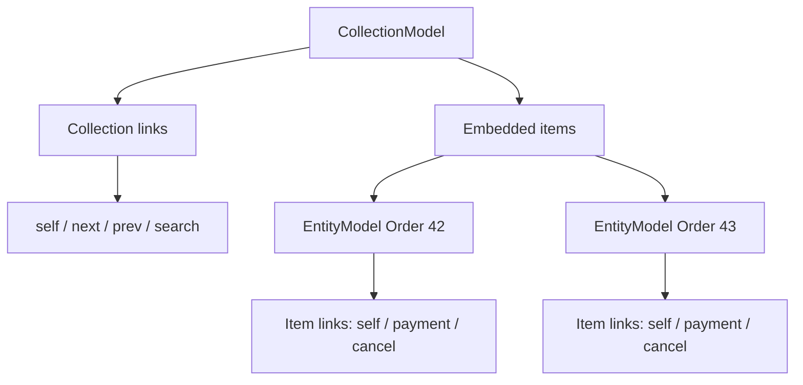

# Link Descriptors for Collections and Single Resources

## 1. Two link levels in a hypermedia API

A HATEOAS API typically returns both **collections** (sets of resources) and **single resources** (a specific resource). Each level can have links serving different purposes:

- Links at the collection level lead to the collection itself, next/previous pages, search operations, or functions applying to the entire set.
- Links at the single-resource level lead to the resource itself, related resources, or operations applying to that resource, such as viewing details, editing, paying, or canceling.

Spring HATEOAS models these two forms with `CollectionModel<T>` and `EntityModel<T>` (both belonging to the `RepresentationModel` family). A `CollectionModel<EntityModel<Order>>` can contain links at the collection level while each `EntityModel<Order>` in the list has its own links.

Spring REST Docs uses `links(...)` and `linkWithRel(...)` to describe relations in the response. Each snippet should make clear whether it describes **collection links** or **item/resource links**. Mixing levels can cause readers to mistake `next` for a single order's link or mistake an order's `payment` link for an operation applying to the entire collection.



## 2. Identifying collections and single resources in a HAL payload

Example collection response:

```http
HTTP/1.1 200 OK
Content-Type: application/hal+json
```

```json
{
  "_embedded": {
    "orders": [
      {
        "id": 42,
        "status": "PENDING",
        "_links": {
          "self": { "href": "/api/orders/42" },
          "payment": { "href": "/api/orders/42/payment" }
        }
      },
      {
        "id": 43,
        "status": "PAID",
        "_links": {
          "self": { "href": "/api/orders/43" }
        }
      }
    ]
  },
  "_links": {
    "self": { "href": "/api/orders" },
    "next": { "href": "/api/orders?page=1" },
    "search": { "href": "/api/orders/search" }
  },
  "page": {
    "size": 20,
    "totalElements": 42,
    "totalPages": 3,
    "number": 0
  }
}
```

In this example:

| Location | Level | Meaning |
| --- | --- | --- |
| Root `_links.self` | Collection | URI of the orders collection. |
| Root `_links.next` | Collection | Next page of the collection. |
| Root `_links.search` | Collection | Entry point for order search functionality. |
| `_embedded.orders[0]._links.self` | Single resource | URI of order 42. |
| `_embedded.orders[0]._links.payment` | Single resource | Entry point for paying order 42. |
| `_embedded.orders[1]._links.self` | Single resource | URI of order 43. |

HAL places collection links in the root-level `_links` and embedded resources in `_embedded`. `CollectionModel` corresponds to the collection; `EntityModel` represents each item that can carry its own links. `page` is pagination metadata, not a link. Do not describe `page.number` as a URI relation.

For a single resource, the payload typically looks like:

```json
{
  "id": 42,
  "status": "PENDING",
  "_links": {
    "self": { "href": "/api/orders/42" },
    "payment": { "href": "/api/orders/42/payment" },
    "cancel": { "href": "/api/orders/42/cancel" }
  }
}
```

Here, all three links belong to order 42. `payment` and `cancel` are not operations applied to the entire collection.

## 3. Spring HATEOAS models: `CollectionModel` and `EntityModel`

Spring HATEOAS provides abstractions for attaching links without manually building `_links` strings:

| Type | Purpose | Example |
| --- | --- | --- |
| `EntityModel<Order>` | Wraps a domain object and that resource's links. | Order 42 with `self`, `payment`, `cancel`. |
| `CollectionModel<EntityModel<Order>>` | Wraps multiple resource models and collection-wide links. | Orders list with `self`, `next`, `search`; each order has its own links. |
| `RepresentationModel<?>` | Base abstraction for representations that need links attached. | Custom response models. |

Example controller capable of building a collection with links at both levels:

```java
@RestController
@RequestMapping("/api/orders")
class OrderController {

    @GetMapping
    CollectionModel<EntityModel<Order>> findAll() {
        List<EntityModel<Order>> items = List.of(
                toModel(new Order(42L, "PENDING")),
                toModel(new Order(43L, "PAID")));

        return CollectionModel.of(items,
                linkTo(methodOn(OrderController.class).findAll()).withSelfRel(),
                linkTo(methodOn(OrderController.class).search()).withRel("search"));
    }

    @GetMapping("/{id}")
    EntityModel<Order> findById(@PathVariable long id) {
        return toModel(loadOrder(id));
    }

    private EntityModel<Order> toModel(Order order) {
        return EntityModel.of(order,
                linkTo(methodOn(OrderController.class).findById(order.id())).withSelfRel(),
                linkTo(methodOn(PaymentController.class).pay(order.id())).withRel("payment"));
    }

    @GetMapping("/search")
    CollectionModel<EntityModel<Order>> search() {
        // Condensed example: implement actual search in the service.
        return CollectionModel.empty();
    }
}
```

This illustrates the return types and how links are attached. `Order`, `PaymentController`, `loadOrder(...)`, and `pay(...)` represent the application's domain/services; implement them or substitute your project's real controllers. In a real application, use a dedicated assembler (e.g. `RepresentationModelAssembler`) when `EntityModel` creation logic is reused in multiple places.

## 4. Documenting collection-level links with `links(...)`

When the response is a HAL collection, `links(halLinks(), ...)` describes the relations in the root-level `_links`. REST Assured example:

```java
given(this.specification)
        .accept("application/hal+json")
        .filter(document("orders-list",
                links(halLinks(),
                        linkWithRel("self").description("Current orders collection"),
                        linkWithRel("search").description("Search orders"),
                        linkWithRel("next").description("Next page of the list"))))
.when()
        .get("/api/orders")
.then()
        .statusCode(200)
        .contentType("application/hal+json");
```

`orders-list` is the snippet group identifier. `links(...)` generates `links.adoc` for this operation. Descriptors should explain the meaning of **collection relations**. If the API includes `prev`, `first`, `last`, or `profile`, add corresponding descriptors when those links are part of the contract.

Static imports:

```java
import static org.springframework.restdocs.hypermedia.HypermediaDocumentation.halLinks;
import static org.springframework.restdocs.hypermedia.HypermediaDocumentation.linkWithRel;
import static org.springframework.restdocs.hypermedia.HypermediaDocumentation.links;
import static org.springframework.restdocs.restassured.RestAssuredRestDocumentation.document;
```

The HAL extractor focuses on `_links` at the representation level. Do not assume that a single call to `links(halLinks(), ...)` automatically creates separate tables for every `_links` nested inside each `_embedded` element. Therefore, document collection-level links separately and keep the raw response/body so readers can see embedded item links; if you need a dedicated table for each item in a collection, use a single-resource test or write an extractor/snippet specifically targeting nested structures.

## 5. Documenting single-resource links

For the `GET /api/orders/{id}` endpoint, the response is the representation of a single order. Here, `links(...)` describes the relations at the resource level:

```java
given(this.specification)
        .accept("application/hal+json")
        .filter(document("orders-get",
                links(halLinks(),
                        linkWithRel("self").description("Current order"),
                        linkWithRel("payment").description("Open payment flow"),
                        linkWithRel("cancel").description("Cancel the order while still allowed"))))
.when()
        .get("/api/orders/{id}", 42)
.then()
        .statusCode(200)
        .contentType("application/hal+json");
```

Here, `payment` and `cancel` belong to the specific order. If `cancel` only appears in certain states, mark it `.optional()` when that absence is valid:

```java
linkWithRel("cancel").description("Cancel the order").optional()
```

Do not use `optional` if the API is required to provide that link in the state under test; in that case, a disappearing link is a contract bug that should be caught.

## 6. Documenting both body fields and links

Links tell clients where they can go; body fields tell them what data the current resource contains. The two snippet types complement each other.

Single-resource example:

```java
.filter(document("orders-get",
        links(halLinks(),
                linkWithRel("self").description("Current order"),
                linkWithRel("payment").description("Pay for the order")),
        responseFields(
                fieldWithPath("id").description("Order ID"),
                fieldWithPath("status").description("Order status"),
                subsectionWithPath("_links").description("Order links"))))
```

Collection response example:

```java
.filter(document("orders-list",
        links(halLinks(),
                linkWithRel("self").description("Orders collection"),
                linkWithRel("next").description("Next page").optional()),
        responseFields(
                subsectionWithPath("_embedded").description("List of order resources"),
                subsectionWithPath("_links").description("Collection-level links"),
                subsectionWithPath("page").description("Pagination metadata"))))
```

`subsectionWithPath(...)` collapses a nested structure into a single descriptor. For collections, this avoids having to describe each item in the array as though they were fixed fields of one object. When you need to document detailed `id`, `status`, or links of an individual order, use a single-resource response `/orders/{id}` with specific descriptors and a separate identifier.

Additional static imports:

```java
import static org.springframework.restdocs.payload.PayloadDocumentation.fieldWithPath;
import static org.springframework.restdocs.payload.PayloadDocumentation.responseFields;
import static org.springframework.restdocs.payload.PayloadDocumentation.subsectionWithPath;
```

## 7. Strict, optional, ignored, and relaxed at each level

Spring REST Docs checks link descriptors against the links found in the response by the extractor:

- `links(...)` is strict mode: a relation appearing without a descriptor causes an error; a required descriptor missing from the response also causes an error.
- `.optional()` allows a documented relation to be absent in some states.
- `.ignored()` excludes a relation from the table without causing an error merely because the relation appears.
- `relaxedLinks(...)` ignores relations that appear without being described; described relations must still be present unless optional.

The strict/optional policy should be applied according to the **operation being documented**. For example, `next` may be optional on the last page of a collection, while `payment` may be optional depending on an order's state. Do not switch the entire snippet to relaxed just because one of the relations varies by state.

Example collection where `next` depends on the page:

```java
links(halLinks(),
        linkWithRel("self").description("Current collection"),
        linkWithRel("next").description("Next page").optional(),
        linkWithRel("prev").description("Previous page").optional())
```

Example single resource with state-dependent action links:

```java
links(halLinks(),
        linkWithRel("self").description("Current order"),
        linkWithRel("payment").description("Pay for order").optional(),
        linkWithRel("cancel").description("Cancel order").optional())
```

The optional links in the examples are only valid if the server actually hides/shows them according to business rules. If every `PENDING` order must always have `payment`, a test for the `PENDING` state should keep the `payment` descriptor required.

## 8. Pagination: collection links and pagination metadata

A collection can describe pagination via links such as `first`, `prev`, `self`, `next`, `last`, while also having separate `page` metadata in the payload. Do not confuse these two components:

| Component | Function |
| --- | --- |
| `next` / `prev` / `first` / `last` | URIs the client can dereference to navigate pages. |
| `page.number` | Current page index. |
| `page.size` | Maximum number of elements per page. |
| `page.totalElements` | Total number of elements matching the query. |
| `page.totalPages` | Total number of pages. |

Example response that documents links and metadata:

```java
links(halLinks(),
        linkWithRel("self").description("Current page"),
        linkWithRel("first").description("First page"),
        linkWithRel("prev").description("Previous page").optional(),
        linkWithRel("next").description("Next page").optional(),
        linkWithRel("last").description("Last page"))
```

Metadata should be described in `responseFields(...)` or the `page` subsection. The `next` link is a navigation control, not direct arithmetic on `page.number`; clients should follow the href/relation returned by the server rather than constructing URLs from page numbers.

## 9. Reusing common links while distinguishing levels

A HAL collection and a single resource may share `self` and `curies`. You can define a snippet helper that ignores common relations and then appends operation-specific links:

```java
static LinksSnippet ignoreSelfAndCuries(LinkDescriptor... descriptors) {
    return HypermediaDocumentation.links(
            linkWithRel("self").ignored().optional(),
            linkWithRel("curies").ignored())
            .and(descriptors);
}
```

Used for a collection:

```java
ignoreSelfAndCuries(
        linkWithRel("next").description("Next page").optional(),
        linkWithRel("search").description("Search orders"))
```

Used for a single resource:

```java
ignoreSelfAndCuries(
        linkWithRel("payment").description("Pay for order"),
        linkWithRel("cancel").description("Cancel order").optional())
```

The helper only omits common relations from each operation's table; it does not merge collection links and item links into the same group. Documentation should have an overview section explaining `self`/`curies` once, followed by separate snippets describing specific links at the proper level.

## 10. Verifying collection and item links in tests

For a collection response, include assertions for both root links and embedded item links if they belong to the contract being verified. REST Assured example:

```java
given(this.specification)
        .accept("application/hal+json")
        .get("/api/orders")
.then()
        .statusCode(200)
        .body("_links.self.href", notNullValue())
        .body("_links.next.href", notNullValue())
        .body("_embedded.orders[0]._links.self.href", notNullValue())
        .body("_embedded.orders[0]._links.payment.href", notNullValue());
```

These assertions verify relations at both levels in the response; `links(...)` by default still documents only the links extracted within its scope. If you require a separate `links.adoc` table for an item inside a collection, you need a custom extractor/snippet or a single-resource endpoint test so the item sits at the root of the operation response. Do not assume assertions into `_embedded` mean `links(...)` automatically generates a table describing all nested links.

For APIs where item counts vary, avoid relying on index `[0]` if collection order is not guaranteed. You can prepare a stable fixture, find items by ID with a suitable matcher, or test a single resource separately.

## 11. Combining snippets in Asciidoctor documentation

Collections and single resources should be presented in separate sections:

```asciidoc
== List orders

=== HTTP response
include::{snippets}/orders-list/http-response.adoc[]

=== Collection links
include::{snippets}/orders-list/links.adoc[]

=== Collection fields and pagination
include::{snippets}/orders-list/response-fields.adoc[]

== View an order

=== HTTP response
include::{snippets}/orders-get/http-response.adoc[]

=== Resource links
include::{snippets}/orders-get/links.adoc[]

=== Resource fields
include::{snippets}/orders-get/response-fields.adoc[]
```

`http-response.adoc` keeps the full payload so readers see HAL `_embedded`, root `_links`, and item `_links`. `links.adoc` describes the relations declared for the operation; `response-fields.adoc` explains business data or subsections. The `{snippets}` attribute must point to the current build's output directory.

If documentation uses Markdown, a corresponding AsciiDoc include/conversion mechanism is needed; plain Markdown does not natively process `include::...[]` directives.

## 12. Common errors

| Symptom | Cause | How to fix |
| --- | --- | --- |
| Collection snippet has `next` but does not describe individual orders | Only documented root collection links. | Use response snippet for `_embedded`, item link assertions, or a separate single-resource test. |
| `payment` link put into collection table | Custom extractor mixes nested links with root links or descriptors don't distinguish context. | Identify link level; keep root links and item links in separate snippets/tests. |
| `next` fails test on last page | Required descriptor even though there is no next page. | Mark optional when absence matches the last-page contract. |
| `payment` absent on already-paid order | Link is state-dependent, yet test uses a required descriptor across all states. | Write per-state tests and use optional within proper bounds. |
| Cannot document `_embedded` | Tried to use `links(...)` to describe the entire nested collection body. | Use `responseFields(subsectionWithPath("_embedded"))` and keep raw response; use custom extraction if a separate table is needed. |
| Test depends on element `[0]` | Collection ordering is not guaranteed. | Use a stable fixture or query the resource by ID. |
| Collection and resource snippets overwrite each other | Shared the same identifier. | Give distinct names like `orders-list`, `orders-get`. |

## 13. Practice checklist

- [ ] Determined whether the response is a collection or a single resource.
- [ ] Distinguished collection-level `_links` from links inside each `_embedded` item.
- [ ] Collection links such as `self`, `next`, `prev`, `search` are described with dedicated descriptors.
- [ ] Resource links such as `self`, `payment`, `cancel` are documented according to resource state.
- [ ] Used `CollectionModel` and `EntityModel` matching the representation structure when using Spring HATEOAS.
- [ ] Understood the scope of the HAL link extractor and did not assume it documents all nested links.
- [ ] Used `subsectionWithPath("_embedded")`/`subsectionWithPath("_links")` when describing payload structure.
- [ ] Pagination links are distinguished from page metadata.
- [ ] Tests include assertions for key nested links; snippet identifiers do not collide.
- [ ] Final documentation has clear collection and single-resource sections, published only when tests pass.

Collections and single resources can both contain hypermedia links, yet their relations serve different navigation levels. `CollectionModel` describes the set and pagination/search links; `EntityModel` describes an item and actions related to that item. Separating descriptors, snippets, and tests by level ensures integrators know exactly which links navigate the collection and which links apply to individual resources.

## References

- [Spring REST Docs – Hypermedia](https://docs.spring.io/spring-restdocs/reference/documenting-your-api/hypermedia.html)
- [Spring REST Docs – HypermediaDocumentation API](https://docs.spring.io/spring-restdocs/docs/current/api/org/springframework/restdocs/hypermedia/HypermediaDocumentation.html)
- [Spring HATEOAS – Fundamentals and Representation Models](https://docs.spring.io/spring-hateoas/docs/current/reference/html/)
- [Spring Data REST – CollectionModel and EntityModel](https://docs.spring.io/spring-data/rest/docs/3.7.7/reference/html/)
