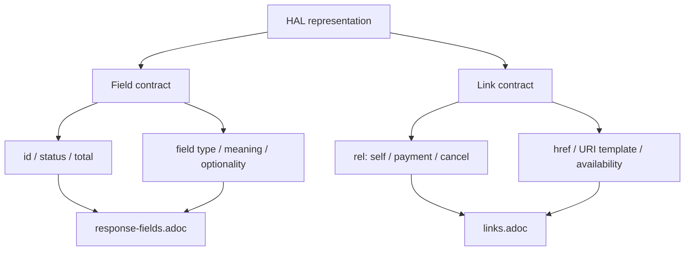

# Distinguishing the Link Contract from the Field Contract

## 1. Two distinct contract parts in a hypermedia response

A REST API returning hypermedia representations usually carries both business data and navigation links. When documenting with Spring REST Docs, distinguish between the **field contract** and the **link contract**:

- **Field contract** describes the data structure: field names, data types, meanings, required/optional fields, and nested structures.
- **Link contract** describes navigation capabilities: which relations are provided, what each relation means, when it appears, and how the URI or URI template can be used.

These two parts complement each other. `responseFields(...)` helps readers understand `id`, `status`, `total`, or a nested object. `links(...)` and `linkWithRel(...)` help them understand what `self`, `payment`, `cancel`, `next`, or `search` are for. A fields table does not replace a links table; nor does a links table describe the resource's JSON schema.

Example HAL response:

```json
{
  "id": 42,
  "status": "PENDING",
  "total": 125000,
  "_links": {
    "self": { "href": "/api/orders/42" },
    "payment": { "href": "/api/orders/42/payment" },
    "cancel": { "href": "/api/orders/42/cancel" }
  }
}
```

| Component | Contract | Question documentation needs to answer |
| --- | --- | --- |
| `id` | Field contract | What is the ID's type, meaning, and format? |
| `status` | Field contract | What are the valid status values? |
| `total` | Field contract | What currency unit does the monetary value use, and what type represents it? |
| `self` | Link contract | Which resource does this relation point to? |
| `payment` | Link contract | How does the client use this link to start or continue payment? |
| `cancel` | Link contract | Does the link appear in all states or only when the order is still cancelable? |
| `_links` | Representation structure | Where are links placed in the HAL payload? |



## 2. The field contract describes data, not navigation

The field contract focuses on payload and data semantics. In Spring REST Docs, commonly used descriptors include:

| API | Purpose |
| --- | --- |
| `fieldWithPath("id")` | Describes a field at a specific path. |
| `.type(JsonFieldType.NUMBER)` | Publishes the field's data type. |
| `.description("...")` | Explains the business meaning. |
| `.optional()` | The field may be absent. |
| `.ignored()` | Excludes the field from the table and skips requiring its description. |
| `subsectionWithPath("address")` | Describes/groups a nested structural region. |

Example response fields:

```java
responseFields(
        fieldWithPath("id")
                .type(JsonFieldType.NUMBER)
                .description("Order ID"),
        fieldWithPath("status")
                .type(JsonFieldType.STRING)
                .description("Order processing status"),
        fieldWithPath("total")
                .type(JsonFieldType.NUMBER)
                .description("Total amount in the API's currency unit"),
        fieldWithPath("note")
                .type(JsonFieldType.STRING)
                .description("Customer note")
                .optional())
```

With default strict descriptors, a field present in the payload without a descriptor can fail snippet generation; a required descriptor missing from the payload can also cause an error. `.optional()` should only be used when the field can legitimately be absent per the contract. `.ignored()` is not synonymous with optional: it omits the field from documentation and skips documenting it.

If the response has `customer.address.city`, you can describe each path in detail or group a region with `subsectionWithPath(...)`, depending on documentation goals. Do not use a subsection to avoid explaining important fields that clients need to understand.

## 3. The link contract describes relations and navigation capabilities

The link contract needs to explain more than a URL. With HAL, important information typically includes:

- **Relation (`rel`):** the meaning of the link relative to the current resource or collection.
- **Href:** the target URI; may be relative, absolute, or a URI template.
- **Availability:** the conditions or states that cause the link to appear or be absent.
- **Templating:** if `templated: true`, which variables must be supplied to expand the URI template.
- **Method and operation:** if the client needs to perform an action via the link, explain the HTTP method, payload, and outcome per the target endpoint's documentation. A plain HAL link does not by itself declare full HTTP method/body details.

Spring REST Docs provides `links(...)` and `linkWithRel(...)` to generate the `links.adoc` snippet:

```java
links(
        linkWithRel("self").description("Retrieve the representation of the current order"),
        linkWithRel("payment").description("Open the payment flow for the order"),
        linkWithRel("cancel").description("Cancel the order if state allows"))
```

`links.adoc` focuses on relations and descriptions; it is not a full schema for the entire JSON link object. Keep `http-response.adoc`/`response-body.adoc` or describe `_links` in a field snippet if readers need to see `href` and HAL attributes such as `templated`, `type`, or `hreflang`.

## 4. Both snippets should appear together

For the response in section 1, you can document both links and fields in the same operation:

```java
given(this.specification)
        .accept("application/hal+json")
        .filter(document("orders-get",
                links(halLinks(),
                        linkWithRel("self")
                                .description("Current order"),
                        linkWithRel("payment")
                                .description("Open payment flow"),
                        linkWithRel("cancel")
                                .description("Cancel the order while still allowed").optional()),
                responseFields(
                        fieldWithPath("id")
                                .type(JsonFieldType.NUMBER)
                                .description("Order ID"),
                        fieldWithPath("status")
                                .type(JsonFieldType.STRING)
                                .description("Processing status"),
                        fieldWithPath("total")
                                .type(JsonFieldType.NUMBER)
                                .description("Order total amount"),
                        subsectionWithPath("_links")
                                .description("Hypermedia links of the order"))))
.when()
        .get("/api/orders/{id}", 42)
.then()
        .statusCode(200)
        .contentType("application/hal+json")
        .body("id", equalTo(42))
        .body("_links.self.href", notNullValue());
```

Key static imports:

```java
import static org.springframework.restdocs.hypermedia.HypermediaDocumentation.halLinks;
import static org.springframework.restdocs.hypermedia.HypermediaDocumentation.linkWithRel;
import static org.springframework.restdocs.hypermedia.HypermediaDocumentation.links;
import static org.springframework.restdocs.payload.PayloadDocumentation.fieldWithPath;
import static org.springframework.restdocs.payload.PayloadDocumentation.responseFields;
import static org.springframework.restdocs.payload.PayloadDocumentation.subsectionWithPath;
import static org.springframework.restdocs.restassured.RestAssuredRestDocumentation.document;
import static org.hamcrest.Matchers.equalTo;
import static org.hamcrest.Matchers.notNullValue;
```

The example assumes the server actually returns a HAL response matching the described schema. `links(...)` validates link relations; `responseFields(...)` validates the field contract and groups `_links` into a subsection. The assertion `body("_links.self.href", ...)` additionally verifies the actual link href. The test needs a stable fixture and corresponding endpoint.

The output usually contains these snippets:

```text
build/generated-snippets/orders-get/
  http-request.adoc
  http-response.adoc
  links.adoc
  response-fields.adoc
  ...
```

These snippets serve distinct roles:

| Snippet | Role |
| --- | --- |
| `http-response.adoc` | Preserves the actual response, including status, headers, and HAL body with `href`. |
| `links.adoc` | Explains the meaning of the link relations. |
| `response-fields.adoc` | Describes the representation's data and structure. |

## 5. Do not confuse the `_links` subsection with the link contract

You can use:

```java
subsectionWithPath("_links")
        .description("Hypermedia links of the order")
```

This descriptor states that the payload has a `_links` section and groups its children into a subsection. It **does not** explain what the `payment` relation is used for, when the `cancel` link appears, or which variables a URI template requires. That information belongs to the link contract and should be documented using `links(...)`, related endpoint documentation, or separate explanations.

Conversely, `links(...)` does not replace `responseFields(...)` for `id`, `status`, `total`, or other business fields. A complete operation typically uses both:

```java
document("orders-get",
        links(halLinks(), /* LinkDescriptor... */),
        responseFields(/* FieldDescriptor... */))
```

The `/* ... */` comments above merely mark where descriptors are passed; replace them with real descriptors as shown in the complete example in section 4.

## 6. Link cardinality and field optionality are separate rules

Both the field contract and the link contract can speak about "presence or absence", but their semantics differ:

| Concept | Spring REST Docs descriptor | Meaning |
| --- | --- | --- |
| Optional field | `fieldWithPath("note").optional()` | The `note` field does not always appear in the JSON. |
| Optional link relation | `linkWithRel("cancel").optional()` | The `cancel` relation may not appear depending on resource state. |
| Ignored field | `fieldWithPath("internalCode").ignored()` | Do not describe this field in the fields table. |
| Ignored link | `linkWithRel("curies").ignored()` | Do not include this relation in the links table. |

Example:

```java
responseFields(
        fieldWithPath("id").description("Order ID"),
        fieldWithPath("note").description("Note").optional())
```

and:

```java
links(halLinks(),
        linkWithRel("self").description("Current order"),
        linkWithRel("cancel").description("Cancel order").optional())
```

Here `note` is data that may be absent; `cancel` is a navigation capability that the server may not provide. Do not infer link optionality from field optionality or vice versa.

## 7. The link contract can change with resource state

For example, an order in `PENDING` state has `payment` and `cancel`; when `PAID`, only `self` and `receipt` remain:

```json
{
  "id": 42,
  "status": "PENDING",
  "_links": {
    "self": { "href": "/api/orders/42" },
    "payment": { "href": "/api/orders/42/payment" },
    "cancel": { "href": "/api/orders/42/cancel" }
  }
}
```

```json
{
  "id": 42,
  "status": "PAID",
  "_links": {
    "self": { "href": "/api/orders/42" },
    "receipt": { "href": "/api/orders/42/receipt" }
  }
}
```

The `id` and `status` fields belong to the field contract; relations changing by state belong to the link contract. You can write separate tests per state to keep validation strict:

```java
// Scenario: order pending payment
links(halLinks(),
        linkWithRel("self").description("Current order"),
        linkWithRel("payment").description("Pay for order"),
        linkWithRel("cancel").description("Cancel order"))
```

```java
// Scenario: paid order
links(halLinks(),
        linkWithRel("self").description("Current order"),
        linkWithRel("receipt").description("View receipt"))
```

Assign separate identifiers, such as `orders-get-pending` and `orders-get-paid`. You do not have to use a single descriptor with all links marked optional: if `payment` must appear in the `PENDING` state, the test for that state should detect if the server accidentally drops the link.

## 8. The collection link contract differs from the item field contract

A collection response has its own field contract for metadata like `page.size`, `page.totalElements`, and the embedded resource structure. The link contract at the root may include `self`, `next`, `prev`, `search`; links inside each embedded item belong to each individual resource's contract.

Collection descriptor example:

```java
document("orders-list",
        links(halLinks(),
                linkWithRel("self").description("Orders collection"),
                linkWithRel("next").description("Next page").optional(),
                linkWithRel("prev").description("Previous page").optional()),
        responseFields(
                subsectionWithPath("_embedded").description("Orders on the page"),
                subsectionWithPath("_links").description("Collection-level links"),
                subsectionWithPath("page").description("Pagination metadata")))
```

Do not assume the default link extractor automatically creates a standalone `links.adoc` table for all nested links inside `_embedded`. Keep the raw HTTP response/body to show actual links on items, assert required links, or document the single-resource endpoint separately. If you need a combined table of item links, you must build an extractor/snippet fitting the response structure.

## 9. Bringing both contracts into the documentation page

An Asciidoctor page should present both data and navigation capabilities:

```asciidoc
== View order

=== HTTP response
include::{snippets}/orders-get/http-response.adoc[]

=== Resource fields
include::{snippets}/orders-get/response-fields.adoc[]

=== Link relations
include::{snippets}/orders-get/links.adoc[]
```

The order can be adjusted for reader experience, but the content should clearly explain:

1. What data does the response return and what are the data types?
2. Which relations does the resource have and what does each relation mean?
3. Where is the concrete `href`; is the link templated or state-dependent?
4. What should the client do next when a relation is present or absent?

For a link leading to another endpoint, the link contract should reference the target operation's documentation. For instance, `payment` points to `POST /api/orders/{id}/payment`; that operation's documentation describes the method, request body, status, and corresponding response. The `payment` relation alone cannot replace the HTTP contract of the payment endpoint.

## 10. Versioning and contract changes

Changes to the field contract and link contract have different impacts:

| Change | Risk to clients | How to document/test |
| --- | --- | --- |
| Adding an optional field | Usually low-impact if clients ignore unknown fields. | Update descriptors and test response fields. |
| Removing or changing type of a required field | Can break dependent parsers/clients. | Strict schema tests and update version/changelog. |
| Renaming a relation | Can prevent clients from finding the next action. | Treat as a link contract change; document replacement relation and transition period. |
| Removing a required link in a specific state | Clients may lose the ability to continue the workflow. | Test links by state; do not mark optional if the contract requires the link. |
| Changing `href` while keeping `rel` | Compatible if clients dereference `href` received from the response. | Verify clients do not hardcode URLs; keep `href` examples updated. |
| Changing URI template variables | Clients must supply different variables or encode differently. | Document the template clearly and test expanded query/parameters. |
| Adding a new relation | Clients can ignore it; docs should explain the new capability. | Strict `links(...)` catches undocumented relations for team review. |

HATEOAS reduces client reliance on hardcoded URLs, yet it does not make every link change automatically compatible. Relation semantics, appearance conditions, URI templates, and target operations remain part of the contract clients must understand.

## 11. Common errors

| Symptom | Cause | How to fix |
| --- | --- | --- |
| Only `response-fields.adoc`, no link meanings | Field contract described `_links` as a subsection without a links snippet. | Add `links(...)` and descriptors by relation. |
| Only `links.adoc`, resource payload unclear | Described relations but omitted the field contract. | Add `responseFields(...)` for business data. |
| Thinking `_links` subsection documents all relations | Subsection only describes nested structure. | Use separate `links(...)` for navigation semantics. |
| Marking `cancel` optional in every test | Failed to distinguish state-specific contracts. | Write per-state tests and keep required relations strict where needed. |
| Relaxed fields/links hides schema changes | Used relaxed mode to turn tests green. | Review changes first, then use relaxed intentionally. |
| Changing `href` breaks clients | Clients hardcoded URLs instead of following link relations. | Improve client per HATEOAS and update `href` in response examples. |
| Relation points to an undocumented endpoint | Link contract does not connect to the target HTTP operation. | Add a doc page for the target operation and cross-link. |
| Collection links mixed with item links | Failed to distinguish root `_links` from links in `_embedded`. | Separate collection/resource tests, identifiers, and snippets. |

## 12. Review checklist

- [ ] Field contract describes business fields, data types, meanings, and optionality.
- [ ] Link contract describes relations, meanings, and appearance conditions.
- [ ] Href/URI template is preserved in the HTTP response snippet or an appropriate presentation.
- [ ] `_links` subsection is not confused with the `links.adoc` relations table.
- [ ] Optional/ignored/relaxed are applied independently to fields and links according to their semantics.
- [ ] Resource-state-dependent relations have separate tests/identifiers when needed.
- [ ] Collection links and item links are clearly distinguished.
- [ ] Links leading to other operations reference the corresponding HTTP documentation.
- [ ] Schema or relation changes are reviewed as contract changes.
- [ ] Tests and snippets pass before Asciidoctor/Markdown is compiled and published.

The field contract tells what data a representation contains; the link contract tells how clients can navigate and continue workflows. By documenting both `responseFields(...)` and `links(...)`, while keeping the raw HTTP response to show `href`, Spring REST Docs produces documentation that describes both schema and how to discover the API.

## References

- [Spring REST Docs – Hypermedia](https://docs.spring.io/spring-restdocs/reference/documenting-your-api/hypermedia.html)
- [Spring REST Docs – Request and Response Fields](https://docs.spring.io/spring-restdocs/reference/documenting-your-api/request-response-payloads.html)
- [Spring REST Docs – HypermediaDocumentation API](https://docs.spring.io/spring-restdocs/docs/current/api/org/springframework/restdocs/hypermedia/HypermediaDocumentation.html)
- [Spring HATEOAS Reference](https://docs.spring.io/spring-hateoas/docs/current/reference/html/)
