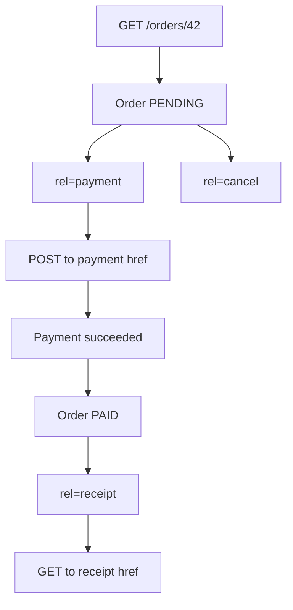

# Documenting Next Actions via Hypermedia

## 1. Thinking from the response to the next action

A hypermedia API helps clients discover the next step from the response returned by the server. Instead of constructing URLs by convention, the client reads the link relation (`rel`), retrieves the target URI (`href`), and invokes the corresponding resource or operation. Spring REST Docs can document those relations with `links(...)` and `linkWithRel(...)`, while documenting the target HTTP operation with standard request/response snippets.

In the **Spring REST Docs** module, the goal is to create verifiable REST API documentation from HTTP tests using MockMvc, WebTestClient, or REST Assured. When documenting next actions, help readers answer four questions:

1. Which actions or links does the current response provide?
2. Which relation represents the action the user wants to perform?
3. Where does the client obtain the target URI, and what conditions govern when the action appears?
4. After following the link, what HTTP method, headers, and payload must the client send, and how should it handle the response?

Order workflow example:



The client discovers links from the response at each step. When the resource state changes, relations can change accordingly; documentation should show important state transitions rather than assuming every action is always available.

## 2. A link shows target and relation, not the full HTTP action

With HAL, a typical link object contains `href`, and may include `title`, `type`, `hreflang`, `templated`, and other metadata. Example:

```json
{
  "id": 42,
  "status": "PENDING",
  "_links": {
    "self": { "href": "/api/orders/42" },
    "payment": { "href": "/api/orders/42/payment", "title": "Pay for order" },
    "cancel": { "href": "/api/orders/42/cancel", "title": "Cancel order" }
  }
}
```

`payment` and `cancel` indicate the navigation relation and target URI. **A basic HAL link does not by itself declare the full HTTP method, request body, validation rules, or response status**. Therefore, do not document only the link relation and assume integrators already know how to execute the action.

Complete documentation needs to connect the pieces:

| Component | What to document |
| --- | --- |
| Link in source response | Relation, meaning, appearance conditions; preserve `href` in the HTTP response snippet. |
| Target HTTP operation | Method, dereferenced URI, headers, request parameters/body, status, and response. |
| Workflow | When the client follows the link, which state the action transitions the resource into, and which links appear next. |
| Affordance/form (if provided by the API) | Method, media type, input properties, and submission rules exposed by the representation. |

If the API uses HAL-FORMS or affordances, the representation can expose additional information about operations and forms. This complements links; only document affordances that actually exist in the response and are supported by the server.

## 3. Documenting action links in the source response

For a `PENDING` order response, REST Assured can verify and document the `self`, `payment`, and `cancel` relations:

```java
given(this.specification)
        .accept("application/hal+json")
        .filter(document("orders-get-pending",
                links(halLinks(),
                        linkWithRel("self")
                                .description("Re-read the order representation"),
                        linkWithRel("payment")
                                .description("Start or continue order payment"),
                        linkWithRel("cancel")
                                .description("Cancel the order while state allows")),
                responseFields(
                        fieldWithPath("id").description("Order ID"),
                        fieldWithPath("status").description("Processing status"),
                        subsectionWithPath("_links")
                                .description("Links and next actions for the order"))))
.when()
        .get("/api/orders/{id}", 42)
.then()
        .statusCode(200)
        .contentType("application/hal+json")
        .body("status", equalTo("PENDING"))
        .body("_links.payment.href", notNullValue())
        .body("_links.cancel.href", notNullValue());
```

Key static imports:

```java
import static org.springframework.restdocs.hypermedia.HypermediaDocumentation.halLinks;
import static org.springframework.restdocs.hypermedia.HypermediaDocumentation.links;
import static org.springframework.restdocs.hypermedia.HypermediaDocumentation.linkWithRel;
import static org.springframework.restdocs.payload.PayloadDocumentation.fieldWithPath;
import static org.springframework.restdocs.payload.PayloadDocumentation.responseFields;
import static org.springframework.restdocs.payload.PayloadDocumentation.subsectionWithPath;
import static org.springframework.restdocs.restassured.RestAssuredRestDocumentation.document;
import static org.hamcrest.Matchers.equalTo;
import static org.hamcrest.Matchers.notNullValue;
```

`links(...)` generates the `links.adoc` snippet explaining the meaning of relations. `responseFields(...)` describes business data and the `_links` region; the HTTP response snippet preserves the actual payload so readers see `href`. Assertions verify state and the presence of important links.

If `cancel` only appears in certain states, use `.optional()` only when absence is valid in the scenario under test. In a dedicated test for a `PENDING` order, if the contract requires `cancel` to always be present, keep the descriptor required so tests detect if the server drops the action.

## 4. Documenting the target operation of each action

Suppose the `payment` link leads to the payment endpoint. The target operation documentation must tell readers exactly how to use it:

```http
POST /api/orders/42/payment HTTP/1.1
Content-Type: application/json
Accept: application/json
Idempotency-Key: docs-payment-42

{"method":"CARD"}
```

Illustrative response:

```http
HTTP/1.1 200 OK
Content-Type: application/json

{"paymentId":9001,"status":"AUTHORIZED"}
```

The test for this operation documents request/response like any standard HTTP test:

```java
given(this.specification)
        .contentType(ContentType.JSON)
        .accept(ContentType.JSON)
        .header("Idempotency-Key", "docs-payment-42")
        .body("{\"method\":\"CARD\"}")
        .filter(document("orders-payment",
                requestHeaders(
                        headerWithName("Idempotency-Key")
                                .description("Idempotency key to prevent duplicate payment processing")),
                requestFields(
                        fieldWithPath("method")
                                .description("Selected payment method")),
                responseFields(
                        fieldWithPath("paymentId")
                                .description("Payment transaction ID"),
                        fieldWithPath("status")
                                .description("Payment processing status"))))
.when()
        .post("/api/orders/{id}/payment", 42)
.then()
        .statusCode(200)
        .body("status", equalTo("AUTHORIZED"));
```

The example assumes the endpoint supports `POST`, accepts JSON, and returns a response like the one above. Adjust the method, headers, payload, or status to match the real contract. If the target action returns `202 Accepted`, `201 Created`, or `204 No Content`, documentation must reflect the actual status and body.

Important point: the `payment` link in the source response does not replace the `orders-payment` snippet. Readers need both to understand the navigation relation and how to execute the HTTP action.

## 5. Using proper identifiers and cross-references in documentation

Assign separate identifiers for each operation and resource state:

```text
generated-snippets/
  orders-get-pending/
    http-request.adoc
    http-response.adoc
    links.adoc
    response-fields.adoc
  orders-payment/
    http-request.adoc
    http-response.adoc
    request-headers.adoc
    request-fields.adoc
    response-fields.adoc
  orders-get-paid/
    http-request.adoc
    http-response.adoc
    links.adoc
    response-fields.adoc
  orders-receipt/
    http-request.adoc
    http-response.adoc
    response-fields.adoc
```

In Asciidoctor, you can present them as a workflow in the order the client executes them:

```asciidoc
== Order payment workflow

=== 1. Read pending order
include::{snippets}/orders-get-pending/http-response.adoc[]

==== Available action links
include::{snippets}/orders-get-pending/links.adoc[]

=== 2. Execute payment
Follow the `payment` relation in the response from step 1.

==== Request
include::{snippets}/orders-payment/http-request.adoc[]

==== Response
include::{snippets}/orders-payment/http-response.adoc[]

=== 3. Read order after payment
include::{snippets}/orders-get-paid/http-response.adoc[]
include::{snippets}/orders-get-paid/links.adoc[]

=== 4. Retrieve receipt
Follow the `receipt` relation in the response from step 3.
include::{snippets}/orders-receipt/http-request.adoc[]
include::{snippets}/orders-receipt/http-response.adoc[]
```

Include paths guide readers from the source response to the target operation. Explanations should make clear which relation the client retrieves `href` from. Do not instruct clients to construct `/api/orders/42/payment` from sample strings when the API already returns dynamic links.

## 6. Describing state-conditional action links

Action links often represent state transitions. Example:

| Current state | Possible relations | Meaning |
| --- | --- | --- |
| `PENDING` | `self`, `payment`, `cancel` | Read order, pay, or cancel. |
| `PAID` | `self`, `receipt`, `refund` | Read order, retrieve receipt, or request refund. |
| `CANCELLED` | `self` | Only read representation remains. |

Documenting each scenario with its own test/identifier shows which links must be present in each state:

```java
// PENDING order: payment and cancel are required actions in this scenario.
links(halLinks(),
        linkWithRel("self").description("Read order"),
        linkWithRel("payment").description("Pay for order"),
        linkWithRel("cancel").description("Cancel order"))
```

```java
// PAID order: receipt and refund replace payment/cancel.
links(halLinks(),
        linkWithRel("self").description("Read order"),
        linkWithRel("receipt").description("Retrieve receipt"),
        linkWithRel("refund").description("Request refund"))
```

The snippets above are descriptors for two different responses, not attached simultaneously to a single request. If a relation is genuinely optional within the same scenario, mark it `.optional()`. If a relation does not belong in the table yet may appear, use `.ignored()`; consider `relaxedLinks(...)` when intentionally documenting only a subset. Do not use relaxed mode to silently skip a new action before reviewing it.

## 7. Documenting conditions and outcomes of actions

The link contract should explain appearance conditions if clients cannot execute an action in every state. Example:

| Action relation | Conditions to publish | Outcomes to document |
| --- | --- | --- |
| `payment` | Order is in a payable state and not expired. | `paymentId`, transaction status, payment errors. |
| `cancel` | Order has not been shipped or paid, per system policy. | `CANCELLED` status, or conflict if state already changed. |
| `receipt` | Payment succeeded and receipt has been issued. | Receipt file/link, media type, or download metadata. |
| `refund` | Order is eligible for refund. | Refund request ID and processing status. |

Avoid just writing "link appears when valid" when important business conditions can be stated clearly. However, do not guess conditions from the relation name; derive conditions from the API contract and endpoint behavior.

Tests should verify status and payload of the target operation, as well as the source response before/after the action. If state changes asynchronously—for example, the operation returns `202 Accepted`—document the tracking link (`status` or `monitor`) and the acceptance confirmation response.

## 8. HAL links and affordances/forms are not the same

A basic HAL link typically provides a relation and a target URI. It is not required to describe the HTTP method or request properties. Some other hypermedia formats, such as HAL-FORMS, can publish templates/forms describing operations and input properties.

Illustrative HAL-FORMS response example (must be verified against the exact schema/serializer used by the application):

```json
{
  "_links": {
    "self": { "href": "/api/orders/42" }
  },
  "_templates": {
    "pay": {
      "method": "POST",
      "contentType": "application/json",
      "properties": [
        { "name": "method", "required": true, "type": "text" }
      ],
      "target": "/api/orders/42/payment"
    }
  }
}
```

Here the `pay` template exposes additional information about method, media type, and properties. If the API actually returns HAL-FORMS, keep the raw response snippet so readers can see the template; document the target operation with request/response snippets to verify the server genuinely accepts data matching the template. Do not assume the default `links.adoc` automatically renders all `_templates` into a form table.

Spring HATEOAS has an affordances API to express operation metadata when building representations. However, a controller creating an affordance does not mean every client/format receives the same payload. Inspect the actual response Content-Type and JSON/XML before writing documentation about form fields or methods.

## 9. Using `links.adoc` alongside raw responses and operation snippets

Three layers of snippets serve distinct roles:

| Snippet | Role in workflow |
| --- | --- |
| `links.adoc` | Explains the relations of action links in the source response. |
| `http-response.adoc` | Shows the actual `href`, resource state, link metadata, or template. |
| `http-request.adoc` of target operation | Proves how the client invokes the action with method, URI, headers, and body. |
| `http-response.adoc` of target operation | Shows success/error outcomes after the action. |

If you only include `links.adoc`, readers may understand what `payment` does without knowing the method/body. If you only include the target operation, readers know the URL/method but might think the URL should be hardcoded. Combining them demonstrates that clients should **discover** the URI from the response and apply the HTTP contract from the target operation page.

## 10. Versioning and changes to action links

Changes to relations can affect clients more than changes to a rarely used field:

| Change | Impact | Action required |
| --- | --- | --- |
| Adding a new relation | Older clients may ignore it; newer clients gain capabilities. | Review semantics, document the relation, and test appropriate states. |
| Removing a relation in active use | Clients may lose a navigation step. | Treat as a contract change; provide transition/migration if needed. |
| Changing relation meaning while keeping the name | Clients may execute the wrong action. | Do not reuse `rel` for a different meaning; define a new relation if semantics change. |
| Changing `href` while keeping relation | Proper HATEOAS clients follow the new URI from the response. | Update raw response snippet; test that clients do not hardcode URIs. |
| Changing an always-present link to state-dependent | Workflow may no longer be available in some cases. | Document availability conditions and test each state. |
| Changing a URI template | Clients need to supply different variables/queries. | Document the template and test the endpoint after URI expansion. |

A link relation can be a standard relation or an API extension relation. If using custom relation URIs, publish their semantics where integrators can look them up; a relation name does not explain its meaning on its own.

## 11. Common errors

| Symptom | Cause | How to fix |
| --- | --- | --- |
| Only `links.adoc`, unclear how to POST the action | HAL link does not describe full method/body. | Document the target operation with request/response snippets. |
| Documentation hardcodes URLs instead of following `href` | Only copied path from examples without guiding clients to read relations. | Explicitly state that clients obtain `href` from `rel` in the current response. |
| `payment` appears even when order is `PAID` | API or test does not check link availability by state. | Test and document responses per state. |
| Action is described but target endpoint lacks docs | Missing connection between link contract and operation contract. | Add a target operation section with method, headers, body, status, and response. |
| Assumed form properties not emitted by response | Confused affordances with basic HAL links. | Check the actual format; only document forms/templates when the server actually returns them. |
| Optional/relaxed prevents test from catching missing actions | Used overly loose descriptors. | Keep relations required in scenarios where the action must exist. |
| Action snippets overwrite each other | Multiple states/tests used the same identifier. | Use separate identifiers such as `orders-get-pending`, `orders-get-paid`. |
| Action returns `202` but docs describe immediate completion | Did not document asynchronous workflow. | Document acceptance status and operation tracking link if provided by the API. |

## 12. Practice checklist

- [ ] Source response has clear relation/action links and dereferenceable `href` values.
- [ ] `links(...)`/`linkWithRel(...)` describe important relations.
- [ ] Raw HTTP response is preserved to show actual `href` and metadata/templates.
- [ ] Appearance conditions for action links are described and tested by resource state.
- [ ] Target operation is documented with method, URI, request headers/body, status, and response.
- [ ] Documentation clearly states clients take URIs from `href`, without assembling URLs themselves when links are server-provided.
- [ ] Basic HAL links are distinguished from affordances/HAL-FORMS templates.
- [ ] Asynchronous actions have their status and tracking links documented if supported by the API.
- [ ] Source response and target operation use distinct identifiers without overwriting snippets.
- [ ] Tests and descriptors all pass before compiling/publishing documentation.

Documenting next actions via hypermedia means documenting both the **discovery point** and **how to execute the action**. `links.adoc` explains the relations clients find in the response; the raw response shows the `href` or template; the target operation documentation confirms the method, payload, and outcome. Connecting these pieces by workflow and resource state enables integrators to navigate the API via hypermedia instead of relying on hardcoded URLs.

## References

- [Spring REST Docs – Hypermedia](https://docs.spring.io/spring-restdocs/reference/documenting-your-api/hypermedia.html)
- [Spring REST Docs – HTTP Request and Response Snippets](https://docs.spring.io/spring-restdocs/reference/documenting-your-api/default-snippets.html)
- [Spring HATEOAS Reference – Affordances](https://docs.spring.io/spring-hateoas/docs/current/reference/html/)
- [HAL Specification](https://stateless.group/hal_specification.html)
- [HAL-FORMS Specification](https://rwcbook.github.io/hal-forms/)
