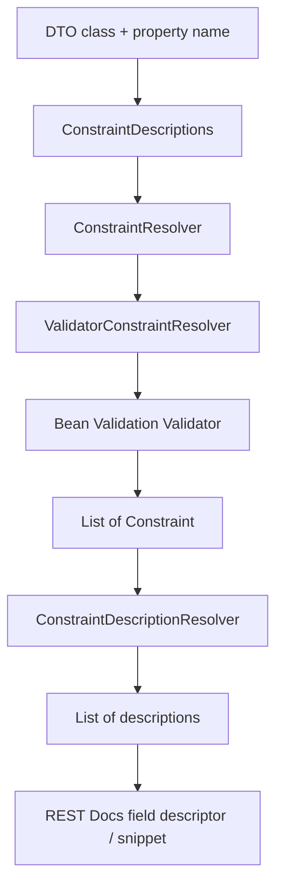

# ConstraintResolver and How Constraints Are Resolved

## Lesson Objectives

In the **SPRING_REST_DOCS** module, API documentation needs to describe not only data types but also the input conditions accepted by the server. For example, an email field may be required, must follow a valid format, and have a length limit. If these rules are declared with Bean Validation, Spring REST Docs can read them to help generate constraint descriptions in snippets.

This lesson focuses on **ConstraintResolver**: how Spring REST Docs resolves constraints on a property, the default mechanism using a Bean Validation Validator, how to replace the Validator or implement a custom resolver, and how to include the resolved descriptions in a request fields snippet.

After this lesson, you will be able to:

- Explain the relationship between ConstraintResolver, ValidatorConstraintResolver, Constraint, and ConstraintDescriptions.
- Use ConstraintDescriptions to obtain constraint descriptions for a DTO property.
- Understand the default limitation: Spring REST Docs currently resolves property constraints.
- Customize the Validator used to resolve constraints.
- Implement a custom ConstraintResolver when project rules live outside the default Bean Validation model.
- Distinguish between resolving constraints and converting a constraint into a descriptive sentence.
- Pass constraint descriptions into `fieldWithPath(...).description(...)` or a snippet's extra information.

## 1. Constraints in REST API Documentation

Suppose an API accepts a user creation request:

```json
{
  "name": "An",
  "email": "an@example.com",
  "password": "secret123"
}
```

Input rules might include:

| Property | Constraint | Meaning |
| --- | --- | --- |
| name | @NotBlank, @Size(min = 2, max = 80) | Must not be blank, from 2 to 80 characters |
| email | @NotBlank, @Email | Required and formatted as an email |
| password | @NotBlank, @Size(min = 8) | Required, minimum 8 characters |

These conditions matter to API callers. When documentation only states `name: string`, readers do not know whether the server rejects empty strings or what length limits apply.

Bean Validation lets you express part of these rules via annotations. Spring REST Docs provides ConstraintDescriptions and resolver classes to extract constraints on properties, convert them into text, and use that text in snippets.

**Important limitation:** Constraint descriptions are helper data for authoring documentation. They do not add validation to the application, do not automatically validate HTTP requests, and do not guarantee that every business rule of the API is declared as an annotation.

## 2. Components in the Constraint Resolution Mechanism

Spring REST Docs separates responsibilities across the following components:

| Component | Responsibility |
| --- | --- |
| Constraint | Represents a resolved constraint, consisting of a name and configuration |
| ConstraintResolver | Resolves constraints for a property of a class |
| ValidatorConstraintResolver | Implements ConstraintResolver using a Bean Validation Validator |
| ConstraintDescriptionResolver | Converts a Constraint into a descriptive sentence |
| ResourceBundleConstraintDescriptionResolver | Retrieves descriptive sentences from a Java resource bundle |
| ConstraintDescriptions | Combines constraint resolution and description resolution, returning a list of descriptive sentences |

Flow diagram:



Two tasks must be distinguished:

1. **Resolving constraints:** Which annotations does the `email` property have? What are the annotation's configuration values?
2. **Describing constraints:** How should `Size(min=2,max=80)` be written as a sentence that API callers understand?

ConstraintResolver handles the first task. ConstraintDescriptionResolver handles the second. ConstraintDescriptions coordinates both.

## 3. Default Usage with ConstraintDescriptions

### 3.1. Declaring a DTO Using Bean Validation

Example DTO:

```java
package com.example.users;

import jakarta.validation.constraints.Email;
import jakarta.validation.constraints.NotBlank;
import jakarta.validation.constraints.Size;

public class CreateUserRequest {

    @NotBlank
    @Size(min = 2, max = 80)
    private String name;

    @NotBlank
    @Email
    private String email;

    @NotBlank
    @Size(min = 8)
    private String password;

    // Constructor/getter/setter or record accessors per project convention
}
```

In Spring Boot 3/4, Bean Validation annotations belong to the `jakarta.validation` namespace. The project must have a Bean Validation implementation on the test/runtime classpath, such as Hibernate Validator via the Spring Boot validation starter, if tests actually initialize a Validator.

### 3.2. Retrieving Descriptions by Property Name

Using ConstraintDescriptions:

```java
import java.util.List;

import org.springframework.restdocs.constraints.ConstraintDescriptions;

class UserConstraintDocumentation {

    List<String> describeNameConstraints() {
        ConstraintDescriptions descriptions =
                new ConstraintDescriptions(CreateUserRequest.class);

        return descriptions.descriptionsForProperty("name");
    }
}
```

`descriptionsForProperty("name")` returns a list of descriptive strings for the constraints found on the `name` property. For the example DTO, the default list contains descriptions for `@NotBlank` and `@Size`.

The simple constructor:

```java
new ConstraintDescriptions(CreateUserRequest.class)
```

uses `ValidatorConstraintResolver` with a default-configured `Validator` and `ResourceBundleConstraintDescriptionResolver` to read text from a resource bundle.

You do not need to write reflection code to find annotations or manually turn `@Size` into prose in common cases.

### 3.3. Output Varies by Description Language

The default descriptions provided by Spring REST Docs are in English. If the API documentation is in Vietnamese, provide translations via a resource bundle instead of concatenating English strings into field descriptions.

## 4. How the Default ConstraintResolver Finds Constraints

By default, Spring REST Docs uses a Bean Validation Validator through `ValidatorConstraintResolver`. The resolver queries Bean Validation metadata for the given class and property.

Core interface API:

```java
public interface ConstraintResolver {

    List<Constraint> resolveForProperty(String property, Class<?> clazz);
}
```

The method takes:

- `property`: the name of the property to look up, e.g., `"email"`.
- `clazz`: the DTO class containing the property, e.g., `CreateUserRequest.class`.

The method returns `List<Constraint>`. If no constraints are found for the property, an empty list is returned; the result is never null.

`ValidatorConstraintResolver` has two key constructors:

```java
new ValidatorConstraintResolver()
```

Creates a resolver using Bean Validation's default-configured `Validator`.

```java
new ValidatorConstraintResolver(validator)
```

Creates a resolver using an application-provided `Validator`. This is useful when the `Validator` has been configured with a provider, mappings, or metadata tailored to the project.

### 4.1. Default Scope: Property Constraints

Current Spring REST Docs documentation explicitly states: **currently, only property constraints are supported**. The default resolver focuses on constraints attached to properties of a class.

Supported example:

```java
class CreateUserRequest {

    @NotBlank
    private String name;

    @Email
    private String email;
}
```

Do not assume the default mechanism automatically aggregates all of the following rules:

- Class-level constraints placed on the DTO as a whole.
- Cross-parameter constraints placed on method parameter groups.
- Business rules that live only in services or the database.
- Conditions applied dynamically based on system state without corresponding Bean Validation metadata.
- Rules in an OpenAPI or JSON Schema not mapped to Bean Validation.

If documentation must present rules of these kinds, add manual descriptions or implement a custom `ConstraintResolver` matching your project's model.

### 4.2. Constraints on Getters and Fields

Bean Validation supports declaring constraints on fields or property accessors according to its conventions. The default resolver works through the Bean Validation Validator/metadata, so follow your provider's standard declaration style rather than relying on custom reflection that only inspects fields.

Avoid placing constraints on both the field and the getter of the same property unless intentionally required. Bean Validation may detect constraints in both locations; duplicating constraints can produce duplicate descriptions or confuse readers.

## 5. Customizing the Validator Used to Resolve Constraints

If your project uses a custom-configured `Validator`, pass that `Validator` into `ValidatorConstraintResolver`, then pass the resolver into `ConstraintDescriptions`.

Example:

```java
import java.util.List;

import jakarta.validation.Validator;
import org.springframework.restdocs.constraints.ConstraintDescriptions;
import org.springframework.restdocs.constraints.ValidatorConstraintResolver;

class UserConstraintDocumentation {

    private final ConstraintDescriptions descriptions;

    UserConstraintDocumentation(Validator validator) {
        this.descriptions = new ConstraintDescriptions(
                CreateUserRequest.class,
                new ValidatorConstraintResolver(validator)
        );
    }

    List<String> describeEmail() {
        return this.descriptions.descriptionsForProperty("email");
    }
}
```

The `Validator` can be obtained from the Spring context or built via the standard Bean Validation API. Example using Jakarta Validation:

```java
import jakarta.validation.Validation;
import jakarta.validation.Validator;

Validator validator = Validation
        .buildDefaultValidatorFactory()
        .getValidator();
```

In a Spring application, it is generally better to reuse the configured `Validator` bean rather than creating multiple separate `ValidatorFactory` instances. If you call `buildDefaultValidatorFactory()` directly, manage the `ValidatorFactory` lifecycle and close it when no longer needed.

### 5.1. When Should You Customize the Validator?

- The application uses a `Validator`/provider with custom configuration for custom constraints.
- There are XML mappings or provider-specific metadata that must be applied.
- You want to document the exact constraint set matching the `Validator` configuration used by the application.
- Tests use a DTO or `Validator` different from the default Bean Validation setup.

Customizing the `Validator` only affects metadata lookup. It does not automatically translate English descriptions into another language; that belongs to `ConstraintDescriptionResolver`.

## 6. Implementing a Custom ConstraintResolver

When input rules cannot be discovered via a Bean Validation `Validator`, you can implement REST Docs' `ConstraintResolver` interface.

Minimal contract:

```java
public interface ConstraintResolver {
    List<Constraint> resolveForProperty(String property, Class<?> clazz);
}
```

`Constraint` is a data model consisting of a constraint name and a configuration map. The name is typically the fully qualified class name of the annotation, e.g., `jakarta.validation.constraints.NotNull`; the map holds attributes such as `min`, `max`, and `regexp`.

### 6.1. Example Resolver Backed by System Metadata

Suppose a project maintains custom rule metadata for request DTOs. You can write a resolver that reads this registry:

```java
import java.util.List;
import java.util.Map;

import org.springframework.restdocs.constraints.Constraint;
import org.springframework.restdocs.constraints.ConstraintResolver;

final class ApiRuleConstraintResolver implements ConstraintResolver {

    private static final Map<String, Map<String, List<Constraint>>> RULES =
            Map.of(
                    "CreateUserRequest",
                    Map.of(
                            "name",
                            List.of(
                                    new Constraint(
                                            "com.example.validation.RequiredText",
                                            Map.of()
                                    ),
                                    new Constraint(
                                            "com.example.validation.TextLength",
                                            Map.of("min", 2, "max", 80)
                                    )
                            ),
                            "email",
                            List.of(
                                    new Constraint(
                                            "com.example.validation.EmailAddress",
                                            Map.of()
                                    )
                            )
                    )
            );

    @Override
    public List<Constraint> resolveForProperty(
            String property, Class<?> clazz) {

        Map<String, List<Constraint>> classRules =
                RULES.get(clazz.getSimpleName());

        if (classRules == null) {
            return List.of();
        }

        return classRules.getOrDefault(property, List.of());
    }
}
```

This is an illustrative example of an application metadata registry, not a resolver that automatically understands all Java annotations. In a real system:

1. Rules can be read from a centralized registry, schema, or team-managed metadata.
2. Use stable keys for classes/fields; avoid relying on `getSimpleName()` if different packages contain classes with the same name.
3. Return an empty list when no constraints exist.
4. Do not return null.
5. Include only meaningful attributes in the configuration map.

### 6.2. Using a Custom Resolver with ConstraintDescriptions

Pass the resolver to the constructor:

```java
ConstraintDescriptions descriptions = new ConstraintDescriptions(
        CreateUserRequest.class,
        new ApiRuleConstraintResolver()
);

List<String> nameDescriptions =
        descriptions.descriptionsForProperty("name");
```

This constructor uses the specified resolver to find constraints and still uses the default `ResourceBundleConstraintDescriptionResolver` to explain them. Therefore, custom constraint names must have corresponding entries in the resource bundle.

### 6.3. What Should You Avoid in a Resolver?

- Querying a database or calling an HTTP service inside `resolveForProperty`.
- Changing field metadata based on specific request values.
- Returning null instead of an empty list.
- Converting a constraint into a prose sentence and stuffing that sentence into the constraint name.
- Swallowing configuration errors, causing documentation to silently omit constraints.

A resolver should be deterministic, easy to test, and responsible solely for looking up metadata.

## 7. Customizing Description Sentences with a Resource Bundle

Finding constraints is not enough; readers need clear prose. By default, Spring REST Docs uses `ResourceBundleConstraintDescriptionResolver` and a resource bundle with the base name:

`org.springframework.restdocs.constraints.ConstraintDescriptions`

You can place the corresponding properties file on the classpath, for example:

```text
src/
└── test/
    └── resources/
        └── org/
            └── springframework/
                └── restdocs/
                    └── constraints/
                        └── ConstraintDescriptions.properties
```

The key in the resource bundle is **the fully qualified constraint name + `.description`**. For example:

```properties
jakarta.validation.constraints.NotNull.description=Must not be null.
jakarta.validation.constraints.NotBlank.description=Must contain at least one non-whitespace character.
jakarta.validation.constraints.Size.description=Length must be within the allowed limits.
jakarta.validation.constraints.Email.description=Must be a valid email address format.
```

The resource bundle above is in test resources, making it suitable for documentation generated during tests. If multiple applications or documentation suites share descriptions, the resource can be placed in main resources or a shared module depending on architecture.

### 7.1. Overriding Default Descriptions

When a key already exists in the bundle, the entry in the properties file overrides the default text. You can provide text in your documentation language, as shown above.

### 7.2. Adding Descriptions for Custom Constraints

Suppose the resolver returns a constraint named `com.example.validation.TextLength`. The resource bundle needs the key:

```properties
com.example.validation.TextLength.description=Text length must be within the allowed range.
```

The name must match the constraint name returned by the resolver. If they do not match, REST Docs cannot find the corresponding description.

### 7.3. Using Constraint Attributes in Descriptions

Spring REST Docs allows referencing a constraint's configuration attributes using property placeholders. For example, the default `@Min` description can use the `value` attribute to insert the threshold into the sentence. This lets one description template work across multiple configuration values.

For custom constraints, verify that the attribute names stored in the configuration map match the placeholder names used in the resource bundle. Do not hardcode `min = 2` for all DTOs if the resolver reads different bounds.

## 8. Customizing ConstraintDescriptionResolver

When you need full control over how descriptions are generated, you can implement `ConstraintDescriptionResolver`.

The interface is responsible for taking a `Constraint` and returning a descriptive string:

```java
public interface ConstraintDescriptionResolver {
    String resolveDescription(Constraint constraint);
}
```

A simple implementation can handle a specific set of constraints:

```java
import java.util.Map;

import org.springframework.restdocs.constraints.Constraint;
import org.springframework.restdocs.constraints.ConstraintDescriptionResolver;

final class VietnameseConstraintDescriptionResolver
        implements ConstraintDescriptionResolver {

    @Override
    public String resolveDescription(Constraint constraint) {
        return switch (constraint.getName()) {
            case "jakarta.validation.constraints.NotNull" ->
                    "Must not be null.";
            case "jakarta.validation.constraints.NotBlank" ->
                    "Must not be empty or contain only whitespace.";
            case "jakarta.validation.constraints.Size" ->
                    describeSize(constraint.getConfiguration());
            default ->
                    "Constraint " + constraint.getName() + " applies.";
        };
    }

    private String describeSize(Map<String, Object> configuration) {
        Object min = configuration.get("min");
        Object max = configuration.get("max");

        return "Minimum length " + min + ", maximum " + max + ".";
    }
}
```

The example above is simplified to illustrate the interface. In a real project, you must handle missing attributes, varying data types, locales, nested constraints, and unsupported constraints. Fallback descriptions should not mislead readers into thinking an unknown constraint has been fully explained.

### 8.1. Combining Custom Resolvers

`ConstraintDescriptions` has a constructor that accepts both resolvers:

```java
ConstraintDescriptions descriptions = new ConstraintDescriptions(
        CreateUserRequest.class,
        new ApiRuleConstraintResolver(),
        new VietnameseConstraintDescriptionResolver()
);
```

Both resolvers can be customized independently:

- A custom `ConstraintResolver` decides which constraints are found.
- A custom `ConstraintDescriptionResolver` decides how those constraints are worded.

If you only want to change the language, you usually do not need to replace `ConstraintResolver`; a resource bundle is simpler. Only consider implementing a custom `ConstraintResolver` when pulling metadata from a different source.

## 9. Adding Constraint Descriptions to REST Docs Snippets

`ConstraintDescriptions` does not automatically generate a separate snippet named `constraints`. Applications can use the list of descriptions in payload descriptors or extra information.

### 9.1. Appending to Field Descriptions

Example with MockMvc:

```java
import java.util.List;

import org.springframework.restdocs.constraints.ConstraintDescriptions;

import static org.springframework.restdocs.payload.PayloadDocumentation.fieldWithPath;
import static org.springframework.restdocs.payload.PayloadDocumentation.requestFields;

ConstraintDescriptions constraints =
        new ConstraintDescriptions(CreateUserRequest.class);

List<String> emailConstraints =
        constraints.descriptionsForProperty("email");

this.mockMvc.perform(post("/api/users")
                .contentType(MediaType.APPLICATION_JSON)
                .content("""
                        {
                          "name": "An",
                          "email": "an@example.com",
                          "password": "secret123"
                        }
                        """))
        .andExpect(status().isCreated())
        .andDo(document("users-create",
                requestFields(
                        fieldWithPath("name")
                                .description("User name."),
                        fieldWithPath("email")
                                .description("Email. " +
                                        String.join(" ", emailConstraints)),
                        fieldWithPath("password")
                                .description("Password.")
                )));
```

The test generates the request snippet, and the `email` field description has the discovered constraints appended. The same can be done for `responseFields`, though only if constraints truly describe the response payload; typically Bean Validation input constraints belong to request DTOs.

### 9.2. Appending Constraints to Multiple Fields Using a Helper

```java
String describeWithConstraints(
        ConstraintDescriptions descriptions,
        String property,
        String baseDescription) {

    List<String> rules = descriptions.descriptionsForProperty(property);
    if (rules.isEmpty()) {
        return baseDescription;
    }

    return baseDescription + " " + String.join(" ", rules);
}
```

Then use it:

```java
fieldWithPath("name").description(
        describeWithConstraints(
                descriptions,
                "name",
                "User name."
        ))
```

Instantiate `ConstraintDescriptions` once per DTO and reuse it where possible. Avoid repeatedly initializing a `Validator` or loading resource bundles for every field unnecessarily.

### 9.3. Passing Constraints as Extra Information

Instead of merging everything into one long sentence, you can use REST Docs `Attributes` to pass dedicated information to a snippet template, such as a `constraints` attribute:

```java
fieldWithPath("email")
        .description("User's email address.")
        .attributes(key("constraints")
                .value(String.join("; ", emailConstraints)))
```

With this approach, the snippet template must be customized to render that attribute. Setting an attribute on a descriptor does not automatically make the default template render it. If you do not want to modify templates, appending descriptions into `description(...)` is more direct.

## 10. Difference Between Resolving Constraints and Validating Requests

| Activity | Component | Result |
| --- | --- | --- |
| Validate requests when the app receives HTTP | Spring MVC/WebFlux + Bean Validation | Valid request or validation error |
| Resolve constraints for documentation | ConstraintResolver | List of constraint metadata for a property |
| Generate description text | ConstraintDescriptionResolver | Descriptive string usable in documentation |
| Verify documentation | REST Docs test + descriptor | Snippet generated, or test fails if request/descriptor mismatch |

A DTO having `@Size(max = 80)` does not guarantee the controller returns HTTP 400 when a string exceeds 80 characters. That also depends on whether the endpoint applies `@Valid`/`@Validated`, the `Validator`, exception handling, and actual execution flow.

Conversely, `ConstraintDescriptions` can read annotations to generate descriptions even if the test never sends invalid requests. It only reads metadata and does not execute validation on the test payload.

## 11. Limitations and Design Considerations

### 11.1. Constraints Are Not the Entire API Contract

Bean Validation does not describe every rule:

- Email belonging to an allowed domain may be a service-layer business rule.
- Product code uniqueness may depend on the database.
- Order status transitions only being permitted at a certain stage may depend on current state.
- Access to a field may depend on the authenticated user.

These conditions must be documented in the API prose or represented via separate metadata. Do not claim documentation is complete merely because `ConstraintDescriptions` read all annotations.

### 11.2. Property Constraints and Nested Objects

For a DTO with nested structure:

```java
class CreateOrderRequest {

    @NotNull
    @Valid
    private CustomerInput customer;
}

class CustomerInput {

    @NotBlank
    private String name;
}
```

Validation can cascade into child objects via `@Valid`. However, the default constraint description mechanism noted in REST Docs documentation resolves constraints by property on the requested class; do not assume it recursively walks the entire object graph and automatically binds constraints to every JSON path like `customer.name`. To document nested paths, query `ConstraintDescriptions` for the child class and manually map to REST Docs field paths.

### 11.3. Validation Groups

Bean Validation supports groups and group sequences. A constraint may apply only within a specific group. When documentation covers APIs across multiple flows (create, update, approve), verify that the `Validator` and resolver reflect the exact metadata set used by the application. Do not assume all groups apply to every request.

### 11.4. Custom Constraints

For custom annotations, ensure:

- The constraint has a consistent name in the resolver.
- All required attributes are included in the configuration map.
- The resource bundle or description resolver knows how to interpret the constraint.
- Tests verify that the generated descriptions are meaningful to API consumers.

## 12. Common Pitfalls When Resolving and Describing Constraints

| Symptom | Possible Cause | Resolution |
| --- | --- | --- |
| `descriptionsForProperty` returns an empty list | Property has no constraints or property name is wrong | Check DTO, property name, and where annotations are placed |
| No constraints resolved from annotations | Missing Bean Validation provider or misconfigured `Validator` | Check validation dependencies and the `Validator` passed to the resolver |
| Custom constraint has no description | Missing resource bundle key or wrong fully qualified name | Check the `constraint-class.description` key |
| Description lacks expected min/max values | Configuration map missing attributes or wrong placeholder | Verify attribute names from the constraint |
| A field shows duplicate constraints | Annotations placed on both field and getter | Choose a consistent access strategy |
| Class-level rules do not appear | Default resolver focuses on property constraints | Add manual descriptions or use a custom resolver |
| Nested property is not described | Child class not queried or JSON path not mapped | Create a helper for nested DTOs and map field paths |
| Docs list constraints but endpoint does not validate | DTO has annotations but handler did not enable validation | Check `@Valid`/`@Validated` and actual error handling |
| English descriptions mixed into localized docs | Only some resource bundle keys translated | Add translations for used constraints and inspect output |
| Snippet does not show extra information | Default template does not render custom attributes | Customize snippet template or merge into field description |

## 13. Practice Exercise

1. Create the `CreateUserRequest` DTO with `@NotBlank`, `@Size`, and `@Email` as in section 3.
2. Write a test that creates `ConstraintDescriptions` and retrieves descriptions for `name`, `email`, and `password`.
3. Create a `ConstraintDescriptions.properties` resource bundle with localized descriptions.
4. Run the test and inspect the output from `descriptionsForProperty`.
5. Use the description list to enrich `fieldWithPath("email").description(...)` in a request fields snippet.
6. Create a custom constraint or custom rule metadata and implement a `ConstraintResolver` returning `Constraint` objects with configuration.
7. Add a description key for the new constraint or implement a custom `ConstraintDescriptionResolver`; verify the snippet contains the expected text.
8. Try a class-level constraint to observe the default resolver's limitation, then document the rule using manual descriptions or a specialized resolver.

**Self-Assessment Questions**

1. How do `ConstraintResolver` and `ConstraintDescriptionResolver` differ?
2. Why does Spring REST Docs use a Bean Validation `Validator` by default?
3. What parameters does `resolveForProperty` accept, and what type does it return?
4. Why might a constraint placed on a class not appear when calling `descriptionsForProperty`?
5. When should you pass a custom `Validator` into `ValidatorConstraintResolver`?
6. How is a key name in the resource bundle formed?
7. Why does `ConstraintDescriptions` not automatically validate HTTP requests?
8. When should you implement a custom `ConstraintResolver` instead of only customizing the resource bundle?

## Official References

- [Spring REST Docs — Bean Validation Constraints](https://docs.spring.io/spring-restdocs/reference/documenting-your-api/constraints.html): default constraint resolution, property constraint scope, resource bundle descriptions, and snippet usage.
- [ConstraintResolver API](https://docs.spring.io/spring-restdocs/api/java/org/springframework/restdocs/constraints/ConstraintResolver.html): `resolveForProperty` contract.
- [ConstraintDescriptions API](https://docs.spring.io/spring-restdocs/api/java/org/springframework/restdocs/constraints/ConstraintDescriptions.html): constructors, custom resolvers, and `descriptionsForProperty`.
- [ValidatorConstraintResolver API](https://docs.spring.io/spring-restdocs/api/java/org/springframework/restdocs/constraints/ValidatorConstraintResolver.html): using the default Bean Validation `Validator` or an application-provided `Validator`.
- [Constraint API](https://docs.spring.io/spring-restdocs/api/java/org/springframework/restdocs/constraints/Constraint.html): constraint name and configuration map.
- [Jakarta Bean Validation](https://jakarta.ee/specifications/bean-validation/): constraint model, `Validator`, metadata, groups, and cascade validation.

**Practical Takeaway:** Start with the default `ConstraintDescriptions` to read constraints per property. Only swap `ValidatorConstraintResolver` when a different `Validator` is needed; only implement a custom `ConstraintResolver` when metadata comes from a source outside default Bean Validation. Use resource bundles to translate descriptions, then pass those descriptions into field descriptors or snippet templates. This separation keeps clean boundaries between metadata resolution, prose formatting, and HTTP behavior testing.
