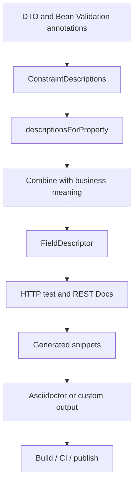
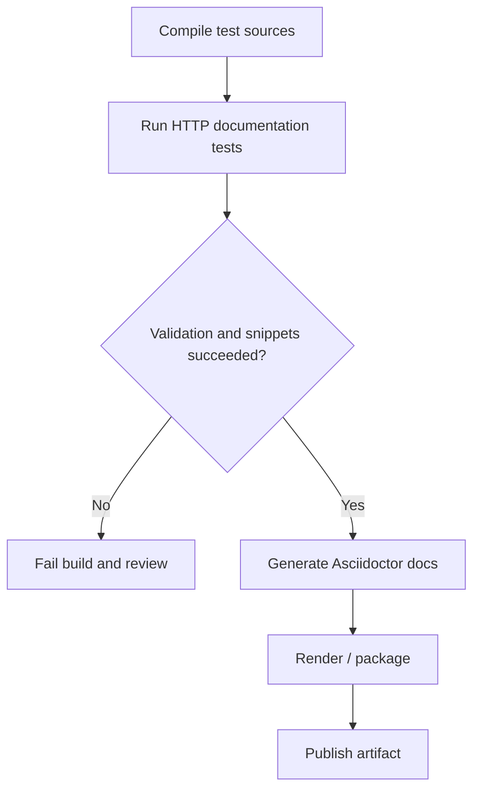

# Using Constraint Descriptions in Generated Snippets

## 1. From Bean Validation to Generated Documentation

In the **SPRING_REST_DOCS** module, HTTP tests using MockMvc, WebTestClient, or REST Assured produce generated snippets for compiling REST API documentation. A useful field table must convey both business meaning and the data limits clients must obey.

For example, an account creation request might contain:

```json
{
  "displayName": "Lan Nguyen",
  "email": "lan@example.test",
  "age": 25
}
```

The DTO declares rules:

```java
class CreateAccountRequest {
    @NotBlank
    @Size(min = 2, max = 60)
    String displayName;

    @NotBlank
    @Email
    String email;

    @NotNull
    @Min(18)
    @Max(120)
    Integer age;
}
```

If you only write `description("Display name")`, the documentation table will not show length bounds or non-blank rules. Spring REST Docs provides `ConstraintDescriptions` to retrieve descriptions from Bean Validation metadata; we can attach those sentences to `FieldDescriptor` before the generated snippet is produced.

Overall flow:



Key point: `ConstraintDescriptions` provides a list of descriptive sentences, but does not automatically insert them into every snippet. The test must explicitly combine the returned data with `requestFields(...)` or `responseFields(...)`, or use a custom snippet/template if you want a dedicated column.

## 2. Retrieving Descriptions by Property

Basic example:

```java
import java.util.List;

import org.springframework.restdocs.constraints.ConstraintDescriptions;

ConstraintDescriptions constraints =
        new ConstraintDescriptions(CreateAccountRequest.class);

List<String> displayNameRules =
        constraints.descriptionsForProperty("displayName");

List<String> emailRules =
        constraints.descriptionsForProperty("email");

List<String> ageRules =
        constraints.descriptionsForProperty("age");
```

The name passed to `descriptionsForProperty` is the **Java property name** of the class passed to `ConstraintDescriptions`. Do not use the JSON path if it differs from the property name.

Example:

```java
class CreateAccountRequest {
    @JsonProperty("display_name")
    @NotBlank
    @Size(min = 2, max = 60)
    String displayName;
}
```

Metadata lookup still uses `descriptionsForProperty("displayName")`. The JSON descriptor uses `fieldWithPath("display_name")` because that is the key on the wire. These are two distinct naming systems that must be joined properly when building snippets.

The result is a list of descriptions; each constraint can contribute one sentence. Do not rely on list order to carry special business meaning. If display order matters, sort or format the results in your documentation utility layer.

## 3. Merging Descriptions into the request-fields Snippet

The direct approach is concatenating constraint descriptions onto the field's business description:

```java
ConstraintDescriptions constraints =
        new ConstraintDescriptions(CreateAccountRequest.class);

String displayNameDescription =
        "Account display name. "
        + String.join("; ",
            constraints.descriptionsForProperty("displayName"));

String emailDescription =
        "Email address used for sign-in and contact. "
        + String.join("; ",
            constraints.descriptionsForProperty("email"));

String ageDescription =
        "Account holder's age. "
        + String.join("; ",
            constraints.descriptionsForProperty("age"));

requestFields(
    fieldWithPath("displayName").description(displayNameDescription),
    fieldWithPath("email").description(emailDescription),
    fieldWithPath("age").description(ageDescription)
)
```

The generated table might resemble:

| Path | Type | Description |
| --- | --- | --- |
| displayName | String | Account display name. Must not be blank; length from 2 to 60 characters |
| email | String | Email address used for sign-in and contact. Must not be blank; must be a valid email |
| age | Number | Account holder's age. Must not be null; value from 18 to 120 |

Exact wording depends on the project's resource bundle, locale, Bean Validation provider, and constraint resolver version. The table above only illustrates expected content.

### 3.1. Using a Helper to Avoid Repetition

In a test suite, avoid repeating `String.join` for every field:

```java
static String describeWithConstraints(
        String businessMeaning,
        List<String> rules) {

    if (rules == null || rules.isEmpty()) {
        return businessMeaning;
    }

    return businessMeaning + " Constraints: "
            + String.join("; ", rules);
}
```

Using the helper:

```java
ConstraintDescriptions constraints =
        new ConstraintDescriptions(CreateAccountRequest.class);

requestFields(
    fieldWithPath("displayName").description(
        describeWithConstraints(
            "Account display name",
            constraints.descriptionsForProperty("displayName"))),
    fieldWithPath("email").description(
        describeWithConstraints(
            "Contact email address",
            constraints.descriptionsForProperty("email"))),
    fieldWithPath("age").description(
        describeWithConstraints(
            "Account holder's age",
            constraints.descriptionsForProperty("age")))
)
```

Helpers belong in test support or documentation utility classes. Avoid placing them in domain models solely for snippet generation.

If you want to catch constraints missing a description, you can check for an empty list and fail during documentation setup for properties expected to have constraints. Do not treat every empty list as an error: a property may intentionally have no Bean Validation constraints by design.

## 4. Complete MockMvc Example: Generating request-fields.adoc

The example below combines DTOs, Bean Validation, `ConstraintDescriptions`, and Spring REST Docs MockMvc. The test sends a valid payload, asserts status, and documents request fields.

```java
import jakarta.validation.Valid;
import jakarta.validation.constraints.Email;
import jakarta.validation.constraints.Max;
import jakarta.validation.constraints.Min;
import jakarta.validation.constraints.NotBlank;
import jakarta.validation.constraints.NotNull;
import jakarta.validation.constraints.Size;

import org.junit.jupiter.api.BeforeEach;
import org.junit.jupiter.api.Test;
import org.junit.jupiter.api.extension.ExtendWith;
import org.springframework.http.MediaType;
import org.springframework.http.ResponseEntity;
import org.springframework.restdocs.RestDocumentationContextProvider;
import org.springframework.restdocs.constraints.ConstraintDescriptions;
import org.springframework.restdocs.junit.jupiter.RestDocumentationExtension;
import org.springframework.test.web.servlet.MockMvc;
import org.springframework.test.web.servlet.setup.MockMvcBuilders;
import org.springframework.web.bind.annotation.PostMapping;
import org.springframework.web.bind.annotation.RequestBody;
import org.springframework.web.bind.annotation.RestController;

import static org.springframework.restdocs.mockmvc.MockMvcRestDocumentation.document;
import static org.springframework.restdocs.mockmvc.MockMvcRestDocumentation.documentationConfiguration;
import static org.springframework.restdocs.payload.PayloadDocumentation.fieldWithPath;
import static org.springframework.restdocs.payload.PayloadDocumentation.requestFields;
import static org.springframework.test.web.servlet.request.MockMvcRequestBuilders.post;
import static org.springframework.test.web.servlet.result.MockMvcResultMatchers.status;

@ExtendWith(RestDocumentationExtension.class)
class CreateAccountDocumentationTest {

    private MockMvc mockMvc;

    private final ConstraintDescriptions constraints =
            new ConstraintDescriptions(CreateAccountRequest.class);

    @BeforeEach
    void setUp(RestDocumentationContextProvider documentation) {
        mockMvc = MockMvcBuilders.standaloneSetup(new AccountController())
                .apply(documentationConfiguration(documentation))
                .build();
    }

    @Test
    void documentCreateAccountRequest() throws Exception {
        mockMvc.perform(post("/api/accounts")
                        .contentType(MediaType.APPLICATION_JSON)
                        .accept(MediaType.APPLICATION_JSON)
                        .content("""
                            {
                              "displayName": "Lan Nguyen",
                              "email": "lan@example.test",
                              "age": 25
                            }
                            """))
                .andExpect(status().isCreated())
                .andDo(document("accounts-create",
                        requestFields(
                                fieldWithPath("displayName")
                                        .description(describeWithConstraints(
                                                "Account display name",
                                                constraints.descriptionsForProperty(
                                                        "displayName"))),
                                fieldWithPath("email")
                                        .description(describeWithConstraints(
                                                "Contact email address",
                                                constraints.descriptionsForProperty(
                                                        "email"))),
                                fieldWithPath("age")
                                        .description(describeWithConstraints(
                                                "Account holder's age",
                                                constraints.descriptionsForProperty(
                                                        "age")))
                        )
                ));
    }

    static String describeWithConstraints(
            String meaning,
            java.util.List<String> rules) {
        return rules.isEmpty()
                ? meaning
                : meaning + ". Constraints: " + String.join("; ", rules);
    }

    record CreateAccountRequest(
            @NotBlank @Size(min = 2, max = 60) String displayName,
            @NotBlank @Email String email,
            @NotNull @Min(18) @Max(120) Integer age) {}

    @RestController
    static class AccountController {
        @PostMapping("/api/accounts")
        ResponseEntity<Void> create(
                @Valid @RequestBody CreateAccountRequest request) {
            return ResponseEntity.status(201).build();
        }
    }
}
```

After the test passes, generated snippets may be located under:

```text
build/generated-snippets/
└── accounts-create/
    ├── http-request.adoc
    ├── http-response.adoc
    └── request-fields.adoc
```

The path may vary by project configuration; Maven typically uses `target/generated-snippets`. The `request-fields.adoc` snippet contains the final description with constraints merged in. REST Docs does not care whether the prose came from annotations or was hand-written: it receives the completed `FieldDescriptor`.

## 5. Using Constraint Descriptions in the response-fields Snippet

You can apply the same technique to response fields, but only when those constraints genuinely represent guarantees of the **response contract**.

Example response DTO:

```java
record AccountResponse(
    @NotBlank
    @Size(min = 2, max = 60)
    String displayName,

    @NotBlank
    @Email
    String email,

    @NotNull
    @Min(18)
    @Max(120)
    Integer age
) {}
```

Retrieving descriptions from the response class:

```java
ConstraintDescriptions responseConstraints =
        new ConstraintDescriptions(AccountResponse.class);

responseFields(
    fieldWithPath("displayName").description(
        describeWithConstraints(
            "Account display name",
            responseConstraints.descriptionsForProperty("displayName"))),
    fieldWithPath("email").description(
        describeWithConstraints(
            "Email linked to the account",
            responseConstraints.descriptionsForProperty("email"))),
    fieldWithPath("age").description(
        describeWithConstraints(
            "Account holder's age",
            responseConstraints.descriptionsForProperty("age")))
)
```

Do not naively reuse constraints from a request DTO to document a response DTO if the two models differ. Submitted data may be normalized, transformed, or masked before being returned. Response documentation must reflect what the server truly guarantees when sending responses.

Similarly, annotations placed on a response class do not automatically guarantee that a runtime validator checks the object before serialization. If the contract requires response values to always be valid, write tests/assertions to verify it.

## 6. Using Constraints with Nested Properties and JSON Names Differing from Java

For nested DTOs:

```java
class CreateOrderRequest {
    @Valid
    CustomerInput customer;

    static class CustomerInput {
        @NotBlank
        @Size(max = 80)
        String displayName;

        @NotBlank
        @Email
        String email;
    }
}
```

You can create `ConstraintDescriptions` for the nested type:

```java
ConstraintDescriptions customerConstraints =
        new ConstraintDescriptions(
                CreateOrderRequest.CustomerInput.class);

List<String> displayNameRules =
        customerConstraints.descriptionsForProperty("displayName");
```

Then attach the description to the nested JSON path:

```java
requestFields(
    fieldWithPath("customer")
        .description("Customer details for the order"),
    fieldWithPath("customer.displayName")
        .description(describeWithConstraints(
                "Customer display name",
                customerConstraints.descriptionsForProperty("displayName"))),
    fieldWithPath("customer.email")
        .description(describeWithConstraints(
                "Customer email",
                customerConstraints.descriptionsForProperty("email")))
)
```

Here:

- `ConstraintDescriptions` reads metadata from the Java type `CustomerInput`.
- `descriptionsForProperty("displayName")` takes the Java field name.
- `fieldWithPath("customer.displayName")` points to the JSON path in the request.
- `@Valid` on the `customer` property instructs Bean Validation to cascade into the child object during runtime validation.

If a Java property is renamed or the JSON serializer changes a field name, update the corresponding side. Constraint lookup and JSON paths do not synchronize names automatically.

## 7. Separating Business Descriptions and Constraints via Descriptor Attributes

Merging all sentences into a single description is simple. If you want the documentation table to have a dedicated **Constraints** column, keep the two kinds of data separate using descriptor attributes:

```java
import static org.springframework.restdocs.snippet.Attributes.key;

List<String> rules =
        constraints.descriptionsForProperty("displayName");

requestFields(
    fieldWithPath("displayName")
        .description("Account display name")
        .attributes(key("constraints").value(rules))
)
```

Attribute metadata does not appear automatically in the default snippet template. You must create a custom snippet template that reads the `constraints` attribute and renders it as a separate column. When configuring the template:

- Render only when the attribute is present.
- Handle empty lists so no trailing delimiters appear.
- Escape content when rendering HTML/Asciidoctor/Markdown according to target syntax.
- Keep business descriptions independent for reuse.
- Inspect the actual output because the template is part of the build.

Example target table:

| Path | Type | Description | Constraints |
| --- | --- | --- | --- |
| displayName | String | Account display name | Must not be blank; 2 to 60 characters long |
| email | String | Contact address | Must not be blank; valid email |
| age | Number | Account holder's age | Not null; from 18 to 120 |

The table above illustrates the design. To generate such a table, the project must configure a template and map attributes; calling `attributes(...)` alone is not enough to change the default snippet.

## 8. Including Generated Snippets in Asciidoctor

An Asciidoctor file can include the generated snippets:

```adoc
= Account API
:snippets: build/generated-snippets

== Create Account

=== HTTP request
include::{snippets}/accounts-create/http-request.adoc[]

=== Request fields and data limits
include::{snippets}/accounts-create/request-fields.adoc[]

=== HTTP response
include::{snippets}/accounts-create/http-response.adoc[]
```

If documentation covers multiple endpoints, organize sections by resource/operation and use matching snippet identifiers. Do not manually copy table content from output into docs when snippets can be included directly; includes keep documentation tied to the latest test run.

Spring REST Docs' default generated snippets are Asciidoctor. When a project publishes Markdown documentation:

1. Decide how to convert Asciidoctor snippets to Markdown or create custom Markdown templates.
2. Ensure tables, special characters, and inline code are escaped properly for Markdown syntax.
3. Feed the same constraint data into both formats so content does not drift.
4. Inspect the final rendered output rather than checking only intermediate snippet files.

Renaming the `.adoc` extension to `.md` does not convert the syntax.

## 9. Keeping Constraint Descriptions Consistent Across Endpoints

One DTO may be used by multiple endpoints, or multiple DTOs may share the same business semantics. Organize a helper to minimize inconsistencies:

```java
final class ConstraintSnippetDescriptions {

    private ConstraintSnippetDescriptions() {}

    static String forProperty(
            ConstraintDescriptions source,
            String javaProperty,
            String businessMeaning) {

        List<String> rules =
                source.descriptionsForProperty(javaProperty);

        if (rules.isEmpty()) {
            return businessMeaning;
        }

        return businessMeaning + ". Constraints: "
                + String.join("; ", rules);
    }
}
```

Example usage:

```java
ConstraintDescriptions constraints =
        new ConstraintDescriptions(CreateAccountRequest.class);

requestFields(
    fieldWithPath("displayName").description(
        ConstraintSnippetDescriptions.forProperty(
            constraints,
            "displayName",
            "Account display name"))
)
```

Share helpers or descriptors only when the Java property and contract are genuinely equivalent. Two fields both named `code` could be a postal code, product code, or verification code with different constraints. Reusing a description across the wrong domain produces documentation that looks consistent yet is inaccurate.

If multiple modules need the same phrasing, place the resource bundle and helper in versioned test support. Do not add Spring REST Docs dependencies into production domain code just to build documentation.

## 10. Verifying Enforced Constraints and Preventing Stale Snippets

Two separate things must be checked:

**Runtime validation:** Does Bean Validation actually reject violating data?

**Documentation generation:** Do generated snippets contain matching descriptions from current metadata?

A documentation test with a valid request only proves a snippet is generated from a valid payload. It does not prove all invalid cases are rejected.

Example invalid test:

```java
mockMvc.perform(post("/api/accounts")
        .contentType(MediaType.APPLICATION_JSON)
        .content("""
            {
              "displayName": " ",
              "email": "not-an-email",
              "age": 15
            }
            """))
    .andExpect(status().isBadRequest());
```

For this test to be meaningful, the application must have a validation provider, controller validation enabled, and an exception handler mapping errors to the published status. In standalone MockMvc, configure the corresponding validator/controller advice if the setup does not register them automatically. With a Spring Boot application context, testing against the real configuration is generally more representative.

A clear testing strategy:

| Test | Goal | Snippet |
| --- | --- | --- |
| Valid request | Generate field table with constraint descriptions | `request-fields.adoc` |
| Invalid request | Prove constraints are enforced and errors match contract | Error response snippet if applicable |
| Valid response | Generate response fields if response has constraint contract | `response-fields.adoc` |
| New constraint | Enforce description review when DTO adds annotations | Generated snippets diff |
| Resource bundle change | Verify updated descriptive sentences | Generated snippets diff |

## 11. Build and CI Integration

A documentation pipeline should run snippet-generating tests before the Asciidoctor step:



Changes to review in CI:

- Constraint annotation added but snippet unchanged: check property lookup, resource bundle, and description merging.
- Min/max or regex updated but description keeps old values: check placeholders and metadata source.
- Default locale differs between developer machines and CI: pin locale/resource bundle for deterministic output.
- Custom constraint added without a description key: fail per policy or use an explicit fallback.
- New template fails to render attribute: inspect the generated snippet after rendering.
- Documentation compiled before snippets were updated: fix task dependencies so tests run before Asciidoctor.

Do not manually edit generated snippet snapshots to make CI pass without understanding the cause of the change. Re-run tests to regenerate snippets from current code and metadata.

## 12. Common Pitfalls

| Symptom | Cause | Resolution |
| --- | --- | --- |
| Snippet lacks constraint sentences | Results of `descriptionsForProperty` not merged into descriptor | Append to description or attach attribute/template |
| Lookup returns empty list | Wrong Java property name or property has no constraints | Check DTO and property name |
| JSON path differs from Java property name | Confusing constraint lookup with wire path | Use Java name for lookup, JSON path for `FieldDescriptor` |
| Using request DTO to document response | Input and output may have different contracts | Pull constraints from response model and verify |
| Constraints column does not appear | Attribute attached, but still using default template | Create a custom snippet template |
| Description still shows old limits | Template/resource bundle hardcoded numbers | Use placeholders from constraint configuration |
| Snippet test passes yet API accepts invalid data | Documentation does not replace runtime validation | Add invalid tests and configure `@Valid`/provider |
| Locale results differ between CI and local | Relying on default locale | Specify locale and resource bundle explicitly |
| Generated snippet does not update | Running Asciidoctor before tests or using stale output | Set task dependencies and clean stale output in build |
| Custom constraint lacks descriptive text | Missing bundle key or custom resolver | Add message/fallback and test |

## 13. Practice Exercise

Use `CreateAccountRequest` from section 4:

1. Retrieve constraint descriptions for `displayName`, `email`, and `age`.
2. Merge those sentences into `requestFields` and generate snippet `accounts-create/request-fields.adoc`.
3. Change `@Size(max = 60)` to `@Size(max = 40)`; run tests and confirm the generated snippet description updates.
4. Change Java property `displayName` to JSON key `display_name` using a serializer annotation; ensure constraint lookup uses the Java name while the descriptor uses the JSON path.
5. Create a nested DTO with `customer.email`; use `ConstraintDescriptions` on the nested type and merge into the JSON path.
6. Put the constraint list into descriptor attribute `constraints`, create a custom template with a dedicated column, and inspect the output.
7. Add a separate response DTO, and only include response constraints in `responseFields` when they represent real output guarantees.
8. Send requests violating `@NotBlank`, `@Email`, and `@Min`; verify the API rejects invalid data with the expected status/error contract.
9. Run tests and Asciidoctor in the proper order; inspect generated snippets and the final HTML page.
10. Convert table content to Markdown via a template/converter rather than merely renaming the file extension.

**Completion criteria:** you can retrieve constraint descriptions from DTOs, merge them into request/response field descriptors, generate snippets with clear data limits, distinguish runtime validation from documentation generation, and ensure Asciidoctor/CI always use fresh snippets.

## References

- [Spring REST Docs — Bean Validation Constraints](https://docs.spring.io/spring-restdocs/reference/documenting-your-api/constraints.html): how to extract constraint descriptions and use them in documentation.
- [Spring REST Docs — Request and Response Payloads](https://docs.spring.io/spring-restdocs/reference/documenting-your-api/request-response-payloads.html): declaring `requestFields`, `responseFields`, and field descriptors.
- [Spring REST Docs — Customizing Snippets](https://docs.spring.io/spring-restdocs/reference/customizing-requests-and-responses.html): customizing snippets/templates for output.
