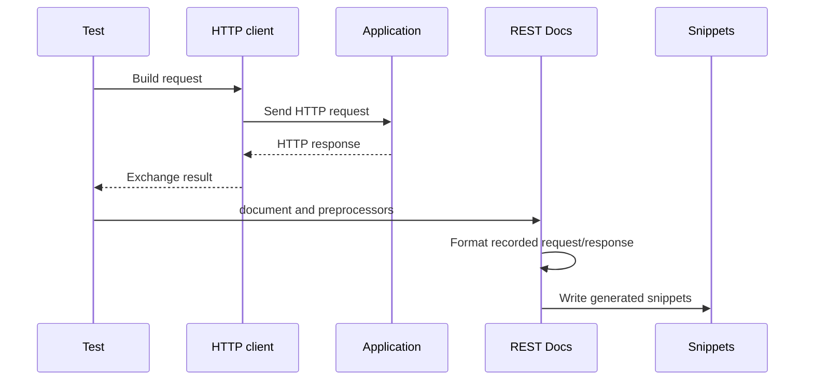

# Pretty Printing for Requests and Responses

## 1. Why Is Pretty Printing Needed in REST Docs?

In the **SPRING_REST_DOCS** module, HTTP tests with MockMvc, WebTestClient, or REST Assured generate snippets to document requests and responses. Snippets are included in Asciidoctor documentation or converted to other publishing formats.

A valid JSON payload might sit on a single line:

```json
{"orderId":"ORD-42","status":"CONFIRMED","customer":{"id":"CUS-7","name":"Lan"},"totalAmount":250000}
```

The data is accurate, but hard to read in `http-request.adoc` or `http-response.adoc`. Pretty printing reformats JSON/XML to add line breaks and indentation:

```json
{
  "orderId": "ORD-42",
  "status": "CONFIRMED",
  "customer": {
    "id": "CUS-7",
    "name": "Lan"
  },
  "totalAmount": 250000
}
```

Spring REST Docs provides `Preprocessors.prettyPrint()` to apply clean formatting to request or response content before generating snippets. It helps readers grasp payload structure faster and makes diffs easier to inspect during code review.

Pretty printing is a documentation presentation step. It is not validation, does not change the API contract, and does not re-send requests.

## 2. Preprocessor and OperationPreprocessor

A preprocessor receives the recorded operation request/response and returns a processed version for REST Docs to generate snippets.

| API | Role |
| --- | --- |
| `OperationPreprocessor` | Contract for processing an operation request or response |
| `OperationRequestPreprocessor` | Preprocessor for requests |
| `OperationResponsePreprocessor` | Preprocessor for responses |
| `Preprocessors.prettyPrint()` | Creates a preprocessor that formats supported content such as JSON/XML |
| `preprocessRequest(...)` | Attaches preprocessors to an operation's request |
| `preprocessResponse(...)` | Attaches preprocessors to an operation's response |

Importing `prettyPrint`:

```java
import static org.springframework.restdocs.operation.preprocess.Preprocessors.prettyPrint;
```

In MockMvc, attach preprocessors to `document(...)`:

```java
.andDo(document("orders-get",
    preprocessRequest(prettyPrint()),
    preprocessResponse(prettyPrint())
))
```

This configuration processes the captured request and response before generating snippets for the `orders-get` operation. If you only want to format the response, pass only `preprocessResponse(prettyPrint())`. If you only want to format the request, pass only `preprocessRequest(prettyPrint())`.

There is no need to format both sides if only one side is hard to read. Choose based on documentation needs.

## 3. Pretty Printing for Requests

Clients may send compact JSON:

```json
{"name":"Lan Nguyen","email":"lan@example.test","roles":["USER","EDITOR"]}
```

MockMvc test:

```java
import static org.springframework.restdocs.mockmvc.MockMvcRestDocumentation.document;
import static org.springframework.restdocs.mockmvc.MockMvcRestDocumentation.preprocessRequest;
import static org.springframework.restdocs.operation.preprocess.Preprocessors.prettyPrint;

mockMvc.perform(post("/api/accounts")
        .contentType(MediaType.APPLICATION_JSON)
        .content("""
            {"name":"Lan Nguyen","email":"lan@example.test","roles":["USER","EDITOR"]}
            """))
    .andExpect(status().isCreated())
    .andDo(document("accounts-create",
        preprocessRequest(prettyPrint())
    ));
```

The HTTP request snippet will present the body with a more readable structure, while the request received by the controller remains the test's payload. If you want the response formatted simultaneously, add `preprocessResponse(prettyPrint())`.

Pretty printing is helpful for nested objects, arrays, and numerous fields. For binary bodies, multipart payloads, or unsupported formats, do not expect the formatter to produce indented JSON.

## 4. Pretty Printing for Responses

An API may return compact JSON because the serializer optimizes size:

```json
{"id":"ORD-42","status":"CONFIRMED","items":[{"sku":"BK-01","quantity":2},{"sku":"BK-02","quantity":1}]}
```

Apply specifically to the response:

```java
.andDo(document("orders-get",
    preprocessResponse(prettyPrint())
))
```

The `http-response.adoc` snippet will have a multi-line, indented body. The JSON structure and values remain unchanged.

For error responses, pretty printing also makes nested error objects and arrays easier to read. However, it does not mask sensitive information. If a body contains tokens or internal data that must not be disclosed, handle it through the response contract or a dedicated redaction preprocessor.

## 5. Complete MockMvc Example

Example using JUnit Jupiter, MockMvc, and Spring REST Docs. The controller returns a JSON order response; the test generates pretty-printed request/response snippets.

```java
import java.util.Map;

import org.junit.jupiter.api.BeforeEach;
import org.junit.jupiter.api.Test;
import org.junit.jupiter.api.extension.ExtendWith;
import org.springframework.http.MediaType;
import org.springframework.restdocs.RestDocumentationContextProvider;
import org.springframework.restdocs.RestDocumentationExtension;
import org.springframework.test.web.servlet.MockMvc;
import org.springframework.test.web.servlet.setup.MockMvcBuilders;
import org.springframework.web.bind.annotation.GetMapping;
import org.springframework.web.bind.annotation.RestController;

import static org.springframework.restdocs.mockmvc.MockMvcRestDocumentation.document;
import static org.springframework.restdocs.mockmvc.MockMvcRestDocumentation.documentationConfiguration;
import static org.springframework.restdocs.mockmvc.MockMvcRestDocumentation.preprocessRequest;
import static org.springframework.restdocs.mockmvc.MockMvcRestDocumentation.preprocessResponse;
import static org.springframework.restdocs.operation.preprocess.Preprocessors.prettyPrint;
import static org.springframework.test.web.servlet.request.MockMvcRequestBuilders.get;
import static org.springframework.test.web.servlet.result.MockMvcResultMatchers.status;

@ExtendWith(RestDocumentationExtension.class)
class OrderPrettyPrintDocumentationTest {

    private MockMvc mockMvc;

    @BeforeEach
    void setUp(RestDocumentationContextProvider documentation) {
        mockMvc = MockMvcBuilders.standaloneSetup(new OrderController())
                .apply(documentationConfiguration(documentation))
                .build();
    }

    @Test
    void getOrderUsesPrettyPrintedSnippets() throws Exception {
        mockMvc.perform(get("/api/orders/42")
                        .accept(MediaType.APPLICATION_JSON))
                .andExpect(status().isOk())
                .andDo(document("orders-get",
                        preprocessRequest(prettyPrint()),
                        preprocessResponse(prettyPrint())
                ));
    }

    @RestController
    static class OrderController {
        @GetMapping(value = "/api/orders/42",
                    produces = MediaType.APPLICATION_JSON_VALUE)
        Map<String, Object> getOrder() {
            return Map.of(
                    "orderId", "ORD-42",
                    "status", "CONFIRMED",
                    "customer", Map.of("id", "CUS-7", "name", "Lan"),
                    "totalAmount", 250000
            );
        }
    }
}
```

In a real application, the mapping could be generalized to `@GetMapping("/api/orders/{id}")` using `@PathVariable`. The example uses a fixed path to focus on the preprocessor. Generated snippets for the `orders-get` operation typically include `http-request.adoc` and `http-response.adoc` along with other snippets depending on configuration.

Preprocessors do not replace status/body assertions. Continue verifying the contract with assertions; pretty printing only affects documentation content.

## 6. Combining Pretty Print with Field Descriptors

Pretty print is commonly used alongside request/response field snippets:

```java
.andDo(document("orders-create",
    preprocessRequest(prettyPrint()),
    preprocessResponse(prettyPrint()),
    requestFields(
        fieldWithPath("customerId").description("Customer ID"),
        fieldWithPath("items").description("List of line items"),
        fieldWithPath("items[].sku").description("Product SKU"),
        fieldWithPath("items[].quantity").description("Quantity")
    ),
    responseFields(
        fieldWithPath("orderId").description("Order ID"),
        fieldWithPath("status").description("Order status")
    )
))
```

The two snippet groups serve different purposes:

- `http-request.adoc` and `http-response.adoc` display the HTTP messages, including the formatted body.
- `request-fields.adoc` and `response-fields.adoc` document field paths, types, and meanings.

Pretty print does not replace field descriptors. A formatted multi-line body can still be hard to understand if explanations of business fields, units, optional/null rules, or array semantics are missing. Conversely, declaring `requestFields` does not automatically make the HTTP body in raw snippets easier to read.

## 7. Pretty Printing for XML and Content Limitations

Compact XML:

```xml
<order><id>ORD-42</id><status>CONFIRMED</status><total>250000</total></order>
```

After formatting:

```xml
<order>
  <id>ORD-42</id>
  <status>CONFIRMED</status>
  <total>250000</total>
</order>
```

Ensure requests/responses declare an appropriate `Content-Type`, such as `application/json` or `application/xml`, and that the body is actually valid JSON/XML.

Do not apply it blindly to whitespace-significant `text/plain`, `application/octet-stream`, multipart payloads containing binaries, streaming payloads, or custom formats. For those body types, keep the content as-is or write a specialized preprocessor. A formatter cannot guess the structure of arbitrary payloads.

## 8. Where Does the Preprocessor Run in the HTTP Lifecycle?



Preprocessors process the operation that REST Docs uses to write documentation after the exchange is captured. They do not change the request body that the test sends to the application, do not change the data the controller parses, and do not change the response the client receives.

Therefore:
- If the API returns wrong JSON, pretty print does not fix the business bug.
- If an assertion fails, pretty print does not make the test pass.
- If a snippet has unexpected output, inspect the preprocessor and `Content-Type`.
- To change the actual data sent/received, modify the client/application or test setup, not documentation pretty printing.

## 9. Combining with Other Preprocessors

REST Docs includes other preprocessors to modify headers, remove headers, change URIs, mask data, or replace body content. Multiple processors can be combined:

```java
import static org.springframework.restdocs.operation.preprocess.Preprocessors.removeHeaders;
import static org.springframework.restdocs.operation.preprocess.Preprocessors.prettyPrint;

.andDo(document("accounts-get",
    preprocessRequest(prettyPrint()),
    preprocessResponse(
        removeHeaders("X-Internal-Trace"),
        prettyPrint()
    )
))
```

Check the API/overloads of your project's REST Docs version. Processor order can matter if an earlier step alters the body or `Content-Type` that a later step needs to read.

Removing a header from the documentation record does not remove the header from the real HTTP response. If sensitive headers are being sent over the network, control them on the server/client. Pretty print itself does not mask values; use an appropriate masking/redaction preprocessor when data must be hidden in snippets.

## 10. WebTestClient and REST Assured

Pretty print is a general preprocessor API, so the concept works similarly across supported HTTP test clients.

### 10.1. WebTestClient

```java
webTestClient.get()
        .uri("/api/orders/42")
        .exchange()
        .expectStatus().isOk()
        .expectBody()
        .consumeWith(document("orders-get",
                preprocessResponse(prettyPrint())));
```

The exact placement and overload of `document` depend on your integration/version. To preprocess the request, add `preprocessRequest(prettyPrint())` to the appropriate document configuration.

### 10.2. REST Assured

```java
given(spec)
    .filter(document("orders-get",
            preprocessRequest(prettyPrint()),
            preprocessResponse(prettyPrint())))
    .when()
    .get("/api/orders/42")
    .then()
    .statusCode(200);
```

How the filter is attached must match Spring REST Docs' REST Assured integration. Regardless of client, pretty print only formats the representation written to snippets; assertions and HTTP semantics remain unchanged.

## 11. Asciidoctor and Build/CI

After tests create snippets, Asciidoctor includes the HTTP exchange:

```adoc
= Order API
:snippets: build/generated-snippets

== Retrieve an Order

=== Request and response
include::{snippets}/orders-get/http-request.adoc[]
include::{snippets}/orders-get/http-response.adoc[]
```

With Gradle, output is typically `build/generated-snippets`; with Maven, it is typically `target/generated-snippets`. Check your actual configuration and use the same directory in both tests and Asciidoctor.

The build process should compile tests, run HTTP documentation tests, apply preprocessors while generating snippets, and only then run Asciidoctor and package the documentation. During review, pretty printing may produce larger diffs because single-line bodies become multi-line. Verify that these are purely presentation changes and that contract structure and values are unchanged.

## 12. Common Errors

| Symptom | Cause | Solution |
| --- | --- | --- |
| Snippet still on a single line | Request/response preprocessor not attached or attached to wrong side | Check document configuration |
| Request formatted but response is not | Only called request preprocessor | Add response preprocessor if needed |
| JSON formatter does not process body | Wrong `Content-Type` or invalid JSON | Inspect `Content-Type` and payload |
| XML displays unexpectedly | Media type not recognized or malformed XML | Declare proper XML content type |
| Text body whitespace changed | Formatter unsuitable for content | Do not pretty-print text/stream/binary |
| Assumed API received formatted body | Confused operation preprocessor with HTTP client | Inspect original request and server |
| Field table did not change automatically | Expected pretty print to document fields | Use `requestFields`/`responseFields` |
| Token still exposed in snippet | Pretty print does not mask data | Use masking/redaction or fix fixture |
| Asciidoctor cannot find snippet | Task ran before tests or wrong include identifier | Fix task dependencies and include path |
| Large snippet diff | Converted single-line output to multi-line format | Review as a presentation change |

## 13. Practice Exercise

Use endpoints `GET /api/orders/42` and `POST /api/orders`:

1. Create a GET test returning compact JSON; generate initial snippets without pretty print.
2. Add `preprocessResponse(prettyPrint())` and compare the body in `http-response.adoc`.
3. For POST, add `preprocessRequest(prettyPrint())` and observe `http-request.adoc`.
4. Enable pretty print for both request and response; confirm field descriptors still work.
5. Return an error response with nested objects and arrays; check output after formatting.
6. Create an XML endpoint with an appropriate `Content-Type` and try pretty print.
7. Try `text/plain` or a binary body; determine when content should be left untouched.
8. Add an internal header and a preprocessor removing it from snippets; verify the application's original HTTP exchange is unchanged.
9. Include snippets in Asciidoctor and run the task after documentation tests.
10. Review the generated diff, confirming only presentation changed while the payload contract remained intact.

**Completion criteria:** you know how to obtain `prettyPrint()` from `Preprocessors`, attach it separately to requests/responses, understand that preprocessors affect the REST Docs record rather than the real HTTP exchange, combine it with field descriptors and other processors, and integrate output into Asciidoctor/CI.

## References

- [Spring REST Docs — Preprocessing](https://docs.spring.io/spring-restdocs/reference/documenting-your-api/preprocessing.html): preprocessing requests/responses before generating snippets.
- [Spring REST Docs — Preprocessors API](https://docs.spring.io/spring-restdocs/api/java/org/springframework/restdocs/operation/preprocess/Preprocessors.html): `prettyPrint()` and preprocessor helpers.
- [Spring REST Docs — MockMvc API](https://docs.spring.io/spring-restdocs/api/java/org/springframework/restdocs/mockmvc/MockMvcRestDocumentation.html): `preprocessRequest`, `preprocessResponse`, and integrating `document` with MockMvc.
