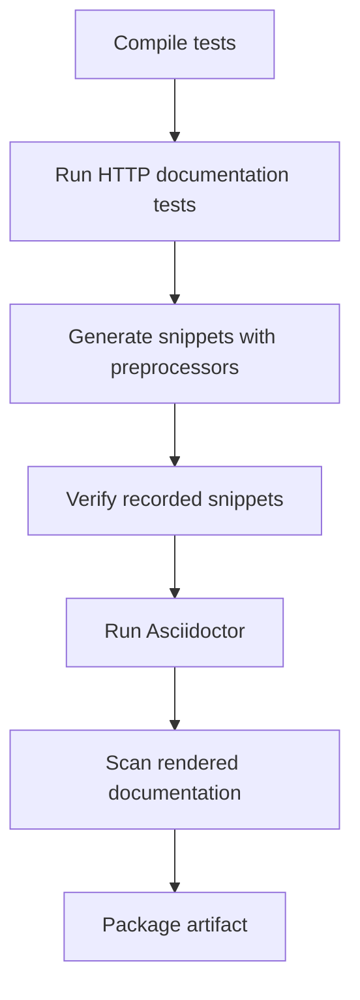

# Verifying Preprocessors Do Not Distort Evidence

## 1. Preprocessors and Documentation Evidence

In the **SPRING_REST_DOCS** module, HTTP tests using MockMvc, WebTestClient, or REST Assured both verify the API and generate snippets for authoring Asciidoctor/Markdown. Preprocessors can normalize URIs, pretty-print bodies, replace headers, or mask sensitive values before writing snippets.

Distinguish the **original HTTP exchange** from the **preprocessed recorded operation**. Test assertions verify the real server/client exchange in the test environment; snippets reflect a record that has undergone permitted transformations. Never use snippets in place of contract assertions, and never assume HTTP assertions automatically prove snippets masked secrets.

Example original response:

```json
{"orderId":"ORD-42","status":"CONFIRMED","accessToken":"test-secret-marker-987"}
```

Snippet after masking:

```json
{
  "orderId": "ORD-42",
  "status": "CONFIRMED",
  "accessToken": "[REDACTED]"
}
```

The token value is replaced deliberately; the remaining contract fields must stay unchanged. This is the guiding principle for designing preprocessor tests.

## 2. Establishing Policy Before Testing

Before configuring processors, list which components may change and which invariants must hold:

| Component | Permitted Transformation | Invariant to Verify |
| --- | --- | --- |
| URI | Change scheme/host/port to public base URI | Path and query stay unchanged |
| `Authorization` | Replace token with placeholder | Header name remains if clients need authentication |
| Internal header | Remove if outside contract | Contract headers like `Content-Type` remain |
| JSON/XML | Pretty print or mask specified fields | Structure and non-sensitive values stay unchanged |
| Status code | Typically unchanged | Matches asserted status |
| `Content-Type` | Typically unchanged | Accurately describes representation |

Example policy: change `localhost` to `api.example.com`; keep path/query; replace `Authorization` with `Bearer [REDACTED]`; remove `X-Internal-Node`; preserve status, `Content-Type`, and business fields.

## 3. Separating HTTP Assertions from Snippet Verification

HTTP assertions must run on the original exchange before the `document` step:

```java
mockMvc.perform(get("/api/orders/42")
        .accept(MediaType.APPLICATION_JSON))
    .andExpect(status().isOk())
    .andExpect(content().contentTypeCompatibleWith(
            MediaType.APPLICATION_JSON))
    .andExpect(jsonPath("$.orderId").value("ORD-42"))
    .andExpect(jsonPath("$.status").value("CONFIRMED"))
    .andDo(document("orders-get",
        preprocessResponse(prettyPrint())
    ));
```

These assertions verify status, media type, and fields from the response MockMvc received. Pretty printing only runs during documentation writing. If an assertion fails, the test must fail even if the formatter could produce clean-looking output.

The second group of assertions verifies generated output: URIs normalized accurately; headers replaced/removed per policy; original secret markers gone; placeholders on the right fields; bodies still parseable; required snippets created and Asciidoctor includes the right identifiers.

## 4. Checking JSON Invariants

When only pretty-printing, do not compare raw JSON strings because whitespace and object key order may differ. Parse both bodies into JSON trees and compare:

```java
JsonNode original = objectMapper.readTree(originalBody);
JsonNode documented = objectMapper.readTree(prettyPrintedBody);
assertEquals(original, documented);
```

JSON tree comparison ignores whitespace and object member ordering while preserving array element order. This is the appropriate check for pure formatting.

When the body is also masked, compare non-sensitive invariants and check placeholders separately:

```java
assertEquals(original.path("orderId"), documented.path("orderId"));
assertEquals(original.path("status"), documented.path("status"));
assertEquals("[REDACTED]", documented.path("accessToken").asText());
assertFalse(documented.toString().contains("test-secret-marker-987"));
assertTrue(documented.has("accessToken"));
```

If the contract requires keeping the key, distinguish an absent key from a `null`-valued key. Verify the placeholder is at the exact path; finding `[REDACTED]` anywhere in the string is insufficient to prove proper masking.

## 5. Checking Header Policies

Example keeping `Authorization` while replacing the token, and removing an internal header from the response:

```java
.andDo(document("accounts-get",
    preprocessRequest(
        modifyHeaders()
            .set("Authorization", "Bearer [REDACTED]")
    ),
    preprocessResponse(
        modifyHeaders().remove("X-Internal-Node")
    )
))
```

Verification should confirm `Authorization` still appears with its placeholder if clients must send auth; `X-Internal-Node` is stripped from response snippets; `Content-Type` and other contract headers remain; original headers in the HTTP exchange are not confused with the processed record.

Header descriptors must be compatible with the recorded operation after preprocessing. If you delete a header required by a descriptor, snippets may lack information or documentation may no longer reflect policy.

## 6. Checking That modifyUris() Preserves Path/Query

Expected transformation example:

```text
Before: http://localhost:8080/api/orders/42?expand=items
After:  https://api.example.com/api/orders/42?expand=items
```

Verify each URI component from the documented output, rather than reading the original request URI to conclude the processor worked:

```java
URI documented = URI.create(documentedUri);
assertEquals("https", documented.getScheme());
assertEquals("api.example.com", documented.getHost());
assertEquals("/api/orders/42", documented.getRawPath());
assertEquals("expand=items", documented.getRawQuery());
```

If the API uses gateway prefixes, percent-encoded paths, or special query encoding, test those cases explicitly. Do not arbitrarily decode/re-encode because that can change semantics.

## 7. Processor Order and Boundary Data

A later processor may receive a representation modified by an earlier processor. For example, a regex written for compact bodies may need re-testing when pretty print runs first. Body-parsing processors also depend on `Content-Type`. Inspect final output after combining processors rather than assuming orders are equivalent.

| Fixture | Risk | Expected Verification |
| --- | --- | --- |
| Compact/pretty JSON | Whitespace-dependent regex | Masks all target values |
| Escaped quotes | Regex terminates string early | JSON remains valid |
| Nested object/array | Masks only root or first element | Masks every path per policy |
| Null/missing field | Processor assumes string always exists | Handles according to contract |
| Empty body | Parser fails | No unexpected errors |
| XML/text/binary | JSON parser misprocesses media type | Does not misparse format |

Use distinctive dummy markers in fixtures. Never use real credentials to test masking.

## 8. MockMvc Example: Verifying Original Response Before document

```java
@ExtendWith(RestDocumentationExtension.class)
class PreprocessorEvidenceTest {
    private MockMvc mockMvc;

    @BeforeEach
    void setUp(RestDocumentationContextProvider documentation) {
        mockMvc = MockMvcBuilders.standaloneSetup(new TokenController())
                .apply(documentationConfiguration(documentation))
                .build();
    }

    @Test
    void documentsMaskedToken() throws Exception {
        mockMvc.perform(get("/api/token")
                        .accept(MediaType.APPLICATION_JSON))
                .andExpect(status().isOk())
                .andExpect(jsonPath("$.tokenType").value("Bearer"))
                .andExpect(jsonPath("$.accessToken")
                        .value("test-secret-marker-987"))
                .andDo(document("token-get",
                        preprocessResponse(
                                replacePattern(
                                    Pattern.compile(
                                      "\"accessToken\"\\s*:\\s*\"[^\"]+\""),
                                    "\"accessToken\":\"[REDACTED]\"")
                        )
                ));
    }
}
```

This test confirms the original response contains the dummy marker and right status/type. It does not automatically read snippets to verify masking. A verification task/test running after documentation tests is needed to read output files and verify placeholders, original markers, and important fields.

## 9. Verifying Generated Snippets After Writing

A verification test can read generated snippets:

```java
Path snippet = generatedSnippets
        .resolve("token-get")
        .resolve("http-response.adoc");
String output = Files.readString(snippet, StandardCharsets.UTF_8);
assertTrue(output.contains("[REDACTED]"));
assertFalse(output.contains("test-secret-marker-987"));
assertTrue(output.contains("tokenType"));
```

This illustrates the verification idea; supply `generatedSnippets` from build configuration and ensure verification runs after the snippet generation task. For many operations, you can scan the entire output directory against a predefined list of dummy markers. Report violating files clearly so reviewers can trace them.

If output is produced with custom templates, inspect final artifacts as well. Templates may render data differently from default snippets.

## 10. Preprocessing Does Not Replace API Security

| Requirement | Assertion on HTTP Exchange | Preprocessor |
| --- | --- | --- |
| Clients must send `Authorization` | Verify authentication works | Mask value, keep header name |
| Response includes access token per contract | Check real field/value | Mask token in docs if policy requires |
| API must not return `passwordHash` | Confirm field is absent in response | Never use masking to hide leaks |

Example where the API must not return password hashes:

```java
mockMvc.perform(get("/api/profile"))
    .andExpect(status().isOk())
    .andExpect(jsonPath("$.passwordHash").doesNotExist());
```

If you only mask `passwordHash` in snippets, clients still receive that field. Assertions on the real response must catch the bug. Also check fixtures, HTTP logging, test reports, failure logs, and CI artifacts because secrets can leak outside generated snippets.

## 11. Status, Content-Type, and Header Invariants

Preprocessors typically modify body/headers or URIs in the documentation representation. Never silently change status or media type to make a response look valid. Verification should confirm snippet status matches asserted status; `Content-Type` accurately describes the body; contract headers are not removed; URIs change only defined parts; post-processed bodies remain parseable; field descriptors still match payloads.

When altering the body, consider representation metadata such as `Content-Length` or `Content-Encoding`. Do not leave stale metadata if it is no longer accurate, and do not delete contract headers arbitrarily. Verify output and pick processors aligned with header semantics.

## 12. Regression Tests and Build/CI

Divide verification into layers:

1. **Preprocessor unit tests:** regex, JSON masking, and URI transforms with boundary fixtures.
2. **HTTP documentation tests:** verify original exchange then call `document(...)`.
3. **Generated snippet verification:** check placeholders, secret markers, path/query, and headers.
4. **Asciidoctor build:** confirm current snippets are included and render succeeds.
5. **Artifact scan:** search for sensitive dummy markers in publishable output.



CI should fail if original markers remain in snippets, placeholders sit on wrong fields, URIs have the wrong base, contract headers are lost, or Asciidoctor includes missing files. Place verification after the snippet generation task via explicit task dependencies; avoid running in parallel before files are written.

## 13. Preprocessor Review Checklist

- [ ] Policy explicitly states which parts may be modified.
- [ ] Tests assert status/headers/body of the original HTTP exchange.
- [ ] Generated snippets are independently verified after preprocessing.
- [ ] URI scheme/host/port are right and path/query are preserved.
- [ ] Essential contract headers remain present.
- [ ] Internal headers are handled on the right side.
- [ ] Original secret markers are gone from generated snippets.
- [ ] Placeholders sit on the right keys/paths and preserve needed structure.
- [ ] JSON/XML remain parseable after processing.
- [ ] Non-sensitive data was not altered by mistake.
- [ ] Custom processors have nested/array/null/empty/malformed fixtures.
- [ ] Status and `Content-Type` match the contract.
- [ ] Asciidoctor runs after snippet generation.
- [ ] Final artifacts are scanned before publishing.

## 14. Practice Exercise

Use endpoints `GET /api/token` and `GET /api/orders/42`:

1. Assert original status, `Content-Type`, and response fields before `document(...)`.
2. Attach `replacePattern(...)` to mask access tokens with both compact and pretty JSON.
3. Verify `http-response.adoc` has `[REDACTED]` at `accessToken` and no original marker.
4. Add an `Authorization` request header; use `modifyHeaders().set(...)` and confirm the header name remains.
5. Remove `X-Internal-Node` from the response snippet while keeping `Content-Type`.
6. Use `modifyUris()` to change base URI; verify path/query remain intact.
7. Test nested JSON and arrays containing markers across multiple elements.
8. Create a forbidden `passwordHash` and assert the field is absent on the original response.
9. Swap the order of two processors; inspect output and explain the difference.
10. Run snippet verification, Asciidoctor, and artifact scanning in CI; confirm the pipeline fails if original markers remain.

**Completion criteria:** distinguish the original HTTP exchange from the preprocessed recorded operation; write contract assertions before `document`; verify snippets against invariants/policy; test headers, URIs, JSON masking, boundary data, and processor ordering; schedule verification after snippet generation in CI.

## References

- [Spring REST Docs — Preprocessing](https://docs.spring.io/spring-restdocs/reference/documenting-your-api/preprocessing.html): operation preprocessors and adjusting representations before snippet generation.
- [Spring REST Docs — Preprocessors API](https://docs.spring.io/spring-restdocs/api/java/org/springframework/restdocs/operation/preprocess/Preprocessors.html): `prettyPrint`, `modifyHeaders`, `replacePattern`, and URI modification.
- [Spring REST Docs — OperationPreprocessor API](https://docs.spring.io/spring-restdocs/api/java/org/springframework/restdocs/operation/preprocess/OperationPreprocessor.html): contract for processing recorded operations.
- [Spring Framework — MockMvc testing](https://docs.spring.io/spring-framework/reference/testing/spring-mvc-test-framework.html): testing HTTP requests/responses in tests.
