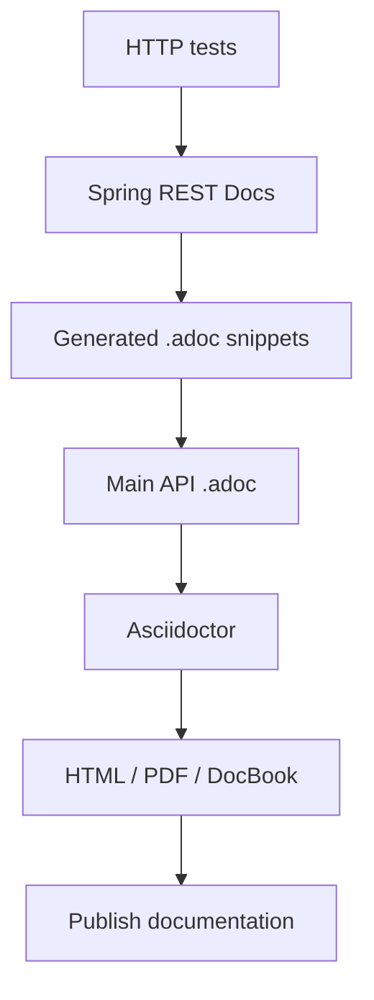
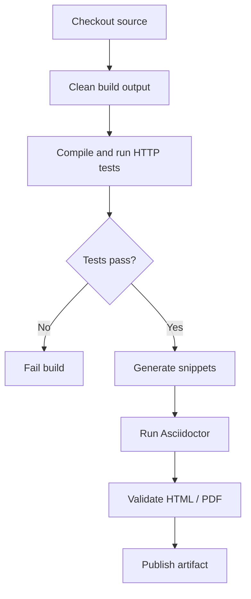

# Why Asciidoctor Is the Default Format

## 1. The Role of Asciidoctor in Spring REST Docs

Spring REST Docs generates verifiable REST API documentation from HTTP tests using MockMvc, WebTestClient, or REST Assured. Tests execute requests, verify responses, and generate snippets describing the method, URI, headers, payload, parameters, fields, or hypermedia links. Writers then assemble these snippets into complete API documentation.

In the standard Spring REST Docs workflow, **AsciiDoc and Asciidoctor are the natural authoring choice** because snippets are generated as `.adoc` files by default, and Asciidoctor supports embedding these files directly into a larger document using the `include::...[]` directive.

Example snippets generated after a test:

```text
build/generated-snippets/
  books-get/
    http-request.adoc
    http-response.adoc
    curl-request.adoc
    path-parameters.adoc
    response-fields.adoc
```

The main document can be written as:

```asciidoc
= Books API

== Get book by ID

=== Request
include::{snippets}/books-get/http-request.adoc[]

=== Response
include::{snippets}/books-get/http-response.adoc[]

=== Response fields
include::{snippets}/books-get/response-fields.adoc[]
```

When Asciidoctor processes the document, the snippet contents are inserted in place. Writers can add explanations, warnings, summary tables, business examples, or links between operations around the auto-generated content.



## 2. Why Is Asciidoctor Better Suited Than Manually Copying Snippets?

Asciidoctor is not an HTTP snippet generation tool. Spring REST Docs handles recording and verifying requests/responses; Asciidoctor handles authoring, merging content, and rendering documentation. The two tools solve different parts of the problem, yet fit together naturally.

| Need | How Asciidoctor Helps |
| --- | --- |
| Embed generated snippets | `include::{snippets}/...[]` reads `.adoc` files directly. |
| Organize multiple endpoints | Headings, sections, table of contents, and cross-references. |
| Add explanations | Paragraphs, lists, admonitions, source blocks, and tables. |
| Reuse content | Include a file or content section in multiple places. |
| Vary output by environment | Attributes such as `{snippets}`, `{project-version}`, `{api-base-url}`. |
| Produce multi-format documentation | Asciidoctor can render HTML, DocBook, and PDF through the appropriate toolchain. |
| Automation | Gradle/Maven plugins can run after tests in the build pipeline. |

If requests/responses are copied manually into a Markdown file, the content can quickly drift out of sync with tests. When tests change and writers forget to update examples, the documentation no longer reflects the verified API. Including snippets ensures the documentation uses the current test output directly.

## 3. AsciiDoc and Asciidoctor Are Not the Same Concept

The two names are often used together, but they have different roles:

- **AsciiDoc** is a text markup language for writing structured documentation. Files typically have the `.adoc` or `.asciidoc` extension.
- **Asciidoctor** is a processor/implementation for AsciiDoc, used to parse source documents and render outputs such as HTML or DocBook. PDF typically requires Asciidoctor PDF or the corresponding toolchain.

In a Spring REST Docs project:

```text
src/docs/asciidoc/api.adoc             # Source file authored by the team
build/generated-snippets/books-get/   # Snippets generated by tests
build/docs/asciidoc/html5/api.html     # Example HTML output
```

The `api.adoc` file is where the team controls structure and prose style. Files in `generated-snippets` are outputs generated from tests and are normally not edited manually. Asciidoctor merges them when building the documentation.

## 4. Core Strength: Include Snippets Without Copying Content

The `include::` directive allows embedding snippet files:

```asciidoc
=== HTTP request
include::{snippets}/books-get/http-request.adoc[]

=== HTTP response
include::{snippets}/books-get/http-response.adoc[]
```

`{snippets}` is a document attribute. The build needs to assign it to the exact output directory of Spring REST Docs. For example, it can be set directly in the source file:

```asciidoc
:snippets: ../../../build/generated-snippets
```

Or pass the attribute from Gradle/Maven to avoid relying on relative paths in the source file. When running in CI or using a different output directory, you only need to update the attribute value.

Include paths are resolved according to the Asciidoctor context and the project's `include` configuration. Therefore, verify that the file already exists and `{snippets}` points to the right location before building.

## 5. Combining Snippets with Writer-Managed Content

API documentation needs more than raw requests and responses. Asciidoctor allows combining explanatory prose with snippets:

```asciidoc
== Create a book

This endpoint creates a new book resource. The client sends a JSON body and receives
HTTP 201 along with the URI of the newly created resource.

=== Request
include::{snippets}/books-create/http-request.adoc[]

=== Request fields
include::{snippets}/books-create/request-fields.adoc[]

=== Response
include::{snippets}/books-create/http-response.adoc[]

=== Response headers
include::{snippets}/books-create/response-headers.adoc[]

=== Response fields
include::{snippets}/books-create/response-fields.adoc[]
```

Snippets provide HTTP examples and tables verified by tests. The prose written by the team explains why clients need to call the endpoint, business rules, limits, common errors, and how to use related operations.

## 6. Asciidoctor Supports Attributes for Flexible Documentation Management

Attributes allow reusing a single value in multiple places without editing every section. For example:

```asciidoc
= {service-name} API
:service-name: Book Service
:snippets: build/generated-snippets
:api-version: v1
:api-base-url: https://api.example.test/{api-version}

API base URL: `{api-base-url}`.
```

In large projects, useful attributes often include:

| Attribute | Purpose |
| --- | --- |
| `snippets` | Directory containing generated snippets. |
| `project-version` | Version of the documented service or API. |
| `api-base-url` | Base URL used in examples/explanations. |
| `source-highlighter` | Syntax highlighter for code blocks when supported by the output. |
| `toc` | Controls the table of contents. |

Do not use a random test-environment URL as the published base URL. If tests run on `localhost:<random-port>`, you can normalize the URI in a Spring REST Docs preprocessor or present the public base URL using a separate attribute. The two values serve different purposes.

## 7. Well-Structured and Easy-to-Navigate Documentation

AsciiDoc supports headings, cross-references, and tables of contents. For documentation with many APIs, you can organize by resource or use case:

```asciidoc
= Store API
:toc:
:toclevels: 3
:sectnums:
:snippets: build/generated-snippets

include::common/overview.adoc[]

== Books
include::operations/books-list.adoc[]
include::operations/books-get.adoc[]
include::operations/books-create.adoc[]

== Orders
include::operations/orders-get.adoc[]
include::operations/orders-pay.adoc[]
```

Each operation file can include snippets by its own identifier. This structure enables multiple people to author concurrently and prevents a single source file from growing too long.

Cross-references allow navigating to another section or anchor:

```asciidoc
See the <<authentication, Authentication>> section before calling the create order endpoint.

[[authentication]]
== Authentication
```

## 8. Rendering HTML, PDF, and Other Formats

Asciidoctor processes a single AsciiDoc source into outputs suited to publishing needs:

| Output | When to Use |
| --- | --- |
| HTML | Developer portal documentation, online reference, search, and navigation. |
| PDF | Documentation meant for download, archiving, or offline distribution. |
| DocBook | Input for another publishing pipeline. |

HTML is a popular choice for API documentation because users can view code, tables, and links in a browser. PDF requires additional configuration of Asciidoctor PDF and suitable fonts. Not every output is generated by the same default command; install the corresponding plugin/backend.

## 9. Why Doesn't Spring REST Docs Require Asciidoctor?

The word "default" here should be understood as **the most directly supported and convenient path**, not a mandatory technical restriction.

Spring REST Docs generates snippets in AsciiDoc using its default templates. Thus, Asciidoctor can include them directly without conversion. However:

- Snippet templates can be customized to generate content as needed.
- `.adoc` snippets can be converted to Markdown or another format in a separate pipeline.
- Another publishing system can be used as long as it can handle snippets, includes, and corresponding document elements.
- Source documentation content can be stored in another format, provided there is a step to integrate Spring REST Docs output.

If a project chooses Markdown, you need to decide how to handle the generated `.adoc` files. Ordinary Markdown processors do not understand `include::...[]` directives and do not render AsciiDoc syntax automatically. Options include running Asciidoctor first and converting the output appropriately, writing a snippet conversion step, or customizing templates for the target format. Inspect the final result to ensure no tables, code blocks, links, or formatting are lost.

| Criterion | Asciidoctor | Plain Markdown |
| --- | --- | --- |
| Direct use of `.adoc` snippets | Yes, via `include::`. | No, requires conversion or a compatible include mechanism. |
| Attributes and cross-references | Built-in support. | Depends on the Markdown processor/extensions. |
| Simplicity for a short README | May have more features than needed. | Usually simpler and more familiar. |
| Multi-operation API documentation | Well suited for includes and large document structures. | Suitable if the repository already has a strong Markdown publishing pipeline. |

## 10. Integrating Asciidoctor in Gradle

A common Gradle configuration uses the Asciidoctor JVM plugin:

```groovy
plugins {
    id 'java'
    id 'org.asciidoctor.jvm.convert' version '3.3.2'
}

configurations {
    asciidoctorExt
}

ext {
    snippetsDir = file('build/generated-snippets')
}

dependencies {
    testImplementation 'org.springframework.restdocs:spring-restdocs-mockmvc'
    asciidoctorExt 'org.springframework.restdocs:spring-restdocs-asciidoctor'
}

tasks.named('test') {
    outputs.dir snippetsDir
}

tasks.named('asciidoctor') {
    inputs.dir snippetsDir
    configurations 'asciidoctorExt'
    dependsOn tasks.named('test')
    attributes 'snippets': snippetsDir
}
```

This is a condensed configuration example. The project needs to manage compatible versions of the plugin and Spring REST Docs, while configuring MockMvc/REST Assured/WebTestClient to write snippets to the exact `snippetsDir`. If using a non-default output location, keep where tests write snippets synchronized with Asciidoctor's `snippets` attribute.

Build command:

```bash
./gradlew clean test asciidoctor
```

`asciidoctor` depends on `test`, so the build must run tests first. If a test or descriptor fails, Gradle will not proceed to the dependent authoring task.

## 11. Integrating Asciidoctor in Maven

Maven can use the Spring REST Docs Maven Plugin or the Asciidoctor Maven Plugin to integrate snippets into the lifecycle. A configuration typically needs:

1. Tests run and generate snippets into `target/generated-snippets`.
2. The Asciidoctor plugin receives this directory via the `snippets` attribute.
3. The rendering execution runs after the test phase, in the appropriate lifecycle phase.
4. HTML/PDF output is packaged or published.

Example AsciiDoc structure:

```asciidoc
= Catalog API
:snippets: target/generated-snippets

== Get product
include::{snippets}/products-get/http-request.adoc[]
include::{snippets}/products-get/http-response.adoc[]
```

Specific Maven plugin configuration depends on the Maven version and chosen plugin. Refer to the plugin documentation to bind execution after tests and avoid rendering from stale snippets.

## 12. Bringing Asciidoctor into CI/CD

The pipeline should ensure snippets are generated from the current test run and compiled only when tests succeed:



In practice, snippets are typically created during the test step rather than as an independent task. The diagram shows the logical order: clean output, run tests, verify results, compile, and publish. Do not publish documentation if tests fail; filters may have already written some snippets before the final assertion failed.

Useful CI checks:

- The snippet directory is clean before tests start.
- Every included identifier exists after tests pass.
- No tokens, cookies, or sensitive data appear in snippets.
- HTML has no remaining include or cross-reference errors.
- Output files are artifacts of the exact current commit/build.

## 13. Common Errors

| Symptom | Cause | Resolution |
| --- | --- | --- |
| Asciidoctor reports included file not found | `{snippets}` is wrong or the test has not generated the corresponding identifier. | Check the output directory, snippet name, and dependency between tests and Asciidoctor. |
| HTML shows literal `include::...[]` | The file was not processed by Asciidoctor or includes are disabled. | Run the proper Asciidoctor task and check include configuration. |
| Documentation contains stale snippets | Build did not clean output or tests did not run completely. | Delete generated snippets before tests and only use artifacts from the current build. |
| Markdown does not render snippets | Markdown engine does not understand AsciiDoc syntax. | Add a conversion step or switch authoring source to AsciiDoc. |
| PDF has font/Vietnamese character issues | PDF backend or font is not configured. | Configure Asciidoctor PDF and a font with Vietnamese glyphs; inspect output after rendering. |
| Duplicate content or strange ordering | Including the same snippet multiple times or inconsistent section organization. | Split operation files, check includes and heading hierarchy. |
| Documentation published even when tests fail | Publish job does not depend on test results. | Set up dependencies/gating between tests, Asciidoctor, and publishing. |

## 14. Checklist for Choosing Asciidoctor

- [ ] Understood that Spring REST Docs generates `.adoc` snippets from HTTP tests.
- [ ] Used `include::{snippets}/...[]` to embed snippets directly.
- [ ] Main AsciiDoc file separates writer-managed content from auto-generated content.
- [ ] Attributes such as `{snippets}` are configured to the exact output directory.
- [ ] Chosen suitable output format: HTML, PDF, or DocBook.
- [ ] Build runs tests before Asciidoctor and only uses snippets from the current run.
- [ ] CI verifies no include/cross-reference errors before publishing.
- [ ] If choosing Markdown, a conversion or compatible integration step for `.adoc` snippets is in place.

Asciidoctor is the convenient default choice in Spring REST Docs because it directly uses the snippet format generated by the framework, supports includes, and provides tools for organizing large-scale API documentation. The key benefit is reducing manual copying: HTTP tests produce verifiable content, and Asciidoctor assembles that content into readable, automatable documentation. Projects can still choose Markdown or another format if they proactively build the corresponding integration step.

## References

- [Spring REST Docs – Getting Started](https://docs.spring.io/spring-restdocs/reference/getting-started.html)
- [Spring REST Docs – Documenting Your API](https://docs.spring.io/spring-restdocs/reference/documenting-your-api.html)
- [Spring REST Docs – Gradle Plugin](https://docs.spring.io/spring-restdocs/reference/getting-started.html#getting-started-build-configuration-gradle)
- [Asciidoctor Documentation](https://docs.asciidoctor.org/)
- [Asciidoctor Gradle Plugin](https://docs.asciidoctor.org/gradle-plugin/latest/)
