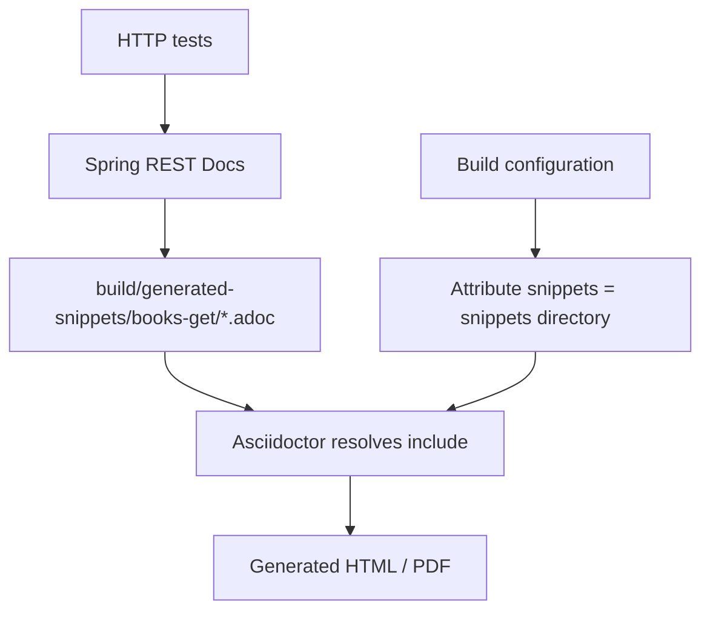

# Defining the snippets Attribute in Documentation

## 1. What Is `snippets` Used For?

Spring REST Docs generates snippets from HTTP tests using MockMvc, WebTestClient, or REST Assured. Snippets typically reside in the build directory, such as `build/generated-snippets` with Gradle or `target/generated-snippets` with Maven. The main AsciiDoc document needs to know where this directory is located in order to include files such as `http-request.adoc`, `http-response.adoc`, `request-fields.adoc`, and `response-fields.adoc`.

In Asciidoctor, **the `snippets` attribute is a variable holding the path to the generated snippets directory**. You can use this variable in the include macro:

```asciidoc
=== HTTP request
include::{snippets}/books-get/http-request.adoc[]

=== HTTP response
include::{snippets}/books-get/http-response.adoc[]
```

When processing the document, Asciidoctor replaces `{snippets}` with the configured attribute value. As a result, the document does not have to repeat absolute paths or build-specific paths in every include.



## 2. How Is the `snippets` Attribute Provided Automatically?

When `spring-restdocs-asciidoctor` is configured properly in the build, Spring REST Docs automatically configures the `snippets` attribute to point to the snippets directory according to the build tool:

| Build tool | Default snippets directory | Configured attribute target |
| --- | --- | --- |
| Gradle | `build/generated-snippets` | `build/generated-snippets` |
| Maven | `target/generated-snippets` | `target/generated-snippets` |

With Gradle, add `spring-restdocs-asciidoctor` to the configuration dedicated to Asciidoctor, typically `asciidoctorExt`. With Maven, add this dependency to the Asciidoctor plugin. When the integration is loaded, you do not need to manually declare `:snippets:` in every `.adoc` file.

Example document without manually assigning the path:

```asciidoc
= Books API

== Get book

include::{snippets}/books-get/http-request.adoc[]
include::{snippets}/books-get/http-response.adoc[]
```

If the attribute is not configured automatically, Asciidoctor typically reports that `{snippets}` cannot be resolved or the included file is not found. In that case, check the dependency/plugin first; only add the attribute manually if the project intentionally does not use the integration or needs to override the default location.

## 3. Configuration with Gradle

Gradle example using the Asciidoctor JVM plugin and Spring REST Docs:

```groovy
plugins {
    id 'java'
    id 'org.asciidoctor.jvm.convert' version '3.3.2'
}

configurations {
    asciidoctorExt
}

ext {
    snippetsDir = file('build/generated-snippets')
}

dependencies {
    testImplementation 'org.springframework.restdocs:spring-restdocs-mockmvc'
    asciidoctorExt 'org.springframework.restdocs:spring-restdocs-asciidoctor'
}

tasks.named('test') {
    outputs.dir snippetsDir
    useJUnitPlatform()
}

tasks.named('asciidoctor') {
    inputs.dir snippetsDir
    configurations 'asciidoctorExt'
    dependsOn tasks.named('test')
}
```

In this example, `snippetsDir` specifies where tests write snippets and is also declared as an output of the `test` task. `asciidoctorExt` places the Spring REST Docs extension on Asciidoctor's classpath; this extension automatically configures the `snippets` attribute following the Gradle convention. `inputs.dir` helps Gradle track inputs; `dependsOn test` ensures tests run before the documentation is rendered.

If using REST Assured or WebTestClient, replace the test integration dependency accordingly:

```groovy
testImplementation 'org.springframework.restdocs:spring-restdocs-restassured'
// or
testImplementation 'org.springframework.restdocs:spring-restdocs-webtestclient'
```

Do not add all three modules if the project does not use all three test clients. Manage the Spring REST Docs version consistently using a BOM or version catalog according to the project configuration.

Run:

```bash
./gradlew clean test asciidoctor
```

## 4. Configuration with Maven

With Maven, `spring-restdocs-asciidoctor` is declared as a dependency of the Asciidoctor Maven Plugin. Example configuration:

```xml
<build>
    <plugins>
        <plugin>
            <groupId>org.asciidoctor</groupId>
            <artifactId>asciidoctor-maven-plugin</artifactId>
            <version>2.2.6</version>
            <executions>
                <execution>
                    <id>generate-api-docs</id>
                    <phase>prepare-package</phase>
                    <goals>
                        <goal>process-asciidoc</goal>
                    </goals>
                    <configuration>
                        <backend>html</backend>
                        <doctype>book</doctype>
                    </configuration>
                </execution>
            </executions>
            <dependencies>
                <dependency>
                    <groupId>org.springframework.restdocs</groupId>
                    <artifactId>spring-restdocs-asciidoctor</artifactId>
                    <version>${spring-restdocs.version}</version>
                </dependency>
            </dependencies>
        </plugin>
    </plugins>
</build>
```

When the integration is configured in the plugin, the `snippets` attribute points to `target/generated-snippets`. Tests must run before the `prepare-package` phase, typically via `mvn clean package` or `mvn clean verify`. The plugin version in the example should be managed according to the project's Maven tooling; do not copy versions mechanically if the project already has a version catalog or parent POM.

## 5. Manual Declaration When Needed

If you are not using `spring-restdocs-asciidoctor`, or intentionally use a different output directory, you can declare the attribute in the AsciiDoc file:

```asciidoc
:snippets: build/generated-snippets
```

Or pass it from Gradle:

```groovy
tasks.named('asciidoctor') {
    attributes 'snippets': snippetsDir
}
```

Or from the Maven plugin:

```xml
<attributes>
    <snippets>${project.build.directory}/generated-snippets</snippets>
</attributes>
```

Choose one clear configuration source. If the extension already provides `snippets` automatically, there is no need to declare it redundantly unless you want to override it. When changing the directory, you must keep both where tests write snippets and where Asciidoctor reads them synchronized.

Relative paths in the attribute should be evaluated relative to the working directory/base directory of the Asciidoctor process. Avoid assuming all paths are resolved relative to the `.adoc` file; verify the actual output after building.

## 6. Include Path Structure

A complete include consists of these parts:

```asciidoc
include::{snippets}/books-get/http-request.adoc[]
```

| Part | Meaning |
| --- | --- |
| `include::` | Asciidoctor include macro. |
| `{snippets}` | Attribute holding the root directory of generated snippets. |
| `books-get` | Operation identifier passed into `document("books-get", ...)`. |
| `http-request.adoc` | Name of the snippet to embed. |
| `[]` | Attribute list of the include macro; can be empty if no options are needed. |

The operation directory name comes from the identifier passed into `document(...)`. For example:

```java
filter(document("books-get"))
```

will write snippets under `.../books-get/`. If you use the identifier `books-get-200`, the include path must also use `books-get-200`:

```asciidoc
include::{snippets}/books-get-200/http-response.adoc[]
```

The snippet name must match the exact generated file. For example, `response-fields.adoc` differs from `response-body.adoc`; do not guess filenames from content.

## 7. Distinguishing the Global `snippets` Attribute from the `snippets` Option of the Operation Macro

Spring REST Docs provides the `operation::` macro through the `spring-restdocs-asciidoctor` extension. Once the extension is configured, you can embed all or selected snippets of an operation:

```asciidoc
operation::books-get[]
```

Or select only specific snippets:

```asciidoc
operation::books-get[snippets='curl-request,http-request,http-response']
```

The two uses of the word `snippets` here have different meanings:

| Usage | Meaning |
| --- | --- |
| `{snippets}` | Global Asciidoctor attribute holding the path to the root generated snippets directory. |
| `snippets='curl-request,http-request'` inside `operation::...[]` | List of snippet names to include for that operation, not a directory path. |

The operation macro helps reduce many repetitive include lines. However, if you need custom layout or headings for individual snippets, explicit includes remain easier to control.

## 8. Combining with Other Asciidoctor Attributes

Multiple attributes can be declared in the main document:

```asciidoc
= Orders API
:toc:
:toclevels: 3
:sectnums:
:snippets: build/generated-snippets
:api-version: v1
:api-base-url: https://api.example.test/{api-version}

Base URL: `{api-base-url}`.

== Get order
include::{snippets}/orders-get/http-request.adoc[]
include::{snippets}/orders-get/http-response.adoc[]
```

When using the Spring REST Docs integration, you can omit the `:snippets:` line if the extension already configures the attribute automatically. `api-base-url` is a project-defined attribute; it does not change the address called by HTTP tests and does not automatically validate the deployment environment.

Do not put tokens, passwords, or secrets as attributes in committed files. Attributes may be included in the final HTML/PDF.

## 9. Common Errors When Declaring `snippets`

| Symptom | Common Cause | Resolution |
| --- | --- | --- |
| Asciidoctor reports attribute `{snippets}` is not substituted | Extension is not loaded or attribute is not declared. | Check the `spring-restdocs-asciidoctor` dependency in the right plugin/configuration; declare manually if needed. |
| `include file not found` | Wrong root path, operation identifier, or filename. | Check the build directory and actual snippet filename. |
| Snippet exists but include cannot find it | Tests write to a different directory than the `snippets` attribute. | Synchronize `snippetsDir`, REST Docs output, and Asciidoctor attribute. |
| Gradle incremental build ignores changes | Task has not declared proper inputs/outputs. | Declare `test.outputs.dir snippetsDir` and `asciidoctor.inputs.dir snippetsDir`. |
| Maven uses snippets from an old build | Output was not cleaned or render lifecycle does not depend on tests. | Use `mvn clean package`/`verify`, configure tests before `prepare-package`. |
| `operation::...[]` is not recognized | Missing `spring-restdocs-asciidoctor` or extension is not on Asciidoctor's classpath. | Check Gradle's `asciidoctorExt` or Maven plugin dependencies. |
| Correct file included but content is missing | Test generated empty snippets/did not run or used a different identifier. | Verify HTTP tests pass and snippets belong to the right operation. |
| Attribute override points to the wrong place | `:snippets:` or build attribute conflicts with the automatic convention. | Keep only one intentional configuration and verify the final value. |

## 10. Practice Checklist

- [ ] Know whether tests write snippets to `build/generated-snippets` (Gradle), `target/generated-snippets` (Maven), or a custom directory.
- [ ] Added `spring-restdocs-asciidoctor` to the right classpath/plugin configuration.
- [ ] Understood that the extension can configure the `snippets` attribute automatically.
- [ ] If declared manually, the attribute points to the exact snippets directory of the current build.
- [ ] Operation identifier in `document(...)` matches the directory name in the include.
- [ ] Snippet filename in the include matches the generated file.
- [ ] Distinguished global `{snippets}` from the `snippets='...'` option of `operation::`.
- [ ] Gradle/Maven runs tests before Asciidoctor and tracks inputs/outputs properly.
- [ ] Clean build and documentation renders successfully before publishing.

The `snippets` attribute is the bridge between the Spring REST Docs output directory and the main AsciiDoc file. When configured properly once in the build, writers only need to reference `{snippets}` in includes; the operation identifier and snippet name determine the embedded content. Synchronizing the write location, read location, and test–Asciidoctor order ensures documentation always pulls the exact snippets from the current build.

## References

- [Spring REST Docs – Getting Started](https://docs.spring.io/spring-restdocs/tutorial/getting-started/index.html)
- [Spring REST Docs 3.0.6 – Reference: Working with Asciidoctor](https://docs.spring.io/spring-restdocs/docs/current/reference/htmlsingle/)
- [Spring REST Docs – Asciidoctor integration and operation macro](https://docs.spring.io/spring-restdocs/docs/current/reference/htmlsingle/)
- [Asciidoctor – Include Directive](https://docs.asciidoctor.org/asciidoc/latest/directives/include/)
