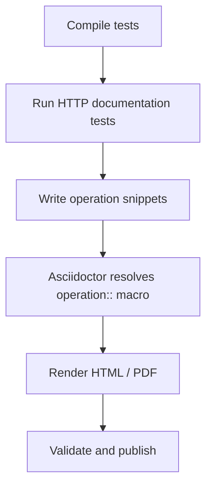

# The Spring REST Docs operation Block Macro

## 1. What Is `operation::`?

Spring REST Docs generates `.adoc` snippets from HTTP tests using MockMvc, WebTestClient, or REST Assured. Each call to `document("operation-id", ...)` creates a directory with that identifier in the generated snippets. An operation can generate multiple files: `curl-request.adoc`, `http-request.adoc`, `http-response.adoc`, `request-fields.adoc`, `response-fields.adoc`, `links.adoc`, and other snippets depending on the declared descriptors.

When authoring documentation, you can include each file using `include::{snippets}/...[]`. However, if you want to bring multiple snippets from the same operation into the document, Spring REST Docs provides the **operation block macro**:

```asciidoc
operation::books-get[]
```

This macro is provided by the `spring-restdocs-asciidoctor` extension. The macro's target is the **operation identifier** used in `document(...)`. In its simplest form, it includes all snippets generated for that operation and creates a section with an appropriate title for each snippet.

Test example:

```java
given(this.specification)
        .filter(document("books-get",
                pathParameters(
                        parameterWithName("id").description("Book ID")),
                responseFields(
                        fieldWithPath("id").description("Book ID"),
                        fieldWithPath("title").description("Book title"))))
.when()
        .get("/api/books/{id}", 42)
.then()
        .statusCode(200);
```

And in the AsciiDoc file:

```asciidoc
== Get book by ID

operation::books-get[]
```

The identifier `books-get` must match the operation name passed into `document(...)` exactly. The macro does not run tests or generate snippets itself; it only brings existing files into the Asciidoctor document.

## 2. Extension Required for the Macro to Work

`operation::` is not a standard macro built into every Asciidoctor environment. Spring REST Docs registers the macro when the `spring-restdocs-asciidoctor` dependency is added to the Asciidoctor plugin's classpath.

With Gradle, the commonly used extension configuration is:

```groovy
plugins {
    id 'org.asciidoctor.jvm.convert' version '3.3.2'
}

configurations {
    asciidoctorExt
}

dependencies {
    asciidoctorExt 'org.springframework.restdocs:spring-restdocs-asciidoctor:3.0.6'
}

tasks.named('asciidoctor') {
    configurations 'asciidoctorExt'
}
```

In an actual project, declare `spring-restdocs-asciidoctor` with the same version as the Spring REST Docs modules being used. A complete configuration also needs the `test` task to generate snippets, declares the snippets directory as output/input, and makes Asciidoctor depend on tests.

With Maven, add `spring-restdocs-asciidoctor` inside the dependencies of `asciidoctor-maven-plugin`:

```xml
<plugin>
    <groupId>org.asciidoctor</groupId>
    <artifactId>asciidoctor-maven-plugin</artifactId>
    <version>2.2.6</version>
    <dependencies>
        <dependency>
            <groupId>org.springframework.restdocs</groupId>
            <artifactId>spring-restdocs-asciidoctor</artifactId>
            <version>${spring-restdocs.version}</version>
        </dependency>
    </dependencies>
</plugin>
```

The dependency must be on the plugin's extension classpath, not only on the application's test classpath. If you only add `spring-restdocs-mockmvc` or `spring-restdocs-restassured`, HTTP snippets can still be generated, but the `operation::` macro will not be registered.

## 3. Including All Snippets of an Operation

The shortest form:

```asciidoc
operation::orders-get[]
```

The target `orders-get` corresponds to:

```java
document("orders-get", ...)
```

The macro includes the snippets available in that operation's directory. For example, after tests run, you might have:

```text
build/generated-snippets/
└── orders-get/
    ├── curl-request.adoc
    ├── http-request.adoc
    ├── http-response.adoc
    ├── httpie-request.adoc
    ├── path-parameters.adoc
    └── response-fields.adoc
```

The actual set of files depends on the test and configured snippets. If the test does not generate `links.adoc`, the macro cannot generate links content on behalf of the test. Therefore, inspect the output directory after tests run when diagnosing a missing section.

## 4. Selecting a Subset of Snippets Using the `snippets` Attribute

The macro supports the `snippets` attribute. Its value is a comma-separated list; each item is a snippet filename **without the `.adoc` extension**:

```asciidoc
operation::books-get[snippets='curl-request,http-request,http-response']
```

The example above only includes:

- `curl-request.adoc`
- `http-request.adoc`
- `http-response.adoc`

This is equivalent to explicit includes:

```asciidoc
[[example_curl_request]]
== Curl request
include::{snippets}/books-get/curl-request.adoc[]

[[example_http_request]]
== HTTP request
include::{snippets}/books-get/http-request.adoc[]

[[example_http_response]]
== HTTP response
include::{snippets}/books-get/http-response.adoc[]
```

Do not include `.adoc` in the `snippets` list. Values must be snippet names, not paths and not other operation identifiers.

## 5. Auto-Generated Section Titles

For each snippet included by the operation macro, Spring REST Docs creates a section with a corresponding title. Some default titles:

| Snippet name | Default title |
| --- | --- |
| `curl-request` | Curl Request |
| `http-request` | HTTP request |
| `http-response` | HTTP response |
| `httpie-request` | HTTPie request |
| `links` | Links |
| `request-body` | Request body |
| `request-fields` | Request fields |
| `response-body` | Response body |
| `response-fields` | Response fields |

For snippets not in the list with a dedicated title, the macro generates a title by replacing `-` with a space and capitalizing the first letter. For example, `custom-snippet` becomes `Custom snippet`.

Section titles help group snippets by operation without manually creating many headings and includes. If the document needs Vietnamese wording, you can customize the title using document attributes.

## 6. Changing Snippet Titles with Document Attributes

The attribute name follows the pattern:

```text
operation-{snippet}-title
```

Example of changing the title of the `curl-request` snippet:

```asciidoc
:operation-curl-request-title: cURL request example

== Get book
operation::books-get[snippets='curl-request,http-request,http-response']
```

Multiple titles can be changed:

```asciidoc
:operation-curl-request-title: Request via cURL
:operation-http-request-title: HTTP request sent to the server
:operation-http-response-title: HTTP response from the server
:operation-response-fields-title: Returned data fields
```

The snippet name in the attribute must match the filename without `.adoc` exactly. For example, `operation-response-fields-title` adjusts the title for `response-fields.adoc`. This attribute only changes the section title generated by the macro; it does not alter the snippet content or filenames in the output directory.

## 7. Using the Operation Macro for Multiple Endpoints

An API document can be organized by resource or use case:

```asciidoc
= Book Store API
:toc:
:toclevels: 3
:sectnums:

== Books

=== List books
operation::books-list[snippets='http-request,http-response,query-parameters,response-fields']

=== Book details
operation::books-get[snippets='curl-request,http-request,http-response,path-parameters,response-fields']

=== Create book
operation::books-create[snippets='http-request,request-fields,http-response,response-fields']

== Orders

=== View order
operation::orders-get[snippets='http-request,http-response,links,response-fields']
```

This keeps the main authoring file short and easy to scan. Operation identifiers must be independent, stable, and match the identifiers in tests. If the same endpoint has multiple scenarios such as `200`, `404`, or `409`, use separate identifiers (for example, `books-get-200`, `books-get-404`) to avoid overwriting snippets.

## 8. When to Use the Operation Macro vs. Individual Snippet Includes?

| Need | Suitable Approach |
| --- | --- |
| Quickly display all snippets of an operation | `operation::id[]` |
| Need only a few snippets | `operation::id[snippets='...']` |
| Need to place explanations between individual snippets | Explicitly include each file. |
| Need to change display order or group into major sections | Explicitly include or split operation macros into groups. |
| Need to customize default titles | Use `operation-{snippet}-title`. |
| Need to format a specific table using AsciiDoc attributes like `cols` | Directly include the snippet file to attach attributes right before the include. |

The operation macro is convenient for repetitive structures, though it is not required for the entire document. You can combine the macro for simple endpoints with explicit includes for sections needing annotations or custom layouts.

Example needing column formatting for a links table:

```asciidoc
=== Link relations
[cols="1,3"]
include::{snippets}/orders-get/links.adoc[]
```

Direct includes allow controlling table attributes placed right before the file; if the operation macro's auto-generated default section is not flexible enough for that case, manually include the corresponding snippet.

## 9. The Operation Macro and the `{snippets}` Attribute Have Different Roles

The two features are often used together but do not replace each other:

| Element | Role |
| --- | --- |
| `{snippets}` | Attribute holding the root directory of generated snippets, used in include paths. |
| `operation::books-get[]` | Macro that recognizes the operation identifier and includes corresponding snippets. |
| `snippets='http-request,http-response'` | Option of the operation macro specifying which snippet files to include. |
| `operation-http-response-title` | Attribute changing the section title for the snippet named `http-response`. |

`spring-restdocs-asciidoctor` typically configures `{snippets}` automatically according to the build tool while also registering the operation macro. If including manually, `{snippets}` is needed. If using the operation macro, the target is the operation identifier so you do not have to write individual file paths yourself.

## 10. Custom Snippets Can Also Be Included

Beyond standard snippets, a project can create custom snippets (such as `example-errors.adoc` or `authorization-notes.adoc`) using the appropriate template/snippet mechanism. When a custom snippet is written to the operation directory and named `custom-snippet.adoc`, the operation macro can select it:

```asciidoc
operation::books-get[snippets='http-request,http-response,custom-snippet']
```

The macro uses the snippet filename without the `.adoc` extension. The default title for `custom-snippet` is `Custom snippet`; it can be changed with:

```asciidoc
:operation-custom-snippet-title: Additional notes
```

Note: the macro only includes snippets that already exist. If a custom snippet has not been generated during test/build, putting its name in the list will not generate content automatically; ensure the task/test generates the file before running Asciidoctor.

## 11. Build Order and CI

The operation macro needs generated snippets to be available before Asciidoctor processes the document. The build must run tests first:



With Gradle, declare outputs/inputs and dependencies:

```groovy
ext {
    snippetsDir = file('build/generated-snippets')
}

tasks.named('test') {
    outputs.dir snippetsDir
}

tasks.named('asciidoctor') {
    inputs.dir snippetsDir
    configurations 'asciidoctorExt'
    dependsOn tasks.named('test')
}
```

With Maven, bind Asciidoctor to a phase after tests, such as `prepare-package`, and place `spring-restdocs-asciidoctor` on the plugin classpath. CI needs to use the current build's output and never reuse stale snippets when tests fail. The operation macro does not replace gating: it does not know whether test assertions passed.

## 12. Common Errors

| Symptom | Cause | Resolution |
| --- | --- | --- |
| `operation::` is not recognized | Missing `spring-restdocs-asciidoctor` on the plugin classpath. | Check Gradle's `asciidoctorExt` or Maven plugin dependencies. |
| Macro includes no snippets | Operation identifier does not exist or tests have not generated snippets. | Compare the target with `document("...")` and check the output directory. |
| One snippet does not appear | Snippet name in the list is wrong or the test did not generate that file. | Omit `.adoc` in the list and verify the actual file. |
| Only a few sections appear | Macro is configured with `snippets='...'` so it only includes selected items. | Add needed snippet names or omit the attribute to include all existing snippets. |
| Section title is not as intended | Title attribute not declared with the right name. | Use `operation-{snippet}-title`. |
| Generated title is in English | Using the default title. | Define title attributes in Vietnamese. |
| `operation::` works locally but fails in CI | Different plugin classpath or snippets not yet generated. | Synchronize plugin dependencies and task ordering. |
| Snippet from another scenario is used by mistake | Duplicate identifier or stale output. | Use separate identifiers per scenario and clean output before tests. |
| Cannot format a table as desired | Macro generates a default section without placing attributes directly above the table include. | Include the snippet separately and use AsciiDoc table attributes. |

## 13. Practice Checklist

- [ ] Added `spring-restdocs-asciidoctor` to the proper Asciidoctor plugin classpath.
- [ ] Target of `operation::` matches the operation identifier in `document(...)`.
- [ ] Decided whether to include all snippets or a selected list.
- [ ] If using `snippets='...'`, each item is a filename without `.adoc`.
- [ ] Understood that the macro creates a section/title for each included snippet.
- [ ] Title attributes follow the form `operation-{snippet}-title`.
- [ ] Tests generate all snippets before Asciidoctor runs.
- [ ] Separate identifiers for statuses/scenarios to avoid overwriting.
- [ ] Use explicit includes where custom layout or table formatting is needed.
- [ ] CI only renders/publishes from snippets of the passing current build.

The operation block macro helps group snippets belonging to the same HTTP operation into an AsciiDoc document with a single `operation::id[]` line. Use the `snippets` attribute to select files, title attributes to customize headings, and explicit includes when custom layout is needed. The macro only handles bringing snippets into the document; accuracy still comes from HTTP tests and a build process that runs tests successfully before Asciidoctor.

## References

- [Spring REST Docs 3.0.6 – Working with Asciidoctor, Including Multiple Snippets for an Operation](https://docs.spring.io/spring-restdocs/docs/current/reference/htmlsingle/)
- [Spring REST Docs – Getting Started: Build Configuration](https://docs.spring.io/spring-restdocs/reference/getting-started.html)
- [Asciidoctor – Document Attributes](https://docs.asciidoctor.org/asciidoc/latest/attributes/document-attributes/)
- [Asciidoctor – Include Directive](https://docs.asciidoctor.org/asciidoc/latest/directives/include/)
