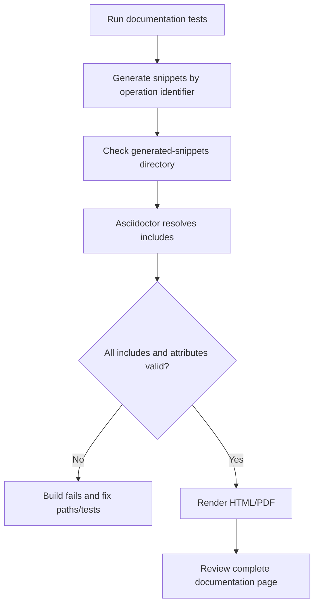

# Embedding an Operation Consisting of Multiple Snippets

## Learning Objectives

After this lesson, you will be able to:

- Explain how a document identifier groups snippets of a single HTTP exchange.
- Embed multiple snippets of the same operation into Asciidoctor in an easy-to-follow order.
- Combine HTTP request/response with path parameters, query parameters, headers, request/response fields, and links.
- Use attributes to avoid repeating snippet paths and organize reusable includes.
- Split documentation pages by resource and use case without mixing snippets between operations.
- Detect missing includes, stale snippets, and path errors in the build.

## 1. Operations and Snippets in Spring REST Docs

In Spring REST Docs, calling document(...) records an HTTP exchange under a document identifier. The identifier determines the directory containing the generated snippets for that exchange.

Test example:

```java
mockMvc.perform(get("/api/orders/{id}", 42)
        .queryParam("expand", "items")
        .header("X-Request-Id", "req-documentation-001")
        .accept(MediaType.APPLICATION_JSON))
    .andExpect(status().isOk())
    .andDo(document("orders-get",
        pathParameters(
            parameterWithName("id").description("Order ID")
        ),
        queryParameters(
            parameterWithName("expand")
                .description("Additional information to expand")
        ),
        requestHeaders(
            headerWithName("X-Request-Id")
                .description("Request trace ID")
        ),
        responseHeaders(
            headerWithName("Content-Type")
                .description("Response media type")
        ),
        responseFields(
            fieldWithPath("id").description("Order ID"),
            fieldWithPath("status").description("Order status"),
            fieldWithPath("items").description("Line items in the order")
        )
    ));
```

After the test runs, the output is typically in a directory like this:

```text
build/
└── generated-snippets/
    └── orders-get/
        ├── curl-request.adoc
        ├── http-request.adoc
        ├── http-response.adoc
        ├── path-parameters.adoc
        ├── query-parameters.adoc
        ├── request-headers.adoc
        ├── response-headers.adoc
        └── response-fields.adoc
```

The actual list of files depends on configured snippets/templates and the descriptors used by the test. If the test does not declare requestFields(...), REST Docs does not automatically generate request-fields.adoc for that operation. Do not assume a file exists just because another operation has a file with the same name.

Key points to remember:

- An identifier like orders-get groups the snippets of one exchange.
- Each descriptor or snippet template produces a separate file.
- Asciidoctor includes individual files according to the intended layout of the page.
- Multiple includes can share the same identifier to form a complete documentation section.

## 2. Why Embed Multiple Snippets of the Same Operation?

An API page often needs to present multiple facets of a request:

| Integrator's question | Suitable snippet |
| --- | --- |
| Which method and URI should be called? | http-request.adoc or curl-request.adoc |
| What does the path parameter mean? | path-parameters.adoc |
| Which query parameters are supported? | query-parameters.adoc |
| Which headers must be sent? | request-headers.adoc |
| Which fields does the request body have? | request-fields.adoc |
| Which status and headers does the response return? | http-response.adoc, response-headers.adoc |
| What structure does the response JSON have? | response-fields.adoc |
| Which navigation links does the resource provide? | links.adoc |

Including only HTTP request and HTTP response may not be enough to explain the contract. Conversely, including only descriptor tables without an example exchange makes it hard for readers to picture how they fit together. A good page typically uses multiple complementary snippets for the same operation.

Not every operation needs every snippet. Include only the files that tests actually generate and that are useful to consumers.

## 3. Preparing the Snippet Path Using an Asciidoctor Attribute

Instead of writing the full path repeatedly, define an attribute pointing to the generated-snippets directory:

```asciidoc
:snippets: {project-root}/build/generated-snippets
```

If project-root is not configured or the AsciiDoc file is located elsewhere, pass the snippets attribute from the build task or use a relative path matching the file's location. Use a single consistent configuration source to avoid conflicts between paths in the file and the task.

You can define a fallback:

```asciidoc
ifndef::snippets[]
:snippets: ../../build/generated-snippets
endif::[]
```

The fallback snippet is an example; the number of ../ levels must match the AsciiDoc file location and the project's output directory. If the task already passes the snippets attribute, the value from the build should take precedence.

### 3.1. Dedicated Attributes for Each Operation

On a page with multiple operations, you can create attributes pointing to each directory:

```asciidoc
:order-get: {snippets}/orders-get
:order-create: {snippets}/orders-create
:order-delete: {snippets}/orders-delete
```

Then include:

```asciidoc
include::{order-get}/http-request.adoc[]
include::{order-get}/response-fields.adoc[]
```

This is useful when the same operation appears in multiple places or is divided into multiple parts. Name attributes by resource/action; avoid generic names like op1 or snippet-dir.

## 4. Combining Multiple Snippets into a Complete API Section

A generally readable order:

1. Short description of the endpoint's purpose and call preconditions.
2. Path/query parameter tables.
3. Request headers and request fields tables, if applicable.
4. Sample HTTP request so readers see how everything fits together.
5. Response headers and response fields.
6. Sample HTTP response to conclude the exchange.

AsciiDoc example for operation GET /api/orders/{id}:

```asciidoc
== Get order information

Returns details for an order by its identifier.
Caller must have permission to read the corresponding order.

=== Path parameters
include::{snippets}/orders-get/path-parameters.adoc[]

=== Query parameters
include::{snippets}/orders-get/query-parameters.adoc[]

=== Request headers
include::{snippets}/orders-get/request-headers.adoc[]

=== HTTP request
include::{snippets}/orders-get/http-request.adoc[]

=== Response headers
include::{snippets}/orders-get/response-headers.adoc[]

=== Response fields
include::{snippets}/orders-get/response-fields.adoc[]

=== HTTP response
include::{snippets}/orders-get/http-response.adoc[]
```

All the includes above use the same identifier orders-get. Descriptor tables explain each part of the exchange and HTTP snippets provide the overall example.

In a real project, if the request has no query parameters or no headers needing documentation, omit the corresponding include. Do not keep an include just because a page template has it; Asciidoctor will fail when the snippet file does not exist.

## 5. Combining Request Body and Response Body

For an operation with a JSON request body, tests can generate http-request.adoc and request-fields.adoc. The fields table helps look up individual fields; the HTTP request shows how the payload is placed in the request.

Example:

```asciidoc
== Create order

=== Request fields
include::{snippets}/orders-create/request-fields.adoc[]

=== HTTP request
include::{snippets}/orders-create/http-request.adoc[]

=== Response fields
include::{snippets}/orders-create/response-fields.adoc[]

=== HTTP response
include::{snippets}/orders-create/http-response.adoc[]
```

If the raw payload is too long or sensitive, you can include only the fields table and use a preprocessor to sanitize the request body before writing snippets. For the response, response-fields.adoc describes the structure; http-response.adoc shows the status, headers, and payload in a single exchange.

Do not assume request-body.adoc or response-body.adoc are always generated. Only include them when the project has configured the corresponding templates and the files actually appear in the output.

## 6. Embedding Links and Additional Snippets

Some APIs return resource links for client navigation. If tests use links(...) and generate links.adoc, you can place the link table alongside response fields:

```asciidoc
=== Resource links
include::{snippets}/orders-get/links.adoc[]

=== Response fields
include::{snippets}/orders-get/response-fields.adoc[]
```

Snippets such as request-parts.adoc, request-headers.adoc, response-headers.adoc, path-parameters.adoc, or query-parameters.adoc only appear when tests generate them. You can choose snippet groups by operation type:

| Operation type | Commonly used snippet group |
| --- | --- |
| GET resource | path/query parameters, request headers, response fields, links, HTTP exchange |
| POST JSON | request fields, request headers, response fields, response headers, HTTP exchange |
| Multipart upload | request-parts, part fields/body, response fields, HTTP exchange |
| Conditional update | request headers such as If-Match, response headers such as ETag, status/response snippet |
| Error response | request context, error response fields, response headers, HTTP response |

## 7. Splitting Operations into Readable Sections on Long Pages

A resource page can contain multiple operations:

```asciidoc
= Orders API

include::orders/list.adoc[leveloffset=+1]

include::orders/get.adoc[leveloffset=+1]

include::orders/create.adoc[leveloffset=+1]

include::orders/cancel.adoc[leveloffset=+1]
```

Each subfile focuses on one operation and includes the corresponding snippets. This split makes resource-level pages easy to navigate, each operation easy to review, and prose sit close to the snippets it explains.

If using nested includes, configure leveloffset carefully so headings do not skip or duplicate levels. Standardize heading conventions between parent and child pages.

## 8. Writing a Test with Complete Snippets for an Operation

MockMvc test example for GET order with path parameter, query parameter, header, and response fields:

```java
@Test
void getOrder() throws Exception {
    mockMvc.perform(get("/api/orders/{id}", 42)
                    .queryParam("expand", "items")
                    .header("X-Request-Id", "req-doc-001")
                    .accept(MediaType.APPLICATION_JSON))
            .andExpect(status().isOk())
            .andExpect(jsonPath("$.id").value(42))
            .andDo(document("orders-get",
                    pathParameters(
                            parameterWithName("id")
                                    .description("Order ID")
                    ),
                    queryParameters(
                            parameterWithName("expand")
                                    .description("Fields to expand")
                    ),
                    requestHeaders(
                            headerWithName("X-Request-Id")
                                    .description("Request trace ID")
                    ),
                    responseHeaders(
                            headerWithName("Content-Type")
                                    .description("Response media type")
                    ),
                    responseFields(
                            fieldWithPath("id")
                                    .description("Order ID"),
                            fieldWithPath("status")
                                    .description("Order status"),
                            fieldWithPath("items")
                                    .description("Line items")
                    )
            ));
}
```

This test is a structural example; it requires static imports, fixtures, and a controller appropriate to the project. For the Asciidoctor page to include snippets, the test must pass in the build and use the exact configured output directory.

An operation can use multiple document(...) invocations if a test intentionally records multiple exchanges, but each identifier must reflect a clear scenario. Do not write requests with different behavior to the same identifier if doing so makes snippets confusing, overwrites them, or causes instability.

## 9. Organizing Snippets for Error Responses

Error responses often have their own structure. Use separate identifiers so success and error snippets do not mix:

```asciidoc
== Error behavior

=== Order not found
When the order ID does not exist, the API returns 404.

==== Error response fields
include::{snippets}/orders-get-not-found/response-fields.adoc[]

==== HTTP response
include::{snippets}/orders-get-not-found/http-response.adoc[]
```

The identifier orders-get-not-found allows independent assertions on status and error body. If an error format is shared across multiple endpoints, you can write a shared explanation section and include specific snippets at each endpoint.

## 10. Reusing Includes Without Obscuring Context

Asciidoctor supports file includes and attribute substitution. You can create a partial for repetitive parts:

```asciidoc
// _http-exchange.adoc
=== HTTP request
include::{operation-snippets}/http-request.adoc[]

=== HTTP response
include::{operation-snippets}/http-response.adoc[]
```

The operation page sets the attribute before including the partial:

```asciidoc
:operation-snippets: {snippets}/orders-get
include::_http-exchange.adoc[]
```

The partial needs to know the attribute context and the snippet names the operation actually creates. Do not turn every page into multiple layers of includes if doing so makes it difficult for reviewers to trace back to the source snippet file. For short pages, direct includes are usually easier to understand.

### 10.1. Avoiding Misapplied Attribute Errors

Place the attribute before where it is used. When a partial is reused across multiple operations, reset the attribute for each include and render to verify:

```asciidoc
:operation-snippets: {snippets}/orders-get
include::_request-response.adoc[]

:operation-snippets: {snippets}/orders-create
include::_request-response.adoc[]
```

Try rendering with multiple consecutive operations and inspect the actual include paths, avoiding having the second partial reuse the directory of the first partial.

## 11. Controlling Custom Snippets

Spring REST Docs provides default snippets; projects can also configure custom snippet templates to generate tables/content following a style guide.

When using custom snippets:

- Define the operation identifier as usual.
- Name the template or snippet clearly according to the integration API of the version in use.
- Inspect the actual output file and naming convention.
- Include the exact generated filename.
- Keep templates stable so multiple operations can share them.

Conceptual example:

```java
andDo(document("orders-get",
    customSnippet(),
    pathParameters(...)
))
```

customSnippet() here is an illustrative placeholder, not a built-in API to copy. In a project, replace it with the actual Snippet class implemented and configured. Do not include a custom snippet file based solely on the class name; confirm the written filename.

## 12. Common Errors When Embedding Multiple Snippets

| Symptom | Possible Cause | Resolution |
| --- | --- | --- |
| Asciidoctor reports included file does not exist | Test has not generated the snippet or include filename is wrong | Run the right test, inspect output directory, and fix the path |
| One operation mistakenly pulls response fields from another operation | snippets attribute points to the wrong directory or identifier was copied by mistake | Set operation attributes clearly and review paths |
| Parameter table appears but HTTP request has no parameters | Descriptor/prose and request fixture do not match the same scenario | Synchronize test request, descriptor, and explanatory content |
| Response fields snippet is not generated | Test does not declare responseFields(...) or does not reach document(...) | Check assertions and descriptors in the test |
| Old include still renders after deleting the test | Generated snippets still contain stale files from a previous build | Clean output or delete output via build task |
| Page is long and repeats information | Including every snippet without structure | Group by request, response, error, and use case |
| Partial uses the wrong operation path | Attribute placed in the wrong spot or not reset | Set the attribute before the include and render multiple times to verify |
| Snippet filename guessed incorrectly | Confusing descriptor name with output filename | Check the output directory instead of guessing |

## 13. Checking the Build and CI

The documentation build flow must ensure tests generate snippets before Asciidoctor includes them:



Gradle dependency example:

```groovy
def snippetsDir = file("$buildDir/generated-snippets")

tasks.named('test') {
    outputs.dir snippetsDir
}

tasks.named('asciidoctor') {
    inputs.dir snippetsDir
    dependsOn tasks.named('test')
}
```

This snippet illustrates task relationships; a project needs the Asciidoctor plugin, REST Docs dependencies, and proper snippets attribute configuration. The test and Asciidoctor tasks must use the same output path. Running only Asciidoctor without snippets will cause includes to fail.

Illustrative build command:

```bash
./gradlew clean test asciidoctor
```

On Windows you can use gradlew.bat. With Maven, configure plugin executions in the lifecycle so tests generate snippets before the Asciidoctor goal.

CI should verify that documentation tests ran, output has the required operation directories, included snippets exist, no stale snippets remain, and Asciidoctor renders successfully. Review the final HTML to confirm proper order, no duplicate content, and no misdirected operations.

## 14. Checklist for Embedding Multiple Snippets of an Operation

- [ ] Each exchange has a clear and stable document identifier.
- [ ] Identified snippets actually generated by tests.
- [ ] Set the snippets attribute to point to the exact output directory.
- [ ] Used the same operation identifier for snippets belonging to one exchange.
- [ ] Ordered includes along the request → response flow.
- [ ] Included parameter/header/field/link snippets when they help clarify the contract.
- [ ] Placed error responses under separate identifiers.
- [ ] Split pages into partials when a resource page has many operations.
- [ ] Set/reset attributes properly before including partials.
- [ ] Do not guess filenames; inspect generated-snippets output.
- [ ] Run clean test asciidoctor on CI and review the rendered page.

## 15. Practice Exercise

An orders API has three scenarios:

- GET /api/orders/{id}: returns order details, supports query expand.
- POST /api/orders: accepts JSON body to create an order.
- GET /api/orders/{id} with non-existent ID: returns error 404.

Perform the following:

1. Write a documentation test for successful GET with identifier orders-get.
2. Create descriptors for path parameter, query parameter, request header, and response fields.
3. Write a POST test with identifier orders-create, documenting request fields, response headers, and response fields.
4. Write a separate 404 test with identifier orders-get-not-found.
5. Run the tests and record the list of actual snippet files generated by each identifier.
6. Write AsciiDoc including multiple snippets of orders-get in the order path/query/header/request/response headers/response fields/HTTP response.
7. Split orders-create and error scenarios into subfiles if the resource page becomes long.
8. Run clean test asciidoctor and verify there are no missing includes or misdirected operations.

**Self-check question:** Can you include orders-create's request-fields.adoc in the GET orders-get section just because both operate on Order? No. Snippets belong to a specific exchange and document identifier. Only include snippets of the operation matching the section being described; if reusing a shared field table, create intentional shared content instead of pointing to another request's snippet.

## Conclusion

A single operation in Spring REST Docs can generate multiple snippets located under the exchange's document identifier. Asciidoctor assembles them into a complete documentation section by including individual files: request, parameters, headers, fields, links, and response. Set up a shared snippets attribute, group snippets by operation, order includes following the integrator's flow, and separate error exchanges with distinct identifiers. Filenames must be verified from generated output, never guessed. When tests generate snippets before Asciidoctor, include paths are checked in CI, and rendered pages are reviewed, the documentation stays consistent with tested HTTP exchanges and remains maintainable as the API evolves.
