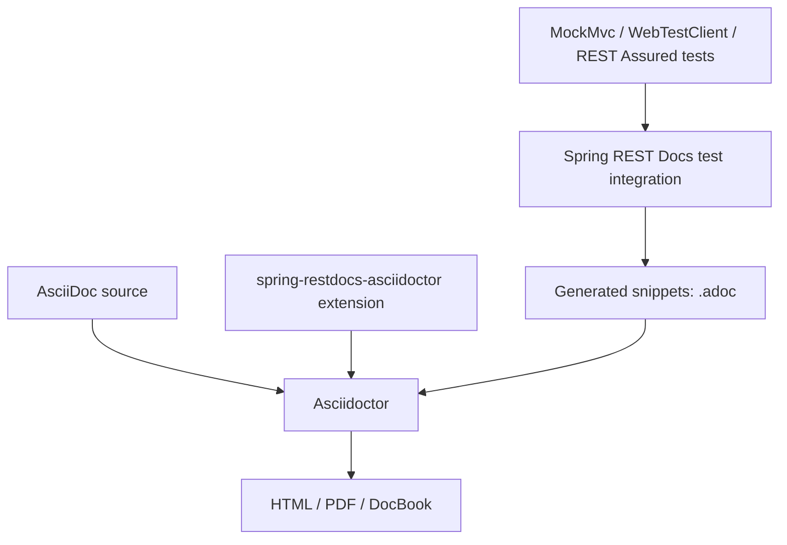
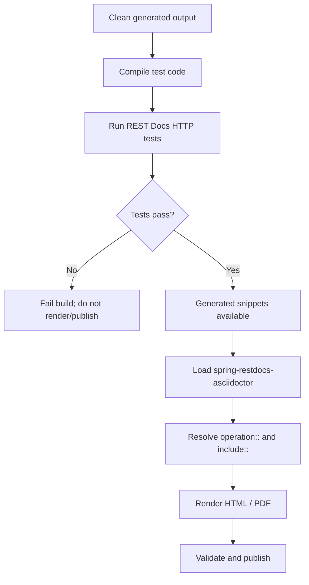

# The spring-restdocs-asciidoctor Extension

## 1. What Does This Extension Solve?

Spring REST Docs generates verifiable REST API documentation from HTTP tests using MockMvc, WebTestClient, or REST Assured. Tests execute requests, verify responses, and write generated snippets such as `http-request.adoc`, `http-response.adoc`, `request-fields.adoc`, `response-fields.adoc`, or `links.adoc`.

The **`spring-restdocs-asciidoctor`** artifact integrates Spring REST Docs with Asciidoctor. When placed on the Asciidoctor processor classpath, the extension registers capabilities specific to Spring REST Docs, notably:

- The operation block macro `operation::...[]` to insert snippets of an operation into the document.
- Attributes and resolution mechanisms for the snippets directory during authoring/rendering.
- Attributes supporting the presentation of operation snippets, such as customizing the title of each snippet.

The extension belongs to the **documentation authoring** stage. It does not send HTTP requests, run JUnit tests, verify assertions, or generate snippets itself. Those responsibilities are handled by the corresponding REST Docs test integration module and tests.



## 2. Distinguishing Common Dependencies

Artifact names are similar, but they have different responsibilities:

| Artifact | Role | Where Is It Used? |
| --- | --- | --- |
| `spring-restdocs-mockmvc` | Integrates Spring REST Docs with MockMvc. | Test compile/runtime. |
| `spring-restdocs-restassured` | Integrates Spring REST Docs with REST Assured. | Test compile/runtime. |
| `spring-restdocs-webtestclient` | Integrates Spring REST Docs with WebTestClient. | Test compile/runtime. |
| `spring-restdocs-asciidoctor` | Provides the extension/macro for Asciidoctor. | Plugin/configuration classpath running Asciidoctor. |

For example, a project using REST Assured needs the `spring-restdocs-restassured` artifact for the `document(...)` filter to write snippets. To use `operation::orders-get[]` when authoring `.adoc` files, you need to add `spring-restdocs-asciidoctor` to the Asciidoctor plugin's classpath. Declaring the extension only in `testImplementation` does not ensure Asciidoctor will load the macro.

## 3. Configuring the Extension with Gradle

Gradle configuration example using the Asciidoctor JVM plugin:

```groovy
plugins {
    id 'java'
    id 'org.asciidoctor.jvm.convert' version '3.3.2'
}

configurations {
    asciidoctorExt
}

dependencies {
    testImplementation 'org.springframework.restdocs:spring-restdocs-mockmvc:3.0.6'
    asciidoctorExt 'org.springframework.restdocs:spring-restdocs-asciidoctor:3.0.6'
}

def snippetsDir = layout.buildDirectory.dir('generated-snippets')

tasks.named('test') {
    outputs.dir snippetsDir
    useJUnitPlatform()
}

tasks.named('asciidoctor') {
    configurations 'asciidoctorExt'
    inputs.dir snippetsDir
    dependsOn tasks.named('test')
    attributes 'snippets': snippetsDir.get().asFile
}
```

In this example:

1. `asciidoctorExt` is the configuration used to place the extension on the Asciidoctor task classpath.
2. `spring-restdocs-asciidoctor` registers the operation macro and integration capabilities.
3. `snippetsDir` is where tests are configured to write snippets.
4. `test.outputs.dir` declares generated snippets as an output of the test task.
5. `asciidoctor.inputs.dir` declares the same directory as an input of the render task.
6. `dependsOn test` ensures tests run before Asciidoctor reads snippets.
7. `attributes 'snippets': ...` sets the path attribute used by macros/includes.

The versions in this example are a consistent illustrative set; use versions compatible with your project's Spring Boot, Spring Framework, and Gradle plugin. Versions can be managed with a BOM or version catalog instead of repeating them directly in dependency strings.

If the project already configures `snippets` elsewhere, keep one consistent configuration source. Declaring the extension and assigning the snippets path are two related responsibilities that should not have conflicting values.

## 4. Configuring the Extension with Maven

With Maven, the extension must be in the dependencies of **Asciidoctor Maven Plugin**, not just the application's dependencies. Example:

```xml
<plugin>
    <groupId>org.asciidoctor</groupId>
    <artifactId>asciidoctor-maven-plugin</artifactId>
    <version>2.2.6</version>
    <executions>
        <execution>
            <id>generate-api-docs</id>
            <phase>prepare-package</phase>
            <goals>
                <goal>process-asciidoc</goal>
            </goals>
            <configuration>
                <backend>html</backend>
                <attributes>
                    <snippets>${project.build.directory}/generated-snippets</snippets>
                </attributes>
            </configuration>
        </execution>
    </executions>
    <dependencies>
        <dependency>
            <groupId>org.springframework.restdocs</groupId>
            <artifactId>spring-restdocs-asciidoctor</artifactId>
            <version>${spring-restdocs.version}</version>
        </dependency>
    </dependencies>
</plugin>
```

`spring-restdocs.version` should be declared centrally in `properties` or managed via dependency management. The `target/generated-snippets` path must match where tests write output. With multi-module Maven, clearly identify which module generates snippets and which module runs Asciidoctor; `${project.build.directory}` in the docs module may differ from the test module's `target`.

Run the build starting from `clean` to avoid using stale snippets:

```bash
mvn clean verify
```

The `prepare-package` phase runs after the `test` phase in the standard lifecycle. If the project customizes the lifecycle, verify that Asciidoctor runs only after all required HTTP tests complete successfully.

## 5. Using the Operation Block Macro

Once the extension is loaded, an AsciiDoc file can invoke:

```asciidoc
== Get book by ID

operation::books-get[]
```

`books-get` must match the identifier in the test:

```java
filter(document("books-get",
        pathParameters(
                parameterWithName("id").description("Book ID")),
        responseFields(
                fieldWithPath("id").description("Book ID"),
                fieldWithPath("title").description("Book title"))))
```

The operation macro includes available snippets belonging to the `books-get` directory and creates a corresponding section for each snippet. The macro cannot generate snippets that tests have not produced. If a test only generates request/response and response fields, you cannot expect the macro to synthesize `request-fields.adoc` or `links.adoc`.

## 6. Selecting Specific Snippets and Changing Titles

You can limit which files are included:

```asciidoc
operation::books-get[snippets='curl-request,http-request,http-response,response-fields']
```

The list consists of snippet names without the `.adoc` extension, separated by commas. These are filenames inside the operation directory, not directory paths.

Section titles can be changed using document attributes following the pattern:

```asciidoc
:operation-curl-request-title: cURL request example
:operation-http-request-title: HTTP request sent to the server
:operation-http-response-title: HTTP response received
:operation-response-fields-title: Returned data fields

operation::books-get[snippets='curl-request,http-request,http-response,response-fields']
```

The `operation-{snippet-name}-title` attribute affects the section title generated by the macro. It does not rename files and does not alter the original snippet content. If you need a layout with explanations interleaved between snippets, you can include individual files instead of using a single operation macro.

## 7. The `snippets` Attribute and the Operation Macro

The two usages are related but have different meanings:

```asciidoc
include::{snippets}/books-get/http-request.adoc[]

operation::books-get[]
```

| Element | Meaning |
| --- | --- |
| `{snippets}` | Attribute holding the root directory of generated snippets. |
| `include::` | Asciidoctor macro that reads a file at the specified path. |
| `operation::` | Spring REST Docs macro that accepts an operation identifier and includes snippets belonging to that operation. |
| `snippets='http-request,http-response'` | Selects snippet files to be included by the operation macro. |
| `operation-http-response-title` | Changes the section title for the `http-response` snippet. |

The extension provides the operation macro; the snippets directory value must be configured to match where tests write output. With explicit includes, writers use `{snippets}` in the path. With the operation macro, the target is the operation identifier, not a physical path.

## 8. Organizing Large Documentation with the Operation Macro and Includes

You can use the operation macro for endpoints with a standard structure:

```asciidoc
= Store API
:toc:
:toclevels: 3
:sectnums:

== Books

=== List books
operation::books-list[snippets='http-request,http-response,query-parameters,response-fields']

=== Book details
operation::books-get[snippets='http-request,http-response,path-parameters,response-fields']

=== Create book
operation::books-create[snippets='http-request,request-fields,http-response,response-fields']
```

For an operation with special explanations, include individual snippets:

```asciidoc
=== Pay for order

The client retrieves the payment URI from the `payment` relation in the order response.

==== Request
include::{snippets}/orders-payment/http-request.adoc[]

==== Response
include::{snippets}/orders-payment/http-response.adoc[]
```

Combining both approaches keeps documentation concise for standard endpoints while giving fine-grained control where workflows or business guidance are needed.

## 9. The Extension Does Not Replace HTTP Test Integration

A common configuration mistake is adding only `spring-restdocs-asciidoctor` and expecting tests to start generating snippets. In reality, both sides are required:

| Test Side | Authoring Side |
| --- | --- |
| Add `spring-restdocs-mockmvc`, `spring-restdocs-restassured`, or `spring-restdocs-webtestclient` depending on the client used. | Add `spring-restdocs-asciidoctor` to the Asciidoctor plugin classpath. |
| Configure the REST Docs filter/extension for tests. | Configure the Asciidoctor plugin and extension. |
| Call `document("operation-id", ...)` in the request test. | Call `operation::operation-id[]` or include snippets directly. |
| Run tests to generate snippet files. | Run Asciidoctor after snippets exist. |

If the test side is missing, the macro has no data to include. If the Asciidoctor side is missing, tests can still create snippet files, but the operation macro will not be recognized.

## 10. Managing Generated Snippets and Build Order

A safe pipeline must ensure snippets belong to the exact build currently running:



With Gradle, declare `asciidoctor` depends on `test`, while explicitly specifying generated snippets as inputs/outputs of the tasks. With Maven, place the render plugin in a phase after `test`. If a test fails after a document filter has already written snippets, files may still remain; do not render/publish merely because the directory contains files.

Do not edit files manually inside `build/generated-snippets` or `target/generated-snippets`. If generated content needs to change, update test descriptors, preprocessors, or custom snippet templates and re-run the tests.

## 11. Verifying the Extension Is Loaded

When the build reports `operation::` is unrecognized or includes do not resolve, check in order:

1. Is `spring-restdocs-asciidoctor` on the Asciidoctor plugin classpath?
2. Did Gradle add `asciidoctorExt` to the task's `configurations`?
3. Is the Maven dependency inside `asciidoctor-maven-plugin`'s dependencies?
4. Is the extension version synchronized with the Spring REST Docs version in tests?
5. Did the test task run and create the corresponding operation directory?
6. Does the `snippets` attribute point to the exact output directory?
7. Do the operation ID and snippet names match the files on disk exactly?

If `include::{snippets}/...[]` works while `operation::...[]` is not recognized, check the extension/macro classpath first. If neither finds files, inspect the output directory and task ordering.

## 12. Common Errors

| Symptom | Cause | Resolution |
| --- | --- | --- |
| `operation::` is not recognized | Extension is not loaded into the Asciidoctor plugin. | Add `spring-restdocs-asciidoctor` to `asciidoctorExt` or Maven plugin dependencies. |
| Tests generate snippets but macro has no content | Wrong operation ID or tests have not generated output for that operation. | Compare `document("...")` with the macro target; inspect the snippets directory. |
| Manual include works but `operation::` fails | Classpath can resolve AsciiDoc files but lacks the macro extension. | Verify the extension is present on Asciidoctor's runtime classpath. |
| Macro runs but a section is missing | Snippet was not generated by the test or was excluded from the `snippets` list. | Check output and selected snippet names. |
| `snippets` points to the wrong directory | Tests and Asciidoctor use two different output directories. | Synchronize test output, build attributes, and plugin configuration. |
| Local build works but CI fails | Plugin classpath/version or task ordering differs. | Use committed build configuration, clean output, and run the same lifecycle. |
| Mismatched versions across artifacts | Spring REST Docs modules are out of sync. | Manage versions centrally with an appropriate BOM/property/version catalog. |
| Docs rendered from stale snippets | Generated directory was not cleaned or tests were skipped. | Clean output and only publish when the current build's tests pass. |

## 13. Practice Checklist

- [ ] Added the right test integration module for MockMvc, WebTestClient, or REST Assured.
- [ ] Added `spring-restdocs-asciidoctor` to the Asciidoctor plugin classpath.
- [ ] Spring REST Docs artifact versions are managed consistently.
- [ ] Configured snippets directory matches where tests write output.
- [ ] Operation ID in `operation::...[]` matches `document("...")`.
- [ ] Verified the list of snippets to include and title attributes, if any.
- [ ] Distinguished the operation macro from direct file includes.
- [ ] Asciidoctor runs after HTTP tests and only reads output from the current build.
- [ ] CI does not render/publish documentation when tests or descriptors fail.
- [ ] Verified the final HTML/PDF has all sections and no missing includes.

`spring-restdocs-asciidoctor` is the bridge between snippets generated by HTTP tests and the rendered AsciiDoc documentation. Placing the extension on the right classpath lets Asciidoctor understand the operation macro and Spring REST Docs attributes; build configuration ensures the macro reads the exact snippets directory. When test integration, the authoring extension, and the render task are cleanly separated, documentation is produced from the verified test results of that exact build rather than manually copied examples or stale output.

## References

- [Spring REST Docs – Getting Started](https://docs.spring.io/spring-restdocs/reference/getting-started.html)
- [Spring REST Docs – Asciidoctor Integration and Operation Macro](https://docs.spring.io/spring-restdocs/docs/current/reference/htmlsingle/)
- [Spring REST Docs – Documenting Your API](https://docs.spring.io/spring-restdocs/reference/documenting-your-api.html)
- [Asciidoctor Gradle Plugin](https://docs.asciidoctor.org/gradle-plugin/latest/)
- [Asciidoctor Maven Plugin](https://github.com/asciidoctor/asciidoctor-maven-plugin)
