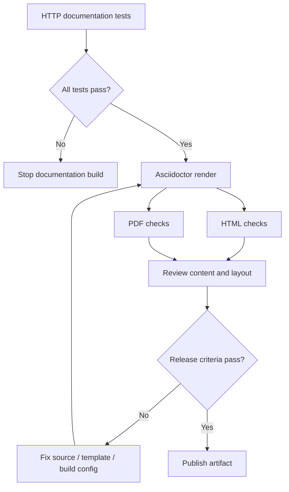
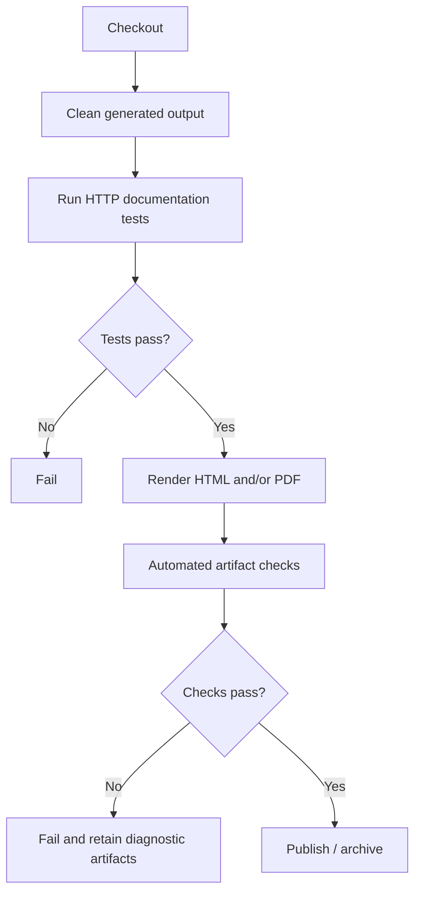

# Checking HTML or PDF Output

## 1. Why Must Documentation Be Checked After Rendering?

Spring REST Docs generates verifiable REST API documentation from HTTP tests using MockMvc, WebTestClient, or REST Assured. Tests generate request, response, headers, parameters, fields, and hypermedia links snippets; Asciidoctor merges snippets with team-authored explanations to create HTML or PDF documentation.

Passing tests and a successful Asciidoctor run are necessary conditions, but not sufficient to guarantee the published documentation is good. A build may succeed while HTML still misses a section, an anchor fails to work, an image does not load, or the layout breaks on small screens. A PDF may render while Vietnamese characters suffer font substitution, tables overflow margins, code gets clipped, a heading sits orphaned at the bottom of a page, or links are unclickable.

Therefore, you must inspect the **final artifact** after rendering. Check both technical accuracy and how readers experience the information:

| Verification Layer | Questions to Answer |
| --- | --- |
| Build and sources | Did tests pass? Do snippets belong to the current build? Do includes resolve? |
| HTML/PDF content | Are all operations, requests/responses, field tables, and links present? |
| Structure | Are headings, table of contents, anchors, and navigation accurate? |
| Presentation | Are tables, code, images, fonts, and page breaks readable? |
| Release | Does the artifact have the right version, paths, metadata, and no leaked sensitive data? |



## 2. Verifying the Exact Artifact and Build Run

Before opening the HTML or PDF, verify that the build ran from current sources and used freshly generated snippets. Common directories:

| Build tool | Snippets | Common HTML output | Common PDF output |
| --- | --- | --- | --- |
| Gradle | `build/generated-snippets/` | `build/docs/asciidoc/html5/` | Depends on Asciidoctor PDF configuration, usually in `build/docs/asciidoc/pdf/`. |
| Maven | `target/generated-snippets/` | `target/generated-docs/` or configured plugin output directory. | Depends on PDF backend/plugin configuration. |

Exact paths are determined by project configuration. Do not assume every project shares the same output path; check task logs and the project's own plugin configuration.

With Gradle, an illustrative command:

```bash
./gradlew clean test asciidoctor
```

With Maven:

```bash
mvn clean verify
```

If PDF is a separate task, invoke the task configured by the project, such as the Asciidoctor PDF task. Running `asciidoctor` to generate HTML does not automatically guarantee PDF is also generated.

When inspecting artifacts, confirm:

- The build exits with code 0.
- HTTP documentation tests ran and were not unexpectedly skipped.
- Generated snippets have timestamps/outputs from the just-completed build.
- Asciidoctor reads the right source files and the right `{snippets}` directory.
- HTML/PDF is freshly created in the configured output directory.
- Leftover files from a previous build are not filling in for tests that just failed.

## 3. Checking HTML: Content and Structure

HTML is usually the primary publishing format for a developer portal. After rendering, open the page in a browser and check the following items.

### Operation Content

Cross-check the page structure against source documents and generated snippets:

- Every resource/operation intended for publication has a section.
- Each operation has the right method, URI, request, and response.
- Path/query parameters, headers, request fields, and response fields appear in the right places.
- Hypermedia links include `links.adoc` when tests generated that snippet.
- Important status codes and error payloads are not omitted.
- Examples do not accidentally pull snippets from another scenario.

Do not merely count files in `generated-snippets`. Read the rendered HTML content to detect mis-included sections, duplicate includes, or empty headings.

### Headings and Table of Contents

Check:

- Headings have a logical hierarchy (`h1`, `h2`, `h3`...), without arbitrary level jumps.
- The table of contents accurately reflects existing sections.
- Operation names in the table of contents are clear enough for searching.
- Anchors/cross-references lead to the right sections, without misdirecting or pointing to missing targets.
- No empty sections exist because an operation macro/include referenced ungenerated content.

If multiple AsciiDoc files are nested via includes, check heading order after Asciidoctor merges them. Heading levels in a subfile may create an unintended structure if the parent file is already at a deep section level.

### Code Blocks and HTTP Snippets

Check that requests/responses display completely:

- Method, URI, HTTP status, and headers are not truncated.
- JSON/XML has readable indentation, brackets, and escape characters.
- Code blocks use a monospace font, with syntax highlighting if configured.
- Long lines such as Authorization, URLs, or JSON paths do not break the layout.
- Sensitive placeholders remain clear, while real tokens/cookies do not appear.

## 4. Checking HTML: Links, Images, and Assets

A page opening does not mean every resource inside loads properly. Check:

| Element | What to Confirm |
| --- | --- |
| `include` | No remaining include errors, missing sections, or wrongly embedded content. |
| Internal links | Anchors exist and links navigate to the right section. |
| External links | URLs are accurate, with no typos or stale links. |
| CSS | Stylesheet loads successfully; tables/code/admonitions render properly. |
| Images | Relative paths are right; images are not broken and have suitable sizes. |
| JavaScript (if any) | Table of contents, search, or navigation works. |
| Download links | Attached files or OpenAPI artifacts are downloadable if published. |

If documentation is hosted under a portal subpath, check relative URLs. An image link that works when opened locally via `file://` may not work when the page is published under `/docs/api/v1/`.

## 5. Checking HTML Responsiveness and Accessibility

API documentation often contains multi-column tables, long URIs, and code blocks. Check at least:

- Common desktop screen widths.
- Narrow windows or mobile devices.
- Browser zoom to verify content remains usable.
- Tables can scroll or wrap reasonably without losing columns.
- Code blocks do not cover navigation buttons or overflow the entire page.
- Text/background colors have sufficient contrast and link states are recognizable.
- Images have appropriate alternative text if they convey information.
- Headings follow proper order, links have descriptive names, and meaning is not conveyed by color alone.

There is no need to turn this check into a full accessibility audit on every build. However, issues that prevent readers from accessing requests/responses or navigating documentation must be fixed before release.

## 6. Checking HTML with Automated Tools

Some checks can be added to CI:

| Check | Purpose | Tool/Example |
| --- | --- | --- |
| Artifact exists | Confirm HTML file was generated. | Check files in output directory. |
| HTML validation | Detect invalid markup. | Validator suited to HTML output. |
| Broken links | Detect non-existent links/anchors. | Link checker running on the rendered site. |
| Missing assets | Detect unloaded CSS/JS/images. | Link checker or browser-based smoke test. |
| Text assertions | Confirm critical sections are present. | `grep`/script checking headings or operation IDs in HTML. |

Example of simple checks in a CI shell once the output path is known:

```bash
test -s build/docs/asciidoc/html5/index.html
grep -q "Get book by ID" build/docs/asciidoc/html5/index.html
grep -q "HTTP response" build/docs/asciidoc/html5/index.html
```

The commands above are only smoke checks: `test -s` confirms the file is non-empty, `grep` confirms strings appear. They do not prove valid markup, working links, or good layout. Use paths and titles matching the project's actual configuration.

Validators/link checkers may report errors for URLs requiring authentication, internal endpoints, or temporarily unreachable external links. Configure allowlists/skips with justification and avoid turning unrelated warnings into false failures; at the same time, never ignore all link errors.

## 7. Checking PDF: Pages, Margins, and Page Breaks

PDF is commonly used when documentation needs to be downloaded, archived, or distributed offline. After rendering, check:

- Paper size and page orientation match configuration.
- Page margins are wide enough so content is not clipped.
- Headers/footers, page numbers, and titles do not overlap content.
- Headings do not sit orphaned at the bottom of a page when avoidable.
- Tables do not split columns awkwardly or overflow margins; if a page break occurs, table headers remain understandable.
- Long code blocks break or flow across pages without losing lines.
- Long URLs and JSON paths are not truncated such that readers cannot copy them.
- The final page has no unintended blank trailing page.

For example, a PDF may open cleanly in a viewer while a three-column response fields table still overflows margins because the description column contains long text. Inspect pages with wide tables, code blocks, and header-heavy HTTP snippets rather than checking only the cover page.

## 8. Checking PDF: Fonts and Vietnamese Characters

For Vietnamese documentation, fonts are a critical item. Verify:

- Letters have full diacritics, without turning into boxes or replacement characters.
- Uppercase/lowercase, combined diacritics, and punctuation render properly.
- Fonts are embedded or handled according to the project's PDF policy.
- Monospace font in code blocks can render the characters used.
- Bold/italic styling does not drop glyphs or switch fonts unexpectedly.
- When copying text from the PDF, content does not reorder characters or lose diacritics severely.

If using Asciidoctor PDF, configure font families and font files according to the backend documentation. Never assume setting `font-family` alone is enough: the font must include Vietnamese glyphs and the backend must locate the exact files. Test rendering words with full diacritics, such as “Tùy chỉnh bảng”, “đơn hàng”, “ngữ nghĩa”, along with code containing brackets and special characters if allowed by the project.

## 9. Checking PDF with Automated Tools

Some useful tools in a PDF pipeline:

| Tool | What It Can Verify | What It Cannot Replace |
| --- | --- | --- |
| `pdfinfo` | Page count, page dimensions, basic metadata. | Visual inspection of margins, fonts, and layout. |
| `pdftotext` | Extracts text to search for titles, operations, or missing characters. | Confirming pages look good or links are clickable. |
| PDF validator/preflight | Certain technical properties, font embedding, or PDF standards per tool settings. | Evaluating whether content is readable for users. |
| PDF viewer/render-to-image | Inspecting images of individual pages. | Checking semantics or source test content. |

Example basic verification commands if Poppler utilities are available:

```bash
pdfinfo build/docs/asciidoc/pdf/api.pdf
pdftotext build/docs/asciidoc/pdf/api.pdf - | grep "Get book by ID"
```

PDF filenames and paths depend on the plugin/backend. This is an illustrative example; substitute the project's actual artifact. `pdftotext` is helpful for checking text presence, but does not catch all glyph errors, character positioning issues, or page overflows.

## 10. Comparing HTML and PDF Checks

| Item | HTML | PDF |
| --- | --- | --- |
| Operation content and snippets | Check sections, includes, headings. | Check text and pages containing sections. |
| Navigation | TOC, anchors, external links. | Bookmarks, hyperlinks, and page references if generated. |
| Tables | Responsive width, overflow, CSS. | Margins, column widths, row splits, repeated headers. |
| Code | Wrap/scroll, syntax highlighting. | Monospace font, line wrapping, and page breaks. |
| Fonts | Web fonts and fallbacks. | Fonts with required glyphs and embedding/availability. |
| Media | CSS, JS, images. | Embedded images and resolution. |
| Accessibility | Headings, contrast, alt text, keyboard. | Reading order, text extraction, and document tags if required. |

Do not apply a single criterion to both outputs. A table may look great in responsive HTML yet be hard to read in PDF; conversely, a PDF may lay out cleanly on paper pages while the website scrolls horizontally too much.

## 11. Practical Review Workflow

A review pass can follow this order:

1. Run a clean build with HTTP tests and the Asciidoctor task.
2. Confirm tests pass and both generated snippets and HTML/PDF are fresh outputs.
3. Review the overview of the table of contents, operations, and mandatory sections.
4. Open representative pages: GET endpoint, POST with body, error endpoint, response with headers, operation with hypermedia links.
5. Inspect long tables, long code blocks, long URLs, and Vietnamese content.
6. Check links, images, cross-references, and navigation.
7. For PDF, inspect several early/middle/late pages and pages with large tables/code; use render-to-image if needed.
8. Log defects against the corresponding source file, snippet, template, stylesheet, or PDF configuration, then re-render.

There is no need to manually open every operation if the documentation is large and has strong automated checks. However, pick a representative sample of different content types and inspect modified areas.

## 12. Integrating Output Checks into CI/CD

Suggested pipeline:



Automated steps should prioritize reproducible checks:

- Tests/descriptors pass.
- Generated snippets are created from the current build.
- Asciidoctor has no include errors or critical unresolved references.
- HTML/PDF output exists and is non-empty.
- Essential sections/operations appear in the artifact.
- Internal assets and internal links are not broken.
- PDF has a valid page count and key Vietnamese/operation strings can be extracted.
- No credentials or sensitive data appear in the artifact.

Visual inspection should still be a review step before releasing a major version or changing stylesheets/templates/fonts. Rendered images of representative pages can be saved as review artifacts in CI.

## 13. Common Errors

| Symptom | Cause | Resolution |
| --- | --- | --- |
| HTML builds successfully but misses an operation | Source file does not include the operation or identifier is wrong. | Cross-check `document("...")`, includes, and HTML output. |
| Table of contents has non-working anchors | Duplicate IDs, changed anchors, or headings not generated. | Inspect anchors and cross-references in source/rendered HTML. |
| CSS/images do not display after publishing | Wrong relative asset paths or changed base path. | Check URLs from the deployed subpath and output package. |
| HTML breaks on mobile | Wide table or code block, missing responsive CSS rules. | Test at narrow viewports and adjust stylesheet/table layout. |
| PDF loses Vietnamese diacritics | Font lacks glyphs or backend does not use configured font. | Choose a font supporting Vietnamese, configure font catalog/theme, and re-render. |
| PDF overflows tables | Description/URI/code column takes too much width. | Adjust `cols`, table width, font size, or split content. |
| Code block is cut mid-page | Long code block and unsuitable page-break rules. | Adjust layout, shorten examples, or split into readable segments. |
| PDF has blank pages | Page break, section break, or layout/theme issue. | Inspect source around preceding/following pages and PDF theme. |
| Text extraction misses characters | Font encoding/ToUnicode or glyph mapping issue. | Check font embedding and PDF output; compare rendered images. |
| CI is green yet documentation is stale | Task cache/stale output or wrong artifact published. | Clean output, check timestamps/build IDs, and task dependencies. |

## 14. Pre-Release Checklist

- [ ] HTTP documentation tests run and pass from current sources.
- [ ] Snippet directory is clean and belongs to the exact build.
- [ ] Asciidoctor reports no critical include or cross-reference errors.
- [ ] HTML/PDF is freshly generated, at the right output path, and non-empty.
- [ ] Every important operation has request/response and necessary descriptors.
- [ ] TOC, headings, anchors, and links work.
- [ ] CSS, images, and assets load properly under the publish path.
- [ ] Tables and code blocks display well on desktop and narrow viewports.
- [ ] PDF has no margin overflow, missing diacritics, clipped code, or awkward page breaks.
- [ ] Vietnamese fonts display accurately; text extraction meets requirements.
- [ ] No unintended tokens, cookies, personal data, or internal hosts are exposed.
- [ ] Artifact carries the right version/commit and CI only publishes when required checks pass.

Checking HTML or PDF output is the final confirmation step that Spring REST Docs documentation is not merely generated, but usable. HTTP tests verify examples; Asciidoctor assembles content; artifact inspection confirms readers can actually see and use the documentation. Combining automated smoke checks with targeted visual review reduces the risk of releasing documentation with missing operations, broken links, overflowing tables, or Vietnamese font issues.

## References

- [Spring REST Docs – Getting Started](https://docs.spring.io/spring-restdocs/reference/getting-started.html)
- [Spring REST Docs – Documenting Your API](https://docs.spring.io/spring-restdocs/reference/documenting-your-api.html)
- [Asciidoctor – User Manual](https://docs.asciidoctor.org/)
- [Asciidoctor PDF – Theming and Fonts](https://docs.asciidoctor.org/pdf-converter/latest/)
- [Poppler Utilities – pdfinfo and pdftotext](https://poppler.freedesktop.org/)
