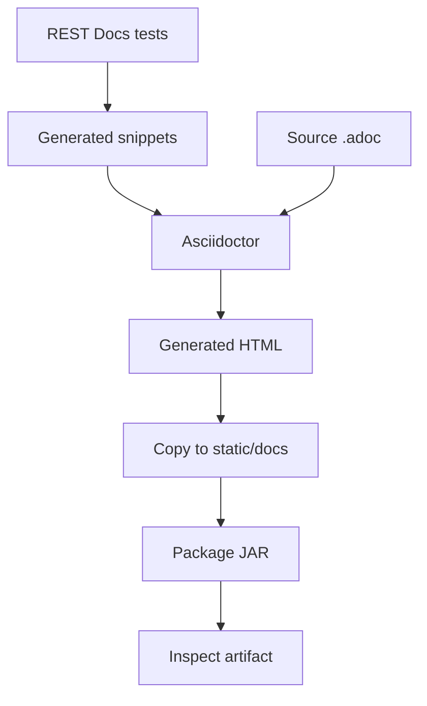

# Generating Documentation Before Packaging

## 1. Objective

**Spring REST Docs** generates REST API documentation from HTTP tests using MockMvc, WebTestClient, or REST Assured. Tests generate snippets for requests, responses, payloads, headers, parameters, and multipart parts. Asciidoctor combines the snippets into HTML.

In a Spring Boot JAR, HTML can be packaged as a static resource:

```text
BOOT-INF/classes/static/docs/
├── index.html
├── images/
└── css/
```

With the default static resource mapping, `static/docs/index.html` can be served at `/docs/index.html`.

The build needs to execute in sequence: tests generate snippets → Asciidoctor generates HTML → copy HTML into output resources → package JAR/WAR → inspect the archive. Running `asciidoctor` alone only generates HTML in the output directory; it does not automatically include the HTML in the JAR.

## 2. Distinguishing Snippets and Generated Documentation

- **Generated snippets:** files produced by tests, usually in `build/generated-snippets` (Gradle) or `target/generated-snippets` (Maven).
- **Generated documentation:** HTML compiled from `.adoc` files and snippets, usually in `build/docs/asciidoc` or `target/generated-docs`.

Example:

```text
project/
├── src/docs/asciidoc/index.adoc
├── src/test/java/...DocumentationTest.java
└── build/
    ├── generated-snippets/users-get/
    ├── docs/asciidoc/index.html
    └── libs/application.jar
```

Do not edit generated snippets or HTML directly. Update the tests/descriptors or Asciidoctor source files and re-run the build.

## 3. Execution Flow



If a task dependency is missing, packaging may run before HTML is ready or the JAR may not contain the docs. Declare explicit relationships instead of relying on manual command invocation order.

## 4. Gradle: Tests, Asciidoctor, and Snippets

Gradle Groovy DSL example; replace the version placeholders with versions compatible with your project:

```groovy
plugins {
    id 'java'
    id 'org.springframework.boot' version '3.x.y'
    id 'org.asciidoctor.jvm.convert' version '4.x.y'
}

configurations {
    asciidoctorExt
}

dependencies {
    testImplementation 'org.springframework.restdocs:spring-restdocs-mockmvc'
    asciidoctorExt 'org.springframework.restdocs:spring-restdocs-asciidoctor'
}
```

If using WebTestClient or REST Assured, add the corresponding integration dependency. `spring-restdocs-asciidoctor` provides the `snippets` attribute so Asciidoctor files can reference the generated snippets directory.

Declare outputs/inputs and dependencies:

```groovy
ext {
    snippetsDir = file("$buildDir/generated-snippets")
}

tasks.named('test') {
    outputs.dir snippetsDir
}

tasks.named('asciidoctor') {
    inputs.dir snippetsDir
    configurations 'asciidoctorExt'
    dependsOn tasks.named('test')
}
```

`test.outputs.dir` declares where tests generate snippets. `asciidoctor.inputs.dir` declares snippets as an input. `dependsOn test` ensures tests finish before documentation is generated. Configuration syntax may vary by plugin version; keep the input/output/dependency relationships intact.

Example `src/docs/asciidoc/index.adoc`:

```asciidoc
= User API
:toc: left

== GET /users/{id}

=== HTTP request
include::{snippets}/users-get/http-request.adoc[]

=== HTTP response
include::{snippets}/users-get/http-response.adoc[]

=== Response fields
include::{snippets}/users-get/response-fields.adoc[]
```

`{snippets}` is configured by the REST Docs Asciidoctor extension to point to the snippets directory. Run the documentation generation step:

```bash
./gradlew clean test asciidoctor
```

Inspect both the snippets and HTML output. This does not yet confirm that the HTML is inside the JAR.

## 5. Gradle: Copying HTML into bootJar

Make the `bootJar` task depend on `asciidoctor` and copy the output into `static/docs`:

```groovy
tasks.named('bootJar') {
    dependsOn tasks.named('asciidoctor')

    from(tasks.named('asciidoctor').map { it.outputDir }) {
        into 'static/docs'
    }
}
```

`dependsOn` ensures docs are generated before packaging. `from(...){ into 'static/docs' }` adds the HTML and related assets to the classpath static resources inside the JAR.

Run:

```bash
./gradlew clean bootJar
```

Or `./gradlew clean build` if the main build task includes `bootJar`. If the JAR contains `BOOT-INF/classes/static/docs/index.html`, Spring Boot normally serves it at `/docs/index.html`. Do not expose internal documentation publicly without authentication/authorization.

## 6. Maven: Generating HTML in prepare-package

Spring REST Docs recommends binding Asciidoctor to the `prepare-package` phase, after `test` and before `package`. Example in `pom.xml`:

```xml
<dependencies>
    <dependency>
        <groupId>org.springframework.restdocs</groupId>
        <artifactId>spring-restdocs-mockmvc</artifactId>
        <scope>test</scope>
    </dependency>
</dependencies>

<build>
    <plugins>
        <plugin>
            <groupId>org.asciidoctor</groupId>
            <artifactId>asciidoctor-maven-plugin</artifactId>
            <version>2.2.1</version>
            <executions>
                <execution>
                    <id>generate-api-docs</id>
                    <phase>prepare-package</phase>
                    <goals>
                        <goal>process-asciidoc</goal>
                    </goals>
                    <configuration>
                        <backend>html</backend>
                        <doctype>book</doctype>
                    </configuration>
                </execution>
            </executions>
            <dependencies>
                <dependency>
                    <groupId>org.springframework.restdocs</groupId>
                    <artifactId>spring-restdocs-asciidoctor</artifactId>
                    <version>4.x.y</version>
                </dependency>
            </dependencies>
        </plugin>
    </plugins>
</build>
```

Replace the placeholder version with the appropriate Spring REST Docs version. The `spring-restdocs-asciidoctor` dependency goes inside the plugin so the extension is present when processing `.adoc` files. The Maven source directory is typically `src/main/asciidoc` and the output is typically `target/generated-docs`.

## 7. Maven: Copying HTML into Resources

Generating HTML in `prepare-package` is not enough. You need to copy the HTML output into the application's resources directory under `static/docs`. Declare `maven-resources-plugin` after the Asciidoctor plugin if both bind to the same phase; Maven executes goals within the same phase in declaration order.

Example configuration:

```xml
<plugin>
    <groupId>org.apache.maven.plugins</groupId>
    <artifactId>maven-resources-plugin</artifactId>
    <executions>
        <execution>
            <id>copy-generated-api-docs</id>
            <phase>prepare-package</phase>
            <goals>
                <goal>copy-resources</goal>
            </goals>
            <configuration>
                <outputDirectory>${project.build.outputDirectory}/static/docs</outputDirectory>
                <resources>
                    <resource>
                        <directory>${project.build.directory}/generated-docs</directory>
                    </resource>
                </resources>
            </configuration>
        </execution>
    </executions>
</plugin>
```

Replace `OUTPUT_DIRECTORY` with the Maven property `project.build.outputDirectory` using Maven property syntax in the actual file. If the Asciidoctor output is customized, adjust the resource directory accordingly. Copy the compiled HTML, not the raw generated snippets.

Run:

```bash
./mvnw clean package
```

Maven runs tests, generates HTML in `prepare-package`, copies it into resources, and then packages in `package`.

## 8. Task Graph and Lifecycle

Gradle needs these relationships:

```text
test
  └── creates build/generated-snippets

asciidoctor
  ├── dependsOn test
  ├── reads generated-snippets
  └── creates HTML

bootJar
  ├── dependsOn asciidoctor
  └── copies HTML to BOOT-INF/classes/static/docs
```

In a multi-module build, if another module generates snippets, declare dependencies and inputs/outputs across projects. A declared task does not run automatically; it must be in the target task's dependency graph or invoked directly.

Maven:

| Phase | Work |
| --- | --- |
| `test` | Tests generate snippets |
| `prepare-package` | Asciidoctor generates HTML; resources plugin copies HTML into output resources |
| `package` | Maven creates the JAR/WAR |

Running only `mvn test` will not execute `prepare-package` or `package`. Use `mvn package` or `mvn verify` to run through these phases.

## 9. Inspecting the Archive and HTTP

List the JAR contents:

```bash
jar tf build/libs/application.jar
```

With Maven:

```bash
jar tf target/application.jar
```

For a Spring Boot executable JAR, look for:

```text
BOOT-INF/classes/static/docs/index.html
BOOT-INF/classes/static/docs/images/...
BOOT-INF/classes/static/docs/css/...
```

In PowerShell you can filter:

```powershell
jar tf build/libs/application.jar | Select-String 'BOOT-INF/classes/static/docs'
```

Verify that index, CSS, scripts, and images are all present; relative links do not point to the build directory; the HTML includes the snippets; and the content matches the API version. Then run the JAR and test `http://localhost:8080/docs/index.html`.

If HTTP returns 404, first check whether the file is in the archive. If the file is in the JAR, check the context path, Spring Security, and static resource mapping. A 404 error is not necessarily an Asciidoctor failure.

## 10. Avoiding Stale Snippets and Non-Reproducible Builds

Asciidoctor can read stale snippets if the output directory still has leftovers even when the corresponding operation test did not run.

Measures:

- Use a clean build in CI: `./gradlew clean bootJar` or `./mvnw clean package`.
- Ensure Asciidoctor depends on the tests that generate snippets.
- Declare the snippet directory as an output of `test` and an input of `asciidoctor` in Gradle.
- Do not commit generated snippets unless your workflow requires it.
- Do not let independent tests write to the same operation ID and snippet filename with different contents.
- Use deterministic fixtures and update every `include` when renaming an operation ID.

CI should build from a clean checkout so it does not depend on stale artifacts on a developer's machine.

## 11. Choosing a Documentation Distribution Approach

| Approach | When Suitable | Notes |
| --- | --- | --- |
| Embed HTML in JAR/WAR | Docs need to match the application version | Increases size; protect if internal |
| Separate docs artifact | Docs have a different lifecycle/access control | Version and publish separately |
| Site/portal | Search and standalone experience needed | Requires a docs deployment pipeline |

If embedded in the JAR, docs and API code share the same version. If published separately, a versioning strategy is needed. Do not expose internal endpoints, sample credentials, or real data on a public static route.

## 12. Common Errors

| Symptom | Cause | Resolution |
| --- | --- | --- |
| HTML exists in build but not in JAR | Output was not copied into the archive | Add `bootJar.from` or Maven resources copy |
| JAR packages before HTML generation finishes | Missing task dependency | Gradle `bootJar dependsOn asciidoctor`; Maven bind to `prepare-package` |
| Asciidoctor missing snippet | Test did not run or wrong operation ID | Ensure test is a dependency and inspect snippets |
| JAR contains old docs | Stale snippets/HTML remained | Clean build |
| Maven copies an empty directory | Resources plugin ran before Asciidoctor in the same phase | Place resources plugin after Asciidoctor |
| HTML missing images/CSS | Incomplete output copy or incorrect flattening | Copy the entire output and preserve structure |
| URL `/docs` returns 404 | Resource in wrong location or blocked by security/context path | Inspect archive and HTTP mapping |
| JAR is too large | Packaging unnecessary files | Package only docs intended for distribution |

## 13. Hands-On Exercise

1. Write a `GET /users/{id}` test using MockMvc and generate request/response snippets.
2. Create `src/docs/asciidoc/index.adoc` and include the snippets via `{snippets}`.
3. Configure Gradle so `asciidoctor` depends on `test`.
4. Configure `bootJar` to depend on `asciidoctor` and copy the output into `static/docs`.
5. Run `./gradlew clean bootJar`.
6. Use `jar tf` to verify the JAR contains `BOOT-INF/classes/static/docs/index.html`.
7. Run the application and access `/docs/index.html`.
8. Repeat with Maven: Asciidoctor in `prepare-package` and resources plugin copying HTML.
9. Run `./mvnw clean package` and inspect the archive.

**Completion criteria:** explain why generating HTML is not the same as packaging; declare the proper order test → Asciidoctor → copy resources → JAR; verify both the archive and runtime URL; distinguish snippet, copy, and static resource errors.

## 14. Self-Check Questions

**1. Why must Asciidoctor run before creating the JAR?**

HTML must be generated before being copied into output resources and before packaging puts resources into the archive.

**2. What Gradle configuration is needed so docs are included in a Spring Boot JAR?**

Make `bootJar` depend on `asciidoctor` and copy the output directory into `static/docs`.

**3. Which Maven phase should run Asciidoctor?**

`prepare-package`, after `test` and before `package`.

**4. Why should the Maven resources plugin be placed after Asciidoctor?**

Both run in `prepare-package`; declaring the resources plugin afterward ensures copying happens after HTML is generated.

**5. How do you prove that docs are inside the artifact?**

Use `jar tf` and verify that `BOOT-INF/classes/static/docs/index.html` or the corresponding classpath location is present.

**6. Should you package generated snippets instead of HTML?**

Not by default. Snippets are inputs to Asciidoctor; the artifact normally contains compiled HTML/PDF.

## References

- [Spring REST Docs — Getting Started, Packaging the Documentation](https://docs.spring.io/spring-restdocs/tutorial/getting-started/index.html): configuring Asciidoctor, `prepare-package`, `bootJar`, and copying HTML into `static/docs`.
- [Spring REST Docs — Reference Documentation](https://docs.spring.io/spring-restdocs/docs/current/reference/htmlsingle/): configuring tests, snippets, Asciidoctor, and packaging.
- [Spring Boot — Static Content](https://docs.spring.io/spring-boot/reference/web/servlet.html#web.servlet.spring-mvc.static-content): serving static resources from the classpath.
