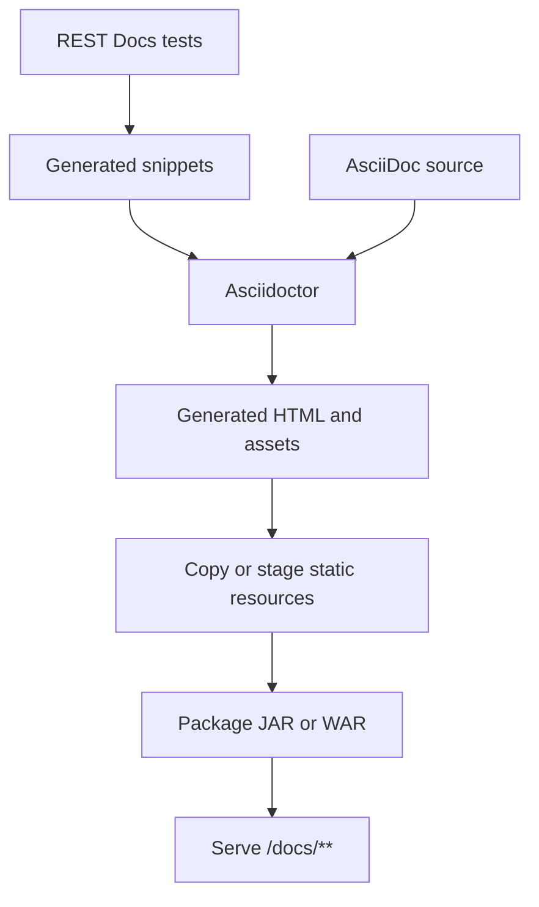

# Copying Generated Documentation to Static Resources

## 1. Objective

**Spring REST Docs** generates REST API documentation from HTTP tests using MockMvc, WebTestClient, or REST Assured. Tests generate snippets for requests, responses, payloads, headers, parameters, and multipart parts; Asciidoctor combines the snippets with source files into HTML.

For Spring Boot to serve HTML from the application, the documentation must reside in classpath static resources. Desired location in an executable JAR:

```text
BOOT-INF/classes/static/docs/
├── index.html
├── css/site.css
├── js/navigation.js
└── images/endpoint-flow.png
```

With the default static resource mapping, `static/docs/index.html` can be served at `/docs/index.html`. Generating HTML in the Asciidoctor output directory alone is not enough; you must copy all documentation and assets to a location that gets packaged.

This lesson covers selecting the source and destination, configuring copying with Gradle and Maven, preserving relative structure, wiring the copy step into packaging tasks/lifecycle, and verifying the archive and runtime behavior.

## 2. Distinguishing Snippets, HTML, and Static Resources

| Type | Example | Role |
| --- | --- | --- |
| Test source | `src/test/java` | Executes requests and generates snippets |
| Generated snippets | `build/generated-snippets` or `target/generated-snippets` | Input to Asciidoctor |
| Generated documentation | `build/docs/asciidoc` or `target/generated-docs` | Compiled HTML and assets |
| Staging resources | `build/generated-docs/static/docs` | Copy prepared for packaging |
| Archive location | `BOOT-INF/classes/static/docs` | Classpath static resources in the JAR |

The copy source must be **the Asciidoctor output**, not generated snippets. Files like `request-parts.adoc` and `response-fields.adoc` are inputs; the compiled `index.html`, CSS, and images are the content distributed to clients.



Do not copy only `index.html` if the page uses CSS, JavaScript, images, or fonts. Copy the entire directory tree and preserve relative paths.

## 3. Identifying the Correct Output Directory

With Gradle, inspect the `outputDir` of the `asciidoctor` task. Depending on the plugin/backend configuration, HTML may sit directly under `build/docs/asciidoc` or in a subdirectory such as `html5`.

With Maven, the output typically sits in `target/generated-docs` when following the Spring REST Docs Getting Started configuration. If the project customizes the output directory, the copy step must use that exact directory.

Do not infer the output directory from the task name alone. Check the Asciidoctor configuration and build logs. If the HTML resides in a subdirectory, copy from the directory containing the entry point along with all corresponding assets.

## 4. Gradle: Staging with a Sync Task

Use a `Sync` task to copy Asciidoctor output into a dedicated staging directory under `build/`:

```groovy
def generatedDocsDir = layout.buildDirectory.dir('generated-docs')

tasks.register('copyApiDocs', Sync) {
    dependsOn tasks.named('asciidoctor')
    from(tasks.named('asciidoctor').map { it.outputDir })
    into(generatedDocsDir.map { it.dir('static/docs') })
}
```

- `dependsOn asciidoctor` ensures HTML is generated before copying.
- `from(...)` takes the entire Asciidoctor output.
- `into(...)` places the copy at `build/generated-docs/static/docs`.
- `Sync` synchronizes the destination with the source; stale files at the destination that are no longer in the source are removed.

The destination must be a dedicated, build-managed staging directory. Do not target a `Sync` task at a directory containing handwritten documentation or user files, because `Sync` can delete files that do not exist in the source.

### 4.1. Why Use Staging?

Staging separates Asciidoctor output from the copy prepared for packaging. You can inspect the contents or add required files before the archive is built. This is still generated output; do not edit it manually because the next build may overwrite it.

```text
build/
├── docs/asciidoc/
│   ├── index.html
│   └── css/site.css
└── generated-docs/
    └── static/docs/
        ├── index.html
        └── css/site.css
```

## 5. Gradle: Including Staging in bootJar

Make `bootJar` depend on the copy task, then add the staging directory to the archive under `static/docs`:

```groovy
tasks.named('bootJar') {
    dependsOn tasks.named('copyApiDocs')
    from(generatedDocsDir.map { it.dir('static/docs') }) {
        into 'static/docs'
    }
}
```

Expected archive layout:

```text
BOOT-INF/classes/static/docs/index.html
BOOT-INF/classes/static/docs/css/site.css
BOOT-INF/classes/static/docs/images/endpoint-flow.png
```

Task graph:

```text
test
  └── generated-snippets
        └── asciidoctor
              └── generated HTML
                    └── copyApiDocs (Sync)
                          └── build/generated-docs/static/docs
                                └── bootJar
```

When you run `./gradlew bootJar`, Gradle executes tests, Asciidoctor, staging copy, and packaging according to the dependency graph.

### 5.1. Avoiding processResources Dependency Cycles

Do not blindly add the staging directory to `sourceSets.main.resources` and force `processResources` to depend on the docs copy task. Asciidoctor depends on tests, while tests require main classes and resources; this can create a cycle:

```text
processResources
    → copyApiDocs
        → asciidoctor
            → test
                → classes
                    → processResources
```

The example above feeds staging directly into `bootJar`. That task runs after tests/Asciidoctor, avoiding a dependency cycle through `processResources`. If you need to serve docs in a development environment from output classes, design that separately and verify the task graph.

### 5.2. Running and Verifying Gradle

Run:

```bash
./gradlew clean bootJar
```

Or `./gradlew clean build` if the main build task includes `bootJar`. You can inspect staging separately with:

```bash
./gradlew clean test asciidoctor copyApiDocs
```

Then inspect `build/generated-docs/static/docs`. If staging is correct but the JAR is missing docs, check `bootJar.from` and the task dependency.

## 6. Maven: copy-resources into the Output Directory

Common Maven flow:

1. REST Docs tests generate snippets in the `test` phase.
2. Asciidoctor runs in `prepare-package` and creates HTML, typically in `target/generated-docs`.
3. `maven-resources-plugin:copy-resources` runs after Asciidoctor in the same phase.
4. `package` creates the JAR/WAR from the output directory.

Example copy plugin configuration:

```xml
<plugin>
    <groupId>org.apache.maven.plugins</groupId>
    <artifactId>maven-resources-plugin</artifactId>
    <executions>
        <execution>
            <id>copy-generated-api-docs</id>
            <phase>prepare-package</phase>
            <goals>
                <goal>copy-resources</goal>
            </goals>
            <configuration>
                <outputDirectory>
                    ${project.build.outputDirectory}/static/docs
                </outputDirectory>
                <resources>
                    <resource>
                        <directory>${project.build.directory}/generated-docs</directory>
                        <filtering>false</filtering>
                    </resource>
                </resources>
            </configuration>
        </execution>
    </executions>
</plugin>
```

In the actual `pom.xml`, use the Maven property `project.build.outputDirectory` as the prefix of the output path, and `project.build.directory` appended with `/generated-docs` as the source. The default values typically correspond to `target/classes` and `target/generated-docs`.

Place the resources plugin **after the Asciidoctor plugin** in `pom.xml` when both run in `prepare-package`. Maven executes goals in the same phase in declaration order. If copying runs before Asciidoctor, the destination may be empty or contain an older build.

`filtering=false` keeps HTML, images, fonts, and binary data intact, preventing unintended placeholder substitution. If the Asciidoctor output directory is customized, update the source directory to match.

Run:

```bash
./mvnw clean package
```

`mvn test` does not run `prepare-package`, so it neither generates nor copies HTML into output resources.

## 7. Preserving Asset Structure

HTML may reference CSS, JavaScript, and images using relative paths:

```html
<link rel="stylesheet" href="css/site.css">
<script src="js/navigation.js"></script>

```

Source:

```text
generated-docs/
├── index.html
├── css/site.css
├── js/navigation.js
└── images/endpoint-flow.png
```

Destination:

```text
static/docs/
├── index.html
├── css/site.css
├── js/navigation.js
└── images/endpoint-flow.png
```

If you only copy `index.html`, links will break. If you flatten all files into a single directory, relative paths will no longer work. Copy the entire output directory and preserve the subdirectory structure. If Asciidoctor generates multiple pages, copy all pages intended for release. Include only the required format on the static route; do not bundle logs, raw snippets, or temporary files.

## 8. Overwrite, Stale Files, and Clean Builds

- **Stale files:** the destination still contains files from a previous build even though the current source removed or renamed them.
- **Unwanted overwrites:** the destination overlaps with a developer-managed directory and the task overwrites manual files.

Gradle `Sync` with a dedicated staging directory synchronizes the destination to the source. Maven `copy-resources` copies new files but does not necessarily delete all old files at the destination; a clean build in CI removes old outputs.

Guidelines:

1. Use a destination inside the build output, not `src/main/resources`, as the default generation target.
2. Use clean builds in CI.
3. Do not store handwritten documentation inside a task-managed staging directory.
4. Do not copy snippets if the goal is publishing HTML.
5. Do not let multiple modules write to the same destination without clear ownership.
6. When changing the output directory, remove or reconfigure the old destination so the JAR does not bundle two copies.

## 9. Verifying Each Layer After Copying

| Layer | What to Verify | Example |
| --- | --- | --- |
| Test | Snippets are generated | `build/generated-snippets/users-get/http-response.adoc` |
| Asciidoctor | HTML is generated | `build/docs/asciidoc/index.html` |
| Gradle staging | Entire HTML tree is copied | `build/generated-docs/static/docs/index.html` |
| Maven resources | HTML is in output resources | `target/classes/static/docs/index.html` |
| Archive | HTML is inside the JAR | `BOOT-INF/classes/static/docs/index.html` |

List the JAR:

```bash
jar tf build/libs/application.jar
```

With Maven:

```bash
jar tf target/application.jar
```

Look for these entries:

```text
BOOT-INF/classes/static/docs/index.html
BOOT-INF/classes/static/docs/css/site.css
BOOT-INF/classes/static/docs/images/endpoint-flow.png
```

Do not check only the index file. Verify at least one asset to confirm the subdirectory structure was preserved.

## 10. Verifying the Runtime URL

Once docs are on classpath static resources, test:

```text
http://localhost:8080/docs/index.html
```

If it returns 404:

1. Check whether the archive contains `BOOT-INF/classes/static/docs/index.html`.
2. Check whether the filename is exactly `index.html`.
3. Check the context path/servlet path.
4. Check whether Spring Security blocks the request.
5. Check whether static resource mapping has been customized.

If HTML returns 200 but CSS/images return 404, check relative paths and confirm subdirectories were copied. HTTP 403 is usually related to documentation access protection policies.

## 11. Common Errors

| Symptom | Cause | Resolution |
| --- | --- | --- |
| JAR does not contain `static/docs/index.html` | Copy task did not run or is outside the task graph | Make `bootJar` depend on copy task or bind Maven copy to `prepare-package` |
| Staging is empty | Wrong source directory or Asciidoctor did not run | Check `outputDir` and dependencies |
| Only index present, missing CSS/images | Only the entry point file was copied | Copy the entire output directory |
| CSS/images return 404 | Paths flattened or relative paths copied incorrectly | Preserve the source directory structure |
| JAR contains old HTML | Stale output at the destination | Clean build; use `Sync` with Gradle staging |
| Maven copies before Asciidoctor | Incorrect plugin order | Place resources plugin after Asciidoctor in the same phase |
| Gradle circular dependency | `processResources` depends on copy while copy depends on test | Feed staging into `bootJar` instead of creating a `processResources`/test cycle |
| HTML is corrupted/altered | Maven resource filtering unnecessarily enabled | Set `filtering` to `false` |
| Docs served at wrong URL | Copied to wrong classpath location | Package under `static/docs` |
| JAR is bloated | Temporary files or snippets copied too | Copy only the documentation intended for release |

## 12. Hands-On Exercise

1. Write a REST Docs test for `GET /users/{id}` and generate snippets.
2. Create `src/docs/asciidoc/index.adoc` including request, response, and response fields.
3. Determine the actual Asciidoctor output directory.
4. Create a Gradle `Sync` task depending on Asciidoctor that copies the entire output into `build/generated-docs/static/docs`.
5. Make `bootJar` depend on `copyApiDocs` and include staging in the archive under `static/docs`.
6. Run `./gradlew clean bootJar`; verify the JAR contains index and at least one asset.
7. Repeat with Maven: Asciidoctor in `prepare-package`; resources plugin copies afterward into `target/classes/static/docs`.
8. Run `./mvnw clean package` and inspect the archive with `jar tf`.
9. Run the application and test `/docs/index.html` along with one CSS/image file.
10. Delete an asset from the source, run a clean build, and verify the old file is no longer in staging/JAR.

**Completion criteria:** distinguish snippets, HTML output, and static resources; configure proper source/destination; preserve asset structure; connect copying with packaging; verify the archive and runtime URL.

## 13. Self-Check Questions

**1. Which directory should be copied into static resources?**

The Asciidoctor output directory containing compiled HTML and assets. Do not copy generated snippets if the goal is HTML pages.

**2. Why should you not copy only `index.html`?**

Pages may reference CSS, JavaScript, images, and fonts. You must copy the entire output tree and preserve relative paths.

**3. Which Gradle task type is used to synchronize staging?**

Use a `Sync` task depending on Asciidoctor, taking `outputDir` as the source and pointing to a dedicated destination under `build`.

**4. Why feed staging into `bootJar` instead of `processResources`?**

Asciidoctor depends on tests, and tests require main classes/resources. Forcing `processResources` to wait for Asciidoctor can create a dependency cycle. Feeding staging into `bootJar` avoids that cycle.

**5. In which Maven phase are docs copied?**

Bind `maven-resources-plugin:copy-resources` to `prepare-package`, after Asciidoctor and before `package`.

**6. How do you verify that copying succeeded?**

Inspect staging/output resources, list the archive with `jar tf`, then access the page and one asset over HTTP.

## References

- [Spring REST Docs — Getting Started](https://docs.spring.io/spring-restdocs/tutorial/getting-started/index.html): generating snippets, configuring Asciidoctor, and packaging documentation.
- [Spring REST Docs — Reference Documentation](https://docs.spring.io/spring-restdocs/docs/current/reference/htmlsingle/): tests, snippets, and compiling documentation.
- [Gradle User Manual — Working With Files](https://docs.gradle.org/current/userguide/working_with_files.html): `Copy`/`Sync` tasks and output directories.
- [Maven Resources Plugin — copy-resources](https://maven.apache.org/plugins/maven-resources-plugin/copy-resources-mojo.html): copying resources in the Maven lifecycle.
- [Spring Boot — Static Content](https://docs.spring.io/spring-boot/reference/web/servlet.html#web.servlet.spring-mvc.static-content): serving static resources from the classpath.
