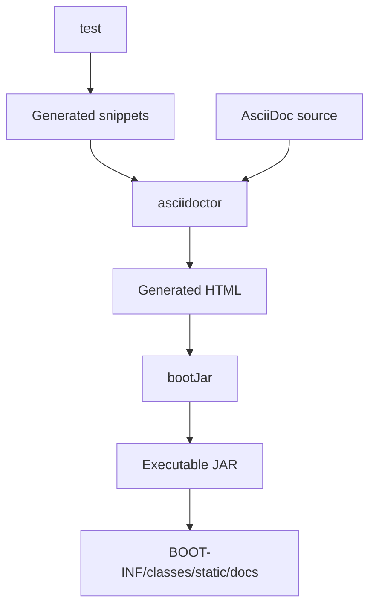

# Making bootJar Depend on asciidoctor in Gradle

## 1. Objective

In **Spring REST Docs**, HTTP tests using MockMvc, WebTestClient, or REST Assured generate snippets for requests, responses, payloads, headers, parameters, and multipart parts. Asciidoctor combines these snippets with AsciiDoc source files to produce HTML documentation.

With a Spring Boot application, the HTML can be embedded in the executable JAR and served as static content. The packaging task must run after the documentation compilation task, while also adding the HTML output into the archive.

Two core configurations:

- `dependsOn asciidoctor`: ensures Asciidoctor completes before `bootJar` packages.
- `from(asciidoctor.outputDir) { into 'static/docs' }`: takes the generated documentation and adds it to the JAR under classpath path `static/docs`.

The dependency only guarantees ordering; it does not add files to the archive on its own. `from` specifies the content to package. Both are needed for a reproducible build.

## 2. Task Graph

Build flow:



There are two dependencies:

1. `asciidoctor` depends on `test` so fresh snippets are generated before compilation.
2. `bootJar` depends on `asciidoctor` so HTML is generated before packaging.

If you only configure `bootJar` to depend on `asciidoctor` without `asciidoctor` depending on `test`, the documentation may use stale snippets or miss snippets altogether. Therefore, configure the full chain: `test` → `asciidoctor` → `bootJar`.

## 3. Configuring Plugins and Dependencies

Gradle Groovy DSL example. The illustrative versions are based on Spring REST Docs 4.0.1 Getting Started, using Asciidoctor plugin 4.0.5 and AsciidoctorJ 3.0.0. Replace the Spring Boot version with one compatible with your project.

```groovy
plugins {
    id 'java'
    id 'org.springframework.boot' version '3.x.y'
    id 'org.asciidoctor.jvm.convert' version '4.0.5'
}

asciidoctorj {
    version = '3.0.0'
}

configurations {
    asciidoctorExt
}

dependencies {
    testImplementation 'org.springframework.restdocs:spring-restdocs-mockmvc:4.0.1'
    asciidoctorExt 'org.springframework.restdocs:spring-restdocs-asciidoctor:4.0.1'
}
```

`3.x.y` is a placeholder for the application's Spring Boot version. If using WebTestClient or REST Assured, add the integration dependency matching your test client.

`spring-restdocs-asciidoctor` is placed in the `asciidoctorExt` configuration so the extension is on the Asciidoctor classpath. The extension configures the `snippets` attribute so AsciiDoc files can reference the snippets directory.

## 4. Declaring the Snippets Directory and Asciidoctor Dependency

```groovy
ext {
    snippetsDir = file('build/generated-snippets')
}

tasks.named('test') {
    outputs.dir snippetsDir
}

tasks.named('asciidoctor') {
    inputs.dir snippetsDir
    configurations 'asciidoctorExt'
    dependsOn tasks.named('test')
}
```

| Configuration | Role |
| --- | --- |
| `snippetsDir` | Directory containing test-generated snippets |
| `test.outputs.dir` | Declares test output to Gradle |
| `asciidoctor.inputs.dir` | Declares snippets as Asciidoctor input |
| `configurations 'asciidoctorExt'` | Loads the REST Docs extension |
| `dependsOn test` | Runs tests before generating documentation |

Declaring inputs/outputs enables Gradle incremental builds. When snippets change, Gradle has the metadata needed to re-evaluate the Asciidoctor task.

### 4.1. Including Snippets in AsciiDoc Source

Example `src/docs/asciidoc/index.adoc`:

```asciidoc
= User API
:toc: left

== GET /users/{id}

=== HTTP request
include::${snippets}/users-get/http-request.adoc[]

=== HTTP response
include::${snippets}/users-get/http-response.adoc[]

=== Response fields
include::${snippets}/users-get/response-fields.adoc[]
```

`${snippets}` is a placeholder token in the example; actual AsciiDoc files use the `snippets` attribute provided by the Spring REST Docs Asciidoctor extension.

A test can generate snippets for the `users-get` operation:

```java
mockMvc.perform(get("/users/{id}", "42"))
    .andExpect(status().isOk())
    .andDo(document("users-get",
        responseFields(
            fieldWithPath("id").description("User ID"),
            fieldWithPath("name").description("User name")
        )
    ));
```

When the test succeeds, snippets such as `http-request.adoc`, `http-response.adoc`, and `response-fields.adoc` are generated according to the configured handlers. If an operation ID changes without updating the `include`, Asciidoctor may report a missing snippet.

## 5. Configuring bootJar to Depend on asciidoctor

After configuring Asciidoctor, add the dependency and source copy to the `bootJar` task:

```groovy
tasks.named('bootJar') {
    dependsOn tasks.named('asciidoctor')

    from(tasks.named('asciidoctor').map { it.outputDir }) {
        into 'static/docs'
    }
}
```

The `bootJar` task waits for `asciidoctor`, takes the task's output directory, adds its contents to the archive, and places them under `static/docs`.

A concise Groovy DSL configuration can also be written as:

```groovy
bootJar {
    dependsOn asciidoctor
    from(asciidoctor.outputDir) {
        into 'static/docs'
    }
}
```

Both examples express the same idea. The `tasks.named` form fits task-provider configuration; the `bootJar { ... }` form fits the convention DSL used in some projects. Choose one style consistent with the existing build to avoid duplicate copy configurations.

### 5.1. What Does dependsOn Do?

`dependsOn` describes a task dependency. When `bootJar` is invoked, Gradle must run `asciidoctor` first. If Asciidoctor depends on `test`, then `test` runs first as well.

A dependency only defines execution order in the task graph; it does not automatically add HTML to the JAR.

### 5.2. What Do from and into Do?

In `from(...){ into 'static/docs' }`:

- `from` selects the source content to add to the archive.
- `into` specifies the prefix/path inside the archive.

If the output directory contains:

```text
index.html
css/site.css
images/endpoint-flow.png
```

then the JAR is expected to contain:

```text
BOOT-INF/classes/static/docs/index.html
BOOT-INF/classes/static/docs/css/site.css
BOOT-INF/classes/static/docs/images/endpoint-flow.png
```

Copy the entire directory tree so CSS, JavaScript, images, and fonts preserve their relative paths.

## 6. Determining Asciidoctor's outputDir

Do not assume HTML always lands in a fixed directory. Output depends on the plugin version, backend, and task configuration. The default Gradle source is typically `src/docs/asciidoc`; output is managed by the `asciidoctor` task.

Use the task's own `asciidoctor.outputDir` property in the copy configuration instead of hardcoding a path like `build/docs/asciidoc/html5`. This keeps the copy source tied to the task that generates the documentation.

You can run it independently to inspect the output:

```bash
./gradlew clean test asciidoctor
```

Verify that `index.html` and assets exist in the output directory. If the project customizes the backend or `outputDir`, inspect the actual structure before adjusting.

## 7. bootJar, jar, and bootWar

The Spring Boot Gradle plugin provides `bootJar` to build an executable JAR. The standard Java plugin `jar` task packages classes/resources in a regular JAR structure and does not necessarily build Spring Boot's executable launcher.

If releasing an executable JAR, configure `bootJar`. If the application packages a WAR, use the `bootWar` task and attach the dependency/copy to the proper packaging task. Do not mistakenly configure `jar` when the pipeline actually ships `bootJar`.

For an executable JAR, classpath resources normally live under `BOOT-INF/classes`. Therefore `into 'static/docs'` produces the path `BOOT-INF/classes/static/docs`.

## 8. Running the Task and Inspecting the Dependency Graph

Run the target task:

```bash
./gradlew clean bootJar
```

Logical order: tests generate snippets; Asciidoctor creates HTML; `bootJar` picks up HTML, places it under `static/docs`, and packages.

You can run tasks separately for diagnostics:

```bash
./gradlew clean test
./gradlew asciidoctor
./gradlew bootJar
```

In CI, invoke the target task `bootJar` or `build` with the complete dependency graph. Separate commands are useful for isolating step-by-step errors, but should not be the sole mechanism enforcing order.

Use dry-run to inspect the task graph:

```bash
./gradlew bootJar --dry-run
```

Confirm that `test` and `asciidoctor` appear in the graph before `bootJar`. Tasks marked UP-TO-DATE or FROM-CACHE can still be present in the graph even when not re-executed.

## 9. Verifying the Executable JAR

List the archive:

```bash
jar tf build/libs/application.jar
```

Look for these entries:

```text
BOOT-INF/classes/static/docs/index.html
BOOT-INF/classes/static/docs/css/site.css
BOOT-INF/classes/static/docs/images/endpoint-flow.png
```

In PowerShell you can filter:

```powershell
jar tf build/libs/application.jar | Select-String 'BOOT-INF/classes/static/docs'
```

If the JAR contains HTML but is missing CSS/images, check the output directory and ensure `from` grabs the entire directory rather than just the entry point file.

Do not conclude packaging succeeded just because the build directory has HTML. The definitive proof is that the static docs entries actually exist inside the archive.

## 10. Verifying the Runtime URL

Run the application:

```bash
java -jar build/libs/application.jar
```

Open:

```text
http://localhost:8080/docs/index.html
```

If it returns 404:

1. Check that the JAR contains `BOOT-INF/classes/static/docs/index.html`.
2. Check that the entry point file is named `index.html`.
3. Check the context path or servlet path.
4. Check whether Spring Security blocks docs.
5. Check whether static resource mapping has been customized.

If HTML returns 200 but CSS/images return 404, check relative paths and confirm assets are also inside the JAR. The URL may include a context path such as `/api/docs/index.html`.

## 11. Common Errors

| Symptom | Cause | Resolution |
| --- | --- | --- |
| JAR missing docs | Dependency declared, but source not added via `from` | Add `outputDir` to archive under `static/docs` |
| Asciidoctor runs after `bootJar` | Missing `bootJar` → `asciidoctor` dependency | Declare `dependsOn` explicitly |
| Asciidoctor missing snippets | Not depending on `test` or snippets input/output not declared | Declare `asciidoctor.dependsOn test` and `snippetsDir` |
| Docs contain stale snippets | Stale output remained or operation test did not run | Clean build and verify operation ID |
| Only index present, missing assets | Only entry point file copied | Copy entire `outputDir` |
| Wrong archive path | `into` sets wrong prefix | Use `into 'static/docs'` |
| Task graph lacks Asciidoctor | Wrong task name or dependency configuration | Check plugin and task provider |
| Configured `jar` instead of `bootJar` | Pipeline builds archive that is not the executable JAR | Configure the actual packaging task |
| Docs URL returns 404 | Resource at wrong classpath path or blocked by security | Inspect archive, context path, and security rules |

## 12. CI Integration

In CI, the target task should be the artifact-producing task:

```bash
./gradlew clean bootJar
```

Minimal verification pipeline:

1. Check out clean source.
2. Run `./gradlew clean bootJar`.
3. Ensure tests generate snippets or valid cached outputs.
4. Verify the JAR contains `BOOT-INF/classes/static/docs/index.html`.
5. Verify at least one CSS/image asset is packaged.
6. If smoke tests exist, start the application and call `/docs/index.html`.
7. Save the verified JAR as the release artifact.

Do not commit generated snippets/HTML just to make CI pass, unless the repository workflow requires it. Builds should regenerate documentation from tests and AsciiDoc sources.

## 13. Hands-On Exercise

1. Configure Spring REST Docs and the Asciidoctor plugin.
2. Create `snippetsDir` at `build/generated-snippets`.
3. Declare `test.outputs.dir snippetsDir`.
4. Configure `asciidoctor.inputs.dir snippetsDir`, the extension configuration, and `dependsOn test`.
5. Write a `GET /users/{id}` test generating request, response, and response fields snippets.
6. Create `src/docs/asciidoc/index.adoc` including the snippets.
7. Configure `bootJar` to depend on `asciidoctor`.
8. Use `from(asciidoctor.outputDir)` and `into 'static/docs'` to add HTML to the archive.
9. Run `./gradlew clean bootJar` and inspect the task graph with `--dry-run`.
10. Use `jar tf` to verify the JAR contains index and assets.
11. Run the application, open `/docs/index.html`, and confirm the docs render.
12. Make a documentation test fail; verify `bootJar` does not package new docs from the failing test.

**Completion criteria:** explain the difference between task dependency and file inclusion; properly configure `test` → `asciidoctor` → `bootJar`; determine `outputDir`; prove HTML and assets are inside the executable JAR.

## 14. Self-Check Questions

**1. Why must `bootJar` depend on `asciidoctor`?**

So documentation finishes compiling before the executable JAR is created.

**2. Does `dependsOn` automatically put HTML into the JAR?**

No. It only describes ordering. Use `from(outputDir)` to add files and `into 'static/docs'` to set the proper archive path.

**3. Why does `asciidoctor` need to depend on `test`?**

So fresh snippets are generated before Asciidoctor includes them.

**4. What are the roles of `from` and `into`?**

`from` selects the output directory as the source; `into` places the content inside the JAR under `static/docs`.

**5. Why avoid hardcoding the output path?**

Output depends on plugin/backend/configuration. Using `asciidoctor.outputDir` copies from the task's actual output.

**6. How do you confirm documentation is inside the JAR?**

Use `jar tf` and check for `BOOT-INF/classes/static/docs/index.html` along with assets.

## References

- [Spring REST Docs 4.0.1 — Getting Started, Packaging the Documentation](https://docs.spring.io/spring-restdocs/tutorial/getting-started/index.html): Gradle configuration, `asciidoctor` depending on `test`, and `bootJar` depending on `asciidoctor` example.
- [Spring REST Docs — Reference Documentation](https://docs.spring.io/spring-restdocs/docs/current/reference/htmlsingle/): test-generated snippets and compiling documentation.
- [Gradle User Manual — Task Dependencies](https://docs.gradle.org/current/userguide/controlling_task_execution.html#sec:depending_on_tasks): task dependencies and execution graph.
- [Spring Boot — Static Content](https://docs.spring.io/spring-boot/reference/web/servlet.html#web.servlet.spring-mvc.static-content): serving static resources from the classpath.
