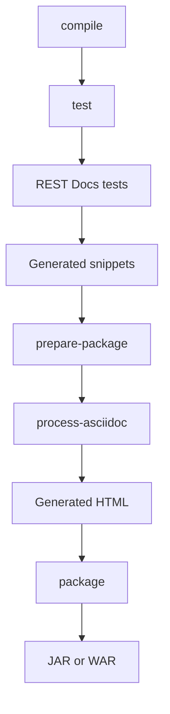

# prepare-package and process-asciidoc in Maven

## 1. Role in the Spring REST Docs Workflow

**Spring REST Docs** generates REST API documentation from HTTP tests using MockMvc, WebTestClient, or REST Assured. Tests send requests, verify responses, and generate snippets such as HTTP request/response, request/response fields, parameters, headers, and multipart parts. Asciidoctor combines the snippets with authored descriptions to produce HTML.

In Maven, two concepts must be distinguished:

- **Lifecycle phase** `prepare-package`: the point in the Maven lifecycle to generate documentation before the package step.
- **Plugin goal** `process-asciidoc`: the Asciidoctor Maven Plugin operation that processes AsciiDoc files and generates HTML.

The standard configuration binds the `process-asciidoc` goal to the `prepare-package` phase. When running `mvn package`, Maven executes preceding phases, including `test`; afterward Asciidoctor generates HTML, and then Maven packages the JAR/WAR.

This lesson covers the lifecycle, plugin configuration, source/output directories, snippets extension, plugin ordering when copying documentation into the JAR, build commands, and error diagnostics.

## 2. Maven Lifecycle: test, prepare-package, and package

| Phase | Role |
| --- | --- |
| `test` | Runs REST Docs tests and generates snippets |
| `prepare-package` | Prepares content to be packaged; Asciidoctor compiles documentation |
| `package` | Packages output into a JAR/WAR |
| `verify` | Runs post-package checks if configured by the project |

Maven runs phases sequentially up to the requested phase. Therefore, `mvn package` goes through `test` and `prepare-package` before `package`. `mvn test` stops at `test` and does not invoke `prepare-package` or `package`.



`prepare-package` is a lifecycle phase; `process-asciidoc` is a plugin goal. The phase determines when the goal runs in the lifecycle.

## 3. Default Source and Output Directories

With a typical Spring REST Docs Maven configuration:

| Content | Path |
| --- | --- |
| Test source | `src/test/java` |
| AsciiDoc source | `src/main/asciidoc` |
| Generated snippets | `target/generated-snippets` |
| Generated HTML | `target/generated-docs` |
| Compiled classes/resources | `target/classes` |
| Final JAR | `target/*.jar` |

Example structure:

```text
project/
├── pom.xml
├── src/
│   ├── main/
│   │   ├── java/
│   │   └── asciidoc/
│   │       └── index.adoc
│   └── test/java/...DocumentationTest.java
└── target/
    ├── generated-snippets/users-get/
    │   ├── http-request.adoc
    │   ├── http-response.adoc
    │   └── response-fields.adoc
    ├── generated-docs/
    │   └── index.html
    └── classes/
```

Generated snippets and generated HTML are two different types of output. Tests create snippets; Asciidoctor reads snippets together with `.adoc` source files to produce HTML. Do not copy snippets into static resources if the goal is publishing complete documentation pages.

If the project customizes the source directory or output directory, keep the Asciidoctor configuration, include paths, and copy step in sync. Do not assume output remains in the default directory after changing the configuration.

## 4. Spring REST Docs Test Dependency

Example using MockMvc:

```xml
<dependencies>
    <dependency>
        <groupId>org.springframework.restdocs</groupId>
        <artifactId>spring-restdocs-mockmvc</artifactId>
        <version>${spring-restdocs.version}</version>
        <scope>test</scope>
    </dependency>
</dependencies>
```

Replace the version token with the project's corresponding Maven property. The dependency is in `test` scope because Spring REST Docs is invoked in tests, not in application runtime code.

If using another client, choose the matching integration:

| Test client | Artifact |
| --- | --- |
| MockMvc | `spring-restdocs-mockmvc` |
| WebTestClient | `spring-restdocs-webtestclient` |
| REST Assured | `spring-restdocs-restassured` |

There is no need to declare all integrations if the project uses only one client.

## 5. Configuring the Asciidoctor Maven Plugin

Declare `asciidoctor-maven-plugin` under `build/plugins` and bind the `process-asciidoc` goal to `prepare-package`:

```xml
<build>
    <plugins>
        <plugin>
            <groupId>org.asciidoctor</groupId>
            <artifactId>asciidoctor-maven-plugin</artifactId>
            <version>3.2.0</version>
            <executions>
                <execution>
                    <id>generate-api-documentation</id>
                    <phase>prepare-package</phase>
                    <goals>
                        <goal>process-asciidoc</goal>
                    </goals>
                    <configuration>
                        <backend>html</backend>
                        <doctype>book</doctype>
                    </configuration>
                </execution>
            </executions>
            <dependencies>
                <dependency>
                    <groupId>org.asciidoctor</groupId>
                    <artifactId>asciidoctorj</artifactId>
                    <version>3.0.0</version>
                </dependency>
                <dependency>
                    <groupId>org.springframework.restdocs</groupId>
                    <artifactId>spring-restdocs-asciidoctor</artifactId>
                    <version>${spring-restdocs.version}</version>
                </dependency>
            </dependencies>
        </plugin>
    </plugins>
</build>
```

Meaning:

- `groupId` and `artifactId` identify the Asciidoctor Maven Plugin.
- `version` is the plugin version, independent of the Spring REST Docs version.
- `execution.id` identifies the execution.
- `phase` binds the execution to the `prepare-package` lifecycle phase.
- `goal` selects the `process-asciidoc` operation.
- `backend` selects the output format, such as HTML.
- `doctype` selects the document structure, such as `book`.
- The plugin dependency `spring-restdocs-asciidoctor` loads the Spring REST Docs extension while processing AsciiDoc.

This example uses Asciidoctor Maven Plugin 3.2.0 and pins AsciidoctorJ 3.0.0 in plugin dependencies for compatibility with the Spring REST Docs 4.x extension. Versions should be matched against your project's actual release. When upgrading the Spring REST Docs major version, consult the Getting Started guide for that exact release to verify AsciidoctorJ and plugin requirements.

### 5.1. Why Is spring-restdocs-asciidoctor Needed?

This is a plugin dependency, not a replacement for the test dependency. The extension configures the `snippets` attribute to point to Maven's default generated snippets directory `target/generated-snippets`. It also provides Spring REST Docs-related macros for Asciidoctor.

### 5.2. AsciiDoc File Including Snippets

Create `src/main/asciidoc/index.adoc`:

```asciidoc
= User API
:toc: left

== GET /users/{id}

Endpoint returning user information by ID.

=== HTTP request
include::{snippets}/users-get/http-request.adoc[]

=== HTTP response
include::{snippets}/users-get/http-response.adoc[]

=== Response fields
include::{snippets}/users-get/response-fields.adoc[]
```

The `users-get` directory must match the operation ID in the test. If the ID changes, update the corresponding `include` macros.

## 6. REST Docs Tests Run Before Asciidoctor

Tests generate snippets when executing requests. MockMvc example:

```java
@Test
void getUserDocumentsResponse() throws Exception {
    mockMvc.perform(get("/users/{id}", "42"))
        .andExpect(status().isOk())
        .andDo(document("users-get",
            responseFields(
                fieldWithPath("id").description("User ID"),
                fieldWithPath("name").description("User name")
            )
        ));
}
```

When Maven runs the `test` phase, the test framework executes the tests and Spring REST Docs writes snippets under `target/generated-snippets/users-get` according to the default output configuration.

Afterward, `prepare-package` invokes Asciidoctor. If a test fails, Maven stops before `prepare-package`; documentation is not compiled from a failing test run. This ensures published documentation reflects API behavior verified by tests.

If using Maven Surefire, check test naming conventions and skip settings. The `-DskipTests` flag skips test execution; in that case you should not assume snippets were freshly regenerated.

## 7. Building and Verifying Output

Run the Maven Wrapper:

```bash
./mvnw clean package
```

Or system-installed Maven:

```bash
mvn clean package
```

After the build, inspect:

```text
target/
├── generated-snippets/users-get/
├── generated-docs/
│   └── index.html
└── application.jar
```

Signs of success:

1. Documentation tests ran and generated operation snippets.
2. Asciidoctor processed `index.adoc` into HTML.
3. HTML appeared in `target/generated-docs`.
4. Maven proceeded to `package` and created the JAR/WAR.

You can invoke the goal directly for diagnostics:

```bash
./mvnw asciidoctor:process-asciidoc
```

Calling the goal directly does not guarantee tests ran first. In a standard pipeline, invoke `package` or `verify` so Maven executes the lifecycle in proper order.

## 8. Putting HTML into the JAR for Spring Boot Static Content Serving

If you want documentation served alongside the application, copy HTML from `target/generated-docs` into output resources before `package`. Spring Boot will find the content under classpath `static/docs`.

Add `maven-resources-plugin` after the Asciidoctor plugin in `build/plugins`:

```xml
<plugin>
    <groupId>org.apache.maven.plugins</groupId>
    <artifactId>maven-resources-plugin</artifactId>
    <executions>
        <execution>
            <id>copy-generated-docs</id>
            <phase>prepare-package</phase>
            <goals>
                <goal>copy-resources</goal>
            </goals>
            <configuration>
                <outputDirectory>
                    ${project.build.outputDirectory}/static/docs
                </outputDirectory>
                <resources>
                    <resource>
                        <directory>
                            ${project.build.directory}/generated-docs
                        </directory>
                    </resource>
                </resources>
            </configuration>
        </execution>
    </executions>
</plugin>
```

Replace the tokens above with the corresponding Maven properties: `project.build.outputDirectory` and `project.build.directory`. The default output directory is typically `target/classes`; the build directory is typically `target`. The final destination is `target/classes/static/docs`.

Maven executes goals in the same phase in the order declared in the POM. Therefore, the resources plugin must come after Asciidoctor: first HTML is generated, then it is copied into output resources. The Spring Boot Maven Plugin packages those resources into the JAR.

If you do not need to serve docs from the application itself, you can keep HTML in `target/generated-docs` and publish that directory as a separate docs artifact; in that case copying into static resources is unnecessary.

## 9. Why Bind process-asciidoc to prepare-package?

`process-asciidoc` needs to run after snippets are generated but before `package`. `prepare-package` fits because Maven has already completed the `test` phase and has not yet packaged the artifact.

| Command | Relevant Steps | Result |
| --- | --- | --- |
| `mvn test` | Runs tests | Snippets present; `prepare-package` not invoked |
| `mvn prepare-package` | Runs preceding phases and `prepare-package` | Snippets and HTML present if tests are not skipped |
| `mvn package` | Runs through `package` | HTML generated; artifact packaged |
| `mvn verify` | Runs through `package` and `verify` | Also executes configured quality checks |

Do not bind Asciidoctor to `package` if HTML must be copied into resources during `prepare-package`. Binding to `prepare-package` ensures docs are ready before the packaging step.

## 10. Accompanying Assets and Source/Output

Asciidoctor typically reads `src/main/asciidoc/*.adoc` and generates `target/generated-docs/*.html`. Documentation may reference CSS, images, JavaScript, or included files. When copying into static resources, copy the entire output directory rather than only `index.html`.

```text
target/generated-docs/
├── index.html
├── css/site.css
├── images/sequence.png
└── js/navigation.js
```

After copying:

```text
target/classes/static/docs/
├── index.html
├── css/site.css
├── images/sequence.png
└── js/navigation.js
```

Do not place generated output in `src/main/resources`. The source tree should be tracked in version control; generated output should stay in `target` so clean builds remove it.

## 11. Common Errors

| Symptom | Cause | Resolution |
| --- | --- | --- |
| Asciidoctor missing snippet | Tests did not run, were skipped, or wrong operation ID | Check test output and `include` names |
| HTML not generated when running `mvn test` | `prepare-package` was not invoked | Run `mvn package` or the direct goal for diagnostics |
| Old HTML remains | Non-clean build or stale snippets used | Run `mvn clean package` |
| Source files not found | Wrong source directory or suffix | Use `src/main/asciidoc` or configure source appropriately |
| `{snippets}` not recognized | REST Docs extension missing from plugin dependencies | Add `spring-restdocs-asciidoctor` to the plugin |
| JAR missing docs | `generated-docs` not copied into output resources | Add resources plugin `copy-resources` |
| Maven copies an empty directory | Resources plugin placed before Asciidoctor in the same phase | Place resources plugin after the Asciidoctor plugin |
| CSS/images missing | Only the entry point file was copied | Copy the entire output directory |
| No snippets generated yet build passes | Tests skipped or Surefire did not recognize test class | Check Maven flags and naming conventions |
| Incompatible plugin versions | Incompatible AsciidoctorJ/REST Docs versions | Follow the Getting Started guide of the release in use |

## 12. Hands-On Exercise

Create a Maven Spring Boot project with a `GET /users/{id}` endpoint:

1. Add `spring-restdocs-mockmvc` in `test` scope.
2. Add `asciidoctor-maven-plugin` and bind `process-asciidoc` to `prepare-package`.
3. Add `spring-restdocs-asciidoctor` to the plugin dependencies.
4. Create `src/main/asciidoc/index.adoc` and include snippets using operation ID `users-get`.
5. Write a MockMvc test using `document("users-get", ...)` to generate request, response, and `response-fields` snippets.
6. Run `./mvnw clean test`; verify snippets exist while `prepare-package` HTML has not been generated yet.
7. Run `./mvnw clean package`; verify HTML is generated in `target/generated-docs`.
8. If you want to serve docs from Spring Boot, add the resources plugin after Asciidoctor to copy into output resources `static/docs`.
9. Use `jar tf` to inspect that the JAR contains `BOOT-INF/classes/static/docs/index.html`.
10. Run the application, access `/docs/index.html`, and verify CSS/images if present.

**Completion criteria:** explain the `prepare-package` phase and `process-asciidoc` goal; understand that tests generate snippets before Asciidoctor; identify source/output directories; configure the extension; understand plugin ordering when copying static resources; verify the generated HTML and JAR.

## 13. Self-Check Questions

**1. What is `prepare-package`?**

A lifecycle phase that runs after `test` and before `package`, suited for generating documentation before the JAR/WAR is packaged.

**2. What is `process-asciidoc`?**

A goal of the Asciidoctor Maven Plugin that processes AsciiDoc files and generates HTML.

**3. Why is the goal bound to `prepare-package`?**

So snippets have already been generated by tests beforehand and HTML is generated before `package`.

**4. Where does Maven store snippets and HTML by default?**

Snippets in `target/generated-snippets`; HTML in `target/generated-docs`.

**5. What is the role of `spring-restdocs-asciidoctor`?**

It provides the extension so Asciidoctor understands the `snippets` attribute and Spring REST Docs macros.

**6. Why must the resources plugin be declared after Asciidoctor?**

Both run in `prepare-package`; copying must happen after HTML is generated.

**7. Does `mvn test` generate HTML?**

Not under this lifecycle binding. It stops at `test`; you must run `mvn package` to reach `prepare-package`.

## References

- [Spring REST Docs — Getting Started](https://docs.spring.io/spring-restdocs/tutorial/getting-started/index.html): test dependencies, Asciidoctor Maven Plugin, `process-asciidoc` goal, `prepare-package` phase, and output directories.
- [Spring REST Docs — Packaging the Documentation](https://docs.spring.io/spring-restdocs/docs/current/reference/htmlsingle/): Asciidoctor/resources plugin ordering and copying HTML into `static/docs`.
- [Asciidoctor Maven Plugin](https://docs.asciidoctor.org/maven-tools/latest/): plugin configuration, executions, goals, and output.
- [Maven Build Lifecycle](https://maven.apache.org/guides/introduction/introduction-to-the-lifecycle.html): ordering of `test`, `prepare-package`, and `package` phases.
