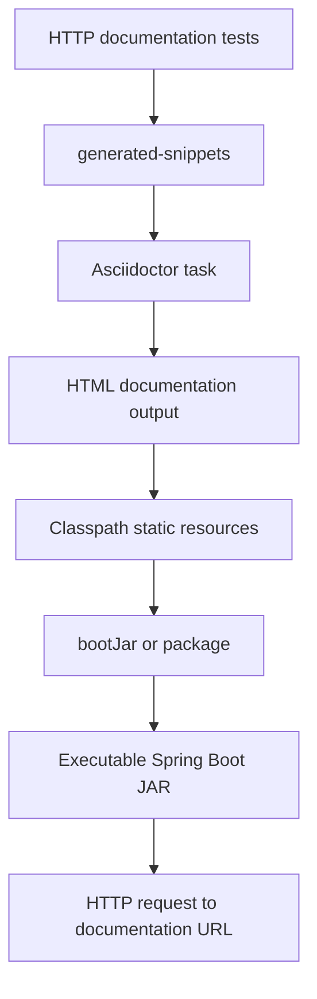

# Packaging Documentation into a Spring Boot JAR

## Learning Objectives

After this lesson, you will be able to:

- Explain how Asciidoctor HTML output becomes a classpath resource in a Spring Boot application.
- Choose packaging locations for documentation such as static web resources or `META-INF/resources`.
- Configure Gradle to generate documentation before packaging `bootJar`.
- Configure Maven to copy documentation output into the packaged resources location.
- Distinguish documentation served from a JAR from a separate website or artifact.
- Inspect JAR contents, run the application, and verify the documentation URL works.
- Troubleshoot missing files, incorrect paths, wrong task execution order, and overridden static resource configs.

## 1. Why Put Documentation in the JAR?

Spring REST Docs generates snippets from HTTP tests. Asciidoctor combines snippets with explanations to produce HTML or PDF. With a Spring Boot application, you can package HTML documentation directly inside the executable JAR so the application and documentation ship under the same version.

Benefits:

- Every build contains documentation matching the tested code and API contract.
- Operations teams can deploy a single artifact when documentation is served alongside the application.
- No manual copying of HTML directories is needed after the build.
- Packaged documentation can be verified inside the JAR build pipeline.
- Released documentation shares the exact same version/release as the application.

Not every project should serve documentation from the runtime application. A standalone developer portal, docs needing separate CDN/caching, or strictly internal docs may be better suited for publishing as a separate website or artifact. This lesson focuses on a Spring Boot application serving HTML documentation from an executable JAR.

## 2. Build Flow from REST Docs to Executable JAR

Common flow:

1. Run HTTP documentation tests using MockMvc, WebTestClient, or REST Assured.
2. Tests write snippets into the `generated-snippets` directory.
3. Asciidoctor includes snippets and compiles AsciiDoc into HTML.
4. HTML is copied into the application's resources directory.
5. Gradle or Maven packages the resources into the JAR.
6. Spring Boot serves the HTML as a static resource when the application runs.



Documentation must be rendered and copied into the resources directory before the packaging task builds the JAR. If `bootJar` runs before HTML is generated, the JAR may be valid yet missing documentation.

## 3. Choosing the Resource Location in the JAR

Spring Boot can serve static resources from common classpath locations, including:

- `classpath:/static`
- `classpath:/public`
- `classpath:/resources`
- `classpath:/META-INF/resources`

Example choosing `static/docs`:

```text
src/main/resources/
└── static/
    └── docs/
        ├── index.html
        ├── orders.html
        ├── authentication.html
        ├── css/
        ├── images/
        └── js/
```

Once packaged, the resources reside in the JAR under the corresponding classpath path. With default static resource handling, `index.html` inside `static/docs` is typically accessible at `/docs/`; `orders.html` at `/docs/orders.html`.

Example:

```text
GET http://localhost:8080/docs/
GET http://localhost:8080/docs/orders.html
```

The exact URL also depends on the server context path, reverse proxy, resource handlers, and application configuration.

### 3.1. Should Documentation Be Placed in META-INF/resources?

`META-INF/resources` is a supported classpath resource location in web application environments. It can be appropriate when a library or artifact wants to provide web resources via `META-INF/resources`.

For a typical Spring Boot application, `src/main/resources/static/docs` is easier to understand and locate. There is no need to choose `META-INF/resources` merely because documentation is packaged in a JAR; choose the location that fits the project structure.

### 3.2. Preserving the HTML Output Structure

An Asciidoctor website can consist of multiple files and directories:

- Main page and operation HTML pages.
- Theme CSS or custom stylesheets.
- JavaScript for navigation/search.
- Images, logos, and included assets.
- Reference pages and downloadable files.

When copying output, preserve the relative structure. If you copy only `index.html` and omit `css`/`images` directories, the page may return 200 yet fail to render properly.

## 4. Configuring Asciidoctor Output for the Application

Suppose:

- AsciiDoc sources reside in `src/docs/asciidoc`.
- Snippets are generated in `build/generated-snippets`.
- Asciidoctor renders HTML into `build/docs/asciidoc`.
- The application packages documentation under `static/docs`.

Two main directories:

| Directory | Role |
| --- | --- |
| `build/docs/asciidoc` | Intermediate output from Asciidoctor |
| `build/resources/main/static/docs` | Classpath resources packaged into the JAR |

You do not need to render directly into `src/main/resources`. Keeping generated output inside the build directory prevents generated files from mixing with Git-tracked sources.

## 5. Gradle Configuration

The examples below illustrate the Spring Boot, Spring REST Docs, and Asciidoctor Gradle plugins. Task names and output accessors may need adjustment depending on your project's plugin versions.

### 5.1. Dependencies and Output Directories

A conceptual configuration in `build.gradle`:

```groovy
plugins {
    id 'java'
    id 'org.springframework.boot' version '3.4.0'
    id 'org.asciidoctor.jvm.convert' version '4.0.2'
}

configurations {
    asciidoctorExt
}

dependencies {
    testImplementation 'org.springframework.restdocs:spring-restdocs-mockmvc'
    asciidoctorExt 'org.springframework.restdocs:spring-restdocs-asciidoctor'
}

def snippetsDir = layout.buildDirectory.dir('generated-snippets')
def docsOutputDir = layout.buildDirectory.dir('docs/asciidoc')
def generatedResourcesDir = layout.buildDirectory.dir('generated-resources/api-docs')
def packagedDocsDir = generatedResourcesDir.map { it.dir('static/docs') }
```

Plugin versions in the example are illustrative. Use versions compatible with your project's Spring Boot, Spring REST Docs, and Gradle versions; manage versions via a version catalog or dependency management if the repository follows that convention.

### 5.2. Snippet-Generating Tests

Declare the test output:

```groovy
tasks.named('test') {
    outputs.dir snippetsDir
}
```

Documentation tests must actually run and call `document(...)`. Declaring `outputs.dir` only describes the task output; it does not create snippets if tests do not integrate REST Docs.

### 5.3. Rendering with Asciidoctor

Example:

```groovy
tasks.named('asciidoctor') {
    inputs.dir snippetsDir
    configurations 'asciidoctorExt'

    sources {
        include 'index.adoc'
    }

    baseDirFollowsSourceFile()

    attributes(
        'snippets': snippetsDir.get().asFile,
        'project-version': project.version
    )

    outputDir = docsOutputDir.get().asFile
    dependsOn tasks.named('test')
}
```

This is an illustrative configuration for the Asciidoctor Gradle plugin. Verify the DSL against your actual plugin version and main source file. If a page includes multiple files, ensure they lie within the base directory allowed for includes.

### 5.4. Copying HTML into Classpath Resources

Create a copy task:

```groovy
tasks.register('copyApiDocs', Copy) {
    dependsOn tasks.named('asciidoctor')
    from(docsOutputDir)
    into(packagedDocsDir)
}
```

Then ensure resource processing and `bootJar` wait for the copy:

```groovy
sourceSets {
    main {
        resources {
            srcDir generatedResourcesDir
        }
    }
}

tasks.named('processResources') {
    dependsOn tasks.named('copyApiDocs')
}
```

Documentation is copied into `build/generated-resources/api-docs/static/docs`, and `processResources` then moves it into `build/resources/main/static/docs`. Do not write directly into the `processResources` output directory before that task runs, because the task may clean and recreate its output. The `bootJar` task already depends on the Gradle Java plugin's `classes`/`processResources` chain.

### 5.5. Running the Build

```bash
./gradlew clean test asciidoctor bootJar
```

The task graph ensures `copyApiDocs` runs before packaging because of the declared dependencies. Do not rely on the task order typed on the command line; declare dependencies in the build script.

## 6. Why Use a Separate Generated Resource Directory?

Another approach adds Asciidoctor output to the resources source set:

```groovy
def docsOutputDir = layout.buildDirectory.dir('docs/asciidoc')

sourceSets {
    main {
        resources {
            srcDir(generatedResourcesDir)
        }
    }
}

tasks.register('copyApiDocs', Copy) {
    dependsOn tasks.named('asciidoctor')
    from(docsOutputDir)
    into(generatedResourcesDir.map { it.dir('static/docs') })
}

tasks.named('processResources') {
    dependsOn tasks.named('copyApiDocs')
}
```

This example uses a separate generated resource directory to preserve the `static/docs` prefix on the classpath. Simply adding `docsOutputDir` directly to the source set would not create the `/docs` URL prefix if Asciidoctor output sits at the root.

Choose a single copy/resource strategy for the project. Do not configure both `sourceSets` and a `Copy` task to feed the same set of files into two different paths, as that can create duplicate resources or make it unclear which file is served.

## 7. Maven Configuration

With Maven, the principle is the same: run tests to generate snippets, execute Asciidoctor, then copy HTML into output resources before packaging.

Target structure:

```text
target/
├── generated-snippets/
├── generated-docs/
│   ├── index.html
│   └── ...
└── classes/
    └── static/
        └── docs/
            ├── index.html
            └── ...
```

### 7.1. Copying Output into target/classes

You can configure `maven-resources-plugin` or `maven-antrun-plugin` to copy the output after Asciidoctor runs and before `package`.

Example `maven-resources-plugin` with an execution in the appropriate phase:

```xml
<plugin>
  <groupId>org.apache.maven.plugins</groupId>
  <artifactId>maven-resources-plugin</artifactId>
  <version>3.3.1</version>
  <executions>
    <execution>
      <id>copy-api-docs</id>
        <phase>prepare-package</phase>
      <goals>
        <goal>copy-resources</goal>
      </goals>
      <configuration>
        <outputDirectory>target/classes/static/docs</outputDirectory>
        <resources>
          <resource>
            <directory>target/generated-docs</directory>
            <filtering>false</filtering>
          </resource>
        </resources>
      </configuration>
    </execution>
  </executions>
</plugin>
```

The snippet above is the copy section; bind this execution to `prepare-package` and ensure the Asciidoctor execution also runs in `prepare-package` before it (or in a phase later than `test` but earlier than the copy). With two executions in the same phase, check the plugin/execution declaration order in the POM. The goal is for tests to have generated snippets, Asciidoctor to have generated `generated-docs`, and only then for the copy to put files into `target/classes/static/docs` before `package`.

Do not enable resource filtering on HTML/CSS/JS indiscriminately. Filtering can substitute delimiter strings in content and break JavaScript, CSS, or documentation examples. For static documentation, you should generally copy files verbatim using `filtering=false`.

### 7.2. Verifying Maven Lifecycle Order

| Step | Illustrative Phase/Goal | Result |
| --- | --- | --- |
| Test | `test` | HTTP documentation tests run and generate snippets |
| Render | `prepare-package` after `test` | HTML from Asciidoctor |
| Copy | `prepare-package` after render | HTML in `target/classes/static/docs` |
| Package | `package` | Spring Boot JAR contains documentation |

Phases and execution order must be adjusted to match your actual plugins. Verify `generated-docs` exists before copying and `target/classes/static/docs` exists before the Spring Boot Maven Plugin packages the JAR.

## 8. Accessing Documentation While the Application Runs

With documentation placed under classpath `static/docs`:

| File in JAR | Common Default URL |
| --- | --- |
| `static/docs/index.html` | `/docs/` |
| `static/docs/orders.html` | `/docs/orders.html` |
| `static/docs/css/site.css` | `/docs/css/site.css` |

Run the application:

```bash
java -jar build/libs/orders-service.jar
```

Then visit:

```text
http://localhost:8080/docs/
```

Spring Boot static resource handling can serve `index.html` when requesting the `docs` directory. If that does not work, try requesting `/docs/index.html` directly and check the resource mapping.

If the application uses a context path:

```properties
server.servlet.context-path=/api
```

The URL may become `/api/docs/`. A reverse proxy or ingress may add or strip another prefix, so verify the public URL in your deployment environment.

## 9. Static Resource Configurations That Can Make Docs Inaccessible

Spring Boot provides static resource handling settings. Certain settings can change where resources are searched:

```properties
spring.web.resources.static-locations=classpath:/custom-static/
```

When declaring `static-locations`, check whether the configured locations still include the resource directory containing the documentation. Specifying a custom location can replace the default locations.

Other factors to check:

- Custom resource handlers declared via `WebMvcConfigurer`.
- Security filter chain blocking `/docs/**`.
- Context path or servlet path.
- Reverse proxy path rewriting.
- Forwarded headers and URL scheme.
- Proxy caching or compression rules.

If using Spring Security, decide whether documentation URLs are public or protected. Do not open all static resources publicly just to access documentation. You can allow only specific paths or require authentication for internal documentation.

## 10. Packaging Documentation with Access Control

Not every REST API document should be public. Documentation may contain internal endpoints, internal-only headers/error details, architecture details, or operational procedures.

If documentation is intended only for developers/operators:

1. Place URLs behind authentication/authorization.
2. Use a dedicated security rule for `/docs/**`.
3. Do not embed credentials, personal data, or secret endpoints in snippets.
4. Consider publishing documentation as an internal artifact/portal instead of a publicly deployed JAR.
5. Verify access permissions at runtime, not just during build tests.

Illustrative matcher example; adjust the DSL for your Spring Security version:

```java
http.authorizeHttpRequests(authorize -> authorize
    .requestMatchers("/docs/**").hasAuthority("SCOPE_API_DOCS_READ")
    .anyRequest().authenticated()
);
```

If docs are public, permit only the exact documentation paths. If docs contain sensitive contracts, enforce an appropriate role/scope and verify 401/403 responses with integration tests.

## 11. Verifying What Is Actually Inside the JAR

A successful build does not prove the JAR contains the documentation pages. Inspect the artifact.

For a Gradle JAR:

```bash
jar tf build/libs/orders-service.jar
```

Look for entries:

```text
BOOT-INF/classes/static/docs/index.html
BOOT-INF/classes/static/docs/orders.html
BOOT-INF/classes/static/docs/css/site.css
```

Paths inside an executable Spring Boot JAR typically live under `BOOT-INF/classes/`. If files are missing, check Asciidoctor output, the copy task, destination directory, `bootJar` dependencies, and resource includes/excludes.

With Maven:

```bash
jar tf target/orders-service.jar
```

Look for the corresponding entries under `BOOT-INF/classes/static/docs/`.

## 12. Runtime Verification After Packaging

After confirming the entries in the JAR, run the newly built JAR itself:

```bash
java -jar build/libs/orders-service.jar
```

Verify with `curl`:

```bash
curl -I http://localhost:8080/docs/
curl -I http://localhost:8080/docs/index.html
curl -I http://localhost:8080/docs/css/site.css
```

Expectations:

- The main page returns an appropriate status, typically 200.
- CSS/JS/image assets are accessible.
- Links from index to operation pages work.
- No 404s due to wrong base paths or relative links.
- If docs are protected, unauthenticated callers receive 401/403 and authorized callers succeed.

Do not check HTTP status alone. An HTML page returning 200 while missing CSS/JS or with broken image includes still breaks for readers.

## 13. Versioning, Caching, and Base Path

When packaging documentation with the JAR, content is released alongside the application version. Publish the docs/API version in a clearly visible location:

```asciidoc
= Orders API
:doctype: book
:revnumber: {project-version}
:revdate: {docdate}
```

The version attribute should be passed from the build rather than hardcoded across multiple files. If the project uses a version catalog or release metadata, pull from a single unified source.

Several considerations:

- Static documentation may be cached by browsers or reverse proxies.
- When releasing a new version, files at the same URL may need proper cache policies to avoid serving stale content.
- If documentation uses versioned URLs, organize paths such as `/docs/1.4/` or `/docs/current/` according to release policy.
- Relative links in HTML should still work when the application is deployed under a context path.
- Do not hardcode `localhost` or production hosts in internal links.

If multiple API versions must be served simultaneously, documentation may fit better when published as a separate website or under version-prefixed resources rather than a single `docs` directory overwritten on every release.

## 14. Common Errors

| Symptom | Possible Cause | Resolution |
| --- | --- | --- |
| JAR does not contain `index.html` | `bootJar` ran before copy task or output was not generated | Add dependency from packaging task to copy/Asciidoctor task |
| JAR has `index.html` but CSS/images return 404 | Only HTML file copied, not entire output tree | Copy the entire output directory and preserve structure |
| `/docs/` returns 404 while `/docs/index.html` works | Resource/index mapping or static resource config | Check resource handlers, static locations, and URL |
| Docs page returns 401/403 | Spring Security blocks the path | Decide public/internal access and add appropriate matcher |
| CSS paths break after deployment | Base path or relative URL mismatch | Use relative links or configure base path properly |
| Old tables/snippets appear in JAR | Generated snippets are stale or task did not re-run | Clean outputs and declare inputs/outputs properly |
| Resource missing from executable JAR | Copied to folder outside packaged resource root | Check classpath path and `jar tf` |
| HTML contains strange substituted strings | Maven resource filtering altered content | Disable filtering for static documentation |
| Local build succeeds but CI lacks docs | CI runs packaging via another task or skips docs task | Wire dependencies in lifecycle and verify the artifact |

## 15. Checklist for Packaging Documentation into a Spring Boot JAR

- [ ] HTTP documentation tests run and generate snippets.
- [ ] Asciidoctor renders HTML successfully.
- [ ] HTML output is copied into a classpath resource directory.
- [ ] CSS, JS, images, and subpage directory structure is preserved.
- [ ] Packaging task depends on doc generation/copy steps.
- [ ] No resource filtering unintentionally modifies HTML/CSS/JS.
- [ ] JAR contains `BOOT-INF/classes/static/docs/index.html` and required assets.
- [ ] Executable JAR runs and documentation URL loads successfully.
- [ ] Context path, reverse proxy, and relative links verified.
- [ ] Security policy for `/docs/**` defined and tested.
- [ ] Documentation version matches the application release.
- [ ] CI checks both JAR contents and HTTP runtime smoke test.

## 16. Hands-On Exercise

An Orders service uses Gradle and Spring Boot. AsciiDoc sources are in `src/docs/asciidoc`, REST Docs generates snippets into `build/generated-snippets`, and Asciidoctor produces HTML.

Perform the following:

1. Configure Asciidoctor to use the correct `generated-snippets` directory.
2. Render documentation into `build/docs/asciidoc`.
3. Create a task copying all HTML/CSS/JS/images into `build/resources/main/static/docs`.
4. Ensure `processResources` or `bootJar` depends on the copy task with a clear task graph.
5. Build the executable JAR from a clean state.
6. Use `jar tf` to verify `BOOT-INF/classes/static/docs/index.html` and related assets are inside the JAR.
7. Run the JAR and access `/docs/` and operation pages.
8. If Spring Security is enabled, write tests for `/docs/**` access control.
9. Simulate deploying under a context path to verify documentation links do not break.
10. Add artifact verification and a runtime smoke test to CI.

**Self-check question:** If Asciidoctor generates `index.html` but the executable JAR does not contain that file, is it a Spring MVC static resource mapping bug? Not necessarily. First check whether the file was copied into the classpath resource directory and whether the packaging task depends on the copy step. Resource mapping can only serve resources that are already on the classpath/JAR or provided from a configured static resource location.

## Summary

Packaging documentation into a Spring Boot JAR is a way to release HTML API documentation with the exact same application version. The pipeline must ensure documentation tests generate snippets, Asciidoctor generates HTML, the output is copied into classpath static resources, and the packaging task waits for those steps to finish. Both Gradle and Maven require explicit task/lifecycle dependencies; after building, inspect the entries in the JAR and run the executable JAR itself to verify URLs, CSS, images, context path, and security. Keep the asset tree intact, avoid filtering that corrupts files, and clearly decide whether documentation is public or internal. When CI verifies both the artifact and runtime endpoints, the team has proof that documentation is genuinely shipped and accessible.
