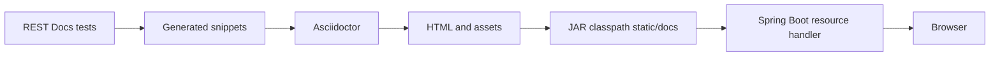

# Serving Static Documentation from the Application

## 1. Objective and Workflow

In the **SPRING_REST_DOCS** module, HTTP tests using MockMvc, WebTestClient, or REST Assured generate snippets for requests, responses, payloads, headers, parameters, and multipart parts. Asciidoctor/Markdown combines snippets with descriptions to produce REST API documentation. Once packaged, Spring Boot can serve the HTML and accompanying assets as static resources.

Users can access:

```text
GET /docs/index.html
GET /docs/css/site.css
GET /docs/images/upload-flow.png
```

Overall flow:



Generating HTML and serving HTML are two separate stages. This lesson assumes documentation has already been copied into the artifact's classpath, such as `BOOT-INF/classes/static/docs`. If the JAR does not contain the documentation, MVC configuration cannot locate the files on its own.

## 2. Placing Documentation in Classpath Static Resources

Spring Boot serves static content from default classpath locations, including `/static`, `/public`, `/resources`, and `/META-INF/resources`.

A simple structure for documentation:

```text
src/main/resources/
└── static/
    └── docs/
        ├── index.html
        ├── css/site.css
        ├── js/navigation.js
        └── images/upload-flow.png
```

If generated documentation is copied into output resources during the build, the executable JAR typically contains:

```text
BOOT-INF/classes/static/docs/
├── index.html
├── css/site.css
├── js/navigation.js
└── images/upload-flow.png
```

With the default static resource mapping, `static/docs/index.html` is typically accessible at:

```text
http://localhost:8080/docs/index.html
```

There is no need to write a custom controller to return individual files. Spring MVC's static resource handler locates the file on the classpath and writes its contents to the response.

### 2.1. Distinguishing URL Path and Classpath Path

| Purpose | Path |
| --- | --- |
| File in JAR/classpath | `static/docs/index.html` |
| URL called by client | `/docs/index.html` |
| CSS in classpath | `static/docs/css/site.css` |
| CSS URL | `/docs/css/site.css` |

The `static` segment is a classpath directory and normally does not appear in the URL. If copied mistakenly into `BOOT-INF/classes/docs` instead of `BOOT-INF/classes/static/docs`, the default URL may return 404.

## 3. Default Configuration and Related Properties

If files live in one of the default static locations, the application usually needs no extra configuration. Ensure documentation sits in `classpath:/static/docs/` and static resource mappings remain enabled.

Properties that can affect behavior:

| Property | Impact |
| --- | --- |
| `spring.web.resources.add-mappings` | Enables/disables default static resource mappings |
| `spring.web.resources.static-locations` | Changes the static locations searched |
| `spring.mvc.static-path-pattern` | Changes the URL pattern for static resources |
| `server.servlet.context-path` | Adds a context prefix to application URLs |

Illustrative default values:

```properties
spring.web.resources.add-mappings=true
spring.mvc.static-path-pattern=/**
server.servlet.context-path=
```

When setting `spring.web.resources.static-locations`, this property replaces the default location list. If the configuration specifies only a custom directory and omits `classpath:/static/`, documentation under `static/docs` may no longer be found. Keep the necessary locations.

### 3.1. Accessing the Index File

Use the explicit URL `/docs/index.html` to verify the main page. Do not assume `/docs/` always resolves to an index file inside a subdirectory; welcome-page handling and resource mapping depend on application configuration.

If you want the shorter `/docs/` URL, create an intentional redirect/forward or test welcome-page behavior on the Spring Boot version in use. Document the exact URL that has been verified.

## 4. Customizing URLs with ResourceHandlerRegistry

If you want a public URL different from the classpath location, register a resource handler using `WebMvcConfigurer`.

Example keeping documentation at `classpath:/static/docs/` while serving it under `/api-reference/**`:

```java
import org.springframework.context.annotation.Configuration;
import org.springframework.web.servlet.config.annotation.ResourceHandlerRegistry;
import org.springframework.web.servlet.config.annotation.WebMvcConfigurer;

@Configuration
class ApiDocumentationResources implements WebMvcConfigurer {

    @Override
    public void addResourceHandlers(ResourceHandlerRegistry registry) {
        registry.addResourceHandler("/api-reference/**")
                .addResourceLocations("classpath:/static/docs/");
    }
}
```

Corresponding mapping:

| Classpath resource | URL |
| --- | --- |
| `static/docs/index.html` | `/api-reference/index.html` |
| `static/docs/css/site.css` | `/api-reference/css/site.css` |
| `static/docs/images/upload-flow.png` | `/api-reference/images/upload-flow.png` |

The resource location ends with a trailing slash to denote a directory. The URL prefix does not need to match the classpath directory name.

Do not register a handler that duplicates the default mapping without a clear reason. Custom configuration can create overlapping handlers or affect other static resources. If `spring.mvc.static-path-pattern` or `spring.web.resources.add-mappings=false` is configured, review the entire MVC configuration and test all routes after making changes.

### 4.1. CacheControl for Documentation

You can set a cache policy on the resource handler:

```java
import java.time.Duration;

import org.springframework.context.annotation.Configuration;
import org.springframework.http.CacheControl;
import org.springframework.web.servlet.config.annotation.ResourceHandlerRegistry;
import org.springframework.web.servlet.config.annotation.WebMvcConfigurer;

@Configuration
class ApiDocsResourceConfiguration implements WebMvcConfigurer {

    @Override
    public void addResourceHandlers(ResourceHandlerRegistry registry) {
        registry.addResourceHandler("/docs/**")
                .addResourceLocations("classpath:/static/docs/")
                .setCacheControl(CacheControl.maxAge(Duration.ofMinutes(5))
                        .cachePublic());
    }
}
```

This example allows public caching for 5 minutes. Use `cachePublic()` only if content is permitted in shared caches/CDNs. If documentation depends on access rights or contains internal information, use an appropriate private policy and authorization.

For documentation that changes with every release, long cache lifetimes may cause users to see stale versions. Consider versioning URLs or asset filenames and caching immutable URLs aggressively.

## 5. Preserving CSS, Image, and JavaScript Paths

HTML may load files inside the same `docs` directory:

```html
<link rel="stylesheet" href="css/site.css">
<script src="js/navigation.js"></script>

```

With the page URL `/docs/index.html`, relative URLs typically resolve to `/docs/css/site.css`, `/docs/js/navigation.js`, and `/docs/images/upload-flow.png`.

The directory structure must be preserved when packaging. If only the HTML entry point is copied, the browser may render text without styles or images.

If using a custom prefix `/api-reference/**`, relative links like `css/site.css` usually continue to work; links starting with a slash like `/css/site.css` point to the host root and bypass the prefix. Check links in HTML and actual URLs behind a reverse proxy.

## 6. Spring Security: Public or Protected Docs

Static resource mapping and authorization are two separate concerns. Files existing on the classpath does not mean every client is permitted to access them; Spring Security can block requests before the resource handler runs.

If documentation is public, you can permit `/docs/**`:

```java
import org.springframework.context.annotation.Bean;
import org.springframework.context.annotation.Configuration;
import org.springframework.security.config.annotation.web.builders.HttpSecurity;
import org.springframework.security.web.SecurityFilterChain;

@Configuration
class SecurityConfiguration {

    @Bean
    SecurityFilterChain applicationSecurity(HttpSecurity http) throws Exception {
        return http
                .authorizeHttpRequests(authorize -> authorize
                        .requestMatchers("/docs/**").permitAll()
                        .anyRequest().authenticated()
                )
                .build();
    }
}
```

If the resource handler uses `/api-reference/**`, the security matcher must also use that prefix. With multiple `SecurityFilterChain` beans, verify which chain actually matches documentation requests.

### 6.1. Internal Documentation

Do not use `permitAll()` for internal docs. You can require authentication:

```java
.authorizeHttpRequests(authorize -> authorize
    .requestMatchers("/docs/**").authenticated()
    .anyRequest().authenticated()
)
```

Or a specific role:

```java
.authorizeHttpRequests(authorize -> authorize
    .requestMatchers("/docs/**").hasRole("API_DOCS")
    .anyRequest().authenticated()
)
```

Protect the entire URL prefix, not just the index page while leaving CSS, images, or subpages exposed on other routes. Test with both an authorized user and an unauthorized user. Do not put tokens, passwords, API keys, customer data, or sensitive internal endpoints in documentation.

## 7. Context Path and Reverse Proxy

If the application sets a context path `/service`, the client URL may be `/service/docs/index.html`. If a reverse proxy exposes the application under another prefix, the external URL also depends on the proxy and forwarded headers.

| Component | Path |
| --- | --- |
| Resource path in JAR | `static/docs/index.html` |
| App context path | `/service` |
| URL in application | `/service/docs/index.html` |
| Public URL behind gateway | `/platform/service/docs/index.html` |

Do not hardcode a public host in AsciiDoc if the same artifact is deployed to multiple environments. Prefer relative links and consistent proxy/context-path configuration. Distinguish the API server URL from the documentation page URL itself.

## 8. Content-Type, HEAD, and Caching

Spring MVC resource handling determines the media type by file extension and content negotiation. For example:

| File | Common Content-Type |
| --- | --- |
| `.html` | `text/html` |
| `.css` | `text/css` |
| `.js` | JavaScript media type per registry |
| `.png` | `image/png` |
| `.svg` | `image/svg+xml` |
| `.woff2` | `font/woff2` |

Do not set `text/html` globally for the entire `docs` directory. CSS, images, and fonts need their appropriate media types.

Spring MVC resource handling supports static requests such as `GET`/`HEAD` along with framework-configured caching and conditional request handling. When using a CDN/reverse proxy, inspect actual response headers such as `Cache-Control`, `Last-Modified`, or `ETag` rather than assuming they behave identically across all versions/configurations.

Caching recommendations:

| Content | Policy |
| --- | --- |
| HTML landing page | Short cache or revalidate to pick up new releases |
| Fixed-name CSS/JS | Moderate cache; purge on release |
| Assets with hash/version in filename | Can cache long-term because the URL changes with content |
| Private documentation | Cache policy aligned with access control; consider `private` or `no-store` |

## 9. Testing the Static Documentation Endpoint

Use a Spring Boot integration test to verify the file is served. MockMvc example:

```java
@SpringBootTest
@AutoConfigureMockMvc
class ApiDocumentationResourceTest {

    @Autowired
    MockMvc mockMvc;

    @Test
    void servesDocumentationIndex() throws Exception {
        mockMvc.perform(get("/docs/index.html"))
                .andExpect(status().isOk())
                .andExpect(content().contentTypeCompatibleWith(MediaType.TEXT_HTML))
                .andExpect(content().string(containsString("User API")));
    }

    @Test
    void servesStylesheet() throws Exception {
        mockMvc.perform(get("/docs/css/site.css"))
                .andExpect(status().isOk())
                .andExpect(content().contentTypeCompatibleWith("text/css"));
    }
}
```

This example assumes `index.html` and the stylesheet are on the classpath, such as a fixture in `src/main/resources/static/docs` or output added to the test/runtime classpath. If Spring Security is enabled, configure a test user or verify access-denied behavior instead of disabling security arbitrarily.

Cases to test:

- Index URL returns 200 for an authorized user.
- CSS or images return 200.
- Non-existent URLs return 404.
- Anonymous/unauthorized roles are rejected when docs are protected.
- URLs with context path/prefix work in an integration environment.

For HTML, assert the `Content-Type` and that the body contains the expected title/marker. For assets, assert the appropriate media type and a non-empty body.

## 10. Troubleshooting Common Errors

| Symptom | Possible Cause | How to Check |
| --- | --- | --- |
| `/docs/index.html` returns 404 | File missing from classpath or copied to wrong archive path | Use `jar tf` to look for `BOOT-INF/classes/static/docs/index.html` |
| HTML 200 but CSS 404 | Missing asset or wrong relative path | Inspect the archive and browser request URLs |
| 401/403 | Spring Security requires login/role | Check the filter chain and matchers |
| `/docs/` fails while `/docs/index.html` works | No welcome-page mapping for subdirectories | Use explicit file URL or configure a redirect |
| Works locally but fails behind gateway | Context path, proxy prefix, or forwarded headers | Verify the public URL |
| Stale documentation appears | Browser/CDN cache or old artifact | Check `Cache-Control` and versioned URLs |
| CSS has wrong MIME type | Resource mapping/proxy overriding header | Check response `Content-Type` |
| Docs private yet anonymous users can access | Other routes/assets unprotected | Protect the entire prefix and test anonymously |
| Custom handler does not work | URL pattern/location mismatch | Inspect `addResourceHandlers` |
| Other static resources disappeared | `static-locations` overrode defaults or `add-mappings=false` | Restore locations and inspect mappings |

## 11. Deployment Checklist

Before releasing documentation alongside the application, confirm:

1. Asciidoctor generated HTML and assets in the output directory.
2. The build copied the entire documentation tree into the classpath under `static/docs`.
3. The JAR/WAR contains `index.html`, CSS, images, and relevant JavaScript.
4. Public URLs match the context path and reverse proxy.
5. Security permits intended users or protects the entire docs path.
6. `Content-Type` headers for HTML and assets are appropriate.
7. Cache policy does not retain stale documentation for too long.
8. No secrets or internal information disallowed for publication are present.
9. Smoke tests verify the index page and at least one asset after deployment.

## 12. Hands-On Exercise

Suppose REST Docs has generated User API documentation:

1. Place sample HTML and CSS into `src/main/resources/static/docs`.
2. Run the application and call `GET /docs/index.html`.
3. Verify status 200, HTML `Content-Type`, and body containing the expected title.
4. Call `GET /docs/css/site.css` and check its media type.
5. Create a custom handler `/api-reference/**` pointing to `classpath:/static/docs/`.
6. Test both public and role-restricted security rules in a test environment.
7. Set a context path and test the URL beneath the prefix.
8. Configure an appropriate `CacheControl` and inspect response headers.
9. Build the executable JAR and verify `BOOT-INF/classes/static/docs/index.html`.
10. Run the JAR from a different working directory and confirm documentation is loaded from the classpath, independent of the developer machine's source folder.

**Completion criteria:** explain classpath locations and public URLs; configure default static resources and custom handlers; control security/caching; verify HTML and assets with integration tests and the executable JAR.

## 13. Self-Check Questions

**1. At which URL is classpath file `static/docs/index.html` accessed?**

Usually `/docs/index.html`; the `/static` prefix does not appear in the default URL.

**2. When is `ResourceHandlerRegistry` needed?**

When you need a custom URL prefix, a non-default resource location, or a custom cache policy.

**3. What effect does `dependsOn` in the build have when serving static docs?**

It ensures documentation is generated/packaged before runtime. When the application runs, Spring Boot reads documentation already present on the classpath; the resource handler does not re-run Asciidoctor.

**4. Why must Spring Security be checked?**

Static resource mapping does not imply public access. The security filter chain can block requests before the resource handler.

**5. Why must CSS and images be copied alongside HTML?**

Pages reference assets using relative URLs. Missing files or altered directory structures will cause pages to render incompletely.

**6. Why not assume `/docs/` always opens the index page?**

Welcome-page mapping for subdirectories depends on configuration and version. Use `/docs/index.html` or configure an explicit redirect and test it.

## References

- [Spring Boot — Static Content](https://docs.spring.io/spring-boot/reference/web/servlet.html#web.servlet.spring-mvc.static-content): static resource locations, URL mappings, and related configuration.
- [Spring Framework — Serving Static Resources](https://docs.spring.io/spring-framework/reference/web/webmvc/mvc-config/static-resources.html): `ResourceHandlerRegistry`, resource locations, cache control, and MVC static resource handling.
- [Spring Security — Authorize HTTP Requests](https://docs.spring.io/spring-security/reference/servlet/authorization/authorize-http-requests.html): protecting or permitting access to documentation URLs.
- [Spring REST Docs — Getting Started](https://docs.spring.io/spring-restdocs/tutorial/getting-started/index.html): generating snippets and compiling documentation before serving.
