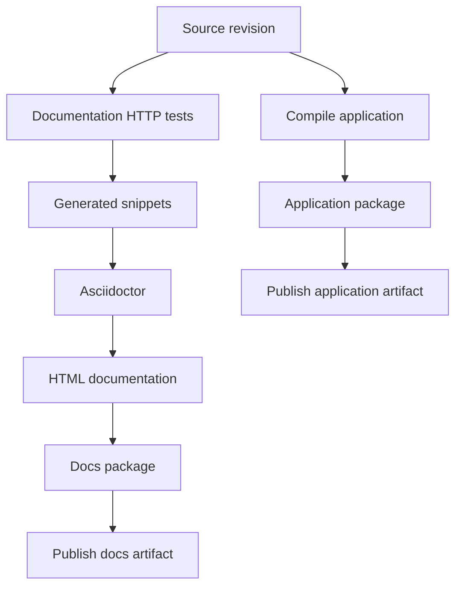
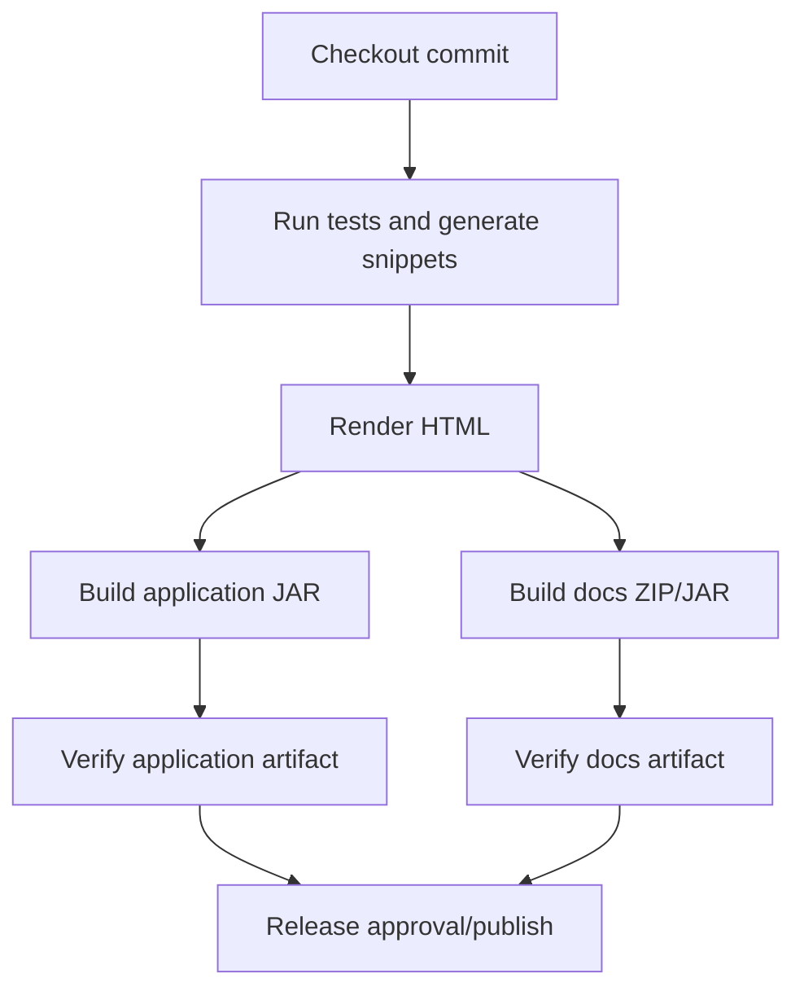

# Distinguishing the Documentation Artifact from the Application Artifact

## Learning Objectives

After this lesson, you will be able to:

- Explain the difference between a Spring Boot executable artifact and an artifact containing API documentation.
- Choose a documentation distribution approach: embedding in the application JAR, packaging a separate JAR, publishing a static website, or storing as a build artifact.
- Design a pipeline to generate snippets, render Asciidoctor, and produce an independent documentation artifact.
- Synchronize documentation versions with API/application versions and recognize cases requiring separate versioning.
- Configure Gradle or Maven to publish the proper artifact, avoiding reliance on ad-hoc build outputs.
- Verify artifact contents, metadata, checksums, and download/deployment readiness.
- Evaluate access permissions, security, and storage lifecycle before publishing documentation.

## 1. Two Artifacts with Different Purposes

In a Spring REST Docs project, the build typically produces at least two groups of outputs:

1. **Application artifact**: executable JAR/WAR containing bytecode, dependencies, or launcher classes required to run the service.
2. **Documentation artifact**: HTML/PDF generated from AsciiDoc and snippets produced by HTTP tests.

The two outputs can be released together or separately. This decision affects deployment, access control, caching, versioning, and accessibility for API integrators.

Example:

```text
orders-service-2.4.0.jar
orders-api-docs-2.4.0.zip
```

The application JAR serves the runtime API. The documentation ZIP contains HTML pages and static assets for publishing to a developer portal, web server, or object storage. Sharing the version helps readers know which contract the documentation describes.

Do not assume documentation must always live inside the application JAR. Choose the distribution model based on audience, access control, deployment method, and operational requirements.

## 2. Common Distribution Models

| Model | Artifact | How Accessed | When Appropriate |
| --- | --- | --- | --- |
| Embedded in application | One executable JAR containing code and HTML docs | Via Spring Boot URL, e.g., `/docs/` | Docs ship with app releases and share the same access control |
| Separate documentation JAR | A JAR containing only static docs | Classpath resource or extracted/published by another system | Want independent docs versioning and deployment while still using Maven/Gradle repositories |
| Static website ZIP | A ZIP containing HTML/CSS/JS/images | Extracted to a web server, CDN, or object storage | Developer portal or standalone hosting |
| HTML/PDF build artifact | HTML/PDF files stored in CI artifact store | Downloaded from pipeline or release page | Internal use, review, audit, or build archiving |
| Published website | Content deployed to a docs site | Official domain/portal | Public documentation or multiple API versions |

No single model fits every project. A system may produce both an application JAR and a docs ZIP from the same build, then publish them under two distinct policies.

## 3. Embedding Documentation in the Executable JAR

With this model, HTML is copied into classpath static resources, such as `static/docs`:

```text
orders-service.jar
└── BOOT-INF/classes/
    └── static/
        └── docs/
            ├── index.html
            ├── orders.html
            ├── css/
            ├── images/
            └── js/
```

Advantages:

- A single artifact contains both the application and corresponding documentation.
- Releasing the application automatically carries its documentation along.
- No separate website deployment is needed if the in-app URL meets requirements.
- Easy to identify the documentation version matching the runtime version.

Limitations:

- Documentation changes also require rebuilding and re-releasing the application.
- Docs access permissions are tied to the application's infrastructure and security policy.
- Serving docs traffic may consume resources of the API service.
- Multiple concurrent doc versions are difficult to organize if only one `/docs/` path is used.
- CDN/caching and website deployment are not independent of application releases.

Choose this approach when documentation accompanies the application, its size is reasonable, and readers can access it through the same host and security policy.

## 4. Publishing a Separate Documentation JAR

A separate JAR can contain static resources under a package path:

```text
orders-api-docs-2.4.0.jar
├── static/
│   └── docs/
│       ├── index.html
│       ├── orders.html
│       └── css/
└── META-INF/
    └── ...
```

The documentation JAR does not need to contain application classes. It is a versioned artifact that can be published to a Maven repository or internal artifact repository.

Usage patterns:

- Consumers download the JAR and extract it to publish a static website.
- A docs-host application adds this JAR as a dependency and serves resources from the classpath.
- A release pipeline fetches the JAR and unpacks it into a web server deployment directory.
- An artifact store retains each version for auditing or rollback.

A key design point is the resource path inside the JAR. If the docs host serves static resources from the classpath, pick a path the host can map cleanly, such as `META-INF/resources` or a custom-configured resource location. Verify the actual URL on the host; merely having the JAR exist does not mean browsers can automatically reach the content.

### 4.1. When Should You Split Out a Docs JAR?

Splitting is useful when:

- The API team and developer portal team have different release schedules.
- Documentation is large or needs to be served via a CDN.
- One host needs to aggregate documentation across multiple services.
- Documentation may be published to multiple distinct environments.
- You want to store/rollback docs without redeploying the service.

However, splitting the artifact does not mean versions can diverge arbitrarily. Documentation must still identify the API version or application build it describes.

## 5. Publishing a Static Website or ZIP

For developer portals, ZIP is often a convenient format:

```text
orders-api-docs-2.4.0.zip
├── index.html
├── orders/
│   ├── list.html
│   ├── get.html
│   └── create.html
├── css/
├── images/
└── js/
```

The ZIP can be extracted onto:

- Nginx/Apache or a static web server.
- Object storage with static website hosting.
- A CDN origin.
- An internal developer portal.
- A CI artifact store for download.

The advantage is that hosting does not depend on the Spring Boot runtime. Documentation can be cached, scaled, and deployed independently. The drawback is that the pipeline must ensure the right version is published, base paths/links work after extraction, and access policies are configured at the hosting layer.

Do not ZIP only a single `index.html` file. Preserve all relative assets such as CSS, JavaScript, images, subpages, fonts, and downloadable files.

## 6. Deciding Which Model to Choose

Answer these questions before choosing:

| Question | If Yes | Typically Suitable Direction |
| --- | --- | --- |
| Does docs need to match the exact running service build? | Docs release must stay strictly synchronized with app | Embed in application JAR or release in parallel with same version |
| Does docs need to deploy without restarting the service? | Hosting has an independent lifecycle | ZIP/website or separate docs JAR |
| Need to serve multiple API versions simultaneously? | Consumers may use older versions | Website with version prefixes or versioned artifacts |
| Is documentation strictly internal? | Separate authentication/authorization required | Internal docs portal or protected endpoint |
| Want to distribute to other systems as a dependency? | Consumers use Maven/Gradle | Docs JAR |
| Only need to store pipeline outputs? | No runtime hosting needed | HTML/PDF build artifact |

A common hybrid option is:

- Application JAR holds the runtime API.
- Docs ZIP is published to the developer portal.
- HTML/PDF is also stored in the CI artifact store for audit purposes.

## 7. Build Flow Producing Two Artifacts from the Same Source

Crucially, both artifacts must be built from the same source revision and the same snippet generation run:



Do not build the application JAR from commit A and the docs ZIP from commit B while tagging both with the same release version. If built independently, record the source commit/build identifier in metadata for traceability.

## 8. Configuring Gradle to Build a Separate Docs ZIP

Assuming Asciidoctor has generated HTML into `build/docs/asciidoc`, you can create a ZIP:

```groovy
def docsOutputDir = layout.buildDirectory.dir('docs/asciidoc')

tasks.register('apiDocsZip', Zip) {
    dependsOn tasks.named('asciidoctor')
    from(docsOutputDir)
    archiveBaseName = 'orders-api-docs'
    archiveVersion = project.version.toString()
    archiveClassifier = 'docs'
    destinationDirectory = layout.buildDirectory.dir('distributions')
}
```

Illustrative artifact:

```text
build/distributions/orders-api-docs-2.4.0-docs.zip
```

The final filename depends on `archiveBaseName`, `archiveVersion`, `archiveClassifier`, and the Gradle version. If you want the exact name `orders-api-docs-2.4.0.zip`, omit the `docs` classifier or adjust the naming convention.

### 8.1. Including a Docs JAR in a Publication

If you need to publish docs as a JAR:

```groovy
tasks.register('apiDocsJar', Jar) {
    dependsOn tasks.named('asciidoctor')
    from(docsOutputDir) {
        into 'static/docs'
    }
    archiveBaseName = 'orders-api-docs'
    archiveVersion = project.version.toString()
    archiveClassifier = 'docs'
}
```

This JAR contains only static documentation. The consumer or docs host must know how to unpack or serve resources from the JAR; it does not automatically become a standalone website simply because it has a `.jar` extension.

### 8.2. Publishing via Maven Publish

You can add the docs artifact to a Maven publication:

```groovy
publishing {
    publications {
        docs(MavenPublication) {
            artifact(tasks.named('apiDocsJar'))
            groupId = project.group.toString()
            artifactId = 'orders-api-docs'
            version = project.version.toString()
        }
    }
}
```

This configuration snippet is an example. The project must declare the `maven-publish` plugin, target repository, and credentials via CI secrets. Do not hardcode tokens/passwords in `build.gradle`.

If publishing only a ZIP, use `artifact(tasks.named('apiDocsZip'))` and set an appropriate extension/classifier. Inspect the published POM/metadata so consumers can resolve the artifact coordinates.

## 9. Configuring Maven to Build a Docs ZIP or JAR

Maven can use `maven-assembly-plugin` or `maven-jar-plugin` to package HTML output after Asciidoctor runs.

Example target layout:

```text
target/
├── generated-snippets/
├── generated-docs/
├── orders-service.jar
└── orders-api-docs-2.4.0.zip
```

For a ZIP, configure an assembly descriptor to take the contents of `target/generated-docs` and preserve the relative structure. Bind execution to `package` or a phase after docs are rendered.

For a JAR, `maven-jar-plugin` can package a classes/docs staging directory into an artifact with classifier `docs`. Keep that staging directory separate from the application's `target/classes` so you do not accidentally put documentation into both artifacts.

Things to verify:

- The `test` phase generated snippets.
- Asciidoctor ran after tests and created `generated-docs`.
- The packaging plugin reads the right output directory.
- The docs artifact has the expected name, version, and classifier.
- The application JAR contains only the resources intended for embedding.

## 10. Synchronizing Versions Between Application and Documentation

If docs describe the API of application version `2.4.0`, the artifacts should reflect that relationship:

```text
orders-service:2.4.0
orders-api-docs:2.4.0
```

You can use the same release version:

- Application version: version of the code/service.
- API version: version of the public contract, which may be independent of the application version.
- Docs artifact version: version of the rendered documentation build.
- Source revision/build ID: commit or build number that produced the artifact.

These four versions are not always identical. For instance, a code patch that does not alter the API contract may bump the application version while keeping the API version unchanged. Even then, the docs artifact must still be traceable to the commit/build that produced it.

### 10.1. Traceability Metadata

You can include a metadata file in the ZIP:

```json
{
  "service": "orders-service",
  "applicationVersion": "2.4.0",
  "apiVersion": "v2",
  "sourceRevision": "a1b2c3d4",
  "buildNumber": "184",
  "generatedAt": "2026-11-17T03:00:00Z"
}
```

The values above are examples only. The pipeline should populate them from actual build metadata rather than hardcoding sample commits or timestamps. Metadata is helpful when investigating which documentation was published and which code revision it corresponds to.

### 10.2. Versioned Documentation URLs

A website can be structured as:

```text
/docs/
├── current/
├── 2.4/
└── 2.3/
```

`current` points to the latest supported release; specific versions are retained so consumers integrating with older versions can look them up. A retention policy should define when an old version is archived or retired.

## 11. CI Creating, Verifying, and Publishing Artifacts

A typical pipeline:

1. Check out source revision.
2. Run unit/integration/documentation tests.
3. Confirm snippets were generated.
4. Render Asciidoctor.
5. Build the application JAR.
6. Build the docs ZIP/JAR.
7. Verify contents, version, and checksum.
8. Store artifacts or publish to repository/portal according to pipeline permissions.

Example workflow:



In pipelines, publishing typically runs only on approved branches, tags, or releases. Pull request builds can produce artifacts for review without publishing to production repositories.

### 11.1. Verifying the Docs ZIP

After building the ZIP, check:

- `index.html` is present.
- Operation pages linked from index are present.
- CSS, JS, images, and fonts are intact.
- No temporary files, test logs, or unnecessary source files are present.
- No tokens, session cookies, personal data, or internal hostnames disallowed for publication are present.
- Relative links work after unpacking under the expected base path.

### 11.2. Verifying the Docs JAR

For a JAR:

```bash
jar tf build/libs/orders-api-docs-2.4.0-docs.jar
```

Check entries:

```text
static/docs/index.html
static/docs/orders.html
static/docs/css/site.css
```

For a ZIP:

```bash
jar tf build/distributions/orders-api-docs-2.4.0-docs.zip
```

`jar tf` can list ZIP contents on supported JDKs; you can also use `unzip -l` or an equivalent archive tool. Never conclude an artifact is valid based solely on its filename; inspect the actual entries.

### 11.3. Checksums and Provenance

Generating a checksum helps detect whether an artifact was altered after publication:

```bash
sha256sum orders-api-docs-2.4.0-docs.zip
```

On Windows you can use `Get-FileHash` with SHA256. Store the checksum alongside the artifact and attach the source revision/build ID in release metadata. In environments requiring provenance/signing, use your organization's artifact signing mechanism.

## 12. Access Control and Sensitive Content

Separating artifacts does not solve security by itself. A public docs ZIP can be downloaded by anyone with the URL; a docs JAR in an internal repository is accessible according to repository permissions.

Before publishing, check:

- Are internal endpoints exposed?
- Do snippets contain real `Authorization`, `Cookie`, session IDs, or tokens?
- Do examples contain real user data or production information?
- Do error messages reveal hostnames, stack traces, or internal structures?
- Does documentation describe endpoints that are not yet public or enabled in production?
- Does the repository/portal have the right audience group?

If docs are internal-only, publish to an access-controlled repository/portal. If public, apply content review and secret scanning before release. Use synthetic fixtures in documentation tests from the beginning to reduce leakage risk.

## 13. Choosing Where to Store Artifacts

| Storage Location | Best For | Notes |
| --- | --- | --- |
| Maven repository | Versioned JAR/ZIP downloaded by coordinates | Manage permissions, retention, and immutable releases |
| CI artifact store | Build outputs, review, audit | Retention may be short; do not assume it is a release channel |
| Object storage | Static websites and versioned docs | Configure ACL, caching, and origin policy |
| CDN | Distributing public docs at scale | Purge/cache versions and base paths |
| Developer portal | Multiple APIs/services with shared navigation | Requires service/version metadata and a publish workflow |
| Application JAR | Docs tied to a single runtime service | Shares deployment lifecycle and security policy |

Do not use temporary CI artifacts as official documentation URLs if retention and access control do not meet consumer needs.

## 14. Common Errors

| Symptom | Possible Cause | Resolution |
| --- | --- | --- |
| Docs ZIP has a different version from application JAR | Two artifacts read versions from different sources | Use shared release metadata and source revision |
| ZIP contains only `index.html` | Task packaged only a single file | Package the entire output directory |
| Docs JAR is not served by host | Resource path inside JAR is not scanned by the resource handler | Check classpath location and host configuration |
| Docs publish succeeds yet website returns 404 | Base path or deployment layout mismatch | Check unpacked structure and URL mapping |
| Consumers download wrong docs version | Unversioned artifact or unclear `current` alias | Publish explicit versions and manage aliases clearly |
| Artifact contains stale snippets | Stale generated output or tests did not run | Clean outputs, run docs tests, and re-render |
| Documentation leaks credentials | Real fixtures or secrets leaked into snippets | Use fake data, preprocess, and scan artifacts |
| App JAR bloats in size | Embedded unnecessary website/docs assets | Consider a separate artifact/hosting |
| Unintended publish from pull request | CI publish trigger unrestricted | Publish only on allowed tags/branches/releases |

## 15. Checklist for Distinguishing and Publishing Artifacts

- [ ] Identify the audience and where documentation will be served.
- [ ] Choose among embedding in application JAR, docs JAR, website ZIP, or CI artifact.
- [ ] Ensure the docs artifact is built from the same source revision as the application when synchronization is required.
- [ ] Use traceable versions and metadata.
- [ ] Preserve all HTML/CSS/JS/images and relative directory structure.
- [ ] Exclude stale generated snippets or temporary files from packages.
- [ ] Verify artifact contents and checksums.
- [ ] Scan for credentials, cookies, tokens, and sensitive data.
- [ ] Define access control for the repository/portal/website.
- [ ] Verify URLs/base paths after deployment.
- [ ] Restrict publish triggers to appropriate branches/tags/releases.
- [ ] Retain artifacts and provenance according to retention policy.

## 16. Hands-On Exercise

An Orders API development team wants to produce an executable JAR for the service and a docs ZIP package to publish to a developer portal.

Perform the following:

1. Configure documentation tests to generate snippets into `generated-snippets`.
2. Render HTML with Asciidoctor into a separate output directory.
3. Configure the application JAR for runtime needs; embedding docs is optional if the portal serves them separately.
4. Build a ZIP containing all HTML/CSS/JS/images with a versioned filename.
5. Add metadata for service, API version, source revision, and build number.
6. Inspect ZIP entries and scan for secrets before publishing.
7. Generate a SHA-256 checksum and store it alongside the artifact.
8. Configure CI to publish only on valid release tags.
9. Deploy the ZIP to the staging portal and verify navigation and relative links.
10. Confirm consumers can access the documentation version matching the API.

**Self-check question:** If the docs ZIP and application JAR are built with the same version string, is that enough to prove they describe the exact same source? No. Two pipelines could use the same version string while checking out different commits. You need to record the source revision/build ID and ensure both artifacts are produced from the same revision or the same release pipeline.

## Summary

The application artifact and the documentation artifact can be released together or independently. Embedding HTML in the executable JAR fits when docs share the runtime and security policy; a docs JAR or ZIP fits when you need separate versioning, hosting, and deployment; CI artifacts fit review and auditing. Whichever model you choose, generate snippets and HTML from the same source revision, synchronize version metadata, preserve all assets, verify contents and checksums, and scan for secrets before publishing. CI should restrict publish triggers and retain provenance so consumers know precisely which API version the documentation describes. Clearly distinguishing the purpose and lifecycle of each artifact lets the team ship both the application and documentation appropriately while preserving traceability to the tested contract.
