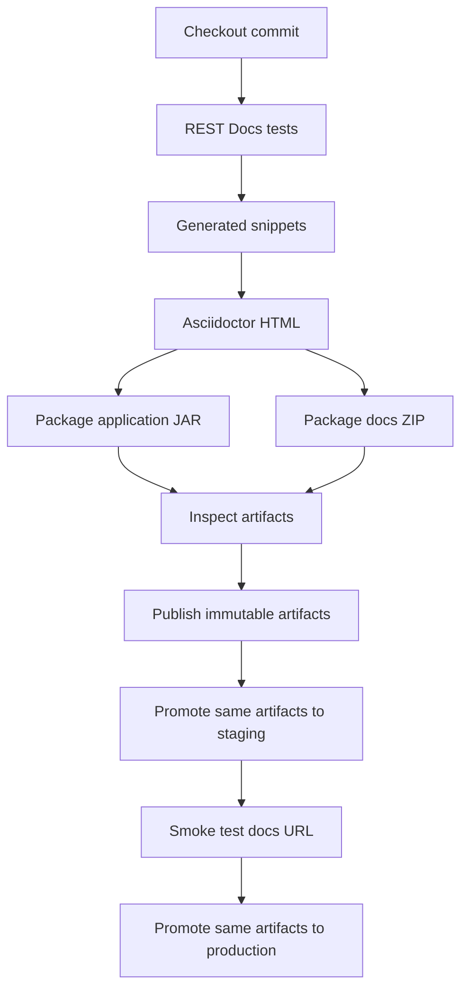

# Packaging Documentation by Release Environment

## 1. Objective

**Spring REST Docs** generates verifiable REST API documentation from HTTP tests using MockMvc, WebTestClient, or REST Assured. Tests generate snippets for requests, responses, payloads, headers, parameters, and multipart parts; Asciidoctor/Markdown combines snippets with authored content to build release documentation.

When preparing a release, the development team must decide where documentation is packaged and whether it differs across environments. Three common models:

1. Embed HTML into the application JAR/WAR.
2. Publish documentation as a separate artifact.
3. Publish documentation to a site/portal or object storage.

Choosing a model affects artifact size, access permissions, versioning, CI/CD pipelines, and rollbacks. This lesson covers configuring Maven/Gradle per environment while keeping API versions and documentation versions linked.

## 2. Distinguishing Build-Time and Runtime Environments

Two stages must be distinguished:

- **Build time:** tests generate snippets, Asciidoctor creates HTML, and copy/packaging tasks decide which files end up in the artifact.
- **Runtime:** Spring Boot starts with a profile such as `dev`, `staging`, or `prod`; profiles adjust URLs, security, logging, and application properties.

A runtime profile does not automatically swap contents already packaged inside the JAR. If the JAR already contains `static/docs/index.html`, activating the `prod` profile cannot replace that file with different documentation unless the application is explicitly designed to read docs from an external source outside the classpath.

```text
Build:
  REST Docs tests
    -> generated snippets
    -> Asciidoctor HTML
    -> package application.jar

Runtime:
  application.jar + SPRING_PROFILES_ACTIVE=prod
    -> production settings
    -> serves HTML already inside the JAR
```

Deciding "which documentation gets released" generally belongs to the build/publish pipeline. Deciding "who can access it and which URLs are used" generally belongs to runtime configuration and deployment.

## 3. Choosing a Distribution Model

| Model | When Appropriate | Pros | Considerations |
| --- | --- | --- | --- |
| Embedded in JAR/WAR | Docs always ship with API version | Synchronized releases; rolls back with the app | Increases size; doc edits require rebuild |
| Separate docs artifact | Docs have separate access control or lifecycle | Independent publish/rollback; retain multiple versions | Needs version and pipeline synchronization |
| Portal/static site | Multiple APIs/versions need lookup | Centralized search and versioning | Requires hosting, access control, and caching |

### 3.1. Embedding Documentation in the Application Artifact

Structure inside a Spring Boot executable JAR is typically:

```text
BOOT-INF/classes/static/docs/
├── index.html
├── css/
├── images/
└── operations/
```

Suitable when users need documentation matching the running API, docs have no independent lifecycle, and rolling back the application must restore both the API and documentation.

Gradle typically makes `bootJar` depend on `asciidoctor` and copies output into `static/docs`. Maven can run Asciidoctor in `prepare-package` and copy output into `target/classes/static/docs` before `package`.

### 3.2. Publishing Docs as a Separate Artifact

Example pipeline producing two artifacts:

```text
release/
├── application-2.4.0.jar
└── api-docs-2.4.0.zip
```

The docs artifact can be stored in an artifact repository or published to static hosting. Keep metadata linking it to the API release:

```yaml
apiVersion: 2.4.0
docsVersion: 2.4.0
sourceRevision: 8f31c2a
generatedAt: 2026-11-17T03:00:00Z
```

These values are illustrative. The pipeline must pull versions/commits from the build rather than hardcoding them.

### 3.3. Publishing to a Portal or Static Site

A portal fits when there are multiple services, teams, and versions. Each release can live under a dedicated prefix such as `/services/orders/2.4.0/`, while `/services/orders/current/` points to the current release.

Define who can publish/view, how history is retained, and how CDN invalidation works. Do not publish internal documentation to a public site merely because HTML generation succeeded.

## 4. Do dev, staging, and production Need Different Documentation?

Do not assume every environment needs a different set of content. Endpoint descriptions, schemas, status codes, and request/response examples should reflect the contract of the same API version. Changing docs content by environment can mislead users about the API contract.

Differences typically lie in:

- base URL or server URL;
- gateway prefix;
- how tokens/authentication are obtained;
- banners indicating the environment;
- documentation access policies;
- internal instructions permitted only in non-production.

Do not include credentials, tokens, customer data, or sensitive internal endpoints in generated snippets. Use fixtures and synthetic data in tests.

A good strategy is keeping the API contract identical while providing server URLs/environment instructions outside the artifact. If internal docs must differ from public docs, separate sources/outputs clearly and inspect artifacts to prevent content mixing.

## 5. Maven: Build Profiles to Select Documentation

A Maven profile can toggle executions or configure outputs. For example, include documentation in the application JAR only when the `with-api-docs` profile is activated.

```xml
<profiles>
    <profile>
        <id>with-api-docs</id>
        <build>
            <plugins>
                <plugin>
                    <groupId>org.asciidoctor</groupId>
                    <artifactId>asciidoctor-maven-plugin</artifactId>
                    <version>3.2.0</version>
                    <executions>
                        <execution>
                            <id>generate-api-docs</id>
                            <phase>prepare-package</phase>
                            <goals>
                                <goal>process-asciidoc</goal>
                            </goals>
                            <configuration>
                                <backend>html</backend>
                            </configuration>
                        </execution>
                    </executions>
                    <dependencies>
                        <dependency>
                            <groupId>org.asciidoctor</groupId>
                            <artifactId>asciidoctorj</artifactId>
                            <version>3.0.0</version>
                        </dependency>
                        <dependency>
                            <groupId>org.springframework.restdocs</groupId>
                            <artifactId>spring-restdocs-asciidoctor</artifactId>
                            <version>${spring-restdocs.version}</version>
                        </dependency>
                    </dependencies>
                </plugin>
            </plugins>
        </build>
    </profile>
</profiles>
```

The profile illustrates only activating the execution. REST Docs test dependencies and test output configuration must sit consistently in the shared build or inside the same profile. If resource copying must also be conditional, place the copy execution in that profile after the Asciidoctor plugin.

Activate:

```bash
./mvnw -Pwith-api-docs clean package
```

If the profile is inactive, executions inside the profile do not run. CI must explicitly activate the profile when building release docs; do not rely on `activeByDefault` if another profile can automatically deactivate it.

### 5.1. Separating Docs Artifacts with Classifiers

If you want docs as a secondary artifact, use an archive/assembly plugin to build a separate ZIP instead of copying into `target/classes/static`. Set a classifier or artifact name tied to the same application version, such as `api-docs`. Both docs and application must draw snippets/sources from the same build revision.

Do not publish a docs artifact from a different commit than the application JAR and label both with the same version without recording provenance.

## 6. Gradle: Separate Tasks and Conditional Packaging

You can define separate docs tasks and include docs in the JAR only when a property is enabled. Groovy DSL example:

```groovy
def includeApiDocs = providers.gradleProperty('includeApiDocs')
        .map { it.toBoolean() }
        .getOrElse(false)

tasks.named('asciidoctor') {
    dependsOn tasks.named('test')
    inputs.dir file('build/generated-snippets')
    configurations 'asciidoctorExt'
}

tasks.named('bootJar') {
    if (includeApiDocs) {
        dependsOn tasks.named('asciidoctor')
        from(tasks.named('asciidoctor').map { it.outputDir }) {
            into 'static/docs'
        }
    }
}
```

Build with docs:

```bash
./gradlew clean bootJar -PincludeApiDocs=true
```

Build without embedded docs:

```bash
./gradlew clean bootJar -PincludeApiDocs=false
```

In this configuration, `test`/`asciidoctor` are pulled into `bootJar`'s dependency graph only when the property is enabled. If CI still needs to validate docs on every build, run the docs/verify task separately rather than skipping snippet-generating tests.

### 6.1. Building a Standalone Docs Artifact

You can use a dedicated archive task:

```groovy
tasks.register('apiDocsZip', Zip) {
    dependsOn tasks.named('asciidoctor')
    from(tasks.named('asciidoctor').map { it.outputDir })
    archiveBaseName = 'api-docs'
    archiveVersion = project.version.toString()
    archiveClassifier = 'html'
    destinationDirectory = layout.buildDirectory.dir('distributions')
}
```

Run:

```bash
./gradlew clean apiDocsZip
```

The ZIP resides in `build/distributions`. To build both the JAR and ZIP from the same revision:

```bash
./gradlew clean bootJar apiDocsZip
```

Ensure `asciidoctor` depends on `test` and the archive task reads the right output directory. Avoid redundantly packaging docs into the JAR if the goal is solely a separate artifact.

## 7. Runtime Profiles: URLs and Access Control

Runtime profiles are meant for adjusting URLs, security, and cache policies, not for altering already-packaged content.

Example:

```yaml
# application-prod.yml
server:
  servlet:
    context-path: /service

spring:
  web:
    resources:
      cache:
        cachecontrol:
          max-age: 5m
          cache-public: true
```

With this context path, the URL may be `/service/docs/index.html`. However, `cache-public` is only appropriate if docs are genuinely public. Internal docs need their own security and cache policies.

The `staging` profile may use a prefix or shorter cache policy, but should not alter API contract snippets. If public and internal docs must differ, separate outputs/routes cleanly and inspect the respective artifacts.

## 8. Injecting Environment-Specific Base URLs into Documentation

You can use Asciidoctor attributes to insert a server URL from build inputs:

```asciidoc
= Orders API
:toc: left
:api-server-url: https://api.example.invalid

API server: {api-server-url}

== GET /orders/{id}
include::{snippets}/orders-get/http-request.adoc[]
```

Attributes can be passed when running Asciidoctor/Maven/Gradle depending on the plugin. However, if the same artifact is promoted from staging to production, baking a staging hostname into HTML will be wrong. Whenever possible, use relative paths or place the server URL in portal/deployment configuration outside the artifact.

If you genuinely build environment-specific docs, label them clearly in the title/banner and record environment metadata. Do not reuse the same artifact version for differing contents without recording it.

## 9. CI/CD: Build, Verify, and Promote

A release pipeline may include:



Principles:

1. Generate snippets and HTML from the same commit as the application.
2. Use clean builds or declare task inputs/outputs to avoid stale generated outputs.
3. Store JAR and docs artifacts with matching versions/revisions.
4. Inspect archives before publishing.
5. Promote the exact tested artifacts through staging and production; do not rebuild with different content while keeping the same version.
6. After deployment, smoke test URLs, security, and cache headers.
7. Roll back both the application and docs if the two artifacts depend on each other.

### 9.1. Provenance Metadata

Attach release metadata for traceability:

```text
service: orders-api
apiVersion: 2.4.0
docsArtifact: api-docs-2.4.0-html.zip
sourceRevision: 8f31c2a
buildNumber: 1842
```

Populate values from the CI environment or build metadata rather than entering fixed commits/versions in documentation.

## 10. Security by Release Environment

| Environment | Docs Access | Considerations |
| --- | --- | --- |
| Local development | Developers/team | May use docs fixtures and local endpoints |
| CI | Build jobs/service accounts | Do not publish unverified documentation |
| Staging | Testers, QA, internal | May require authentication |
| Production public API | Customers/developers | Publish only approved contracts |
| Production internal API | Authorized roles/teams | Protect all docs routes and assets |

Do not rely on hard-to-guess URLs to protect docs. Use Spring Security, gateway authentication, or hosting access policies. Never allow public caches to store user-dependent responses.

## 11. Common Errors

| Symptom | Cause | Resolution |
| --- | --- | --- |
| Production JAR missing docs | Build did not enable docs profile/property | Check CI parameters and archive |
| Staging docs differ from production despite same version | Rebuilt with environment-specific content | Promote the same artifact or assign distinct version/provenance |
| HTML contains staging host in production | Baked base URL during staging build then promoted artifact | Use relative URLs or configure URL outside artifact |
| Docs and API versions out of sync | Published from two different commits/builds | Attach source revision and version to both artifacts |
| Runtime profile does not change HTML | Content is already inside the JAR | Build a new artifact or read docs from an external source |
| Docs unintentionally public | Route lacks authorization | Protect prefix in Security/gateway |
| Cache retains stale docs | Policy unsuitable for current URL | Revalidate HTML and version assets |
| Docs ZIP missing snippets | Asciidoctor does not depend on tests | Ensure `test` → `asciidoctor` |
| CI does not generate docs | Maven profile/Gradle property not enabled | Check build command and active profiles |
| Rollback out of sync | Docs artifact and JAR deployed independently | Pair versions and roll back together |

## 12. Hands-On Exercise

Design a release for a service with API version `2.4.0`:

1. Write REST Docs tests and generate snippets.
2. Configure Asciidoctor to generate HTML.
3. Choose a model: embed docs in the JAR or build a separate ZIP.
4. For Maven, create a `with-api-docs` profile and bind `process-asciidoc` to `prepare-package`.
5. For Gradle, create an `includeApiDocs` property and an `apiDocsZip` task.
6. Ensure the docs artifact and application artifact come from the same source revision.
7. Do not embed a staging hostname if the artifact is promoted to production.
8. Configure runtime profiles for context path, security, and cache headers.
9. Inspect the JAR/ZIP via archive listing; verify entry point and assets.
10. Deploy to staging, smoke test the URL, then promote the same artifact to production.
11. Test rollback and confirm both the API and docs revert to the same release.

**Completion criteria:** distinguish build-time/runtime; choose a distribution model; intentionally configure profiles/tasks; synchronize versions/revisions; verify security, URLs, and caching; promote/roll back traceable artifacts.

## 13. Self-Check Questions

**1. Can a runtime profile swap HTML already inside the JAR?**

Not automatically. Runtime profiles change application configuration; packaged HTML stays unchanged unless a mechanism loads docs from an external source.

**2. When should docs be embedded in the JAR?**

When docs must always match the API version and roll back together with the application artifact.

**3. When should a separate docs ZIP be published?**

When docs have independent access control, lifecycle, hosting, or rollback requirements.

**4. Why avoid rebuilding separate artifacts for staging and production with the same version?**

Contents can differ despite identical versions, breaking immutability and complicating traceability/rollbacks. Promote the same artifact or assign distinct versions/provenance.

**5. What is the role of a Maven profile?**

A profile activates docs generation/copy executions for a given build mode. CI must explicitly select the corresponding profile.

**6. What can a Gradle property control?**

Enabling/disabling embedding docs in `bootJar` or building a separate docs archive. The task graph must reflect the choice.

**7. How do you guarantee docs match the API release?**

Generate docs and application from the same commit/build, attach matching versions/source revisions, and inspect artifacts before publishing.

## References

- [Spring REST Docs — Getting Started](https://docs.spring.io/spring-restdocs/tutorial/getting-started/index.html): generating snippets and compiling documentation in the build.
- [Maven Profiles](https://maven.apache.org/guides/introduction/introduction-to-profiles.html): activating build configurations by profile.
- [Maven Build Lifecycle](https://maven.apache.org/guides/introduction/introduction-to-the-lifecycle.html): phase ordering and plugin executions.
- [Gradle Build Environment](https://docs.gradle.org/current/userguide/build_environment.html): project properties and build configuration.
- [Gradle Task Configuration](https://docs.gradle.org/current/userguide/lazy_configuration.html): task providers and dependencies.
- [Spring Boot Profiles](https://docs.spring.io/spring-boot/reference/features/profiles.html): runtime configuration by profile.
