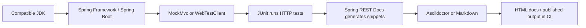

# Java, Spring Framework, and Spring REST Docs Version Requirements

## Learning Objectives

Before configuring **Spring REST Docs**, you need to determine which JDK the project uses, which Spring Framework/Spring Boot generation it belongs to, and select the matching Spring REST Docs branch. An incompatible version combination can prevent HTTP tests from compiling, running, or generating snippets, even though the API itself works normally.

After this lesson, you will be able to:

- Identify the minimum requirements for Java, Spring Framework, and testing libraries for Spring REST Docs 3.x and 4.x.
- Choose the appropriate Spring REST Docs branch for a Spring Boot 3.x or 4.x project, and know when to use MockMvc, WebTestClient, or REST Assured.
- Verify the actual JDK version used by your development machine, build tool, and CI.
- Set up a sample project with the right dependencies, run a snippet-generating test, and diagnose version-incompatibility errors.

> **Scope:** This lesson belongs to the **Project Setup** chapter of the `SPRING_REST_DOCS` module. Spring REST Docs is a tool for generating verifiable REST API documentation from HTTP tests. Subsequent chapters dive into documenting requests/responses, payloads, parameters, headers, and publishing Asciidoctor/Markdown documentation in builds and CI. The release information below was cross-checked against Spring documentation as of **November 17, 2026**; when applying it to a long-lived project, re-check the latest patch releases.

## 1. Distinguishing Components and Dependencies

Spring REST Docs is not a standalone HTTP-handling framework. It hooks into an HTTP testing tool in the Spring ecosystem, observes the actual request and response during test execution, and generates documentation fragments (snippets). If the test or documentation specification is inaccurate, documentation generation also fails; as a result, the documentation is verified against the source code.

| Component | Responsibility | Impact on Version Selection |
| --- | --- | --- |
| **JDK (Java Development Kit)** | Compiles and runs the application, tests, and Gradle/Maven | Must meet the minimum version required by Spring Framework, Spring REST Docs, and related tools. |
| **Spring Framework** | Provides Spring MVC Test/`MockMvc`, WebFlux/`WebTestClient`, and Spring Test | Serves as the primary compatibility constraint for Spring REST Docs. |
| **Spring Boot** *(if used)* | Manages dependency versions, configuration, and test starters | Typically determines the Spring Framework generation; Boot 3 and Boot 4 should use different REST Docs branches. |
| **Spring REST Docs** | Integrates with HTTP tests, verifies documentation descriptors, and generates snippets | Choose 3.x or 4.x according to the Spring generation in use. |
| **JUnit and HTTP test tool** | Executes tests and sends requests to the API | Must match the version supported by Spring REST Docs. |
| **Asciidoctor/Markdown** | Compiles snippets into readable documentation | Acts as the publishing step, wired into the build after tests generate snippets. |

Overall processing flow:



**Do not assume that merely adding the `spring-restdocs-core` dependency is enough.** A minimal setup requires a suitable HTTP testing tool, snippet-generation configuration, and a build task that consumes the generated snippets.

## 2. Where to Start with the Compatibility Matrix?

For modern Spring projects, determine versions in this order: **Spring Boot (if used) → Spring Framework → Spring REST Docs → Java/JUnit**.

| Project | Spring Framework | Spring REST Docs | Minimum Java | Testing and Integration |
| --- | --- | --- | --- | --- |
| **Spring Boot 3.x** | **6.x** | **3.x** | **17** | JUnit Jupiter 5; MockMvc, WebTestClient; REST Assured 5.2+ integration in REST Docs 3.x. |
| **Spring Boot 4.x** | **7.x** | **4.x** | **17** | JUnit 6; MockMvc or WebTestClient. **No REST Assured integration in REST Docs 4.x.** |
| **Spring Framework without Boot** | 6.x or 7.x | 3.x or 4.x respectively | **17** for both branches | Manage Spring Test, JUnit, and corresponding REST Docs module versions manually. |

Key milestones:

1. **Spring REST Docs 3.0** raised the baseline to **Java 17** and **Spring Framework 6**. This branch fits applications still on Spring Boot 3.x. REST Assured integration in the 3.x branch requires REST Assured **5.2** or later.
2. **Spring REST Docs 4.0** still requires a minimum of **Java 17**, but upgrades to **Spring Framework 7**, **JUnit 6**, and **AsciidoctorJ 3.0**. This branch targets the Spring Boot 4.x generation.
3. **Spring REST Docs 4.0 removed the REST Assured integration module**, due to incompatibility with the Groovy 5 baseline at the time of the 4.0 release. Therefore, examples using `spring-restdocs-restassured` from REST Docs 3.x cannot be copied directly to 4.x.
4. At the time of this lesson, the latest published stable release of the 4.0 branch is **4.0.2** (released October 22, 2026); the 3.0 branch has **3.0.6** (June 9, 2026). **4.1.0-RC1** is a release candidate, still in pre-release testing and already raising the Spring Framework requirement to 7.1; do not select it by default for environments requiring a stable release.

This is a **generation-level compatibility matrix**, not a guarantee that arbitrary patch versions of Boot, Framework, and REST Docs can be mixed freely. Prefer letting the **Spring Boot BOM** (or your project's centrally managed BOM) choose the tested set of versions together.

### Quick Selection by Scenario

**Scenario A — Existing project on Spring Boot 3.5.x.** Stay on Spring Framework 6.x and use Spring REST Docs 3.x. You can choose MockMvc for Servlet controllers or WebTestClient for WebFlux. If the project already uses REST Assured 5.2+ for tests, the REST Docs 3.x branch still supports that integration.

**Scenario B — New project on Spring Boot 4.0.x or 4.1.x.** Choose Spring Framework 7.x and Spring REST Docs 4.x. Prefer MockMvc/WebTestClient. You will need to update test code for JUnit 6 and Spring Boot 4 package/module changes.

**Scenario C — Legacy project on Java 8/11, Spring Framework 5, or Spring Boot 2.x.** You cannot simply add Spring REST Docs 3.x/4.x and run it. Plan a JDK and Spring upgrade along with migrating the relevant Jakarta APIs, or evaluate an older REST Docs branch that still fits; avoid introducing an obsolete branch into new projects.

## 3. Java Requirements: Minimum 17, but Verify the Actual JDK in Use

### 3.1. JDK and JVM Can Differ Across Development Machines, Builds, and CI

Both Spring REST Docs 3.x and 4.x have a **minimum Java version of 17**. Java 21 or Java 25 (newer LTS releases) are also sensible choices when your entire stack and pipeline support them. Choose the Java version based on your project's operational policy rather than assuming the highest Java version is always safe with every plugin.

Check in your terminal:

```bash
java -version
javac -version
```

Example valid output for the minimum requirement:

```text
openjdk version "17.0.x" ...
javac 17.0.x
```

Check the build tool's JVM separately:

```bash
./gradlew --version
./mvnw -version
```

On Windows, you can use `.\gradlew.bat --version` and `.\mvnw.cmd -version`. These two wrapper commands only run when the project includes the corresponding wrapper files.

**Common pitfall:** `java -version` showing Java 21 does not guarantee that Gradle, Maven, your IDE, or your CI runner is also using JDK 21. An IDE may pick a separate Gradle JVM; CI may set `JAVA_HOME` to JDK 11. Inspect the output directly inside the test execution environment and align your CI configuration consistently.

### 3.2. Lock the Project's Java Version

In Gradle, use a Java toolchain:

```groovy
java {
    toolchain {
        languageVersion = JavaLanguageVersion.of(17)
    }
}
```

In Maven, you can use the `release` configuration:

```xml
<properties>
    <java.version>17</java.version>
    <maven.compiler.release>17</maven.compiler.release>
</properties>
```

`--release 17` controls the Java bytecode/API level used for compilation; it does not automatically guarantee that the CI machine has a compatible JDK installed. When a dependency requires Java 17 class files while execution runs on Java 11, you may encounter `UnsupportedClassVersionError`.

## 4. Spring Framework and Spring Boot: Generation-Level Compatibility

**Spring Framework** contains the Spring MVC/WebFlux testing APIs that REST Docs uses. **Spring Boot** is the configuration and dependency management layer on top of Spring Framework; Boot is not required to use REST Docs, but in Boot projects you should let Boot manage the Spring Framework version.

### 4.1. How Do Spring Framework 6 and 7 Differ When Setting Up REST Docs?

| Aspect | Spring Framework 6 / Boot 3 Generation | Spring Framework 7 / Boot 4 Generation |
| --- | --- | --- |
| Minimum Java version | Java 17 | Java 17 |
| Matching Spring REST Docs | 3.x | 4.x |
| Primary test tools | Spring MVC Test (MockMvc), WebFlux WebTestClient | Spring MVC Test (MockMvc), WebFlux WebTestClient |
| JUnit | JUnit Jupiter 5 commonly used | JUnit 6 is the baseline required by REST Docs 4 |
| Jakarta | Migrated from `javax.*` to `jakarta.*` in corresponding Jakarta EE APIs | **Jakarta EE 11** baseline; Servlet 6.1 for Servlet web |
| JSON handling in REST Docs | REST Docs 3 branch uses Jackson 2 | REST Docs 4 uses Jackson 3 |

For example, code importing `javax.servlet.http.HttpServletRequest` in an older project is no longer valid when migrating to Spring Framework 6/7; you must switch to `jakarta.servlet.http.HttpServletRequest` and address related changes. Not every Java `javax.*` class was renamed: `javax.crypto.*`, for instance, remains part of Java SE.

### 4.2. Do Not Force a Framework Version Just to Fix a Test Error

Example in Spring Boot 4:

```groovy
dependencies {
    implementation 'org.springframework.boot:spring-boot-starter-webmvc'
    testImplementation 'org.springframework.boot:spring-boot-starter-webmvc-test'
    testImplementation 'org.springframework.restdocs:spring-restdocs-mockmvc'
}
```

When a project uses Spring Boot's dependency management plugin/BOM, do not separately declare `spring-webmvc`, `spring-test`, or a version for `spring-restdocs-mockmvc` if it is already managed by the BOM. Avoid pinning a `spring-test` version from a different generation than the other Spring modules: compilation errors can turn into `NoSuchMethodError` or `NoClassDefFoundError` at test runtime.

You can inspect the dependency tree **without editing code**:

```bash
./gradlew dependencies --configuration testRuntimeClasspath
./mvnw dependency:tree
```

With Gradle, you can use `dependencyInsight` to see which dependency selected a specific version:

```bash
./gradlew dependencyInsight --dependency spring-restdocs-mockmvc --configuration testRuntimeClasspath
```

## 5. JUnit, MockMvc, WebTestClient, and REST Assured: Choosing the Right Integration

Spring REST Docs generates snippets from **tests that actually invoke HTTP endpoints**; you do not need to start a server on a network port when using MockMvc or WebTestClient bound directly to the application context.

| Testing Approach | Suitable When | Spring REST Docs Dependency | Version Status |
| --- | --- | --- | --- |
| **MockMvc** | Spring MVC/Servlet controllers; fast web-layer tests | `org.springframework.restdocs:spring-restdocs-mockmvc` | Supported in 3.x and 4.x |
| **WebTestClient** | Spring WebFlux/reactive; WebTestClient-based test API needed | `org.springframework.restdocs:spring-restdocs-webtestclient` | Supported in 3.x and 4.x |
| **REST Assured** | 3.x-branch projects testing APIs with the REST Assured DSL | `org.springframework.restdocs:spring-restdocs-restassured` | **REST Docs 3.x only**; integration removed in 4.x |

Specific notes for the 4.x branch:

- Uses **JUnit 6** and `org.junit.jupiter.api.Test`. The `org.junit.jupiter.*` package name is preserved, so you cannot tell JUnit 5 from JUnit 6 merely by looking at imports.
- With plain REST Docs configuration, use `@ExtendWith(RestDocumentationExtension.class)` and configure `MockMvcBuilders`/`WebTestClient`. This approach is explicit and does not depend on where Boot's auto-configuration annotation lives.
- If you use Spring Boot 4's `@AutoConfigureRestDocs` convenience annotation, the import moves to `org.springframework.boot.restdocs.test.autoconfigure.AutoConfigureRestDocs`. Make sure the `org.springframework.boot:spring-boot-restdocs` module is present on the test classpath; adding `spring-restdocs-mockmvc` alone is not enough to provide Boot's annotation.
- In Boot 3, `@AutoConfigureRestDocs` is in the `org.springframework.boot.test.autoconfigure.restdocs` package with the corresponding Boot 3 test starter configuration. Do not copy imports verbatim from Boot 3 examples into Boot 4.

**Selection rule:** Pick **one primary testing approach** matching your application stack; add another only when there is a clear testing need. Testing tool and Spring REST Docs dependencies usually use `testImplementation` (Gradle) or `test` (Maven) scope, because they do not need to be present on the running API's runtime classpath.

## 6. Complete Configuration Example: Java 17 + Spring Boot 4 + REST Docs 4

The following example uses **Spring Boot 4.0.9**, **Spring REST Docs 4.0.2**, **JUnit 6**, **MockMvc**, and **Asciidoctor**. The Spring Boot BOM manages the `spring-restdocs-mockmvc` version; the Java code uses `RestDocumentationExtension`, so no Spring Boot-specific annotation is required.

### 6.1. `build.gradle` (Groovy DSL)

```groovy
plugins {
    id 'java'
    id 'org.springframework.boot' version '4.0.9'
    id 'io.spring.dependency-management' version '1.1.7'
    id 'org.asciidoctor.jvm.convert' version '4.0.5'
}

group = 'com.example'
version = '0.0.1-SNAPSHOT'

java {
    toolchain {
        languageVersion = JavaLanguageVersion.of(17)
    }
}

repositories {
    mavenCentral()
}

configurations {
    asciidoctorExt
}

dependencies {
    implementation 'org.springframework.boot:spring-boot-starter-webmvc'
    testImplementation 'org.springframework.boot:spring-boot-starter-webmvc-test'
    testImplementation 'org.springframework.restdocs:spring-restdocs-mockmvc'
    testRuntimeOnly 'org.junit.platform:junit-platform-launcher'
    asciidoctorExt 'org.springframework.restdocs:spring-restdocs-asciidoctor'
}

asciidoctorj {
    version = '3.0.0'
}

ext {
    snippetsDir = file('build/generated-snippets')
}

tasks.named('test') {
    useJUnitPlatform()
    outputs.dir snippetsDir
}

tasks.named('asciidoctor') {
    inputs.dir snippetsDir
    configurations 'asciidoctorExt'
    dependsOn test
}
```

Layer-by-layer explanation:

1. **JDK:** `java.toolchain` selects Java 17 for compilation and testing.
2. **Web:** `spring-boot-starter-webmvc` provides the application's Spring MVC environment; `spring-boot-starter-webmvc-test` provides the corresponding web test utilities in Spring Boot 4.
3. **REST Docs:** `spring-restdocs-mockmvc` supports snippet generation in MockMvc. Because the Spring Boot BOM is active, do not specify `4.0.2` directly on this dependency; verify the resolved version when needed.
4. **JUnit:** `useJUnitPlatform()` enables the test platform; the launcher is declared on test runtime.
5. **Documentation:** `spring-restdocs-asciidoctor` and AsciidoctorJ 3.0 process REST Docs macros and includes.
6. **Build order:** `asciidoctor.dependsOn test` ensures snippets exist before Asciidoctor reads them. The output directory is declared to Gradle to support incremental builds.

If you use **WebFlux** instead of Spring MVC, switch to the corresponding WebFlux/test starters and replace `spring-restdocs-mockmvc` with `spring-restdocs-webtestclient`; the test class also needs to use `WebTestClient` and its dedicated REST Docs configuration.

### 6.2. A Small Test to Verify the Selected Versions

Create `src/test/java/com/example/docs/PingDocumentationTest.java`:

```java
package com.example.docs;

import org.junit.jupiter.api.BeforeEach;
import org.junit.jupiter.api.Test;
import org.junit.jupiter.api.extension.ExtendWith;
import org.springframework.http.MediaType;
import org.springframework.restdocs.RestDocumentationContextProvider;
import org.springframework.restdocs.RestDocumentationExtension;
import org.springframework.test.web.servlet.MockMvc;
import org.springframework.test.web.servlet.setup.MockMvcBuilders;
import org.springframework.web.bind.annotation.GetMapping;
import org.springframework.web.bind.annotation.RestController;

import static org.springframework.restdocs.mockmvc.MockMvcRestDocumentation.document;
import static org.springframework.restdocs.mockmvc.MockMvcRestDocumentation.documentationConfiguration;
import static org.springframework.test.web.servlet.request.MockMvcRequestBuilders.get;
import static org.springframework.test.web.servlet.result.MockMvcResultMatchers.content;
import static org.springframework.test.web.servlet.result.MockMvcResultMatchers.status;

@ExtendWith(RestDocumentationExtension.class)
class PingDocumentationTest {

    private MockMvc mockMvc;

    @BeforeEach
    void setUp(RestDocumentationContextProvider restDocumentation) {
        this.mockMvc = MockMvcBuilders.standaloneSetup(new PingController())
                .apply(documentationConfiguration(restDocumentation))
                .build();
    }

    @Test
    void documentsPingEndpoint() throws Exception {
        this.mockMvc.perform(get("/api/ping").accept(MediaType.TEXT_PLAIN))
                .andExpect(status().isOk())
                .andExpect(content().string("pong"))
                .andDo(document("ping"));
    }

    @RestController
    static class PingController {
        @GetMapping(value = "/api/ping", produces = MediaType.TEXT_PLAIN_VALUE)
        String ping() {
            return "pong";
        }
    }
}
```

Here `PingController` is defined inline in the test for a self-contained demonstration; in a real project, replace it with your own controller or application context. `RestDocumentationExtension` manages the output directory, `documentationConfiguration(...)` attaches the documentation recorder to MockMvc, and `document("ping")` generates snippets for the request/response of the test after assertions pass.

Run `./gradlew test` (Windows: `.\gradlew.bat test`). Expected output includes files such as:

```text
build/
└── generated-snippets/
    └── ping/
        ├── curl-request.adoc
        ├── http-request.adoc
        ├── http-response.adoc
        ├── httpie-request.adoc
        ├── request-body.adoc
        └── response-body.adoc
```

Default snippet names may differ when a project explicitly configures which snippet types to generate. If the test passes but the directory does not appear, check `.apply(documentationConfiguration(...))` and `.andDo(document("ping"))` first.

### 6.3. Using Snippets in an Asciidoctor Document

Create `src/docs/asciidoc/index.adoc`:

```asciidoc
= REST API Documentation
:toc: left
:sectnums:

== Ping endpoint

=== HTTP request

include::{snippets}/ping/http-request.adoc[]

=== HTTP response

include::{snippets}/ping/http-response.adoc[]
```

Run `./gradlew asciidoctor` (or `.\gradlew.bat asciidoctor`). Because of `dependsOn test`, this command runs tests first and then compiles the documentation from snippets. The resulting HTML is typically at `build/docs/asciidoc/index.html`. This step verifies the end-to-end path from HTTP tests to output documentation before integrating into application packaging or CI.

**If you choose Markdown:** Spring REST Docs can also generate snippets using Markdown templates, but you must configure `TemplateFormats.markdown()` instead of the default Asciidoctor format and use an appropriate Markdown build pipeline. Simply renaming content extensions or copying `include::{snippets}` into Markdown will not automatically produce a complete document.

## 7. Equivalent Maven Configuration: Minimal Parts to Recognize

If a Maven project uses `spring-boot-starter-parent` from the Boot 4 branch, let the parent/BOM manage dependency versions. Example relevant sections in `pom.xml`:

```xml
<parent>
    <groupId>org.springframework.boot</groupId>
    <artifactId>spring-boot-starter-parent</artifactId>
    <version>4.0.9</version>
    <relativePath/>
</parent>

<properties>
    <java.version>17</java.version>
</properties>

<dependencies>
    <dependency>
        <groupId>org.springframework.boot</groupId>
        <artifactId>spring-boot-starter-webmvc</artifactId>
    </dependency>
    <dependency>
        <groupId>org.springframework.boot</groupId>
        <artifactId>spring-boot-starter-webmvc-test</artifactId>
        <scope>test</scope>
    </dependency>
    <dependency>
        <groupId>org.springframework.restdocs</groupId>
        <artifactId>spring-restdocs-mockmvc</artifactId>
        <scope>test</scope>
    </dependency>
</dependencies>
```

These are **configuration excerpts**, not a complete `pom.xml`. To build HTML documentation with Maven, add `org.asciidoctor:asciidoctor-maven-plugin` along with the `spring-restdocs-asciidoctor` plugin dependency and bind the `process-asciidoc` goal to a phase after tests have run (such as `prepare-package`). For Maven projects without a Spring Boot parent/BOM, consistently manage the versions of Spring Framework, JUnit, and REST Docs yourself.

Maven's default snippet directory is `target/generated-snippets`; Gradle's is `build/generated-snippets`. Every build task must point to the exact directory where tests actually write output.

## 8. Readiness Check Before Writing API Documentation

A project is ready for the lessons on generating request/response snippets when all six conditions below are met:

| Check | How to Verify | Expected Result |
| --- | --- | --- |
| 1. **JDK** | `java -version`, `javac -version`, and Gradle/Maven/CI JVM version | Java 17+; actual runtime matches the build configuration. |
| 2. **Spring Framework** | Dependency tree or Boot BOM | Boot 3 → Framework 6; Boot 4 → Framework 7. |
| 3. **REST Docs** | Check resolved dependency in test runtime | 3.x with Framework 6; 4.x with Framework 7. |
| 4. **HTTP test + JUnit** | Check test dependencies and run a test | MockMvc/WebTestClient module matches stack; JUnit is compatible. |
| 5. **Snippets** | Run a test with `document(...)` | `http-request.adoc` and `http-response.adoc` files are generated. |
| 6. **Final docs** | Run Asciidoctor task after tests | Readable HTML page containing real HTTP content from snippets. |

Running `./gradlew test` alone without inspecting snippets is **not enough** to conclude that REST Docs is working: tests can pass simply because they assert the response without calling `document(...)`.

## 9. Common Errors Caused by Choosing the Wrong Versions

| Symptom | First Cause to Check | Resolution |
| --- | --- | --- |
| `UnsupportedClassVersionError` when building/running tests | Runtime JDK is too old for Spring/REST Docs bytecode | Check the actual JDK used by Gradle/Maven/IDE/CI and upgrade to Java 17+ per your stack. |
| `NoSuchMethodError`, `NoClassDefFoundError` in Spring Test | Mixed Spring Framework generations on the classpath | Revert to the appropriate BOM, remove unnecessary overrides, inspect `dependencyInsight`/`dependency:tree`. |
| Cannot resolve `spring-restdocs-restassured:4.x` | REST Assured module was removed in REST Docs 4 | Use MockMvc/WebTestClient in 4.x; if still on 3.x, manage REST Assured 5.2+ accordingly. |
| `@AutoConfigureRestDocs` not found after upgrading to Boot 4 | Old Boot 3 import or missing REST Docs auto-config module | Use the Boot 4 import and add `spring-boot-restdocs` to the test classpath; or configure `RestDocumentationExtension` directly. |
| Tests pass green but `generated-snippets` is missing | REST Docs not applied to MockMvc/WebTestClient or `document(...)` not called | Check setup steps and test code; verify the exact output path. |
| Asciidoctor reports `http-request.adoc` not found | Documentation task runs before tests, wrong snippets directory, or mismatched operation name | Declare `dependsOn test`, verify `snippetsDir`, and check the name inside `document("...")`. |
| Older JUnit 5 tests fail to run as expected on the 4.x branch | Test engine/platform misaligned with the JUnit 6 baseline | Let the Boot 4 BOM manage JUnit versions; update the launcher and `useJUnitPlatform()` configuration. |
| Boot 2 tests fail after upgrading Spring | Servlet API still uses `javax.servlet.*` or old Jakarta dependencies | Review `javax` → `jakarta` changes and Servlet/Jakarta EE APIs per the migration guide. |

The errors in this table are **diagnostic starting points**, not conclusions from a single exception line. When investigating, read the `Caused by` chain and compare against the actual dependency tree.

## 10. Self-Check Practice Exercise

1. Use an existing project or create a suitable Spring Boot project. Record the output of `java -version`, `./gradlew --version` (or Maven), and the Boot version.
2. Fill in a short compatibility matrix for your project: **Java → Spring Framework → Spring Boot → REST Docs → JUnit → MockMvc/WebTestClient**.
3. Add the REST Docs module matching your HTTP testing library, write a simple test calling `/api/ping`, and generate snippets.
4. Run the test; verify that `http-request.adoc` and `http-response.adoc` exist.
5. Include both snippets in an Asciidoctor document, run the documentation build task, and open the resulting HTML.
6. Try removing `.andDo(document("ping"))`, clear the old output, rerun, and compare the passing test against the absence of generated snippets. Restore the test code after observing.

**Self-assessment questions:**

- Why is Java 17 a shared requirement yet insufficient on its own to arbitrarily choose REST Docs 3.x or 4.x?
- Why should a Spring Boot 4 application normally use REST Docs 4 even though Boot can still run on Java 17?
- Why must older REST Assured tests from REST Docs 3.x be updated when moving to REST Docs 4?
- Why are the Asciidoctor dependency and the execution order between tests and documentation generation also part of "project setup"?

## Official References

- [Spring REST Docs — System Requirements](https://docs.spring.io/spring-restdocs/system-requirements.html): Java 17, Spring Framework 7 for the 4.x branch.
- [Spring REST Docs — Getting Started](https://docs.spring.io/spring-restdocs/tutorial/getting-started/index.html): Gradle/Maven configuration, JUnit, MockMvc, WebTestClient, snippets, and Asciidoctor.
- [Spring REST Docs 3.0 Release Notes](https://github.com/spring-projects/spring-restdocs/wiki/Spring-REST-Docs-3.0-Release-Notes): Java 17, Spring Framework 6, and REST Assured 5.2.
- [Spring REST Docs 4.0 Release Notes](https://github.com/spring-projects/spring-restdocs/wiki/Spring-REST-Docs-4.0-Release-Notes): JUnit 6, AsciidoctorJ 3, Spring Framework 7, and REST Assured integration changes.
- [Spring REST Docs — Releases](https://github.com/spring-projects/spring-restdocs/releases): check stable and patch releases over time.
- [Spring Boot 4.0 — System Requirements](https://docs.spring.io/spring-boot/4.0/system-requirements.html): JDK, Framework, Maven/Gradle, and Servlet.
- [Spring Boot 4.0 — Testing Spring Boot Applications](https://docs.spring.io/spring-boot/4.0/reference/testing/spring-boot-applications.html): test modules and `@AutoConfigureRestDocs` configuration.

When setting up a real project, **lock in the compatible branch first**, use proper dependency management, and then prove correctness with a snippet-generating test. This lays the foundation so that all request, response, payload, parameter, and header documentation in subsequent lessons stays aligned with tested HTTP behavior.
