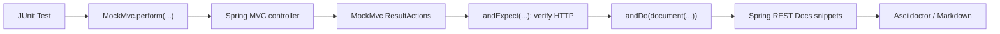
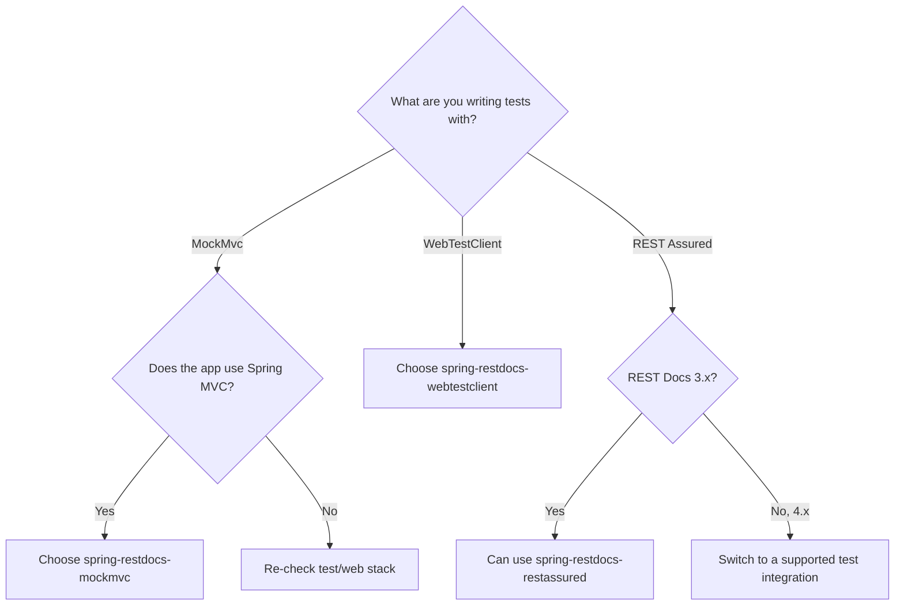

# Choosing the `spring-restdocs-mockmvc` Module

## Lesson Objectives

In the **Project Setup** chapter of the **SPRING_REST_DOCS** module, we need to pick the right component to integrate Spring REST Docs with HTTP tests. When an API is implemented using **Spring MVC**, the module typically chosen is **`org.springframework.restdocs:spring-restdocs-mockmvc`**.

After this lesson, you will be able to:

- Explain the role of `spring-restdocs-mockmvc` and why it pairs with **MockMvc**.
- Decide when to choose MockMvc, when to use `spring-restdocs-webtestclient`, or when REST Assured integration applies on supported branches.
- Declare the dependency properly in Gradle/Maven with the correct test scope and Spring REST Docs branch.
- Configure a practical MockMvc test to generate request/response snippets, then extend it to payloads, parameters, and headers.
- Inspect the results to distinguish between **passing HTTP tests**, **generated REST Docs snippets**, and **compiled final documentation**.

> **Context:** Spring REST Docs generates verifiable REST API documentation from HTTP tests using MockMvc, WebTestClient, or REST Assured (depending on version). Snippets generated from requests/responses are included in Asciidoctor/Markdown documents and integrated into builds and CI. This lesson focuses on deciding when to choose and setting up **`spring-restdocs-mockmvc`**; detailed documentation descriptors for each snippet type come in subsequent lessons.

## 1. What Does `spring-restdocs-mockmvc` Do?

**Spring MockMvc** is a tool in `spring-test` that invokes Spring MVC controllers with simulated HTTP requests without starting a server on a network port. It passes through Spring MVC's request-processing pipeline and returns results to assert status, headers, and body.

**Spring REST Docs MockMvc** is the module that **connects** that testing flow to Spring REST Docs' snippet generator. It provides the following key APIs:

| API | Purpose |
| --- | --- |
| `org.springframework.restdocs.mockmvc.MockMvcRestDocumentation.documentationConfiguration(...)` | Attaches REST Docs configuration to `MockMvcBuilders`. |
| `org.springframework.restdocs.mockmvc.MockMvcRestDocumentation.document(...)` | Names the operation and triggers snippet generation inside `.andDo(...)`. |
| `org.springframework.restdocs.mockmvc.RestDocumentationRequestBuilders` | Builds HTTP requests with support for documenting path parameters. |
| `org.springframework.restdocs.RestDocumentationExtension` | Manages the documentation context and output directory per JUnit test; lives in REST Docs core and is pulled in transitively by the MockMvc module. |
| `org.springframework.restdocs.payload.PayloadDocumentation`, `request.RequestDocumentation`, `headers.HeaderDocumentation` | Describe parts of requests/responses; used alongside `document(...)` in an HTTP test. |

Execution flow:



Selecting the module is only the **first step**. The dependency makes REST Docs classes available; to actually produce snippet files, you must **configure REST Docs on the MockMvc instance itself** and **invoke `document(...)`** in the test (or use a configured default documentation handler).

### What the Module Does Not Do for You

- It **does not** automatically generate documentation for every controller at application startup.
- It **does not** replace `spring-test`, JUnit, assertions, or build tools.
- It **does not** produce complete HTML or Markdown documents on its own; that is handled by compiling snippets.
- It **does not** fully validate API structure if you only call `document("operation-name")`. To catch changed fields, parameters, or headers, you must add the corresponding descriptors.

## 2. Criteria for Deciding Whether to Choose `spring-restdocs-mockmvc`

### 2.1. Choose It When the API Is Handled by Spring MVC

`spring-restdocs-mockmvc` is usually the right fit when:

1. The API uses `@RestController`/`@RequestMapping`/`@GetMapping` on the **Spring MVC (Servlet stack)**.
2. The project already uses `MockMvc` to test controllers or wants fast HTTP tests without opening a network port.
3. You need to verify HTTP status, headers, JSON, or request mappings while generating snippets from **the same test**.
4. You want the build or CI to fail whenever documented parts of the API no longer match the actual response.

Practical example: a team builds an order management API on Spring MVC. A test uses MockMvc to call `GET /api/orders/42`, checks status `200`, verifies the response JSON, and writes the `orders-get` snippet. When the `totalPrice` field disappears or is renamed, a strictly declared `responseFields(...)` descriptor causes the test to fail, alerting the team that the documentation needs updating.

### 2.2. Comparison with Other Modules

| Option | Use When | How Endpoints Are Called in Tests | Notes |
| --- | --- | --- | --- |
| **`spring-restdocs-mockmvc`** | Spring MVC, Servlet controllers; already using `MockMvc` | `mockMvc.perform(...).andDo(document(...))` | Does not require running a real HTTP server. |
| **`spring-restdocs-webtestclient`** | WebFlux, reactive APIs, or tests already using `WebTestClient` | `webTestClient.get()...exchange()...consumeWith(document(...))` | Requires WebTestClient filter/consumer setup instead of `MockMvcBuilders`. |
| **`spring-restdocs-restassured`** | REST Assured tests in projects using **Spring REST Docs 3.x** | REST Assured filter and request specification | **Spring REST Docs 4.x no longer includes REST Assured integration**. |
| **`spring-restdocs-core`** | Building custom core components or extensions | Does not directly replace `MockMvcRestDocumentation` | Pulled in transitively by integration modules; rarely declared directly in standard setups. |
| **`spring-restdocs-asciidoctor`** | Compiling snippets into Asciidoctor documents | Asciidoctor plugin/task | **Complements the publishing step**; does not replace `spring-restdocs-mockmvc` in HTTP tests. |

**Selection rule:** Look at **the actual HTTP testing tool** together with **the application's web stack**. Do not choose `spring-restdocs-mockmvc` just because the application is a "REST API": a WebFlux service is still a REST API, yet requires a different integration.



### 2.3. Selecting by Spring REST Docs Version

| Common Spring Project | Spring Framework | Spring REST Docs Branch | MockMvc Dependency to Declare |
| --- | --- | --- | --- |
| Spring Boot **3.x** | **6.x** | **3.x** | `org.springframework.restdocs:spring-restdocs-mockmvc` |
| Spring Boot **4.x** | **7.x** | **4.x** | `org.springframework.restdocs:spring-restdocs-mockmvc` |
| Without Boot | 6.x or 7.x | Choose 3.x or 4.x accordingly | Declare a version consistent with the project's Spring Test/JUnit |

**The artifact ID remains `spring-restdocs-mockmvc`** across both 3.x and 4.x branches. What changes is the **underlying library versions** (Spring Framework, JUnit, and related components). Both modern branches require Java 17 as a minimum.

For example, as of **November 17, 2026**, Spring Boot 3.5.16 manages `spring-restdocs-mockmvc:3.0.6` and Spring Boot 4.0.9 manages `spring-restdocs-mockmvc:4.0.2`. **Do not hardcode these numbers across every project**: prefer the BOM/parent corresponding to the Spring Boot version actually in use.

## 3. Declaring the Dependency Correctly

### 3.1. Gradle Groovy DSL for Spring Boot 3.x

In `build.gradle` of a project that **already has the Spring Boot plugin and dependency management**:

```groovy
dependencies {
    implementation 'org.springframework.boot:spring-boot-starter-web'

    testImplementation 'org.springframework.boot:spring-boot-starter-test'
    testImplementation 'org.springframework.restdocs:spring-restdocs-mockmvc'
}

tasks.named('test') {
    useJUnitPlatform()
}
```

`spring-boot-starter-web` provides Spring MVC; `spring-boot-starter-test` provides test utilities; `spring-restdocs-mockmvc` adds REST Docs integration. Both **JUnit** and **REST Docs** are in test scope. If the Boot BOM already manages versions, omit `:3.x.y` on the REST Docs dependency.

### 3.2. Gradle Groovy DSL for Spring Boot 4.x

Spring Boot 4 splits web and test starters by specific technology. For Spring MVC:

```groovy
dependencies {
    implementation 'org.springframework.boot:spring-boot-starter-webmvc'

    testImplementation 'org.springframework.boot:spring-boot-starter-webmvc-test'
    testImplementation 'org.springframework.restdocs:spring-restdocs-mockmvc'
    testRuntimeOnly 'org.junit.platform:junit-platform-launcher'
}

tasks.named('test') {
    useJUnitPlatform()
}
```

This example assumes the project uses the Spring Boot 4 plugin and its matching BOM. Spring REST Docs 4 builds on **Spring Framework 7/JUnit 6**. Use the test starters matching your Boot version; do not mix Boot 3 starters with Boot 4.

Spring Boot **4.0.4 and later** also includes `spring-boot-starter-restdocs`. This starter can offer convenient integration setup depending on your needs, but **`spring-restdocs-mockmvc` remains the dedicated artifact** to understand when working directly with MockMvc. If you choose the starter, inspect the resolved dependencies to avoid redundant declarations.

### 3.3. Gradle Kotlin DSL

The same module in `build.gradle.kts`:

```kotlin
dependencies {
    testImplementation("org.springframework.restdocs:spring-restdocs-mockmvc")
}

tasks.test {
    useJUnitPlatform()
}
```

This snippet illustrates **only the REST Docs dependency**; the application still needs Spring MVC test, JUnit, and appropriate Spring Boot/Gradle configuration as shown above.

### 3.4. Maven

If the project uses `spring-boot-starter-parent` for the corresponding Boot branch:

```xml
<dependencies>
    <!-- Spring MVC application; example for Boot 4.x -->
    <dependency>
        <groupId>org.springframework.boot</groupId>
        <artifactId>spring-boot-starter-webmvc</artifactId>
    </dependency>

    <!-- Spring MVC test utilities for Boot 4.x -->
    <dependency>
        <groupId>org.springframework.boot</groupId>
        <artifactId>spring-boot-starter-webmvc-test</artifactId>
        <scope>test</scope>
    </dependency>

    <dependency>
        <groupId>org.springframework.restdocs</groupId>
        <artifactId>spring-restdocs-mockmvc</artifactId>
        <scope>test</scope>
    </dependency>
</dependencies>
```

For **Boot 3.x**, replace `spring-boot-starter-webmvc`/`spring-boot-starter-webmvc-test` in the example with `spring-boot-starter-web`/`spring-boot-starter-test`, while keeping `spring-restdocs-mockmvc`.

**`<scope>test</scope>` is critical:** the documentation-generation tool only serves testing and does not need to be packaged into the running application. If you do not use Spring Boot's parent/BOM, you must explicitly declare a REST Docs version compatible with your Spring Framework and test dependencies; for example, Spring Framework 7 pairs with the REST Docs 4.x branch.

### 3.5. Dependency Summary Table by Purpose

| Component | Gradle Example | Needed at API Runtime? |
| --- | --- | --- |
| Spring MVC application | `implementation 'org.springframework.boot:spring-boot-starter-webmvc'` (Boot 4) | Yes |
| Spring MVC test + JUnit | `testImplementation 'org.springframework.boot:spring-boot-starter-webmvc-test'` (Boot 4) | No |
| Spring REST Docs for MockMvc | `testImplementation 'org.springframework.restdocs:spring-restdocs-mockmvc'` | No |
| Extension for Asciidoctor | `asciidoctorExt 'org.springframework.restdocs:spring-restdocs-asciidoctor'` | No; used in documentation build tasks |

**Note:** `spring-restdocs-mockmvc` is not a Spring Boot web starter. It provides the MockMvc documentation API and pulls in REST Docs core; it does not replace application dependencies, nor does it automatically supply a configured `MockMvc` instance.

## 4. End-to-End Example: MockMvc Generating Snippets Without Starting a Server

The example below uses JUnit Jupiter + Spring MVC + Spring REST Docs. It works well for understanding the basic integration in both REST Docs **3.x and 4.x** and does not rely on Spring Boot auto-configuration annotations.

### 4.1. Creating a Standalone Test

Assume dependencies are declared as shown in Section 3. Create `src/test/java/com/example/docs/HealthDocumentationTest.java`:

```java
package com.example.docs;

import org.junit.jupiter.api.BeforeEach;
import org.junit.jupiter.api.Test;
import org.junit.jupiter.api.extension.ExtendWith;
import org.springframework.http.MediaType;
import org.springframework.restdocs.RestDocumentationContextProvider;
import org.springframework.restdocs.RestDocumentationExtension;
import org.springframework.test.web.servlet.MockMvc;
import org.springframework.test.web.servlet.setup.MockMvcBuilders;
import org.springframework.web.bind.annotation.GetMapping;
import org.springframework.web.bind.annotation.RestController;

import static org.springframework.restdocs.mockmvc.MockMvcRestDocumentation.document;
import static org.springframework.restdocs.mockmvc.MockMvcRestDocumentation.documentationConfiguration;
import static org.springframework.restdocs.mockmvc.RestDocumentationRequestBuilders.get;
import static org.springframework.test.web.servlet.result.MockMvcResultMatchers.content;
import static org.springframework.test.web.servlet.result.MockMvcResultMatchers.status;

@ExtendWith(RestDocumentationExtension.class)
class HealthDocumentationTest {

    private MockMvc mockMvc;

    @BeforeEach
    void setUp(RestDocumentationContextProvider documentation) {
        this.mockMvc = MockMvcBuilders
                .standaloneSetup(new HealthController())
                .apply(documentationConfiguration(documentation))
                .build();
    }

    @Test
    void documentHealth() throws Exception {
        this.mockMvc.perform(get("/api/health")
                        .accept(MediaType.TEXT_PLAIN))
                .andExpect(status().isOk())
                .andExpect(content().string("UP"))
                .andDo(document("health-check"));
    }

    @RestController
    static class HealthController {

        @GetMapping(value = "/api/health",
                    produces = MediaType.TEXT_PLAIN_VALUE)
        String health() {
            return "UP";
        }
    }
}
```

Key lines:

1. **`@ExtendWith(RestDocumentationExtension.class)`** creates the REST Docs context and ties it to the build tool's snippet output directory.
2. **`MockMvcBuilders.standaloneSetup(...)`** builds MockMvc from a sample controller—sufficient to test basic request handling without starting a server or loading the full Spring application context.
3. **`.apply(documentationConfiguration(documentation))`** enables snippet generation on that MockMvc instance.
4. **`get("/api/health")`** sends a simulated request; `.andExpect(...)` verifies HTTP behavior.
5. **`.andDo(document("health-check"))`** writes snippets into a subdirectory named `health-check`.

Here `HealthController` is embedded directly inside the test file for easy experimentation. In a real project, use your actual controller implementation. For tests that must verify security, filters, validation, or real Spring MVC configuration, consider `webAppContextSetup(...)` or the corresponding Spring Boot test integration: `standaloneSetup` does not automatically reproduce every component of the application context.

### 4.2. Running the Test and Verifying Output

From the project root directory:

```bash
# Gradle (Linux/macOS)
./gradlew test

# Maven (Linux/macOS)
./mvnw test
```

On Windows, use `.\gradlew.bat test` or `.\mvnw.cmd test` if the project includes wrapper scripts.

Default output with Gradle:

```text
build/
└── generated-snippets/
    └── health-check/
        ├── curl-request.adoc
        ├── http-request.adoc
        ├── http-response.adoc
        ├── httpie-request.adoc
        ├── request-body.adoc
        └── response-body.adoc
```

With Maven, the directory is `target/generated-snippets/health-check/`. By default, Spring REST Docs generates six basic snippets; the exact content or number of snippets may differ if you customize the configuration. The `health-check` test receives a `text/plain` response, so the body snippets may be very short or empty. What matters is that `http-request.adoc` and `http-response.adoc` exist and capture the tested request and response.

**Three distinct levels of verification:**

| Level | Evidence | What Is Still Missing |
| --- | --- | --- |
| HTTP test passes | `.andExpect(status().isOk())` succeeds | Does not guarantee `document(...)` was called. |
| Snippets generated | `generated-snippets/health-check` contains request/response files | Does not guarantee HTML/Markdown docs have been compiled. |
| Documentation ready to publish | Asciidoctor/Markdown task runs and produces a readable output page | Still needs release controls and CI integration per project policy. |

To verify this principle, delete the old snippet folder for that specific operation in your practice setup, temporarily remove `.andDo(document("health-check"))`, and rerun the test. The test may still pass green, yet no new snippets are created. Restore the `document(...)` call afterward.

## 5. Two Ways to Integrate MockMvc into a Spring Boot Project

### Approach A — Manually Configure MockMvc + REST Docs

Use `RestDocumentationExtension` and `MockMvcBuilders` as shown in Section 4 when you want direct control over setup:

```java
@BeforeEach
void setUp(WebApplicationContext context,
           RestDocumentationContextProvider documentation) {
    this.mockMvc = MockMvcBuilders.webAppContextSetup(context)
            .apply(documentationConfiguration(documentation))
            .build();
}
```

When a test loads `WebApplicationContext`, configure the corresponding Spring test context—for example, `@SpringBootTest` with `SpringExtension` (already included by most Boot test annotations). The snippet above is **only the setup method**, not a standalone test class.

### Approach B — Let Spring Boot Auto-Configure REST Docs

Spring Boot provides `@AutoConfigureRestDocs` to wire REST Docs into the Boot-managed MockMvc. This is useful for tests using `@WebMvcTest` or application test slices. Example for **Spring Boot 4.x**, using a real `HealthController` from application code:

```java
import org.junit.jupiter.api.Test;
import org.springframework.beans.factory.annotation.Autowired;
import org.springframework.boot.restdocs.test.autoconfigure.AutoConfigureRestDocs;
import org.springframework.boot.webmvc.test.autoconfigure.WebMvcTest;
import org.springframework.test.web.servlet.MockMvc;

import static org.springframework.restdocs.mockmvc.MockMvcRestDocumentation.document;
import static org.springframework.restdocs.mockmvc.RestDocumentationRequestBuilders.get;
import static org.springframework.test.web.servlet.result.MockMvcResultMatchers.status;

@WebMvcTest(HealthController.class)
@AutoConfigureRestDocs
class HealthControllerDocumentationTest {

    @Autowired
    MockMvc mockMvc;

    @Test
    void documentsHealth() throws Exception {
        mockMvc.perform(get("/api/health"))
                .andExpect(status().isOk())
                .andDo(document("health-check"));
    }
}
```

In Boot 4, you need the module supporting REST Docs auto-configuration, for example:

```groovy
dependencies {
    testImplementation 'org.springframework.boot:spring-boot-starter-webmvc-test'
    testImplementation 'org.springframework.boot:spring-boot-restdocs'
    testImplementation 'org.springframework.restdocs:spring-restdocs-mockmvc'
}
```

With Spring Boot 4.0.4 and later, you can consider `spring-boot-starter-restdocs`; inspect the actual REST Docs artifacts resolved on the test classpath to pick the right dependency set. If the controller has business dependencies injected via its constructor, `@WebMvcTest` may require mocking or providing those beans.

In **Spring Boot 3.x**, `@AutoConfigureRestDocs` is imported from **`org.springframework.boot.test.autoconfigure.restdocs.AutoConfigureRestDocs`**; `@WebMvcTest` is imported from **`org.springframework.boot.test.autoconfigure.web.servlet.WebMvcTest`**. In **Boot 4.x**, these imports move to the packages shown in the example above. When upgrading a project, do not copy Boot 3 test imports verbatim.

**Approach A or B?** For standalone tests aimed at demonstrating how REST Docs works under the hood, A is easy to follow. For many controller tests already using `@WebMvcTest`, B reduces boilerplate. Both still require `spring-restdocs-mockmvc` for MockMvc's `document(...)` API, and both require verifying the generated snippet files.

## 6. From Basic Snippets to Verifiable API Documentation

`document("operation")` writes basic request/response snippets by default. To turn documentation into a structural API check, add descriptors to the `document(...)` call:

| Part to Document | Common API | Resulting Snippet |
| --- | --- | --- |
| JSON fields in request | `requestFields(fieldWithPath("name").description(...))` | `request-fields.adoc` |
| JSON fields in response | `responseFields(fieldWithPath("id").description(...))` | `response-fields.adoc` |
| Query parameters | `queryParameters(parameterWithName("page").description(...))` | `query-parameters.adoc` |
| Path parameters | `pathParameters(parameterWithName("id").description(...))` | `path-parameters.adoc` |
| Request headers | `requestHeaders(headerWithName("Authorization").description(...))` | `request-headers.adoc` |
| Response headers | `responseHeaders(headerWithName("Location").description(...))` | `response-headers.adoc` |

For example, for an endpoint returning JSON `{"id":42,"name":"Lan"}`, the response documentation part can be written as:

```java
import static org.springframework.restdocs.mockmvc.MockMvcRestDocumentation.document;
import static org.springframework.restdocs.payload.PayloadDocumentation.fieldWithPath;
import static org.springframework.restdocs.payload.PayloadDocumentation.responseFields;

// Placed after andExpect(...) in a GET test returning JSON:
.andDo(document("users-get",
        responseFields(
                fieldWithPath("id").description("User identifier"),
                fieldWithPath("name").description("Display name")
        )));
```

This is a **chained continuation** of a `mockMvc.perform(...).andExpect(...)` call, not a standalone Java method. When using `responseFields(...)` in its default strict mode, REST Docs fails if the payload contains an undocumented field or if a required descriptor is missing from the payload. This catches API drift directly inside the test suite.

A few reminders:

- Never document real passwords, access tokens, session cookies, or real personal data in published snippets. Use dummy data, or strip/mask sensitive values before writing snippets.
- Use `RestDocumentationRequestBuilders` when documenting **path parameters** in Spring Framework versions older than 6.2; this builder also works cleanly in basic examples.
- Header/parameter/field descriptors must accurately reflect the request/response executed by the test. Generating only the six default snippets does not validate individual JSON fields.
- You can switch to Markdown snippets via `TemplateFormats.markdown()` in REST Docs configuration; Asciidoctor is the default. This choice **does not change the HTTP test module**—it remains `spring-restdocs-mockmvc`.

## 7. Integrating into Asciidoctor Documentation and the Build

Once `spring-restdocs-mockmvc` generates `http-request.adoc` and `http-response.adoc`, they can be compiled into an HTML page using Asciidoctor. In a Gradle Groovy DSL project:

```groovy
plugins {
    id 'org.asciidoctor.jvm.convert' version '4.0.5'
}

configurations {
    asciidoctorExt
}

dependencies {
    asciidoctorExt 'org.springframework.restdocs:spring-restdocs-asciidoctor'
}

asciidoctorj {
    version = '3.0.0' // Use with Spring REST Docs 4.x
}

ext {
    snippetsDir = file('build/generated-snippets')
}

tasks.named('test') {
    outputs.dir snippetsDir
}

tasks.named('asciidoctor') {
    inputs.dir snippetsDir
    configurations 'asciidoctorExt'
    dependsOn test
}
```

This is an **addition** to a `build.gradle` that already has the Java/Spring Boot plugins and dependencies from Section 3. For **REST Docs 3.x**, check the AsciidoctorJ/Gradle plugin versions compatible with that branch before copying the 4.x configuration.

Example `src/docs/asciidoc/index.adoc`:

```asciidoc
= API Documentation
:toc: left
:sectnums:

== Service Health Check

=== HTTP request

include::{snippets}/health-check/http-request.adoc[]

=== HTTP response

include::{snippets}/health-check/http-response.adoc[]
```

Run:

```bash
./gradlew asciidoctor
```

The Asciidoctor task runs after tests thanks to `dependsOn test`, reads snippets from `build/generated-snippets`, and generates HTML, typically at `build/docs/asciidoc/index.html`. For Maven, the equivalent setup usually runs `asciidoctor-maven-plugin` during the `prepare-package` phase and points to `target/generated-snippets`.

In CI, execute the snippet-generating tests **before** the documentation build step, preserve output directories between the two steps, and archive the resulting docs as a build artifact when publishing. With `responseFields(...)` or other strict descriptors, CI will fail tests whenever API behavior diverges from the documented contract.

## 8. How to Verify Dependencies Were Selected Correctly

### Gradle

```bash
./gradlew dependencies --configuration testRuntimeClasspath
./gradlew dependencyInsight --dependency spring-restdocs-mockmvc --configuration testRuntimeClasspath
```

Look for `org.springframework.restdocs:spring-restdocs-mockmvc` and its resolved version. If using a Spring Boot BOM, this version must belong to the same generation as your project's Boot/Framework. Also verify `spring-test` and JUnit on the test runtime classpath.

### Maven

```bash
./mvnw dependency:tree -Dincludes=org.springframework.restdocs
```

If the project uses Maven without a wrapper, run the equivalent command with `mvn`. In multi-module Maven builds, run inside the specific module containing the tests or specify it with `-pl`.

### Checklist

- [ ] The API's primary web stack is **Spring MVC/Servlet**; tests use **MockMvc**.
- [ ] Spring Boot 3/Framework 6 uses REST Docs **3.x**, or Boot 4/Framework 7 uses REST Docs **4.x**.
- [ ] `spring-restdocs-mockmvc` is in `testImplementation` or `test`, with no conflicting Spring versions.
- [ ] Spring MVC Test/JUnit dependencies are present and tests are discovered by the JUnit Platform.
- [ ] MockMvc is properly configured with `documentationConfiguration(...)` or `@AutoConfigureRestDocs`.
- [ ] Tests call `.andDo(document("..."))` or an equivalent mechanism to write snippets.
- [ ] The `generated-snippets` directory contains newly generated request/response files.
- [ ] If publishing documentation, the Asciidoctor/Markdown task takes snippets generated in the current build as inputs.

## 9. Common Errors When Choosing or Configuring the Module

| Symptom | Common Cause | How to Check and Fix |
| --- | --- | --- |
| `MockMvcRestDocumentation` not found at compile time | Missing `spring-restdocs-mockmvc` or declared in a configuration not visible to tests | Check `testImplementation`/`test` dependencies and the resolved classpath. |
| `MockMvc` not found | Missing `spring-test` or webmvc test starter | Add the test starter matching your Boot branch; verify `org.springframework.test:spring-test`. |
| `document(...)` not in import scope | Wrong static import or imported from WebTestClient | Use `org.springframework.restdocs.mockmvc.MockMvcRestDocumentation.document`. |
| Tests pass green but no snippets appear | `documentationConfiguration(...)` not applied, `document(...)` not called, or checking wrong output folder | Verify the actual MockMvc configuration and inspect `build/generated-snippets` or `target/generated-snippets`. |
| `RestDocumentationContextProvider` not found in setup | `RestDocumentationExtension` not applied or incorrect test context configuration | Add `@ExtendWith(RestDocumentationExtension.class)` for manual setup; Boot auto-config does not require a separate extension. |
| `NoSuchMethodError` in `spring-test`/REST Docs | Mixing Spring Framework 6 and 7, or forcing a mismatched REST Docs branch | Inspect the dependency tree; let the BOM/parent manage the version set. |
| `@AutoConfigureRestDocs` fails to resolve in Boot 4 | Using Boot 3 import or missing Boot REST Docs module | Switch import to `org.springframework.boot.restdocs.test.autoconfigure.AutoConfigureRestDocs`; add the appropriate test dependency. |
| Using REST Docs 4 but tests still need `spring-restdocs-restassured` | The 4.x branch removed the REST Assured module | Migrate to MockMvc/WebTestClient where appropriate, or keep legacy tests on a controlled 3.x branch. |
| `response-fields.adoc` is not generated | Only called `document("...")` without declaring `responseFields(...)` | Add descriptors to request JSON field snippet generation. |
| Asciidoctor reports include file not found | Docs built before tests ran, wrong operation name, or wrong `snippetsDir` | Configure `dependsOn test` and compare include paths against newly generated files. |
| Tests using `standaloneSetup` do not reflect real app behavior | Filters, controller advice, security, or real MVC config are not active | Use `webAppContextSetup`/`@WebMvcTest`/`@SpringBootTest` depending on the scope to test. |

## 10. Practice Exercise and Self-Check Questions

**Practice Exercise**

1. Determine whether your current project uses Spring MVC or WebFlux and inspect the dependency tree to identify the Spring Framework version.
2. Select the matching REST Docs branch and add `spring-restdocs-mockmvc` to the Spring MVC project's test classpath.
3. Create `HealthDocumentationTest` from Section 4; run the test and verify the six default snippets in the `health-check` folder.
4. Add a JSON endpoint to the controller, document its fields with `responseFields(...)`, then rename one field in the response. Observe the test failing due to a descriptor mismatch and update the descriptor.
5. Include the request/response snippets in an Asciidoctor document, link the build task to `test`, and rerun using the build command.

**Self-Assessment**

1. Why is knowing a project has `@RestController` not enough on its own to pick `spring-restdocs-mockmvc`?
2. What is the difference between `spring-test`, `spring-restdocs-mockmvc`, and `spring-restdocs-asciidoctor`?
3. Why is `testImplementation`/`test` more appropriate than `implementation`/`compile` for `spring-restdocs-mockmvc`?
4. When a test returns HTTP 200 but produces no snippets, where should you investigate?
5. How does `responseFields(...)` detect documentation drift when JSON changes?
6. When migrating from Boot 3 to Boot 4, which version groups and test imports must be reviewed?

## Official References

- [Spring REST Docs — Getting Started](https://docs.spring.io/spring-restdocs/tutorial/getting-started/index.html): configuring `spring-restdocs-mockmvc` in Gradle/Maven, tests, snippets, and Asciidoctor.
- [Spring REST Docs — Default Snippets](https://docs.spring.io/spring-restdocs/reference/configuration/default-snippets.html): the six default snippets and customizing MockMvc configuration.
- [Spring REST Docs — Request and Response Payloads](https://docs.spring.io/spring-restdocs/reference/documenting-your-api/request-response-payloads.html): `requestFields`, `responseFields`, and descriptor verification.
- [Spring REST Docs — Snippet Template Format](https://docs.spring.io/spring-restdocs/reference/configuration/snippet-template-format.html): switching to Markdown snippets when needed.
- [Spring Boot — Testing Spring Boot Applications](https://docs.spring.io/spring-boot/reference/testing/spring-boot-applications.html): `@AutoConfigureRestDocs`, `@WebMvcTest`, and test configuration.
- [Spring Boot 3.5 — Managed Dependency Coordinates](https://docs.spring.io/spring-boot/3.5/appendix/dependency-versions/coordinates.html) and [Spring Boot 4.0 — Managed Dependency Coordinates](https://docs.spring.io/spring-boot/4.0/appendix/dependency-versions/coordinates.html): checking BOM-managed REST Docs versions.
- [Spring Boot 4.0 Migration Guide](https://github.com/spring-projects/spring-boot/wiki/Spring-Boot-4.0-Migration-Guide): starter and test module changes when upgrading from Boot 3.

When working with Spring MVC, **`spring-restdocs-mockmvc` is the bridge between MockMvc HTTP tests and the Spring REST Docs snippet generator**. Verify compatible dependencies, wire configuration into MockMvc, and confirm snippets are generated before connecting them to documentation and CI.
