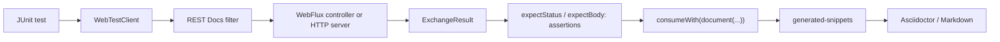
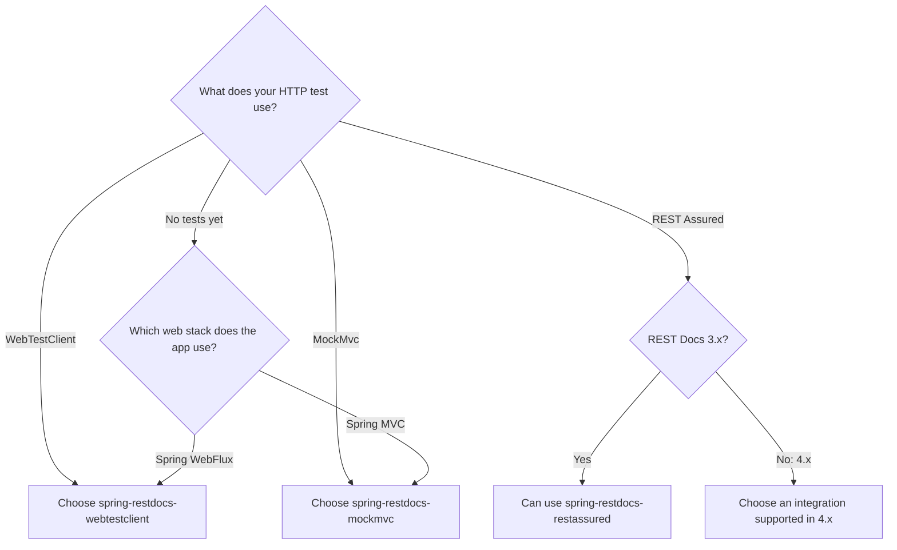
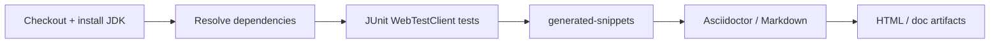

# Choosing the `spring-restdocs-webtestclient` Module

## Learning Objectives

In the **Project Setup** chapter of the **SPRING_REST_DOCS** module, choosing the right integration module determines how Spring REST Docs captures requests and responses from HTTP tests. If you use **`WebTestClient`**, the module to focus on is **`org.springframework.restdocs:spring-restdocs-webtestclient`**.

Spring REST Docs helps produce verifiable REST API documentation through HTTP tests, generating snippets for requests, responses, payloads, parameters, and headers; those snippets are then included in Asciidoctor/Markdown documents within builds and CI. This lesson explains how to **choose and set up the WebTestClient integration** before diving into each snippet type.

After this lesson, you will be able to:

- Explain the role of `spring-restdocs-webtestclient` and the relationship among WebTestClient, Spring WebFlux, and Spring REST Docs.
- Distinguish when to use WebTestClient, MockMvc, or REST Assured depending on your HTTP testing tool and Spring generation.
- Declare the dependency with the proper scope in Gradle or Maven, avoiding mixed Spring Framework/Spring Boot/REST Docs versions.
- Write a WebTestClient test that actually generates snippets, describes JSON fields, and verifies the output document.
- Know how to choose among portless controller tests, reactive application tests, and HTTP tests against a real server.

## 1. What Is `spring-restdocs-webtestclient`?

`WebTestClient` is an HTTP testing API provided by Spring in **`spring-test`**. Fluent test style:

```java
webTestClient.get()
        .uri("/api/status")
        .exchange()
        .expectStatus().isOk()
        .expectBody()
        .jsonPath("$.status").isEqualTo("UP");
```

The test above verifies HTTP behavior, but **does not yet generate REST Docs documentation**. The `spring-restdocs-webtestclient` module provides the bridge to:

1. Attach an **`ExchangeFilterFunction`** to the client to capture requests and responses for REST Docs.
2. Call `WebTestClientRestDocumentation.document(...)` at the end of the test chain to write snippets.
3. Combine REST Docs core descriptors such as `responseFields(...)`, `requestHeaders(...)`, and `queryParameters(...)`.
4. Feed the generated snippets into Asciidoctor/Markdown or CI artifacts.

Workflow diagram:



Three components to distinguish:

| Component | Role | Generates Snippets Automatically? |
| --- | --- | --- |
| **`WebClient`** | HTTP client used in application code (e.g., calling external services). | No. |
| **`WebTestClient`** | API for writing and verifying HTTP tests; can bind to WebFlux handlers or an HTTP server. | No, unless wired to REST Docs. |
| **`spring-restdocs-webtestclient`** | Integrates Spring REST Docs with `WebTestClient` HTTP exchanges. | Yes, after configuring the filter and calling `document(...)` or a configured documentation handler. |

**Key point:** REST Docs only records requests executed by tests and explicitly marked for documentation. It does not automatically scan controllers to build docs, nor does it publish an HTML website on its own.

## 2. When Should You Choose WebTestClient Over MockMvc or REST Assured?

### 2.1. Best Fit for Spring WebFlux

Choose `spring-restdocs-webtestclient` when the project uses **Spring WebFlux** (the reactive web stack) and tests call endpoints via `WebTestClient`. Typical scenarios:

- REST APIs returning `Mono<T>` or `Flux<T>`.
- Endpoints handled by annotated controllers (`@RestController`) or functional routing (`RouterFunction`).
- Tests using `@WebFluxTest` to test the web layer without starting an external HTTP server.
- Integration tests using `@SpringBootTest` with `WebTestClient` bound to the application context or connected to a real server.
- Teams needing documentation generated directly from the same test cases that verify status codes, JSON, parameters, and headers.

Example: a reporting service returns `Mono<ReportDto>` via `GET /api/reports/{id}`. A WebTestClient test verifies HTTP 200 and the JSON payload; `document(...)` generates request/response snippets, and `responseFields(...)` catches newly added undocumented fields.

### 2.2. Base the Choice on the **Testing Tool**, Not Just Technology Names

| Option | Selection Criteria | How REST Docs Is Triggered | Notes |
| --- | --- | --- | --- |
| **`spring-restdocs-webtestclient`** | Tests run using `WebTestClient` | `.filter(documentationConfiguration(...))` and `.expectBody().consumeWith(document(...))` | Especially convenient with Spring WebFlux. |
| **`spring-restdocs-mockmvc`** | Tests use `MockMvc` with Spring MVC/Servlet | `MockMvcBuilders` + `.andDo(document(...))` | MockMvc runs through the Spring MVC pipeline; different from WebTestClient. |
| **`spring-restdocs-restassured`** | Team maintains REST Assured and Spring REST Docs **3.x** | REST Assured filter and corresponding `document(...)` | This module is **no longer present in REST Docs 4.x**. |
| **`spring-restdocs-core`** | Building custom REST Docs core components/extensions | No built-in WebTestClient bridge from core alone | Does not replace the integration module. |
| **`spring-restdocs-asciidoctor`** | Compiling snippets into Asciidoctor documents | Asciidoctor plugin or task | Complements the build step; does not send HTTP requests. |

WebTestClient can also send requests to a **real HTTP server** using `bindToServer()`. Thus, a `WebTestClient` test does not have to be a reactive unit test. Conversely, if an API uses Spring MVC and tests are already well-built with MockMvc, **there is no need to switch to WebTestClient just for REST Docs**.

> **Spring Boot note:** When both Spring MVC and WebFlux are present, Boot normally prioritizes configuring the application as **Spring MVC**. If your goal is testing reactive WebFlux, check the web application type and test setup so you do not accidentally run on the Servlet stack.

### 2.3. Quick Decision Tree



## 3. Choosing the Right Version and Dependency Scope

### 3.1. Compatibility by Spring Generation

| Project Baseline | Spring Framework | Spring REST Docs | Minimum Java | Testing Notes |
| --- | --- | --- | --- | --- |
| **Spring Boot 3.x** | **6.x** | **3.x** | **17** | WebTestClient; JUnit Jupiter 5 commonly used. |
| **Spring Boot 4.x** | **7.x** | **4.x** | **17** | WebTestClient, JUnit 6; REST Docs 4 requires AsciidoctorJ 3.0 if building Asciidoctor. |
| **Spring Framework without Boot** | 6.x or 7.x | Pair 3.x or 4.x respectively | **17** | Manage `spring-test`, WebFlux, and JUnit versions manually. |

The module name **`spring-restdocs-webtestclient` stays the same** between REST Docs 3.x and 4.x. Never assume a 4.x artifact works with Spring Framework 6.x, or vice versa.

When using Spring Boot, prefer letting the **Spring Boot BOM/parent** manage the test version set. Do not force separate versions of Spring Test, Reactor, or REST Docs unless there is a clear need and compatibility has been verified. Without a BOM, declare a Spring REST Docs version consistent with your Spring Framework generation.

### 3.2. Dependency Scope

This module is for **testing and documentation generation**, so place it in:

- Gradle: `testImplementation("org.springframework.restdocs:spring-restdocs-webtestclient")`.
- Maven: `<scope>test</scope>`.

It **does not** belong on the production API runtime classpath. Using the wrong scope can package unnecessary test dependencies into the application artifact.

## 4. Gradle Configuration

### 4.1. Spring Boot 3.x Project — Groovy DSL

The following snippets assume the project already has the Spring Boot plugin, dependency management, and `mavenCentral()`:

```groovy
dependencies {
    implementation 'org.springframework.boot:spring-boot-starter-webflux'

    testImplementation 'org.springframework.boot:spring-boot-starter-test'
    testImplementation 'org.springframework.restdocs:spring-restdocs-webtestclient'
    testImplementation 'io.projectreactor:reactor-test'
}

tasks.named('test') {
    useJUnitPlatform()
}
```

Here:

- `spring-boot-starter-webflux` provides the reactive HTTP stack.
- `spring-boot-starter-test` provides `spring-test`, JUnit Jupiter, and core testing utilities.
- `spring-restdocs-webtestclient` connects `WebTestClient` to the snippet generator.
- `reactor-test` supports tests using Reactor `StepVerifier`; it is **not required to generate REST Docs snippets** in simple HTTP examples.

**Caution:** If the application is MVC, do not add `spring-boot-starter-webflux` just to access an HTTP client. Choose dependencies matching the actual web stack and test style in use.

### 4.2. Spring Boot 4.x Project — Groovy DSL

Spring Boot 4 provides stack-specific test starters:

```groovy
dependencies {
    implementation 'org.springframework.boot:spring-boot-starter-webflux'

    testImplementation 'org.springframework.boot:spring-boot-starter-webflux-test'
    testImplementation 'org.springframework.restdocs:spring-restdocs-webtestclient'
    testRuntimeOnly 'org.junit.platform:junit-platform-launcher'
}

tasks.named('test') {
    useJUnitPlatform()
}
```

This snippet represents the `dependencies`/`test` section of a project **already configured for Spring Boot 4**. With the 4.x branch, use JUnit 6 and test dependencies consistent with Spring Framework 7. The REST Docs Maven/Gradle coordinates remain `org.springframework.restdocs:spring-restdocs-webtestclient`.

### 4.3. Gradle Kotlin DSL

When the project uses `build.gradle.kts`:

```kotlin
dependencies {
    testImplementation("org.springframework.restdocs:spring-restdocs-webtestclient")
}

tasks.test {
    useJUnitPlatform()
}
```

This is an addition to an existing build; you still need the WebFlux application dependencies, test starter, repositories, and Java/Spring Boot plugins shown in the earlier examples.

### 4.4. Verifying Resolved Versions

```bash
./gradlew dependencies --configuration testRuntimeClasspath
./gradlew dependencyInsight --dependency spring-restdocs-webtestclient --configuration testRuntimeClasspath
```

In the output, look for `org.springframework.restdocs:spring-restdocs-webtestclient`, `spring-test`, and `spring-webflux`. If REST Docs 4.x appears alongside Framework 6.x, that is a sign to review your dependency management.

## 5. Maven Configuration

For a Maven project using `spring-boot-starter-parent` of **Spring Boot 4.x**, the main test dependencies are:

```xml
<dependencies>
    <dependency>
        <groupId>org.springframework.boot</groupId>
        <artifactId>spring-boot-starter-webflux</artifactId>
    </dependency>
    <dependency>
        <groupId>org.springframework.boot</groupId>
        <artifactId>spring-boot-starter-webflux-test</artifactId>
        <scope>test</scope>
    </dependency>
    <dependency>
        <groupId>org.springframework.restdocs</groupId>
        <artifactId>spring-restdocs-webtestclient</artifactId>
        <scope>test</scope>
    </dependency>
</dependencies>
```

If using **Spring Boot 3.x**, replace `spring-boot-starter-webflux-test` with `spring-boot-starter-test`; `spring-restdocs-webtestclient` still keeps `test` scope. Because the parent/BOM manages versions, you normally omit `<version>` on the REST Docs dependency.

For Maven projects without the Spring Boot BOM, set `<version>` on REST Docs to match the target generation, and manually manage Spring Framework, Spring Test, and JUnit. For instance, REST Docs 4.0.x targets Spring Framework 7.x; do not mix it with Spring Framework 6.x.

Check the dependency tree:

```bash
./mvnw dependency:tree -Dincludes=org.springframework.restdocs
```

If the project has no Maven wrapper, run `mvn` instead of `./mvnw`. Do not confuse **test dependencies** with Asciidoctor plugin dependencies: they belong to two different steps.

## 6. Choosing One of Three `WebTestClient` Initialization Styles

Spring supports testing at different levels. All three work with REST Docs when configured properly:

| Initialization Style | Starts an HTTP Server? | Use When | Notes |
| --- | --- | --- | --- |
| `WebTestClient.bindToController(controller)` | **No** | Testing one or a few standalone WebFlux annotated controllers | Needed beans/filters/configurations must be explicitly registered. |
| `WebTestClient.bindToApplicationContext(context)` | **No** | Testing Spring WebFlux within an application context | Needs a suitable reactive context; integrates well with Spring Test/Boot. |
| `WebTestClient.bindToServer().baseUrl("http://localhost:...")` | **Yes, requires a running server** | End-to-end HTTP, network, filters, security, and real deployment serialization | Port must be available; snippet content must avoid exposing test-environment hostnames and sensitive data. |

Both **server-less** forms can use:

```java
webTestClient = WebTestClient.bindToController(controller)
        .configureClient()
        .filter(documentationConfiguration(restDocumentation))
        .build();
```

Or:

```java
webTestClient = WebTestClient.bindToApplicationContext(applicationContext)
        .configureClient()
        .filter(documentationConfiguration(restDocumentation))
        .build();
```

With a real HTTP server:

```java
webTestClient = WebTestClient.bindToServer()
        .baseUrl("http://localhost:8080")
        .filter(documentationConfiguration(restDocumentation))
        .build();
```

These snippets illustrate **the client configuration part**; when running with REST Docs, pass `restDocumentation` from `RestDocumentationExtension` or an equivalent mechanism. Avoid hardcoding port 8080 in parallel CI runs if you can use a random port and pass the actual port value.

**Memorable difference:** With `bindToController`/`bindToApplicationContext`, `configureClient()` transitions to client configuration, where you attach `filter(...)`. With `bindToServer()`, `WebTestClient.Builder` already supports `filter(...)` directly.

## 7. Complete Example: Testing WebFlux and Generating JSON Snippets

The following example uses **Java 17+, JUnit Jupiter, Reactor, WebTestClient, and Spring REST Docs**. The test binds directly to a controller, so it does not depend on Spring Boot's `@AutoConfigureRestDocs` configuration. When applying this to REST Docs 3.x or 4.x, ensure the generation-appropriate dependencies from Section 4/5 are present.

Create `src/test/java/com/example/docs/StatusDocumentationTest.java`:

```java
package com.example.docs;

import java.util.Map;

import org.junit.jupiter.api.BeforeEach;
import org.junit.jupiter.api.Test;
import org.junit.jupiter.api.extension.ExtendWith;
import org.springframework.http.MediaType;
import org.springframework.restdocs.RestDocumentationContextProvider;
import org.springframework.restdocs.RestDocumentationExtension;
import org.springframework.test.web.reactive.server.WebTestClient;
import org.springframework.web.bind.annotation.GetMapping;
import org.springframework.web.bind.annotation.RestController;

import reactor.core.publisher.Mono;

import static org.springframework.restdocs.payload.PayloadDocumentation.fieldWithPath;
import static org.springframework.restdocs.payload.PayloadDocumentation.responseFields;
import static org.springframework.restdocs.webtestclient.WebTestClientRestDocumentation.document;
import static org.springframework.restdocs.webtestclient.WebTestClientRestDocumentation.documentationConfiguration;

@ExtendWith(RestDocumentationExtension.class)
class StatusDocumentationTest {

    private WebTestClient webTestClient;

    @BeforeEach
    void setUp(RestDocumentationContextProvider documentation) {
        this.webTestClient = WebTestClient
                .bindToController(new StatusController())
                .configureClient()
                .filter(documentationConfiguration(documentation))
                .build();
    }

    @Test
    void documentsStatusEndpoint() {
        this.webTestClient.get()
                .uri("/api/status")
                .accept(MediaType.APPLICATION_JSON)
                .exchange()
                .expectStatus().isOk()
                .expectHeader()
                    .contentTypeCompatibleWith(MediaType.APPLICATION_JSON)
                .expectBody()
                .jsonPath("$.status").isEqualTo("UP")
                .consumeWith(document("status-get",
                        responseFields(
                                fieldWithPath("status")
                                        .description("Service status")
                        )));
    }

    @RestController
    static class StatusController {

        @GetMapping(value = "/api/status",
                    produces = MediaType.APPLICATION_JSON_VALUE)
        Mono<Map<String, String>> status() {
            return Mono.just(Map.of("status", "UP"));
        }
    }
}
```

### 7.1. How Each Part Works

1. **`@ExtendWith(RestDocumentationExtension.class)`** provides the REST Docs context and injects `RestDocumentationContextProvider` into the `@BeforeEach` method.
2. **`bindToController(new StatusController())`** creates a client simulating responses from the WebFlux controller without opening an HTTP port.
3. **`.configureClient().filter(documentationConfiguration(documentation))`** places the REST Docs request/response recorder into the exchange filter chain.
4. **`.get().uri(...).exchange()`** executes the request. `expectStatus`, `expectHeader`, and `jsonPath` verify the HTTP response before documenting it.
5. **`.expectBody().consumeWith(document("status-get", ...))`** writes snippets under the `status-get` operation. `responseFields(...)` generates an additional JSON field table and verifies that the `status` field is present.

The `document` method for WebTestClient comes from **`org.springframework.restdocs.webtestclient.WebTestClientRestDocumentation`** and is passed to **`consumeWith(...)`**. Do not use `MockMvcRestDocumentation.document` or `.andDo(...)`, as those belong to the MockMvc API.

If using a real `@RestController` with services, security, or custom codecs, a `bindToController` test only reflects what you manually register on the builder. Use `bindToApplicationContext` or a Spring Boot test when your goal is verifying the full application configuration.

### 7.2. Output and Verification

Run Gradle:

```bash
./gradlew test
```

Or Maven:

```bash
./mvnw test
```

On Windows, use `.\gradlew.bat test` or `.\mvnw.cmd test` if the project has wrapper scripts.

After the test passes, Gradle generates by default:

```text
build/
└── generated-snippets/
    └── status-get/
        ├── curl-request.adoc
        ├── http-request.adoc
        ├── http-response.adoc
        ├── httpie-request.adoc
        ├── request-body.adoc
        ├── response-body.adoc
        └── response-fields.adoc
```

With Maven, the default path is `target/generated-snippets/status-get/`. The first six files are default snippets; `response-fields.adoc` is additionally created because of `responseFields(...)`. File names may vary if the project customizes the default snippet list.

Open `http-response.adoc` and `response-fields.adoc` to confirm that both the JSON response and the description table for the `status` field were saved. To verify drift detection, change `Map.of("status", "UP")` to a different field name without updating the descriptor, then rerun the test: by default `responseFields(...)` reports an error for the undocumented or missing required field. Restore the code after testing.

## 8. Integrating Directly with Spring Boot

Spring Boot can auto-configure WebTestClient and REST Docs. `@WebFluxTest` loads only the web layer slice; `@SpringBootTest` can load a broader application context. Choose the setup matching your test goal:

| Goal | Common Annotation/Component | Characteristics |
| --- | --- | --- |
| Test an isolated WebFlux controller | `@WebFluxTest(YourController.class)` | Auto-configures WebTestClient; may need `@MockitoBean` for controller dependencies. |
| Test reactive app without an HTTP port | `@SpringBootTest` with `@AutoConfigureWebTestClient` | Uses a mock web environment and application context. |
| Test a real HTTP server | `@SpringBootTest(webEnvironment = RANDOM_PORT)` or a CI-started server | Performs real network requests; can use `WebTestClient.bindToServer()` or the Boot-provided client. |
| Enable REST Docs on Boot-managed WebTestClient | `@AutoConfigureRestDocs` | Boot automatically wires REST Docs configuration; no need to register `RestDocumentationExtension` manually in that test. |

### 8.1. Spring Boot 4.x Example

Assuming `StatusController` is a **real** controller in application code and tests include `spring-boot-starter-webflux-test` plus `spring-restdocs-webtestclient`, you can configure:

```java
import org.junit.jupiter.api.Test;
import org.springframework.beans.factory.annotation.Autowired;
import org.springframework.boot.restdocs.test.autoconfigure.AutoConfigureRestDocs;
import org.springframework.boot.webflux.test.autoconfigure.WebFluxTest;
import org.springframework.test.web.reactive.server.WebTestClient;

import static org.springframework.restdocs.webtestclient.WebTestClientRestDocumentation.document;

@WebFluxTest(StatusController.class)
@AutoConfigureRestDocs
class StatusControllerDocumentationTest {

    @Autowired
    WebTestClient webTestClient;

    @Test
    void documentsStatus() {
        webTestClient.get()
                .uri("/api/status")
                .exchange()
                .expectStatus().isOk()
                .expectBody()
                .consumeWith(document("status-get-boot"));
    }
}
```

In Boot 4, `@AutoConfigureRestDocs` belongs to package `org.springframework.boot.restdocs.test.autoconfigure` and is supplied by the Spring Boot REST Docs support module (for example `org.springframework.boot:spring-boot-restdocs` on the test classpath). Adding `spring-restdocs-webtestclient` alone gives you `document(...)`, but not necessarily Boot's auto-configuration annotation.

### 8.2. Differences in Spring Boot 3.x

In Boot 3, the corresponding imports are:

```java
import org.springframework.boot.test.autoconfigure.restdocs.AutoConfigureRestDocs;
import org.springframework.boot.test.autoconfigure.web.reactive.WebFluxTest;
```

Common starters are `spring-boot-starter-webflux` and `spring-boot-starter-test`. When upgrading from Boot 3 to Boot 4, inspect imports, test starter dependencies, and JUnit/REST Docs versions; do not mix configurations from both generations into the same project.

### 8.3. Scenarios Requiring Extra Care

- **Controllers with bean dependencies:** `@WebFluxTest` loads only web components, so services/repositories may not exist. Use `@MockitoBean` or `@Import` as needed.
- **Functional routes:** `@WebFluxTest` often does not auto-detect all `RouterFunction` beans. Import the relevant route/handler configuration or use a test with an appropriate application context.
- **Security:** A mocked web-layer test may lack production security configuration. If documentation describes authentication headers, provide appropriate security filters and mock credentials—never record real tokens.
- **Real server readiness:** `@WebFluxTest` tests do not verify networking, TLS, proxies, or deployment environments; use end-to-end tests where necessary.

## 9. Adding Request, Response, Parameter, and Header Snippets

By default, `document("operation")` writes six basic snippets. Detailed descriptors share the REST Docs core API:

| Item to Document | Descriptor API | Example Snippet File |
| --- | --- | --- |
| Request JSON fields | `requestFields(fieldWithPath("name").description(...))` | `request-fields.adoc` |
| Response JSON fields | `responseFields(fieldWithPath("status").description(...))` | `response-fields.adoc` |
| Query parameters | `queryParameters(parameterWithName("limit").description(...))` | `query-parameters.adoc` |
| Path parameters | `pathParameters(parameterWithName("id").description(...))` | `path-parameters.adoc` |
| Request headers | `requestHeaders(headerWithName("X-Correlation-Id").description(...))` | `request-headers.adoc` |
| Response headers | `responseHeaders(headerWithName("Content-Type").description(...))` | `response-headers.adoc` |

Example continuation appended to a WebTestClient test:

```java
import static org.springframework.restdocs.headers.HeaderDocumentation.headerWithName;
import static org.springframework.restdocs.headers.HeaderDocumentation.requestHeaders;
import static org.springframework.restdocs.request.RequestDocumentation.parameterWithName;
import static org.springframework.restdocs.request.RequestDocumentation.queryParameters;
import static org.springframework.restdocs.webtestclient.WebTestClientRestDocumentation.document;

// Tail of a test that sent GET /api/items?limit=10
// with request header X-Correlation-Id:
.expectBody()
.consumeWith(document("items-list",
        queryParameters(
                parameterWithName("limit")
                        .description("Maximum number of items to return")
        ),
        requestHeaders(
                headerWithName("X-Correlation-Id")
                        .description("Request tracing identifier")
        )));
```

This is a **chained code excerpt**, not a complete Java method. The actual test request must include `limit=10` and the `X-Correlation-Id` header so descriptors match. Descriptors are passed into `document(...)`, not attached directly to `get()` or `exchange()`.

Under the default strict validation mode, `responseFields` or `requestFields` fails the test if a field is undocumented or a documented field is absent. Use `optional()` for genuinely optional fields, and only use `relaxed...Fields` when you intentionally want to ignore remaining fields.

**Snippet security:** Never put passwords, real tokens, live session cookies, personal information, or production data into documentation. Use synthetic request/response data in tests and apply `preprocessRequest(...)` / `preprocessResponse(...)` to mask or remove sensitive data before writing snippets.

## 10. Normalizing Snippet Content and HTTP Addresses

### 10.1. URLs Appearing in Documentation

When using WebTestClient, REST Docs renders URIs by default with a base of `http://localhost:8080`. This **does not mean the controller test is actually listening on port 8080**; it is merely the base used to format the request in snippets.

For clients bound to a controller/context, you can pick a public host to make documentation easier to read:

```java
webTestClient = WebTestClient.bindToController(new StatusController())
        .configureClient()
        .baseUrl("https://api.example.com")
        .filter(documentationConfiguration(documentation))
        .build();
```

With `bindToServer()`, `baseUrl(...)` sets the **real HTTP target**; do not change it to a fake host just to prettify snippets. If you want docs to display a public host while testing an internal server, use a **URI preprocessor** to modify only what gets written to documentation.

### 10.2. Using Markdown Instead of Asciidoctor

REST Docs generates **Asciidoctor** (`.adoc`) snippets by default. To use Markdown templates, configure:

```java
import static org.springframework.restdocs.templates.TemplateFormats.markdown;

webTestClient = WebTestClient.bindToController(new StatusController())
        .configureClient()
        .filter(documentationConfiguration(documentation)
                .snippets().withTemplateFormat(markdown()))
        .build();
```

This changes only the **snippet format**; the test dependency remains `spring-restdocs-webtestclient`. You still need a workflow to assemble Markdown snippets into a complete document. Do not use Asciidoctor's `include::{snippets}` syntax in plain Markdown unless your pipeline specifically supports that include directive.

## 11. Connecting Asciidoctor with Gradle and CI

To use WebTestClient snippets in Asciidoctor, the additions to `build.gradle` can look like this (**assuming the project already has the Java/Spring Boot plugins and dependencies from Section 4**):

```groovy
plugins {
    id 'org.asciidoctor.jvm.convert' version '4.0.5'
}

configurations {
    asciidoctorExt
}

dependencies {
    // REST Docs 4.x branch example; keep aligned with the test REST Docs version
    asciidoctorExt 'org.springframework.restdocs:spring-restdocs-asciidoctor:4.0.2'
}

asciidoctorj {
    version = '3.0.0'
}

ext {
    snippetsDir = file('build/generated-snippets')
}

tasks.named('test') {
    outputs.dir snippetsDir
}

tasks.named('asciidoctor') {
    inputs.dir snippetsDir
    configurations 'asciidoctorExt'
    dependsOn test
}
```

**Version note:** The example above uses REST Docs **4.0.2/AsciidoctorJ 3**. If your project uses REST Docs 3.x, pick the plugin/Asciidoctor versions compatible with that branch. Do not pin REST Docs 4.x for the Asciidoctor plugin while HTTP tests use REST Docs 3.x.

Create `src/docs/asciidoc/index.adoc`:

```asciidoc
= API Status Documentation
:toc: left
:sectnums:

== GET /api/status

=== HTTP request
include::{snippets}/status-get/http-request.adoc[]

=== HTTP response
include::{snippets}/status-get/http-response.adoc[]

=== Response fields
include::{snippets}/status-get/response-fields.adoc[]
```

Run:

```bash
./gradlew asciidoctor
```

`dependsOn test` ensures tests generate snippets before Asciidoctor compiles them. The HTML document typically appears at `build/docs/asciidoc/index.html`. With Maven, use `asciidoctor-maven-plugin` in a phase after tests (such as `prepare-package`) and point to `target/generated-snippets`.

In CI, minimal pipeline flow:



CI must use the same JDK and dependency versions as developer machines; snippets must come from the current test run. If a descriptor is wrong, tests fail and the doc build step must not mask that failure.

## 12. Independent Checks Before Considering Setup Complete

| Item | How to Verify | Sign of Success |
| --- | --- | --- |
| Java/Spring | `java -version`, dependency tree | Java ≥ 17 and matching Framework/REST Docs generation. |
| Test dependency | `dependencyInsight` or `dependency:tree` | `spring-restdocs-webtestclient` present on test classpath. |
| Web stack | Check controller and Spring test setup | WebFlux controller or server called properly by WebTestClient. |
| REST Docs filter | Check `.filter(documentationConfiguration(...))` or `@AutoConfigureRestDocs` | Configuration attached to **the actual client used in tests**. |
| HTTP assertions | Run tests and inspect status/body | Meets testing requirements. |
| Snippet generation | Check `generated-snippets/status-get` | Contains `http-request.adoc`, `http-response.adoc`, and `response-fields.adoc`. |
| Compilation | Run Asciidoctor/Markdown task | Output doc page displays real HTTP data from tests. |

Passing tests without snippets **do not prove** Spring REST Docs is working. Before concluding setup is done, confirm the client has the filter applied and the test calls `consumeWith(document(...))`.

## 13. Common Errors

| Symptom | Cause to Check | How to Fix |
| --- | --- | --- |
| `WebTestClientRestDocumentation` fails to resolve | Missing `spring-restdocs-webtestclient` or dependency not on test classpath | Add dependency with proper scope and inspect dependency tree. |
| `WebTestClient` fails to resolve | Missing `spring-test`/WebFlux test starter | Use the matching test starter or add Spring Test matching your Framework version. |
| Tests pass but no snippets appear | REST Docs filter/auto-config not configured or `document(...)` not called | Verify the exact client instance and `.expectBody().consumeWith(document(...))` chain. |
| Compile error when using `.andDo(document(...))` | Copied MockMvc API into a WebTestClient test | Use `.consumeWith(document(...))` with WebTestClient static imports. |
| Test returns 404 when calling controller | Wrong URL mapping, context missing controller/route, or wrong application type | Check `@GetMapping`, route beans, and WebFlux test configuration. |
| `@WebFluxTest` complains about missing service bean | Slice test loads only the web layer | Use `@MockitoBean`, `@Import`, or a broader test setup. |
| `@AutoConfigureRestDocs` fails to resolve after Boot upgrade | Wrong import between Boot 3/4 or missing Boot REST Docs module | Use the generation-appropriate import and add the auto-config support module. |
| `NoSuchMethodError`/`NoClassDefFoundError` involving Spring | REST Docs 4.x mixed with Spring Framework 6.x or cross-generation dependencies | Use the proper BOM/parent; inspect the dependency tree. |
| `response-fields.adoc` is not created | `responseFields(...)` not declared or test documents a different operation | Add descriptors and check the operation name inside `document(...)`. |
| Snippets show `localhost:8080` while API is published on another domain | Documentation base URL not customized | Use `baseUrl(...)` for mock bindings or a URI preprocessor when testing a real server. |
| Asciidoctor reports missing include file | Compiled docs before tests, wrong operation name, or wrong output dir | Declare task dependency, check `{snippets}` and actual output files. |
| Real-server tests flake in CI | Hardcoded port, server not ready, or resource contention | Use random ports and build client after port resolution; keep tests isolated. |

Errors in this table are **initial diagnostic leads**. Whenever a test fails, trace the root cause in the stack trace and resolved dependencies rather than relying solely on the top exception line.

## 14. Practice Exercise and Self-Assessment Questions

**Practice**

1. Determine whether your project uses Spring MVC or Spring WebFlux; verify whether HTTP tests use `WebTestClient` or `MockMvc`.
2. Add `spring-restdocs-webtestclient` with `testImplementation` or Maven `test` scope and inspect the resolved version.
3. Run `StatusDocumentationTest` from Section 7. Verify `status-get/http-response.adoc` and `status-get/response-fields.adoc`.
4. Change the JSON response from `{"status":"UP"}` to `{"state":"UP"}` while keeping the old descriptor. Observe the field-descriptor error, then restore it.
5. Add another HTTP test for `GET /api/items?limit=10`, document the query parameter and request header, and inspect the extra snippets.
6. Compile docs with Asciidoctor, open `index.html`, and verify the build runs tests before generating HTML.

**Self-Assessment**

1. How do `WebClient`, `WebTestClient`, and `spring-restdocs-webtestclient` differ?
2. When is `bindToController` preferable to `bindToServer`, and when is a real server needed?
3. Why is `spring-restdocs-webtestclient` normally placed in test scope?
4. Which method attaches `document("status-get")` to a WebTestClient test chain?
5. Why cannot `spring-restdocs-mockmvc` simply replace `spring-restdocs-webtestclient`?
6. When upgrading from Spring Boot 3 to 4, which dependencies, imports, and versions need review?
7. Why does having snippets not mean Asciidoctor/Markdown documentation has been published?

## Official References

- [Spring REST Docs — Getting Started](https://docs.spring.io/spring-restdocs/tutorial/getting-started/index.html): choosing the WebTestClient module, filter configuration, `document(...)`, Gradle/Maven, Asciidoctor.
- [Spring REST Docs — Default Snippets](https://docs.spring.io/spring-restdocs/reference/configuration/default-snippets.html): the six default snippets and configuration customization.
- [Spring REST Docs — Documenting Request and Response Payloads](https://docs.spring.io/spring-restdocs/reference/documenting-your-api/request-response-payloads.html): documenting JSON fields, strict and relaxed modes.
- [Spring REST Docs — URI Configuration](https://docs.spring.io/spring-restdocs/reference/configuration/uris.html): base URL configuration with WebTestClient.
- [Spring REST Docs — Snippet Template Format](https://docs.spring.io/spring-restdocs/reference/configuration/snippet-template-format.html): Asciidoctor/Markdown formats.
- [Spring REST Docs — Customizing Requests and Responses](https://docs.spring.io/spring-restdocs/reference/customizing-requests-and-responses.html): preprocessing URIs, headers, and bodies.
- [Spring Boot — Testing Spring Boot Applications](https://docs.spring.io/spring-boot/reference/testing/spring-boot-applications.html): `@WebFluxTest`, `@AutoConfigureWebTestClient`, `@AutoConfigureRestDocs`.
- [Spring WebFlux — Testing](https://docs.spring.io/spring-framework/reference/testing/webtestclient.html): ways to create WebTestClient and test without a server or against a real HTTP server.

**Practical takeaway:** If HTTP tests use WebTestClient, choose `spring-restdocs-webtestclient` matching your Spring generation, attach the REST Docs filter, assert responses, and call `consumeWith(document(...))`. Verify the files in `generated-snippets` before wiring them into Asciidoctor/Markdown and CI.
