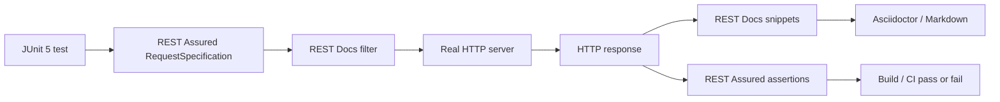
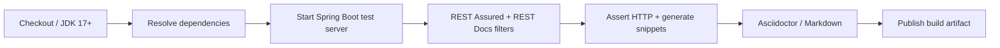

# Choosing the `spring-restdocs-restassured` Module

## Lesson Objectives

In the **Project Setup** chapter of the **SPRING_REST_DOCS** module, choosing the right HTTP test integration determines how Spring REST Docs records tested requests and responses to produce verifiable API documentation. When a team already uses **REST Assured** for HTTP testing and the project is on the **Spring REST Docs 3.x** generation, the module to evaluate is **`org.springframework.restdocs:spring-restdocs-restassured`**.

Spring REST Docs can generate snippets for requests, responses, JSON payloads, parameters, and headers from HTTP tests, then compile them into Asciidoctor or Markdown documentation integrated with builds and CI. This lesson focuses on **deciding whether to choose the REST Assured module, compatibility requirements, and practical configuration**. One critical point to keep in mind: **REST Assured integration was removed in Spring REST Docs 4.0**.

After this lesson, you will be able to:

- Explain how `spring-restdocs-restassured` differs from `io.rest-assured:rest-assured`.
- Determine when to choose REST Assured versus when MockMvc or WebTestClient is a better fit.
- Select the right Spring Boot, Spring Framework, Java, and Spring REST Docs branch that supports REST Assured.
- Declare dependencies with the proper scope, start a test server, and attach REST Docs to `RequestSpecification`.
- Write a REST Assured test that generates snippets for HTTP requests/responses, JSON fields, and query parameters.
- Integrate snippets into Asciidoctor/Markdown documentation and catch configuration mistakes in CI.

> **Version scope:** The examples use **Spring Boot 3.x, Spring Framework 6.x, Java 17+, and Spring REST Docs 3.x** with a compatible REST Assured 5.x version. Information about removing REST Assured integration in REST Docs 4.0 is cross-checked against the official release notes; do not apply this example verbatim to Spring Boot 4/Spring REST Docs 4 projects.

## 1. What Does the `spring-restdocs-restassured` Module Do?

### 1.1. Two Libraries Serving Two Different Purposes

**REST Assured** is a Java library for sending HTTP requests and asserting responses using a Given–When–Then style syntax:

```java
given()
    .accept("application/json")
.when()
    .get("http://localhost:8080/api/greetings")
.then()
    .statusCode(200);
```

This snippet checks the HTTP status of a running API, but **does not automatically generate Spring REST Docs documentation**.

**`spring-restdocs-restassured`** integrates Spring REST Docs via the **REST Assured Filter** mechanism. A filter can observe HTTP requests and responses; Spring REST Docs uses that hook to capture exchange data, generate snippets, and validate descriptors declared by the test author.

| Component | Purpose | Needed for REST Docs with REST Assured? |
| --- | --- | --- |
| `io.rest-assured:rest-assured` | Builds requests, calls a real HTTP server, asserts status/body/headers | **Yes**; this is the tool that sends HTTP requests. |
| `org.springframework.restdocs:spring-restdocs-restassured` | REST Docs bridge via REST Assured Filter, providing `documentationConfiguration(...)` and `document(...)` | **Yes**, but only on REST Docs branches that include REST Assured integration. |
| `org.springframework.restdocs:spring-restdocs-core` | Operation model, snippets, descriptors | Pulled in transitively by the integration module; normally does not need to be declared separately. |
| `org.springframework.boot:spring-boot-starter-test` | JUnit, Spring Test, and testing utilities in Spring Boot apps | Needed for the Spring Boot/JUnit example in this lesson. |
| `org.springframework.restdocs:spring-restdocs-asciidoctor` | Compiles Asciidoctor snippets | Needed in the **documentation publishing step**; does not replace the HTTP test filter. |

In REST Docs 3.x, the integration classes live in the **`org.springframework.restdocs.restassured`** package:

| API | Role |
| --- | --- |
| `RestAssuredRestDocumentation.documentationConfiguration(context)` | Creates the REST Docs configuration filter for each test. |
| `RestAssuredRestDocumentation.document("operation")` | Creates the filter that documents a single HTTP exchange. |
| `RestDocumentationExtension` | Manages the REST Docs context through JUnit Jupiter. |
| `RequestSpecBuilder.addFilter(...)` | Attaches the configuration filter to a shared `RequestSpecification`. |
| `given(spec).filter(document(...))` | Attaches the documentation filter for a specific request. |



**Key point:** REST Assured normally sends **HTTP requests over the network** to a running server. Unlike `MockMvc`, it does not spin up a simulated Spring MVC controller inside the test. Therefore, choosing this module also entails choosing **how to start the test server and manage ports**.

### 1.2. Why Not Just Declare `spring-restdocs-core`?

`spring-restdocs-core` knows how to model requests, responses, and descriptors and render snippets, but it cannot attach itself to REST Assured's filter chain. Declaring only `core` leaves tests without specialized factory methods such as `RestAssuredRestDocumentation.documentationConfiguration(...)`.

Similarly, adding `spring-restdocs-restassured` **without attaching the filters** is not enough. A test calling `given().when().get(...).then()` can still pass green without creating any documentation files.

## 2. When Should You Choose REST Assured?

### 2.1. Suitable Scenarios

Choose `spring-restdocs-restassured` when all of these conditions hold:

1. **The project uses Spring REST Docs 3.x**, with a REST Assured version supported by that branch.
2. Existing HTTP tests already use REST Assured, or the team needs to call APIs through a **running HTTP server**.
3. You want documentation based on real endpoint requests and responses, including full serialization, HTTP status codes, and headers.
4. Development and CI environments can start a test server, allocate HTTP ports, and keep the server running during tests.

Example: a Spring Boot 3 project has a REST Assured suite calling `GET /api/orders` and `POST /api/orders` on a random port. Adding REST Docs filters to the relevant tests generates documentation alongside checking status codes, JSON bodies, and response headers.

### 2.2. Comparing the Three HTTP Test Integrations

| Criterion | REST Assured | MockMvc | WebTestClient |
| --- | --- | --- | --- |
| REST Docs module | `spring-restdocs-restassured` | `spring-restdocs-mockmvc` | `spring-restdocs-webtestclient` |
| Typical test style | Sends HTTP to a **real server** | Invokes the Spring MVC pipeline in-test without opening a port | Binds to controller/context or sends HTTP to a real server |
| Primary types | `RequestSpecification`, HTTP filters | `MockMvc`, `ResultActions` | `WebTestClient`, `ExchangeResult` |
| Snippet trigger point | `.filter(document("..."))` | `.andDo(document("..."))` | `.expectBody().consumeWith(document("..."))` |
| Spring REST Docs 3.x | Supported | Supported | Supported |
| Spring REST Docs **4.0.x** | **Integration removed** | Supported | Supported |
| When to choose | Existing REST Assured API suite requiring real HTTP server testing | Spring MVC controllers, fast web-layer tests | Spring WebFlux/reactive or WebTestClient test suite |

REST Assured also has a separate module called **`io.rest-assured:spring-mock-mvc`** for testing Spring MVC. Do not confuse it with **`spring-restdocs-restassured`**: the REST Docs filter demonstrated in this lesson targets the **REST Assured HTTP client**. Using REST Assured MockMvc or other adapters does not mean this HTTP filter works automatically.

If you are already using `MockMvc` or `WebTestClient` smoothly, there is no compelling reason to switch to REST Assured just to generate REST Docs. Pick the module matching **the HTTP tests you actually run**.

## 3. Version Compatibility: Mandatory Checks Before Installing

### 3.1. Selection Table

| Application Stack | Spring Framework | Spring REST Docs | REST Assured Integration |
| --- | --- | --- | --- |
| **Spring Boot 3.x** | **6.x** | **3.x** | **Yes**: use `spring-restdocs-restassured` with REST Assured 5.2+ and Java 17+. |
| **Spring Boot 4.x** | **7.x** | **4.0.x** | **No**: the REST Assured integration module was removed from REST Docs 4.0. |
| Without Spring Boot, using Framework 6.x | **6.x** | **3.x** | Yes, while manually aligning Spring Test, REST Docs, JUnit, and REST Assured. |
| Without Spring Boot, using Framework 7.x | **7.x** | **4.0.x** | No REST Assured integration provided by Spring REST Docs 4.0. |

Milestones from the release notes:

- **REST Docs 3.0** raised the baseline to **Java 17**, **Spring Framework 6**, and **REST Assured 5.2**. The REST Assured integration package is `org.springframework.restdocs.restassured`.
- **REST Docs 4.0** moved the baseline to **Spring Framework 7** and **JUnit 6**; REST Assured integration was **removed** due to compatibility issues with **Groovy 5** at release time.
- REST Assured continued releasing newer versions afterward. **Newer REST Assured releases do not mean `spring-restdocs-restassured:4.x` has been restored**. For real projects, always check the release notes and artifacts of **Spring REST Docs itself**.

**Do not work around this by forcing `spring-restdocs-restassured:3.x` into a Boot 4/Framework 7 project**: doing so can mix classpath generations and cause `NoSuchMethodError` or runtime test failures. When upgrading to Boot 4, plan to migrate documentation tests to MockMvc/WebTestClient or evaluate another suitable documentation approach.

### 3.2. Version Management via BOM

With Spring Boot 3, prefer the Spring REST Docs and REST Assured versions managed by the **Spring Boot BOM**. If you override any version, verify compatibility and prove it with actual test runs.

For standalone Spring Framework projects, Spring REST Docs 3.x provides its own BOM `org.springframework.restdocs:spring-restdocs-bom`, though that BOM does not replace overall dependency management for Spring Framework and REST Assured. Coordinate the whole stack together.

Verify that development machines, Gradle/Maven, and CI are running **Java 17 or newer**. The terminal's Java, the test-runner JDK, Gradle JVM, Maven JVM, and the JDK configured in your IDE can differ.

## 4. Gradle Declaration

### 4.1. Spring Boot 3.x Project Using Groovy DSL

The snippet below shows the `dependencies` and `test` sections to add to `build.gradle` in a project already configured with the Spring Boot 3 plugin, repositories, and an appropriate JDK:

```groovy
dependencies {
    implementation 'org.springframework.boot:spring-boot-starter-web'

    testImplementation 'org.springframework.boot:spring-boot-starter-test'
    testImplementation 'io.rest-assured:rest-assured'
    testImplementation 'org.springframework.restdocs:spring-restdocs-restassured'
}

tasks.named('test') {
    useJUnitPlatform()
}
```

Explanation:

1. `spring-boot-starter-web` provides Spring MVC and an embedded HTTP server when running tests with `RANDOM_PORT`.
2. `spring-boot-starter-test` provides JUnit Jupiter, Spring Test, assertions, and testing utilities.
3. `io.rest-assured:rest-assured` provides the `given()–when()–then()` HTTP client/DSL.
4. `spring-restdocs-restassured` provides the two core filters: `documentationConfiguration(...)` and `document(...)`.

Both HTTP test dependencies use **`testImplementation`**, since neither belongs in the application's production runtime package.

With a Gradle Java toolchain:

```groovy
java {
    toolchain {
        languageVersion = JavaLanguageVersion.of(17)
    }
}
```

These snippets are **not a complete `build.gradle`**; you still need `plugins`, `repositories`, and project-specific application configuration. Without Spring Boot dependency management, you must specify explicit dependency versions rather than leaving coordinates versionless.

### 4.2. Gradle Kotlin DSL

In `build.gradle.kts`:

```kotlin
dependencies {
    testImplementation("org.springframework.boot:spring-boot-starter-test")
    testImplementation("io.rest-assured:rest-assured")
    testImplementation("org.springframework.restdocs:spring-restdocs-restassured")
}

tasks.test {
    useJUnitPlatform()
}
```

This shows only the **test dependencies** for a Spring Boot 3 project with a running REST API; add `implementation("org.springframework.boot:spring-boot-starter-web")` if not already present.

### 4.3. Verifying Resolved Dependencies

```bash
./gradlew dependencies --configuration testRuntimeClasspath
./gradlew dependencyInsight --dependency spring-restdocs-restassured --configuration testRuntimeClasspath
./gradlew dependencyInsight --dependency rest-assured --configuration testRuntimeClasspath
```

The output should show a **Spring REST Docs 3.x** release paired with a **compatible REST Assured 5.x** version on the test classpath. If Gradle reports it cannot resolve a REST Docs 4.x artifact named `spring-restdocs-restassured`, the cause is that the module no longer exists in that branch—not a missing `mavenCentral()` repository.

## 5. Maven Declaration

If the project uses `spring-boot-starter-parent` from the Spring Boot 3 generation:

```xml
<dependencies>
    <dependency>
        <groupId>org.springframework.boot</groupId>
        <artifactId>spring-boot-starter-web</artifactId>
    </dependency>
    <dependency>
        <groupId>org.springframework.boot</groupId>
        <artifactId>spring-boot-starter-test</artifactId>
        <scope>test</scope>
    </dependency>
    <dependency>
        <groupId>io.rest-assured</groupId>
        <artifactId>rest-assured</artifactId>
        <scope>test</scope>
    </dependency>
    <dependency>
        <groupId>org.springframework.restdocs</groupId>
        <artifactId>spring-restdocs-restassured</artifactId>
        <scope>test</scope>
    </dependency>
</dependencies>
```

In this example, the parent/BOM manages versions, so no `<version>` is specified for REST Docs or REST Assured. If Maven does not use a corresponding parent/BOM, manage those versions in `dependencyManagement` or declare them explicitly.

Check:

```bash
./mvnw dependency:tree -Dincludes=org.springframework.restdocs,io.rest-assured
```

If the project has no Maven wrapper, use `mvn dependency:tree`. In multi-module projects, run inside the module containing the tests or target it with `-pl`.

## 6. Complete Example: Spring Boot 3 + REST Assured + REST Docs 3

This example calls a **real HTTP server on a random port**, matching REST Assured's model. The files assume a Spring Boot 3 project with the dependencies from Section 4/5 and root package `com.example.demo`.

### 6.1. Create a Minimal Spring Boot Application

`src/main/java/com/example/demo/DemoApplication.java`:

```java
package com.example.demo;

import org.springframework.boot.SpringApplication;
import org.springframework.boot.autoconfigure.SpringBootApplication;

@SpringBootApplication
public class DemoApplication {

    public static void main(String[] args) {
        SpringApplication.run(DemoApplication.class, args);
    }
}
```

`src/main/java/com/example/demo/GreetingController.java`:

```java
package com.example.demo;

import java.util.Map;

import org.springframework.http.MediaType;
import org.springframework.web.bind.annotation.GetMapping;
import org.springframework.web.bind.annotation.RequestParam;
import org.springframework.web.bind.annotation.RestController;

@RestController
class GreetingController {

    @GetMapping(value = "/api/greetings",
                produces = MediaType.APPLICATION_JSON_VALUE)
    Map<String, String> greet(
            @RequestParam(defaultValue = "vi") String lang) {
        String message = "en".equals(lang) ? "Hello" : "Xin chào";
        return Map.of("message", message);
    }
}
```

The endpoint `GET /api/greetings?lang=vi` returns JSON:

```json
{
  "message": "Xin chào"
}
```

### 6.2. Write an Integration Test with REST Docs Filters

`src/test/java/com/example/demo/GreetingDocumentationTest.java`:

```java
package com.example.demo;

import io.restassured.builder.RequestSpecBuilder;
import io.restassured.specification.RequestSpecification;
import org.junit.jupiter.api.BeforeEach;
import org.junit.jupiter.api.Test;
import org.junit.jupiter.api.extension.ExtendWith;
import org.springframework.boot.test.context.SpringBootTest;
import org.springframework.boot.test.web.server.LocalServerPort;
import org.springframework.restdocs.RestDocumentationContextProvider;
import org.springframework.restdocs.RestDocumentationExtension;

import static io.restassured.RestAssured.given;
import static org.hamcrest.Matchers.equalTo;
import static org.springframework.restdocs.payload.PayloadDocumentation.fieldWithPath;
import static org.springframework.restdocs.payload.PayloadDocumentation.responseFields;
import static org.springframework.restdocs.request.RequestDocumentation.parameterWithName;
import static org.springframework.restdocs.request.RequestDocumentation.queryParameters;
import static org.springframework.restdocs.restassured.RestAssuredRestDocumentation.document;
import static org.springframework.restdocs.restassured.RestAssuredRestDocumentation.documentationConfiguration;

@SpringBootTest(webEnvironment = SpringBootTest.WebEnvironment.RANDOM_PORT)
@ExtendWith(RestDocumentationExtension.class)
class GreetingDocumentationTest {

    @LocalServerPort
    private int port;

    private RequestSpecification specification;

    @BeforeEach
    void setUp(RestDocumentationContextProvider documentation) {
        this.specification = new RequestSpecBuilder()
                .setBaseUri("http://127.0.0.1")
                .setPort(this.port)
                .addFilter(documentationConfiguration(documentation))
                .build();
    }

    @Test
    void documentsGreetingEndpoint() {
        given(this.specification)
                .accept("application/json")
                .queryParam("lang", "vi")
                .filter(document("greetings-get",
                        queryParameters(
                                parameterWithName("lang")
                                        .description("Greeting language")
                        ),
                        responseFields(
                                fieldWithPath("message")
                                        .description("Greeting message content")
                        )))
        .when()
                .get("/api/greetings")
        .then()
                .statusCode(200)
                .body("message", equalTo("Xin chào"));
    }
}
```

### 6.3. Explaining Each Key Point

1. **`@SpringBootTest(webEnvironment = RANDOM_PORT)`** starts the embedded HTTP server on an available port, preventing port conflicts when multiple tests or CI jobs run concurrently.
2. **`@LocalServerPort`** injects the exact port selected by Boot. The import in this example is for **Spring Boot 3**: `org.springframework.boot.test.web.server.LocalServerPort`.
3. **`@ExtendWith(RestDocumentationExtension.class)`** integrates JUnit Jupiter with the Spring REST Docs context. `@SpringBootTest` already enables Spring Test; here we add the REST Docs extension.
4. **`RequestSpecBuilder`** creates shared configuration: test server host, dynamic port, and `documentationConfiguration(documentation)`.
5. **`given(this.specification)`** applies that configured specification. Accidentally calling `given()` without the specification skips the shared filter.
6. **`.filter(document("greetings-get", ...))`** creates the `greetings-get` operation and requests extra `query-parameters` and `response-fields` snippets.
7. **`.when().get("/api/greetings")`** executes the real HTTP request; the REST Docs filter captures the request/response during the exchange.
8. **`.then().statusCode(200).body(...)`** verifies the response matches the API contract. Failing assertions or mismatched descriptors cause the test to fail.

**Timing differs from MockMvc:** Here `document(...)` is a **REST Assured Filter** attached before `when()`; it processes the HTTP exchange as the request executes. In MockMvc, the documentation call sits inside `.andDo(...)`. Do not copy method chains verbatim between the two tools.

### 6.4. Why Use RANDOM_PORT?

If you hardcode `.setPort(8080)`:

- Tests might accidentally call another application already running on the developer's machine.
- CI can fail if port 8080 is occupied.
- Concurrent builds can interfere with one another.

Using `RANDOM_PORT` combined with `@LocalServerPort` routes requests to the exact test server managed by Spring Boot. For an external system already running outside the Spring Boot test (such as staging), read the base URI and port from the environment; **do not assume `@LocalServerPort` is available**.

## 7. Expected Output: Requests, Responses, and Descriptors

Run the test suite from the project directory:

```bash
# Gradle
./gradlew test

# Or Maven
./mvnw test
```

On Windows, use `.\gradlew.bat test` or `.\mvnw.cmd test` if the project has the corresponding wrapper.

With Gradle, snippets for the `greetings-get` operation appear by default at:

```text
build/
└── generated-snippets/
    └── greetings-get/
        ├── curl-request.adoc
        ├── http-request.adoc
        ├── http-response.adoc
        ├── httpie-request.adoc
        ├── request-body.adoc
        ├── response-body.adoc
        ├── query-parameters.adoc
        └── response-fields.adoc
```

With Maven, the corresponding directory is `target/generated-snippets/greetings-get/`.

| Snippet | Content |
| --- | --- |
| `curl-request.adoc` | curl command representing the HTTP request. |
| `http-request.adoc` | HTTP method, URI, headers, and request body (if any). |
| `http-response.adoc` | HTTP status, headers, and response body. |
| `httpie-request.adoc` | Request example in HTTPie syntax. |
| `request-body.adoc` | Isolated request body; may be empty for GET. |
| `response-body.adoc` | Isolated response body, such as the returned JSON. |
| `query-parameters.adoc` | Table describing the `lang` query parameter. |
| `response-fields.adoc` | Table describing the `message` JSON field. |

**The first six snippets** are Spring REST Docs 3.x defaults; the last two are added by calling `queryParameters(...)` and `responseFields(...)`. The default list can change if the project customizes it.

Open `http-response.adoc` and `response-fields.adoc` to compare the actual response against the documentation. If you change the returned JSON key from `message` to `text` while keeping `responseFields(fieldWithPath("message"))`, the test fails because the descriptor no longer matches. This is the core mechanism behind **verifiable API documentation**.

> **Verify three separate stages:** An HTTP test can pass green without generating snippets if filters are missing; snippets existing does not mean HTML docs were compiled; compiled HTML still needs to be archived or published by the project's pipeline.

## 8. Documenting Payloads, Path, Query, Form Parameters, and Headers

Descriptors from **Spring REST Docs core** work together with REST Assured's `document(...)`.

| Content | Common API | Snippet |
| --- | --- | --- |
| JSON request fields | `requestFields(fieldWithPath("name").description(...))` | `request-fields.adoc` |
| JSON response fields | `responseFields(fieldWithPath("id").description(...))` | `response-fields.adoc` |
| Query parameters | `queryParameters(parameterWithName("limit").description(...))` | `query-parameters.adoc` |
| Form parameters | `formParameters(parameterWithName("email").description(...))` | `form-parameters.adoc` |
| Path parameters | `pathParameters(parameterWithName("id").description(...))` | `path-parameters.adoc` |
| Request headers | `requestHeaders(headerWithName("X-Request-Id").description(...))` | `request-headers.adoc` |
| Response headers | `responseHeaders(headerWithName("Location").description(...))` | `response-headers.adoc` |

Since REST Docs 3.0, **`requestParameters(...)` is no longer a catch-all API for documenting every parameter type**. Separate `queryParameters(...)` and `formParameters(...)` explicitly based on where data lives in the HTTP request.

Example when a test sends a query parameter and a request header (chained onto `given(this.specification)`):

```java
import static org.springframework.restdocs.headers.HeaderDocumentation.headerWithName;
import static org.springframework.restdocs.headers.HeaderDocumentation.requestHeaders;
import static org.springframework.restdocs.request.RequestDocumentation.parameterWithName;
import static org.springframework.restdocs.request.RequestDocumentation.queryParameters;
import static org.springframework.restdocs.restassured.RestAssuredRestDocumentation.document;

// Chained after given(this.specification):
.queryParam("limit", 10)
.header("X-Request-Id", "example-request-001")
.filter(document("items-list",
        queryParameters(
                parameterWithName("limit")
                        .description("Maximum number of results")
        ),
        requestHeaders(
                headerWithName("X-Request-Id")
                        .description("Request tracing identifier")
        )))
.when()
.get("/api/items");
```

This is an **illustrative excerpt** for an existing `/api/items` endpoint; it does not replace the complete example in Section 6. The actual request must carry the documented query parameter and header so the test and snippets stay consistent.

### 8.1. Strict Verification When Payloads Change

By default, `responseFields(...)` and `requestFields(...)` verify documented fields in the payload: a documented field that is missing causes an error, and undocumented fields can also fail the test. If the API has optional fields, mark the corresponding descriptor with `optional()`. Use `relaxedResponseFields(...)` or `relaxedRequestFields(...)` only when you intentionally accept unlisted fields.

Some APIs use array bodies, nested objects, or non-JSON responses. In those cases, descriptors must match the actual structure; REST Docs does not automatically infer the business meaning of fields.

### 8.2. Keep Secrets Out of Snippets

REST Docs processes data from **real HTTP exchanges**, so documentation can accidentally capture tokens, cookies, `Authorization` headers, personal data, or internal hostnames. You should:

- Use dummy data in tests and accounts restricted solely to test environments.
- Configure operation preprocessors to mask or remove sensitive headers and fields before snippets are written.
- Avoid printing raw requests/responses containing secrets into CI logs or build artifacts.

Example applying a preprocessor to request documentation:

```java
import static org.springframework.restdocs.operation.preprocess.Preprocessors.modifyHeaders;
import static org.springframework.restdocs.operation.preprocess.Preprocessors.preprocessRequest;
import static org.springframework.restdocs.restassured.RestAssuredRestDocumentation.document;

// Added to the given(spec) chain before when():
.filter(document("profile-get",
        preprocessRequest(
                modifyHeaders().remove("Authorization")
        )))
```

This snippet removes the `Authorization` header **only from the generated snippet content**; it does not guarantee secrets are stripped from all loggers or HTTP monitoring tools. For APIs that require cookies or `Authorization` during testing, use dummy test values and inspect the generated output before publishing.

## 9. Normalizing URIs in Documentation When the Server Uses a Random Port

In the Section 6 example, the server listens on `127.0.0.1:<random-port>`. That is right for HTTP tests, but a curl command published to API consumers should not point to an internal CI machine port.

REST Docs lets you transform the URI **after the HTTP request executes and before snippets are written**. Example:

```java
import static org.springframework.restdocs.operation.preprocess.Preprocessors.modifyUris;
import static org.springframework.restdocs.operation.preprocess.Preprocessors.preprocessRequest;
import static org.springframework.restdocs.restassured.RestAssuredRestDocumentation.document;

// Set filter on the REST Assured request:
.filter(document("greetings-get",
        preprocessRequest(
                modifyUris()
                        .scheme("https")
                        .host("api.example.com")
                        .removePort()
        )))
```

**Distinguish two responsibilities:**

- `RequestSpecBuilder.setBaseUri(...)` and `setPort(...)` determine **the real server that receives the HTTP request**.
- `preprocessRequest(modifyUris()...)` adjusts **the URI written into snippets** after the request completes.

Never change the test's base URI to a fake documentation host during execution, or the request will go to the fake host and fail. Only substitute a public host in the snippet preprocessor when the real endpoint is being tested locally or in an internal environment.

For response headers like `Location` containing absolute URIs, you may also need a corresponding response preprocessor; inspect `http-response.adoc` before publishing.

## 10. Sharing REST Docs Filter Configuration

When a project has many HTTP tests, avoid repeating configuration in every case. `RequestSpecBuilder` can build a shared specification per test, while each HTTP operation attaches its own `document(...)` filter.

Example customizing default response snippet formatting in `@BeforeEach` (replacing the `RequestSpecification` setup from the earlier example):

```java
import static org.springframework.restdocs.operation.preprocess.Preprocessors.prettyPrint;
import static org.springframework.restdocs.restassured.RestAssuredRestDocumentation.documentationConfiguration;

this.specification = new RequestSpecBuilder()
        .setBaseUri("http://127.0.0.1")
        .setPort(this.port)
        .addFilter(documentationConfiguration(documentation)
                .operationPreprocessors()
                    .withResponseDefaults(prettyPrint()))
        .build();
```

`prettyPrint()` changes how JSON/XML is formatted in **snippets**, making documentation easier to read; it does not alter the HTTP response sent by the server to REST Assured. Other defaults such as template format or default snippets can also be configured on `documentationConfiguration(...)`.

> **Note:** Do not share a single global `RestDocumentationFilter` across the entire JVM if suites run in parallel and tests have separate contexts. Creating a fresh `RequestSpecification` in `@BeforeEach` preserves each test's exact port and documentation context.

## 11. Assembling Snippets into Asciidoctor Documentation

Installing `spring-restdocs-restassured` completes only **the HTTP test and snippet generation step**. To produce documentation pages, configure Asciidoctor or a Markdown build system.

Example additions to `build.gradle` of a Spring Boot 3 project already equipped with Java/Spring Boot plugins:

```groovy
plugins {
    id 'org.asciidoctor.jvm.convert' version '4.0.5'
}

configurations {
    asciidoctorExt
}

dependencies {
    asciidoctorExt 'org.springframework.restdocs:spring-restdocs-asciidoctor'
}

ext {
    snippetsDir = file('build/generated-snippets')
}

tasks.named('test') {
    outputs.dir snippetsDir
}

tasks.named('asciidoctor') {
    inputs.dir snippetsDir
    configurations 'asciidoctorExt'
    dependsOn test
}
```

This example uses `spring-restdocs-asciidoctor` from the same REST Docs 3 branch managed by dependency management. If no BOM applies to the `asciidoctorExt` configuration, declare the matching extension version explicitly; do not mix a 4.x artifact with REST Docs 3.x tests.

File `src/docs/asciidoc/index.adoc`:

```asciidoc
= Greeting REST API
:toc: left
:sectnums:

== GET /api/greetings

=== Request
include::{snippets}/greetings-get/http-request.adoc[]

=== Query parameters
include::{snippets}/greetings-get/query-parameters.adoc[]

=== Response
include::{snippets}/greetings-get/http-response.adoc[]

=== Response fields
include::{snippets}/greetings-get/response-fields.adoc[]
```

Run `./gradlew asciidoctor`; the Asciidoctor task waits for `test` to generate snippets, then builds HTML documentation, typically at `build/docs/asciidoc/index.html`. With Maven, use `asciidoctor-maven-plugin` bound to `prepare-package` pointing at `target/generated-snippets`.

If you need **Markdown** instead of Asciidoctor, Spring REST Docs 3.x supports the Markdown template format; you still need a pipeline that assembles snippets and compiles the final documentation. Do not use `include::{snippets}/...[]` verbatim in plain Markdown if your tool does not support includes.

## 12. Bringing REST Assured Tests and Docs into CI

Sample pipeline:



With `@SpringBootTest(webEnvironment = RANDOM_PORT)`, Spring Test starts and manages the server within the test lifecycle, so CI does not need to launch a separate HTTP process for this example. If running against an external staging environment, CI must ensure the service is ready, pass URLs/credentials via protected environment variables, and avoid documenting live data.

Practical guidelines:

1. **JUnit must pass** and all API contract descriptors must match before documentation is published.
2. Documentation tasks must depend on **snippet-generating tests** to avoid reusing stale files from an earlier build.
3. Published artifacts should contain compiled HTML/Markdown; `generated-snippets` files are only intermediate inputs.
4. Use random ports and synthetic data so tests run independently on CI.
5. When an API changes, update tests and descriptors alongside code instead of hand-editing snippets under `build/` or `target/`.

## 13. Common Errors Table

| Symptom | Likely Cause | Fix |
| --- | --- | --- |
| `RestAssuredRestDocumentation` not found when compiling tests | Missing `spring-restdocs-restassured` or dependency in wrong scope | Check `testImplementation`/`test` and the test classpath. |
| Maven/Gradle cannot resolve `spring-restdocs-restassured:4.x` | Spring REST Docs 4.0 removed REST Assured integration | Use REST Docs 3.x with a compatible stack, or migrate to MockMvc/WebTestClient on 4.x. |
| `RestAssuredRestDocumentation` not found under old package | Using imports from REST Docs 2.x | For REST Docs 3.x, use `org.springframework.restdocs.restassured.RestAssuredRestDocumentation`. |
| `Connection refused` or requests going to wrong port 8080 | Test server not started or specification points to wrong port | Use `@SpringBootTest(RANDOM_PORT)`, `@LocalServerPort`, `setBaseUri`, and `setPort`. |
| HTTP 200 but no `generated-snippets` | Missing `documentationConfiguration(...)`, missing `document(...)`, or using a different specification | Verify both the configuration filter and operation filter in the executed test. |
| `NoSuchMethodError` when running tests | Mixing different generations of Spring REST Docs/Framework/REST Assured or dependency conflicts | Inspect `dependencyInsight`/`dependency:tree` and align versions to a compatible set. |
| `query-parameters.adoc` missing | `queryParameters(...)` not declared or query param not actually sent | Add the descriptor and ensure the request includes that parameter. |
| Test fails for undocumented field | JSON response changed while descriptor remained outdated | Update documentation descriptors or fix the response to match the API contract. |
| JUnit tests do not run | Missing JUnit Platform or Gradle missing `useJUnitPlatform()` | Check test starters and build tool configuration. |
| Snippets leak internal port URLs or `Authorization` headers | REST Assured hits a real server without preprocessors | Use preprocessors to normalize URIs and strip sensitive data from snippets. |
| Asciidoctor reports missing `http-response.adoc` | Documentation task ran before tests, wrong snippets directory, or wrong operation name | Declare `dependsOn test` and verify generated file paths. |
| Suite flakes under parallel execution | Fixed port, shared mutable state, or external data dependencies | Use random ports, per-test data, and isolated environments. |

This table provides **diagnostic leads**, not a substitute for reading the stack trace and checking actually resolved dependencies.

## 14. Practice Exercise and Self-Assessment Questions

### Practice Exercise

1. Confirm your project uses Spring Boot 3/Spring Framework 6 and Java 17+, or manually configure Spring Framework 6 + REST Docs 3.
2. Declare REST Assured alongside `spring-restdocs-restassured` in test scope and verify resolved dependency versions.
3. Create the three Java files from Section 6; run the test against a random-port server and read `greetings-get/http-response.adoc`.
4. Temporarily change the JSON response key from `message` to `text`; observe the documentation error from `responseFields(...)`, then revert it.
5. Add a `POST` test with a JSON request body and `requestFields(...)`. Ensure test payloads contain no real user data.
6. Include the snippets in `index.adoc` and run Asciidoctor. Confirm the HTML is freshly generated from the current test run's snippets.

### Self-Assessment Questions

1. Why cannot `io.rest-assured:rest-assured` replace `spring-restdocs-restassured` on its own?
2. When does REST Assured need a real HTTP server, and why use `RANDOM_PORT` in Spring Boot tests?
3. Why is `document("operation")` a **filter** in REST Assured, whereas it sits inside `.andDo(...)` in MockMvc?
4. Why should you not force the REST Docs 3.x REST Assured integration into a Spring Boot 4 application?
5. How does REST Docs 3.x differ from older versions when documenting query parameters and form parameters?
6. Why is a passing HTTP test insufficient proof that documentation has been generated and published?
7. How can you prevent CI's random port from appearing in curl examples for API consumers?

## Official References

- [Spring REST Docs 3.0 — Release Notes](https://github.com/spring-projects/spring-restdocs/wiki/Spring-REST-Docs-3.0-Release-Notes): Java 17, Spring Framework 6, REST Assured 5.2, and integration package.
- [Spring REST Docs 4.0 — Release Notes](https://github.com/spring-projects/spring-restdocs/wiki/Spring-REST-Docs-4.0-Release-Notes): removal of REST Assured integration, Spring Framework 7, and JUnit 6.
- [Spring REST Docs 3.x — Reference Documentation](https://docs.spring.io/spring-restdocs/docs/3.0.x/reference/htmlsingle/): REST Assured filter integration, snippets, URI preprocessors, and build guides.
- [Spring REST Docs 3.0 — RestAssuredRestDocumentation API](https://docs.spring.io/spring-restdocs/docs/3.0.x/api/org/springframework/restdocs/restassured/RestAssuredRestDocumentation.html): overloads of `document(...)` and `documentationConfiguration(...)`.
- [REST Assured — Usage](https://github.com/rest-assured/rest-assured/wiki/Usage): `RequestSpecBuilder`, `given(...)`, filters, and HTTP response assertions.
- [Spring Boot — Testing Spring Boot Applications](https://docs.spring.io/spring-boot/3.5/reference/testing/spring-boot-applications.html): `@SpringBootTest` and random HTTP ports.
- [Spring REST Docs — Project Releases](https://github.com/spring-projects/spring-restdocs/releases): checking support and patch versions before upgrading.

**Conclusion:** Choose `spring-restdocs-restassured` when your HTTP test suite genuinely uses REST Assured and the project runs on **Spring REST Docs 3.x** with a compatible stack. Attach `documentationConfiguration(...)` to `RequestSpecification`, apply `.filter(document(...))` per operation, verify snippets after tests, and feed the output into Asciidoctor/Markdown in builds and CI. When moving to REST Docs 4.0, switch your HTTP documentation integration because the REST Assured module has been removed.
