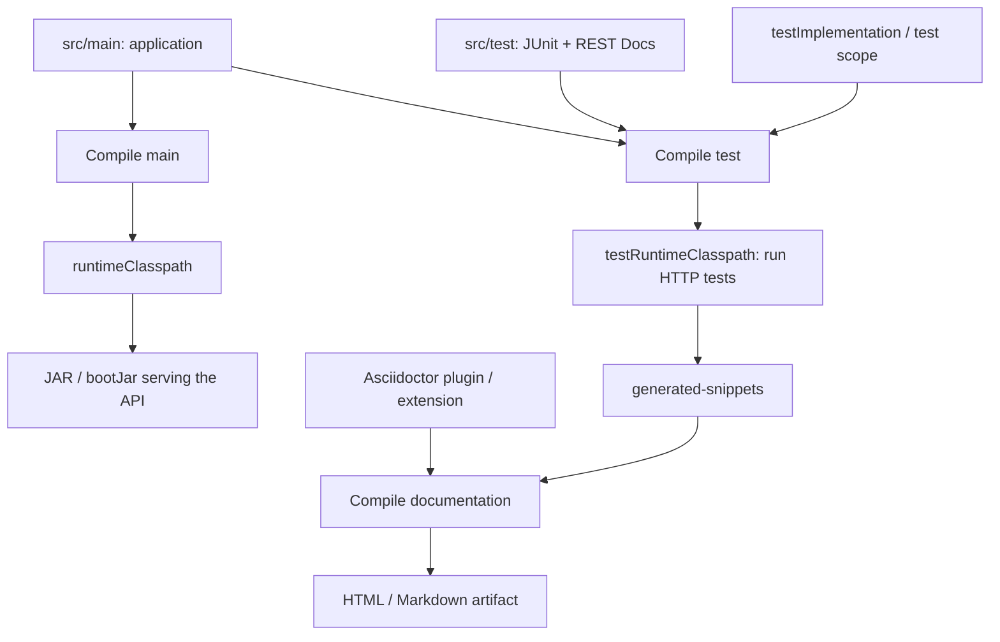
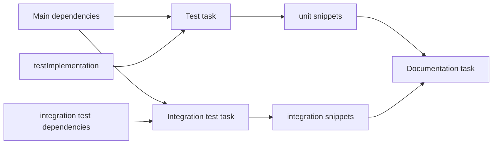
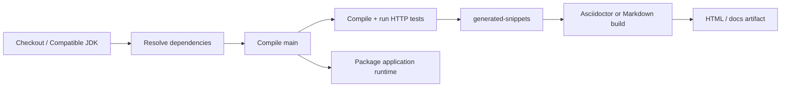

# Test Dependencies and Test-Only Scope

## Lesson Objectives

In the **Project Setup** chapter of the **SPRING_REST_DOCS** module, a key decision is placing libraries into the **right dependency scope**. Spring REST Docs builds verifiable API documentation from HTTP tests using MockMvc, WebTestClient, or REST Assured (depending on version), generating snippets for requests, responses, payloads, parameters, and headers before feeding them into Asciidoctor/Markdown in builds and CI.

Most Spring REST Docs components are used **only when running tests or compiling documentation**, so they do not need to be packaged into the production application serving HTTP traffic. Declaring the wrong scope can bloat the deployment artifact, pull test libraries into runtime unnecessarily, or cause `ClassNotFoundException` when tests run.

After this lesson, you will be able to:

- Distinguish **compile classpath**, **runtime classpath**, **test compile classpath**, and **test runtime classpath**.
- Properly use Gradle's `testImplementation`, `testRuntimeOnly`, and `testCompileOnly`, as well as Maven's `<scope>test</scope>`.
- Choose the Spring REST Docs module matching MockMvc, WebTestClient, or REST Assured and place it in test scope.
- Separate dependencies for **HTTP testing** from dependencies for **Asciidoctor compilation plugins**.
- Write a snippet-generating test, inspect the dependency tree, and verify that the packaged application artifact does not contain unintended testing tools.
- Handle special cases such as separate integration tests, multi-step CI, and dependency version management tools.

> **Lesson scope:** This lesson covers **dependency management during project setup** and does not require designing every snippet type. The HTTP test examples use Spring MVC and MockMvc for illustration; the same classpath-separation principles apply to WebTestClient and REST Assured on Spring REST Docs branches that still support them.

## 1. Why Does Spring REST Docs Normally Belong in Test Scope?

Suppose your application exposes `GET /api/products/7`. While serving users, the app needs Spring MVC or Spring WebFlux, business logic, serializers, and operational components. It **does not need** an API documentation generator to return JSON to clients.

When a developer runs a documentation test:

1. JUnit or the test runner starts the test.
2. MockMvc, WebTestClient, or REST Assured sends an HTTP request to the endpoint.
3. Assertions verify status, headers, and body.
4. Spring REST Docs records the exchange and validates payload/parameter/header descriptors.
5. Snippets are saved under the build directory; Asciidoctor or a Markdown pipeline turns them into complete documentation.

The two activities—**running the application** and **generating docs from tests**—have distinct lifecycles and classpaths:



**Default rule:** Place the Spring REST Docs test integration in **test dependencies**, and place documentation rendering components on the **documentation tool's classpath**. The production application receives only the dependencies needed to serve the API.

### 1.1. Being on the Test Classpath Does Not Mean Being Packaged

Both Gradle and Maven allow the test classpath to see application classes. That **does not** mean every test dependency ends up inside the production JAR.

For example, in a typical Gradle Java/Spring Boot setup:

- `implementation` is an application dependency, participating in main compile and main runtime.
- `testImplementation` adds dependencies only for compiling and running tests.
- `testRuntimeOnly` adds things needed only when **running** tests, not when compiling them.
- `bootJar` normally packages the runtime dependencies required by the application and does not include `testImplementation` libraries merely because they exist in the project.

Similarly, Maven's `<scope>test</scope>` makes a dependency available during **test-compile** and **test**, without propagating it as a runtime dependency of the application.

### 1.2. Do Not Treat Test Scope as an Absolute Security Boundary

Proper scoping reduces the risk of shipping unnecessary libraries to production, yet a custom build could still accidentally copy `build/generated-snippets`, `target`, or the entire test classpath into a release package. Verify your actual packaging configuration and produced artifact if your project uses a custom `bootJar` task, Docker image, or assembly setup.

In addition, tests may contain simulated requests/responses or sensitive data. Even though test dependencies do not enter production, **snippets and CI logs** still need review before publication.

## 2. Understand the Four Classpaths Before Choosing a Scope

A Java project typically uses classes across four distinct phases:

| Classpath | When Used | Example Components |
| --- | --- | --- |
| **Main compile classpath** | Compiling `src/main/java` | Spring MVC, service APIs, serializers imported by application code. |
| **Main runtime classpath** | Running the app or packaging an executable JAR | Spring Boot runtime, logging, DB drivers when needed. |
| **Test compile classpath** | Compiling `src/test/java` | JUnit API, MockMvc, REST Docs `document(...)`, AssertJ. |
| **Test runtime classpath** | Executing tests | Test compile dependencies needed at runtime, JUnit engine/launcher, and runtime-only test tools. |

Choosing a scope answers two questions:

1. **Which code needs to see the dependency at compile time?**
2. **Which process needs to load the dependency at runtime?**

Illustration:

```java
// In src/main/java: the application needs Spring MVC
import org.springframework.web.bind.annotation.GetMapping;

// In src/test/java: only tests need these APIs
import org.junit.jupiter.api.Test;
import org.springframework.test.web.servlet.MockMvc;
import org.springframework.restdocs.RestDocumentationExtension;
```

If a production class must import `MockMvc` or `RestDocumentationExtension`, that usually indicates test responsibilities have leaked into operational code. Do not rush to change `testImplementation` to `implementation` to "fix" a compile error; first check the source file location and design.

## 3. Gradle Scopes: Picking the Right Configuration

### 3.1. Common Configurations with the Java Plugin

| Gradle configuration | Compile main | Runtime main | Compile test | Runtime test | Typical Use |
| --- | --- | --- | --- | --- | --- |
| `implementation` | Yes | Yes | Yes, via the main source set classpath in tests | Yes | Spring MVC/WebFlux, business libraries. |
| `runtimeOnly` | No | Yes | Not directly | Yes, via app runtime | JDBC drivers loaded at runtime, not imported at compile time. |
| `compileOnly` | Yes | No | Not guaranteed in tests | Not guaranteed in tests | APIs provided by another environment, compile-only annotations. |
| `testImplementation` | No | No | Yes | Yes | JUnit API, Spring Test, REST Docs MockMvc/WebTestClient/REST Assured. |
| `testRuntimeOnly` | No | No | No | Yes | JUnit Platform launcher when required by the stack. |
| `testCompileOnly` | No | No | Yes | No | APIs used only to compile tests (rare). |

> This table shows **standard behavior under the Java plugin**. Custom source sets, Gradle plugins, and configuration inheritance in a specific project can alter actual classpaths; verify with Gradle commands rather than guessing from configuration names alone.

In a basic Spring REST Docs project, core dependencies should be separated like this:

```groovy
dependencies {
    // Application code needed at compile and runtime
    implementation 'org.springframework.boot:spring-boot-starter-web'

    // Used only by HTTP tests
    testImplementation 'org.springframework.boot:spring-boot-starter-test'
    testImplementation 'org.springframework.restdocs:spring-restdocs-mockmvc'

    // Used only to run the test platform if needed
    testRuntimeOnly 'org.junit.platform:junit-platform-launcher'
}
```

This example targets **Spring Boot 3.x + Spring REST Docs 3.x** and assumes the project already has the Spring Boot plugin, Maven Central, and appropriate BOM/dependency management. Do not copy Boot 3 configuration to Boot 4 without reviewing the new test starters.

### 3.2. Why Is `testImplementation` the Standard Choice for REST Docs?

When you write:

```java
import static org.springframework.restdocs.mockmvc.MockMvcRestDocumentation.document;
```

The test compiler must see `MockMvcRestDocumentation`. At test execution time, REST Docs must also be present to execute `document(...)` and write snippets. Therefore:

- `testImplementation` fits because it covers both phases.
- `testRuntimeOnly` **does not work** for the REST Docs integration module when test code imports its APIs, because `compileTestJava` will fail to find the classes.
- `testCompileOnly` **does not work** when test runtime needs to run filters/snippets, because classes will be missing at runtime.
- `implementation` is overly broad if only test code uses this module.

The same principle applies to `spring-restdocs-webtestclient` and `spring-restdocs-restassured` on supported versions: test code imports the integration API, and integration logic executes when tests send HTTP requests.

### 3.3. JUnit API and Launcher Do Not Have to Share the Same Scope

For instance, tests import `org.junit.jupiter.api.Test`; the JUnit API is needed on the **test compile classpath**. When executing tests, Gradle also needs the test platform/engine components.

In some modern setups, the launcher is added separately:

```groovy
dependencies {
    testImplementation 'org.springframework.boot:spring-boot-starter-test'
    testRuntimeOnly 'org.junit.platform:junit-platform-launcher'
}

tasks.named('test') {
    useJUnitPlatform()
}
```

Do not pin JUnit Platform/Jupiter versions manually if the Spring Boot BOM manages them. With Spring Boot 4/Spring REST Docs 4, you need a JUnit setup compatible with JUnit 6.

### 3.4. Compile-Only APIs Do Not Replace `testImplementation`

`compileOnly` and `testCompileOnly` suit certain annotation dependencies or container-provided APIs, but they are **not the default scope** for REST Docs. When tests generate snippets, REST Docs code actually executes and must be on the test runtime classpath.

In particular, declaring a dependency as `compileOnly` for main **does not guarantee** it is available in custom test source sets. If tests need that library, declare it for the test suite or configure source set dependencies explicitly.

## 4. Maven Scopes: Understanding `<scope>test</scope>`

Maven provides these primary scopes:

| Maven scope | Compile main | Runtime main | Compile/run test | Common Use |
| --- | --- | --- | --- | --- |
| `compile` (default) | Yes | Yes | Yes | Spring MVC/WebFlux and application dependencies. |
| `runtime` | No | Yes | Available at test runtime; restricted at main compile | Runtime drivers loaded on execution. |
| `provided` | Yes | Not packaged transitively via standard runtime | Available during build/test | APIs supplied by the container/environment. |
| `test` | No | No | Yes | JUnit, REST Assured, MockMvc, Spring REST Docs. |

With Maven, place REST Docs in test scope:

```xml
<dependency>
    <groupId>org.springframework.restdocs</groupId>
    <artifactId>spring-restdocs-mockmvc</artifactId>
    <scope>test</scope>
</dependency>
```

This lets `maven-compiler-plugin` compile test code importing REST Docs APIs, and `maven-surefire-plugin` execute those tests. You do not need to put REST Docs MockMvc in `compile` scope just because the build generates snippets.

**Important distinction:** Maven does not separate `testImplementation` and `testRuntimeOnly` inside dependency declarations the way Gradle does. `<scope>test</scope>` generally provides a dependency for both test compilation and test execution. If finer separation is needed, consider plugin configuration or separate modules rather than assuming Gradle configuration names work in Maven.

### 4.1. Why `<scope>test</scope>` Does Not Affect Production Code

Suppose a testing library is declared as:

```xml
<dependency>
    <groupId>io.rest-assured</groupId>
    <artifactId>rest-assured</artifactId>
    <scope>test</scope>
</dependency>
```

Maven resolves REST Assured during tests; this dependency **does not appear as a standard runtime dependency** of the application or as a transitive dependency for consumers of your artifact.

If you accidentally omit `<scope>test</scope>`, Maven defaults to `compile`: the test library gets pulled onto the main classpath and expands the dependency footprint unnecessarily.

### 4.2. Parent and BOM Are Not Scope

When using `spring-boot-starter-parent` or the Spring Boot BOM, dependency versions are managed centrally. Example:

```xml
<dependency>
    <groupId>org.springframework.restdocs</groupId>
    <artifactId>spring-restdocs-webtestclient</artifactId>
    <scope>test</scope>
</dependency>
```

Here:

- **The BOM/parent** decides the version, provided the artifact is in its dependency management list.
- **`<scope>test</scope>`** decides where the dependency is used.

These two are independent. A BOM does not automatically keep a testing library limited to tests; the POM author must still declare the right scope.

## 5. Choosing the REST Docs Module by HTTP Test Style and Spring Generation

Dependency names and scopes across Gradle and Maven:

| Testing Style | Spring REST Docs Dependency | Gradle | Maven |
| --- | --- | --- | --- |
| **MockMvc** with Spring MVC | `org.springframework.restdocs:spring-restdocs-mockmvc` | `testImplementation` | `test` |
| **WebTestClient** with WebFlux or compatible HTTP tests | `org.springframework.restdocs:spring-restdocs-webtestclient` | `testImplementation` | `test` |
| **REST Assured** in REST Docs **3.x** | `org.springframework.restdocs:spring-restdocs-restassured` | `testImplementation` | `test` |
| REST Docs core | `org.springframework.restdocs:spring-restdocs-core` | Normally pulled in by the integration module | Normally pulled in by the integration module |
| Asciidoctor integration | `org.springframework.restdocs:spring-restdocs-asciidoctor` | **Documentation plugin** classpath (`asciidoctorExt`) | Dependency of the **Asciidoctor Maven plugin** |

**Compatibility essentials:**

- **Spring Boot 3.x / Spring Framework 6.x**: choose **Spring REST Docs 3.x**, minimum Java 17.
- **Spring Boot 4.x / Spring Framework 7.x**: choose **Spring REST Docs 4.x**, minimum Java 17 and JUnit 6.
- **Spring REST Docs 4.0 removed REST Assured integration**. Do not declare `spring-restdocs-restassured:4.x` expecting that artifact to exist; nor should you force a REST Docs 3.x version onto Framework 7.

REST Assured is a separate HTTP testing library at `io.rest-assured:rest-assured`. When using the REST Docs 3.x integration, you need both the **REST Assured HTTP client** and the **REST Docs REST Assured module**, along with filter configuration.

There is no need to install all three modules—MockMvc, WebTestClient, and REST Assured—in every project. Add only the module matching the test tool your suite actually uses.

## 6. Example Gradle Configuration: Spring Boot 3 + MockMvc

Assume a Spring Boot 3 project using Java 17, Spring MVC, and JUnit Jupiter. The following snippet puts each dependency in the right scope.

### 6.1. `build.gradle` (Groovy DSL)

```groovy
plugins {
    id 'java'
    id 'org.springframework.boot' version '3.5.0'
    id 'io.spring.dependency-management' version '1.1.7'
}

group = 'com.example'
version = '0.0.1-SNAPSHOT'

java {
    toolchain {
        languageVersion = JavaLanguageVersion.of(17)
    }
}

repositories {
    mavenCentral()
}

dependencies {
    // Run the application
    implementation 'org.springframework.boot:spring-boot-starter-web'

    // Compile and run HTTP tests, generate snippets
    testImplementation 'org.springframework.boot:spring-boot-starter-test'
    testImplementation 'org.springframework.restdocs:spring-restdocs-mockmvc'

    // Test execution platform component, not needed by application code
    testRuntimeOnly 'org.junit.platform:junit-platform-launcher'
}

tasks.named('test') {
    useJUnitPlatform()
}
```

This example uses a version from the Boot 3.5 line for illustration and **does not imply 3.5.0 is the current recommended patch**. In real projects, update to the latest supported patch in your Boot line and verify compatible Gradle/JDK versions. Avoid manually appending `:3.x` to `spring-restdocs-mockmvc` when the Spring Boot BOM already manages it.

### 6.2. Minimal Change If Using WebTestClient

For a Spring Boot 3 project based on WebFlux:

```groovy
dependencies {
    implementation 'org.springframework.boot:spring-boot-starter-webflux'
    testImplementation 'org.springframework.boot:spring-boot-starter-test'
    testImplementation 'org.springframework.restdocs:spring-restdocs-webtestclient'
}
```

These are **replacement declarations** for the web-stack and test integration parts; do not stack both MVC and WebFlux starters if the application does not need both.

### 6.3. When You Already Have REST Assured Tests on Spring REST Docs 3.x

```groovy
dependencies {
    implementation 'org.springframework.boot:spring-boot-starter-web'
    testImplementation 'org.springframework.boot:spring-boot-starter-test'
    testImplementation 'io.rest-assured:rest-assured'
    testImplementation 'org.springframework.restdocs:spring-restdocs-restassured'
}
```

REST Assured is used in tests to send HTTP requests to the test server. The REST Docs REST Assured 3.x module generates snippets from exchanges via filters. Do not use this declaration for Spring REST Docs 4.x because the integration was removed.

## 7. Example Gradle Configuration: Spring Boot 4

In Spring Boot 4, web starters and test starters are split by technology. For a Spring MVC application:

```groovy
dependencies {
    implementation 'org.springframework.boot:spring-boot-starter-webmvc'
    testImplementation 'org.springframework.boot:spring-boot-starter-webmvc-test'
    testImplementation 'org.springframework.restdocs:spring-restdocs-mockmvc'
    testRuntimeOnly 'org.junit.platform:junit-platform-launcher'
}

tasks.named('test') {
    useJUnitPlatform()
}
```

For WebFlux:

```groovy
dependencies {
    implementation 'org.springframework.boot:spring-boot-starter-webflux'
    testImplementation 'org.springframework.boot:spring-boot-starter-webflux-test'
    testImplementation 'org.springframework.restdocs:spring-restdocs-webtestclient'
    testRuntimeOnly 'org.junit.platform:junit-platform-launcher'
}
```

These snippets assume the project **already has the Spring Boot 4 plugin/BOM**. If you use Boot 4's `@AutoConfigureRestDocs`, you need the matching REST Docs auto-configuration module (e.g., `org.springframework.boot:spring-boot-restdocs` on the test classpath) or the corresponding integration starter for your Boot version. `spring-restdocs-mockmvc`/`spring-restdocs-webtestclient` provide the REST Docs APIs for HTTP tests, but do not automatically supply every Spring Boot annotation.

The core **scope** rule stays unchanged: HTTP testing + REST Docs belong on the test classpath, while the Spring web starter serving the application belongs on the main classpath.

## 8. Equivalent Maven Configuration

In a `pom.xml` with a Spring Boot 3.x parent, minimal declarations look like:

```xml
<dependencies>
    <!-- Runtime of the Spring MVC application -->
    <dependency>
        <groupId>org.springframework.boot</groupId>
        <artifactId>spring-boot-starter-web</artifactId>
    </dependency>

    <!-- For testing only -->
    <dependency>
        <groupId>org.springframework.boot</groupId>
        <artifactId>spring-boot-starter-test</artifactId>
        <scope>test</scope>
    </dependency>
    <dependency>
        <groupId>org.springframework.restdocs</groupId>
        <artifactId>spring-restdocs-mockmvc</artifactId>
        <scope>test</scope>
    </dependency>
</dependencies>
```

With Spring Boot 4, replace the MVC starter with `spring-boot-starter-webmvc` and the test starter with `spring-boot-starter-webmvc-test`; keep `spring-restdocs-mockmvc` in `test` scope and let the BOM select the compatible REST Docs branch.

For WebFlux, pick the corresponding WebFlux starter and test starter. For REST Assured on the REST Docs 3.x branch, add `io.rest-assured:rest-assured` and `spring-restdocs-restassured`, **both in `test` scope**.

**Important note when no BOM is present:** Dependencies declared without `<version>` will not resolve automatically. If your project does not use a matching parent/BOM, determine valid versions of Spring Framework, Spring Test, REST Docs, and JUnit and place them in `dependencyManagement` or on each dependency.

### 8.1. Dependencies for the Asciidoctor Maven Plugin Belong to a Separate Classpath

Documentation compilation usually uses a Maven plugin:

```xml
<build>
  <plugins>
    <plugin>
      <groupId>org.asciidoctor</groupId>
      <artifactId>asciidoctor-maven-plugin</artifactId>
      <version>3.2.0</version>
      <dependencies>
        <dependency>
          <groupId>org.springframework.restdocs</groupId>
          <artifactId>spring-restdocs-asciidoctor</artifactId>
          <version>3.0.4</version>
        </dependency>
      </dependencies>
      <executions>
        <execution>
          <id>generate-api-docs</id>
          <phase>prepare-package</phase>
          <goals>
            <goal>process-asciidoc</goal>
          </goals>
        </execution>
      </executions>
    </plugin>
  </plugins>
</build>
```

Version numbers in this snippet **only illustrate how to bind the plugin and extension**; verify availability, compatibility, and select suitable patch versions of the plugin matching **the REST Docs branch used for tests**. `spring-restdocs-asciidoctor` is configured inside **`<plugin><dependencies>`**, and should not be added as a `compile` dependency of the application.

Key takeaway: dependency management for project code and the classpath of a Maven plugin are **two separate mechanisms**. Spring Boot's dependency management does not automatically pick versions for every dependency declared inside a plugin. Therefore, declare a valid extension version inside the plugin section when Maven requires it.

Maven `prepare-package` runs after `test` in the default lifecycle, which works if snippet-generating tests are run by Surefire during `test`. If snippets come from **Failsafe integration tests** during `integration-test`/`verify`, run documentation compilation after those tests complete rather than binding strictly to `prepare-package`.

## 9. Demonstration Test: Dependencies Stay Test-Only While Still Generating Snippets

The following example applies to **Spring Boot 3/Spring REST Docs 3, Spring MVC, JUnit 5, and MockMvc**. No HTTP server needs to start because `MockMvcBuilders.standaloneSetup(...)` simulates the Spring MVC pipeline directly in the test.

Create `src/test/java/com/example/docs/ProductDocumentationTest.java`:

```java
package com.example.docs;

import java.util.Map;

import org.junit.jupiter.api.BeforeEach;
import org.junit.jupiter.api.Test;
import org.junit.jupiter.api.extension.ExtendWith;
import org.springframework.http.MediaType;
import org.springframework.restdocs.RestDocumentationContextProvider;
import org.springframework.restdocs.RestDocumentationExtension;
import org.springframework.test.web.servlet.MockMvc;
import org.springframework.test.web.servlet.setup.MockMvcBuilders;
import org.springframework.web.bind.annotation.GetMapping;
import org.springframework.web.bind.annotation.PathVariable;
import org.springframework.web.bind.annotation.RestController;

import static org.springframework.restdocs.mockmvc.MockMvcRestDocumentation.document;
import static org.springframework.restdocs.mockmvc.MockMvcRestDocumentation.documentationConfiguration;
import static org.springframework.restdocs.payload.PayloadDocumentation.fieldWithPath;
import static org.springframework.restdocs.payload.PayloadDocumentation.responseFields;
import static org.springframework.test.web.servlet.request.MockMvcRequestBuilders.get;
import static org.springframework.test.web.servlet.result.MockMvcResultMatchers.jsonPath;
import static org.springframework.test.web.servlet.result.MockMvcResultMatchers.status;

@ExtendWith(RestDocumentationExtension.class)
class ProductDocumentationTest {

    private MockMvc mvc;

    @BeforeEach
    void setUp(RestDocumentationContextProvider documentation) {
        this.mvc = MockMvcBuilders.standaloneSetup(new ProductController())
                .apply(documentationConfiguration(documentation))
                .build();
    }

    @Test
    void documentsGetProduct() throws Exception {
        this.mvc.perform(get("/api/products/7")
                        .accept(MediaType.APPLICATION_JSON))
                .andExpect(status().isOk())
                .andExpect(jsonPath("$.id").value(7))
                .andExpect(jsonPath("$.name").value("Pen"))
                .andDo(document("products-get",
                        responseFields(
                                fieldWithPath("id").description("Product ID"),
                                fieldWithPath("name").description("Product name")
                        )));
    }

    @RestController
    static class ProductController {
        @GetMapping(value = "/api/products/{id}",
                    produces = MediaType.APPLICATION_JSON_VALUE)
        Map<String, Object> getProduct(@PathVariable int id) {
            return Map.of("id", id, "name", "Pen");
        }
    }
}
```

Things to observe:

1. `ProductDocumentationTest` resides in **`src/test/java`**, not `src/main/java`.
2. The test imports `MockMvc` and `RestDocumentationExtension`; hence both must be on the **test compile classpath**.
3. At runtime, `documentationConfiguration(...)` activates REST Docs on MockMvc; `document("products-get", responseFields(...))` generates snippets from the exchange.
4. `responseFields(...)` validates the JSON response fields and writes `response-fields.adoc`. If the API renames `name` to `title` without updating the descriptor, the test catches the drift.
5. The main application has no dependency on REST Docs. Snippet generation happens **outside production runtime**.

Run:

```bash
./gradlew test
# Or with Maven:
./mvnw test
```

On Windows, use `.\gradlew.bat test` or `.\mvnw.cmd test` if the project has wrapper scripts.

Default Gradle output:

```text
build/
└── generated-snippets/
    └── products-get/
        ├── curl-request.adoc
        ├── http-request.adoc
        ├── http-response.adoc
        ├── httpie-request.adoc
        ├── request-body.adoc
        ├── response-body.adoc
        └── response-fields.adoc
```

Default Maven output is `target/generated-snippets/products-get/`. If tests pass without creating snippets, check that `document(...)` is called and `documentationConfiguration(...)` is applied on **the exact MockMvc instance** used in the test.

### 9.1. Test Source and Production Source Must Never Mix

For easy experimentation, this example places `ProductController` inside the test file. Real projects keep controllers in `src/main/java` and have tests target those controllers or the application context; the scoping rules remain identical.

Never move `ProductDocumentationTest` into `src/main/java` just to make the build find the class. If Gradle/Maven does not discover a test, inspect source sets, test class naming, JUnit engine setup, and the test task configuration.

## 10. Separating Test Execution Dependencies from Documentation Compilation Dependencies

Spring REST Docs typically involves **two independent dependency groups**:

| Phase | Required Components | Appropriate Classpath |
| --- | --- | --- |
| **Sending HTTP requests and generating snippets** | JUnit, Spring Test/REST Assured, `spring-restdocs-mockmvc`/`webtestclient`/`restassured` | `testImplementation` (Gradle) or `test` (Maven). |
| **Compiling snippets into HTML** | Asciidoctor Gradle/Maven plugin, `spring-restdocs-asciidoctor` | **Asciidoctor** plugin/configuration, not application runtime. |
| **Publishing documentation** | Copy task, artifact upload, or project publisher | Build/CI; not a dependency serving API requests. |

### 10.1. Gradle: Using `asciidoctorExt`

Example adding the **documentation build step** to a Gradle project that already has snippet-generating tests:

```groovy
plugins {
    id 'org.asciidoctor.jvm.convert' version '4.0.5'
}

configurations {
    asciidoctorExt
}

dependencies {
    // Keep the same REST Docs branch as the test snippet-generation dependency
    asciidoctorExt 'org.springframework.restdocs:spring-restdocs-asciidoctor:3.0.4'
}

ext {
    snippetsDir = file('build/generated-snippets')
}

tasks.named('test') {
    outputs.dir snippetsDir
}

tasks.named('asciidoctor') {
    inputs.dir snippetsDir
    configurations 'asciidoctorExt'
    dependsOn test
}
```

This is an **addition** to a build already containing Java/Spring Boot plugins. Version `3.0.4` merely illustrates declaring the extension on the same REST Docs 3 branch; projects must pick an actually compatible patch version aligned with the resolved `spring-restdocs-mockmvc`. If using REST Docs 4.x, pick the 4.x extension and a compatible AsciidoctorJ version (REST Docs 4 requires AsciidoctorJ 3).

**Why use `asciidoctorExt` instead of `implementation`?** When the plugin runs, it needs the REST Docs extension to process snippet macros. The running Spring Boot application **never calls** that extension. Placing the dependency on the plugin configuration cleanly separates responsibilities.

### 10.2. Asciidoctor Document Referencing Test-Generated Snippets

Example `src/docs/asciidoc/index.adoc`:

```asciidoc
= Product API
:toc: left
:sectnums:

== GET /api/products/7

=== HTTP request
include::{snippets}/products-get/http-request.adoc[]

=== HTTP response
include::{snippets}/products-get/http-response.adoc[]

=== Response fields
include::{snippets}/products-get/response-fields.adoc[]
```

Run `./gradlew asciidoctor`. Because of `dependsOn test`, Gradle generates snippets first and then compiles the documentation. The usual HTML path is `build/docs/asciidoc/index.html`.

**Markdown:** REST Docs can also use Markdown snippet templates. When choosing Markdown format, configure `TemplateFormats.markdown()` in REST Docs alongside a pipeline that assembles Markdown snippets. Switching to Markdown **does not turn REST Docs test dependencies into production dependencies**.

### 10.3. Do Not Put `spring-restdocs-asciidoctor` in `runtimeOnly`

`runtimeOnly` here refers to the Java application's runtime, which is separate from the **Asciidoctor plugin's** runtime. Placing the extension in the application's `runtimeOnly` can still leave the plugin missing required classes during compilation while adding unnecessary dependencies to the application. Use the plugin's dedicated configuration or Maven plugin dependencies instead.

## 11. How to Prove Test Dependencies Are Not Packaged

Do not rely solely on a build completing without errors. You can verify across three layers: **dependency graph**, **built artifact**, and **task execution**.

### 11.1. Gradle

List test dependencies:

```bash
./gradlew dependencies --configuration testRuntimeClasspath
./gradlew dependencyInsight --dependency spring-restdocs-mockmvc --configuration testRuntimeClasspath
```

Check application dependencies:

```bash
./gradlew dependencies --configuration runtimeClasspath
```

Expected result for a standard project:

- `spring-restdocs-mockmvc` is present in **`testRuntimeClasspath`**.
- `spring-restdocs-mockmvc` is **absent** from the application's **`runtimeClasspath`** unless another dependency or plugin pulls it in unintentionally.
- `spring-restdocs-asciidoctor` appears only in the configuration used by the Asciidoctor task, not on the application runtime classpath.

Libraries like `spring-core` or `spring-webmvc` **may appear in both test and main**, because the application itself needs them. The goal is not two completely disjoint dependency trees; the goal is **keeping dedicated testing modules out of production runtime**.

You can query `runtimeClasspath` for a specific artifact:

```bash
./gradlew dependencyInsight --dependency spring-restdocs-mockmvc --configuration runtimeClasspath
```

When Gradle reports the dependency was not found in `runtimeClasspath`, that confirms a proper test-only setup. If you have multiple source sets or custom configurations, inspect each configuration individually.

### 11.2. Maven

```bash
./mvnw dependency:tree
./mvnw help:effective-pom
```

In the dependency tree, confirm REST Docs has `test` scope. `help:effective-pom` shows dependency/plugin versions resolved from parent/BOM and the effective configuration.

Never assume that setting `test` scope alone excludes all generated files from your final artifact. If you use custom assembly/copy/resources plugins, inspect the actual JAR or Docker image.

### 11.3. Inspect Packaged Files

For a built Spring Boot executable JAR:

```bash
jar tf build/libs/your-app.jar
```

Maven normally outputs artifacts under `target/`. Inspect libraries inside `BOOT-INF/lib/` when using a Spring Boot executable JAR. In a standard build, you **should not see** `spring-restdocs-mockmvc-*.jar`, `junit-jupiter-*.jar`, or `rest-assured-*.jar` inside the production artifact unless there is an explicit, intentional configuration.

`your-app.jar` is just a placeholder name—substitute the actual built filename. If you build a `war`, native image, or container image, inspect that artifact instead.

## 12. When Documentation Tests Live in a Separate Integration Test Suite

Not all HTTP documentation tests run in the default `test` task. A project might create an `integrationTest` suite to start a real server and test APIs end-to-end.

### 12.1. Provide the Right Dependencies to the New Source Set

Example directory layout:

```text
src/
├── main/java/
├── test/java/
└── integrationTest/java/
```

In Gradle, a custom source set does not automatically inherit all dependencies of `src/test`. If you use the Gradle JVM Test Suite plugin or a custom source set, declare `spring-restdocs-*` on the **integration test suite's classpath** or configure explicit configuration inheritance.

Right mental model:



If snippets come only from integration tests, the documentation task must depend on **`integrationTest`**, not merely `test`. Avoid letting independent unit tests and integration tests overwrite the same operation ID/output folder; running in parallel can corrupt or collide on snippets.

### 12.2. Maven Surefire and Failsafe

In Maven:

- `maven-surefire-plugin` typically runs unit tests in the `test` phase.
- `maven-failsafe-plugin` typically runs integration tests in the `integration-test` and `verify` phases.
- If snippet-generating tests run via Failsafe, schedule documentation compilation **after integration tests complete**, and ensure the build fails if integration tests or descriptors fail.

For example, binding Asciidoctor to `prepare-package` when snippets are generated in `integration-test` is out of order: `prepare-package` runs earlier. Adjust lifecycle bindings or use sequential steps in a CI pipeline.

### 12.3. Clean Output Separation

A team might separate snippet directories:

```text
build/
├── generated-snippets-unit/
└── generated-snippets-integration/
```

Then configure the documentation compilation task to reference both directories. Do not arbitrarily change default names if existing scripts assume `build/generated-snippets`; keep directory paths synchronized across REST Docs, Gradle/Maven plugins, and Asciidoctor sources.

## 13. CI: Separating Tests, Snippets, and Final Documentation Output

A sound pipeline:



**Checks to enforce in CI:**

1. Snippet-generating tests must run on the **locked JDK and dependency versions**. If local machines use Java 17 while CI runs Java 11, modern REST Docs 3.x/4.x branches will not meet minimum requirements.
2. The documentation build job must receive snippets **from the current test run**. If split across jobs, pass the snippets directory via CI artifacts/workspace; never assume two jobs share a filesystem.
3. A wrong descriptor or missing field must fail tests, blocking publication of stale docs if the pipeline gates publishing on test success.
4. Compiled HTML/Markdown docs can be archived as a separate artifact. Do not add documentation tools to the production application's classpath.
5. When tests hit an HTTP server on a random port, normalize URIs in snippets if public docs require a fixed domain. Never alter the real server address targeted by tests just to prettify docs.

**Distinguishing three states:**

| State | Indicator | What Still Needs Verification? |
| --- | --- | --- |
| HTTP tests pass | Status/body assertions pass | Was REST Docs `document(...)` actually called? |
| Snippets generated | `generated-snippets` contains requests/responses and descriptors | Does the Asciidoctor/Markdown task read the fresh snippets? |
| Complete documentation | Output HTML/Markdown produced | Did the pipeline store/publish the right versioned artifact? |

## 14. Common Scoping Errors

| Symptom | Likely Cause | How to Fix |
| --- | --- | --- |
| `package org.springframework.restdocs... does not exist` during `compileTestJava` | REST Docs placed in `testRuntimeOnly`, missing test dependency, or wrong source set | Move the integration module to `testImplementation` for the appropriate suite. |
| Runtime throws `ClassNotFoundException` for REST Docs during tests | Dependency only in `testCompileOnly` or customized test classpath is misconfigured | Ensure REST Docs is also on the test runtime classpath. |
| REST Docs appears in `BOOT-INF/lib` of the application | Declared as `implementation`/`compile` or custom packaging pulls in test libs | Place test modules in `testImplementation`/Maven `test` and inspect the artifact. |
| Maven REST Docs dependency defaults to `compile` | Forgot `<scope>test</scope>` | Declare the right scope; inspect `dependency:tree`. |
| `NoSuchMethodError` / `NoClassDefFoundError` in Spring Test | Mixing Spring Framework 6 and 7, REST Docs 3 and 4, or bad BOM overrides | Inspect the dependency tree and use a compatible version combination. |
| `spring-restdocs-restassured:4.x` fails to resolve | REST Docs 4.0 removed the REST Assured module | Use MockMvc/WebTestClient on REST Docs 4; keep REST Assured integration on a matching 3.x branch. |
| JUnit does not run even though test code compiles | Missing engine/launcher or test task missing JUnit Platform config | Check test starter, `testRuntimeOnly`, and `useJUnitPlatform()`. |
| No snippets generated despite green tests | Missing REST Docs configurer/filter or `document(...)` not called | Check the exact HTTP client and output directory path. |
| Asciidoctor cannot find `spring-restdocs-asciidoctor` | Extension placed in main/test dependencies instead of plugin classpath | Use `asciidoctorExt` or Maven plugin `<dependencies>`. |
| Asciidoctor reports `http-request.adoc` not found | Docs task runs before the snippet-generating suite or wrong operation ID | Order task dependencies and verify generated snippet directories. |
| `integrationTest` tests cannot see REST Docs | Custom source set does not receive test dependencies | Declare dependencies for the integration test suite or configure explicit inheritance. |
| CI has stale snippets despite API changes in tests | Using stale cache/workspace, snippet suite skipped, or job failed to pass fresh artifacts | Chain test → snippets → docs and inspect outputs and caches. |

## 15. Practice Exercises and Self-Assessment Questions

### Practice A — Prove Test Dependencies Stay Out of the Application

1. Pick a Spring MVC project using Spring Boot 3 and Java 17+. In the build file, place `spring-restdocs-mockmvc` in `testImplementation` (Gradle) or `test` (Maven).
2. Run the `ProductDocumentationTest` example from Section 9. Confirm `products-get` contains `http-response.adoc` and `response-fields.adoc`.
3. Inspect `testRuntimeClasspath` and `runtimeClasspath` (Gradle) or `dependency:tree` (Maven). Record where REST Docs appears.
4. Build the executable JAR; confirm the artifact does not include the REST Docs MockMvc module as a runtime dependency.
5. Temporarily change `testImplementation 'spring-restdocs-mockmvc'` to `testRuntimeOnly` and run `compileTestJava`. Explain the compile error; restore the correct configuration afterward.

### Practice B — Separate Documentation Tools from HTTP Tests

1. Configure the Asciidoctor plugin and the REST Docs extension on the plugin classpath.
2. Create `src/docs/asciidoc/index.adoc` referencing `products-get/http-response.adoc`.
3. Run the documentation build task, confirming tests run first and produce HTML from fresh snippets.
4. Inspect the application runtime classpath again. Explain why `spring-restdocs-asciidoctor` does not belong in `implementation`.

### Self-Assessment Questions

1. Why does `spring-restdocs-mockmvc` need `testImplementation` rather than `testRuntimeOnly`?
2. How does Maven's `<scope>test</scope>` differ from Gradle's `testRuntimeOnly`?
3. How does a BOM manage versions, and why does a BOM not determine scope on its own?
4. Why does a project using WebTestClient not automatically need `spring-restdocs-mockmvc`?
5. What happens if you take the 3.x `spring-restdocs-restassured` module and use it with Spring Boot 4?
6. Why should `spring-restdocs-asciidoctor` live on the plugin classpath?
7. In a project with a separate `integrationTest` suite, which task should the documentation task depend on?
8. How can you prove an executable JAR does not contain test-only documentation libraries?

## Official References

- [Spring REST Docs — Getting Started](https://docs.spring.io/spring-restdocs/tutorial/getting-started/index.html): MockMvc/WebTestClient test dependencies, snippet-generating tasks, and Asciidoctor.
- [Spring REST Docs — System Requirements](https://docs.spring.io/spring-restdocs/system-requirements.html): minimum Java and Spring Framework versions for the current branch.
- [Spring REST Docs 3.0 — Release Notes](https://github.com/spring-projects/spring-restdocs/wiki/Spring-REST-Docs-3.0-Release-Notes): Java/Spring Framework levels and supported REST Assured versions.
- [Spring REST Docs 4.0 — Release Notes](https://github.com/spring-projects/spring-restdocs/wiki/Spring-REST-Docs-4.0-Release-Notes): Spring Framework 7 generation, JUnit 6, and REST Assured integration changes.
- [Gradle — Declaring Dependencies](https://docs.gradle.org/current/userguide/declaring_dependencies.html): `implementation`, `runtimeOnly`, `testImplementation`, and configurations.
- [Gradle — JVM Test Suite Plugin](https://docs.gradle.org/current/userguide/jvm_test_suite_plugin.html): dependencies for separate integration test suites.
- [Maven — Introduction to the Dependency Mechanism](https://maven.apache.org/guides/introduction/introduction-to-dependency-mechanism.html): `compile`, `provided`, `runtime`, `test` scopes, and transitive dependencies.
- [Maven — Build Lifecycle](https://maven.apache.org/guides/introduction/introduction-to-the-lifecycle.html): ordering of `test`, `prepare-package`, `integration-test`, and `verify`.
- [Spring Boot — Gradle Plugin](https://docs.spring.io/spring-boot/gradle-plugin/index.html) and [Spring Boot — Maven Plugin](https://docs.spring.io/spring-boot/maven-plugin/index.html): packaging and application build management.

In most projects, keep **Spring REST Docs HTTP integrations in test scope**, keep **the Asciidoctor extension on the documentation plugin's classpath**, and verify via the dependency tree that production runtime contains only libraries needed to serve the API. This separation lets HTTP tests catch broken documentation, generate snippets, and compile docs in CI without complicating deployment artifacts.
