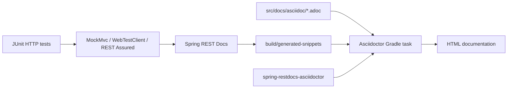
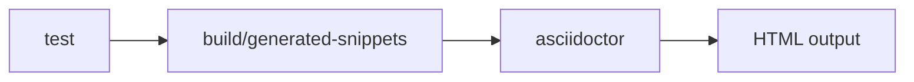
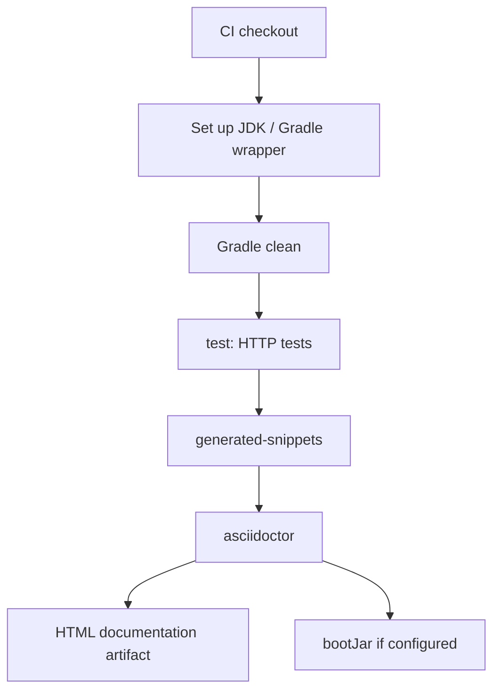

# Configuring the Asciidoctor Plugin for Gradle

## Lesson Objectives

In the **Project Setup** chapter of the **SPRING_REST_DOCS** module, after HTTP tests with MockMvc, WebTestClient, or REST Assured generate snippets, a compilation step is needed to assemble them into readable documentation. For Gradle projects using AsciiDoc, the right tool is the **Asciidoctor Gradle Plugin**.

Spring REST Docs produces snippets from tested requests and responses; the Asciidoctor plugin reads **.adoc** files, processes **include** directives along with the REST Docs extension, and outputs HTML. Both stages are linked in the Gradle task graph: **tests generate snippets first, and Asciidoctor consumes those snippets as inputs afterward**.

After this lesson, you will be able to install the **org.asciidoctor.jvm.convert** plugin, declare **asciidoctorExt** and the **spring-restdocs-asciidoctor** dependency, pick a compatible AsciidoctorJ version, configure **snippetsDir**, connect the test task to the Asciidoctor task, write **index.adoc**, run and locate the HTML output, and integrate the workflow into CI.

> **Reference configuration set:** examples use Spring REST Docs 4.0.2, Asciidoctor Gradle plugin 4.0.5, and AsciidoctorJ 3.0.0, matching the version set in the Spring REST Docs 4.0.2 Getting Started guide. For another REST Docs or Gradle branch, verify compatibility requirements before changing versions.

## 1. Which Step Does the Asciidoctor Plugin Solve?

A REST Docs project has two groups of documentation files:

- **Generated snippets** from tests, such as `http-request.adoc`, `http-response.adoc`, and `response-fields.adoc`. Gradle typically stores them under `build/generated-snippets`.
- **Authored source documents**, such as `src/docs/asciidoc/index.adoc`. This file organizes structure, headings, explanations, and includes for the generated snippets.

Asciidoctor converts `.adoc` files into HTML. The **spring-restdocs-asciidoctor** extension adds REST Docs integration, sets the **{snippets}** attribute pointing to the snippet directory, and provides the **operation** macro.



The plugin **does not author API prose on behalf of the development team**. Tests supply HTTP evidence; `.adoc` files decide how it is presented and explained; Asciidoctor renders them into finished documentation.

## 2. Components to Configure

| Component | Responsibility | Configuration / Path |
| --- | --- | --- |
| Gradle plugin | Creates the `asciidoctor` task and connects AsciidoctorJ to Gradle | `org.asciidoctor.jvm.convert` |
| AsciidoctorJ | Engine running Asciidoctor on the JVM | `asciidoctorj` version `3.0.0` |
| REST Docs Asciidoctor extension | Provides `{snippets}` and the `operation` macro | Configuration `asciidoctorExt` |
| HTTP test integration | Generates snippets from tests | `testImplementation` with MockMvc/WebTestClient; REST Assured on supported branches |
| Snippet directory | Where tests write operation snippets | `build/generated-snippets` |
| Source document | AsciiDoc file authored by the team | `src/docs/asciidoc/index.adoc` |
| HTML output | Output of the Asciidoctor task | Configured `outputDir` or plugin default |

**Do not confuse the two dependencies:** `spring-restdocs-mockmvc` or `spring-restdocs-webtestclient` runs with tests on the test classpath; `spring-restdocs-asciidoctor` is supplied to the documentation compilation task. The Asciidoctor extension is not an API runtime dependency.

## 3. Gradle Groovy DSL Configuration

### 3.1. Declaring the Plugin

In `build.gradle`, add the plugin to the existing `plugins` block:

```groovy
plugins {
    id 'java'
    id 'org.springframework.boot' version '4.0.9'
    id 'io.spring.dependency-management' version '1.1.7'
    id 'org.asciidoctor.jvm.convert' version '4.0.5'
}
```

This illustrates the plugins block for a Spring Boot 4 project; if the project already has a `plugins` block, simply add the Asciidoctor line. For a docs-only project, the Spring Boot plugin is unnecessary:

```groovy
plugins {
    id 'org.asciidoctor.jvm.convert' version '4.0.5'
}
```

### 3.2. Choosing the AsciidoctorJ Version

Spring REST Docs 4 requires **AsciidoctorJ 3.0** for its extension and macros:

```groovy
asciidoctorj {
    version = '3.0.0'
}
```

These three versions belong to three separate components:

| Declaration | Selected Component |
| --- | --- |
| Plugin `org.asciidoctor.jvm.convert` version `4.0.5` | Plugin integrating Asciidoctor into Gradle |
| `asciidoctorj.version = 3.0.0` | AsciidoctorJ engine used by the plugin |
| `spring-restdocs-asciidoctor:4.0.2` | Spring REST Docs' own extension |

Do not swap one component's version for another's. When upgrading Spring REST Docs, check the AsciidoctorJ requirement in that branch's documentation.

### 3.3. Creating a Dedicated Configuration for the Extension

Add to `build.gradle`:

```groovy
configurations {
    asciidoctorExt
}

dependencies {
    asciidoctorExt 'org.springframework.restdocs:spring-restdocs-asciidoctor:4.0.2'
}
```

`asciidoctorExt` is a custom Gradle dependency configuration created by the project. It holds the Asciidoctor extension library without mixing into the application's `implementation`, `runtimeOnly`, or `testImplementation` configurations.

When running the task, assign this configuration to Asciidoctor:

```groovy
tasks.named('asciidoctor') {
    configurations 'asciidoctorExt'
}
```

This places `spring-restdocs-asciidoctor` on AsciidoctorJ's classpath. The extension automatically configures `{snippets}` to point to the snippets directory and supplies the `operation` macro.

### 3.4. Declaring the Snippets Directory

Define a shared property to avoid repeating paths:

```groovy
ext {
    snippetsDir = file('build/generated-snippets')
}
```

Make sure tests actually write snippets into this exact directory. Spring REST Docs uses `build/generated-snippets` by default on Gradle; if tests are configured with a different output directory, align `snippetsDir` with that path.

### 3.5. Wiring the Test Task and Asciidoctor Task

This is the most important part:

```groovy
tasks.named('test') {
    outputs.dir snippetsDir
}

tasks.named('asciidoctor') {
    inputs.dir snippetsDir
    configurations 'asciidoctorExt'
    dependsOn test
}
```

What this means:

1. `outputs.dir snippetsDir`: tells Gradle that the `test` task produces the snippets directory. This registers it as a task output, helping Gradle manage task ordering and incremental builds.
2. `inputs.dir snippetsDir`: tells Gradle that the `asciidoctor` task reads the snippets directory. Whenever snippets change, Gradle recognizes that documentation inputs have changed.
3. `configurations 'asciidoctorExt'`: places the REST Docs extension on Asciidoctor's classpath.
4. `dependsOn test`: requires tests to run before compiling documentation.

Declaring `dependsOn test` alone without input/output directories leaves the data exchange between the two tasks implicit, making incremental builds and input tracking less reliable.

## 4. Combined `build.gradle` Configuration

Example bringing together the core pieces of Spring Boot 4 + REST Docs 4 + MockMvc:

```groovy
plugins {
    id 'java'
    id 'org.springframework.boot' version '4.0.9'
    id 'io.spring.dependency-management' version '1.1.7'
    id 'org.asciidoctor.jvm.convert' version '4.0.5'
}

group = 'com.example'
version = '0.0.1-SNAPSHOT'

java {
    toolchain {
        languageVersion = JavaLanguageVersion.of(17)
    }
}

repositories {
    mavenCentral()
}

asciidoctorj {
    version = '3.0.0'
}

configurations {
    asciidoctorExt
}

dependencies {
    implementation 'org.springframework.boot:spring-boot-starter-webmvc'
    testImplementation 'org.springframework.boot:spring-boot-starter-webmvc-test'
    testImplementation 'org.springframework.restdocs:spring-restdocs-mockmvc'
    testRuntimeOnly 'org.junit.platform:junit-platform-launcher'
    asciidoctorExt 'org.springframework.restdocs:spring-restdocs-asciidoctor:4.0.2'
}

ext {
    snippetsDir = file('build/generated-snippets')
}

tasks.named('test') {
    useJUnitPlatform()
    outputs.dir snippetsDir
}

tasks.named('asciidoctor') {
    inputs.dir snippetsDir
    configurations 'asciidoctorExt'
    dependsOn test
}
```

Each dependency sits on the appropriate classpath:

- `implementation`: libraries to compile and run the application.
- `testImplementation`: test starter and Spring REST Docs MockMvc to compile and run tests.
- `testRuntimeOnly`: JUnit Platform launcher at test execution time.
- `asciidoctorExt`: extension needed by the Asciidoctor task when rendering docs.

If using **WebTestClient**, replace the MVC/test starters with the corresponding WebFlux starters and change `spring-restdocs-mockmvc` to `spring-restdocs-webtestclient`. If the project uses REST Assured, remember `spring-restdocs-restassured` is available only on the REST Docs 3.x branch; the module was removed in 4.0.

## 5. Kotlin DSL

In `build.gradle.kts`, the equivalent declaration is:

```kotlin
plugins {
    java
    id("org.springframework.boot") version "4.0.9"
    id("io.spring.dependency-management") version "1.1.7"
    id("org.asciidoctor.jvm.convert") version "4.0.5"
}

repositories {
    mavenCentral()
}

asciidoctorj {
    version = "3.0.0"
}

val asciidoctorExt by configurations.creating
val snippetsDir = file("build/generated-snippets")

dependencies {
    implementation("org.springframework.boot:spring-boot-starter-webmvc")
    testImplementation("org.springframework.boot:spring-boot-starter-webmvc-test")
    testImplementation("org.springframework.restdocs:spring-restdocs-mockmvc")
    testRuntimeOnly("org.junit.platform:junit-platform-launcher")
    asciidoctorExt("org.springframework.restdocs:spring-restdocs-asciidoctor:4.0.2")
}

tasks.test {
    useJUnitPlatform()
    outputs.dir(snippetsDir)
}

tasks.named("asciidoctor") {
    inputs.dir(snippetsDir)
    configurations("asciidoctorExt")
    dependsOn(tasks.test)
}
```

Kotlin DSL uses `val asciidoctorExt by configurations.creating` to declare the configuration and `configurations("asciidoctorExt")` on the task. If Spring Boot or other plugins are managed in a root project, inherit plugin/version management rather than redeclaring them.

## 6. Creating the Source Document `index.adoc`

By default, the plugin looks for AsciiDoc sources at:

```text
src/
└── docs/
    └── asciidoc/
        └── index.adoc
```

Create `src/docs/asciidoc/index.adoc`:

```asciidoc
= Product API
:toc: left
:sectnums:

== GET /api/products/7

=== Request
include::{snippets}/products-get/http-request.adoc[]

=== Response
include::{snippets}/products-get/http-response.adoc[]

=== Response fields
include::{snippets}/products-get/response-fields.adoc[]
```

`{snippets}` is an attribute set by `spring-restdocs-asciidoctor`. It points to the snippets directory configured in Gradle. For operation ID `products-get`, the includes reference:

```text
build/generated-snippets/
└── products-get/
    ├── http-request.adoc
    ├── http-response.adoc
    └── response-fields.adoc
```

If a test generates an operation with a different name, such as `product-get`, update the include paths to match. The operation folder name comes from the `document("...")` call in the test.

### 6.1. Using the `operation` Macro

The REST Docs extension also provides the `operation` macro to render an operation:

```asciidoc
== GET /api/products/7

operation::products-get[snippets='http-request,http-response,response-fields']
```

This macro keeps the document cleaner when an operation has many snippets. To use it, `spring-restdocs-asciidoctor` must be on the Asciidoctor task's classpath via `asciidoctorExt`; declaring only test dependencies does not supply the macro to the compilation step.

## 7. Running the Task and Locating the HTML Output

Run the Asciidoctor task directly:

```powershell
.\gradlew.bat asciidoctor
```

Or on Linux/macOS:

```bash
./gradlew asciidoctor
```

Because `dependsOn test` is configured, Gradle runs tests before processing `index.adoc`. If tests fail, the Asciidoctor task will not proceed as though the current build's snippets were valid.

Per Spring REST Docs conventions, source docs live at `src/docs/asciidoc` and default HTML is typically generated at `build/asciidoc/html5`. The plugin may use a different `outputDir`; check build logs and task configuration if you cannot locate the file.

You can specify the output directory explicitly:

```groovy
tasks.named('asciidoctor') {
    outputDir = file(buildDir.toString() + '/docs/api')
}
```

HTML files then appear under `build/docs/api`, keeping the source filename with an `.html` extension. With only `index.adoc`, the output is usually `index.html`.

## 8. Role of the Task Graph and Incremental Builds

Minimal task graph:



These three declarations describe the data handoff between tasks:

```groovy
tasks.named('test') {
    outputs.dir snippetsDir
}

tasks.named('asciidoctor') {
    inputs.dir snippetsDir
    dependsOn test
}
```

Gradle relies on task dependencies and input/output relationships to decide which tasks must run:

- `outputs.dir` declares the artifacts produced by `test`.
- `inputs.dir` declares the inputs read by `asciidoctor`.
- `dependsOn` enforces execution order.

When `.adoc` source files change, Gradle reruns Asciidoctor. When a response descriptor or HTTP test changes and snippets update, the Asciidoctor task recognizes that its inputs changed. When nothing has changed and Gradle has complete metadata, tasks can be skipped via up-to-date checking.

### 8.1. Do Not Edit Generated Snippets Manually

Files inside `build/generated-snippets` are **build outputs** and can be overwritten whenever tests run. Do not edit these files directly to fix documentation content. Make changes in the test/descriptor, the `.adoc` source file, or preprocessor configuration instead. That guarantees documentation can always be regenerated cleanly from source code and tests on every build.

## 9. Packaging Documentation into the Spring Boot JAR (Optional)

Normally, HTML documentation is a separate build artifact. If you want the Spring Boot application to serve documentation as static content, configure `bootJar` to wait for `asciidoctor` and copy the HTML into the JAR:

```groovy
tasks.named('bootJar') {
    dependsOn tasks.named('asciidoctor')
    from(tasks.named('asciidoctor').map { it.outputDir }) {
        into 'static/docs'
    }
}
```

After packaging, documentation files sit under `BOOT-INF/classes/static/docs` inside the executable JAR. Spring Boot can serve static content using standard web configuration.

**Apply this only if the documentation genuinely needs to be served alongside the application.** If the goal is publishing docs to a developer portal or storing CI artifacts, it is usually better to keep HTML outside the application JAR.

## 10. Integrating into CI

A minimal pipeline can run:

```bash
./gradlew clean asciidoctor
```

Or if you also want to build the application artifact:

```bash
./gradlew clean bootJar
```

If `bootJar` depends on `asciidoctor` as shown in Section 9, the second command builds documentation before packaging.



Practical guidelines:

1. Use the same JDK and Gradle wrapper tested locally.
2. Tests must generate snippets for the operations being published; never reuse stale snippets from a prior workspace.
3. The Asciidoctor task must receive the snippets directory from the current build.
4. Store HTML as a separate artifact if not packaged inside the application.
5. If testing and doc compilation are split across multiple CI jobs, pass `build/generated-snippets` via artifacts/workspace; two jobs do not share a filesystem automatically.
6. If snippet-generating tests fail, the pipeline must halt before the documentation publishing step.

## 11. Common Configuration Errors

| Symptom | Common Cause | Resolution |
| --- | --- | --- |
| Gradle does not recognize the `asciidoctor` task | Plugin not applied or wrong plugin ID | Check `org.asciidoctor.jvm.convert` in `plugins`. |
| `{snippets}` not resolved | Missing REST Docs Asciidoctor extension on task classpath | Declare `asciidoctorExt` and `configurations 'asciidoctorExt'`. |
| `operation` macro not recognized | Extension not used by the task or wrong version | Check plugin configuration and AsciidoctorJ requirements. |
| `http-request.adoc` does not exist | Test did not generate the operation or wrong operation ID | Run tests, check `document("...")` and the snippets folder. |
| Asciidoctor runs before tests | Missing `dependsOn test` | Add the task dependency. |
| Snippets change but old HTML is not rebuilt | Task inputs/outputs not declared | Declare `outputs.dir snippetsDir` and `inputs.dir snippetsDir`. |
| AsciidoctorJ compatibility error | REST Docs extension requires a different engine version | Check your REST Docs branch requirements; REST Docs 4 requires AsciidoctorJ 3.0. |
| Plugin incompatible with Gradle wrapper | Plugin version incompatible with Gradle/JDK | Check plugin compatibility notes and align wrapper and plugin versions. |
| HTML ends up in the wrong directory | `outputDir` was overridden or plugin defaults differ | Inspect task configuration and set `outputDir` explicitly. |
| JAR does not contain documentation | `bootJar` not wired to Asciidoctor or output not copied | Add the dependency and `from(...){ into 'static/docs' }` if packaging is desired. |
| CI reports include cannot find snippet | Job did not pass snippets or tests did not run in that job | Run tests before Asciidoctor in the same job or pass snippets as an artifact. |

## 12. Practice Exercise

1. Create or use a Gradle project with Spring REST Docs MockMvc or WebTestClient matching its web stack.
2. Configure the Asciidoctor plugin and the `spring-restdocs-asciidoctor` dependency per Section 3.
3. Write an HTTP test with operation ID `catalog-list`, ensuring the test writes request/response snippets to `build/generated-snippets`.
4. Create `src/docs/asciidoc/index.adoc`, including `catalog-list/http-request.adoc` and `catalog-list/http-response.adoc`.
5. Run `./gradlew clean asciidoctor`; confirm tests run first and HTML is generated properly.
6. Modify a descriptor or `.adoc` file, rerun the task, and observe Gradle re-executing only the required stages.
7. (Optional) Wire `bootJar` to include the HTML under `static/docs`, then use `jar tf` to verify the file path inside the JAR.

**Self-Assessment Questions**

- Why does `spring-restdocs-asciidoctor` go into `asciidoctorExt` rather than `implementation`?
- Distinguish `asciidoctorj.version` from the Gradle plugin version.
- Why should `outputs.dir`, `inputs.dir`, and `dependsOn` all be declared together?
- How is the `{snippets}` attribute supplied by the extension?
- Why should you never edit files directly inside `build/generated-snippets`?
- When is it appropriate to wire `bootJar` to the `asciidoctor` task?
- If tests run in a separate CI job, how does Asciidoctor receive the right snippets?

## Official References

- [Spring REST Docs — Getting Started](https://docs.spring.io/spring-restdocs/tutorial/getting-started/index.html): Gradle configuration, AsciidoctorJ 3.0, `asciidoctorExt`, `snippetsDir`, inputs/outputs, and task dependencies.
- [Asciidoctor Gradle Plugin — Official Documentation](https://docs.asciidoctor.org/gradle-plugin/latest/): plugin, `asciidoctor` task, source directory, output directory, and configuration.
- [Asciidoctor Gradle Plugin — Task Configuration](https://docs.asciidoctor.org/gradle-plugin/latest/classic/common-task-configuration/): `sourceDir`, `outputDir`, `configurations`, `inputs`, and task properties.
- [Asciidoctor Gradle Plugin — Adding Custom Extensions](https://docs.asciidoctor.org/gradle-plugin/latest/classic/asciidoctorj-custom-extensions/): placing extensions on a separate Asciidoctor task classpath.
- [Gradle — Incremental Builds](https://docs.gradle.org/current/userguide/incremental_build.html): declaring task inputs/outputs and up-to-date checking.

Once configured, verify everything with a repeatable build chain: **HTTP tests generate snippets → Asciidoctor reads snippets and source files → output HTML is saved as an artifact**. This provides the foundation for REST API documentation that reflects tested behavior and builds automatically in CI.
