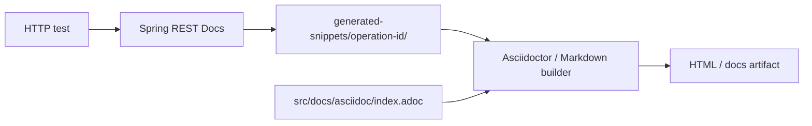
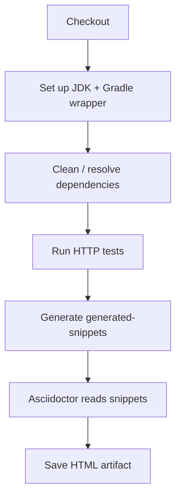

# Defining the `generated-snippets` Directory

## Lesson Objectives

In the **Project Setup** chapter of the **SPRING_REST_DOCS** module, after HTTP tests with MockMvc, WebTestClient, or REST Assured run, Spring REST Docs writes requests, responses, and descriptors into snippet files. Those files need an intermediate storage location so the documentation compilation tool can read them.

The directory conventionally used for this purpose is called **generated-snippets**. With Gradle, the default path is typically **build/generated-snippets**; with Maven, it is **target/generated-snippets**. This is a build-generated output, not a place to author source documentation, and should not be edited by hand.

After this lesson, you will be able to:

- Explain the role of `generated-snippets` in the test → snippets → Asciidoctor/Markdown flow.
- Distinguish the snippet directory from the documentation source directory and the HTML output directory.
- Identify Gradle/Maven path conventions and verify which directory tests actually write to.
- Configure the output directory and synchronize it with `snippetsDir` and the `{snippets}` attribute.
- Organize operation IDs and folder structures across multiple endpoints and test suites.
- Handle cleanup, incremental builds, CI artifacts, caching, and path-mismatch errors.

> **Scope:** This lesson focuses on conventions and management of the snippet directory generated by Spring REST Docs. Examples use MockMvc for illustration; the same path principles apply to WebTestClient and REST Assured on supported branches.

## 1. What Is `generated-snippets`?

Spring REST Docs does not produce one giant documentation page directly while sending HTTP requests. Instead, it creates many **small snippets**, each capturing one aspect of an HTTP operation. For example, for the **products-get** operation, a test might generate:

```text
generated-snippets/
└── products-get/
    ├── curl-request.adoc
    ├── http-request.adoc
    ├── http-response.adoc
    ├── httpie-request.adoc
    ├── request-body.adoc
    ├── response-body.adoc
    └── response-fields.adoc
```

Each operation folder contains independent files. **http-request.adoc** describes the request; **http-response.adoc** records status, headers, and response body; **response-fields.adoc** appears when the test declares descriptors for JSON fields. Other snippets appear when tests document query parameters, path parameters, headers, request fields, or form parameters.

The root **generated-snippets** directory collects outputs across operations. On each test run, Spring REST Docs writes snippets into the output directory configured for the test context.

### Data Flow



**Remember three distinct directory types:**

| Directory Type | What It Contains | Who Creates or Edits It? | Example |
| --- | --- | --- | --- |
| **Generated snippets** | Small HTTP request/response and descriptor files | Generated by REST Docs from tests; do not edit directly | `build/generated-snippets` |
| **Documentation source** | AsciiDoc/Markdown pages, explanations, and structure | Authored by the development team | `src/docs/asciidoc` |
| **Rendered documentation** | HTML or final published format | Created by the Asciidoctor/Markdown task | `build/docs` or `build/asciidoc` |

`generated-snippets` is an intermediate staging area. It does not replace source documentation, nor is it the published HTML directory.

## 2. Default Paths for Gradle and Maven

Spring REST Docs follows different conventions depending on the build tool:

| Tool | Default Snippet Directory | Common Source Doc Directory | HTML Directory |
| --- | --- | --- | --- |
| **Gradle** | `build/generated-snippets` | `src/docs/asciidoc` | Configured by the Asciidoctor task; usually inside `build/` |
| **Maven** | `target/generated-snippets` | Commonly `src/main/asciidoc` or custom plugin config | Configured by Asciidoctor Maven Plugin; usually inside `target/` |

Gradle uses **build/** for build outputs; Maven uses **target/**. When migrating a project from Maven to Gradle or vice versa, do not assume the snippet path stays unchanged.

### 2.1. Gradle

In a Gradle project, REST Docs writes snippets by default to:

```text
<project-root>/
└── build/
    └── generated-snippets/
        └── <operation-id>/
            ├── http-request.adoc
            └── http-response.adoc
```

A Gradle variable is commonly defined in `build.gradle` for reuse:

```groovy
ext {
    snippetsDir = file('build/generated-snippets')
}
```

This is a build-script variable, **not a property that automatically changes REST Docs' own output directory**. It helps synchronize where tests write snippets, the `test` task output, the `asciidoctor` task input, and the attribute/extension used by source docs to include snippets.

If you define `snippetsDir` while tests still write to another default path, Asciidoctor will read an empty directory. Verify the actual output before assuming this variable completes configuration.

### 2.2. Maven

With Maven, the default snippet path is:

```text
<project-root>/
└── target/
    └── generated-snippets/
        └── <operation-id>/
            ├── http-request.adoc
            └── http-response.adoc
```

Maven and compilation plugins normally use `target/generated-snippets` as the include source. If tests use `@AutoConfigureRestDocs` or a custom output directory, align the Asciidoctor Maven Plugin configuration with that output.

## 3. Determining REST Docs' Output Directory

### 3.1. When Using Spring Boot and `@AutoConfigureRestDocs`

When Boot auto-configures REST Docs, you can specify the output directory via `outputDir`:

```java
import org.springframework.boot.test.autoconfigure.restdocs.AutoConfigureRestDocs;
import org.springframework.boot.test.autoconfigure.web.servlet.WebMvcTest;

@WebMvcTest(ProductController.class)
@AutoConfigureRestDocs(outputDir = "build/generated-snippets")
class ProductDocumentationTest {
    // MockMvc tests and document(...) go here
}
```

These are Spring Boot 3.x imports. In Boot 4, test auto-configuration packages were reorganized; check the corresponding package for your Boot version. The REST Docs integration module must still be on the test classpath.

The `outputDir` value is the root snippet directory; REST Docs creates subdirectories by operation ID. With Gradle you might choose `build/generated-snippets`; with Maven the convention is usually `target/generated-snippets`. What matters is that tests, the build task, and documentation agree on the same path.

### 3.2. When Configuring MockMvc Manually

If tests build MockMvc using `MockMvcBuilders` and `RestDocumentationExtension`, REST Docs configuration is attached directly to the MockMvc instance:

```java
@ExtendWith(RestDocumentationExtension.class)
class ProductDocumentationTest {

    private MockMvc mockMvc;

    @BeforeEach
    void setUp(RestDocumentationContextProvider documentation) {
        this.mockMvc = MockMvcBuilders.standaloneSetup(new ProductController())
                .apply(documentationConfiguration(documentation))
                .build();
    }
}
```

The extension supplies the REST Docs context, including an output directory suited to the build environment. If you need to change the directory, use the output directory configuration supported by your Spring REST Docs/Boot version and ensure Asciidoctor receives that exact folder. Do not assume a Gradle `snippetsDir` variable automatically redirects the JUnit extension's output.

### 3.3. With WebTestClient

WebTestClient connects to REST Docs via a filter:

```java
this.webTestClient = WebTestClient
        .bindToController(new ProductController())
        .configureClient()
        .filter(documentationConfiguration(documentation))
        .build();
```

After executing the exchange, call `consumeWith(document("products-get"))` to write snippets. The output directory comes from the `RestDocumentationContextProvider` used in filter setup. If you change the output location, configure the context accordingly; merely setting a Gradle variable does not redirect the filter's path.

### 3.4. With REST Assured

Spring REST Docs 3.x's REST Assured integration also uses the context to create a configuration filter:

```java
this.specification = new RequestSpecBuilder()
        .setBaseUri("http://127.0.0.1")
        .setPort(port)
        .addFilter(documentationConfiguration(documentation))
        .build();
```

When a test calls `filter(document("products-get"))`, snippets are written to the REST Docs context's output directory. **Version note:** Spring REST Docs 4.0 removed REST Assured integration; this example applies to a compatible REST Docs 3.x branch.

## 4. Synchronizing `snippetsDir` with the Asciidoctor Task

### 4.1. Basic Gradle Configuration

In `build.gradle`:

```groovy
ext {
    snippetsDir = file('build/generated-snippets')
}

tasks.named('test') {
    outputs.dir snippetsDir
}

tasks.named('asciidoctor') {
    inputs.dir snippetsDir
    dependsOn test
}
```

Each declaration serves a different purpose:

| Declaration | Purpose |
| --- | --- |
| `snippetsDir = file(...)` | Defines a consistent path variable in the build script |
| `test.outputs.dir snippetsDir` | Registers the snippets directory as an output of `test` |
| `asciidoctor.inputs.dir snippetsDir` | Registers the snippets directory as an input of `asciidoctor` |
| `dependsOn test` | Ensures tests run before documentation compilation |

In the Asciidoctor task, the REST Docs extension is placed on the classpath via a dedicated configuration:

```groovy
configurations {
    asciidoctorExt
}

dependencies {
    asciidoctorExt 'org.springframework.restdocs:spring-restdocs-asciidoctor:4.0.2'
}

tasks.named('asciidoctor') {
    inputs.dir snippetsDir
    configurations 'asciidoctorExt'
    dependsOn test
}
```

Extension version `4.0.2` pairs with REST Docs 4.0.2. If using REST Docs 3.x, pick the extension from the same branch and a compatible AsciidoctorJ version. Never mix a 4.x extension with 3.x test integrations.

### 4.2. Synchronizing the `{snippets}` Attribute

In `src/docs/asciidoc/index.adoc`, snippets can be included as:

```asciidoc
= Product API

== GET /api/products/7

=== HTTP request
include::{snippets}/products-get/http-request.adoc[]

=== HTTP response
include::{snippets}/products-get/http-response.adoc[]
```

The `{snippets}` attribute is set by the `spring-restdocs-asciidoctor` extension. It must point to the **root snippets directory** generated by tests. If the actual folder is `build/generated-snippets` while includes resolve to `target/generated-snippets`, Asciidoctor will report missing files.

Avoid hardcoding one path in `.adoc` files and setting a different path in Gradle unintentionally. Prefer the extension-managed attribute or pass a single unified variable/attribute from the build.

### 4.3. Operation IDs Create Subdirectories

The documentation call sets the operation ID:

```java
.andDo(document("products-get"))
```

Or with WebTestClient:

```java
.consumeWith(document("products-get"))
```

REST Assured:

```java
.filter(document("products-get"))
```

These three differ in the HTTP testing tool's API, yet all set the operation ID to `products-get`. REST Docs creates the subdirectory:

```text
generated-snippets/
└── products-get/
    ├── http-request.adoc
    └── http-response.adoc
```

Source documents must reference the exact operation ID. If a test renames the operation to `product-detail`, existing includes referencing `products-get` do not update automatically.

## 5. Naming Operations and Organizing Multiple Endpoints

An API typically has many operations. Choose stable, readable IDs that describe the resource and action:

| Endpoint | Suggested Operation ID | Generated Directory |
| --- | --- | --- |
| `GET /api/products` | `products-list` | `generated-snippets/products-list` |
| `GET /api/products/{id}` | `products-get` | `generated-snippets/products-get` |
| `POST /api/products` | `products-create` | `generated-snippets/products-create` |
| `PUT /api/products/{id}` | `products-update` | `generated-snippets/products-update` |
| `DELETE /api/products/{id}` | `products-delete` | `generated-snippets/products-delete` |

Do not reuse the same ID across documentation tests with different purposes unless you intentionally want the same operation writing to one directory. If two tests both write `products-get` with different response shapes, they can overwrite snippets or produce order-dependent outputs.

When one operation has multiple request/response variants, use distinct IDs such as:

- `products-get-basic`
- `products-get-not-found`
- `products-get-with-fields`

Or separate by method/API version if needed. Pick names meaningful to readers; avoid order-based generated IDs like `test-1` or `test-2`.

### 5.1. Do Not Confuse Operation Folders with Resource Folders

By default, REST Docs organizes folders by **operation ID**, not automatically by controller/package or resource name. If you want documentation grouped by topic, organize AsciiDoc sources into multiple files/sections or adopt a naming convention like `catalog/products-list`, ensuring include paths match the resulting folder layout.

### 5.2. Prevent Parallel Tests from Writing the Same Output

When tests run in parallel, each test should use a distinct operation ID, or coordination is needed to prevent concurrent writes to the same snippet file. Do not share one output directory across independent CI jobs if they run different tests that could collide on the same operation.

## 6. Multiple Test Suites and Multiple Snippet Directories

In a simple project, one `generated-snippets` directory suffices. Larger projects may separate them:

```text
build/
├── generated-snippets-unit/
├── generated-snippets-integration/
└── docs/
    └── api/
```

Example breakdown by purpose:

| Directory | Producer | Content |
| --- | --- | --- |
| `generated-snippets-unit` | `test` task | Snippets from fast controller/service suite tests |
| `generated-snippets-integration` | `integrationTest` task | Snippets from tests against a running app/real server |
| `docs/api` | `asciidoctor` task | Final HTML output |

When splitting test suites, configure the **REST Docs context's output directory** per suite and declare accurate task inputs/outputs. Do not merely rename a Gradle variable and assume the JUnit extension will write to the new folder.

### 6.1. Example Declaring Two Output Directories in Gradle

Task graph illustration:

```groovy
def unitSnippets = file('build/generated-snippets-unit')
def integrationSnippets = file('build/generated-snippets-integration')

tasks.named('test') {
    outputs.dir unitSnippets
}

tasks.named('integrationTest') {
    outputs.dir integrationSnippets
}

tasks.named('asciidoctor') {
    inputs.dir unitSnippets
    inputs.dir integrationSnippets
    dependsOn test, integrationTest
}
```

This snippet declares only task relationships. To complete the setup, configure the `test` and `integrationTest` suites so REST Docs writes into their respective directories; the Asciidoctor configuration must also read both sources or documents must include via two separate attributes. For custom suites, check Gradle test suites/source sets and how the Spring REST Docs context receives its output directory.

### 6.2. Defining Separate Attributes for Two Snippet Sources

When using Asciidoctor with two directories, you can define explicit attributes in the document:

```asciidoc
:unit-snippets: build/generated-snippets-unit
:integration-snippets: build/generated-snippets-integration

== API tests
include::{unit-snippets}/products-list/http-response.adoc[]

== End-to-end tests
include::{integration-snippets}/products-create/http-response.adoc[]
```

Relative paths in AsciiDoc resolve relative to the Asciidoctor task's base directory. When running from the Gradle project root, verify these paths point to the right directories. For advanced setups, pass attributes from the build task to avoid duplicating paths and maintain a single source of truth.

## 7. Cleaning Up Snippets and Avoiding Stale Files

`generated-snippets` is a build output, so it is normally excluded from Git. Standard `.gitignore` files ignore `build/` or `target/`; preserve that convention.

### 7.1. Why Are Stale Snippets Dangerous?

Suppose an earlier test created `products-create/request-fields.adoc`. Later the test changes and stops producing that snippet, yet the old file remains in the build directory. If the Asciidoctor task includes the stale file, documentation can still compile cleanly even though the current tests no longer produce that snippet.

A clean build removes stale outputs:

```bash
./gradlew clean asciidoctor
```

Or with Maven:

```bash
./mvnw clean verify
```

`clean` deletes the build/target directory managed by the build tool, and tests then regenerate snippets from scratch. Do not run `clean` if that directory holds non-reproducible source files or data.

### 7.2. Do Not Edit Snippets by Hand

If snippet content is wrong:

- Fix the HTTP test, assertions, or descriptors.
- Fix preprocessors if you need to hide headers, rewrite host/port, or format bodies.
- Fix source documentation files to add explanations or headings.

Never edit files directly under `build/generated-snippets` and commit them to preserve changes; the next test run can overwrite them and the output will no longer be reproducible.

### 7.3. Git and Artifacts

Normally, commit only tests and Spring REST Docs setup code, AsciiDoc/Markdown source files, Gradle/Maven build scripts, and required helper scripts. Do not commit intermediate snippets or built HTML unless your project has an explicit release workflow requiring it. In CI, archive HTML as a build artifact; pass snippets between jobs if doc compilation runs in a separate job.

## 8. Integrating with CI and Caching

Standard CI flow:



When caching, distinguish three things:

- **Dependency cache:** caches downloaded Gradle libraries for faster builds.
- **Build output cache:** restores task outputs when a task is cacheable and inputs/outputs match.
- **CI artifact:** transfers files from one job to another.

Never treat an existing snippets folder as proof that tests just passed. If CI splits into two jobs:

1. The HTTP test job runs tests and uploads `build/generated-snippets` as an artifact.
2. The documentation job downloads the snippet artifact and runs Asciidoctor with the matching path.
3. Verify required operations have complete snippets before publishing HTML.

If the Asciidoctor task runs in the same job, simply connect `asciidoctor.dependsOn test` and declare task inputs/outputs. Gradle can then enforce execution order and up-to-date checks.

### 8.1. Do Not Share Output Caches Across Branches Incorrectly

If an output cache or CI workspace is shared across branches, make sure cache keys account for source files, Gradle configuration, and relevant test inputs. Snippets can vary with test data, API versions, or environment settings.

Keep sensitive data out of snippets to avoid leaks in cached outputs or artifacts. Use synthetic data and preprocessors to strip tokens or cookies before writing files.

## 9. Inspecting the Snippet Directory After Tests

### 9.1. Gradle

PowerShell:

```powershell
Get-ChildItem -Recurse build/generated-snippets
```

Linux/macOS:

```bash
find build/generated-snippets -type f
```

Check:

- Does the folder match the exact operation ID used in the test?
- Are `http-request.adoc` and `http-response.adoc` present?
- If the test declares `responseFields(...)`, is `response-fields.adoc` present?
- Do file modification timestamps match the test run you just executed?

### 9.2. Maven

PowerShell:

```powershell
Get-ChildItem -Recurse target/generated-snippets
```

Linux/macOS:

```bash
find target/generated-snippets -type f
```

If the folder is missing, run the test containing `document(...)` and check the configured output directory. Do not run Asciidoctor alone expecting snippets to appear; the compilation task does not execute HTTP tests by itself.

### 9.3. Inspecting the Gradle Task Graph

```bash
./gradlew asciidoctor --dry-run
```

`--dry-run` shows which tasks enter the execution graph without running the build. When configured properly, `test` must precede `asciidoctor` in the dependency graph. A dry-run does not prove tests will produce all snippets; you still need an actual test run to verify generated files.

## 10. Common Path-Related Errors

| Symptom | Possible Cause | Resolution |
| --- | --- | --- |
| Asciidoctor reports `http-request.adoc` not found | Include uses wrong operation ID or wrong snippet root | Check the name in `document("...")` and `{snippets}`. |
| `build/generated-snippets` does not exist | Tests did not run, `document(...)` not called, or output directory changed | Run the right tests and check REST Docs configuration. |
| Tests write snippets to `target/` while Gradle reads `build/` | Switched build tools while keeping old paths | Synchronize the test output directory and `snippetsDir`. |
| Asciidoctor reads old snippets after test drops a descriptor | Leftover file from a previous build | Run `clean` and verify outputs from a fresh build. |
| `{snippets}` resolves to an empty or wrong path | Extension missing from Asciidoctor classpath or wrong attribute | Check `spring-restdocs-asciidoctor` and task configuration. |
| Two tests write to the same operation folder | Duplicate operation ID | Assign unique IDs or merge tests intentionally. |
| CI has snippets in test job but docs job cannot find them | Artifact not passed between jobs or path mismatch | Upload/download the exact folder and align base directories. |
| Asciidoctor task always reruns | Inputs change continuously or task inputs/outputs unstable | Inspect Gradle inputs/outputs and up-to-date check reasons. |
| Clean build fails with missing snippet error | Snippet-generating test suite not wired to Asciidoctor task | Add `dependsOn` and `inputs` for that suite. |
| HTML contains `localhost`/random port URLs | Snippets reflect the test server host | Use a URI preprocessor for recorded output; do not alter the real test server URL. |

## 11. Practice Exercise

1. Create a MockMvc test with operation ID `inventory-list`; verify REST Docs writes snippets into `build/generated-snippets/inventory-list`.
2. Create `src/docs/asciidoc/index.adoc` including `inventory-list/http-request.adoc` and `inventory-list/http-response.adoc`.
3. Define `snippetsDir`, register `test.outputs.dir`, `asciidoctor.inputs.dir`, and `dependsOn test`.
4. Run `./gradlew clean asciidoctor`; confirm the snippet directory is freshly created and HTML is rendered.
5. Change the operation ID in the test without updating the include; observe the missing-snippet error. Then update the include to match.
6. Add a `responseFields(...)` descriptor and verify `response-fields.adoc` appears.
7. (Advanced) Separate an integration test suite with its own output directory, then configure the Asciidoctor task to read both directories.

**Self-Assessment Questions**

- How does `generated-snippets` differ from `src/docs/asciidoc`?
- Why does Gradle use `build/generated-snippets` while Maven typically uses `target/generated-snippets`?
- Does a Gradle variable named `snippetsDir` automatically change `RestDocumentationExtension`'s output directory?
- How are operation IDs used to name subdirectories?
- Why should two tests with different responses not share the same operation ID?
- What roles do `inputs.dir`, `outputs.dir`, and `dependsOn` play?
- How can you detect when documentation is including stale snippets?
- If tests and Asciidoctor run in two separate CI jobs, what must be passed between them?

## Official References

- [Spring REST Docs — Getting Started](https://docs.spring.io/spring-restdocs/tutorial/getting-started/index.html): default snippet directory, test setup, and how to include snippets.
- [Spring REST Docs — Configuration](https://docs.spring.io/spring-restdocs/reference/configuration.html): REST Docs configuration, output, and templates/snippets.
- [Spring REST Docs — Documenting Your API](https://docs.spring.io/spring-restdocs/reference/documenting-your-api.html): operations, requests/responses, and descriptor types.
- [Spring Boot — Testing Spring Boot Applications](https://docs.spring.io/spring-boot/reference/testing/spring-boot-applications.html): `@AutoConfigureRestDocs` and test context configuration.
- [Gradle — Incremental Builds](https://docs.gradle.org/current/userguide/incremental_build.html): declaring task inputs/outputs and up-to-date checks.
- [Gradle — Build Cache](https://docs.gradle.org/current/userguide/build_cache.html): managing output caches and reusing build results.
- [Gradle — JVM Test Suite Plugin](https://docs.gradle.org/current/userguide/jvm_test_suite_plugin.html): organizing multiple test suites and separate dependencies.
- [Maven — Introduction to the Build Lifecycle](https://maven.apache.org/guides/introduction/introduction-to-the-lifecycle.html): `test`, `package`, and `verify` lifecycle phases.

Once configuration is complete, verify it with a clean build: tests write snippets to the exact directory, operation IDs match include paths, Asciidoctor reads the fresh output, and HTML lands at its target location. That makes `generated-snippets` a reproducible build output rather than a collection of stale files of unclear origin.
