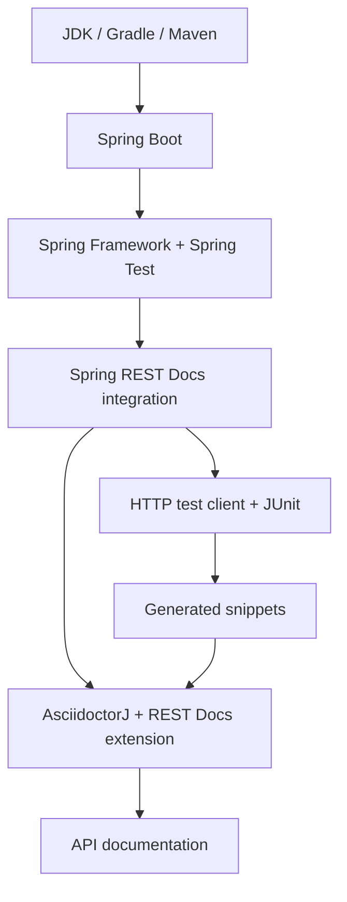

# Library Version Management and Compatibility

## Lesson Objectives

In the **Project Setup** chapter of the **SPRING_REST_DOCS** module, version management determines whether HTTP tests compile and run reliably, whether Spring REST Docs generates snippets properly, and whether Asciidoctor can compile documentation. The components involved include the JDK, Spring Boot, Spring Framework, Spring Test, JUnit, REST Docs integration modules, HTTP test clients, and documentation build tools.

After this lesson, you will be able to:

- Identify compatibility relationships among Spring Boot, Spring Framework, and Spring REST Docs.
- Distinguish managing **versions** from choosing **dependency scopes**.
- Use BOMs and dependency management to avoid version conflicts.
- Configure Gradle/Maven so REST Docs modules follow the same release train.
- Inspect the dependency graph and catch libraries unexpectedly upgraded or downgraded.
- Plan upgrades across REST Docs, JUnit, REST Assured, or Asciidoctor without breaking tests and documentation.

> **Principle:** Pick a compatible Spring generation first, then select the matching Spring REST Docs branch, and let a BOM manage dependencies within its scope. Do not upgrade individual libraries solely because a newer version exists.

## 1. Why Manage Versions as a Coordinated Set?

A REST Docs test passes through multiple library layers:

1. The JDK compiles and runs the application, Gradle/Maven, and tests.
2. Spring Boot manages dependencies and application configuration.
3. Spring Framework and Spring Test provide web and testing APIs.
4. JUnit executes the tests.
5. MockMvc, WebTestClient, or REST Assured sends requests.
6. The Spring REST Docs module captures requests/responses and generates snippets.
7. AsciidoctorJ together with the REST Docs extension compiles snippets into documentation.

If these layers drift across generations, failures can surface at several stages:

| Stage | Example Error |
| --- | --- |
| Dependency resolution | Artifact not found or no compatible version resolved |
| Compilation | Class/package not found; API changed or removed |
| Test execution | `NoSuchMethodError`, `NoClassDefFoundError`, JUnit engine failures |
| Snippet generation | Filter/extension inactive; no operation output generated |
| Doc compilation | AsciidoctorJ incompatible with extension, macros, or templates |
| Packaging / release | Test dependencies leak into runtime or doc artifact is missing |



Compatibility errors do not always originate from Spring REST Docs itself. Test compilation can fail because of JUnit APIs; HTML rendering errors can come from AsciidoctorJ or a Gradle plugin even after HTTP tests pass.

## 2. Generation-Level Compatibility Matrix

The following matrix provides a starting point for common Spring projects:

| Project Baseline | Spring Framework | Spring REST Docs | Minimum Java | Common Test Stack |
| --- | --- | --- | --- | --- |
| Spring Boot 2.x (legacy line) | Framework 5.x | Matching REST Docs 2.x | Depends on Boot/Framework release; many support Java 8/11 | JUnit 5 in a compatible setup; verify per release |
| Spring Boot 3.x | Framework 6.x | REST Docs 3.x | Java 17 | JUnit Jupiter 5; MockMvc/WebTestClient; REST Assured 5.2+ with REST Docs 3 |
| Spring Boot 4.x | Framework 7.x | REST Docs 4.x | Java 17 | JUnit 6; MockMvc/WebTestClient |

Key milestones:

- **The 3.0 branch** raised the baseline to Java 17 and Spring Framework 6. REST Assured integration requires REST Assured 5.2 or later.
- **The 4.0 branch** moved to Spring Framework 7 and JUnit 6, and requires AsciidoctorJ 3.0 when using Asciidoctor integration. REST Assured integration was removed from REST Docs 4.0.
- The MockMvc and WebTestClient artifact names retain their roles across branches, yet you must pick module versions matching the Framework/REST Docs generation.

**Do not treat this table as a license to mix arbitrary patch releases freely.** The Spring Boot BOM/parent is the preferred source of version management for Boot projects. For non-Boot projects, check the release notes and system requirements of the exact Spring REST Docs version you intend to install.

### 2.1. Choosing the REST Docs Branch by Boot Version

- Boot 3.x projects on Framework 6.x: choose REST Docs 3.x, typically with JUnit Jupiter 5 and the integration module matching your HTTP test client.
- Boot 4.x projects on Framework 7.x: choose REST Docs 4.x and JUnit 6; use MockMvc or WebTestClient. If tests rely on REST Docs 3's REST Assured integration, plan a migration to a supported documentation integration.
- Non-Boot projects: anchor on the Spring Framework version, then check Spring REST Docs, JUnit, and JDK requirements. Do not import Boot's BOM just to borrow version numbers if you are not using Boot's dependency stack.

### 2.2. Choosing by HTTP Test Client

| HTTP Test Client | Spring REST Docs Module | Version Notes |
| --- | --- | --- |
| MockMvc | `org.springframework.restdocs:spring-restdocs-mockmvc` | Use with Spring MVC; select REST Docs matching Framework |
| WebTestClient | `org.springframework.restdocs:spring-restdocs-webtestclient` | Fits WebFlux or suites already using WebTestClient |
| REST Assured | `org.springframework.restdocs:spring-restdocs-restassured` | Integration belongs to REST Docs 3.x; removed in REST Docs 4.0 |

REST Assured has its own coordinates `io.rest-assured:rest-assured`. When using the REST Docs 3.x integration, both REST Assured and the REST Docs bridge module are needed on the test classpath. The two dependencies serve different purposes and must be compatible with each other.

## 3. Distinguishing Version, BOM, and Scope

These three concepts are often confused:

| Concept | Answers the Question | Example |
| --- | --- | --- |
| **Version** | Which library version is used? | Spring REST Docs `4.0.x` |
| **BOM / dependency management** | What controls versions for a group of dependencies? | Spring Boot dependency management or Spring REST Docs BOM |
| **Scope / configuration** | On which classpath (compile/runtime/test/plugin) does it belong? | Gradle `testImplementation`, Maven `test` |

A BOM does not automatically make a dependency test-only. Example:

```groovy
dependencies {
    testImplementation 'org.springframework.restdocs:spring-restdocs-mockmvc'
}
```

The Spring Boot BOM may supply the artifact version, while `testImplementation` places the dependency on the test classpath. The two concerns are independent.

Similarly in Maven:

```xml
<dependency>
    <groupId>org.springframework.restdocs</groupId>
    <artifactId>spring-restdocs-mockmvc</artifactId>
    <scope>test</scope>
</dependency>
```

The parent/BOM manages the version; `scope` keeps the dependency restricted to test compilation and execution.

## 4. Using a BOM in Spring Boot Projects

### 4.1. Maven with the Spring Boot Parent

When using `spring-boot-starter-parent`, Spring Boot provides dependency management for managed libraries:

```xml
<parent>
    <groupId>org.springframework.boot</groupId>
    <artifactId>spring-boot-starter-parent</artifactId>
    <version>4.0.9</version>
    <relativePath/>
</parent>

<dependencies>
    <dependency>
        <groupId>org.springframework.boot</groupId>
        <artifactId>spring-boot-starter-webmvc</artifactId>
    </dependency>
    <dependency>
        <groupId>org.springframework.boot</groupId>
        <artifactId>spring-boot-starter-webmvc-test</artifactId>
        <scope>test</scope>
    </dependency>
    <dependency>
        <groupId>org.springframework.restdocs</groupId>
        <artifactId>spring-restdocs-mockmvc</artifactId>
        <scope>test</scope>
    </dependency>
</dependencies>
```

This example targets Boot 4; the Boot version is illustrative and should match the line chosen for your project. Do not specify a separate version on the REST Docs dependency if the BOM already manages that exact artifact. If an artifact is not in the managed list, Maven will require an explicit version or additional dependency management.

For Boot 3, use generation-3 starters such as `spring-boot-starter-web` and `spring-boot-starter-test`, and stay on REST Docs 3.x with Framework 6.x.

### 4.2. Maven Without the Boot Parent

You can import the Spring REST Docs BOM to manage REST Docs artifacts:

```xml
<dependencyManagement>
    <dependencies>
        <dependency>
            <groupId>org.springframework.restdocs</groupId>
            <artifactId>spring-restdocs-bom</artifactId>
            <version>4.0.2</version>
            <type>pom</type>
            <scope>import</scope>
        </dependency>
    </dependencies>
</dependencyManagement>
```

This example uses BOM `4.0.2` for REST Docs `4.0.x`. The REST Docs BOM manages only artifacts within its scope; it does not replace version management for Spring Framework, JUnit, Maven plugins, or other libraries. Non-Boot projects must still verify the full version set themselves.

### 4.3. Gradle with Spring Boot and Dependency Management Plugins

When using the Spring Boot plugin alongside the dependency management plugin, you can declare managed dependencies without repeating versions:

```groovy
plugins {
    id 'java'
    id 'org.springframework.boot' version '4.0.9'
    id 'io.spring.dependency-management' version '1.1.7'
}

dependencies {
    implementation 'org.springframework.boot:spring-boot-starter-webmvc'
    testImplementation 'org.springframework.boot:spring-boot-starter-webmvc-test'
    testImplementation 'org.springframework.restdocs:spring-restdocs-mockmvc'
}
```

If using Gradle's native platform/BOM instead of the dependency management plugin, import the platform explicitly:

```groovy
dependencies {
    implementation platform('org.springframework.boot:spring-boot-dependencies:4.0.9')
    implementation 'org.springframework.boot:spring-boot-starter-webmvc'
    testImplementation 'org.springframework.boot:spring-boot-starter-webmvc-test'
    testImplementation 'org.springframework.restdocs:spring-restdocs-mockmvc'
}
```

Avoid stacking multiple version-management mechanisms that solve the same job. Choose one clear mechanism and inspect the dependency graph after making changes.

## 5. Managing Versions Without Spring Boot

When using standalone Spring Framework, the project team is responsible for aligning:

- Spring Framework and Spring Test on the same release line.
- Spring REST Docs core and integration modules on the exact same version.
- A JDK meeting the minimum required by Framework/REST Docs.
- Compatible JUnit API, engine, and launcher versions.
- HTTP clients/adapters such as REST Assured if used.
- AsciidoctorJ and the REST Docs Asciidoctor extension.

Maven example using REST Docs 3.x:

```xml
<dependencyManagement>
    <dependencies>
        <dependency>
            <groupId>org.springframework</groupId>
            <artifactId>spring-framework-bom</artifactId>
            <version>6.2.0</version>
            <type>pom</type>
            <scope>import</scope>
        </dependency>
        <dependency>
            <groupId>org.springframework.restdocs</groupId>
            <artifactId>spring-restdocs-bom</artifactId>
            <version>3.0.4</version>
            <type>pom</type>
            <scope>import</scope>
        </dependency>
    </dependencies>
</dependencyManagement>
```

Versions in this example illustrate combining BOMs and are **not a recommendation for specific patch versions in new projects**. Substitute supported patch versions after checking system requirements and release notes. JUnit and REST Assured must also be managed separately if no other BOM manages them.

Do not declare only `spring-restdocs-core` expecting MockMvc/WebTestClient/REST Assured APIs to appear. You need the matching integration module, and all REST Docs modules from the same release must stay synchronized.

## 6. Synchronizing Spring REST Docs Modules

A typical setup uses only **one** HTTP test integration:

```groovy
dependencies {
    testImplementation 'org.springframework.restdocs:spring-restdocs-mockmvc'
}
```

If a project genuinely runs multiple independent test stacks, declare the corresponding integration modules, keeping them on the exact same version and restricted to the tests that need them:

```groovy
dependencies {
    testImplementation 'org.springframework.restdocs:spring-restdocs-mockmvc'
    testImplementation 'org.springframework.restdocs:spring-restdocs-webtestclient'
}
```

Do not add MockMvc, WebTestClient, and REST Assured all at once just to experiment if the project does not use them. For REST Assured, add `spring-restdocs-restassured` only on REST Docs 3.x and verify REST Assured version compatibility.

### 6.1. Checking Version Alignment

If a project accidentally resolves `spring-restdocs-core` `4.0.x` alongside `spring-restdocs-mockmvc` `3.0.x`, the classpath mixes two release trains. Align all REST Docs modules to the same version. Likewise, never mix Spring Test `6.x` with Spring Framework `7.x` simply because a resolver pulled in a newer version.

## 7. Managing JUnit and HTTP Clients

### 7.1. JUnit 5 and JUnit 6

Spring REST Docs 3.x is commonly used with JUnit Jupiter 5. Spring REST Docs 4.0 raises the requirement to JUnit 6. Never change only the `junit-jupiter-api` version while forgetting the engine and launcher.

With Gradle:

```groovy
dependencies {
    testImplementation 'org.springframework.boot:spring-boot-starter-test'
    testRuntimeOnly 'org.junit.platform:junit-platform-launcher'
}

tasks.named('test') {
    useJUnitPlatform()
}
```

When using Boot, let the BOM manage JUnit wherever possible. If managing JUnit manually, keep the API, engine, and launcher at compatible versions.

### 7.2. REST Assured

REST Assured versions independently from Spring REST Docs. For REST Docs 3.x, release notes specify REST Assured 5.2+ for that branch's integration. Do not automatically upgrade REST Assured to a new major version without verifying compatibility.

In REST Docs 4.0, the REST Assured integration module was removed. You can still use REST Assured as a standalone HTTP client for testing if desired, but you cannot import REST Docs 4.0's `RestAssuredRestDocumentation` integration API; choose another supported documentation approach.

## 8. Managing AsciidoctorJ and Gradle Plugins

AsciidoctorJ, the Asciidoctor Gradle plugin, and `spring-restdocs-asciidoctor` are three distinct components:

| Component | Role |
| --- | --- |
| `org.asciidoctor.jvm.convert` | Gradle plugin creating the compilation task |
| AsciidoctorJ | Engine processing AsciiDoc on the JVM |
| `spring-restdocs-asciidoctor` | Extension providing REST Docs attributes and macros |

REST Docs 4.0 requires AsciidoctorJ 3.0 when using Asciidoctor integration. Example:

```groovy
plugins {
    id 'org.asciidoctor.jvm.convert' version '4.0.5'
}

asciidoctorj {
    version = '3.0.0'
}

configurations {
    asciidoctorExt
}

dependencies {
    asciidoctorExt 'org.springframework.restdocs:spring-restdocs-asciidoctor:4.0.2'
}

tasks.named('asciidoctor') {
    configurations 'asciidoctorExt'
}
```

Plugin version `4.0.5`, engine `3.0.0`, and extension `4.0.2` belong to three separate artifacts. There is no rule that the Gradle plugin version must match the Spring REST Docs version. Choose each version from that component's own compatibility documentation.

For REST Docs 3.x, do not blindly copy REST Docs 4's AsciidoctorJ 3.0 setup. Check the engine and plugin requirements for the 3.x branch.

## 9. Inspecting the Dependency Graph Before Running Tests

### 9.1. Gradle

Inspect test runtime:

```bash
./gradlew dependencies --configuration testRuntimeClasspath
```

Inspect individual dependencies:

```bash
./gradlew dependencyInsight --dependency spring-restdocs-core --configuration testRuntimeClasspath
./gradlew dependencyInsight --dependency spring-restdocs-mockmvc --configuration testRuntimeClasspath
./gradlew dependencyInsight --dependency spring-test --configuration testRuntimeClasspath
./gradlew dependencyInsight --dependency junit-jupiter-api --configuration testRuntimeClasspath
```

Verify:

- All Spring REST Docs modules belong to the same release train.
- Spring Test matches the Spring Framework/Boot generation.
- JUnit API, engine, and launcher are compatible.
- REST Assured meets the integration module's requirement if used.
- Test-only modules do not appear unexpectedly on the application runtime classpath.

### 9.2. Maven

List the dependency tree:

```bash
./mvnw dependency:tree
```

Filter specifically for Spring REST Docs, Spring Framework, and JUnit:

```bash
./mvnw dependency:tree -Dincludes=org.springframework.restdocs,org.springframework,org.junit.jupiter
```

Inspect the effective POM:

```bash
./mvnw help:effective-pom
```

The effective POM reveals dependency versions inherited from parents/BOMs, plugin versions, and project overrides. Do not read only the raw `pom.xml` when dependencies may be managed by a parent.

## 10. Resolving Conflicts and Locking Versions

### 10.1. Why Does the Resolver Pick an Unexpected Version?

A transitive dependency may request a different version than what you declared directly. The final result depends on Gradle/Maven resolution rules, constraints, BOMs, and overrides. Therefore, reading one line in a build file is not enough; check **the final resolved version on the classpath**.

Best practices:

- Prefer the Spring Boot BOM or a matching BOM over pinning individual Spring modules manually.
- Avoid declaring separate versions for `spring-core`, `spring-test`, or `spring-webmvc` when Boot already manages them.
- Never force a REST Docs module from another release train as a quick fix for a compile error.
- Use dependency constraints/platforms when you genuinely must pin a version outside a BOM.
- After changes, run `dependencyInsight`/`dependency:tree` and execute tests.

### 10.2. Gradle Dependency Locking

For projects requiring reproducible builds, Gradle supports dependency locking. Enable it for the desired configurations:

```groovy
dependencyLocking {
    lockAllConfigurations()
}
```

Then record resolved versions according to your project's locking workflow. Lock files keep subsequent builds on identical versions until the team intentionally updates the lock state. Do not use locking to mask an incompatible dependency mix; verify tests before committing new locks.

### 10.3. Maven Enforcer and Convergence

The Maven Enforcer Plugin can catch non-convergent dependency versions or rule violations. The `dependencyConvergence` rule detects cases where the same artifact is requested at multiple conflicting versions. It is a detection tool; evaluate legitimate exclusions carefully rather than disabling the rule just to get a green build.

## 11. Safe Version Upgrade Workflow

When upgrading Spring Boot, Spring REST Docs, or related tools, proceed in order:

1. **Choose the target:** identify the target Boot/Framework/JDK and compatible REST Docs branch.
2. **Read release notes:** check breaking changes, Java/JUnit/Asciidoctor requirements, and removed modules.
3. **Update version management:** update the Boot parent/plugin/BOM or standalone BOM; avoid scattered overrides.
4. **Update test clients:** review MockMvc/WebTestClient/REST Assured, especially when moving from REST Docs 3 to 4.
5. **Update Asciidoctor:** synchronize the extension, engine, and Gradle/Maven plugins.
6. **Inspect the dependency graph:** confirm no wrong-generation modules or unexpected overrides remain.
7. **Run HTTP tests:** verify assertions pass and fresh snippets are generated.
8. **Compile docs:** run Asciidoctor/Markdown and inspect output artifacts.
9. **Run CI/packaging build:** verify the runtime artifact contains no unintended test dependencies.

### 11.1. Example: Migrating from REST Docs 3 to 4

| Area | Before: REST Docs 3 | After: REST Docs 4 |
| --- | --- | --- |
| Typical Spring baseline | Boot 3 / Framework 6 | Boot 4 / Framework 7 |
| Java | 17+ | 17+ |
| JUnit | JUnit 5 | JUnit 6 |
| REST Assured integration | Available, REST Assured 5.2+ | Removed |
| MockMvc | 3.x MockMvc module | 4.x MockMvc module |
| WebTestClient | 3.x WebTestClient module | 4.x WebTestClient module |
| AsciidoctorJ | Check 3.x branch requirements | AsciidoctorJ 3.0 |

This is a framework-generation upgrade, not just bumping a REST Docs version number. Spring Boot test packages can also change; check annotation imports such as `AutoConfigureRestDocs`, `WebMvcTest`, and `WebFluxTest` for the new Boot version.

## 12. Diagnosing Common Compatibility Errors

| Symptom | Likely Cause to Check | Resolution |
| --- | --- | --- |
| `UnsupportedClassVersionError` | Runtime JDK is older than library bytecode level | Check JDK in IDE, Gradle/Maven, and CI |
| `NoSuchMethodError` in Spring Test | Spring Test and Spring Framework version mismatch or changed API | Inspect dependency graph, use BOM, remove bad overrides |
| `NoClassDefFoundError` for REST Docs | Missing integration module or dependency in wrong scope | Add MockMvc/WebTestClient module with proper test scope |
| REST Docs core and MockMvc module have different versions | Mixed release trains | Align all REST Docs modules to the same version |
| `spring-restdocs-restassured` fails to resolve on 4.x | REST Assured integration was removed | Switch to MockMvc/WebTestClient or another docs approach |
| Test compile cannot find JUnit API | JUnit API missing from test compile classpath or wrong version | Check starter/BOM and test dependencies |
| Test engine does not run | Incompatible or missing JUnit engine/launcher | Check `testRuntimeClasspath` and JUnit Platform |
| Asciidoctor macro unrecognized | Wrong extension version or missing from task classpath | Align extension and AsciidoctorJ |
| Asciidoctor class/method error after upgrade | Engine or Gradle plugin incompatible with extension | Check AsciidoctorJ requirements for your REST Docs branch |
| Build passes locally but fails in CI | Different JDK, Gradle wrapper, Maven, or lock state | Standardize toolchain and dependency resolution |
| Runtime JAR contains JUnit/REST Docs test modules | Dependency in `implementation`/`compile` instead of test scope | Move to `testImplementation` or Maven `test`; inspect artifact |

Always trace the deepest root cause in the stack trace and compare against resolved dependencies. Never pin an arbitrary version just to silence the first error without understanding the underlying conflict.

## 13. Pre-Completion Checklist for Project Setup

- [ ] Spring Boot and Spring Framework belong to the same generation.
- [ ] JDK on developer machines, IDE, build tool, and CI meets the minimum requirement.
- [ ] Selected Spring REST Docs branch is compatible with Spring Framework.
- [ ] All REST Docs modules share the same release train.
- [ ] HTTP test client matches the web stack and is supported by a REST Docs module.
- [ ] If using REST Assured, confirmed the project is on REST Docs 3 and the client meets minimum version rules.
- [ ] JUnit API, engine, and launcher are compatible with the Spring/REST Docs branch.
- [ ] AsciidoctorJ, the REST Docs Asciidoctor extension, and the Gradle/Maven plugin were verified separately.
- [ ] BOM/dependency management is used intentionally; no unexplained version overrides remain.
- [ ] Dependency graph checked on both test classpath and runtime classpath.
- [ ] HTTP tests generate snippets and the compilation task builds HTML/Markdown.
- [ ] CI uses the same JDK, wrapper, dependency locks, and tasks as the verified setup.

## 14. Practice Exercise

1. Pick a Spring Boot 3 or 4 project and record its JDK, Boot, Framework, REST Docs, JUnit, and HTTP test client versions.
2. Inspect the dependency graph using Gradle `dependencyInsight` or Maven `dependency:tree`.
3. Cross-check against the compatibility matrix; verify all REST Docs modules belong to the same release train.
4. Create a snippet-generating HTTP test and run Asciidoctor to build documentation.
5. On a test branch, temporarily override a single Spring Test dependency to a version from another generation. Observe the dependency graph and test errors; then restore the consistent BOM.
6. Draft a migration plan from REST Docs 3 to REST Docs 4, listing changes to JUnit, REST Assured, AsciidoctorJ, and Boot test packages.

**Self-Assessment Questions**

1. Does a BOM manage dependency scope?
2. Why should all `spring-restdocs-*` modules in a project belong to the same release train?
3. Why cannot you choose REST Docs 4 just by bumping the version when the application still uses Framework 6?
4. What changes for REST Assured when upgrading from REST Docs 3 to 4?
5. Why does the Asciidoctor Gradle plugin version not have to equal the Spring REST Docs version?
6. What problems do `dependencyInsight` and `dependency:tree` help uncover?
7. Does dependency locking replace compatibility verification?

## Official References

- [Spring REST Docs — System Requirements](https://docs.spring.io/spring-restdocs/system-requirements.html): JDK and Spring Framework requirements for the current branch.
- [Spring REST Docs — Getting Started](https://docs.spring.io/spring-restdocs/tutorial/getting-started/index.html): integration modules, build setup, and Asciidoctor.
- [Spring REST Docs 3.0 — Release Notes](https://github.com/spring-projects/spring-restdocs/wiki/Spring-REST-Docs-3.0-Release-Notes): Java 17, Framework 6, and REST Assured.
- [Spring REST Docs 4.0 — Release Notes](https://github.com/spring-projects/spring-restdocs/wiki/Spring-REST-Docs-4.0-Release-Notes): Framework 7, JUnit 6, AsciidoctorJ 3, and removal of REST Assured integration.
- [Spring Boot — Dependency Versions](https://docs.spring.io/spring-boot/appendix/dependency-versions/index.html): dependency versions managed by Spring Boot.
- [Gradle — Platforms](https://docs.gradle.org/current/userguide/platforms.html): using BOMs/platforms and dependency constraints.
- [Gradle — Dependency Locking](https://docs.gradle.org/current/userguide/dependency_locking.html): locking dependencies for reproducible builds.
- [Gradle — Viewing and Debugging Dependencies](https://docs.gradle.org/current/userguide/viewing_debugging_dependencies.html): dependency reports and `dependencyInsight`.
- [Maven — Dependency Mechanism](https://maven.apache.org/guides/introduction/introduction-to-dependency-mechanism.html): dependency management, BOM, and scope.
- [Maven Enforcer Plugin](https://maven.apache.org/enforcer/maven-enforcer-plugin/): dependency governance and convergence rules.

Good version management keeps the entire **HTTP tests → REST Docs snippets → Asciidoctor/Markdown → CI artifacts** pipeline running on a consistent library set. Use BOMs within their intended scope, inspect the dependency graph after every upgrade, and prove the setup with passing tests and rendered documentation before releasing.
