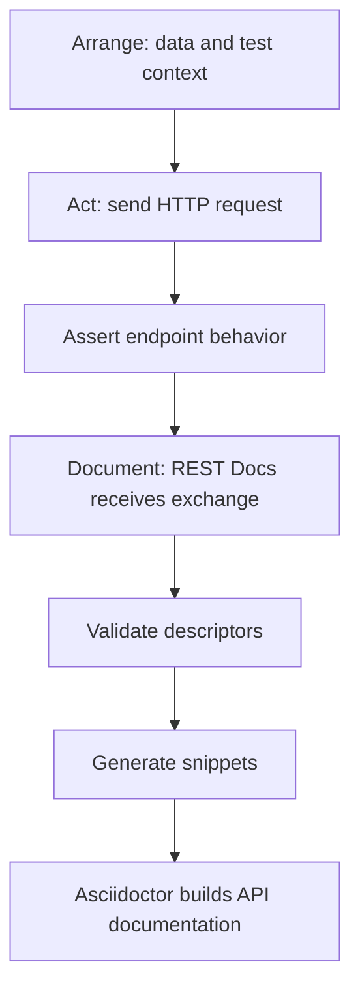

# Documentation Tests Must Also Verify Endpoint Behavior

## Learning Objectives

In the **SPRING_REST_DOCS** module, a documentation test has two related but distinct responsibilities. The test executes an HTTP exchange and provides data for Spring REST Docs to generate snippets; at the same time, it must verify that the endpoint actually behaves according to its contract. If a test only invokes the endpoint and records the request/response, documentation can be generated from broken behavior.

For example, a product creation endpoint might return HTTP 201 and a JSON body. The test needs to verify the status, key fields, and the `Location` header according to the contract. Only then does REST Docs use the same exchange to generate `http-request`, `http-response`, and payload snippets.

After this lesson, you will be able to:

- Explain why generating snippets is not equivalent to verifying endpoint behavior.
- Write documentation tests with assertions on status, headers, body, and errors.
- Combine business assertions with Spring REST Docs descriptors.
- Apply this testing approach to MockMvc, WebTestClient, and REST Assured.
- Create tests for success, validation error, not found, and unauthorized/forbidden cases.
- Keep tests independent with deterministic data and avoid overly brittle assertions.
- Diagnose cases where snippets are generated but the test still lacks sufficient protection for the API contract.

## 1. Two Responsibilities in One Documentation Test

A documentation test needs to answer two groups of questions:

| Responsibility | Questions to answer | Mechanism |
| --- | --- | --- |
| Verify the endpoint | Is the HTTP status correct? Do the headers and body match the contract? Are business rules enforced? | Test framework assertions |
| Generate and verify documentation | Are the request/response recorded? Are fields, parameters, headers, and cookies fully described and matching the exchange? | Spring REST Docs and descriptors |

Example flow:



Behavior assertions must be present before the test is considered passing. REST Docs does not decide on its own which status code is right for the business logic, which product is created, or which user is allowed access. It records the exchange and validates the descriptors provided by the test.

## 2. Why Calling Only document(...) Is Not Enough

Insufficient example:

```java
this.mockMvc.perform(post("/api/products")
        .contentType(MediaType.APPLICATION_JSON)
        .content("""
                {
                  "name": "Keyboard",
                  "price": 129.90
                }
                """))
    .andDo(document("products-create"));
```

This test may record a response, but it does not assert that the response is correct. If the endpoint accidentally returns 500, 200 instead of 201, or an error body, the test can still reach the snippet-generation step if there is no assertion causing it to fail.

Version with behavior verification:

```java
this.mockMvc.perform(post("/api/products")
        .contentType(MediaType.APPLICATION_JSON)
        .content("""
                {
                  "name": "Keyboard",
                  "price": 129.90
                }
                """))
    .andExpect(status().isCreated())
    .andExpect(header().exists(HttpHeaders.LOCATION))
    .andExpect(jsonPath("$.id").isNumber())
    .andExpect(jsonPath("$.name").value("Keyboard"))
    .andDo(document("products-create"));
```

Here:

- status().isCreated() verifies that the endpoint returns HTTP 201.
- header().exists(...) verifies that the response includes Location.
- jsonPath checks the data in the body.
- document(...) records the exchange and triggers snippet generation.

If an assertion fails, the test fails and is not treated as a verified documentation source.

## 3. Verifying Status Codes

The status code is a fundamental part of the HTTP contract. Verify the exact status for each action:

| Action | Common status | What to verify |
| --- | --- | --- |
| Resource created successfully | 201 Created | Resource is created; may include Location or body per API |
| Resource read successfully | 200 OK | Resource returns the expected data |
| Deleted successfully with no body | 204 No Content | No response body per contract |
| Invalid request | 400 Bad Request or API-defined status | Validation error has the expected structure |
| Not found | 404 Not Found | Correct error code and message |
| Unauthenticated | 401 Unauthorized | Authentication policy is enforced |
| Insufficient permissions | 403 Forbidden | Access permissions are checked properly |

These are common patterns, not mandatory rules for every API. A project must determine the status codes according to its actual contract.

MockMvc:

```java
.andExpect(status().isCreated())
```

WebTestClient:

```java
.expectStatus().isCreated()
```

REST Assured:

```java
given()
    .contentType(ContentType.JSON)
    .body(request)
    .when()
    .post("/api/products")
    .then()
    .statusCode(201);
```

Do not use generic status assertions like `is2xxSuccessful()` if each endpoint has a specific status in the contract that the test needs to protect.

## 4. Verifying Response Headers

The right status is still not enough if an important header is missing or wrong.

For example, a product creation endpoint requires Location:

```java
this.mockMvc.perform(post("/api/products")
        .contentType(MediaType.APPLICATION_JSON)
        .content(requestJson))
    .andExpect(status().isCreated())
    .andExpect(header().exists(HttpHeaders.LOCATION))
    .andExpect(header().string(
        HttpHeaders.CONTENT_TYPE,
        MediaType.APPLICATION_JSON_VALUE
    ))
    .andDo(document("products-create"));
```

With WebTestClient:

```java
this.webTestClient.post()
    .uri("/api/products")
    .contentType(MediaType.APPLICATION_JSON)
    .bodyValue(request)
    .exchange()
    .expectStatus().isCreated()
    .expectHeader().contentTypeCompatibleWith(MediaType.APPLICATION_JSON)
    .expectHeader().exists(HttpHeaders.LOCATION)
    .expectBody()
    .consumeWith(document("products-create"));
```

Choose headers that truly matter to clients. Headers such as `Cache-Control`, `ETag`, `Location`, `Content-Type`, `Retry-After`, or `Set-Cookie` need assertions when they are part of the endpoint contract.

If you want to document headers, add `requestHeaders`/`responseHeaders` or cookie snippets. Assertions and descriptors serve different purposes: assertions verify that values are correct; descriptors explain header semantics to readers.

## 5. Verifying the Response Body

### 5.1. Verifying Meaningful Fields

JSON response:

```json
{
  "id": 501,
  "name": "Keyboard",
  "price": 129.90,
  "status": "ACTIVE"
}
```

The test should check the fields representing the contract:

```java
.andExpect(jsonPath("$.id").isNumber())
.andExpect(jsonPath("$.name").value("Keyboard"))
.andExpect(jsonPath("$.price").value(129.90))
.andExpect(jsonPath("$.status").value("ACTIVE"))
```

Then declare `responseFields`:

```java
responseFields(
    fieldWithPath("id").description("Server-generated product ID."),
    fieldWithPath("name").description("Product name."),
    fieldWithPath("price").description("Selling price."),
    fieldWithPath("status").description("Product status.")
)
```

These two verification layers complement each other:

- `jsonPath` verifies whether the actual values are correct.
- `responseFields` verifies that the payload structure is fully documented and that the field paths in descriptors exist.

Correct descriptors do not guarantee correct values. For example, `responseFields` might describe `status` as "Product status" even if the endpoint returns `status` `"DELETED"` instead of `"ACTIVE"`. Assertions must verify that.

### 5.2. Verifying an Empty Body

A DELETE endpoint returning 204:

```java
this.mockMvc.perform(delete("/api/products/{id}", 501))
    .andExpect(status().isNoContent())
    .andExpect(content().string(""))
    .andDo(document("products-delete"));
```

Do not declare `responseFields` if the response has no body. You can document the appropriate status and headers instead.

### 5.3. Do Not Assert Every Random Detail

Avoid asserting values that vary by time or environment if they are not part of the contract:

- Exact timestamps generated at test execution time.
- Auto-generated IDs that are unstable across runs.
- Collection ordering not guaranteed by the API.
- Random trace IDs or request IDs.

Instead, verify types, presence, format, or necessary relationships. If a specific value is part of the contract, standardize the `Clock`/ID generator or fixture to make the test deterministic.

## 6. Verifying Request and Validation Behavior

A documentation test does not only prove that a valid payload is accepted. It should also protect how the endpoint handles invalid payloads in operations that document errors.

Example DTO:

```java
public record CreateProductRequest(
        @NotBlank
        @Size(max = 80)
        String name,
        @NotNull
        @Positive
        BigDecimal price
) {
}
```

Controller enabling validation:

```java
@PostMapping
ResponseEntity<ProductResponse> create(
        @Valid @RequestBody CreateProductRequest request) {
    ProductResponse created = productService.create(request);
    return ResponseEntity.status(HttpStatus.CREATED).body(created);
}
```

Test for an invalid request:

```java
this.mockMvc.perform(post("/api/products")
        .contentType(MediaType.APPLICATION_JSON)
        .content("""
                {
                  "name": " ",
                  "price": -1
                }
                """))
    .andExpect(status().isBadRequest())
    .andExpect(jsonPath("$.code").value("VALIDATION_ERROR"))
    .andExpect(jsonPath("$.violations").isArray())
    .andDo(document("products-create-invalid",
        responseFields(
            fieldWithPath("code").description("Error code."),
            fieldWithPath("message").description("Error message."),
            fieldWithPath("violations").description("List of validation errors.")
        )));
```

Error field paths should be described in detail according to the actual schema, for example `violations[].field` and `violations[].message`. The snippet above illustrates the general structure; descriptors must match the JSON body the endpoint actually returns.

A validation test does two things:

1. Verifies that invalid requests are rejected and fail according to the contract.
2. Uses REST Docs to generate snippets for the error response.

Merely having `@NotBlank` on the DTO does not prove the controller has enabled validation. HTTP assertions are what verify endpoint behavior.

## 7. Verifying Business and Security Errors

There should be dedicated documentation tests for important error scenarios:

| Scenario | Behavior assertion | Documentation to describe |
| --- | --- | --- |
| Resource does not exist | Status 404 and error code | Error response |
| Missing authentication | Status 401 and header/challenge if present | Error response, WWW-Authenticate when part of the contract |
| Insufficient permissions | Status 403 or API-defined status | Error response |
| Conflict | Status 409 and domain error code | Error response |
| Rate limit | API-defined status, Retry-After if present | Error response and header |
| Validation failure | Error status and violation list | Error payload, field paths |

Example:

```java
this.mockMvc.perform(get("/api/admin/reports")
        .header(HttpHeaders.AUTHORIZATION, "Bearer invalid-token"))
    .andExpect(status().isUnauthorized())
    .andExpect(jsonPath("$.code").value("UNAUTHENTICATED"))
    .andDo(document("admin-reports-unauthenticated",
        responseFields(
            fieldWithPath("code").description("Authentication error code."),
            fieldWithPath("message").description("Error message.")
        )));
```

Do not use real tokens in tests or snippets. Authentication fixtures should be dummy values without access to any real system.

## 8. Combining Assertions and REST Docs with MockMvc

MockMvc supports assertions through `ResultActions` before calling `document`:

```java
this.mockMvc.perform(post("/api/products")
        .contentType(MediaType.APPLICATION_JSON)
        .accept(MediaType.APPLICATION_JSON)
        .content("""
                {
                  "name": "Keyboard",
                  "price": 129.90
                }
                """))
    .andExpect(status().isCreated())
    .andExpect(content().contentTypeCompatibleWith(
            MediaType.APPLICATION_JSON))
    .andExpect(jsonPath("$.id").isNumber())
    .andExpect(jsonPath("$.name").value("Keyboard"))
    .andExpect(jsonPath("$.status").value("ACTIVE"))
    .andDo(document("products-create",
        requestFields(
            fieldWithPath("name").description("Product name."),
            fieldWithPath("price").description("Selling price.")
        ),
        responseFields(
            fieldWithPath("id").description("Product ID."),
            fieldWithPath("name").description("Product name."),
            fieldWithPath("price").description("Selling price."),
            fieldWithPath("status").description("Status.")
        )));
```

This ordering makes it clear that the test only records documentation after expectations have been checked. If you use a custom `ResultHandler` or test helper structure, you must still ensure documentation is not treated as successful when behavior assertions fail.

## 9. Combining Assertions and REST Docs with WebTestClient

WebTestClient supports expecting status, headers, and body:

```java
this.webTestClient.post()
    .uri("/api/products")
    .contentType(MediaType.APPLICATION_JSON)
    .accept(MediaType.APPLICATION_JSON)
    .bodyValue(Map.of(
            "name", "Keyboard",
            "price", 129.90
    ))
    .exchange()
    .expectStatus().isCreated()
    .expectHeader().contentTypeCompatibleWith(MediaType.APPLICATION_JSON)
    .expectBody()
    .jsonPath("$.name").isEqualTo("Keyboard")
    .jsonPath("$.status").isEqualTo("ACTIVE")
    .consumeWith(document("products-create",
        responseFields(
            fieldWithPath("id").description("Product ID."),
            fieldWithPath("name").description("Product name."),
            fieldWithPath("price").description("Selling price."),
            fieldWithPath("status").description("Status.")
        )));
```

`expectBody` can use JSONPath or appropriate body assertions. Choose checks that are meaningful for the endpoint and keep descriptors matching the response.

## 10. Combining Assertions and REST Docs with REST Assured

REST Assured typically structures checks using `given/when/then`:

```java
given(this.spec)
    .contentType(ContentType.JSON)
    .body("""
            {
              "name": "Keyboard",
              "price": 129.90
            }
            """)
    .filter(document("products-create",
        requestFields(
            fieldWithPath("name").description("Product name."),
            fieldWithPath("price").description("Selling price.")
        )))
    .when()
    .post("/api/products")
    .then()
    .statusCode(201)
    .contentType(ContentType.JSON)
    .body("name", equalTo("Keyboard"))
    .body("status", equalTo("ACTIVE"));
```

With REST Assured, `filter(document(...))` triggers snippet recording; `then()` contains the behavior assertions. Verify the order of filters and assertions according to your project's test configuration, and use a REST Docs module version compatible with REST Assured. REST Assured integration belongs to REST Docs branches that support it; do not assume every major REST Docs version provides this adapter.

## 11. Strict Descriptors Are Also a Contract Verification Layer

When using `requestFields`/`responseFields` (non-relaxed), REST Docs checks field descriptors against the payload:

- A newly appearing field without a descriptor can cause the test to fail.
- A descriptor pointing to a field absent from the payload can cause the test to fail.
- `optional()` allows a documented field to be absent.
- `ignored()` allows a field to be handled without appearing in the table.

This is **documentation structure-level** verification. It complements **behavior-level** assertions.

Example:

```java
.andExpect(jsonPath("$.status").value("ACTIVE"))
.andDo(document("products-get",
    responseFields(
        fieldWithPath("id").description("Product ID."),
        fieldWithPath("name").description("Product name."),
        fieldWithPath("status").description("Product status.")
    )));
```

If `status` is removed from the response, the JSONPath assertion will fail. If the endpoint adds an `archived` field not yet handled by descriptors, REST Docs strict payload validation can fail. These two signals detect two different kinds of changes.

Relaxed mode is useful when intentionally documenting only part of a payload, but it should not replace strict mode by default when the goal is keeping documentation synchronized with the schema.

## 12. Deterministic and Repeatable Test Data

Documentation tests produce artifacts that are committed or published, so results need to be stable across runs.

### 12.1. Fixed Test Data

- Use fixtures with clear and meaningful values.
- Use a test database or mock repository appropriate for the test's purpose.
- Clean up state before/after tests if data is persisted.
- Do not depend on test execution order.
- Use fixed IDs or assert IDs by type/constraint rather than random values if the exact ID is not part of the contract.

### 12.2. Time and Identifiers

If the response contains timestamps:

- Use a controllable `Clock` to fix time when timestamps need exact verification.
- If only format verification is needed, check the format or parse into a time object instead of comparing dynamic strings.
- Do not include timestamps that change on every build in documentation unless necessary.

For UUIDs, trace IDs, or session IDs:

- Use dummy values or replaceable dependencies in tests.
- Do not use real tokens from external environments.
- Do not let random IDs become operation IDs or snippet directory names.

### 12.3. Tests Independent of One Another

Test A should not have to run before Test B for snippets to be generated or for valid data to exist. Each documentation test should prepare its own preconditions and only produce output for the operations it owns.

If multiple tests write to the same operation directory, snippet contents may be overwritten or depend on execution order. Use distinct operation IDs for scenarios with different requests/responses.

## 13. Which Layer to Test: Slice, Integration, or End-to-End?

Choose the test scope appropriate for what needs to be proven:

| Test type | What it verifies | When appropriate |
| --- | --- | --- |
| Web slice with MockMvc/WebTestClient | Mapping, validation, serialization, controller advice, and web layer with test configuration | Documenting endpoints at the web layer |
| Integration test | Integration of controller, service, repository, security, and test database | Contract depends on multiple components |
| End-to-end test | Flows across multiple processes/services or near-production environments | A few critical flows requiring cross-system proof |

Not every operation needs an end-to-end test. A web slice test with thorough assertions can be a good documentation test source when out-of-scope dependencies are intentionally replaced. However, if the documentation claims behavior depending on a database, security filter, or message broker, the test must cover the component that actually determines that behavior.

## 14. Common Anti-Patterns

| Anti-pattern | Risk | How to improve |
| --- | --- | --- |
| Only calling document(...) | Snippets may be generated even if the endpoint returns wrong status/body | Add behavior assertions before documenting |
| Only asserting 2xx status | Fails to detect wrong body, missing fields, or wrong headers | Verify body/headers according to the contract |
| Only declaring field descriptors | Describes structure but does not verify business values | Add JSONPath/body assertions |
| Always using relaxed descriptors | New fields can slip through without review | Use strict mode when schema coverage is needed |
| Using production data | Leaks cookies, tokens, emails, or personal data into snippets | Use dummy fixtures |
| Relying on test order | Unstable results when running in parallel or in CI | Have each test prepare its own state |
| Asserting random timestamps/UUIDs with fixed strings | Flaky tests | Fix Clock/IDs or verify format |
| Reusing the same operation ID for different responses | Snippets can be overwritten | Separate operation IDs |
| Ignoring error responses | Documentation only covers happy paths | Document validation, not-found, and auth errors |
| Running tests only when Asciidoctor runs | Hard to tell whether a failure is an assertion or authoring issue | Run snippet-generating tests separately, then run the docs task |

## 15. Hands-On Exercise

1. Create a `POST /api/products` endpoint accepting `name` and `price`.
2. Write a MockMvc documentation test asserting status 201, `Content-Type`, `Location`, and key response fields.
3. Add `requestFields` and `responseFields` to validate the payload structure.
4. Create a validation error test using operation ID `products-create-invalid`; assert status and error code before documenting the response.
5. Create a GET test for a non-existent resource; assert status 404 and the error response schema.
6. Create an unauthorized test; assert status 401 and document the authentication error without using real tokens.
7. Fix fixtures or `Clock` so running the tests repeatedly produces stable snippet output.
8. Try removing a body assertion in an experimental branch and making the endpoint return a wrong field; observe why descriptors do not replace value assertions.

**Self-Assessment Questions**

1. Why does calling `document(...)` not prove that an endpoint works correctly?
2. Which parts of the contract do status, header, and body assertions protect?
3. How do field descriptors differ from JSONPath assertions?
4. When are documentation tests needed for error responses?
5. Why can a test using `relaxedResponseFields` miss schema drift?
6. When is a web slice test sufficient as a documentation source, and when is an integration test needed?
7. How can you keep timestamps, UUIDs, and fixtures stable?
8. Why should tests not depend on execution order or share an operation ID with differing outputs?

## Official References

- [Spring REST Docs — Getting Started](https://docs.spring.io/spring-restdocs/tutorial/getting-started/index.html): executing HTTP tests and generating snippets.
- [Spring REST Docs — Documenting Your API](https://docs.spring.io/spring-restdocs/reference/documenting-your-api.html): combining tests, operations, and snippets.
- [Spring Framework — MockMvc](https://docs.spring.io/spring-framework/reference/testing/mockmvc.html): executing and asserting requests/responses with MockMvc.
- [Spring Framework — WebTestClient](https://docs.spring.io/spring-framework/reference/testing/webtestclient.html): verifying HTTP exchanges with WebTestClient.
- [Spring REST Docs — Request and Response Fields](https://docs.spring.io/spring-restdocs/reference/documenting-your-api/request-response-payloads.html): validating field descriptors and payloads.
- [REST Assured](https://rest-assured.io/): given/when/then API and response assertions.

**Practical Takeaway:** A reliable documentation test must prove that the endpoint returns the expected status, headers, and body according to the contract, and then use the same exchange to generate snippets. Behavior assertions check values and business rules; REST Docs checks descriptors and produces documentation. Combine both, use deterministic fixtures, and separate operation IDs for different scenarios so snippets are both structurally accurate and reflect a verified endpoint.
