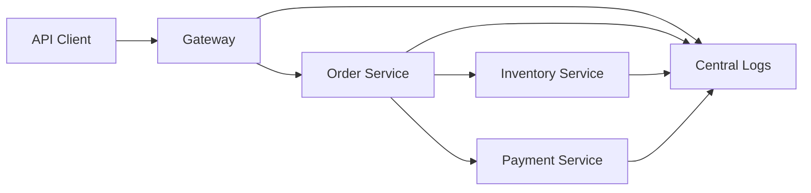

# Correlation ID for Error Tracing

## 1. Why Do Error Responses Need a Correlation ID?

In the **SPRING_REST_DOCS** module, Spring REST Docs generates REST API documentation from HTTP tests using MockMvc, WebTestClient, or REST Assured. Documentation needs to explain how clients report errors and how operations teams locate the corresponding request in logs and traces.

A correlation ID is a value that identifies a request or related processing flow. The client may provide an ID, the gateway/application may generate one, and the response returns the ID for support lookups. Documentation should clearly state which header is used, whether the ID is echoed or newly generated, whether a corresponding field exists in the body, and whether the ID is propagated across service boundaries.

A correlation ID is not an access token or authentication credential. Use opaque values and avoid embedding usernames, hostnames, emails, or sensitive data.

## 2. Distinguishing Request ID, Correlation ID, and Trace ID

| Concept | Purpose | Scope |
| --- | --- | --- |
| Request ID | Identifies a single HTTP request | Usually one request/response |
| Correlation ID | Links logs/events belonging to the same workflow | Can span multiple requests/services |
| Trace ID | Identifies a distributed trace | A trace consists of multiple spans |
| Span ID | Identifies a unit of work | A specific span |

A system may use the same value for request ID and correlation ID by its own convention. W3C Trace Context uses traceparent to propagate trace context with separate trace ID and span ID. Do not rename or reinterpret traceparent as a custom correlation ID.

Common header examples:
- X-Request-Id: request ID generated by the gateway/application.
- X-Correlation-Id: workflow correlation ID.
- traceparent: context propagation per W3C Trace Context.

If the API supports multiple ID types, describe the semantics of each and the relationship between them.

## 3. Defining a Contract for Correlation IDs

A contract may specify:

1. Clients are permitted to send X-Request-Id.
2. If missing, the gateway or application generates a new ID.
3. The response echoes the accepted ID in the X-Request-Id header.
4. The error body may include the same ID in the correlationId field.
5. Server logs record the same ID for support queries.

Example request:

```http
GET /api/orders/ORD-42 HTTP/1.1
Host: api.example.com
X-Request-Id: req-demo-7f31
Accept: application/json
```

Example error response:

```http
HTTP/1.1 404 Not Found
Content-Type: application/problem+json
X-Request-Id: req-demo-7f31
```

Body:

```json
{
  "type": "https://api.example.com/problems/order-not-found",
  "title": "Order not found",
  "status": 404,
  "detail": "Order ORD-42 was not found.",
  "code": "ORDER_NOT_FOUND",
  "correlationId": "req-demo-7f31"
}
```

This is an example convention, not default behavior of Spring REST Docs or Spring MVC. The application needs a filter/interceptor or gateway policy to generate, validate, propagate, and echo the ID.

## 4. Documenting Correlation ID in Response Headers

Spring REST Docs uses responseHeaders(...) to describe headers:

```java
.andDo(document("orders-get-not-found",
    responseHeaders(
        headerWithName("Content-Type")
            .description("Media type of the error response"),
        headerWithName("X-Request-Id")
            .description("ID used to look up the request in support logs")
    )
))
```

If a header may be absent according to the contract, mark it optional:

```java
headerWithName("X-Request-Id")
    .optional()
    .description("Trace ID if provided")
```

Do not mark it optional just to make tests pass. If middleware guarantees the ID is always returned, tests should assert the header as required and the descriptor should not be optional.

responseHeaders(...) generates a separate snippet, typically response-headers.adoc. http-response.adoc displays the entire response; response-headers.adoc describes the meaning of selected headers.

## 5. Documenting Correlation ID in the Error Payload

If the error body also contains correlationId, document the field with responseFields(...):

```java
responseFields(
    fieldWithPath("type").description("URI identifying the problem type"),
    fieldWithPath("title").description("Error title"),
    fieldWithPath("status").description("HTTP status"),
    fieldWithPath("detail").description("Error details for the client"),
    fieldWithPath("code").description("Stable error code"),
    fieldWithPath("correlationId")
        .description("ID used to correlate logs and traces for the request")
)
```

If the field only exists on certain error types, use optional in accordance with the contract. If the ID only lives in the response header, do not add a fake field to the body just for convenience.

When the ID appears in both header and body, verify that the two values match. If they differ, clients will not know which ID to give support.

## 6. Verifying Consistency Between Request, Response, and Error Body

A test should verify the underlying HTTP exchange:

```java
mockMvc.perform(get("/api/orders/ORD-42")
        .header("X-Request-Id", "req-test-42")
        .accept(MediaType.APPLICATION_PROBLEM_JSON))
    .andExpect(status().isNotFound())
    .andExpect(header().string("X-Request-Id", "req-test-42"))
    .andExpect(jsonPath("$.correlationId").value("req-test-42"))
    .andDo(document("orders-get-not-found",
        responseHeaders(
            headerWithName("X-Request-Id")
                .description("Request trace ID")
        ),
        responseFields(
            fieldWithPath("type").description("Problem type URI"),
            fieldWithPath("title").description("Error title"),
            fieldWithPath("status").description("HTTP status"),
            fieldWithPath("detail").description("Error details"),
            fieldWithPath("code").description("Error code"),
            fieldWithPath("correlationId").description("Trace ID")
        )
    ));
```

This example assumes the application has a filter/interceptor placing the ID into both the response and the error body. If the contract only returns the header, omit the body assertion/descriptor. If the server generates an ID when the client does not send one, test that case separately and verify the ID is non-empty and properly formatted.

Do not merely check that the header exists. Compare the header/body value against the client-supplied ID or server-generated ID.

## 7. Illustrative Filter to Generate and Return Request ID

This simple filter reads the ID from the request, generates a new one if missing, and sets it on the response. A production implementation must validate length/characters and decide whether to trust client-supplied values.

```java
import java.io.IOException;
import java.util.UUID;
import jakarta.servlet.Filter;
import jakarta.servlet.FilterChain;
import jakarta.servlet.ServletException;
import jakarta.servlet.ServletRequest;
import jakarta.servlet.ServletResponse;
import jakarta.servlet.http.HttpServletRequest;
import jakarta.servlet.http.HttpServletResponse;

class RequestIdFilter implements Filter {
    static final String HEADER = "X-Request-Id";

    @Override
    public void doFilter(ServletRequest request, ServletResponse response,
                         FilterChain chain)
            throws IOException, ServletException {
        HttpServletRequest httpRequest = (HttpServletRequest) request;
        HttpServletResponse httpResponse = (HttpServletResponse) response;

        String requestId = httpRequest.getHeader(HEADER);
        if (requestId == null || requestId.isBlank()) {
            requestId = "req-" + UUID.randomUUID();
        }

        httpResponse.setHeader(HEADER, requestId);
        chain.doFilter(request, response);
    }
}
```

In a real application, store the ID in a request attribute or logging context (MDC) so controller advice and log formatters use the same value. Clear MDC in a finally block after the request so thread pools do not carry over the previous request's ID to the next request.

The example above accepts the client-supplied value directly for illustration only. Public APIs must validate charset/length, strip newlines to prevent log injection, enforce size limits, and consider generating a fresh ID at the trust boundary.

## 8. Including the ID in Error Responses via Exception Handler

Controller advice can read the request-scoped context to add the ID to Problem Details:

```java
@RestControllerAdvice
class ApiExceptionHandler {
    private final RequestCorrelation requestCorrelation;

    ApiExceptionHandler(RequestCorrelation requestCorrelation) {
        this.requestCorrelation = requestCorrelation;
    }

    @ExceptionHandler(OrderNotFoundException.class)
    ResponseEntity<ProblemDetail> notFound(OrderNotFoundException exception) {
        ProblemDetail problem = ProblemDetail.forStatusAndDetail(
                HttpStatus.NOT_FOUND, exception.getMessage());

        problem.setTitle("Order not found");
        problem.setType(URI.create(
                "https://api.example.com/problems/order-not-found"));
        problem.setProperty("code", "ORDER_NOT_FOUND");
        problem.setProperty("correlationId", requestCorrelation.currentId());

        return ResponseEntity.status(HttpStatus.NOT_FOUND)
                .header("X-Request-Id", requestCorrelation.currentId())
                .contentType(MediaType.APPLICATION_PROBLEM_JSON)
                .body(problem);
    }
}
```

ProblemDetail supports standard members and extension properties. How extensions are serialized depends on Spring Framework/Jackson configuration; tests must verify the actual JSON. RequestCorrelation is an application abstraction, not a built-in Spring REST Docs API.

If using a custom error schema, add the field to the corresponding DTO. Keep a single source for the ID so the response header, body, and logs never diverge.

## 9. Propagating Correlation ID Across Multiple Services

In a multi-service architecture, a request may pass through a gateway, order service, inventory service, and payment service.



Principles:
- The gateway defines the trust boundary and decides whether to accept or generate the ID.
- Downstream services read the ID from the request context and forward it when calling other services.
- Logs in every service record the ID under a consistent field name.
- The response returns the ID that clients should provide to support.
- Trace ID/span ID are still managed separately when using distributed tracing.

Do not forward all custom headers unconditionally. Use an allowlist and avoid forwarding credentials or unrelated metadata. With W3C Trace Context, use proper instrumentation instead of assembling traceparent strings manually.

## 10. Correlation ID in Logs and Tracing

A correlation ID is only useful if logs record the same value. It can be placed in MDC so the log pattern includes the field:

```text
correlationId=req-test-42
```

Example log:

```text
2026-11-17T08:30:00Z INFO [correlationId=req-test-42] OrderController - Order lookup failed
```

In OpenTelemetry systems, trace ID and span ID are typically added to the log context automatically. Do not log tokens, passwords, or sensitive payloads simply because a correlation ID is present. The ID helps locate records; it does not replace data minimization and access control.

Client documentation should explain how to provide the ID to support, without exposing internal query syntax, log index names, or private dashboards.

## 11. Documenting Request Headers and Response Headers

If the API allows clients to send a request ID, use requestHeaders(...):

```java
requestHeaders(
    headerWithName("X-Request-Id")
        .optional()
        .description("Client-supplied request ID; server generates one if absent")
)
```

If the API requires clients to send it, omit optional and test the missing-header case. If the server always generates its own ID, a request header descriptor may not be needed; document only the response header.

A single operation can document both:

```java
.andDo(document("orders-get",
    requestHeaders(
        headerWithName("X-Request-Id").optional()
            .description("Client-supplied request ID")
    ),
    responseHeaders(
        headerWithName("X-Request-Id")
            .description("Trace ID returned by the server")
    )
))
```

Make it clear whether the server echoes the exact client-supplied ID or generates a new one. Do not document echoing if the gateway may replace the value at the trust boundary.

## 12. Error Cases and IDs

| Scenario | HTTP status | ID Behavior to Document |
| --- | --- | --- |
| 400 validation | 400 | ID in response header and/or body |
| 401 unauthenticated | 401 | Clarify whether middleware generates the ID before authentication |
| 403 forbidden | 403 | Keep ID for support without leaking authorization details |
| 404 not found | 404 | ID helps trace requests where the resource was not found |
| 409 conflict | 409 | Correlates logs of transaction conflicts |
| 429 rate limited | 429 | ID may accompany Retry-After |
| 500 internal error | 500 | Return public ID, do not return stack traces |
| 503 unavailable | 503 | Keep ID for tracing outages |

If an error occurs before the request reaches the application, such as a gateway rejection, the application filter cannot attach a response ID. The gateway must uphold the contract or documentation must clarify the scope. Write integration tests at the gateway if this is a public guarantee.

## 13. Organizing Snippets and Asciidoctor

Generated snippets can include response, response headers, and response fields:

```adoc
= Order API

== Order Not Found

=== HTTP response
include::{snippets}/orders-get-not-found/http-response.adoc[]

=== Response headers
include::{snippets}/orders-get-not-found/response-headers.adoc[]

=== Error payload fields
include::{snippets}/orders-get-not-found/response-fields.adoc[]
```

Clearly state which correlation ID clients need to send to support and where the ID appears in the response. If both the body and header contain the ID, point out both locations.

The build should run documentation tests before Asciidoctor. Verify snippets use stable demo IDs, do not leak internal metadata, and include the right operation identifiers.

## 14. Common Pitfalls

| Symptom | Cause | Solution |
| --- | --- | --- |
| Header ID exists but body ID differs | Two independent ID generators | Use a single request-scoped source |
| ID disappears in downstream services | Internal client does not forward context | Configure propagation with an allowlist |
| Logs cannot be found by ID | Logging does not emit correlation field | Put ID into MDC/log context |
| Previous request's ID appears | MDC not cleared on thread pool | Clean up in finally block |
| Client-supplied ID causes log injection | Input not validated | Restrict charset/length, strip newlines |
| Using traceparent as correlation ID | Confusing trace context with custom request ID | Document separate semantics |
| Pre-application errors lack ID | Gateway rejects before filter runs | Generate ID at gateway and test contract |
| Wrong optional descriptor | Contract undefined | Specify behavior when missing |
| ID exposes hostname/user data | ID contains internal information | Generate opaque identifiers |
| Snippet changes ID on every run | Fixture uses random UUID | Use a fixed dummy ID in docs tests |

## 15. Practice Exercise

Using the endpoint GET /api/orders/{id}:

1. Create a filter/interceptor that attaches X-Request-Id to the request context.
2. If the client does not send an ID, generate a new one; verify the response includes the header per contract.
3. When the order does not exist, return Problem Details with a correlationId extension.
4. Assert status 404, and verify the response header and body field have the same value.
5. Use responseHeaders(...) to document X-Request-Id.
6. Use responseFields(...) to document correlationId.
7. Add requestHeaders(...) if clients are allowed to send an ID.
8. Test an ID containing newlines or exceeding length limits and verify the server rejects or replaces it per policy.
9. Simulate a downstream call and verify the same ID appears in the next service's log context.
10. Include HTTP response, response headers, and response fields into Asciidoctor; verify snippets contain no production IDs or internal metadata.

**Completion criteria:** You can distinguish request ID, correlation ID, and trace ID; define a send/receive ID contract; document headers and error bodies with Spring REST Docs; verify response/log consistency; and understand propagation across gateways/services with trust boundaries.

## References

- [Spring REST Docs — HTTP Headers](https://docs.spring.io/spring-restdocs/reference/documenting-your-api/headers.html): documenting request and response headers.
- [Spring REST Docs — Response Fields](https://docs.spring.io/spring-restdocs/reference/documenting-your-api/response-fields.html): documenting fields in response payloads.
- [W3C Trace Context](https://www.w3.org/TR/trace-context/): standard for propagating trace context over HTTP.
- [OpenTelemetry — Context Propagation](https://opentelemetry.io/docs/concepts/context-propagation/): propagating trace context across service boundaries.
