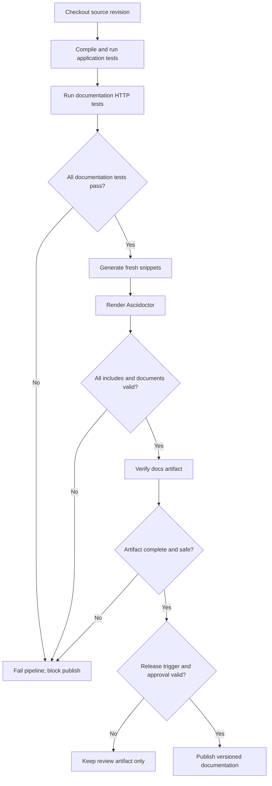

# Do Not Publish Documentation If Documentation Tests Fail

## Learning Objectives

After this lesson, you can:

- Explain why documentation tests are a mandatory quality gate before publishing API documentation.
- Design a pipeline ordered as HTTP tests, snippet generation, Asciidoctor rendering, artifact verification, and only then publishing.
- Configure Gradle or Maven so failures at any verification step fail the pipeline.
- Distinguish artifacts meant for pull request review from officially published artifacts.
- Block publishing when tests are skipped, snippets are missing, documentation fails to render, or artifacts are incomplete.
- Manage publishing conditions by branch, tag, approval, and version.
- Preserve logs, test reports, and artifacts to trace root causes when a quality gate fails.

## 1. Why Must Documentation Not Be Published When Tests Fail?

Spring REST Docs generates snippets from the HTTP exchanges of documentation tests. Asciidoctor uses those snippets to compile API pages. If tests fail, documentation may describe outdated requests/responses, lack new fields or headers, contain stale snippets, fail to reflect current validation/authentication errors, or fail to compile because includes point to ungenerated snippets.

Publishing documentation in that state misleads consumers into relying on a broken contract. Therefore, documentation tests must be a mandatory quality gate. The pipeline must never proceed to the publish step if tests or documentation rendering/verification fail.

Principles:

1. Create release artifacts only from a verified source revision.
2. Documentation tests must run and pass.
3. Snippets must be generated in the current build.
4. Asciidoctor must render successfully.
5. Artifacts must pass content and structure checks.
6. Only then may publishing proceed.

The pipeline may save diagnostic artifacts on failure, but those artifacts must never be labeled or distributed as official documentation.

## 2. Pipeline with Explicit Quality Gates



| Gate | Pass condition | On failure |
| --- | --- | --- |
| Application tests | Required application tests all pass | Halt pipeline |
| Documentation tests | HTTP exchanges and REST Docs assertions pass | Do not render/publish official build |
| Asciidoctor | All includes and sources are valid | Do not publish |
| Artifact verification | Complete HTML/assets/version metadata, no forbidden content | Do not publish |
| Release policy | Valid branch/tag and approval | Keep review artifact only or skip publish |

Do not collapse everything into a single publish command without explicit dependency conditions. Reviewers need to see which step failed and where publishing was blocked.

## 3. Documentation Tests Must Actually Run

A common configuration mistake is running unit tests in the pipeline without running the documentation test group. The build stays green while generated snippets remain un-updated.

You can organize tests using tags or a dedicated source set. Either way, ensure:

- The documentation test task is invoked in the mandatory pipeline.
- No exclusion rule silently filters out all REST Docs tests.
- Test reports show an executed test count greater than 0 when the module has documentation tests.
- Test failures cause the task to return a non-zero exit code.
- Publishing depends on the task having succeeded.

If using JUnit tags, verify includeTags/excludeTags and Gradle/Maven configuration so the docs test group is never omitted in CI.

### 3.1. Do Not Use Skip Flags in Release Jobs

Options like Gradle `-x test`, Maven `-DskipTests`, or `-Dmaven.test.skip=true` can skip running tests or even compiling tests depending on usage. Never allow a release job to use these flags to produce official documentation artifacts.

You may have a fast development job that skips certain tests, but that job must not have permission to publish. The release workflow must re-run the full quality gate from the source revision being released.

### 3.2. Detecting Unexecuted Tests

An exit code of 0 does not always prove expected tests were discovered. Check test reports: the expected documentation test suite is present, test count is non-zero when required by the project, no tests are skipped outside permitted policy, and no assumption/condition skips the entire suite in CI.

If a module legitimately has no docs tests under some profiles, declare valid profiles explicitly rather than treating "0 tests" as a default pass.

## 4. Generating Fresh Snippets and Avoiding Stale Output

Spring REST Docs writes snippets to an output directory. If tests do not run or the task is skipped, the `generated-snippets` directory may still hold files from a previous build. Asciidoctor can consume that stale output and render successfully even though current tests generated no snippets.

Measures:

1. Use a clean build in the release pipeline or delete generated output before tests.
2. Have the test task declare the exact output directory.
3. Ensure Asciidoctor depends on documentation tests.
4. Never copy snippets from another workspace or build artifact into a release.
5. Verify required snippets exist in the output of the current run.

Do not share a single snippet directory across multiple jobs or concurrent commits. Each pipeline needs an isolated workspace/output.

## 5. Configuring Gradle to Block Publishing When Docs Tests Fail

Illustrative example for Gradle Groovy DSL:

```groovy
def snippetsDir = layout.buildDirectory.dir('generated-snippets')
def docsOutputDir = layout.buildDirectory.dir('docs/asciidoc')

tasks.named('test') {
    outputs.dir snippetsDir
}

tasks.named('asciidoctor') {
    dependsOn tasks.named('test')
    inputs.dir snippetsDir
    outputDir = docsOutputDir.get().asFile
}
```

If the project has a dedicated task for documentation tests, use that task instead of the general `test` task:

```groovy
tasks.register('documentationTest', Test) {
    useJUnitPlatform {
        includeTags 'restdocs'
    }
    outputs.dir snippetsDir
}

tasks.named('asciidoctor') {
    dependsOn tasks.named('documentationTest')
    inputs.dir snippetsDir
    outputDir = docsOutputDir.get().asFile
}
```

The snippet above is an illustrative structure. Tag settings, test source set, classpath, and output directory must match your project. Do not register two tasks writing to the same snippets directory if they could run in parallel.

### 5.1. Verification Task Before Publishing

```groovy
tasks.register('verifyApiDocs') {
    dependsOn tasks.named('asciidoctor')

    doLast {
        def indexFile = docsOutputDir.get().file('index.html').asFile
        if (!indexFile.isFile() || indexFile.length() == 0) {
            throw new GradleException(
                'API documentation index.html is missing or empty'
            )
        }
    }
}
```

The publish task must depend on verifyApiDocs:

```groovy
tasks.named('publish') {
    dependsOn tasks.named('verifyApiDocs')
}
```

This is an example for the Gradle Maven Publish plugin and must be adjusted to match your actual publication/task. If publishing is performed by a CI command or another plugin, make verifyApiDocs a prerequisite in that pipeline. Do not merely create a verify task and leave the release job without invoking it.

### 5.2. Release Command

```bash
./gradlew clean test asciidoctor verifyApiDocs publish
```

The task graph guarantees verifyApiDocs and its dependencies run before publish. Nevertheless, verify the task graph and never pass command-line options that exclude tests/Asciidoctor in a release job.

## 6. Configuring Maven to Fail Fast

The Maven lifecycle normally runs tests before package. Configure documentation tests in the test phase, Asciidoctor after tests complete, and publish/deploy after package/verify succeeds.

Illustrative pipeline command:

```bash
mvn clean verify
```

Then publish the artifact in a separate job or stage, only when verify succeeds:

```bash
mvn deploy
```

Do not run deploy in an independent job relying solely on an artifact file existing from an old workspace. The deploy job must use artifacts generated and verified from the same source revision/build.

### 6.1. Binding Asciidoctor to the Lifecycle

The Asciidoctor plugin must run after snippet-generating tests. Maven configuration example:

```xml
<plugin>
  <groupId>org.asciidoctor</groupId>
  <artifactId>asciidoctor-maven-plugin</artifactId>
  <version>3.2.0</version>
  <executions>
    <execution>
      <id>render-api-docs</id>
      <phase>prepare-package</phase>
      <goals>
        <goal>process-asciidoc</goal>
      </goals>
      <configuration>
        <sourceDirectory>src/docs/asciidoc</sourceDirectory>
        <outputDirectory>target/generated-docs</outputDirectory>
        <attributes>
          <snippets>target/generated-snippets</snippets>
        </attributes>
      </configuration>
    </execution>
  </executions>
</plugin>
```

The plugin version is an example; check compatibility with your Maven version and current configuration. The test phase must complete before prepare-package. If docs tests reside in a separate profile, the release profile must activate that profile and CI must verify the test reports.

### 6.2. Maven Deploy Only After Verify

Maven deploy normally executes preceding phases in the lifecycle. Even so, do not use deploy as the sole check on documentation content. Add an artifact verification step after package: inspect the main HTML and operation pages, includes/resources, JAR/ZIP artifacts, and run a runtime smoke test if docs are served from the application.

Allow deploy only when those verification steps pass. If docs are published via a separate repository, publication/deploy must live in a stage dependent on verify.

## 7. Distinguishing Review Artifacts and Release Artifacts

Pull requests can generate HTML for reviewers to preview. That is a review artifact, not yet an official release.

| Pipeline type | Generates docs | Official publish |
| --- | --- | --- |
| Pull request | Can generate preview artifact | No |
| Integration branch | Runs docs tests and renders | Publish snapshot only if policy allows |
| Release tag | Runs full tests and verification | Yes, after quality gate and approval |
| Hotfix | Re-runs gate on hotfix revision | Yes, after gate and release policy |

Name preview artifacts with the commit SHA or build number to avoid confusing them with release builds. Never reuse the same immutable coordinates/version for previews and releases.

### 7.1. Publishing Conditions

A release job should verify that the source revision is an allowed tag/branch, application/documentation tests pass, Asciidoctor rendering passes, artifact completeness/content checks pass, approvals/environment protections are satisfied, and version metadata matches the release.

Branch/tag conditions only decide when to publish; they do not replace tests. A release tag must still re-run the quality gate.

## 8. Do Not Publish When Tests Are Skipped or Reports Are Missing

Some pipelines use caches or conditions to skip jobs when assuming outputs did not change. For documentation releases, be careful:

- If caching is used, keys must cover source, test code, descriptors, AsciiDoc, and relevant dependencies.
- Never use a snippet cache from another revision.
- Never treat a skipped job as a passing job.
- If test reports are not produced, the release gate must fail.
- If test count is unexpectedly 0, fail or require explicit profile configuration.

Caching can speed up runs, but must never erase proof that tests verified the source revision being released. For critical releases, running docs tests on a clean workspace is easier to audit.

## 9. Verifying Asciidoctor and Artifacts Before Publishing

Passing tests is not enough. Asciidoctor can fail due to wrong includes, missing attributes, or ungenerated snippets. Therefore, rendering must be its own gate.

After rendering, verify:

1. The index page exists and is non-empty.
2. Linked operation pages exist.
3. Required snippet includes appear in the output.
4. CSS, JS, images, and downloadable files are complete.
5. No stale files remain from a previous build.
6. Version/source revision metadata is accurate.
7. Artifacts contain no tokens, cookies, or sensitive data.

If building a standalone ZIP/JAR, inspect the archive entries. If embedding into the application JAR, inspect classpath entries in the executable JAR. If publishing a website, check staging output before deploying.

## 10. General CI Pipeline Example

```yaml
stages:
  - test
  - documentation
  - verify
  - publish

documentation_tests:
  stage: test
  script:
    - ./gradlew clean test
  artifacts:
    when: always
    reports:
      junit: build/test-results/test/*.xml

render_documentation:
  stage: documentation
  needs:
    - documentation_tests
  script:
    - ./gradlew asciidoctor
  artifacts:
    paths:
      - build/docs/asciidoc/

verify_documentation:
  stage: verify
  needs:
    - render_documentation
  script:
    - ./gradlew verifyApiDocs

publish_documentation:
  stage: publish
  needs:
    - verify_documentation
  rules:
    - if: '$CI_COMMIT_TAG'
  script:
    - ./gradlew publish
```

This is illustrative GitLab CI-style YAML, not a complete configuration for every repository. Workspace/artifact handoffs must ensure the render job receives snippets generated by `documentation_tests`. Real configurations must use the CI provider's exact dependency/artifact syntax and guarantee the publish job never runs if any preceding gate fails.

With GitHub Actions or other CI systems, the principle is identical: the publish job uses `needs`/dependencies on test, render, and verify; tag conditions apply only after dependencies pass.

## 11. Preserving Evidence When the Pipeline Fails

When docs tests fail, preserve information for diagnosis:

- JUnit XML/test reports.
- Test and Asciidoctor logs.
- List of generated snippets.
- Generated HTML if rendering completed and is marked preview/diagnostic.
- Commit SHA, build number, and Java/build tool versions.
- Non-sensitive environment info such as timezone, locale, and profile.

You can use `artifacts: when: always` to preserve test reports even when a job fails. However, never push diagnostic artifacts into a release repository or official website.

Never store tokens, environment secrets, or sensitive request headers in logs. Redact before uploading diagnostic artifacts.

## 12. Handling Failures and Recovering the Pipeline

When a gate fails:

1. Identify which gate failed: test, render, verify, or policy.
2. Read the test report and the first meaningful error.
3. Check whether `generated-snippets` belongs to the current build.
4. Verify descriptors against the actual response.
5. Fix tests, implementation, or AsciiDoc based on the root cause.
6. Re-run from a clean state.
7. Confirm all gates pass before publishing again.

Never manually edit generated snippets to make a build green. Never delete assertions or mark tests skipped just to pass a quality gate. If the contract legitimately changed, update tests and documentation together.

### 12.1. Do Not Use Retries Instead of Fixing Errors

Retries can help for identified transient infrastructure errors. However, if a documentation test fails due to a wrong response, missing field, or changed authorization behavior, retrying does not make the contract valid.

Record retry counts and reasons. A release should never publish merely because a later retry happened to pass without diagnosing the prior failure.

## 13. Versioning and Safe Publishing Policy

Docs artifacts must trace back to service name, API version, application version if present, source commit SHA, build identifier, and creation timestamp.

Never republish an already-released artifact under the same coordinates/version with different content. Use a new version or snapshot rules appropriate to your repository.

If documentation has multiple versions, publish to a separate version path and update the `current` alias only after the new release passes the quality gate. Never switch `current` before all pages and assets finish uploading.

## 14. Common Errors

| Symptom | Possible cause | Resolution |
| --- | --- | --- |
| Pipeline green yet docs are stale | Documentation tests did not run | Enforce docs test task and check report/test count |
| Asciidoctor passes despite skipped tests | Old snippets remain in output directory | Clean output and bind task dependencies |
| Publish runs even when verify fails | Publish job does not depend on verify | Add needs/dependency and fail-fast |
| Pull request publishes to production | Publish trigger is too broad | Restrict to release tags/branches and approvals |
| Docs missing operation page | Tests did not run or artifact handoff missed snippets | Check test report, snippets, and render inputs |
| Test report missing | Job failed before upload or wrong report path | Configure exact artifacts/report path |
| Release uses artifact from another commit | Job pulled old artifact or detached build lacked provenance | Enforce commit SHA/build ID across jobs |
| Retries cause flaky releases to pass | Unresolved flaky test | Investigate root cause; do not bypass gate |
| Diagnostic HTML published by mistake | Shared channel for preview and release | Separate artifact names, repositories, and publish permissions |

## 15. Pre-Release Quality Gate Checklist

- [ ] Release job uses no flags that skip documentation tests.
- [ ] Docs test suite is discovered and executed test count is valid.
- [ ] Test failures halt the pipeline with a non-zero exit code.
- [ ] Generated snippets come from a clean/current build.
- [ ] Asciidoctor depends on documentation tests.
- [ ] Render/include errors fail the pipeline.
- [ ] Artifact completeness and content checks pass.
- [ ] Publish depends on all preceding gates.
- [ ] Publish runs only on permitted branches/tags and environments.
- [ ] Pull requests produce only preview/review artifacts.
- [ ] Artifacts carry clear version and source revision metadata.
- [ ] Test reports/logs are preserved even on failure without exposing secrets.
- [ ] No retry/skip mechanism hides contract failures.

## 16. Hands-On Exercise

An Orders service uses Gradle, Spring REST Docs, and Asciidoctor. Currently CI runs tests and publishes a docs ZIP in the same job. Occasionally REST Docs tests get skipped while an old ZIP still gets published.

Complete the following:

1. Separate documentation tests into a task or tag suite explicitly invoked by CI.
2. Use a clean workspace/output to eliminate stale snippets.
3. Declare Asciidoctor's dependency on documentation tests.
4. Create `verifyApiDocs` checking `index.html`, operation pages, and required assets.
5. Create a publish job depending on test, render, and verify.
6. Allow publishing only when a valid release tag and approvals are met.
7. Configure preserving JUnit reports and logs when the job fails.
8. Intentionally break one documentation test and confirm the publish job does not run.
9. Intentionally omit a required snippet and confirm Asciidoctor/verify fails.
10. Restore the test, run a clean pipeline, and confirm the released artifact carries the right commit/version.

**Self-check question:** If docs tests fail yet an old HTML file still exists, should publishing continue? No. An old file is not proof of the current source revision's contract. The pipeline must fail, retain separate diagnostic artifacts if needed, and publish only after test, render, and verify succeed from the revision being released.

## Conclusion

Blocking documentation publishing when documentation tests fail is a mandatory quality gate, because snippets and API pages must reflect verified HTTP behavior of the current source revision. Pipelines must run tests, generate fresh snippets, render Asciidoctor, verify artifacts, and only then publish. Gradle/Maven must define clear task/lifecycle dependencies; CI publish jobs must depend on all gates and run only on permitted release triggers. Eliminate stale snippets, never use skips/retries to mask failures, save test reports on failure, and separate preview artifacts from release artifacts. When tests or rendering fail, the pipeline stops and leaves official documentation untouched; only a build that clears every check gets published.
