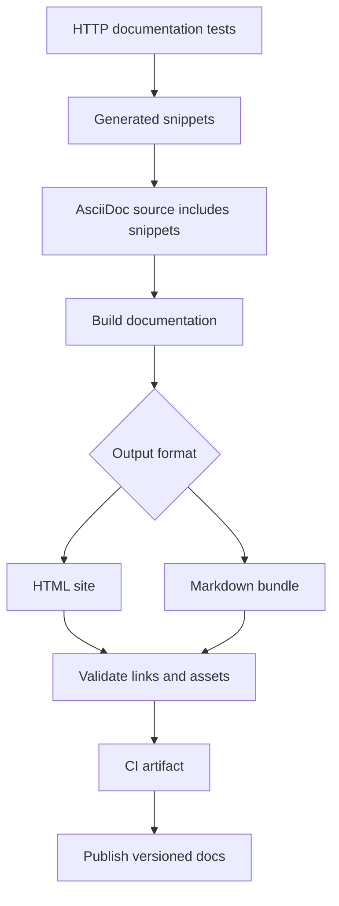

# Publishing HTML or Markdown Documentation

## Learning Objectives

In the **SPRING_REST_DOCS** module, HTTP documentation tests generate verified snippets. For API consumers to read them, the team must compile snippets into complete documentation and then publish it in an appropriate format. Two common choices are HTML for navigable websites and Markdown for repositories, wikis, or Markdown-enabled portals.

Spring REST Docs is typically integrated with Asciidoctor to assemble AsciiDoc snippets into HTML. Markdown is an alternative publishing format, but requires defining explicitly how Markdown content is produced: using custom Markdown snippet templates, converting content via a separate pipeline, or maintaining Markdown documentation linked to artifacts/snippets. Never assume Asciidoctor outputs Markdown by default using its default backend.

After this lesson, you can:

- Choose HTML or Markdown based on where users read documentation.
- Generate HTML from AsciiDoc and Spring REST Docs snippets.
- Build a controlled Markdown publishing workflow.
- Store documentation artifacts in CI and release by commit/tag.
- Publish to static hosting or a documentation portal.
- Check links, snippets, and access permissions before publishing.
- Design a repeatable publishing workflow with rollback capability.

## 1. From Documentation Tests to Published Documentation

The workflow typically consists of:



1. Tests verify endpoints and generate snippets.
2. Source documents organize content, explanations, and snippet includes.
3. The build creates an HTML or Markdown bundle.
4. Validation checks required files, links, images, and content.
5. CI saves artifacts tied to the commit/build.
6. Publishing deploys artifacts to where users access them.

Do not publish directly from the snippet directory. Snippets are only fragments of HTTP exchanges; readers need pages with navigation, guides, authentication details, errors, and usage flows.

## 2. Choosing HTML or Markdown

| Criterion | HTML | Markdown |
| --- | --- | --- |
| Reading experience | Website with navigation, styling, and search | Repositories, wikis, and Markdown-capable portals |
| Content | Layout, CSS, images, and navigation | Headings, tables, code, links; depends on renderer |
| REST Docs integration | Common Asciidoctor HTML workflow | Needs custom Markdown pipeline/templates or conversion |
| Versioning | Versioned URLs | Branches/tags or version directories |
| Review | Artifact/site review | Easy to diff and review in Git |
| Links and assets | Check relative paths, CSS, images | Check renderer and relative links |

Choose HTML when you need a browsable API reference with navigation hosted as a website. Choose Markdown when your organization wants documentation to live alongside source code, be reviewed via pull requests, or be ingested into a Markdown-supporting portal.

A project can publish both from the same content source, but needs separate pipelines and verification for each format.

## 3. Publishing HTML with Asciidoctor

Spring REST Docs typically generates AsciiDoc snippets. Source documents can include them:

```asciidoc
= Products API

== Create product

=== HTTP request
include::{snippets}/products-create/http-request.adoc[]

=== Request fields
include::{snippets}/products-create/request-fields.adoc[]

=== HTTP response
include::{snippets}/products-create/http-response.adoc[]

=== Response fields
include::{snippets}/products-create/response-fields.adoc[]
```

Once tests generate snippets and Asciidoctor has the appropriate extension, the build task replaces includes with snippet contents and renders HTML.

### 3.1. Gradle

Gradle Groovy DSL configuration example:

```groovy
plugins {
    id 'java'
    id 'org.asciidoctor.jvm.convert' version '4.0.4'
}

configurations {
    asciidoctorExt
}

dependencies {
    testImplementation 'org.springframework.restdocs:spring-restdocs-mockmvc'
    asciidoctorExt 'org.springframework.restdocs:spring-restdocs-asciidoctor'
}

ext {
    snippetsDir = file("$buildDir/generated-snippets")
}

tasks.test {
    outputs.dir snippetsDir
}

tasks.asciidoctor {
    inputs.dir snippetsDir
    configurations 'asciidoctorExt'
    dependsOn tasks.test
    attributes 'snippets': snippetsDir
}
```

This is an illustrative configuration; plugins and versions must be managed consistently with your project build. With Gradle Kotlin DSL, task/configuration syntax will differ.

Run:

```bash
./gradlew clean test asciidoctor
```

HTML is typically generated under `build/docs/asciidoc` or the configured output directory. Check actual task outputs before packaging.

### 3.2. Maven

With Maven, the workflow is similar:

1. The test plugin runs documentation tests and writes snippets to `target/generated-snippets`.
2. Asciidoctor Maven Plugin reads AsciiDoc sources.
3. The REST Docs Asciidoctor extension provides the `snippets` attribute.
4. The plugin generates HTML into the configured output directory.

Illustrative build command:

```bash
./mvnw clean verify
```

Goal names, plugin versions, dependencies, and phases must match your project configuration. Do not copy Gradle configuration verbatim into Maven or vice versa.

## 4. HTML Site Structure for Publishing

A documentation site can have a structure like:

```text
build/docs/api/
├── index.html
├── products.html
├── orders.html
├── css/
│   └── api-docs.css
├── images/
│   └── architecture.svg
└── assets/
```

The index page should provide API/documentation version, authentication instructions, request/response conventions, links to resources, error response conventions, and support/changelog info.

Resource pages include generated snippets, while surrounding prose should explain when to use the endpoint, input preconditions, and how to handle errors.

## 5. Publishing Markdown: Defining the Markdown Source

By default, Spring REST Docs generates AsciiDoc snippets when using default templates. If the publishing target is Markdown, a clear strategy must be chosen.

### 5.1. Strategy A: Markdown as Source Documentation

The team maintains Markdown files in the repository, while documentation tests generate snippets to verify payloads and exchanges. The pipeline can:

1. Run tests to generate snippets.
2. Verify snippets and descriptors.
3. Update or verify examples in Markdown from tested fixtures.
4. Render Markdown using a static site generator or portal.
5. Publish output.

The advantage is that Markdown is easy to review and diff. The drawback is that if examples are copied manually, they can drift from snippets; a check or generation step is needed to prevent drift.

### 5.2. Strategy B: Generating Markdown Snippets with Custom Templates

REST Docs allows customizing snippet templates. You can design templates that generate Markdown files for appropriate sections:

- Choose filenames with the `.md` extension.
- Create corresponding templates for requests/responses/fields.
- Verify actual output in the operation directory.
- Use the proper include syntax or Markdown processing supported by your documentation system.

Not every default snippet/template automatically has an equivalent Markdown version. The team must implement and maintain the templates while ensuring content remains verified by descriptors.

### 5.3. Strategy C: Converting Content via a Separate Pipeline

You can convert AsciiDoc content or rendered HTML into Markdown using a converter tool. Conversion can drop macros, includes, complex tables, attributes, or specialized structures.

If using a converter:

- Pin the tool and its exact version.
- Convert after snippet includes have been resolved.
- Inspect code blocks, tables, links, and anchors.
- Do not treat exit code 0 from conversion as sufficient; inspect the content.
- Keep AsciiDoc sources and Markdown outputs traceable to the same commit.

Asciidoctor has separate output backends; do not assume the default backend is Markdown. Verify the converter or extension used by the project.

## 6. Markdown Bundle Structure

Example:

```text
docs/markdown/
├── index.md
├── authentication.md
├── products.md
├── orders.md
├── errors.md
└── assets/
    └── architecture.svg
```

Markdown should be organized by reading flow:

```markdown
# API Reference

## Authentication

Describe how to obtain and send credentials.

## Products

### Create product

Describe the endpoint, required permissions, and request fields.

### Errors

Describe error codes and handling.
```

Plain Markdown has no standard include syntax supported by every renderer. If you want to reuse snippet files, use a static site generator's include extension, a build-time file assembly step, or a template generator. Confirm the renderer in the publishing environment supports that exact syntax.

## 7. Artifacts in CI

CI should store documentation output as a build artifact before publishing:

```text
artifacts/
└── api-docs/
    ├── html/
    │   ├── index.html
    │   └── ...
    └── markdown/
        ├── index.md
        └── ...
```

Artifacts should carry commit SHA, build number/workflow run ID, API version/tag, documentation test results, and output format.

Storing artifacts enables reviewing the built output before release and allows re-publishing the exact verified content without re-running tests on a different source state.

## 8. CI Pipeline Example

Conceptual pipeline:

```yaml
name: Build API documentation

on:
  push:
    branches: [main]
  pull_request:

jobs:
  build-docs:
    runs-on: ubuntu-latest
    steps:
      - uses: actions/checkout@v4

      - uses: actions/setup-java@v4
        with:
          distribution: temurin
          java-version: '21'

      - name: Run documentation tests and build HTML
        run: ./gradlew clean test asciidoctor

      - name: Upload HTML documentation
        uses: actions/upload-artifact@v4
        with:
          name: api-docs-html
          path: build/docs/asciidoc/
```

This is a GitHub Actions example. The artifact path must match the actual output directory. Pull requests can build and save artifacts for review; the production publish step usually runs only on protected branches/tags.

If the project uses Maven, substitute the build command and output path per your Maven configuration.

## 9. Publishing HTML to Static Hosting

HTML can be hosted on GitHub Pages, GitLab Pages, object storage with static website hosting, an internal web server, or a CDN.

The publishing workflow should:

1. Take only artifacts that passed tests and validation.
2. Place documentation at a clear versioned path, such as `/api-docs/1.4/`.
3. Check the index page, CSS, images, and relative links.
4. Publish into the new version directory and then update the `current` alias.
5. Verify URLs after publishing.
6. Retain previous versions for rollback.

Never publish untrusted pull request content to a production site. If previews are needed, use a dedicated preview environment with restricted access.

## 10. Publishing Markdown to a Repository or Portal

Markdown can be committed into a `docs` folder in the same repository, pushed to a separate documentation repository by tag/version, uploaded to a Markdown-supporting portal, or placed into an internal wiki/knowledge base.

If the pipeline commits Markdown automatically to Git:

- Create a dedicated commit/PR or use a controlled publish mechanism.
- Tie the output to the tested source commit.
- Never push back to a release branch from an untrusted pull request build.
- Avoid creating commits when content has not changed.
- Keep version history to compare API changes.

If a portal provides an upload API, use CI secret credentials with least privilege. Never print tokens to logs or artifact files.

## 11. Versioning and Managing Multiple Documentation Releases

Example:

```text
api-docs/
├── v1/
├── v2/
└── latest/
```

One implementation approach:

- Each release tag generates an immutable documentation artifact for that version.
- `latest` points to the currently published version.
- Previews from `main` carry a `snapshot` or `development` label.
- Do not overwrite older version documentation while that API version remains supported.

If the API does not use versioned URLs but has release versions, state the version/commit clearly on the documentation page.

## 12. Pre-Publish Quality Checks

- [ ] Documentation tests ran and passed.
- [ ] Snippet outputs belong to the exact current commit.
- [ ] Asciidoctor/Markdown build completed.
- [ ] No includes are missing.
- [ ] Internal links and anchors work.
- [ ] CSS, images, and assets are packaged.
- [ ] Code blocks and tables render properly on the target renderer.
- [ ] No tokens, cookies, passwords, or personal data appear in snippets.
- [ ] Version and commit are clearly recorded.
- [ ] Artifacts are saved before the publish step.
- [ ] Post-publish URLs have been verified.
- [ ] A rollback plan to the previous version exists.

For Markdown, test with the exact target renderer/portal. A file that renders properly on GitHub may differ when ingested into a wiki using another Markdown dialect.

## 13. Access Control and Security When Publishing

Before publishing, determine whether documentation is public or internal:

- Public documentation must not contain internal hostnames, unannounced admin endpoints, or credentials.
- Internal documentation requires proper authentication and authorization.
- Previews from untrusted pull requests must not have access to production secrets.
- Artifacts must follow organizational retention policies.
- Links to internal dashboards, logs, or tickets should not appear in public documentation.

REST Docs records HTTP exchanges; it does not automatically classify which details are safe to make public. Use dummy fixtures and inspect artifacts before publishing.

## 14. Common Errors

| Symptom | Possible cause | Resolution |
| --- | --- | --- |
| HTML lacks snippets | Tests did not run or wrong output root | Check task dependencies and snippets directory |
| Asciidoctor reports missing include | Wrong operation ID or snippet path | Cross-check tests and `generated-snippets` |
| HTML build passes yet CSS/images break | Assets not copied or wrong relative path | Check output site and base path |
| Markdown missing snippet content | Renderer lacks include support or converter dropped macro | Assemble snippets in build step or use custom templates |
| Markdown tables/code render poorly | Incompatible Markdown dialect | Test with the target renderer |
| CI artifact empty | Uploaded wrong output path | Check task output and artifact path |
| Old version published | Job used artifact from another commit | Tag artifacts with SHA/version and check provenance |
| `latest` URL points to wrong version | Updated alias before deployment finished | Deploy versioned folder first, then update alias |
| Pull request can publish to production | Overly broad workflow conditions/permissions | Restrict publishing by branch/tag and permissions |
| Docs leak tokens or real data | Fixtures pulled from a real environment | Use dummy data and scan artifacts |
| Cannot roll back | Overwrote current release without keeping prior one | Publish versioned releases and retain previous version |

## 15. Hands-On Exercise

1. Create an AsciiDoc page including request/response snippets for one operation.
2. Configure Gradle or Maven to build HTML from source documentation.
3. Inspect the output directory and open the HTML page to verify CSS, links, and code blocks.
4. Create a Markdown page for the same operation; decide whether snippets are produced via custom templates, build-time includes, or Markdown source content.
5. Render the Markdown using the intended publishing platform and check tables, code blocks, and anchors.
6. Create a CI job that runs documentation tests, builds docs, and uploads artifacts.
7. Tag artifacts with commit SHA and version.
8. Configure preview publishing for pull requests and production publishing only for release tags/branches.
9. Verify post-publish URLs and practice rolling back to the previous artifact.

**Self-assessment questions**

1. Why is HTML a common output when using Asciidoctor with Spring REST Docs?
2. Why should you not assume Asciidoctor outputs Markdown by default?
3. What are three strategies for producing Markdown from documentation tests?
4. Why is it important to save artifacts before the publish step?
5. How do you ensure documentation matches the exact commit and API version?
6. Why must untrusted pull requests not access production secrets?
7. Which links and assets need verification after publishing?
8. How do you roll back a published documentation release?

## Official References

- [Spring REST Docs — Getting Started](https://docs.spring.io/spring-restdocs/tutorial/getting-started/index.html): configuring Asciidoctor and building documentation from snippets.
- [Spring REST Docs — Documenting Your API](https://docs.spring.io/spring-restdocs/reference/documenting-your-api.html): generating snippets from HTTP tests.
- [Asciidoctor Gradle Plugin](https://docs.asciidoctor.org/gradle-plugin/latest/): configuring tasks and HTML documentation outputs.
- [Asciidoctor Maven Plugin](https://docs.asciidoctor.org/maven-tools/latest/): compiling AsciiDoc with Maven.
- [GitHub Actions — Workflow Artifacts](https://docs.github.com/actions/using-workflows/storing-workflow-data-as-artifacts): saving and passing artifacts between jobs.
- [GitHub Pages](https://docs.github.com/pages): publishing static websites.
- [RFC 9110 — HTTP Semantics](https://www.rfc-editor.org/rfc/rfc9110): HTTP semantics relevant to API examples.

**Practical conclusion:** Using Asciidoctor to compile HTML from source documents and REST Docs snippets is the standard workflow. If Markdown is needed, choose explicit templates or a conversion/assembly step, and verify with the target renderer. In CI, build and validate first, save artifacts tied to commit/version, and only then publish to hosting or a portal with access control and rollback capability.
