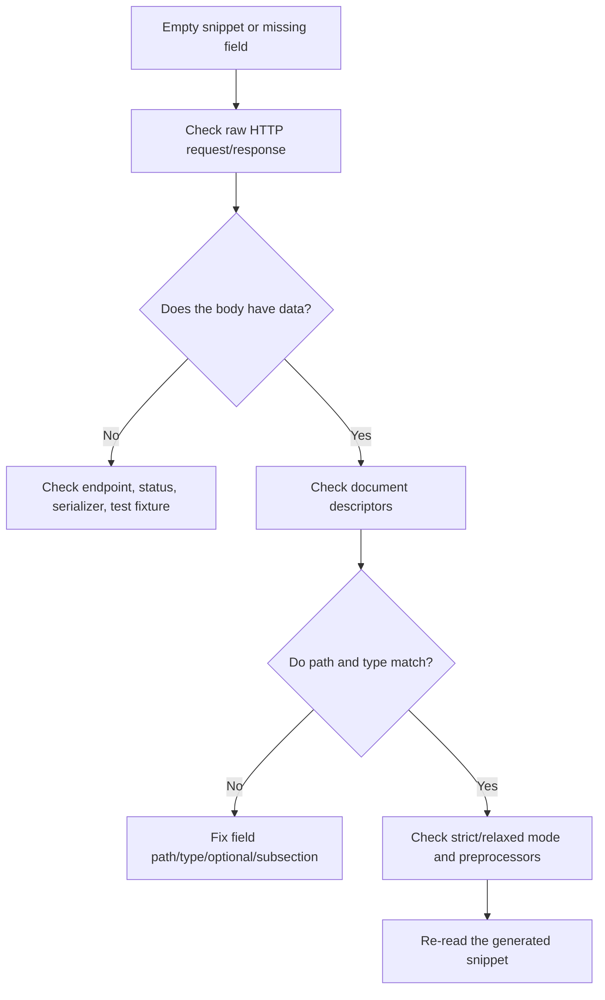

# Empty Snippets or Missing Field Descriptions

## 1. Identifying the Exact Error Type

Spring REST Docs creates verifiable REST API documentation from HTTP tests using MockMvc, WebTestClient, or REST Assured. In tests, calling `document(...)` combines descriptors such as `requestFields(...)`, `responseFields(...)`, `requestHeaders(...)`, `pathParameters(...)`, or `links(...)` to generate snippets. When a snippet is empty or missing fields, you need to determine whether the issue lies in the actual payload, the descriptors, the document operation, or how the output is inspected.

Common symptoms:

- `http-response.adoc` has status/headers, but the body section is empty.
- `response-body.adoc` is empty, or the expected file is missing.
- `response-fields.adoc` only contains the table header without data rows.
- Some fields exist in the JSON but do not appear in the description table.
- Tests fail with a message stating that a field is undocumented or a descriptor could not find a field.
- Snippets show different values than expected because the request or response was preprocessed.

Do not edit templates right away. First compare three sources: the **actual HTTP payload**, the **descriptors in the test**, and the **generated snippet files**.



## 2. Checking the Actual HTTP Body Before Checking Snippets

If the actual response body is empty, Spring REST Docs cannot produce a populated JSON example or field table from non-existent data. Possible causes include:

- The endpoint returns `204 No Content` or a status code that has no response body per contract.
- The controller returns `null`, `void`, or a `ResponseEntity` without a body.
- The test calls the wrong endpoint or the fixture does not create data.
- The request returns an early error before reaching the intended handler.
- The serializer or converter does not write the expected representation.
- The test asserts a different response than what the documentation author assumed.

First, verify the response inside the test:

```java
mockMvc.perform(get("/api/books/{id}", 42))
        .andExpect(status().isOk())
        .andExpect(content().contentTypeCompatibleWith(MediaType.APPLICATION_JSON))
        .andExpect(jsonPath("$.id").value(42))
        .andDo(document("books-get"));
```

With REST Assured:

```java
given(this.specification)
        .when()
        .get("/api/books/{id}", 42)
        .then()
        .statusCode(200)
        .contentType(ContentType.JSON)
        .body("id", equalTo(42));
```

With WebTestClient:

```java
webTestClient.get()
        .uri("/api/books/{id}", 42)
        .exchange()
        .expectStatus().isOk()
        .expectHeader().contentTypeCompatibleWith(MediaType.APPLICATION_JSON)
        .expectBody()
        .jsonPath("$.id").isEqualTo(42)
        .consumeWith(document("books-get"));
```

These examples are illustrative skeletons; use assertions and filter/documentation setups suitable for your project's version and test client. If the body is genuinely empty because the API legitimately returns `204`, do not add field descriptors to force a table to generate. The documentation should describe the status and headers according to the contract.

## 3. Distinguishing Body and Field Snippet Types

An operation can generate several different snippets. Not every file contains the same content:

| Snippet | Content |
| --- | --- |
| `http-request.adoc` | Recorded HTTP request including method, URI, headers, and body. |
| `http-response.adoc` | Recorded HTTP response including status, headers, and representation body. |
| `request-body.adoc` | Extracted request payload alone. |
| `response-body.adoc` | Extracted response payload alone. |
| `request-fields.adoc` | Description table of declared request fields. |
| `response-fields.adoc` | Description table of declared response fields. |

If `response-fields.adoc` does not contain expected content, inspect `http-response.adoc` and confirm the response body actually has data. If the HTTP response snippet has JSON while the fields snippet is missing a field, the problem usually lies in the descriptors or path structure.

Not every operation generates all snippets. For example, a `204 No Content` endpoint may have no response body or response fields; a test that does not declare `responseFields(...)` will not produce a `response-fields.adoc` table to include.

## 4. Checking Whether Field Paths Match the Payload

`fieldWithPath(...)` must point to the exact path in the JSON/XML payload. Example response:

```json
{
  "id": 42,
  "title": "Spring REST Docs",
  "author": {
    "id": 7,
    "name": "An"
  },
  "tags": ["java", "spring"]
}
```

Corresponding descriptors:

```java
responseFields(
        fieldWithPath("id").description("Book ID"),
        fieldWithPath("title").description("Book title"),
        fieldWithPath("author.id").description("Author ID"),
        fieldWithPath("author.name").description("Author name"),
        fieldWithPath("tags").description("List of book tags"));
```

Common path mistakes:

| Actual payload | Wrong descriptor | Right descriptor |
| --- | --- | --- |
| `author.name` | `fieldWithPath("authorName")` | `fieldWithPath("author.name")` |
| `items[0].id` | `fieldWithPath("items.id")` | `fieldWithPath("items[].id")` when describing array elements using supported REST Docs payload syntax. |
| `meta.total` | `fieldWithPath("total")` | `fieldWithPath("meta.total")` |
| `isActive` | `fieldWithPath("active")` | `fieldWithPath("isActive")` |

For arrays, use the `[]` wildcard path to describe repeating elements, such as `items[].id`, rather than fixing an index like `items[0].id` when the goal is to document every item. Check path syntax for the payload type and Spring REST Docs version in use.

## 5. Nested Fields, Objects, and Arrays

For nested objects, you can describe each child field individually or group an entire region using `subsectionWithPath(...)`.

Detailed description example:

```java
responseFields(
        fieldWithPath("id").description("Order ID"),
        fieldWithPath("customer.id").description("Customer ID"),
        fieldWithPath("customer.name").description("Customer name"),
        fieldWithPath("items[].sku").description("Product SKU"),
        fieldWithPath("items[].quantity").description("Quantity"));
```

Subsection grouping example:

```java
responseFields(
        fieldWithPath("id").description("Order ID"),
        subsectionWithPath("customer").description("Customer information"),
        subsectionWithPath("items").description("List of line items"));
```

When declaring a subsection, its child fields are considered covered by that subsection. Do not both describe a subsection and re-declare child fields within the same scope in one descriptor set if that causes overlap or validation conflicts. Choose the level of detail according to the documentation goal.

## 6. Strict Mode: Undocumented Fields or Missing Descriptors

Spring REST Docs payload field snippets typically validate descriptors strictly against the payload:

- A field present in the payload without a descriptor can fail the test.
- A required descriptor whose field is absent from the payload can also fail the test.
- This check helps catch documentation drifting from the actual response.

Example payload adding `createdAt` before a descriptor is declared:

```json
{
  "id": 42,
  "title": "Spring REST Docs",
  "createdAt": "2026-11-17T09:00:00Z"
}
```

If descriptors only cover `id` and `title`, the test may report that `createdAt` is undocumented. Decide whether this field belongs to the public contract; if so, add a descriptor. If the field falls inside an area documented by a subsection, verify that the subsection path covers it properly.

Do not switch to relaxed mode just to make the test green. A new field may represent an API change that needs review and documentation.

## 7. Optional and Ignored Fields

`optional()` and `ignored()` have different semantics:

```java
responseFields(
        fieldWithPath("id").description("Book ID"),
        fieldWithPath("title").description("Book title"),
        fieldWithPath("subtitle")
                .description("Subtitle, may be omitted")
                .optional(),
        fieldWithPath("internalTrace")
                .ignored());
```

| Descriptor | Behavior |
| --- | --- |
| Required field | Must be present in the documented payload. |
| `.optional()` | May be absent from the payload without failing the descriptor solely due to the missing field. |
| `.ignored()` | Excludes the field from the snippet and does not require documenting it. |

Only use `.optional()` when the contract genuinely allows the field to be absent, such as a subtitle present only on certain types of books. Do not mark every field optional to dodge errors; doing so prevents the documentation from verifying required structure.

`ignored()` is suitable for internal fields or fields outside the documentation scope. However, evaluate whether that field is exposed in the public API and raises security concerns; ignoring it in the snippet does not remove the field from the response.

## 8. Relaxed Field Snippets

When you only want to document a subset of fields without requiring every other field in the payload to be described, you can use `relaxedResponseFields(...)` or `relaxedRequestFields(...)`:

```java
relaxedResponseFields(
        fieldWithPath("id").description("Book ID"),
        fieldWithPath("title").description("Book title"));
```

Relaxed mode ignores unlisted fields. Declared fields still must match the payload according to descriptor rules. This is useful when a response contains substantial metadata or when a section of documentation focuses on only part of the representation.

Do not use relaxed mode as the default for every endpoint. When the goal is to verify the full public schema, strict `responseFields(...)` catches unreviewed new fields. You can use strict mode for primary contract documentation and relaxed mode for deliberate explanatory sections.

## 9. Checking Field Types and Values

REST Docs can infer certain types from the payload, though you can declare types explicitly to make tables clearer or avoid unsuitable inferences:

```java
responseFields(
        fieldWithPath("id")
                .type(JsonFieldType.NUMBER)
                .description("Book ID"),
        fieldWithPath("title")
                .type(JsonFieldType.STRING)
                .description("Book title"),
        fieldWithPath("published")
                .type(JsonFieldType.BOOLEAN)
                .description("Publication status"),
        fieldWithPath("tags")
                .type(JsonFieldType.ARRAY)
                .description("List of tags"));
```

If the snippet is missing or displays a different type than expected, inspect the actual JSON. For instance, `"42"` is a string whereas `42` is a number; `"true"` is a string whereas `true` is a boolean. Do not infer types solely from field names.

For `null`, objects, arrays, or custom payload formats, check the appropriate `JsonFieldType`/field type and how the payload format is parsed. If the API returns XML or a custom format, use the appropriate payload documentation API/extractor instead of assuming every field is a JSON path.

## 10. Request Fields and Response Fields Do Not Share Payloads

A common mistake is describing response fields inside `requestFields(...)` or vice versa.

```java
filter(document("books-create",
        requestFields(
                fieldWithPath("title").description("Submitted book title"),
                fieldWithPath("authorId").description("Author ID")),
        responseFields(
                fieldWithPath("id").description("Created book ID"),
                fieldWithPath("title").description("Saved book title"))));
```

`requestFields(...)` validates the request payload; `responseFields(...)` validates the response payload. If the request body is empty, you cannot expect `request-fields.adoc` to have data rows. If an operation only returns `204`, there is no response body to produce `response-fields.adoc`.

For PATCH, the request may contain only a subset of fields; document that partial payload accurately rather than copying the entire response schema into the request descriptors.

## 11. Checking Preprocessors and Documented Content

Spring REST Docs supports preprocessors that transform requests/responses before snippets are written. Examples include formatting JSON, masking sensitive headers, or replacing dynamic hosts:

```java
filter(document("books-get",
        preprocessResponse(prettyPrint()),
        responseFields(
                fieldWithPath("id").description("Book ID"),
                fieldWithPath("title").description("Book title"))));
```

If a snippet body looks empty or differs from the expected response, check:

- Does any preprocessor alter the body or remove headers?
- Does the test use a custom operation preprocessor?
- Does another wrapper or filter mutate the response before REST Docs records it?
- Does masked content accidentally replace the payload or fields that need documenting?

`prettyPrint()` only formats the payload for readability; it does not create new data. Mask/remove preprocessors should target only the areas that need redaction without accidentally stripping contract fields.

## 12. Missing Header and Parameter Snippets

If the error is not with fields but with header/parameter tables, inspect the corresponding descriptors:

```java
filter(document("books-get",
        requestHeaders(
                headerWithName("Accept").description("Media types accepted by the client")),
        pathParameters(
                parameterWithName("id").description("Book ID")),
        responseHeaders(
                headerWithName("Content-Type").description("Response media type"))));
```

Snippets are generated only when the documented operation has the corresponding descriptor and the actual request includes the part being described. Distinguish:

- `pathParameters(...)` for variables in the URI template path.
- `queryParameters(...)` for the query string.
- `requestParameters(...)` for request parameters according to supported request/API types.
- `requestHeaders(...)` and `responseHeaders(...)` for HTTP headers.

Output filenames usually match the descriptor type, such as `path-parameters.adoc`, `query-parameters.adoc`, and `request-headers.adoc`. Inspect the actual files in the operation directory before writing includes.

## 13. Complete Example: Diagnosing a Missing Field

Suppose the actual response is:

```json
{
  "id": 42,
  "title": "Spring REST Docs",
  "author": {
    "id": 7,
    "name": "An"
  },
  "tags": ["java", "spring"],
  "createdAt": "2026-11-17T09:00:00Z"
}
```

Descriptors missing `createdAt`:

```java
responseFields(
        fieldWithPath("id").description("Book ID"),
        fieldWithPath("title").description("Book title"),
        subsectionWithPath("author").description("Author information"),
        fieldWithPath("tags").description("Book tags"));
```

In strict mode, the test may fail because `createdAt` is undocumented. If `createdAt` is a public field, add:

```java
fieldWithPath("createdAt")
        .type(JsonFieldType.STRING)
        .description("Book creation timestamp in ISO-8601")
```

If the new field is only metadata outside this table's scope, you can use `.ignored()` or relaxed mode depending on documentation goals and review decisions. Because `author` is already described as a subsection, there is no need to re-list `author.id` and `author.name` in the same descriptor set.

After fixing, re-run the test and read the newly generated `response-fields.adoc`. Do not just check that the test passes; confirm the table has the expected paths, types, and descriptions.

## 14. End-to-End Diagnostic Workflow

1. **Confirm test and operation:** Did the test run, pass through the REST Docs filter, and call `document("operation-id", ...)` properly?
2. **Inspect raw response/request:** Does the body have data and the right Content-Type?
3. **Compare payload with descriptors:** Do field paths, array paths, types, and nesting match?
4. **Check strict/relaxed:** Are there extra fields or missing required descriptors?
5. **Check optional/ignored/subsection:** Are the right semantics and payload regions used?
6. **Check preprocessors:** Were the body or headers overly altered or masked?
7. **Check output:** Are you reading the right operation directory and snippets from the current build?
8. **Render documentation:** Are the right files included and fully displayed in the final HTML/PDF?

Keep the test report, raw request/response, and snippet output handy during diagnosis. These three sources separate API/test bugs from descriptor mistakes and authoring errors.

## 15. Common Errors

| Symptom | Cause | Resolution |
| --- | --- | --- |
| `response-fields.adoc` has no rows | Empty response body or no field descriptors. | Check raw response and `responseFields(...)`. |
| `http-response.adoc` has empty body | Endpoint returns no-content, controller returns no body, or response was altered. | Assert status/content type/body and check serializer/preprocessor. |
| Test reports undocumented field | Payload contains an undeclared field in strict mode. | Add a descriptor, subsection, ignored, or deliberate relaxed mode. |
| Test reports descriptor field not found | Wrong path or optional field is absent. | Compare JSON paths and use `optional()` if the contract allows it. |
| Nested field does not display properly | Wrong nested path or array wildcard. | Use proper paths such as `author.name`, `items[].sku`. |
| Wrong type in table | JSON value has a different type than expected or descriptor type is wrong. | Inspect raw JSON and declare the appropriate type. |
| Request fields empty | Request has no body or response descriptors were used by mistake. | Check request body and use `requestFields(...)` for the operation. |
| Headers/parameters snippet does not exist | Corresponding descriptor not declared or wrong include filename. | Add the descriptor and verify the actual output filename. |
| Snippet contains stale data | Reading old output or build was not cleaned. | Clean the output directory, run current tests, and check timestamps. |
| Content lost after preprocessor | Mask/remove/custom preprocessor is too broad. | Narrow preprocessor scope and inspect the post-processed snippet. |

## 16. Practical Checklist

- [ ] Test actually runs through the REST Docs filter/extension and uses the right operation ID.
- [ ] Raw request/response has a body and Content-Type matching the contract.
- [ ] Distinguished `http-response`, `response-body`, and `response-fields` snippets.
- [ ] Field paths match the payload, including nested objects and array wildcards.
- [ ] Request fields and response fields are described from their respective payloads.
- [ ] Field types match actual JSON values.
- [ ] Strict/relaxed mode is chosen for verification goals, not just to turn tests green.
- [ ] `optional()`, `ignored()`, and `subsectionWithPath()` are used with their proper semantics.
- [ ] Preprocessors do not accidentally strip needed body/headers/fields.
- [ ] Header/parameter descriptors and snippet filenames match.
- [ ] Newly generated snippets have been read back, not just verified via passing tests.
- [ ] Asciidoctor includes the right files and the final artifact shows complete content.

Empty snippets or missing fields usually stem from an unexpected actual payload, descriptors mismatching the data structure, or reading stale output. Start from the raw HTTP response/request, compare paths and types against descriptors, and then check strict/relaxed mode, optionality, and preprocessors. Only once tests pass and snippets read back correctly can you confirm the documentation accurately reflects the contract.

## References

- [Spring REST Docs – Request and Response Fields](https://docs.spring.io/spring-restdocs/reference/documenting-your-api/request-response-payloads.html)
- [Spring REST Docs – Customizing Requests and Responses](https://docs.spring.io/spring-restdocs/reference/customizing-requests-and-responses.html)
- [Spring REST Docs – Documenting Your API](https://docs.spring.io/spring-restdocs/reference/documenting-your-api.html)
- [Spring REST Docs – PayloadDocumentation API](https://docs.spring.io/spring-restdocs/docs/current/api/org/springframework/restdocs/payload/PayloadDocumentation.html)
