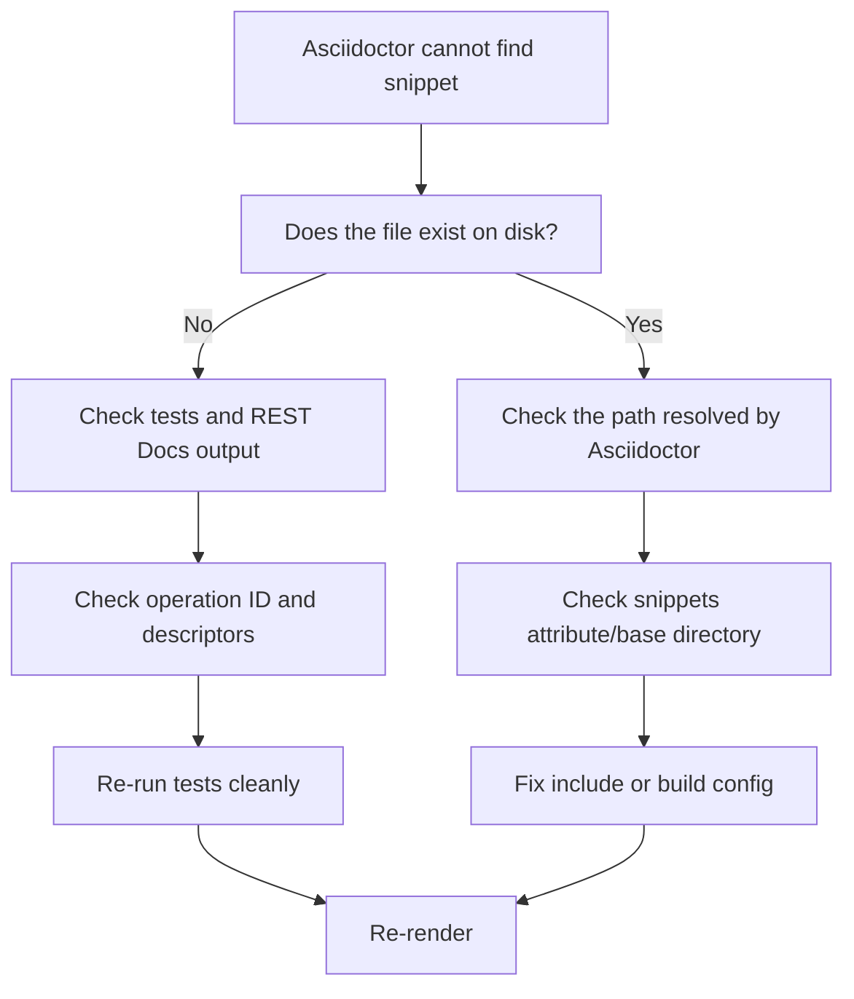

# Asciidoctor Cannot Find Snippets

## 1. Understanding Snippet Include Errors

Spring REST Docs generates verifiable REST API documentation from HTTP tests using MockMvc, WebTestClient, or REST Assured. When tests run through the REST Docs integration, snippets such as `http-request.adoc`, `http-response.adoc`, `response-fields.adoc`, and `links.adoc` are written to the generated snippets directory. Asciidoctor then reads these files via `include::` or the operation macro to produce HTML/PDF.

A common error looks like:

```text
include file not found: .../generated-snippets/books-get/http-response.adoc
```

Or the documentation renders, yet a section is empty or missing content. This means Asciidoctor could not find the file at the resolved path, or the operation macro could not find the corresponding operation/snippet.

Do not rush to create an empty file or delete the include just to get a green build. Determine whether the file was actually generated, where Asciidoctor is looking, and whether the operation and snippet names match.



## 2. Distinguishing Ungenerated Snippets from Wrong Include Paths

These are the two main categories of root causes:

| Observation | Possible cause | Where to check |
| --- | --- | --- |
| No `generated-snippets` directory. | Tests did not run, REST Docs filter is not attached, or output path differs. | Test report, document filter, output directory. |
| Directory exists, `books-get/` is missing. | Different identifier or test scenario did not run. | `document("...")` and test report. |
| Operation folder exists, `http-response.adoc` is missing. | Test has not generated that snippet, request never reached filter, or descriptor flow differs. | Test code and actual files in the folder. |
| File exists, include reports not found. | Wrong `{snippets}`, wrong relative path, or different base directory. | Attribute value and path resolved by Asciidoctor. |
| `operation::books-get[]` has no content. | Extension not loaded, wrong operation ID, or empty operation folder. | Extension classpath and generated snippets. |

First, check the actual file on disk. Do not rely on the path shown in the error message to conclude that tests failed to generate the snippet; the error can also occur because Asciidoctor is looking in the wrong directory.

## 3. Verifying That Tests Ran and Generated Snippets

Spring REST Docs only writes snippets when an HTTP documentation test executes a request through the filter/extension and calls `document(...)`. Confirm:

1. The test class and method were discovered and run.
2. The test was not skipped by tags, profiles, `-x test`, `-DskipTests`, or other conditions.
3. The test reached the request with the REST Docs filter attached.
4. `document("books-get", ...)` uses the right operation identifier.
5. The test completed its intended flow without failing before writing snippets.

REST Assured example:

```java
given(this.specification)
        .filter(document("books-get"))
.when()
        .get("/api/books/{id}", 42)
.then()
        .statusCode(200);
```

MockMvc example:

```java
mockMvc.perform(get("/api/books/{id}", 42))
        .andExpect(status().isOk())
        .andDo(document("books-get"));
```

If tests did not run, fix the task/lifecycle first. If tests pass but snippets are missing, check the filter/configuration and output directory. Refer to the test report to distinguish whether a test was undiscovered, skipped, or failed.

## 4. Verifying Operation Identifiers and Filenames

The operation directory is determined by the identifier passed to `document(...)`:

```java
document("books-get", ...)
```

Snippets are written under the `books-get` directory. If the documentation includes:

```asciidoc
include::{snippets}/book-get/http-response.adoc[]
```

then the path is wrong because `book-get` differs from `books-get`.

The snippet filename must also be exact. Common filenames include:

| Content | Snippet file |
| --- | --- |
| HTTP request | `http-request.adoc` |
| HTTP response | `http-response.adoc` |
| Request fields | `request-fields.adoc` |
| Response fields | `response-fields.adoc` |
| Path parameters | `path-parameters.adoc` |
| Query parameters | `query-parameters.adoc` |
| Request headers | `request-headers.adoc` |
| Response headers | `response-headers.adoc` |
| Hypermedia links | `links.adoc` |

Not every operation generates every file in this table. Field files exist only when tests declare payload field descriptors; links exist only when tests document matching links. Take filenames from the actual output rather than assuming every operation has `response-fields.adoc`.

## 5. Checking the `{snippets}` Attribute

With an explicit include:

```asciidoc
include::{snippets}/books-get/http-response.adoc[]
```

`{snippets}` must point to the root directory containing `books-get/`. Common conventions:

| Build tool | Common snippets directory |
| --- | --- |
| Gradle | `build/generated-snippets/` |
| Maven | `target/generated-snippets/` |

When using `spring-restdocs-asciidoctor`, the extension can configure the `snippets` attribute according to the build tool. If you are not using the extension or are using a custom path, declare the attribute in the source file or build configuration:

```asciidoc
:snippets: ../../build/generated-snippets
```

Or Gradle:

```groovy
tasks.named('asciidoctor') {
    attributes 'snippets': layout.buildDirectory.dir('generated-snippets').get().asFile
}
```

Or Maven:

```xml
<attributes>
    <snippets>${project.build.directory}/generated-snippets</snippets>
</attributes>
```

Keep only one clear source of truth. If the extension sets the attribute automatically while the build overrides it with an old path, Asciidoctor will look in the wrong place. The path where tests write snippets and the path where Asciidoctor reads snippets must match.

## 6. Checking Relative Paths and the Base Directory

If `{snippets}` is not used, an include may specify a relative path directly:

```asciidoc
include::../../build/generated-snippets/books-get/http-response.adoc[]
```

Relative paths must be calculated from the AsciiDoc file containing the macro in Asciidoctor's processing context, not assumed relative to the terminal working directory. With nested includes, identify which file actually contains the `include::` directive and compute the path from that location.

Example:

```text
project/
├── src/docs/asciidoc/
│   ├── index.adoc
│   └── operations/books-get.adoc
└── build/generated-snippets/books-get/http-response.adoc
```

In `index.adoc`, the direct path to snippets may be `../../build/generated-snippets/...`. However, in `operations/books-get.adoc`, the path needs to go up one more level: `../../../build/generated-snippets/...`. Using a properly configured `{snippets}` attribute reduces breakage when moving operation files.

Beyond the path itself, check Asciidoctor's `base_dir` and safe mode. A file can exist yet still be rejected by the processor/plugin security settings if it falls outside the allowed include root.

## 7. Checking Gradle Task Ordering

If you run solely:

```bash
./gradlew asciidoctor
```

then the `test` task may not run unless a dependency is declared. Asciidoctor may end up reading an empty directory or stale snippets.

Illustrative configuration:

```groovy
def snippetsDir = layout.buildDirectory.dir('generated-snippets')

tasks.named('test') {
    outputs.dir snippetsDir
    useJUnitPlatform()
}

tasks.named('asciidoctor') {
    dependsOn tasks.named('test')
    inputs.dir snippetsDir
    configurations 'asciidoctorExt'
}
```

`outputs.dir` only declares the task output to Gradle; REST Docs tests must still be configured to write to `snippetsDir`. `inputs.dir` declares the directory Asciidoctor reads. If snippets are generated by `integrationTest` or `documentationTest`, the dependency must point to that task instead of defaulting to `test`.

Run a clean build:

```bash
./gradlew clean test asciidoctor
```

## 8. Checking the Maven Lifecycle

With Maven, tests typically write snippets to `target/generated-snippets`. The Asciidoctor Maven Plugin must run after the tests that generate snippets. If using integration tests via Failsafe, run the appropriate lifecycle, usually:

```bash
mvn clean verify
```

Ensure the Asciidoctor execution sits in a phase after the relevant test phase, such as `prepare-package`, and that the plugin declares the `spring-restdocs-asciidoctor` dependency if using the operation macro. Running the Asciidoctor goal standalone may mean tests have not executed yet.

In multi-module projects, remember `target` is resolved per module. A test module may write to `api-tests/target/generated-snippets` while the docs module looks in `api-docs/target/generated-snippets`. Configure an explicit copy/artifact dependency or cross-module path.

## 9. Checking Extensions When Using `operation::`

If using:

```asciidoc
operation::books-get[]
```

make sure `spring-restdocs-asciidoctor` is on the Asciidoctor plugin classpath. With Gradle, the dependency is typically placed in a configuration like `asciidoctorExt` and loaded by the task. With Maven, the dependency is declared inside `asciidoctor-maven-plugin`'s plugin dependencies.

Distinguish two cases:

- `include::{snippets}/books-get/http-response.adoc[]` cannot find the file: check the file, path, and attribute.
- `operation::books-get[]` is not recognized: check the extension/macro classpath in addition to the operation directory.

If explicit includes work while the operation macro does not, the issue is very likely in the extension setup. If neither can find the file, focus on the output directory or test generation.

## 10. Commands to Inspect Actual Files

After a clean test run, use an OS-appropriate command to see which files were generated:

```bash
find build/generated-snippets -maxdepth 3 -type f
```

Or for Maven:

```bash
find target/generated-snippets -maxdepth 3 -type f
```

On PowerShell:

```powershell
Get-ChildItem .\build\generated-snippets -Recurse -File
Get-ChildItem .\target\generated-snippets -Recurse -File
```

If you know the exact operation to inspect:

```powershell
Get-ChildItem .\build\generated-snippets\books-get -File
```

The output confirms filenames and casing. Linux filesystems are typically case-sensitive, whereas some Windows filesystems are not. Use the exact generated filename to avoid issues that only surface on Linux CI.

## 11. Preventing Stale Snippets from Masking Errors

Generated snippets can linger from a previous build. If current tests fail to run yet Asciidoctor reads old files, documentation can still render successfully and mask a test discovery bug.

To rule this out:

- Run `clean` on the proper project/module before testing.
- Verify timestamps or contents of operation snippets belong to the current run.
- Do not commit or manually edit files inside `build/generated-snippets` or `target/generated-snippets`.
- Render/publish only after snippet-generating tests pass.
- Never create empty files just to satisfy includes.

## 12. Diagnosing by Symptom

| Symptom | Possible cause | Resolution |
| --- | --- | --- |
| `include file not found` and file does not exist | Tests did not generate snippet or operation ID/descriptor is wrong. | Check test report, filter, and generated directory. |
| `include file not found` even though file exists | Wrong `{snippets}`, relative path, or `base_dir`. | Inspect resolved path and Asciidoctor configuration. |
| Manual include works, `operation::` fails | Extension not loaded. | Check `spring-restdocs-asciidoctor` on plugin classpath. |
| Operation macro produces no section | Operation directory is empty or ID mismatches. | Compare `document("...")` with the macro target. |
| Only a few snippets are missing | Test did not declare descriptors or files were not produced. | Check actual output and `document(...)`. |
| Works locally, fails in CI | Different paths, case sensitivity, or task graph. | Use portable paths, clean output, and compare build commands. |
| Docs module cannot see test module snippets | Output sits in another module's `target`/`build`. | Configure artifact/path sharing between modules. |
| Old file is still included | Build not cleaned or tests skipped. | Clean and verify test report/timestamps. |

## 13. End-to-End Troubleshooting Workflow

1. Read the Asciidoctor error to get the missing operation ID and filename.
2. Check whether that file exists in the generated snippets directory.
3. If it does not exist, read the test report to confirm the HTTP documentation test ran.
4. Inspect the REST Docs filter/extension and `document("operation-id", ...)`.
5. Verify that the test output directory and `{snippets}` attribute point to the same location.
6. If the file exists, recalculate the relative include path or inspect `base_dir`/safe mode.
7. If using the operation macro, confirm the extension is loaded and the target matches the operation folder.
8. Run clean tests followed by Asciidoctor in the proper task/lifecycle order.
9. Re-open the HTML/PDF to verify the section appears.

## 14. Common Errors

| Symptom | Cause | Direction to resolve |
| --- | --- | --- |
| Wrong operation name | `document("books-get-200")` while including `books-get`. | Align identifier between test and AsciiDoc. |
| Wrong filename | Included `response-field.adoc` instead of `response-fields.adoc`. | Check actual filename. |
| Attribute not substituted | Extension not loaded or attribute undeclared. | Configure `spring-restdocs-asciidoctor` or declare `snippets`. |
| Wrong relative path in child file | Computed path from `index.adoc` instead of the file containing the include. | Use `{snippets}` or recalculate from the current file. |
| Missing snippet because tests did not run | Asciidoctor task ran standalone. | Add task dependency/lifecycle after tests. |
| Operation macro unrecognized | Extension missing from Asciidoctor plugin classpath. | Add dependency to the right configuration/plugin. |
| Fails only on Linux | Filename casing mismatch. | Match exact filename casing. |
| Build uses stale snippets | Output was not cleaned. | Clean the right module and publish only fresh artifacts. |

## 15. Practical Checklist

- [ ] Extracted the exact operation ID and filename from the error message.
- [ ] Verified whether the snippet actually exists on the filesystem.
- [ ] Test report confirms HTTP documentation tests ran and passed.
- [ ] REST Docs filter/extension is attached and invokes `document(...)`.
- [ ] Test output directory has been verified from actual configuration.
- [ ] `{snippets}` points to the exact generated snippets directory.
- [ ] Relative paths are computed from the AsciiDoc file containing the macro.
- [ ] Checked `base_dir`/safe mode if the file exists yet the include is rejected.
- [ ] Operation macro has the extension on the classpath and targets the right identifier.
- [ ] Gradle/Maven runs tests before Asciidoctor.
- [ ] Clean build does not consume stale snippets; CI publishes only output from the current build.
- [ ] Final HTML/PDF opened and verified to contain complete sections.

When Asciidoctor cannot find a snippet, inspect the actual files on disk before editing includes. If the file does not exist, trace back to test discovery, the REST Docs filter, the operation identifier, and the output directory. If the file exists, check `{snippets}`, relative paths, `base_dir`, and the extension when using `operation::`. Aligning test output with Asciidoctor input and running a clean build ensures documentation is generated from snippets produced by the current test run.

## References

- [Spring REST Docs – Getting Started](https://docs.spring.io/spring-restdocs/reference/getting-started.html)
- [Spring REST Docs – Working with Asciidoctor](https://docs.spring.io/spring-restdocs/docs/current/reference/htmlsingle/)
- [Spring REST Docs – Documenting Your API](https://docs.spring.io/spring-restdocs/reference/documenting-your-api.html)
- [Asciidoctor – Include Directive](https://docs.asciidoctor.org/asciidoc/latest/directives/include/)
- [Asciidoctor – Safe Modes](https://docs.asciidoctor.org/asciidoc/latest/safe-modes/)
