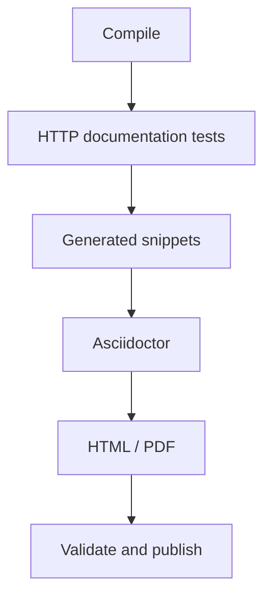

# Build Plugins Not Running in the Right Dependency Order

## 1. Symptoms and Resolution Principles

Spring REST Docs creates verifiable REST API documentation from HTTP tests using MockMvc, WebTestClient, or REST Assured. Tests run through the REST Docs integration to write snippets; Asciidoctor then reads those snippets and renders HTML/PDF. This workflow has a strict dependency order:

1. Compile production and test sources.
2. Execute HTTP documentation tests.
3. Write generated snippets to the output directory.
4. Run Asciidoctor after snippets are ready.
5. Validate and publish documentation.

If build plugins do not declare dependencies properly, Asciidoctor may run before tests, in parallel with tests, or without running snippet-generating tests at all. The usual result is `include file not found`, empty sections, stale HTML preserved, or a passing build whose documentation was never updated.

Rule: **the snippet-generating task must be an upstream dependency of the documentation rendering task**. Simply declaring a directory as `inputs.dir` does not make the test task run beforehand; an explicit task or lifecycle dependency is required.



## 2. Distinguishing Plugin Dependencies from Task Dependencies

Two kinds of dependencies are often confused:

| Type | Example | Role |
| --- | --- | --- |
| Plugin/library dependency | `spring-restdocs-asciidoctor` in `asciidoctorExt`. | Places macros/extensions on Asciidoctor's classpath. |
| Task dependency | `asciidoctor.dependsOn(test)`. | Ensures the test task finishes before Asciidoctor runs. |
| Task input/output | `asciidoctor.inputs.dir(snippetsDir)`, `test.outputs.dir(snippetsDir)`. | Declares what data tasks read/write to Gradle. |
| Maven lifecycle binding | Asciidoctor execution at `prepare-package`, tests at `test` or Failsafe before `verify`. | Orders plugin goals by lifecycle phase. |

Adding `spring-restdocs-asciidoctor` does not automatically run tests. Adding `dependsOn(test)` does not put the extension on the classpath either. A complete setup requires the extension dependency, task/lifecycle ordering, and the matching snippets directory.

## 3. Gradle: Minimal Task Dependency Configuration

When tests live in the default source set and write snippets to `build/generated-snippets`, you can configure:

```groovy
plugins {
    id 'java'
    id 'org.asciidoctor.jvm.convert' version '3.3.2'
}

configurations {
    asciidoctorExt
}

def snippetsDir = layout.buildDirectory.dir('generated-snippets')

dependencies {
    testImplementation 'org.springframework.restdocs:spring-restdocs-mockmvc'
    asciidoctorExt 'org.springframework.restdocs:spring-restdocs-asciidoctor'
}

tasks.named('test') {
    outputs.dir snippetsDir
    useJUnitPlatform()
}

tasks.named('asciidoctor') {
    dependsOn tasks.named('test')
    inputs.dir snippetsDir
    configurations 'asciidoctorExt'
    attributes 'snippets': snippetsDir.get().asFile
}
```

Key lines:

- `dependsOn tasks.named('test')`: the `test` task must finish before Asciidoctor runs.
- `test.outputs.dir snippetsDir`: declares to Gradle that tests write snippets to this directory.
- `asciidoctor.inputs.dir snippetsDir`: declares that Asciidoctor reads the same directory.
- `configurations 'asciidoctorExt'`: loads the Spring REST Docs extension into the Asciidoctor task.

Note: `outputs.dir` does not configure the REST Docs writer. The test setup (such as `@AutoConfigureRestDocs`, `RestDocumentationExtension`, or custom configuration) must also write to `snippetsDir`.

## 4. Gradle: Using a Dedicated Integration/Documentation Test Task

Some projects do not place HTTP documentation tests in the `test` task. They may live in `integrationTest` or `documentationTest`. In that case, the dependency must point to the task that actually generates snippets.

Example using an `integrationTest` source set:

```groovy
sourceSets {
    integrationTest {
        java.srcDir file('src/integrationTest/java')
        resources.srcDir file('src/integrationTest/resources')
        compileClasspath += sourceSets.main.output
        runtimeClasspath += output + compileClasspath
    }
}

configurations {
    integrationTestImplementation.extendsFrom testImplementation
    integrationTestRuntimeOnly.extendsFrom testRuntimeOnly
}

def snippetsDir = layout.buildDirectory.dir('generated-snippets')

tasks.register('integrationTest', Test) {
    description = 'Runs integration and REST Docs tests.'
    group = 'verification'
    testClassesDirs = sourceSets.integrationTest.output.classesDirs
    classpath = sourceSets.integrationTest.runtimeClasspath
    outputs.dir snippetsDir
    useJUnitPlatform()
}

tasks.named('asciidoctor') {
    dependsOn tasks.named('integrationTest')
    inputs.dir snippetsDir
    configurations 'asciidoctorExt'
    attributes 'snippets': snippetsDir.get().asFile
}
```

This is a structural example; source set and dependency configuration may vary depending on your project's convention plugins. If `check` must also run integration tests, wire the appropriate dependency into `check`. Do not point Asciidoctor at `test` if snippets are only generated by `integrationTest`.

If both `test` and `integrationTest` write to the same snippets directory, manage operation identifiers to avoid overwrites and ensure task ordering prevents race conditions.

## 5. Inspecting the Gradle Task Graph

Before editing configuration, inspect which tasks are actually scheduled:

```bash
./gradlew asciidoctor --dry-run
```

Once dependencies are declared, the output should show the snippet-generating test task running before `asciidoctor`. For detailed logs:

```bash
./gradlew clean asciidoctor --info
```

If the test task does not appear in the dry-run graph, the dependency may be misconfigured, another task may be generating snippets, or the build may be invoking the wrong task. If the test task appears yet is skipped, check `onlyIf`, `enabled`, test filters, tags, and skip properties.

Do not infer ordering from the position of blocks in `build.gradle`. Gradle schedules work from the task graph and dependencies, not from textual order in the build script.

## 6. Gradle: Avoiding Reverse Dependencies or Task Cycles

Dependencies must flow in one direction:

```text
test/integrationTest -> generated snippets -> asciidoctor
```

In the Gradle DSL, this is typically written as `asciidoctor.dependsOn(test)`: Asciidoctor depends on tests. Avoid configuring the reverse—making tests depend on Asciidoctor when Asciidoctor already depends on tests—which creates a task cycle.

Do not configure the Asciidoctor task to write into the same directory that tests manage as their snippets output. Keep them distinct:

- `generated-snippets`: test output, Asciidoctor input.
- `docs/asciidoc/html5`: Asciidoctor HTML output.
- PDF output: a separate directory per the PDF backend/task configuration.

If the build cache or incremental builds miss changes, verify that inputs and outputs fully cover what tasks consume. Avoid manually forcing a task `UP-TO-DATE` when snippets have not been generated.

## 7. Maven: Understanding the Lifecycle Before Configuring Plugins

Maven executes plugin goals by lifecycle phase. A typical flow:

| Phase | Typical work |
| --- | --- |
| `test` | Maven Surefire runs matching unit/documentation tests. |
| `integration-test` | Maven Failsafe runs integration tests if configured. |
| `verify` | Failsafe verifies integration test results and checks. |
| `prepare-package` | Can run Asciidoctor to render documentation before packaging. |

If REST Docs tests are run by Surefire in the `test` phase, placing the Asciidoctor execution in a later phase such as `prepare-package` usually ensures tests run first. If snippets are generated by Failsafe, verify that Asciidoctor executes after the integration tests run. With Failsafe, `mvn verify` is commonly used to execute both `integration-test` and `verify`.

Example invocation:

```bash
mvn clean verify
```

Invoking a standalone Asciidoctor render goal can skip snippet-generating tests. The plugin will still run, but without fresh input.

## 8. Maven: Configuring Asciidoctor After Tests

Example configuring the Asciidoctor Maven Plugin in the `prepare-package` phase:

```xml
<plugin>
    <groupId>org.asciidoctor</groupId>
    <artifactId>asciidoctor-maven-plugin</artifactId>
    <version>2.2.6</version>
    <executions>
        <execution>
            <id>render-api-docs</id>
            <phase>prepare-package</phase>
            <goals>
                <goal>process-asciidoc</goal>
            </goals>
            <configuration>
                <backend>html</backend>
                <attributes>
                    <snippets>${project.build.directory}/generated-snippets</snippets>
                </attributes>
            </configuration>
        </execution>
    </executions>
    <dependencies>
        <dependency>
            <groupId>org.springframework.restdocs</groupId>
            <artifactId>spring-restdocs-asciidoctor</artifactId>
            <version>${spring-restdocs.version}</version>
        </dependency>
    </dependencies>
</plugin>
```

`spring-restdocs-asciidoctor` belongs in the plugin's dependencies so the macro is loaded. It does not replace the test integration dependency. `snippets` must point to the output directory written by tests. Align the plugin and Spring REST Docs versions in the example with your project's dependency management.

If REST Docs tests run under Failsafe, verify that the Asciidoctor execution actually runs after the integration-test goals. You can bind the execution to a later phase or configure the lifecycle appropriately, confirming actual ordering in the Maven log.

## 9. Maven: Multi-Module Builds and Profiles

In a multi-module build, the test module and docs module may have separate output directories:

```text
parent/
├── api-tests/target/generated-snippets/
└── api-docs/target/generated-docs/
```

Asciidoctor in `api-docs` does not automatically read `api-tests/target/generated-snippets`. Configure an explicit copy/artifact dependency or shared path. Ensure reactor build order executes the test module before the docs module and that the docs module receives the proper artifact.

If plugin or test executions live in a Maven profile, that profile must be enabled in the CI command:

```bash
mvn -Papi-docs clean verify
```

The profile name is just an example. Inspect the actual POM and effective POM whenever it is unclear which executions are active:

```bash
mvn help:active-profiles
mvn help:effective-pom
```

Do not leave the documentation profile disabled in CI while still publishing stale HTML from an earlier workspace.

## 10. Do Not Confuse Plugin Dependencies with Lifecycle Executions

Some configuration failures happen because a plugin has the right dependency yet its execution is never bound, or the execution runs while the plugin lacks the extension.

| Configuration | If missing or wrong |
| --- | --- |
| `spring-restdocs-asciidoctor` in plugin dependencies | `operation::` or Spring REST Docs macros are unrecognized. |
| `asciidoctor-maven-plugin` execution | No documentation rendering step runs in the lifecycle. |
| Execution phase | Rendering may run before snippet-generating tests. |
| `snippets` attribute | Includes point to the wrong folder even when snippets exist. |
| REST Docs test dependency/filter | Tests run without generating snippets. |
| Maven profile activation | Plugin executions or tests are excluded from the build. |

The same applies to Gradle: `asciidoctorExt` supplies the extension classpath; `dependsOn` controls task order; `inputs/outputs` describe data for incremental builds. No single setting replaces the others.

## 11. Running a Clean Build and Verifying Fresh Output

After fixing dependency ordering, run a clean build so stale snippets cannot hide errors.

Gradle:

```bash
./gradlew clean test asciidoctor
```

Or when using an integration task:

```bash
./gradlew clean integrationTest asciidoctor
```

Maven:

```bash
mvn clean verify
```

Verify:

- The test report contains the expected documentation tests.
- Snippets have timestamps and contents from the current run.
- The Asciidoctor task starts after tests finish.
- There are no `include file not found` errors.
- HTML/PDF output is freshly generated.
- When tests fail, dependent render/publish tasks halt according to build policy.

Do not use "the directory exists" as sole proof. A directory may remain from a prior build or be created empty by a task output declaration.

## 12. Diagnosing by Symptom

| Symptom | Possible cause | Resolution |
| --- | --- | --- |
| Asciidoctor runs before tests | Missing `dependsOn` or Maven phase is too early. | Declare task/lifecycle dependency after tests. |
| Gradle dry-run omits the test task | Asciidoctor does not depend on the snippet task or task name is wrong. | Point `dependsOn` to `test`, `integrationTest`, or the actual task. |
| Tests run, Asciidoctor reads empty folder | Test writer and Asciidoctor input use different paths. | Align REST Docs output directory with `snippetsDir`/attribute. |
| `operation::` unrecognized | Extension missing from plugin classpath. | Add `spring-restdocs-asciidoctor` to `asciidoctorExt`/Maven plugin dependencies. |
| Maven `test` skips `*IT` | Tests belong to Failsafe, lifecycle never reached integration-test/verify. | Use `mvn verify` and check Failsafe execution. |
| Running `asciidoctor` alone fails includes | Renderer does not run HTTP tests automatically. | Run the test task first or add a dependency. |
| Tasks run in parallel and miss files | Dependency order wrong or multiple tasks write to the same output. | Declare task dependencies and isolate outputs/operation IDs. |
| CI renders stale docs | Clean/profile/task graph differs from local. | Clean the right module and verify active profiles and build artifact IDs. |
| Build cycle | Task dependency declared backward or circularly. | Design unidirectional test -> snippets -> Asciidoctor and remove cycles. |

## 13. End-to-End Dependency Order Verification Example

Suppose `books-get` is generated by `documentationTest`, not the `test` task.

**Step 1 — Inspect the task graph:**

```bash
./gradlew asciidoctor --dry-run
```

If `documentationTest` does not appear before `asciidoctor`, the dependency is not wired properly.

**Step 2 — Declare the right task:**

```groovy
tasks.named('asciidoctor') {
    dependsOn tasks.named('documentationTest')
}
```

**Step 3 — Align the snippets directory:**

```groovy
tasks.named('documentationTest') {
    outputs.dir snippetsDir
}

tasks.named('asciidoctor') {
    inputs.dir snippetsDir
    attributes 'snippets': snippetsDir.get().asFile
}
```

Ensure the REST Docs test configuration also writes to `snippetsDir`.

**Step 4 — Run a clean build and inspect reports:**

```bash
./gradlew clean documentationTest asciidoctor --info
```

Verify that a fresh `books-get/http-response.adoc` is generated before Asciidoctor starts. If the file exists yet the include still fails, switch to diagnosing `{snippets}`/relative paths instead of continuing to tweak task order.

## 14. Common Errors

| Symptom | Cause | Direction to resolve |
| --- | --- | --- |
| Build file has `asciidoctor` without test dependency | Only declared the render task. | Add `dependsOn` or appropriate lifecycle binding. |
| Used `inputs.dir` assuming tests will auto-run | Inputs do not create task dependencies. | Declare the dependency explicitly. |
| Set `dependsOn(test)` while integration tests generate snippets | Depends on the wrong task. | Point to `integrationTest`/`documentationTest`. |
| Only added `spring-restdocs-asciidoctor` | Extension present, no snippet-generating task wired. | Configure test integration and task order. |
| Only added `spring-restdocs-mockmvc` | Test integration present, missing Asciidoctor macro extension. | Add `spring-restdocs-asciidoctor` plugin dependency. |
| Maven renders in `test` phase | Execution may run before or alongside tests depending on plugin order. | Bind to a phase after tests and check logs/lifecycle. |
| Maven skips Failsafe | Invoked only `mvn test` or profile inactive. | Run `mvn verify` and activate the right profile. |
| Build cache preserves stale output | Wrong inputs/outputs or clean missed. | Clean properly and declare exact task inputs/outputs. |
| Task cycle | Reverse dependency. | Only let Asciidoctor depend on snippet-generating tasks. |

## 15. Practical Checklist

- [ ] Identified the exact task that produces generated snippets.
- [ ] Asciidoctor depends on that exact task, not mistakenly on default `test`.
- [ ] Gradle task graph or Maven lifecycle log confirms actual execution order.
- [ ] Distinguished plugin classpath dependencies from task/lifecycle dependencies.
- [ ] Test output directory matches Asciidoctor's snippets input and attribute.
- [ ] Gradle inputs/outputs are declared properly so incremental builds never use stale output.
- [ ] Maven Surefire/Failsafe and profiles are invoked through the proper lifecycle.
- [ ] Multi-module builds pass snippets between the test module and docs module properly.
- [ ] No task cycles or multiple tasks writing to the same output causing races.
- [ ] Clean build generates fresh snippets before rendering.
- [ ] When tests fail, dependent Asciidoctor/publish tasks do not proceed with stale snippets.

When build plugins run out of dependency order, identify which task produces snippets and which task reads them. In Gradle, connect Asciidoctor to the exact producer task using `dependsOn`, declare inputs/outputs, and inspect the task graph. In Maven, place Asciidoctor in an appropriate post-test phase and run a deep enough lifecycle, especially when using Failsafe. Keep the extension dependency, task order, and snippets path distinct and consistent; all three must align for documentation to render from the current test run's output.

## References

- [Spring REST Docs – Getting Started](https://docs.spring.io/spring-restdocs/reference/getting-started.html)
- [Spring REST Docs – Working with Asciidoctor](https://docs.spring.io/spring-restdocs/docs/current/reference/htmlsingle/)
- [Gradle – Task Dependencies](https://docs.gradle.org/current/userguide/controlling_task_execution.html#sec:task_dependencies)
- [Gradle – Incremental Builds](https://docs.gradle.org/current/userguide/incremental_build.html)
- [Maven – Introduction to the Build Lifecycle](https://maven.apache.org/guides/introduction/introduction-to-the-lifecycle.html)
- [Maven Failsafe Plugin – Usage](https://maven.apache.org/surefire/maven-failsafe-plugin/usage.html)
