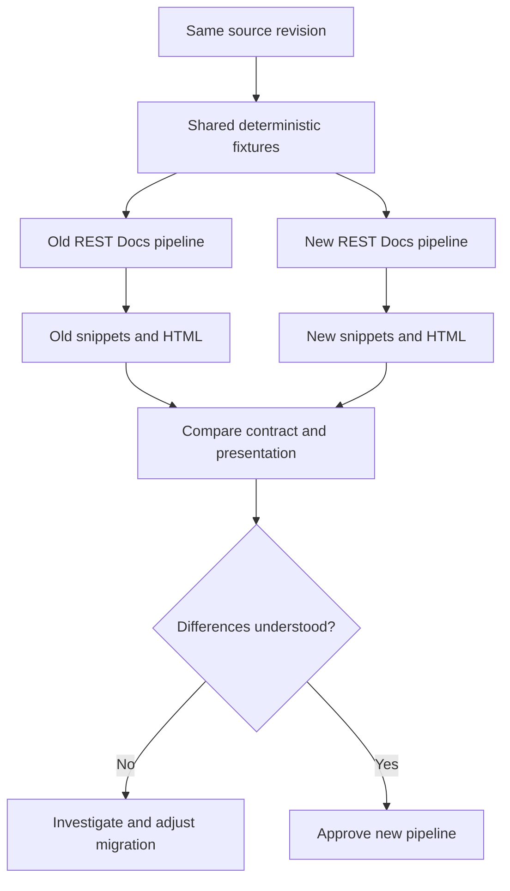

# Keeping Legacy Documentation Reproducible During the Transition Period

## Learning Objectives

After this lesson, you will be able to:

- Explain why preserving reproducibility of legacy documentation is necessary while upgrading Spring REST Docs, Spring Boot, build tools, or Asciidoctor.
- Inventory the sources, snippets, templates, toolchains, and artifacts that produce the current documentation.
- Pin dependencies and environments to rebuild the baseline documentation.
- Build a workflow to run old and new build pipelines in parallel to compare results.
- Separate formatting diffs from diffs reflecting API contract changes.
- Manage versions, provenance, archiving, and deprecation policies for legacy documentation.
- Define verifiable transition exit criteria and rollback procedures.

## 1. Why Keep Legacy Documentation Reproducible?

When upgrading Spring REST Docs or its surrounding ecosystem, output can change even if the API itself has not changed. For example:

- The Asciidoctor plugin version changes the HTML structure or theme.
- Spring REST Docs changes snippet templates or request/response formatting.
- Spring Boot/Spring Framework changes serialization, error handling, or static resource behavior.
- Java, Gradle, or Maven changes task lifecycles and dependency resolution.
- Custom snippet templates or AsciiDoc attributes are modified.
- Test dependencies alter JSON ordering, headers, or value representation.

If you keep only the latest source and immediately delete the old configuration, the team may lose the ability to rebuild released documentation to investigate incidents, verify contracts, or support consumers using older API versions.

During the transition period, maintain a reproducible baseline. A baseline does not necessarily have to remain publicly published; it serves as technical proof showing which source, toolchain, and configuration produced the old documentation.

## 2. Defining the Baseline Scope

Before upgrading, inventory every component that builds the documentation:

| Component | What to Record |
| --- | --- |
| Source revision | Commit SHA or release tag |
| Application/API version | Code and contract version |
| Java | JDK vendor/version or toolchain |
| Build tool | Gradle wrapper or Maven version |
| Spring Boot/Framework | Platform version |
| Spring REST Docs | Core and test integration versions |
| Asciidoctor | Plugin, engine, and extension versions |
| Test dependencies | JUnit, MockMvc/WebTestClient/REST Assured, and mock server |
| Snippet templates | Default templates and custom templates |
| AsciiDoc sources | Entry point, includes, attributes, theme |
| Generated snippets | Output directory and document identifiers |
| Artifact | Published HTML/PDF/JAR/ZIP, checksum, and metadata |

A good baseline lets someone else answer: "Which revision do I check out, which JDK/build tool do I use, and which command do I run to reproduce this documentation?"

### 2.1. Saving a Baseline Manifest

Metadata can be stored alongside the artifact:

```json
{
  "service": "orders-service",
  "applicationVersion": "2.3.1",
  "apiVersion": "v2",
  "sourceRevision": "7f3a91c",
  "javaVersion": "17",
  "gradleVersion": "8.7",
  "springBootVersion": "3.2.5",
  "springRestDocsVersion": "3.0.1",
  "asciidoctorPluginVersion": "4.0.2",
  "artifact": "orders-api-docs-2.3.1.zip",
  "sha256": "example-checksum"
}
```

These values only illustrate structure. In practice, pull data from build metadata, dependency locks/version catalogs, and the release pipeline. Never write guessed versions or dummy checksums into a release manifest.

### 2.2. Preserving Documentation Generation Configuration

A standalone HTML artifact is not enough for reproducibility. Retain:

- AsciiDoc sources and include files.
- Custom snippet templates.
- Build scripts and wrappers.
- Dependency lockfiles/version catalogs if the project uses them.
- Test fixtures and test configuration.
- Attributes/variables passed to Asciidoctor.
- Metadata on required environment settings.

You do not necessarily need to store generated snippets long-term if they can be reliably regenerated. However, archiving snippets for releases can be helpful for comparison and auditing. If stored, tie them to an exact source revision.

## 3. Pinning the Legacy Toolchain and Dependencies

To keep the baseline reproducible, avoid floating dependency versions:

- Commit the Gradle Wrapper or Maven Wrapper.
- Lock the JDK toolchain.
- Use explicit versions for Spring Boot, Spring REST Docs, and the Asciidoctor plugin.
- Lock custom templates and extensions.
- Use dependency locking or appropriate dependency management.
- Document environment variables that affect output.

Gradle toolchain example:

```groovy
java {
    toolchain {
        languageVersion = JavaLanguageVersion.of(17)
    }
}
```

The version above is an example. Use the exact JDK that the baseline used; do not upgrade the toolchain in the same change if the goal is to reproduce legacy output.

Wrapper check example:

```bash
./gradlew --version
```

With Maven:

```bash
./mvnw --version
```

The wrapper pins the build tool, but does not pin the JDK itself. CI still needs the exact JDK installed or an image pinned by version/digest.

## 4. Creating a Baseline from the Legacy State

Before changing dependencies or templates:

1. Check out the release tag or commit that produced the old documentation.
2. Use the exact JDK and build wrapper.
3. Clean generated output to avoid leftover stale files.
4. Run documentation tests.
5. Render Asciidoctor.
6. Package the artifact following the old release process.
7. Save test reports, artifacts, manifests, and checksums.
8. Record a re-runnable build command.

Gradle example:

```bash
./gradlew clean test asciidoctor
```

Maven example:

```bash
./mvnw clean verify
```

Commands must match the project's actual tasks/lifecycle. Confirm documentation tests actually executed and Asciidoctor consumed snippets from that same build run.

### 4.1. Validating the Baseline

Do not treat the first build as a valid baseline if:

- Tests were skipped outside policy.
- The snippet directory retained files from an earlier build.
- Asciidoctor rendered with ignored warnings/errors.
- The artifact is missing CSS, images, or operation pages.
- The source revision or dependency versions cannot be identified.
- The build depends on uncommitted local files.

If the baseline cannot be reproduced, document the limitations and archive the last published artifact along with available metadata. Never claim a baseline is reproducible without re-running it successfully.

## 5. Upgrading on a Separate Branch While Keeping the Legacy Path

During the transition period, keep two distinct build paths:

```text
release/2.x
    └── old toolchain + old templates + baseline docs

upgrade/restdocs-3.x
    └── new toolchain + updated templates + candidate docs
```

Do not modify the old release configuration directly to experiment with an upgrade before having a baseline and rollback path. The upgrade branch should apply intentional dependency/template changes, record diffs, and run tests independently.

If a repository uses a single release branch, you can use a baseline commit/tag and a feature branch for testing. Avoid maintaining two unverified build configurations, as they drift quickly.

## 6. Running Old and New Documentation Pipelines in Parallel

During a transition window, run both pipelines on the same source revision when possible:

1. The old pipeline uses legacy dependencies/templates.
2. The new pipeline uses upgraded dependencies/templates.
3. Both run the same documentation tests and fixtures.
4. Each pipeline writes output to a separate directory.
5. Store HTML, snippets, and test reports separately.
6. Compare results before replacing the main pipeline.

Diagram:



If running on the exact same source revision is impossible due to API/dependency incompatibilities, record the corresponding commits and separate code diffs from toolchain diffs. Do not compare two artifacts from different commits and attribute every difference to the REST Docs upgrade.

## 7. Comparing Snippets and HTML Properly

Diffs between old and new builds can originate from several layers:

| Diff Type | Example | How to Evaluate |
| --- | --- | --- |
| Contract diff | New field, changed status, changed header | Requires API behavior review |
| Snippet formatting | Whitespace, table markup, line wrapping | May be a template/formatter change |
| HTML presentation | CSS classes, navigation, heading structure | Review layout and links |
| Environment noise | Port, timestamp, UUID, host | Control via fixtures/preprocessors |
| Dependency behavior | JSON serialization or exception mapping | Determine if runtime behavior changed |

Do not rely on an HTML snapshot as the sole criterion. HTML may change due to theme updates while snippet contracts stay intact; conversely, HTML might look nearly identical while a response field was silently dropped.

Compare layer by layer:

1. Test results and HTTP assertions.
2. Structured REST Docs snippets.
3. AsciiDoc source/include resolution.
4. HTML rendering and navigation.
5. Artifact packaging and runtime serving.

### 7.1. Reviewing Contracts Before Presentation

Prioritize checking:

- Request methods/paths and parameters.
- Request/response headers.
- Request/response fields.
- Success/error status codes.
- Links and multipart parts.
- Error schemas and authentication challenges.

Only after contracts pass should you review HTML/CSS/navigation. This separates API changes from presentation shifts introduced by Asciidoctor.

## 8. Controlling Custom Snippet Template Changes

Custom snippet templates may rely on models or helpers from older Spring REST Docs versions. When upgrading:

- Read release notes/migration notes for the exact target version.
- Verify model attribute names and the template engine.
- Check HTML/AsciiDoc escaping.
- Check table markup, cell spans, and multiline content.
- Verify snippet file names remain compatible with includes.
- Do not copy default templates from the new version into the project without comparing against the original custom intent.

Keep legacy templates in the baseline branch/tag so published artifacts remain reproducible. New templates should be reviewed alongside test output rather than swapped silently.

## 9. Managing Legacy AsciiDoc and Markdown

During the transition period, several artifacts may coexist:

- AsciiDoc sources currently used for rendering.
- HTML published from those sources.
- Markdown sources distributed to consumers.
- Templates and attributes from the legacy release.
- New pages being migrated or reorganized.

Define clearly whether each file is a source of truth, generated output, or archive. Never allow two manually edited files to represent the same content without a synchronization rule.

If Markdown is purely an export from AsciiDoc, document the source and how to regenerate it. If Markdown is an official source, run a pipeline checking links/images/code fences and ensure content stays synchronized with contracts.

Do not delete legacy documentation URLs immediately when the new pipeline goes live. Consumers may still have bookmarks, SDK generators, or integration guides pointing to the older version.

## 10. Versioning and Archiving Legacy Documentation

The documentation site can be organized by version:

```text
docs/
├── current/
├── 3.0/
├── 2.4/
└── archive/
    └── 2.3/
```

The policy should specify:

- Which versions are actively supported.
- Which versions are reference-only.
- The date documentation becomes deprecated.
- When old URLs will be redirected or removed.
- Who owns content and security notice updates.

If preserving old URLs, add a clear banner stating the page documents a legacy API version. Do not overwrite old content with the new contract while keeping the old URL/version, as consumers will misread history.

## 11. URL Transitions and Link Compatibility

When restructuring pages, links can break:

- Resource page URLs change.
- Anchor IDs change.
- CSS/image files move directories.
- Website base path changes.
- Markdown/HTML file names change.

Build an old URL → new URL mapping:

| Old URL | New URL | Policy |
| --- | --- | --- |
| /docs/orders.html | /docs/2.4/orders/ | Redirect if equivalent |
| /docs/#orders-get | /docs/2.4/orders/#orders-get | Preserve anchor or map |
| /docs/api.md | /docs/2.4/api.md | Keep file or announce new URL |

The URLs in this table are examples. Check access logs, link checkers, and consumer documentation before removing old paths. Redirects are only appropriate when the destination content is genuinely equivalent; do not redirect every old version to current if contracts have changed.

## 12. Rollback When the New Pipeline Has Issues

Before switching the main pipeline:

1. Keep the old baseline tag/commit.
2. Retain published docs artifacts and checksums.
3. Preserve old build wrappers, dependency locks, and templates.
4. Do not overwrite immutable published artifacts.
5. Prepare a mechanism to repoint the current alias back to the previous version.
6. Verify URLs and redirects after rollback.

Documentation rollback can be independent of application rollback if docs are published separately. If docs live inside the application JAR, rolling back docs usually requires redeploying the corresponding application artifact. Clarify this coupling prior to release.

Do not delete old archives after completing a rollback. They serve as proof of what was released and enable reproduction during investigations.

## 13. Exit Criteria for the Transition Period

Retire the legacy pipeline only when:

- New documentation tests run stably in CI.
- All required snippets are generated.
- Custom templates are compatible and reviewed.
- Asciidoctor renders with zero include/link errors.
- Contract diffs have been approved.
- HTML/Markdown/assets have been verified.
- New artifacts carry clear version/provenance metadata.
- URLs/redirects and version archives are confirmed.
- A rollback procedure has been tested or rehearsed.
- The release owner approves retiring the old pipeline.

Do not use "the new build went green once" as the criterion to delete the baseline. Gather sufficient evidence across environments and release cycles.

## 14. Common Mistakes

| Symptom | Possible Cause | Resolution |
| --- | --- | --- |
| Cannot reproduce old docs | Unpinned JDK/plugin/dependency versions | Store wrappers, toolchains, lockfiles, and manifests |
| Huge diff after upgrade | Contract, template, and theme changes mixed | Compare tests, snippets, AsciiDoc, and HTML separately |
| New snippets pick up stale output | Both pipelines share the same output directory | Separate workspaces and generated directories |
| Custom snippet template fails | Model/template API changed | Read migration notes and test templates per version |
| Old links return 404 | URLs/anchors changed without mapping | Maintain redirects or archived URLs |
| Consumers follow wrong contract | current URL changed content without version label | Publish versioned docs with clear banners |
| Rollback fails to restore docs | Old artifacts/toolchains were deleted | Keep immutable artifacts and baseline metadata |
| Old/new pipelines differ due to data | Unstable fixtures/timezone/randomness | Use identical deterministic test data |
| Same version, different source output | Pipelines checked out different commits | Attach source revision/build ID and enforce provenance |

## 15. Checklist for Keeping Legacy Documentation Reproducible

- [ ] Recorded source revision and API/application version of the baseline.
- [ ] Pinned Java, Gradle/Maven, Spring REST Docs, and Asciidoctor versions.
- [ ] Preserved AsciiDoc sources, custom templates, build scripts, and attributes.
- [ ] Rebuilt baseline from a clean state.
- [ ] Archived old artifacts, checksums, and metadata.
- [ ] Old and new pipelines use separate output directories.
- [ ] Test fixtures are identical and deterministic.
- [ ] Contract diffs are reviewed separately from presentation diffs.
- [ ] Custom templates and includes are verified.
- [ ] Legacy URLs/anchors have mappings or an archiving policy.
- [ ] Rollback paths exist for both docs and application.
- [ ] Legacy pipeline is retired only after the new pipeline meets exit criteria.

## 16. Hands-On Exercise

An Orders service is preparing to upgrade Spring REST Docs and Asciidoctor. Documentation for version 2.3 is already published and consumers are actively integrating against it.

Complete the following steps:

1. Check out tag 2.3 and record the Java, Gradle, Spring Boot, REST Docs, and Asciidoctor versions.
2. Run clean documentation tests and re-render the 2.3 documentation.
3. Compare the newly generated artifact against the published artifact; save checksums and note any differences.
4. Create an upgrade branch, pin the new versions, and keep the old templates in the baseline branch.
5. Run the old and new pipelines on the same source revision and fixtures if compatible.
6. Classify diffs into contract, formatting, presentation, and environment noise.
7. Update custom templates and includes for the new pipeline.
8. Publish candidate docs under a separate version/path without replacing current.
9. Verify links from legacy docs, redirects, and archives.
10. Rehearse rolling the current alias back to the previous release before proposing retirement of the old pipeline.

**Self-check question:** When the new HTML differs from the old HTML, should that be treated as an API contract change? No. HTML can change due to themes, converters, or templates. Inspect HTTP test assertions and snippet contracts first, then evaluate presentation. Only if fields/statuses/headers actually changed is it a contract diff requiring review.

## Conclusion

Keeping legacy documentation reproducible lets teams upgrade Spring REST Docs and Asciidoctor while preserving the ability to audit released API versions. Inventory and pin source revisions, JDKs, build tools, dependencies, templates, and attributes; generate baselines from a clean state and store artifacts, checksums, and provenance. During the transition, run old and new pipelines with deterministic fixtures and separate outputs, separating contract diffs from presentation changes. Preserve legacy URLs/versions and prepare mappings and rollback paths before switching the main pipeline. Retire the old build path only once the new pipeline is stable, artifacts are verified, and transition exit criteria are approved.
