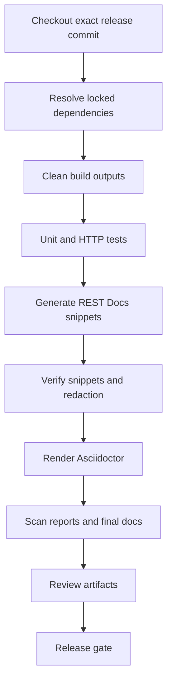

# Running Regression Test Suites Before Release

## 1. Why Does Spring REST Docs Need a Regression Suite?

In the **SPRING_REST_DOCS** module, REST API documentation is generated from HTTP tests with MockMvc, WebTestClient, or REST Assured. Tests both verify endpoint behavior and generate snippets for requests, responses, payloads, parameters, and headers. Documentation is typically assembled with Asciidoctor and packaged with the application or published separately.

A small pre-release change can impact multiple layers:
- Spring Boot, Spring Framework, or Spring REST Docs version is bumped.
- Jackson/JSON serialization changes payload representation.
- Controller advice changes status codes or error schemas.
- Security filters alter authentication/authorization responses.
- Operation identifiers or descriptors change, causing missing snippets.
- Preprocessors modify URIs, headers, or bodies.
- The Asciidoctor plugin changes version or include paths.
- Build tasks execute in the wrong order, causing docs to use stale snippets.

A regression suite confirms that API contracts, generated snippets, and rendered documentation remain consistent after changes. A green build is only meaningful when the suite covers critical outcomes and runs against the latest source and dependencies.

## 2. Defining Regression Scope Before Release

Do not run only happy paths. Build an endpoint-and-outcome matrix:

| Group | Required Scenarios | Evidence |
| --- | --- | --- |
| Success | 200/201/204 per contract | Status, headers, response fields |
| Validation | Missing/invalid body fields | Error status, violations, error code |
| Authentication | Missing/invalid credentials | 401 and challenge/header |
| Authorization | Insufficient permissions | 403 and error payload |
| Resource | Not found | 404, Problem Details, or custom schema |
| State conflict | Disallowed state transition | 409 and stable error code |
| Rate limit | Threshold exceeded | 429, Retry-After if applicable |
| Server failure | Unexpected error | Safe 5xx without exposing stack traces |
| Query/path | Boundaries, encoding, optional params | Request snippets and parameter descriptors |
| Headers | Required/optional headers | Request/response header snippets |
| Payload | Nested objects, arrays, null, empty | Field descriptors and examples |
| Security | Tokens/cookies/PII in fixtures | Masking and artifact scan |

The matrix should reflect the actual contract. Not every endpoint needs every status code; pick meaningful outcomes and high-risk boundaries.

## 3. Separating Testing Layers

An effective regression suite spans multiple layers:

1. **Unit tests:** mapping logic, custom preprocessors, descriptor helpers.
2. **HTTP slice/integration tests:** endpoints, filters, controller advice, validation, and security.
3. **REST Docs tests:** descriptors match recorded requests/responses and generate all snippets.
4. **Documentation build:** Asciidoctor includes the right snippets and renders successfully.
5. **Artifact verification:** inspect final contents, ensuring no sensitive markers or stale snippets remain.

MockMvc suits MVC slice/integration tests; WebTestClient suits WebFlux or supported setups; REST Assured suits testing against a real HTTP server or using its filter DSL. Choose the client reflecting the boundary you want to test. You do not need to run all three integrations for every endpoint unless it increases coverage.

## 4. Verifying HTTP Contracts Before Documenting

Documentation tests must assert actual responses before or in the same chain as documenting:

```java
mockMvc.perform(get("/api/orders/{id}", "ORD-42")
        .accept(MediaType.APPLICATION_JSON))
    .andExpect(status().isOk())
    .andExpect(content().contentTypeCompatibleWith(
            MediaType.APPLICATION_JSON))
    .andExpect(jsonPath("$.orderId").value("ORD-42"))
    .andExpect(jsonPath("$.status").value("CONFIRMED"))
    .andDo(document("orders-get",
        responseFields(
            fieldWithPath("orderId").description("Order ID"),
            fieldWithPath("status").description("Order status")
        )
    ));
```

The regression suite must assert everything clients rely on: status, Content-Type, required headers, JSON paths, error codes, pagination metadata, links, or Location. REST Docs descriptors add checks that payloads are fully documented; they do not replace business assertions.

For error responses, assert both the HTTP status and the status field inside Problem Details if the schema defines one. Check stable codes rather than relying on messages that may be localized.

## 5. Checking Operation Identifiers and Generated Snippets

The operation identifier is the directory path holding snippets. Changing an identifier can break Asciidoctor includes even while HTTP tests still pass.

```java
.andDo(document("orders-get-success", ...));
.andDo(document("orders-get-not-found", ...));
.andDo(document("orders-cancel-conflict", ...));
```

Before release, verify:
- Every endpoint requiring documentation has a snippet-generating test.
- Identifiers are stable, unique, and follow naming conventions.
- http-request, http-response, and required field/header snippets are all generated.
- Descriptors are neither missing new fields nor declaring removed fields.
- No stale snippet files remain from deleted or renamed tests.
- Asciidoctor includes match the exact identifiers and output directory.

Generate generated-snippets in a clean build directory so stale files never make the suite appear healthy. Do not store auto-generated snippets inside source folders if the build uses a separate output directory.

## 6. Checking Preprocessing After Changes

Preprocessors can alter snippets even when the HTTP contract is unchanged:

| Processor | What to Verify |
| --- | --- |
| prettyPrint() | JSON/XML parses cleanly and structure is unchanged |
| modifyHeaders() | Only permitted headers are modified/removed |
| replacePattern() | Secret markers vanish while other fields stay intact |
| modifyUris() | Scheme/host/port are right while path/query remain unchanged |
| Custom processor | Empty, malformed, nested, and array inputs follow policy |

Do not snapshot only raw text when whitespace or key order can legitimately vary. For JSON, parse into a tree and compare invariants. For masking, verify placeholders sit at the right JSON paths and original markers no longer appear anywhere in snippets.

REST Docs preprocessing does not protect application logs, JUnit XML, or HTTP wire logs. Artifact scanning must cover every channel capable of storing raw exchanges.

## 7. Regression Testing for Error Contracts and Security

Changes to exception handlers or Spring Security can alter error responses without happy-path tests noticing. Cover:
- Validation errors via Bean Validation and controller advice.
- Domain errors such as not found/conflict.
- 401 from the authentication entry point.
- 403 from the access denied handler.
- Fallback 500 without leaking exception messages or stack traces.
- Consistent correlation IDs between response headers/bodies if required by the contract.
- No password hashes, tokens, or sensitive fields returned.
- Error Content-Type and error codes matching the contract.

Some errors occur before DispatcherServlet, such as at a gateway, reverse proxy, or security filter. Controller advice tests do not prove those boundaries. If gateway/security components are part of the release scope, add integration tests at the corresponding boundary.

## 8. Running Builds from a Clean State

Regressions should run against freshly generated output. With Gradle, a typical flow is:

```bash
./gradlew clean test
./gradlew asciidoctor
```

If the Asciidoctor task directly depends on the test task and configured snippet outputs, you can use an aggregate lifecycle task:

```bash
./gradlew clean build
```

With Maven, use the configured lifecycle phase to run tests before Asciidoctor/documentation packaging. Exact plugin/task names depend on the project; inspect the dependency graph and actual output directory.

Do not run Asciidoctor before documentation tests. Do not run verification in parallel with snippet-generating tasks if both read/write the same output directory. Clean builds expose missing includes instead of silently reusing files from prior runs.

## 9. Dependency Upgrades and Compatibility Matrix

When upgrading Spring Boot, Spring Framework, Spring REST Docs, JUnit, Jackson, or Asciidoctor, verify compatibility rather than bumping individual artifacts independently of the BOM.

| Component | What to Check |
| --- | --- |
| JDK | Toolchain and target bytecode |
| Spring Boot/Framework | MockMvc/WebTestClient, exception handling, converters |
| Spring REST Docs | Preprocessors, descriptors, and generated snippets |
| JUnit | Test discovery, extensions, lifecycle |
| Jackson | JSON naming, null handling, date/time serialization |
| Validation provider | Constraint behavior and error mapping |
| Spring Security | 401/403 handlers and filter ordering |
| Asciidoctor plugin | Include paths, attributes, and rendered output |
| REST Assured | Filter integration and HTTP client behavior |

Prefer the project-supported dependency management/BOM. Do not force incompatible REST Docs or Spring Framework versions just to get a new feature.

After upgrading, review dependency reports and official changelogs for breaking changes. A regression suite confirms project behavior; it does not replace reading migration notes.

## 10. Checking Stability and Repeatability

The regression suite should produce reproducible output:
- Use fixed fixtures without relying on production data.
- Normalize timestamps, UUIDs, and request IDs if they are not part of verified content.
- Avoid depending on test execution order or shared mutable state.
- Clean output before generating snippets.
- Avoid calling unstable external services unless integration requires it.
- Use a fixed clock/test data provider for time-based responses.
- Set consistent locale/time zone when serialization depends on environment settings.

If snippets change on every run, code reviews struggle to distinguish contract changes from random data. Do not normalize away dynamic values if clients depend on that behavior; instead, document the format/range and keep appropriate assertions.

## 11. Verifying Asciidoctor and Rendered Documentation

Once snippets are generated, build the complete documentation. Check:
- All include targets exist.
- Attributes such as snippets point to the right output directory.
- No operation sections are empty due to missing snippets.
- Code blocks, tables, and cross-references render properly.
- Error snippets appear in the right sections with clear statuses/outcomes.
- Links to API references/problem types are not broken.
- Documentation contains no local hostnames, secret markers, or sensitive fixtures.

Include example:

```adoc
= Order API
:snippets: build/generated-snippets

== Get Order

=== Success
include::{snippets}/orders-get-success/http-response.adoc[]

=== Not Found
include::{snippets}/orders-get-not-found/http-response.adoc[]
include::{snippets}/orders-get-not-found/response-fields.adoc[]
```

Do not only verify that the task exited with code 0; inspect the final HTML/PDF artifact if that is what gets published.

## 12. Artifact Scanning and Security Regressions

Before publishing, scan generated snippets, JUnit reports, captured logs, and rendered docs for dummy markers from test fixtures:

```text
test-secret-marker-987
test-session-marker-42
```

If markers appear in public artifacts, the pipeline must fail. Avoid overly broad regexes that cause false positives; prefer distinctive markers and rules tailored to each artifact type. Never use real credentials to test redaction.

Verify access controls and retention of CI artifacts. Internal reports may still contain stack traces or environment details; do not upload them publicly just because generated documentation has been masked.

## 13. Pre-Release CI Pipeline

Reference pipeline:



Each step should fail fast when contracts or artifacts are invalid. If tests and snippet generation share the same task, keep dependencies explicit. If separated into tasks, declare generated snippets as outputs/inputs so the build tool orders execution properly.

Run on the exact commit scheduled for release. Store the commit SHA, JDK, and dependency versions in build metadata for reproducibility.

## 14. Classifying Regression Failures

| Symptom | Possible Error Group | Investigation Path |
| --- | --- | --- |
| HTTP assertion fails | API behavior/fixture | Controller, service, data setup |
| responseFields fails | Contract/schema drift | Payload and descriptors |
| Missing snippet | Operation ID/test discovery | Executed tests and identifiers |
| Old snippets remain | Output not cleaned | Clean task and output directory |
| Asciidoctor include fails | Path/attribute/dependency order | Snippets path and task graph |
| URI/header snippet changed | Preprocessor/config upgrade | Policy and generated output |
| JSON snapshot changed | Serializer/Jackson/config | JSON tree and contract |
| 401/403 changed | Security config/filter order | Entry point/access denied handler |
| Secret scan fails | Logging/redaction gap | Source writing the marker |
| Flaky tests | Clock, UUID, shared state | Fixtures and test isolation |

Do not automatically update snapshots or descriptors just to turn the build green. First determine whether the change is a bug, an intentional contract change, or a presentation difference.

## 15. Release Gate Checklist

- [ ] Executed on the exact release commit and dependency set.
- [ ] Build outputs cleaned prior to generating snippets.
- [ ] Critical success and error outcomes all have regression tests.
- [ ] Status, headers, payloads, and error codes are asserted.
- [ ] Controller advice and security handlers are tested at the proper boundaries.
- [ ] Strict descriptors catch schema drift on critical contracts.
- [ ] Operation identifiers are unique and include targets exist.
- [ ] Preprocessor transformations preserve defined invariants.
- [ ] Generated snippets are non-stale and contain no secret markers.
- [ ] JUnit reports/logs are checked according to policy.
- [ ] Asciidoctor renders from snippets generated in the current build.
- [ ] Final artifacts are scanned and reviewed.
- [ ] JDK/dependency versions and commit SHA are recorded.
- [ ] No unexplained regression failures remain without an explicit waiver.

## 16. Hands-On Exercise

Simulate upgrading Spring REST Docs or Spring Boot prior to release:

1. Record the commit, JDK, and dependency versions.
2. Build a matrix covering success, validation, unauthorized, forbidden, not-found, conflict, and server error.
3. Run a clean build and save generated snippets.
4. Verify status, Content-Type, headers, response fields, and operation identifiers.
5. Intentionally alter a descriptor to observe regression test failure on schema drift.
6. Alter an operation identifier to observe Asciidoctor include failure.
7. Test masking with dummy markers and inspect snippets/reports.
8. Run Asciidoctor after new snippets are generated; review output.
9. Run tests repeatedly to spot timestamps/UUIDs or shared state causing diffs.
10. Build a CI gate consisting of tests, snippet verification, document build, and artifact scanning.
11. Review diffs and classify changes into API contract, presentation, or dependency behavior.
12. Mark regression as passed only once every failure is explained and the final artifact matches the exact release commit.

**Completion criteria:** build a regression matrix for success/error/security; run clean tests and snippet generation in the right order; verify descriptors, preprocessors, operation IDs, and Asciidoctor; check compatibility during dependency upgrades; scan reports/artifacts; turn steps into a reproducible release gate.

## References

- [Spring REST Docs — Getting Started](https://docs.spring.io/spring-restdocs/reference/getting-started/index.html): test setup and snippet generation.
- [Spring REST Docs — Documenting Your API](https://docs.spring.io/spring-restdocs/reference/documenting-your-api.html): requests, responses, payloads, headers, and preprocessors.
- [Gradle — Java testing](https://docs.gradle.org/current/userguide/java_testing.html): test tasks, reports, and test execution.
- [Gradle — Build lifecycle](https://docs.gradle.org/current/userguide/build_lifecycle.html): task dependencies and build order.
- [Spring Boot — Upgrading](https://docs.spring.io/spring-boot/reference/upgrading/index.html): Spring Boot upgrade guidance.
