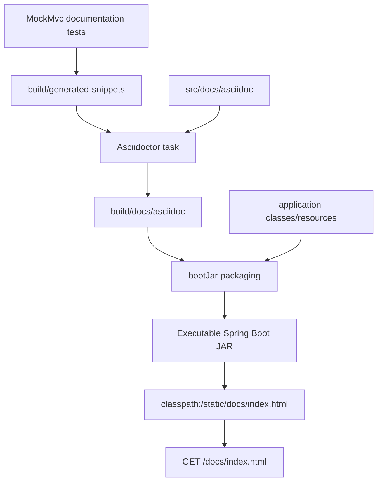

# Building Asciidoctor Documentation and Packaging It into a JAR

## Practice Objectives

In the **SPRING_REST_DOCS** module, documentation tests generate snippets from verified HTTP exchanges. Asciidoctor combines snippets with AsciiDoc content to produce an HTML API reference. As a finishing step, a team can package the HTML together with the Spring Boot application inside an executable JAR so the documentation is deployed in lockstep with the API version.

This practice builds the end-to-end flow: run documentation tests, generate snippets, run Asciidoctor, include HTML in the JAR, inspect the archive, and access the documentation over HTTP. The focus is keeping the task graph accurate and avoiding dependency cycles between tests, resources, and Asciidoctor.

After this lesson, you will be able to:

- Organize AsciiDoc sources and generated snippets.
- Configure Gradle to run tests before Asciidoctor.
- Package HTML into the Spring Boot JAR at `classpath:/static/docs`.
- Avoid dependency cycles when integrating tasks.
- Verify JAR contents and the URL serving the documentation.
- Organize a Maven/CI workflow following the same principles.

## 1. Desired Output Architecture

Suppose a Spring Boot application has product endpoints and the HTML documentation needs to be served at `/docs/index.html`.



After the build, the logical structure inside the JAR should look like:

```text
BOOT-INF/
├── classes/
│   ├── application.properties
│   └── static/
│       └── docs/
│           ├── index.html
│           ├── css/
│           └── images/
└── lib/
    └── ...
```

Spring Boot serves static resources by default from classpath locations such as `/static`. Therefore, `static/docs/index.html` on the classpath is normally accessible at `/docs/index.html`. If the application customizes static resource locations or sets a servlet context path, the actual URL will differ and must be checked against configuration.

## 2. Preparing Documentation Sources

A reference project structure:

```text
spring-rest-docs-demo/
├── build.gradle
├── src/
│   ├── main/
│   │   ├── java/
│   │   └── resources/
│   ├── test/
│   │   └── java/
│   │       └── ProductDocumentationTest.java
│   └── docs/
│       └── asciidoc/
│           ├── index.adoc
│           └── products.adoc
└── build/
    ├── generated-snippets/
    └── docs/
        └── asciidoc/
```

`src/docs/asciidoc` holds source documentation written by the team. `build/generated-snippets` is produced by documentation tests. `build/docs/asciidoc` is the HTML output after Asciidoctor runs.

Do not commit `generated-snippets` or HTML build outputs unless repository conventions require it. They are typically reproducible build artifacts generated from sources and tests.

## 3. Writing a Documentation Test to Generate Snippets

MockMvc test example:

```java
@SpringBootTest
@AutoConfigureMockMvc
@AutoConfigureRestDocs
class ProductDocumentationTest {

    @Autowired
    MockMvc mockMvc;

    @Test
    void getProduct() throws Exception {
        mockMvc.perform(get("/api/products/{id}", 501)
                .accept(MediaType.APPLICATION_JSON))
            .andExpect(status().isOk())
            .andExpect(jsonPath("$.id").value(501))
            .andExpect(jsonPath("$.name").value("Keyboard"))
            .andDo(document("products-get",
                pathParameters(
                    parameterWithName("id")
                        .description("Product ID.")
                ),
                responseFields(
                    fieldWithPath("id")
                        .description("Product ID."),
                    fieldWithPath("name")
                        .description("Product name.")
                )));
    }
}
```

The test must verify endpoint behavior before documenting. If status or body is wrong, the test fails and the build should not proceed to packaging the artifact.

After running the test, expected snippets:

```text
build/generated-snippets/
└── products-get/
    ├── http-request.adoc
    ├── http-response.adoc
    ├── path-parameters.adoc
    └── response-fields.adoc
```

Specific filenames depend on the snippets requested by the test.

## 4. Writing AsciiDoc to Include Snippets

`index.adoc`:

```asciidoc
= Product Service API
:toc:
:toclevels: 2
:sectnums:

REST API documentation generated from HTTP documentation tests.

include::products.adoc[]
```

`products.adoc`:

```asciidoc
== Products

=== Get product

This operation returns product details by ID.

==== Path parameters
include::{snippets}/products-get/path-parameters.adoc[]

==== HTTP request
include::{snippets}/products-get/http-request.adoc[]

==== HTTP response
include::{snippets}/products-get/http-response.adoc[]

==== Response fields
include::{snippets}/products-get/response-fields.adoc[]
```

The `snippets` attribute is configured in the Asciidoctor task to point to the `generated-snippets` root. Include paths consist of the operation ID and snippet name.

## 5. Configuring Gradle

Example using the Groovy DSL:

```groovy
plugins {
    id 'java'
    id 'org.springframework.boot' version '3.4.0'
    id 'io.spring.dependency-management' version '1.1.6'
    id 'org.asciidoctor.jvm.convert' version '4.0.4'
}

configurations {
    asciidoctorExt
}

dependencies {
    testImplementation 'org.springframework.boot:spring-boot-starter-test'
    testImplementation 'org.springframework.restdocs:spring-restdocs-mockmvc'
    asciidoctorExt 'org.springframework.restdocs:spring-restdocs-asciidoctor'
}

ext {
    snippetsDir = file("$buildDir/generated-snippets")
}

tasks.test {
    useJUnitPlatform()
    outputs.dir snippetsDir
}

tasks.named('asciidoctor') {
    configurations 'asciidoctorExt'
    inputs.dir snippetsDir
    dependsOn tasks.test
    attributes 'snippets': snippetsDir
}

tasks.named('bootJar') {
    dependsOn tasks.named('asciidoctor')
    from(tasks.named('asciidoctor').get().outputDir) {
        into 'static/docs'
    }
}
```

This is an illustrative configuration; align the Spring Boot, Spring REST Docs, and Asciidoctor plugin versions with your project's dependency management.

### 5.1. Why Does `bootJar` Depend on `asciidoctor`?

When running `bootJar`, Gradle must ensure Asciidoctor has finished before taking the HTML output to package. Task relationship:

```text
bootJar
  └── asciidoctor
        └── test
```

The `test` task generates snippets; `asciidoctor` uses snippets to produce HTML; `bootJar` adds HTML into the archive.

### 5.2. Avoiding Dependency Cycles via `processResources`

Do not arbitrarily make `processResources` depend on `asciidoctor` while `asciidoctor` depends on `test`. In a Java build, `test` typically depends on `classes`, and `classes` depends on `processResources`. The chain can become:

```text
test
 -> testClasses
 -> classes
 -> processResources
 -> asciidoctor
 -> test
```

This is a dependency cycle. Adding Asciidoctor output directly into `bootJar` as shown above avoids inserting the documentation task into the resources branch that tests need to start.

If your project has different requirements, inspect the actual task graph and choose a packaging point that does not create a circular dependency.

### 5.3. Declaring Clear Outputs/Inputs

Declaring `snippetsDir` as an output of `test` tells Gradle which artifacts the test produces. Declaring `inputs.dir` on `asciidoctor` helps the task recognize its input data and supports incremental builds.

If `test` is skipped as up-to-date after the snippet directory was manually deleted, handle the output state appropriately, such as running a clean build or adjusting task outputs/inputs to ensure snippets exist when Asciidoctor runs.

## 6. Running the Build and Inspecting HTML Output

Run the full pipeline:

```bash
./gradlew clean test asciidoctor bootJar
```

Or if `bootJar` already has `dependsOn asciidoctor`:

```bash
./gradlew clean bootJar
```

Inspect HTML with PowerShell:

```powershell
Get-ChildItem -Recurse build/docs/asciidoc
Test-Path build/docs/asciidoc/index.html
```

On Linux/macOS:

```bash
find build/docs/asciidoc -type f
test -f build/docs/asciidoc/index.html
```

If `index.html` does not exist, check the source document name, task `outputDir`, task dependencies, and Asciidoctor logs. Do not proceed with packaging when output has not been generated completely.

## 7. Inspecting Executable JAR Contents

After `bootJar` succeeds, locate the JAR file in `build/libs`:

```powershell
Get-ChildItem build/libs/*.jar
```

Use the `jar` command to list contents:

```bash
jar tf build/libs/spring-rest-docs-demo.jar
```

Look for paths:

```text
BOOT-INF/classes/static/docs/index.html
BOOT-INF/classes/static/docs/products.html
```

The JAR filename and page names depend on project configuration. What must be verified is that HTML resides under `BOOT-INF/classes/static/docs/` inside the executable Spring Boot JAR.

You can automate this check:

```bash
jar tf build/libs/spring-rest-docs-demo.jar | grep 'BOOT-INF/classes/static/docs/index.html'
```

If the file is missing, verify Asciidoctor's `outputDir`, the `from(...)` path in `bootJar`, `into 'static/docs'`, task dependencies, and the existence of the HTML before packaging.

## 8. Running the Application and Accessing Documentation

Run the executable JAR:

```bash
java -jar build/libs/spring-rest-docs-demo.jar
```

If the application runs on the default port with no context path, try:

```text
http://localhost:8080/docs/index.html
```

Check with `curl`:

```bash
curl -I http://localhost:8080/docs/index.html
```

The expected result is HTTP 200 and a `Content-Type` appropriate for HTML. If the application has a context path, reverse proxy prefix, or custom static resource mapping, the URL will differ.

### 8.1. Checking Assets and Relative Links

The index page may load CSS, images, or link to subpages. Verify that CSS, images, and fonts reside within the same `static/docs` tree; links to subpages do not accidentally point to root; snippets are resolved in the HTML; and navigation does not rely on file paths on the build machine.

Test accessing an asset and a subpage directly over HTTP, not just opening the index file.

## 9. Maven: Equivalent Integration Principles

With Maven, the goal is identical to Gradle but uses a different lifecycle and plugins:

1. Documentation tests run during `test`/`verify` and produce `target/generated-snippets`.
2. The Asciidoctor Maven Plugin reads sources and snippets, creating HTML in `target/generated-docs`.
3. Before `package`, copy the HTML into `target/classes/static/docs`.
4. The Maven JAR/Spring Boot plugin packages `target/classes` into the JAR.

Conceptual `copy-resources` configuration example:

```xml
<execution>
  <id>copy-api-docs</id>
  <phase>prepare-package</phase>
  <goals>
    <goal>copy-resources</goal>
  </goals>
  <configuration>
    <outputDirectory>target/classes/static/docs</outputDirectory>
    <resources>
      <resource>
        <directory>target/generated-docs</directory>
        <filtering>false</filtering>
      </resource>
    </resources>
  </configuration>
</execution>
```

Ensure the Asciidoctor execution runs before the `copy-resources` execution (or use matching phases/dependencies) so copying does not happen before the HTML exists. Inspect the effective POM and actual Maven lifecycle.

Run:

```bash
./mvnw clean verify
```

Then inspect the JAR:

```bash
jar tf target/application.jar
```

Look for `BOOT-INF/classes/static/docs/index.html`. With Maven, use the plugin's actual output directory rather than the `build/docs/asciidoc` path from the Gradle example.

## 10. CI Integration

A minimal CI pipeline needs to:

1. Check out the exact commit.
2. Install a compatible JDK.
3. Run `clean bootJar` or Maven `verify`.
4. Verify the executable JAR exists.
5. Verify the archive contains `static/docs/index.html`.
6. Optionally start the application for a smoke test and request `/docs/index.html`.
7. Archive the JAR tied to the commit/version.

GitHub Actions example:

```yaml
name: Build Spring REST Docs application

on:
  pull_request:
  push:
    branches: [main]

jobs:
  build:
    runs-on: ubuntu-latest
    steps:
      - uses: actions/checkout@v4

      - uses: actions/setup-java@v4
        with:
          distribution: temurin
          java-version: '21'

      - name: Build executable JAR with API docs
        run: ./gradlew clean bootJar

      - name: Verify docs are packaged
        shell: bash
        run: |
          jar tf build/libs/spring-rest-docs-demo.jar | grep -q 'BOOT-INF/classes/static/docs/index.html'

      - name: Upload application artifact
        uses: actions/upload-artifact@v4
        with:
          name: spring-rest-docs-app
          path: build/libs/spring-rest-docs-demo.jar
```

This is an illustrative workflow. In a real repository, use a deterministic JAR name if multiple archives exist, and configure separate publish permissions for release branches/tags.

## 11. Quality and Security Checks

- [ ] Documentation tests pass.
- [ ] Snippets are generated from the exact commit being built.
- [ ] Asciidoctor completes and `index.html` exists.
- [ ] The executable JAR contains `static/docs/index.html`.
- [ ] The page is served at the expected URL.
- [ ] CSS, images, links, and subpages work.
- [ ] No real tokens, passwords, cookies, or personal data appear in snippets.
- [ ] Documentation does not expose out-of-scope internal endpoints.
- [ ] Documentation version/commit matches the application.
- [ ] CI archives the verified JAR.

Keeping documentation inside the same JAR ensures the API version and API reference are deployed together. However, if the content is intended only for internal use, protect the docs endpoint with appropriate network policies or security configuration; default static resources may be publicly accessible in the application.

## 12. Common Errors

| Symptom | Possible Cause | Resolution |
| --- | --- | --- |
| Asciidoctor cannot find snippet | Tests did not run or `snippetsDir` is wrong | Check test output and `snippets` attribute |
| `index.html` is not created | Wrong source file or task did not run | Check Asciidoctor logs and `outputDir` |
| JAR does not contain `static/docs` | `bootJar` does not pick up output or path is wrong | Check `from(outputDir)` and archive path |
| `bootJar` runs before Asciidoctor | Missing `dependsOn` | Declare `bootJar` depends on `asciidoctor` |
| Gradle reports circular dependency | Asciidoctor attached to `processResources` while depending on `test` | Package output directly into `bootJar` |
| JAR has HTML but URL returns 404 | Wrong static resource path, context path, or security rule | Check classpath location and mapping |
| Index renders but CSS fails | Wrong asset path or not copied | Check relative paths and archive entries |
| Works locally, lacks docs in CI | CI invokes a different task or wrong artifact path | Run `bootJar` and verify the archive in CI |
| JAR contains stale snippets | Stale output or tests did not re-run | Clean build and check task inputs/outputs |
| Maven copies files before Asciidoctor | Incorrect execution order/phase | Adjust phase or execution ordering |

## 13. Comprehensive Practice Exercise

1. Create a Spring Boot project with a `GET /api/products/{id}` endpoint.
2. Write a MockMvc documentation test checking status and response fields.
3. Create `index.adoc` including `http-request`, `http-response`, `path-parameters`, and `response-fields`.
4. Configure Gradle Asciidoctor output to `build/docs/asciidoc`.
5. Configure `bootJar` to depend on `asciidoctor` and package the output into `static/docs`.
6. Run `clean bootJar`.
7. Verify the JAR contains `BOOT-INF/classes/static/docs/index.html`.
8. Run the JAR and access `/docs/index.html`.
9. Intentionally remove `dependsOn` or misconfigure the output path; observe the failure and fix it.
10. Add a CI step verifying the archive and storing the executable JAR.

**Self-assessment questions**

1. Why do generated snippets need to be produced before Asciidoctor?
2. How does the Asciidoctor output directory differ from `snippetsDir`?
3. Why is `bootJar` the right place to package HTML in the Gradle example?
4. How can a dependency cycle occur if Asciidoctor is attached to `processResources`?
5. Which classpath path causes Spring Boot to serve docs under `/docs`?
6. How do you verify that HTML is actually inside the executable JAR?
7. Why is a URL smoke test needed after running the JAR?
8. When should documentation packaged with the application be protected by a security policy?

## Official References

- [Spring REST Docs — Getting Started](https://docs.spring.io/spring-restdocs/tutorial/getting-started/index.html): configuring tests and generating snippets.
- [Spring REST Docs — Asciidoctor Integration](https://docs.spring.io/spring-restdocs/reference/getting-started/documentation-snippets.html): including snippets in documentation.
- [Asciidoctor Gradle Plugin](https://docs.asciidoctor.org/gradle-plugin/latest/): configuring the Asciidoctor task.
- [Gradle — Task Dependencies](https://docs.gradle.org/current/userguide/controlling_task_execution.html): `dependsOn`, task graph, and execution order.
- [Spring Boot — Static Content](https://docs.spring.io/spring-boot/reference/web/servlet.html): serving static resources in web applications.
- [Spring Boot Gradle Plugin](https://docs.spring.io/spring-boot/gradle-plugin/packaging.html): packaging executable archives.
- [Spring Boot Maven Plugin](https://docs.spring.io/spring-boot/maven-plugin/packaging.html): packaging executable JARs with Maven.

**Practice conclusion:** Let documentation tests generate snippets, let Asciidoctor assemble the HTML, and then package the output into the executable JAR at `static/docs`. With Gradle, wire `bootJar` to depend on `asciidoctor` and copy the output directory directly into the archive; avoid creating cycles through `processResources`. Finally, inspect the archive entries and run the application to verify the documentation is accessible at the chosen URL.
