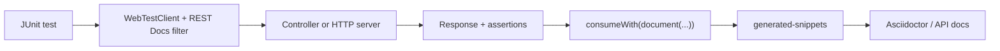

# Configuring WebTestClient with `documentationConfiguration`

## 1. Goals and Context

In **Spring REST Docs**, REST API documentation is generated from tested HTTP interactions. As a result, request/response examples and field descriptions in the documentation are verified alongside the application's behavior. For applications using **Spring WebFlux**, `WebTestClient` is a convenient choice for sending requests, asserting responses, and capturing data to generate snippets.

This lesson belongs to the **WebTestClient** chapter of the **SPRING_REST_DOCS** module. After this lesson, you will be able to:

- Explain the roles of `documentationConfiguration(...)` and `document(...)`.
- Configure `WebTestClient` with `RestDocumentationExtension` in JUnit 5.
- Apply the configuration to a controller, an `ApplicationContext`, or a running HTTP server.
- Customize how requests/responses are recorded and use snippets in Asciidoctor, Gradle, and CI.
- Identify configuration mistakes that allow tests to pass without generating documentation.

> **Scope:** Examples use Java, JUnit 5, and Spring REST Docs with `WebTestClient`. API and dependency versions must align with the Spring Framework/Spring Boot version used by your project.

## 2. What Does `documentationConfiguration` Solve?

A standard `WebTestClient` only sends requests and returns results for test assertions. For Spring REST Docs to record the HTTP exchange, you add an **`ExchangeFilterFunction`** provided by `documentationConfiguration(restDocumentation)` when building the client:

```java
WebTestClient client = WebTestClient.bindToController(new ExampleController())
    .configureClient()
    .filter(documentationConfiguration(restDocumentation))
    .build();
```

Where:

| Component | Role |
| --- | --- |
| `RestDocumentationContextProvider` | Provides the documentation context for the current test; JUnit 5 can inject it via `RestDocumentationExtension`. |
| `documentationConfiguration(provider)` | Creates the REST Docs configuration to attach to `WebTestClient` as a filter. |
| `.configureClient()` | Transitions from the mock server setup of `bindToController`/`bindToApplicationContext` to client configuration so filters can be added. |
| `.filter(...)` | Registers request and response processing for documentation. |
| `document("identifier", snippets...)` | Called when consuming the test result, writing snippets for **that specific request**. |

The processing flow can be visualized as follows:



**Distinguishing the two operations:** `documentationConfiguration(...)` is called **once when creating the client**, whereas `document(...)` is called **in each test that needs documentation generated**. Simply adding the filter without calling `document(...)` in the test is not enough to create snippets for the desired operation.

## 3. Preparing Dependencies

Example with Gradle (Groovy DSL), in a Spring Boot project that already includes WebFlux:

```groovy
dependencies {
    implementation 'org.springframework.boot:spring-boot-starter-webflux'
    testImplementation 'org.springframework.boot:spring-boot-starter-test'
    testImplementation 'org.springframework.restdocs:spring-restdocs-webtestclient'
}
```

Spring Boot typically manages the versions of the corresponding dependencies. If you are not using Spring Boot, select a Spring REST Docs version compatible with your project's Spring Framework and JUnit versions. `WebTestClient` and WebFlux components must be present on the test classpath.

Two important static imports:

```java
import static org.springframework.restdocs.webtestclient.WebTestClientRestDocumentation.documentationConfiguration;
import static org.springframework.restdocs.webtestclient.WebTestClientRestDocumentation.document;
```

Do not confuse them with the `document` or `documentationConfiguration` methods specific to `MockMvc` or REST Assured.

## 4. Complete Example with JUnit 5 and `bindToController`

The following example tests a simple WebFlux endpoint. There is no need to start a real HTTP server: `WebTestClient` binds directly to the controller, sends a GET request, asserts the response, and generates documentation.

```java
import java.util.Map;

import org.junit.jupiter.api.BeforeEach;
import org.junit.jupiter.api.Test;
import org.junit.jupiter.api.extension.ExtendWith;
import org.springframework.http.MediaType;
import org.springframework.restdocs.RestDocumentationContextProvider;
import org.springframework.restdocs.RestDocumentationExtension;
import org.springframework.test.web.reactive.server.WebTestClient;
import org.springframework.web.bind.annotation.GetMapping;
import org.springframework.web.bind.annotation.RestController;
import reactor.core.publisher.Mono;

import static org.springframework.restdocs.payload.PayloadDocumentation.fieldWithPath;
import static org.springframework.restdocs.payload.PayloadDocumentation.responseFields;
import static org.springframework.restdocs.webtestclient.WebTestClientRestDocumentation.document;
import static org.springframework.restdocs.webtestclient.WebTestClientRestDocumentation.documentationConfiguration;

@ExtendWith(RestDocumentationExtension.class)
class GreetingApiDocumentationTest {

    private WebTestClient client;

    @BeforeEach
    void setUp(RestDocumentationContextProvider restDocumentation) {
        this.client = WebTestClient.bindToController(new GreetingController())
            .configureClient()
            .filter(documentationConfiguration(restDocumentation))
            .build();
    }

    @Test
    void documentsGetGreeting() {
        this.client.get()
            .uri("/api/greetings")
            .accept(MediaType.APPLICATION_JSON)
            .exchange()
            .expectStatus().isOk()
            .expectBody()
            .json("{\"message\":\"Hello\"}")
            .consumeWith(document("greetings/get",
                responseFields(
                    fieldWithPath("message").description("The returned greeting")
                )
            ));
    }

    @RestController
    static class GreetingController {

        @GetMapping(path = "/api/greetings",
                    produces = MediaType.APPLICATION_JSON_VALUE)
        public Mono<Map<String, String>> getGreeting() {
            return Mono.just(Map.of("message", "Hello"));
        }
    }
}
```

Key steps to note:

1. `@ExtendWith(RestDocumentationExtension.class)` enables Spring REST Docs support for JUnit 5.
2. The `RestDocumentationContextProvider` parameter is injected into `@BeforeEach` by the extension.
3. `bindToController(...).configureClient().filter(...).build()` creates the client with the documentation filter installed.
4. `exchange()` executes the request; `expectStatus()` and `json(...)` verify the result.
5. `consumeWith(document("greetings/get", ...))` instructs REST Docs to write snippets under the `greetings/get` identifier. `responseFields(...)` documents the JSON structure and helps tests catch undocumented fields or descriptions that do not match the payload.

When the test passes and the output directory is configured, snippets are typically located under `build/generated-snippets/greetings/get/` (Gradle) or `target/generated-snippets/greetings/get/` (Maven). Typical files include `http-request.adoc`, `http-response.adoc`, `request-body.adoc`, `response-body.adoc`, and `response-fields.adoc`. The actual list depends on the default snippets and the snippets you pass to `document(...)`.

## 5. Ways to Create `WebTestClient`

The `documentationConfiguration(...)` part remains the same, while the client initialization API depends on the test type:

### 5.1. Testing One or a Few Controllers

```java
WebTestClient client = WebTestClient.bindToController(new GreetingController())
    .configureClient()
    .filter(documentationConfiguration(restDocumentation))
    .build();
```

Suitable for tests focused on how a controller handles requests/responses without running the full application. If the controller requires dependencies, provide real dependencies or test doubles explicitly.

### 5.2. Testing with a WebFlux `ApplicationContext`

```java
WebTestClient client = WebTestClient.bindToApplicationContext(context)
    .configureClient()
    .filter(documentationConfiguration(restDocumentation))
    .build();
```

`context` is the Spring `ApplicationContext` created by the test, such as through `@WebFluxTest` or an appropriate WebFlux configuration. This approach uses the routing, codecs, controllers, and beans within the tested context. Inject the context and declare `RestDocumentationExtension` in the test just like in the previous example.

### 5.3. Testing a Real HTTP Server

```java
WebTestClient client = WebTestClient.bindToServer()
    .baseUrl("http://localhost:" + port)
    .filter(documentationConfiguration(restDocumentation))
    .build();
```

`port` must be the actual port of the started server (e.g., from `@LocalServerPort` in a Spring Boot integration test). `bindToServer()` returns the client builder directly, so **do not call `.configureClient()`** in this branch. This option is useful when you want the documentation to reflect the full HTTP filters, middleware, and runtime configuration of the application.

## 6. Customizing Requests and Responses Before Generating Snippets

Many tests receive JSON on a single line, making snippets hard to read. You can configure default preprocessors directly in the filter:

```java
import static org.springframework.restdocs.operation.preprocess.Preprocessors.prettyPrint;

// Inside @BeforeEach, once restDocumentation is available:
this.client = WebTestClient.bindToController(new GreetingController())
    .configureClient()
    .filter(documentationConfiguration(restDocumentation)
        .operationPreprocessors()
            .withRequestDefaults(prettyPrint())
            .withResponseDefaults(prettyPrint()))
    .build();
```

`prettyPrint()` formats snippet payloads for readability; it does not alter the HTTP data sent to or returned by the application during the test. You can also use other preprocessors to strip constantly changing headers, mask sensitive tokens, or normalize example values before committing documentation to the repository.

A practical rule: **hide or normalize data only in the documentation, while keeping test assertions exact**. For example, if `Authorization` contains a real token, remove the token from the snippet or replace it with a placeholder value; never let secrets enter published documentation.

## 7. Generating Snippets for Parameters, Headers, and Payloads

Once the filter is installed, each test can add descriptors tailored to the HTTP operation:

```java
import static org.springframework.restdocs.headers.HeaderDocumentation.headerWithName;
import static org.springframework.restdocs.headers.HeaderDocumentation.requestHeaders;
import static org.springframework.restdocs.payload.PayloadDocumentation.fieldWithPath;
import static org.springframework.restdocs.payload.PayloadDocumentation.requestFields;
import static org.springframework.restdocs.payload.PayloadDocumentation.responseFields;
import static org.springframework.restdocs.request.RequestDocumentation.parameterWithName;
import static org.springframework.restdocs.request.RequestDocumentation.pathParameters;

// Illustrative example: the POST /api/items/{category} endpoint must exist
// and the response must contain JSON with an id field.
client.post()
    .uri("/api/items/{category}", "books")
    .header("X-Request-Id", "req-001")
    .contentType(MediaType.APPLICATION_JSON)
    .bodyValue(Map.of("name", "Spring REST Docs"))
    .exchange()
    .expectStatus().isCreated()
    .expectBody()
    .consumeWith(document("items/create",
        pathParameters(
            parameterWithName("category").description("Product category")
        ),
        requestHeaders(
            headerWithName("X-Request-Id").description("Request trace ID")
        ),
        requestFields(
            fieldWithPath("name").description("Product name")
        ),
        responseFields(
            fieldWithPath("id").description("ID of the newly created product")
        )
    ));
```

This code **illustrates the test structure**, not a standalone runnable test: it requires a corresponding POST endpoint and a response satisfying the descriptors. For query strings, use the query parameter snippet corresponding to your project's Spring REST Docs version. Descriptors both generate API documentation content and help catch payload changes where the test has not yet updated the documentation.

## 8. Including Snippets in Asciidoctor and CI

Spring REST Docs generates *documentation fragments* (snippets), not the entire API page structure. For example, in an `.adoc` file you can write:

```asciidoc
= Greeting API
:snippets: build/generated-snippets

== GET /api/greetings

=== HTTP request
include::{snippets}/greetings/get/http-request.adoc[]

=== HTTP response
include::{snippets}/greetings/get/http-response.adoc[]

=== Response fields
include::{snippets}/greetings/get/response-fields.adoc[]
```

The `:snippets:` attribute must be set to a path relative to the Asciidoctor file's location or passed from the build configuration. To ensure Gradle always generates snippets before building the documentation, you can wire the tasks as follows (assuming the Asciidoctor plugin is declared and provides the `asciidoctor` task):

```groovy
def snippetsDir = layout.buildDirectory.dir("generated-snippets")

tasks.named("test") {
    outputs.dir(snippetsDir)
}

tasks.named("asciidoctor") {
    inputs.dir(snippetsDir)
    dependsOn(tasks.named("test"))
    attributes "snippets": snippetsDir.get().asFile
}
```

Then the Asciidoctor file can use `include::{snippets}/...`, with the `snippets` value passed by the build. In CI, run the test suite and documentation build task, such as `./gradlew clean test asciidoctor` when the project has the corresponding plugin and tasks configured. If an assertion or descriptor fails, the test fails and CI should not publish stale documentation as up-to-date.

Markdown can also link to snippets or incorporate generated snippet content in a documentation aggregation step, provided that step is configured in the build; plain Markdown does not natively process Asciidoctor's `include::` directive.

## 9. Common Errors and How to Resolve Them

| Symptom | Check and Fix |
| --- | --- |
| Tests run but no snippets appear | Verify that `.filter(documentationConfiguration(...))` was added to the **exact client** executing the request and that `.consumeWith(document(...))` was called. |
| `RestDocumentationContextProvider` is not provided | For JUnit 5, add `@ExtendWith(RestDocumentationExtension.class)` and ensure `spring-restdocs-webtestclient` is on the test runtime classpath. |
| Cannot call `.filter(...)` after `bindToController` | Call `.configureClient()` before configuring filters. With `bindToServer()`, filters are added directly. |
| Missing `response-fields.adoc` | In the corresponding operation, pass `responseFields(...)` into `document(...)`. |
| Test fails due to missing or extra fields | Compare descriptors against the actual JSON; document all fields, using `.optional()` or `.ignored()` only when truly appropriate for the API contract. |
| `include::` cannot find file | Check the Gradle/Maven snippets directory, the identifier in `document(...)`, the `:snippets:` path, and that the documentation build task depends on the test task. |
| Documentation contains `localhost`, random ports, or tokens | Normalize URIs and sensitive data in the REST Docs configuration/preprocessor dedicated to documentation. |

## 10. Suggested Practice Exercises

1. Run the `GreetingApiDocumentationTest` example and inspect `http-request.adoc`, `http-response.adoc`, and `response-fields.adoc`.
2. Enable `prettyPrint()` and compare the response snippet before and after.
3. Add a `language` field to the returned JSON without updating `responseFields(...)`; observe the test failure, then add the descriptor and re-run.
4. Include the three GET snippets in an Asciidoctor page, and configure the build task so the page is always built from the latest test results.

**Expected outcome:** You have a `WebTestClient` configured with `documentationConfiguration`, a verified HTTP test that generates snippets, and a pipeline that feeds snippets into API documentation. This serves as the foundation for documenting request bodies, response bodies, query/path parameters, and headers for more complex APIs.
