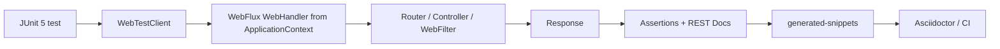

# Binding WebTestClient to ApplicationContext

## 1. Lesson Objectives

In the **SPRING_REST_DOCS** module, we use HTTP tests to generate verifiable REST API documentation. For Spring WebFlux applications, `WebTestClient` can send requests to an application built directly during test execution, assert responses, and collaborate with **Spring REST Docs** to generate snippets for requests, responses, payloads, parameters, and headers. These snippets can then be included in Asciidoctor/Markdown as part of the build and CI pipeline.

This lesson belongs to the **WebTestClient** chapter, focusing on **binding `WebTestClient` to an `ApplicationContext`** using `WebTestClient.bindToApplicationContext(context)`. After completing this lesson, you will be able to:

- Explain what binding to `ApplicationContext` means and when to use it.
- Prepare a WebFlux `ApplicationContext` for HTTP testing without starting a network port.
- Combine `bindToApplicationContext` with Spring REST Docs' `documentationConfiguration` and `document`.
- Write a JUnit 5 test that generates snippets for path parameters and a JSON response.
- Organize snippets to build API documentation with Asciidoctor and verify it in CI.
- Diagnose common issues related to beans, routing, REST Docs, and security.

## 2. What Is `bindToApplicationContext`?

Spring's `ApplicationContext` holds the beans declared by the application or registered via auto-configuration, such as controllers, routers, codecs, `WebFilter` instances, exception handlers, and web-related components. For **WebFlux**, `WebTestClient.bindToApplicationContext(context)` builds an HTTP processing environment from the WebFlux beans present in that context.

Minimal example:

```java
WebTestClient client = WebTestClient
    .bindToApplicationContext(applicationContext)
    .build();
```

`WebTestClient` routes requests through the WebFlux request-handling pipeline constructed from the context. **There is no need for the application to listen on `localhost` or open a TCP port**. This fits web-layer integration tests where you want to verify routing, status codes, headers, response bodies, and the web components actually present in the test context.



Do not confuse the client initialization modes:

| Initialization Method | Request Handler | When to Use |
| --- | --- | --- |
| `bindToController(controller)` | The specified controller and minimal test infrastructure | Focused tests where you explicitly supply the controller and its dependencies |
| **`bindToApplicationContext(context)`** | WebFlux handlers, routing, and beans inside the context | Testing how the web layer behaves with Spring configuration |
| `bindToServer().baseUrl(url)` | A real HTTP server running at the given URL | Testing over a network connection and an environment closer to production |

**Important limitation:** `bindToApplicationContext` only reflects the beans **loaded into the test context**. If a test uses a slice configuration such as `@WebFluxTest`, components excluded from the slice will not automatically appear in the test results.

## 3. Preparing Dependencies and the Spring Context

In a Spring Boot project with WebFlux, the minimal test dependencies can be declared as follows (Gradle Groovy DSL):

```groovy
dependencies {
    implementation 'org.springframework.boot:spring-boot-starter-webflux'
    testImplementation 'org.springframework.boot:spring-boot-starter-test'
    testImplementation 'org.springframework.restdocs:spring-restdocs-webtestclient'
}
```

Spring Boot typically manages the versions of the included libraries. If you are not using Spring Boot, ensure that Spring Framework, Spring REST Docs, Reactor, JUnit 5, and the JSON/codec libraries are compatible with one another.

To make `bindToApplicationContext` work in an example without a Spring Boot test slice, we will create the context using:

- `@SpringJUnitConfig`: runs the test with the Spring TestContext Framework and loads the specified configuration class.
- `@Configuration` and `@EnableWebFlux`: registers the Spring WebFlux infrastructure configuration.
- `@Bean`: registers the controller under test in the context.
- `@Autowired ApplicationContext`: supplies the context to `WebTestClient`.

For an actual Spring Boot project, another option is `@WebFluxTest` along with any required beans or mocks. Both approaches must construct a WebFlux `ApplicationContext` before binding the client.

## 4. Complete Example: Spring WebFlux + JUnit 5 + REST Docs

Suppose the application has an endpoint `GET /api/books/{id}` returning:

```json
{
  "id": 7,
  "title": "Spring REST Docs"
}
```

The following test includes the complete WebFlux configuration, controller, and response documentation. You can place the class in `src/test/java` in a project that already has the dependencies listed above.

```java
import java.util.Map;

import org.junit.jupiter.api.BeforeEach;
import org.junit.jupiter.api.Test;
import org.junit.jupiter.api.extension.ExtendWith;
import org.springframework.beans.factory.annotation.Autowired;
import org.springframework.context.ApplicationContext;
import org.springframework.context.annotation.Bean;
import org.springframework.context.annotation.Configuration;
import org.springframework.http.MediaType;
import org.springframework.restdocs.RestDocumentationContextProvider;
import org.springframework.restdocs.RestDocumentationExtension;
import org.springframework.test.context.junit.jupiter.SpringJUnitConfig;
import org.springframework.test.web.reactive.server.WebTestClient;
import org.springframework.web.bind.annotation.GetMapping;
import org.springframework.web.bind.annotation.PathVariable;
import org.springframework.web.bind.annotation.RestController;
import org.springframework.web.reactive.config.EnableWebFlux;
import reactor.core.publisher.Mono;

import static org.springframework.restdocs.payload.PayloadDocumentation.fieldWithPath;
import static org.springframework.restdocs.payload.PayloadDocumentation.responseFields;
import static org.springframework.restdocs.request.RequestDocumentation.parameterWithName;
import static org.springframework.restdocs.request.RequestDocumentation.pathParameters;
import static org.springframework.restdocs.webtestclient.WebTestClientRestDocumentation.document;
import static org.springframework.restdocs.webtestclient.WebTestClientRestDocumentation.documentationConfiguration;

@SpringJUnitConfig(BookWebFluxDocumentationTest.WebFluxConfig.class)
@ExtendWith(RestDocumentationExtension.class)
class BookWebFluxDocumentationTest {

    @Autowired
    private ApplicationContext applicationContext;

    private WebTestClient client;

    @BeforeEach
    void setUp(RestDocumentationContextProvider restDocumentation) {
        this.client = WebTestClient.bindToApplicationContext(applicationContext)
            .configureClient()
            .filter(documentationConfiguration(restDocumentation))
            .build();
    }

    @Test
    void documentsGetBook() {
        this.client.get()
            .uri("/api/books/{id}", 7)
            .accept(MediaType.APPLICATION_JSON)
            .exchange()
            .expectStatus().isOk()
            .expectHeader().contentTypeCompatibleWith(MediaType.APPLICATION_JSON)
            .expectBody()
            .jsonPath("$.id").isEqualTo(7)
            .jsonPath("$.title").isEqualTo("Spring REST Docs")
            .consumeWith(document("books/get-by-id",
                pathParameters(
                    parameterWithName("id").description("ID of the book to look up")
                ),
                responseFields(
                    fieldWithPath("id").description("Book ID"),
                    fieldWithPath("title").description("Book title")
                )
            ));
    }

    @Configuration
    @EnableWebFlux
    static class WebFluxConfig {
        @Bean
        BookController bookController() {
            return new BookController();
        }
    }

    @RestController
    static class BookController {
        @GetMapping(
            path = "/api/books/{id}",
            produces = MediaType.APPLICATION_JSON_VALUE
        )
        public Mono<Map<String, Object>> getBook(@PathVariable("id") long id) {
            return Mono.just(Map.of(
                "id", id,
                "title", "Spring REST Docs"
            ));
        }
    }
}
```

The test demonstrates three distinct parts with different responsibilities:

1. **Context creation:** `@SpringJUnitConfig` loads `WebFluxConfig`. `@EnableWebFlux` registers the WebFlux components, and `@Bean` adds `BookController` to the context. The Spring TestContext Framework injects `ApplicationContext` into the test field.
2. **Binding and enabling documentation:** `bindToApplicationContext(applicationContext)` picks up the WebFlux configuration from Spring; `configureClient().filter(documentationConfiguration(restDocumentation))` attaches REST Docs recording capabilities to the client before `build()` is called. `RestDocumentationExtension` supplies `RestDocumentationContextProvider` to the `@BeforeEach` method.
3. **Verification and snippet generation:** the test invokes a URI with the `{id}` variable, verifies status/headers/payload, and uses `consumeWith(document(...))` to generate documentation for the `books/get-by-id` operation.

Each descriptor in `pathParameters(...)` and `responseFields(...)` corresponds to a part of the API contract. When a payload changes or a field no longer matches, the documentation test can fail, prompting the team to update both the test and the documentation.

> **Note on visibility:** The controller in the example is a bean explicitly registered by the test. For a real application, let Spring load your controllers and related beans through the application's normal configuration mechanism; do not create a duplicate controller solely to generate documentation.

## 5. Choosing an ApplicationContext That Fits the Test Goal

### 5.1. Minimal Context for a Web Feature

The `@SpringJUnitConfig` example above creates a clearly scoped context that runs quickly. This fits scenarios where you need to verify endpoints alongside codecs, routing, exception handlers, or web filters configured by the test. Controller dependencies can be supplied via dedicated `@Bean` definitions or replaced with test doubles.

### 5.2. Spring Boot WebFlux Slice with `@WebFluxTest`

A Spring Boot project can load most of its web configuration via a test slice:

```java
@WebFluxTest(controllers = BookController.class)
@ExtendWith(RestDocumentationExtension.class)
class BookControllerDocumentationTest {

    @Autowired
    ApplicationContext context;

    WebTestClient client;

    @BeforeEach
    void setUp(RestDocumentationContextProvider restDocumentation) {
        client = WebTestClient.bindToApplicationContext(context)
            .configureClient()
            .filter(documentationConfiguration(restDocumentation))
            .build();
    }

    // @Test methods call client.get()/post()/... and consumeWith(document(...)).
    // Provide mock/test beans for BookController dependencies if any.
}
```

This is a **configuration template**, assuming the application already has `BookController` and that the corresponding annotations, classes, and static methods are imported. `@WebFluxTest` focuses on the web layer, so services, repositories, or business beans that are not loaded will require appropriate mocks/test beans. In Spring Boot, `@WebFluxTest` integrates the Spring TestContext mechanism automatically; there is no need to add `@SpringJUnitConfig` manually.

### 5.3. When a Real HTTP Server Must Run

If you need to verify how the application behaves over the network, proxies, dynamically assigned ports, or a real server, use:

```java
WebTestClient client = WebTestClient.bindToServer()
    .baseUrl("http://localhost:" + port)
    .filter(documentationConfiguration(restDocumentation))
    .build();
```

In `bindToServer` mode, `filter(...)` sits directly on the client builder, so **there is no `configureClient()` step**. By contrast, `bindToApplicationContext` returns a mock server configuration, so you must call `configureClient()` before attaching the REST Docs filter.

## 6. Adding Request, Response, Parameter, and Header Descriptions

Once the client is configured, you can add descriptors per test without changing how the client is bound. For example, with an actual `POST /api/books` endpoint in the context:

```java
import static org.springframework.restdocs.headers.HeaderDocumentation.headerWithName;
import static org.springframework.restdocs.headers.HeaderDocumentation.requestHeaders;
import static org.springframework.restdocs.payload.PayloadDocumentation.requestFields;
import static org.springframework.restdocs.payload.PayloadDocumentation.fieldWithPath;

client.post()
    .uri("/api/books")
    .header("X-Request-Id", "demo-123")
    .contentType(MediaType.APPLICATION_JSON)
    .bodyValue(Map.of("title", "Spring REST Docs"))
    .exchange()
    .expectStatus().isCreated()
    .expectBody()
    .consumeWith(document("books/create",
        requestHeaders(
            headerWithName("X-Request-Id").description("Request tracking ID")
        ),
        requestFields(
            fieldWithPath("title").description("Title of the created book")
        )
    ));
```

This example **illustrates adding descriptors**, not a standalone runnable test; you need to implement a corresponding POST endpoint that returns status 201. For requests containing query parameters, use the query parameter snippet for your version of Spring REST Docs. For JSON responses, add `responseFields(...)` to document the returned fields. You can document request/response headers, path parameters, payloads, and bodies according to the API contract without modifying the `bindToApplicationContext(...)` call.

To make snippets easier to read, you can format JSON during the documentation step:

```java
import static org.springframework.restdocs.operation.preprocess.Preprocessors.prettyPrint;

client = WebTestClient.bindToApplicationContext(applicationContext)
    .configureClient()
    .filter(documentationConfiguration(restDocumentation)
        .operationPreprocessors()
            .withRequestDefaults(prettyPrint())
            .withResponseDefaults(prettyPrint()))
    .build();
```

Operation preprocessors transform the data **written to snippets**, without altering the data the application actually receives or returns. You can use additional preprocessors to mask tokens, headers, or sensitive data before committing documentation to the source repository.

## 7. Including Snippets in Asciidoctor Documentation and CI

When the sample test passes, the `books/get-by-id` operation can generate files such as:

```text
build/generated-snippets/
└── books/
    └── get-by-id/
        ├── http-request.adoc
        ├── http-response.adoc
        ├── path-parameters.adoc
        └── response-fields.adoc
```

This is a **partial** list: Spring REST Docs can also generate other default snippets, such as `curl-request.adoc`, `request-body.adoc`, and `response-body.adoc`. With Maven, the standard directory is `target/generated-snippets` instead of `build/generated-snippets`.

Example usage in an Asciidoctor file:

```asciidoc
= Book API
:snippets: build/generated-snippets

== Look up a book

=== Request
include::{snippets}/books/get-by-id/http-request.adoc[]

=== Path parameters
include::{snippets}/books/get-by-id/path-parameters.adoc[]

=== Response
include::{snippets}/books/get-by-id/http-response.adoc[]

=== Response fields
include::{snippets}/books/get-by-id/response-fields.adoc[]
```

The `:snippets:` path is only an example; adjust it to match the location of your Asciidoctor file or pass this attribute from the build configuration. In Gradle, you can make the documentation build task depend on test execution (assuming the Asciidoctor plugin and the `asciidoctor` task are already configured):

```groovy
def snippetsDir = layout.buildDirectory.dir("generated-snippets")

tasks.named("test") {
    outputs.dir(snippetsDir)
}

tasks.named("asciidoctor") {
    dependsOn(tasks.named("test"))
    inputs.dir(snippetsDir)
    attributes "snippets": snippetsDir.get().asFile
}
```

Once the plugin is fully configured, CI can run `./gradlew clean test asciidoctor`. To avoid publishing outdated documentation, the pipeline should fail if documentation tests fail. With Markdown, you can link to snippets or use a build step to embed snippet content into pages; the `include::` directive above belongs to Asciidoctor syntax, not plain Markdown.

## 8. Common Errors

| Symptom | Possible Cause and Fix |
| --- | --- |
| Calling `bindToApplicationContext` returns 404 | Verify that the controller/router is loaded into the **test context** and that the URI mapping and HTTP method are correct. |
| Context fails to initialize due to missing bean | `@WebFluxTest` or minimal config has not created a controller dependency; add appropriate beans/mocks matching the test scope. |
| No WebFlux processing infrastructure | In a hand-written context, enable `@EnableWebFlux` and register controllers/routers; check Spring WebFlux dependencies. |
| Unexpected 401/403 response | The context contains security filters or authentication policies; configure appropriate credentials/test security rather than bypassing security automatically. |
| `RestDocumentationContextProvider` is not injected | For JUnit 5, `RestDocumentationExtension` and the `spring-restdocs-webtestclient` dependency are required on the test runtime classpath. |
| `filter(...)` is unavailable directly after `bindToApplicationContext(...)` | Call `configureClient()` to switch to the client builder before attaching the filter. |
| Test passes but no snippets are generated | Verify that `document(...)` is called inside `consumeWith(...)` on the right request, and that the client has the REST Docs filter installed. |
| Missing `path-parameters.adoc` or `response-fields.adoc` | Add the corresponding `pathParameters(...)` or `responseFields(...)` to the operation and re-run the test. |
| Documentation cannot find snippet | Check the `books/get-by-id` identifier, output directory, test task, and Asciidoctor's `snippets` attribute. |
| Behavior differs from production | The test context may be missing filters, services, configuration, or middleware; broaden the context scope or switch to `bindToServer` when end-to-end HTTP verification is needed. |

## 9. Practice

1. Run `BookWebFluxDocumentationTest` and inspect the generated snippets for `books/get-by-id`.
2. Remove `@Bean BookController` from the test configuration, re-run, and explain why the request is no longer routed to the controller.
3. Restore the controller, then rename the `title` field in the response without updating `responseFields(...)`. Observe the documentation test error and update the descriptor accordingly.
4. Try enabling `prettyPrint()`; compare the contents of `http-response.adoc` before and after.
5. Build an Asciidoctor page for the endpoint, make the build task depend on tests, and verify that CI detects an out-of-sync API contract.

## 10. Key Takeaways

- `bindToApplicationContext(context)` configures `WebTestClient` to use the **WebFlux infrastructure in a Spring `ApplicationContext`** to handle HTTP without a TCP server.
- When using REST Docs with this binding mode, configure `.configureClient().filter(documentationConfiguration(restDocumentation))` before `build()`.
- Use `@ExtendWith(RestDocumentationExtension.class)` to supply the REST Docs context to JUnit 5; call `document(...)` in tests that should generate snippets.
- Documentation accuracy depends on **the beans and configuration present in the test context** and the assertions/descriptors that tests actually verify.
- Include snippets in Asciidoctor/Markdown through the build, forcing CI to run tests before publishing documentation so API changes are caught early.
