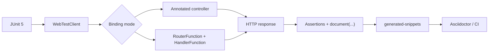

# Binding Directly to a Controller or Router

## 1. Objectives and Use Cases

In the **SPRING_REST_DOCS** module, REST API documentation is generated from HTTP tests: the test sends a request, asserts the response, and then Spring REST Docs writes snippets that can be included in Asciidoctor or Markdown. This approach keeps documentation examples aligned with verified application behavior and allows them to be re-run during builds and CI.

With **Spring WebFlux**, `WebTestClient` does not have to connect to a real server. It can send requests directly to:

- One or more **annotation-based controllers** via `WebTestClient.bindToController(...)`.
- A **functional router** via `WebTestClient.bindToRouterFunction(...)`.

This lesson belongs to the **WebTestClient** chapter and explains how to use both modes in combination with `documentationConfiguration(...)` and `document(...)` to generate HTTP documentation.

After this lesson, you will be able to write standalone tests for controllers or routers, describe path parameters/headers/payloads, choose the right testing scope, and include snippets in documentation built with Asciidoctor.

## 2. Understanding Direct Binding

Calling `bindToController` and `bindToRouterFunction` sets up a **mock WebFlux environment at the HTTP layer**, handling requests within the test process. No network port is opened and no Netty/Tomcat server needs to start.



The two WebFlux programming styles differ in how endpoints are defined:

| Criterion | `bindToController(...)` | `bindToRouterFunction(...)` |
| --- | --- | --- |
| Input | Controller instance, e.g., `new BookController()` | `RouterFunction<ServerResponse>` |
| Route declaration | `@GetMapping`, `@PostMapping`, `@RequestMapping`, etc. | `RouterFunctions.route`, `RequestPredicates.GET`, `POST`, etc. |
| Where path variables are read | `@PathVariable` in method parameters | `ServerRequest.pathVariable(...)` |
| Where response is built | Controller return value, e.g., `Mono<Map<...>>` | `ServerResponse` from handler function |
| Test scope | The controller and the WebFlux infrastructure created for the test | The router function, handler function, and the WebFlux infrastructure created for the test |
| REST Docs setup | `.configureClient().filter(documentationConfiguration(...))` | Same |

Compared to `bindToApplicationContext(context)`, both direct binding modes **do not load all application beans**. This keeps tests focused and generally faster, but you must supply any dependencies, filters, advice, or codecs needed for the scenario under test.

## 3. Preparing Dependencies and Tools

The examples below use Java, JUnit 5, Spring WebFlux, and Spring REST Docs. For a Spring Boot project with Gradle Groovy DSL:

```groovy
dependencies {
    implementation 'org.springframework.boot:spring-boot-starter-webflux'
    testImplementation 'org.springframework.boot:spring-boot-starter-test'
    testImplementation 'org.springframework.restdocs:spring-restdocs-webtestclient'
}
```

Spring Boot typically manages dependency versions. If you are not using Spring Boot, configure compatible versions of Spring WebFlux, Spring Test, JUnit 5, Reactor, and Spring REST Docs. The examples use `Map` to avoid creating extra DTOs; a real project should define proper models/DTOs and test the corresponding API contract.

Two shared static imports for generating documentation:

```java
import static org.springframework.restdocs.webtestclient.WebTestClientRestDocumentation.documentationConfiguration;
import static org.springframework.restdocs.webtestclient.WebTestClientRestDocumentation.document;
```

These are the REST Docs APIs **for WebTestClient**; do not mix them with static imports from `MockMvcRestDocumentation` or REST Assured.

## 4. Complete Example: Binding Directly to a Controller

Suppose a WebFlux controller exposes `GET /api/books/{id}` and returns a book with two fields, `id` and `title`. We instantiate the controller directly in the test, bind it to `WebTestClient`, and record snippets from the response.

```java
import java.util.Map;

import org.junit.jupiter.api.BeforeEach;
import org.junit.jupiter.api.Test;
import org.junit.jupiter.api.extension.ExtendWith;
import org.springframework.http.MediaType;
import org.springframework.restdocs.RestDocumentationContextProvider;
import org.springframework.restdocs.RestDocumentationExtension;
import org.springframework.test.web.reactive.server.WebTestClient;
import org.springframework.web.bind.annotation.GetMapping;
import org.springframework.web.bind.annotation.PathVariable;
import org.springframework.web.bind.annotation.RestController;
import reactor.core.publisher.Mono;

import static org.springframework.restdocs.payload.PayloadDocumentation.fieldWithPath;
import static org.springframework.restdocs.payload.PayloadDocumentation.responseFields;
import static org.springframework.restdocs.request.RequestDocumentation.parameterWithName;
import static org.springframework.restdocs.request.RequestDocumentation.pathParameters;
import static org.springframework.restdocs.webtestclient.WebTestClientRestDocumentation.document;
import static org.springframework.restdocs.webtestclient.WebTestClientRestDocumentation.documentationConfiguration;

@ExtendWith(RestDocumentationExtension.class)
class BookControllerDocumentationTest {

    private WebTestClient client;

    @BeforeEach
    void setUp(RestDocumentationContextProvider documentation) {
        client = WebTestClient.bindToController(new BookController())
            .configureClient()
            .filter(documentationConfiguration(documentation))
            .build();
    }

    @Test
    void documentsBookById() {
        client.get()
            .uri("/api/books/{id}", 42)
            .accept(MediaType.APPLICATION_JSON)
            .exchange()
            .expectStatus().isOk()
            .expectHeader().contentTypeCompatibleWith(MediaType.APPLICATION_JSON)
            .expectBody()
            .jsonPath("$.id").isEqualTo(42)
            .jsonPath("$.title").isEqualTo("Spring REST Docs")
            .consumeWith(document("books/get-by-id-controller",
                pathParameters(
                    parameterWithName("id").description("ID of the book to look up")
                ),
                responseFields(
                    fieldWithPath("id").description("Book ID"),
                    fieldWithPath("title").description("Book title")
                )
            ));
    }

    @RestController
    static class BookController {
        @GetMapping(
            path = "/api/books/{id}",
            produces = MediaType.APPLICATION_JSON_VALUE
        )
        public Mono<Map<String, Object>> getBook(@PathVariable("id") long id) {
            return Mono.just(Map.of(
                "id", id,
                "title", "Spring REST Docs"
            ));
        }
    }
}
```

Test flow:

1. `RestDocumentationExtension` manages the documentation context for each test; JUnit 5 injects `RestDocumentationContextProvider` into `@BeforeEach`.
2. `bindToController(new BookController())` creates a WebFlux handler with mappings from the supplied controller.
3. `configureClient()` opens the client customization step; `filter(documentationConfiguration(documentation))` adds HTTP transaction recording for Spring REST Docs.
4. `exchange()` executes the request; assertions check status, media type, and JSON.
5. `consumeWith(document("books/get-by-id-controller", ...))` generates snippets for the operation, including `path-parameters.adoc` and `response-fields.adoc`.

**Why is `configureClient()` needed?** `bindToController` returns a `ControllerSpec` for configuring the mock server environment. Only after switching to the client builder with `configureClient()` can you register the `ExchangeFilterFunction` provided by Spring REST Docs.

> Not calling `document(...)` in a test means snippets will not be requested for that operation, even if the REST Docs filter is installed on the client.

## 5. Complete Example: Binding Directly to a Functional Router

In WebFlux's **functional endpoints** style, a `RouterFunction<ServerResponse>` decides which requests are handled; a handler function receives a `ServerRequest` and returns a `Mono<ServerResponse>`. No `@RestController` declaration is required.

The following example documents `GET /api/notes/{id}`. The router and handler are constructed directly in `@BeforeEach` and passed to `bindToRouterFunction(...)`.

```java
import java.util.Map;

import org.junit.jupiter.api.BeforeEach;
import org.junit.jupiter.api.Test;
import org.junit.jupiter.api.extension.ExtendWith;
import org.springframework.http.MediaType;
import org.springframework.restdocs.RestDocumentationContextProvider;
import org.springframework.restdocs.RestDocumentationExtension;
import org.springframework.test.web.reactive.server.WebTestClient;
import org.springframework.web.reactive.function.server.RouterFunction;
import org.springframework.web.reactive.function.server.RouterFunctions;
import org.springframework.web.reactive.function.server.RequestPredicates;
import org.springframework.web.reactive.function.server.ServerResponse;

import static org.springframework.restdocs.payload.PayloadDocumentation.fieldWithPath;
import static org.springframework.restdocs.payload.PayloadDocumentation.responseFields;
import static org.springframework.restdocs.request.RequestDocumentation.parameterWithName;
import static org.springframework.restdocs.request.RequestDocumentation.pathParameters;
import static org.springframework.restdocs.webtestclient.WebTestClientRestDocumentation.document;
import static org.springframework.restdocs.webtestclient.WebTestClientRestDocumentation.documentationConfiguration;

@ExtendWith(RestDocumentationExtension.class)
class NoteRouterDocumentationTest {

    private WebTestClient client;

    @BeforeEach
    void setUp(RestDocumentationContextProvider documentation) {
        RouterFunction<ServerResponse> router = RouterFunctions.route(
            RequestPredicates.GET("/api/notes/{id}"),
            request -> ServerResponse.ok()
                .contentType(MediaType.APPLICATION_JSON)
                .bodyValue(Map.of(
                    "id", Long.parseLong(request.pathVariable("id")),
                    "content", "Sample note"
                ))
        );

        client = WebTestClient.bindToRouterFunction(router)
            .configureClient()
            .filter(documentationConfiguration(documentation))
            .build();
    }

    @Test
    void documentsNoteById() {
        client.get()
            .uri("/api/notes/{id}", 15)
            .accept(MediaType.APPLICATION_JSON)
            .exchange()
            .expectStatus().isOk()
            .expectBody()
            .jsonPath("$.id").isEqualTo(15)
            .jsonPath("$.content").isEqualTo("Sample note")
            .consumeWith(document("notes/get-by-id-router",
                pathParameters(
                    parameterWithName("id").description("Note ID")
                ),
                responseFields(
                    fieldWithPath("id").description("Note ID"),
                    fieldWithPath("content").description("Note content")
                )
            ));
    }
}
```

Key traits of the router style:

- `RequestPredicates.GET("/api/notes/{id}")` declares the HTTP method and path.
- `request.pathVariable("id")` retrieves the variable matched from the URI by the router.
- `ServerResponse.ok().contentType(...).bodyValue(...)` builds the HTTP response.
- `bindToRouterFunction(router)` creates a mock server from the specified router; afterward it uses **the exact same REST Docs mechanism** as a controller.

Handlers can invoke services injected via constructor or passed in when creating the router. In a direct test, you must supply those dependencies explicitly. If the production router depends on other configuration or beans, include those components in the test or consider `bindToApplicationContext(...)`.

## 6. Choosing the Right Binding Mode and Understanding Limits

Both direct binding modes are very useful for testing the HTTP contract at a small scope. However, they do not automatically verify the entire application configuration.

| Need | Suitable Choice | Notes |
| --- | --- | --- |
| Test mappings and JSON returned by a `@RestController` | `bindToController` | Can instantiate the controller with a fake/mock service |
| Test `RouterFunction` and WebFlux handlers | `bindToRouterFunction` | Suited for functional endpoints |
| Test routing/filters/exception handlers that are Spring beans | `bindToApplicationContext` | Includes only beans actually present in the test context |
| Test HTTP flow through a running port/server | `bindToServer` | Sends requests over the network to the application |

For example, if production uses a `WebFilter` to enforce authentication, a test created with `bindToController(new BookController())` will not automatically include that filter. A test returning 200 in direct binding mode **does not prove** that the production route bypasses authentication. When a test is meant to verify security configuration, filter chains, or integrated behavior, build the appropriate configuration or use a more suitable test mode.

For a controller with dependencies:

```java
BookService fakeService = new FakeBookService();
BookController controller = new BookController(fakeService);

WebTestClient client = WebTestClient.bindToController(controller)
    .configureClient()
    .filter(documentationConfiguration(documentation))
    .build();
```

The snippet above illustrates **passing dependencies via constructor**, assuming `BookController(BookService)` and `FakeBookService` exist in the project; it is not meant to be used directly with the standalone controller without that constructor in Section 4. The goal is to control response data so documentation examples remain stable across runs.

## 7. Customizing Request/Response Snippets

Spring REST Docs provides descriptors to document HTTP behavior and detect changes:

| Content Type | Common Snippet API | Generated File |
| --- | --- | --- |
| Path variable | `pathParameters(parameterWithName(...))` | `path-parameters.adoc` |
| Query parameter | `queryParameters(parameterWithName(...))` | `query-parameters.adoc` |
| Request header | `requestHeaders(headerWithName(...))` | `request-headers.adoc` |
| Response header | `responseHeaders(headerWithName(...))` | `response-headers.adoc` |
| Request JSON field | `requestFields(fieldWithPath(...))` | `request-fields.adoc` |
| Response JSON field | `responseFields(fieldWithPath(...))` | `response-fields.adoc` |

An example illustrating the structure of a POST test after adding a `POST /api/books` endpoint to the controller or router:

```java
import static org.springframework.restdocs.headers.HeaderDocumentation.headerWithName;
import static org.springframework.restdocs.headers.HeaderDocumentation.requestHeaders;
import static org.springframework.restdocs.payload.PayloadDocumentation.requestFields;

client.post()
    .uri("/api/books")
    .header("X-Request-Id", "test-request-001")
    .contentType(MediaType.APPLICATION_JSON)
    .bodyValue(Map.of("title", "Spring REST Docs"))
    .exchange()
    .expectStatus().isCreated()
    .expectBody()
    .consumeWith(document("books/create",
        requestHeaders(
            headerWithName("X-Request-Id").description("Request trace ID")
        ),
        requestFields(
            fieldWithPath("title").description("Title of the created book")
        )
    ));
```

This is an **illustrative snippet**, not a standalone test: the POST endpoint and 201 response must be implemented beforehand. If the API returns JSON, add corresponding assertions and `responseFields(...)`. When documenting fields, accurately describe all required fields in the payload; for optional fields, use the `.optional()` descriptor when appropriate for the API contract.

You can also preprocess snippets to make JSON easier to read without changing the HTTP operation in the test:

```java
import static org.springframework.restdocs.operation.preprocess.Preprocessors.prettyPrint;

client = WebTestClient.bindToController(new BookController())
    .configureClient()
    .filter(documentationConfiguration(documentation)
        .operationPreprocessors()
            .withRequestDefaults(prettyPrint())
            .withResponseDefaults(prettyPrint()))
    .build();
```

In this snippet, `documentation` is `RestDocumentationContextProvider` and `BookController` is the controller from Section 4. For a router, replace `bindToController(new BookController())` with `bindToRouterFunction(router)`. When publishing documentation, you can use preprocessors to strip tokens or private values from snippets; test assertions should still verify the real data.

## 8. Building Asciidoctor Documentation from Snippets

When running the tests in Sections 4 and 5, Spring REST Docs can create directories corresponding to each `document(...)` identifier:

```text
build/generated-snippets/
├── books/
│   └── get-by-id-controller/
│       ├── http-request.adoc
│       ├── http-response.adoc
│       ├── path-parameters.adoc
│       └── response-fields.adoc
└── notes/
    └── get-by-id-router/
        ├── http-request.adoc
        ├── http-response.adoc
        ├── path-parameters.adoc
        └── response-fields.adoc
```

These are **representative** files, not an exhaustive list: other default snippets such as `curl-request.adoc`, `request-body.adoc`, and `response-body.adoc` may be generated depending on the operation and configuration. With Maven, the standard output directory is `target/generated-snippets`.

An Asciidoctor file can assemble the verified snippets:

```asciidoc
= Books and Notes API
:snippets: build/generated-snippets

== Get a book

=== HTTP request
include::{snippets}/books/get-by-id-controller/http-request.adoc[]

=== Path parameters
include::{snippets}/books/get-by-id-controller/path-parameters.adoc[]

=== HTTP response
include::{snippets}/books/get-by-id-controller/http-response.adoc[]

=== Response fields
include::{snippets}/books/get-by-id-controller/response-fields.adoc[]

== Get a note

include::{snippets}/notes/get-by-id-router/http-request.adoc[]
include::{snippets}/notes/get-by-id-router/http-response.adoc[]
include::{snippets}/notes/get-by-id-router/response-fields.adoc[]
```

The `:snippets:` path must match where Asciidoctor resolves paths; in a real build, pass this value from the plugin and adjust it to the file location. Example Gradle configuration when **the Asciidoctor plugin is installed** and provides the `asciidoctor` task:

```groovy
def snippetsDir = layout.buildDirectory.dir("generated-snippets")

tasks.named("test") {
    outputs.dir(snippetsDir)
}

tasks.named("asciidoctor") {
    dependsOn(tasks.named("test"))
    inputs.dir(snippetsDir)
    attributes "snippets": snippetsDir.get().asFile
}
```

In CI, run tests before generating documentation, e.g. `./gradlew clean test asciidoctor` once the corresponding plugin/tasks are configured. If an HTTP assertion or descriptor mismatches, the test should fail the pipeline and prevent stale documentation from being published as current. With plain Markdown, a separate step is required to link or inline snippet contents; the `include::` syntax belongs to Asciidoctor.

## 9. Common Errors and How to Resolve Them

| Symptom | Check and Fix |
| --- | --- |
| Test gets 404 with `bindToController` | Check that the passed controller has the proper `@RestController`/`@RequestMapping` and that the URI and HTTP method match the mapping. |
| Router returns 404 | Check that `RouterFunction` was passed to `bindToRouterFunction` and that `RequestPredicates` match the method/path. |
| Handler method has a null dependency | Inject the dependency via constructor, use a mock/fake service, or choose a test with a Spring context to inject beans. |
| Application filters/security do not run | Direct binding builds a WebFlux environment solely from the test setup; add the filters/advice being tested or switch to `bindToApplicationContext` when needed. |
| Cannot call `.filter(...)` after `bindToController` | Call `.configureClient()` before `.filter(documentationConfiguration(...))`. The same applies to `bindToRouterFunction`. |
| Cannot inject `RestDocumentationContextProvider` | Verify `@ExtendWith(RestDocumentationExtension.class)`, JUnit 5, and the `spring-restdocs-webtestclient` dependency. |
| HTTP test passes but generates no snippets | Ensure the client in use has the REST Docs filter and the test calls `.consumeWith(document(...))`. |
| Missing `response-fields.adoc` or `path-parameters.adoc` | Add the corresponding `responseFields(...)` or `pathParameters(...)` to `document(...)` and re-run the test. |
| Field description mismatch fails the test | Inspect the returned JSON, update descriptors and assertions; use `.optional()` only when a field is genuinely optional. |
| `include::` cannot find file | Verify the identifier, generated snippets path, `snippets` attribute, and task dependency between test and Asciidoctor tasks. |

## 10. Practice Exercises and Self-Check

1. Run `BookControllerDocumentationTest`, inspect the snippet files under `books/get-by-id-controller`, and compare the request/response against the assertions.
2. Change the URI argument in the test from `.uri("/api/books/{id}", 42)` to `.uri("/api/books/{id}", 99)`. Observe the `id` field in the JSON change and update the assertion appropriately.
3. Run `NoteRouterDocumentationTest`, then change `RequestPredicates.GET` to `POST` while keeping the GET test to observe the 404 failure and adjust the test/router.
4. Add an `author` field to the response without adding `fieldWithPath("author")`. Watch the documentation test catch the undocumented field, then fix the descriptor.
5. Apply `prettyPrint()` to one of the two clients and verify the formatting change in `http-response.adoc`.
6. Create an Asciidoctor page covering both the controller and router, then include test execution and documentation building in your CI pipeline.

## 11. Key Takeaways

- `bindToController(...)` is for annotation-based controllers, while `bindToRouterFunction(...)` is for Spring WebFlux functional routing.
- Both modes process HTTP inside the test without requiring a TCP server or a full `ApplicationContext`.
- To generate snippets with REST Docs, configure `.configureClient().filter(documentationConfiguration(context))` when building the client and call `.consumeWith(document("operation-id", ...))` in the test.
- A useful snippet both showcases an HTTP example and validates the request/response contract through descriptors.
- Results only reflect the controller/router, dependencies, and infrastructure explicitly included in the test; broader integration tests require the corresponding environment.
- Tie test execution to the Asciidoctor/Markdown build step in your build and CI so documentation stays updated alongside API changes.
