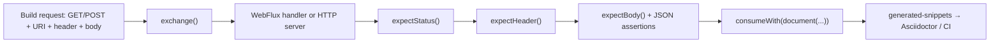

# Exchanging Requests and Asserting Responses

## 1. Lesson Objectives

In the **SPRING_REST_DOCS** module, REST API documentation is built from verified HTTP interactions: tests send requests, assert responses, and instruct Spring REST Docs to export snippets for Asciidoctor/Markdown documentation. This approach helps detect early when an endpoint changes its HTTP status, headers, or payload without corresponding documentation updates.

This lesson belongs to the **WebTestClient** chapter and focuses on the core workflow: **build request → call `exchange()` → assert response → write snippets**. After this lesson, you will be able to:

- Use `get()`, `post()`, `uri()`, `header()`, `accept()`, `contentType()`, and `bodyValue()` to construct requests.
- Explain why `exchange()` is the request execution boundary and distinguish it from assertion steps.
- Assert status codes, response headers, JSON bodies, lists of results, and empty-body responses.
- Combine JUnit 5, Spring WebFlux `WebTestClient`, and Spring REST Docs to generate request/response/payload/header/parameter snippets.
- Choose the right assertion approach for standard JSON versus continuous streaming responses.
- Integrate verified snippets into Asciidoctor and the build/CI pipeline.

## 2. The WebTestClient Request–Response Chain

`WebTestClient` provides a fluent API. You configure the request on the client side, execute it, and then declare a sequence of expectations on the response:

```java
client.get()
    .uri("/api/books/{id}", 42)
    .accept(MediaType.APPLICATION_JSON)
    .exchange()
    .expectStatus().isOk()
    .expectHeader().contentTypeCompatibleWith(MediaType.APPLICATION_JSON)
    .expectBody()
    .jsonPath("$.id").isEqualTo(42);
```

The example above assumes `client` has been created and the `GET /api/books/42` endpoint exists. Key points:

1. **Before `exchange()`**: defines the HTTP method, URI, request headers, and request body (if any).
2. **At `exchange()`**: `WebTestClient` sends the request to the bound target (controller/router, `ApplicationContext`, or HTTP server) and returns an object for inspecting the response.
3. **After `exchange()`**: `expectStatus()`, `expectHeader()`, and `expectBody()` perform assertions. Any failing assertion causes the test to fail.
4. **With REST Docs**: `consumeWith(document(...))` receives the test's HTTP exchange and writes snippets for the documented operation.



`exchange()` is the method that **executes the request**, not a data comparison step. Unlike `WebClient`, which is meant for general HTTP communication, `WebTestClient` comes with a built-in assertion API for testing. Therefore, you do not need to call `retrieve()` to read the response in test chains like this example.

## 3. Commonly Used Methods

| Stage | API | Purpose |
| --- | --- | --- |
| Start request | `client.get()`, `post()`, `put()`, `patch()`, `delete()` | Select the HTTP method |
| Target URI | `.uri("/api/books/{id}", 42)` | Build the URI and substitute path variables |
| Request headers | `.header("X-Request-Id", "req-001")` | Send domain/custom headers |
| Expected content | `.accept(MediaType.APPLICATION_JSON)` | Set `Accept` |
| Outgoing body type | `.contentType(MediaType.APPLICATION_JSON)` | Set `Content-Type` |
| Request body | `.bodyValue(object)` | Encode an object into the request body via codec |
| Execute | `.exchange()` | Send the request and obtain `ResponseSpec` |
| Status code | `.expectStatus().isOk()` | Assert HTTP 200 |
| Response headers | `.expectHeader().valueEquals("Location", "...")` | Assert a header value |
| Response body | `.expectBody().jsonPath("$.id").isEqualTo(42)` | Assert a JSON path |
| Document | `.expectBody().consumeWith(document("books/get", ...))` | Generate snippets from the operation |

Not every request has a body: for GET, you usually only need the URI, headers, and `exchange()`. For POST/PUT/PATCH, use `contentType(...)` and `bodyValue(...)` when sending JSON. `Accept` indicates the response format the client expects, whereas `Content-Type` describes the data type of the request body.

## 4. Preparing JUnit 5 and Spring REST Docs

Assume a Spring Boot project with Spring WebFlux. With Gradle (Groovy DSL), the baseline dependencies are:

```groovy
dependencies {
    implementation 'org.springframework.boot:spring-boot-starter-webflux'
    testImplementation 'org.springframework.boot:spring-boot-starter-test'
    testImplementation 'org.springframework.restdocs:spring-restdocs-webtestclient'
}
```

Spring Boot normally manages dependency versions. In a project managing versions manually, choose compatible versions of Spring WebFlux, Spring Test, Spring REST Docs, and JUnit. The following examples use Java 9+ (for `Map.of`) and JUnit 5.

For a test focused solely on a controller, you can initialize the client like this:

```java
@ExtendWith(RestDocumentationExtension.class)
class ExampleDocumentationTest {

    private WebTestClient client;

    @BeforeEach
    void setUp(RestDocumentationContextProvider restDocumentation) {
        this.client = WebTestClient.bindToController(new ExampleController())
            .configureClient()
            .filter(documentationConfiguration(restDocumentation))
            .build();
    }
}
```

This is an illustrative skeleton: `ExampleController`, imports, and test methods are provided in the full example below. `RestDocumentationExtension` supplies the documentation context for JUnit 5. `documentationConfiguration(restDocumentation)` attaches the Spring REST Docs filter to the client; `document(...)` in each test specifies the operation and snippets to generate.

When using `bindToApplicationContext(context)`, the setup still follows `.configureClient().filter(...).build()`. When using `bindToServer()`, you can call `.filter(...)` directly on the client builder without `configureClient()`.

## 5. Complete Example: Asserting GET and POST and Generating Documentation

To keep the focus on requests and responses, the example uses a simple WebFlux controller with no database connection. Two sample endpoints:

- `GET /api/books/{id}` returns `200 OK` and JSON containing `id` and `title`.
- `POST /api/books` accepts JSON with `title`, returning `201 Created`, a `Location` header, and JSON for the newly created book.

You can place the following test in `src/test/java` of a project configured with the dependencies from Section 4:

```java
import java.net.URI;
import java.util.Map;

import org.junit.jupiter.api.BeforeEach;
import org.junit.jupiter.api.Test;
import org.junit.jupiter.api.extension.ExtendWith;
import org.springframework.http.HttpHeaders;
import org.springframework.http.MediaType;
import org.springframework.http.ResponseEntity;
import org.springframework.restdocs.RestDocumentationContextProvider;
import org.springframework.restdocs.RestDocumentationExtension;
import org.springframework.test.web.reactive.server.WebTestClient;
import org.springframework.web.bind.annotation.GetMapping;
import org.springframework.web.bind.annotation.PathVariable;
import org.springframework.web.bind.annotation.PostMapping;
import org.springframework.web.bind.annotation.RequestBody;
import org.springframework.web.bind.annotation.RestController;
import reactor.core.publisher.Mono;

import static org.springframework.restdocs.headers.HeaderDocumentation.headerWithName;
import static org.springframework.restdocs.headers.HeaderDocumentation.requestHeaders;
import static org.springframework.restdocs.headers.HeaderDocumentation.responseHeaders;
import static org.springframework.restdocs.payload.PayloadDocumentation.fieldWithPath;
import static org.springframework.restdocs.payload.PayloadDocumentation.requestFields;
import static org.springframework.restdocs.payload.PayloadDocumentation.responseFields;
import static org.springframework.restdocs.request.RequestDocumentation.parameterWithName;
import static org.springframework.restdocs.request.RequestDocumentation.pathParameters;
import static org.springframework.restdocs.webtestclient.WebTestClientRestDocumentation.document;
import static org.springframework.restdocs.webtestclient.WebTestClientRestDocumentation.documentationConfiguration;

@ExtendWith(RestDocumentationExtension.class)
class BookExchangeDocumentationTest {

    private WebTestClient client;

    @BeforeEach
    void setUp(RestDocumentationContextProvider restDocumentation) {
        client = WebTestClient.bindToController(new BookController())
            .configureClient()
            .filter(documentationConfiguration(restDocumentation))
            .build();
    }

    @Test
    void getBookChecksResponseAndDocumentsIt() {
        client.get()
            .uri("/api/books/{id}", 42)
            .accept(MediaType.APPLICATION_JSON)
            .exchange()
            .expectStatus().isOk()
            .expectHeader().contentTypeCompatibleWith(MediaType.APPLICATION_JSON)
            .expectBody()
            .jsonPath("$.id").isEqualTo(42)
            .jsonPath("$.title").isEqualTo("Spring REST Docs")
            .consumeWith(document("books/get",
                pathParameters(
                    parameterWithName("id").description("ID of the book to retrieve")
                ),
                responseFields(
                    fieldWithPath("id").description("Book ID"),
                    fieldWithPath("title").description("Book title")
                )
            ));
    }

    @Test
    void createBookChecksResponseAndDocumentsIt() {
        client.post()
            .uri("/api/books")
            .header("X-Request-Id", "req-001")
            .contentType(MediaType.APPLICATION_JSON)
            .accept(MediaType.APPLICATION_JSON)
            .bodyValue(Map.of("title", "Spring REST Docs"))
            .exchange()
            .expectStatus().isCreated()
            .expectHeader().valueEquals(HttpHeaders.LOCATION, "/api/books/42")
            .expectHeader().contentTypeCompatibleWith(MediaType.APPLICATION_JSON)
            .expectBody()
            .jsonPath("$.id").isEqualTo(42)
            .jsonPath("$.title").isEqualTo("Spring REST Docs")
            .consumeWith(document("books/create",
                requestHeaders(
                    headerWithName("X-Request-Id")
                        .description("ID used to trace the request")
                ),
                requestFields(
                    fieldWithPath("title").description("New book title")
                ),
                responseHeaders(
                    headerWithName(HttpHeaders.LOCATION)
                        .description("URI of the newly created resource")
                ),
                responseFields(
                    fieldWithPath("id").description("Created book ID"),
                    fieldWithPath("title").description("Book title")
                )
            ));
    }

    @RestController
    static class BookController {

        @GetMapping(
            path = "/api/books/{id}",
            produces = MediaType.APPLICATION_JSON_VALUE
        )
        public Mono<Map<String, Object>> getBook(
                @PathVariable("id") long id) {
            return Mono.just(Map.of(
                "id", id,
                "title", "Spring REST Docs"
            ));
        }

        @PostMapping(
            path = "/api/books",
            consumes = MediaType.APPLICATION_JSON_VALUE,
            produces = MediaType.APPLICATION_JSON_VALUE
        )
        public Mono<ResponseEntity<Map<String, Object>>> createBook(
                @RequestBody Mono<Map<String, String>> requestBody) {
            return requestBody.map(body -> {
                Map<String, Object> result = Map.of(
                    "id", 42,
                    "title", body.get("title")
                );
                return ResponseEntity
                    .created(URI.create("/api/books/42"))
                    .body(result);
            });
        }
    }
}
```

Each test begins by building the request, sends it only when calling `exchange()`, and then checks the properties that must hold:

- **GET:** `expectStatus().isOk()` verifies 200; `contentTypeCompatibleWith` allows JSON-compatible media types (including media type parameters like charset); `jsonPath` checks the actual data in the response.
- **POST:** `bodyValue(...)` sends the input JSON; `expectStatus().isCreated()` verifies 201; `valueEquals(HttpHeaders.LOCATION, ...)` checks the new resource URI; `jsonPath` checks the returned fields.
- **REST Docs:** `document("books/get", ...)` and `document("books/create", ...)` create two separate snippet directories. The descriptors document path variables, request/response fields, and headers to be published.

The two operations in this example use fixed data so documentation remains consistent across runs. In a real application, you should provide fixtures or test doubles for services/repositories and assert responses against the real API contract.

## 6. Choosing the Right Assertions for Responses

### 6.1. HTTP Status

You can verify status codes using methods such as:

```java
// One of the following expectations depending on the endpoint:
.expectStatus().isOk()                 // 200
.expectStatus().isCreated()            // 201
.expectStatus().isNoContent()          // 204
.expectStatus().isNotFound()           // 404
.expectStatus().is4xxClientError()     // 4xx range
.expectStatus().is5xxServerError()     // 5xx range
.expectStatus().valueEquals(202)       // specific status code
```

These lines are **illustrative options**—you cannot chain all of them onto one response because most conditions conflict. For an API with a well-defined contract, assert the exact status code. Range assertions like 4xx/5xx are useful for checking an error category, but do not replace checking an exact error status when that code is part of the API contract.

### 6.2. Response Headers

`expectHeader()` lets you check headers when the response carries significant attributes:

```java
client.post()
    .uri("/api/books")
    .contentType(MediaType.APPLICATION_JSON)
    .bodyValue(Map.of("title", "Spring REST Docs"))
    .exchange()
    .expectStatus().isCreated()
    .expectHeader().valueEquals("Location", "/api/books/42");
```

This illustrative snippet uses the POST controller from Section 5. In other endpoints, headers might be `ETag`, `Cache-Control`, or a request correlation ID. If a header belongs in the API documentation, use `requestHeaders(...)` or `responseHeaders(...)` with `headerWithName(...)` inside `document(...)`.

### 6.3. JSON Body, JSON Paths, and Content Matching

For JSON, two common verification styles are:

```java
client.get()
    .uri("/api/books/{id}", 42)
    .exchange()
    .expectStatus().isOk()
    .expectBody()
    .jsonPath("$.id").isEqualTo(42)
    .jsonPath("$.title").isEqualTo("Spring REST Docs");
```

```java
client.get()
    .uri("/api/books/{id}", 42)
    .exchange()
    .expectStatus().isOk()
    .expectBody()
    .json("{\"id\":42,\"title\":\"Spring REST Docs\"}");
```

`jsonPath(...)` inspects specific parts of the JSON; `json(...)` compares against an expected JSON representation using Spring Test's JSON comparison mechanism. Use REST Docs' `responseFields(...)` to document fields, because assertions that only check a few values **do not automatically generate** the field description table.

### 6.4. Empty-Body Responses

For a DELETE endpoint returning 204, you can write:

```java
client.delete()
    .uri("/api/books/{id}", 42)
    .exchange()
    .expectStatus().isNoContent()
    .expectBody().isEmpty();
```

This assumes the API already implements a DELETE endpoint returning 204. `isEmpty()` catches cases where the application accidentally returns a payload when the contract requires an empty body.

### 6.5. List Responses

When an endpoint returns a JSON array, you can deserialize it into a list of DTOs instead of just comparing strings:

```java
client.get()
    .uri("/api/books")
    .exchange()
    .expectStatus().isOk()
    .expectBodyList(BookDto.class)
    .hasSize(2);
```

This is an illustrative snippet requiring a `GET /api/books` endpoint and a `BookDto` class that the test's codec can deserialize. If the API returns a list, add appropriate descriptors for array elements when writing snippets, such as `[].id` and `[].title` in `responseFields(...)`.

## 7. Distinguishing Normal Response Bodies from Streaming

`expectBody()` is suited to finite responses because the entire body is buffered for inspection. For Server-Sent Events (SSE) or continuously emitting `Flux` streams, instead of trying to consume the entire response, use `returnResult(...)` and verify the stream with Reactor Test:

```java
import org.springframework.test.web.reactive.server.FluxExchangeResult;
import reactor.test.StepVerifier;

FluxExchangeResult<String> result = client.get()
    .uri("/api/updates")
    .accept(MediaType.TEXT_EVENT_STREAM)
    .exchange()
    .expectStatus().isOk()
    .returnResult(String.class);

StepVerifier.create(result.getResponseBody())
    .expectNextCount(2)
    .thenCancel()
    .verify();
```

This example requires `/api/updates` to emit at least two SSE items and the test to have the `reactor-test` dependency. `thenCancel()` suits infinite streams. Streaming responses typically require dedicated documentation strategies and finite sample data; do not let a snippet generation step block indefinitely on `expectBody()`. For finite JSON HTTP APIs, the `expectBody().consumeWith(document(...))` chain in Section 5 is the standard choice.

## 8. Generating Verified Snippets with Spring REST Docs

After asserting the response, call `consumeWith(document(...))` with the operation identifier and the required descriptors:

```java
.expectBody()
.jsonPath("$.id").isEqualTo(42)
.consumeWith(document("books/get",
    pathParameters(
        parameterWithName("id").description("ID of the book to retrieve")
    ),
    responseFields(
        fieldWithPath("id").description("Book ID"),
        fieldWithPath("title").description("Book title")
    )
));
```

This is the tail of the GET chain from Section 5; it requires the client to have the REST Docs filter installed. Combining descriptors and assertions serves distinct roles:

| Action | Mechanism | Purpose |
| --- | --- | --- |
| Assert status | `expectStatus()` | Catch HTTP status code changes |
| Assert headers | `expectHeader()` | Catch incorrect or missing headers |
| Assert JSON data | `jsonPath()`, `json()` | Catch mismatched values or structure |
| Document request/response | `requestFields()`, `responseFields()`, `pathParameters()`, etc. | Generate documentation tables and validate API contract descriptions |
| Save snippets | `document("operation-id", ...)` | Write the operation's AsciiDoc files |

By default, documenting fields with `responseFields(...)` is strict: a field present in the response that is not documented typically causes the documentation test to fail. Optional fields can use `.optional()`, and fields to exclude from the table can use `.ignored()` when appropriate for the API contract. Avoid using relaxed descriptors just to hide API changes the team needs to know about.

### Customizing Data Written to Snippets

If single-line JSON is hard to read, apply a preprocessor to the filter:

```java
import static org.springframework.restdocs.operation.preprocess.Preprocessors.prettyPrint;

client = WebTestClient.bindToController(new BookController())
    .configureClient()
    .filter(documentationConfiguration(restDocumentation)
        .operationPreprocessors()
            .withRequestDefaults(prettyPrint())
            .withResponseDefaults(prettyPrint()))
    .build();
```

`prettyPrint()` affects only the content written **into the snippets**, without modifying the request/response processed by the application. Similarly, you can configure preprocessors to replace tokens, remove sensitive headers, or normalize random hosts/ports before placing HTTP examples into shared documentation.

## 9. Including Snippets in Asciidoctor, Gradle, and CI

When tests succeed, the operations in Section 5 typically generate files such as:

```text
build/generated-snippets/
└── books/
    ├── get/
    │   ├── http-request.adoc
    │   ├── http-response.adoc
    │   ├── path-parameters.adoc
    │   └── response-fields.adoc
    └── create/
        ├── http-request.adoc
        ├── http-response.adoc
        ├── request-headers.adoc
        ├── request-fields.adoc
        ├── response-headers.adoc
        └── response-fields.adoc
```

This is a **representative** file list, not necessarily exhaustive; Spring REST Docs can also generate `curl-request.adoc`, `request-body.adoc`, `response-body.adoc`, and other snippets depending on configuration. When using Maven, the output directory is normally `target/generated-snippets`.

Asciidoctor example:

```asciidoc
= Book API
:snippets: build/generated-snippets

== Look up a book

include::{snippets}/books/get/http-request.adoc[]
include::{snippets}/books/get/path-parameters.adoc[]
include::{snippets}/books/get/http-response.adoc[]
include::{snippets}/books/get/response-fields.adoc[]

== Create a book

include::{snippets}/books/create/http-request.adoc[]
include::{snippets}/books/create/request-headers.adoc[]
include::{snippets}/books/create/request-fields.adoc[]
include::{snippets}/books/create/http-response.adoc[]
include::{snippets}/books/create/response-headers.adoc[]
include::{snippets}/books/create/response-fields.adoc[]
```

The `:snippets:` path needs to be adjusted to match how Asciidoctor resolves files or passed from the build. With Gradle, assuming the Asciidoctor plugin is installed and provides the `asciidoctor` task:

```groovy
def snippetsDir = layout.buildDirectory.dir("generated-snippets")

tasks.named("test") {
    outputs.dir(snippetsDir)
}

tasks.named("asciidoctor") {
    dependsOn(tasks.named("test"))
    inputs.dir(snippetsDir)
    attributes "snippets": snippetsDir.get().asFile
}
```

In CI, run tests before building the pages, such as `./gradlew clean test asciidoctor` once these tasks are configured. If an HTTP code, header, or body differs from expectations, tests fail, thereby preventing out-of-sync documentation from being published. With plain Markdown, a separate integration step is needed to link or inline snippet contents into the docs: the `include::` directive is Asciidoctor syntax.

## 10. Common Errors and Diagnostics

| Symptom | Cause and Fix |
| --- | --- |
| Test gets 404 instead of 200 | Check the URI, HTTP method, path variables, and which controller/router is bound to the client. |
| POST returns 415 Unsupported Media Type | Check `contentType(MediaType.APPLICATION_JSON)`, the actual sent body, `consumes`, and JSON codecs. |
| POST returns 406 Not Acceptable | Check `Accept` in the request and the endpoint's `produces` format. |
| `jsonPath(...)` cannot find field | Print/inspect the response to compare the JSON path against the real structure; check whether the field is nested in an object or array. |
| JSON is correct but header test still fails | The actual header may be missing or have a different value; check `Location`, `Content-Type`, and the values returned by the server. |
| HTTP test passes but generates no snippets | Verify `documentationConfiguration(...)` is attached to the right client and `consumeWith(document(...))` is called. |
| `responseFields(...)` reports undocumented field | The API added a field or descriptors are incomplete; update the documentation to match the contract rather than disabling checks arbitrarily. |
| Snippet path collision across multiple tests | Pick a unique, stable identifier for each operation (e.g., `books/get`, `books/create`); avoid overwriting the same identifier when tests run concurrently. |
| Non-terminating SSE/Flux body hangs test | Verify using `returnResult(...)` and `StepVerifier`, or design finite sample data for documentation. |
| Asciidoctor reports missing `.adoc` file | Check the identifier, snippets directory, running tests before the build, and the `snippets` attribute in the task. |

## 11. Practice Exercises

1. Run `BookExchangeDocumentationTest` and verify that the GET test creates `books/get/http-response.adoc` and the POST test creates `books/create/response-headers.adoc`.
2. Change `expectStatus().isCreated()` in the POST test to `isOk()`; observe the test failing because the server returns 201, then restore the proper assertion.
3. Change `Location` in the controller to `/api/books/99` while keeping the `/api/books/42` assertion; see how `expectHeader()` catches the error.
4. Add an `author` field to the GET JSON without declaring it in `responseFields(...)`; observe the REST Docs error, then update the descriptor.
5. Enable `prettyPrint()` to inspect the snippet before and after formatting. Verify that assertion results remain unchanged.
6. Create an Asciidoctor page combining GET and POST documentation. Have the pipeline run tests and build documentation, ensuring test failures fail the pipeline.

## 12. Key Takeaways

- `exchange()` executes the request. `expectStatus()`, `expectHeader()`, and `expectBody()` assert the response.
- For finite JSON, use `jsonPath`/`json` to check content, then `consumeWith(document(...))` to write snippets for the tested operation.
- When sending JSON, clearly distinguish `contentType(...)` for the request body from `accept(...)` for the desired response.
- Assertions and REST Docs descriptors complement each other: assertions verify status/values; descriptors generate documentation tables and validate the documented parts of the API contract.
- For streaming, consider `returnResult(...)` and `Flux` verification mechanisms rather than buffering the entire body.
- Generated documentation is only trustworthy when tests have proper assertions, descriptors accurately reflect the contract, and build/CI always runs tests before publishing snippets.
