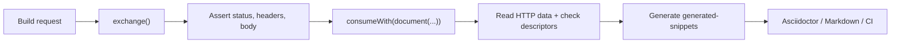

# Using `consumeWith(document(...))` to Generate Snippets

## 1. Problem: Turning an HTTP Test into Verifiable Documentation

In the **SPRING_REST_DOCS** module, the goal is to generate REST API documentation from requests and responses already verified by HTTP tests. Spring REST Docs supports tools such as MockMvc, WebTestClient, and REST Assured; the generated snippets can be compiled into Asciidoctor/Markdown documentation and integrated into builds and CI.

In the **WebTestClient** chapter, after configuring the client with Spring REST Docs, the exact step that determines **whether a request is recorded as a snippet** is:

```java
.expectBody()
.consumeWith(document("books/get-by-id"));
```

This lesson dives into how `consumeWith(document(...))` works: when it executes, the arguments of `document`, descriptors used to describe the HTTP contract, where generated files are written, and how to handle test or snippet-generation failures.

By the end of this lesson, you will be able to:

- Distinguish `exchange()`, `expect...()` calls, and `consumeWith(document(...))`.
- Use `document("operation-id", ...)` to generate default snippets as well as request/response descriptor snippets.
- Document JSON bodies, path parameters, and request/response headers in JUnit 5 tests with WebTestClient.
- Choose stable identifiers so Asciidoctor locates snippets and tests do not overwrite each other.
- Understand why strict descriptors catch API changes, and integrate documentation generation into CI.

## 2. `consumeWith` and `document` Perform Different Jobs

Consider the following call chain:

```java
client.get()
    .uri("/api/books/{id}", 42)
    .accept(MediaType.APPLICATION_JSON)
    .exchange()
    .expectStatus().isOk()
    .expectBody()
    .jsonPath("$.id").isEqualTo(42)
    .consumeWith(document("books/get-by-id"));
```

Assume `client` already has the REST Docs filter attached and the GET endpoint exists. The roles of each step are:

| Component | Job |
| --- | --- |
| `get().uri(...).accept(...)` | Builds the HTTP request. |
| `exchange()` | Sends the request to the configured controller/router, `ApplicationContext`, or HTTP server. |
| `expectStatus()`, `expectBody()`, `jsonPath()` | Asserts status and response data; any failing check fails the test. |
| **`consumeWith(...)`** | Consumes the request/response exchange result to run a callback. |
| **`document("books/get-by-id", ...)`** | Provides the Spring REST Docs callback, using the HTTP exchange details and descriptors to write snippets to the operation directory. |



**Key point:** `consumeWith` is part of the response-testing API, whereas `document` is a callback provided by `spring-restdocs-webtestclient`. If you only configure the REST Docs filter without **calling `document(...)` for an operation**, the expected snippets will not appear automatically. If an assertion before `consumeWith` fails, the test chain aborts and the subsequent documentation step does not execute.

In these examples, `consumeWith(...)` follows `expectBody()` so the callback receives the buffered HTTP exchange result, which fits finite JSON responses. For responses without a body, `expectBody().isEmpty()` verifies an empty payload; combining that assertion with the documentation callback must follow the return types of the Spring Test API in your project version. For non-terminating streaming responses, a separate testing/sampling strategy is needed because buffering the entire body may never complete.

## 3. Preparing WebTestClient for Spring REST Docs

### 3.1. Dependencies

The examples use Java, Spring WebFlux, JUnit 5, and Spring REST Docs. In a Spring Boot project that manages library versions, declare the Gradle Groovy DSL dependencies as follows:

```groovy
dependencies {
    implementation 'org.springframework.boot:spring-boot-starter-webflux'
    testImplementation 'org.springframework.boot:spring-boot-starter-test'
    testImplementation 'org.springframework.restdocs:spring-restdocs-webtestclient'
}
```

If your project does not use Spring Boot dependency management, choose compatible versions of Spring Framework, Spring REST Docs, JUnit 5, and the JSON codec.

### 3.2. Installing the REST Docs Filter

When binding directly to a controller, configure the client in `@BeforeEach` as follows:

```java
import static org.springframework.restdocs.webtestclient.WebTestClientRestDocumentation.document;
import static org.springframework.restdocs.webtestclient.WebTestClientRestDocumentation.documentationConfiguration;

@ExtendWith(RestDocumentationExtension.class)
class ExampleDocumentationTest {

    private WebTestClient client;

    @BeforeEach
    void setUp(RestDocumentationContextProvider restDocumentation) {
        client = WebTestClient.bindToController(new ExampleController())
            .configureClient()
            .filter(documentationConfiguration(restDocumentation))
            .build();
    }
}
```

This snippet explains the configuration, assuming JUnit/WebTestClient/REST Docs imports and `ExampleController` are present. The complete test class in Section 4 includes all of those declarations.

Separate two distinct actions:

1. `documentationConfiguration(restDocumentation)` is attached **when initializing the client**, enabling HTTP capture and linking with the REST Docs context for each test.
2. `document("identifier", ...)` is called **on each request to be documented**, specifying where to write snippets and any optional descriptors.

With `bindToApplicationContext(context)` and `bindToRouterFunction(router)`, the filter configuration sequence remains `configureClient().filter(...).build()`. With `bindToServer()`, the filter is attached directly to the client builder without `configureClient()`.

## 4. Complete Example: Generating Snippets for GET and POST

The following example has two operations:

- `GET /api/books/{id}` returns status 200 and JSON with `id` and `title`.
- `POST /api/books` accepts JSON with `title` and returns status 201, a `Location` header, and JSON for the newly created book.

Each test calls `consumeWith(document(...))` **after** asserting the response, so documentation is produced from the exact HTTP exchange executed by the test.

```java
import java.net.URI;
import java.util.Map;

import org.junit.jupiter.api.BeforeEach;
import org.junit.jupiter.api.Test;
import org.junit.jupiter.api.extension.ExtendWith;
import org.springframework.http.HttpHeaders;
import org.springframework.http.MediaType;
import org.springframework.http.ResponseEntity;
import org.springframework.restdocs.RestDocumentationContextProvider;
import org.springframework.restdocs.RestDocumentationExtension;
import org.springframework.test.web.reactive.server.WebTestClient;
import org.springframework.web.bind.annotation.GetMapping;
import org.springframework.web.bind.annotation.PathVariable;
import org.springframework.web.bind.annotation.PostMapping;
import org.springframework.web.bind.annotation.RequestBody;
import org.springframework.web.bind.annotation.RestController;
import reactor.core.publisher.Mono;

import static org.springframework.restdocs.headers.HeaderDocumentation.headerWithName;
import static org.springframework.restdocs.headers.HeaderDocumentation.requestHeaders;
import static org.springframework.restdocs.headers.HeaderDocumentation.responseHeaders;
import static org.springframework.restdocs.payload.PayloadDocumentation.fieldWithPath;
import static org.springframework.restdocs.payload.PayloadDocumentation.requestFields;
import static org.springframework.restdocs.payload.PayloadDocumentation.responseFields;
import static org.springframework.restdocs.request.RequestDocumentation.parameterWithName;
import static org.springframework.restdocs.request.RequestDocumentation.pathParameters;
import static org.springframework.restdocs.webtestclient.WebTestClientRestDocumentation.document;
import static org.springframework.restdocs.webtestclient.WebTestClientRestDocumentation.documentationConfiguration;

@ExtendWith(RestDocumentationExtension.class)
class BookSnippetDocumentationTest {

    private WebTestClient client;

    @BeforeEach
    void setUp(RestDocumentationContextProvider restDocumentation) {
        client = WebTestClient.bindToController(new BookController())
            .configureClient()
            .filter(documentationConfiguration(restDocumentation))
            .build();
    }

    @Test
    void getBookCreatesSnippets() {
        client.get()
            .uri("/api/books/{id}", 101)
            .accept(MediaType.APPLICATION_JSON)
            .exchange()
            .expectStatus().isOk()
            .expectHeader().contentTypeCompatibleWith(MediaType.APPLICATION_JSON)
            .expectBody()
            .jsonPath("$.id").isEqualTo(101)
            .jsonPath("$.title").isEqualTo("Spring REST Docs")
            .consumeWith(document("books/get-by-id",
                pathParameters(
                    parameterWithName("id").description("ID of the book to look up")
                ),
                responseFields(
                    fieldWithPath("id").description("Book ID"),
                    fieldWithPath("title").description("Book title")
                )
            ));
    }

    @Test
    void createBookCreatesSnippets() {
        client.post()
            .uri("/api/books")
            .header("X-Request-Id", "trace-001")
            .contentType(MediaType.APPLICATION_JSON)
            .accept(MediaType.APPLICATION_JSON)
            .bodyValue(Map.of("title", "Spring REST Docs"))
            .exchange()
            .expectStatus().isCreated()
            .expectHeader().valueEquals(HttpHeaders.LOCATION, "/api/books/101")
            .expectBody()
            .jsonPath("$.id").isEqualTo(101)
            .jsonPath("$.title").isEqualTo("Spring REST Docs")
            .consumeWith(document("books/create",
                requestHeaders(
                    headerWithName("X-Request-Id")
                        .description("HTTP request trace ID")
                ),
                requestFields(
                    fieldWithPath("title").description("Title of the book to create")
                ),
                responseHeaders(
                    headerWithName(HttpHeaders.LOCATION)
                        .description("URI of the newly created book")
                ),
                responseFields(
                    fieldWithPath("id").description("New book ID"),
                    fieldWithPath("title").description("Book title")
                )
            ));
    }

    @RestController
    static class BookController {

        @GetMapping(
            path = "/api/books/{id}",
            produces = MediaType.APPLICATION_JSON_VALUE
        )
        public Mono<Map<String, Object>> getBook(@PathVariable("id") long id) {
            Map<String, Object> body = Map.of(
                "id", id,
                "title", "Spring REST Docs"
            );
            return Mono.just(body);
        }

        @PostMapping(
            path = "/api/books",
            consumes = MediaType.APPLICATION_JSON_VALUE,
            produces = MediaType.APPLICATION_JSON_VALUE
        )
        public Mono<ResponseEntity<Map<String, Object>>> createBook(
                @RequestBody Mono<Map<String, String>> input) {
            return input.map(data -> {
                Map<String, Object> body = Map.of(
                    "id", 101,
                    "title", data.get("title")
                );
                return ResponseEntity
                    .created(URI.create("/api/books/101"))
                    .body(body);
            });
        }
    }
}
```

Analyzing the GET test:

1. `.uri("/api/books/{id}", 101)` supplies the URI template so REST Docs can recognize `id` as a path parameter.
2. `.exchange()` sends the request; `expectStatus()`, `expectHeader()`, and `jsonPath()` verify the response contract.
3. `document("books/get-by-id", ...)` sets the identifier. `pathParameters(...)` generates the path parameter description table; `responseFields(...)` generates the JSON response field table.

Analyzing the POST test:

1. The request has `Content-Type: application/json`, a JSON body, and the `X-Request-Id` header.
2. The response is verified to have status `201 Created`, the expected `Location`, and JSON containing `id`/`title`.
3. `requestHeaders(...)`, `requestFields(...)`, `responseHeaders(...)`, and `responseFields(...)` provide corresponding descriptions for documentation. They also help catch cases where the request or response drifts from the declared contract.

The example fixes the ID and book title so snippets stay deterministic across runs. In a real system, use fixtures or test doubles to control test data. Then expand tests to cover validation, 4xx/5xx errors, and other endpoints matching the API.

## 5. Syntax of `document("identifier", snippets...)`

### 5.1. Identifier: The Name of an Operation

The first argument specifies the directory for the generated snippet set. For example:

```java
document("books/get-by-id");
document("books/create");
document("books/get-not-found");
```

These are `document` callbacks that can be passed to `consumeWith(...)` across different tests, not three standalone calls that immediately write snippets. With the operation path `books/get-by-id`, output typically lands in:

```text
build/generated-snippets/books/get-by-id/
```

Use clear, stable, and unique identifiers for every documented scenario. If multiple tests write to the same identifier and run in parallel, files may be overwritten or make documentation unpredictable. Split operations into `books/get-by-id`, `books/create`, and `books/create-invalid` when requests or responses need distinct descriptions.

### 5.2. Default Snippets and Explicitly Declared Snippets

Calling just `document("books/get-by-id")` allows REST Docs to generate default snippets describing the HTTP exchange. Common snippets include:

| File Name | Data Included in Documentation |
| --- | --- |
| `http-request.adoc` | Plain-text HTTP request. |
| `http-response.adoc` | Plain-text HTTP response. |
| `curl-request.adoc` | `curl` command reproducing the request. |
| `httpie-request.adoc` | HTTPie command reproducing the request. |
| `request-body.adoc` | Request payload (if the operation has an applicable body). |
| `response-body.adoc` | Response payload (if the operation has an applicable body). |

The exact list depends on the version and default snippet configuration. When passing `responseFields(...)`, `pathParameters(...)`, or other descriptors to `document(...)`, you add snippets with description tables and structural validation.

### 5.3. Commonly Used Descriptors

| Information Type | Example Descriptor | Generated Snippet |
| --- | --- | --- |
| Path parameter | `pathParameters(parameterWithName("id").description("Book ID"))` | `path-parameters.adoc` |
| Query parameter | `queryParameters(parameterWithName("page").description("Page to view"))` | `query-parameters.adoc` |
| Request header | `requestHeaders(headerWithName("X-Request-Id").description("Trace ID"))` | `request-headers.adoc` |
| Response header | `responseHeaders(headerWithName("Location").description("New URI"))` | `response-headers.adoc` |
| Request JSON field | `requestFields(fieldWithPath("title").description("Book title"))` | `request-fields.adoc` |
| Response JSON field | `responseFields(fieldWithPath("id").description("Book ID"))` | `response-fields.adoc` |

The query parameter example applies to APIs with requests like `GET /api/books?page=1`; the endpoint and test must actually send that parameter. Older versions of Spring REST Docs may use `requestParameters(...)` instead of `queryParameters(...)`; check against your project's dependency version.

When documenting JSON, descriptor paths can point to nested objects or elements inside arrays:

```java
responseFields(
    fieldWithPath("id").description("Order ID"),
    fieldWithPath("customer.name").description("Customer name"),
    fieldWithPath("items[].sku").description("Product SKU per line item"),
    fieldWithPath("items[].quantity").description("Quantity per line item")
);
```

This is an illustrative descriptor for a response with the exact structure `id`, `customer`, and `items`; it does not apply directly to the book JSON in Section 4. If a response contains an undocumented required field, REST Docs normally fails with an error instead of silently ignoring it.

## 6. How Strict Descriptors Protect the API Contract

Spring REST Docs does more than copy responses as examples. Many descriptors verify whether the corresponding fields, headers, or parameters actually appear in the HTTP exchange.

Suppose the GET test in Section 4 declares:

```java
responseFields(
    fieldWithPath("id").description("Book ID"),
    fieldWithPath("title").description("Book title")
)
```

If the controller adds an `author` field:

```json
{
  "id": 101,
  "title": "Spring REST Docs",
  "author": "Editorial Team"
}
```

A test with strict `responseFields(...)` will report an undocumented field; this forces the author to evaluate whether adding `author` belongs to the public contract. If it does, add the new descriptor:

```java
fieldWithPath("author").description("Author of the book")
```

Two additional mechanisms when allowed by the contract:

- `.optional()`: marks a field that may be absent in some valid responses, such as `fieldWithPath("subtitle").optional()`.
- `.ignored()`: declares a field that the test acknowledges but excludes from the documentation table, such as an internal field intentionally omitted by the team.

Variants like `relaxedResponseFields(...)` or `relaxedRequestFields(...)` reduce strictness, but should only be used when deliberately documenting a subset of the payload. Overusing relaxed descriptors makes significant API changes harder for documentation tests to catch.

Note that **descriptors do not replace business assertions**. For example, `fieldWithPath("id")` describes and checks the existence/shape of the field, whereas `jsonPath("$.id").isEqualTo(101)` verifies its specific value. Including both in tests verifies documentation and behavior more thoroughly.

## 7. Customizing Snippets Before Writing

### 7.1. Preprocessing for a Single Operation

You can pass preprocessors directly into `document(...)` to make JSON easier to read:

```java
import static org.springframework.restdocs.operation.preprocess.Preprocessors.preprocessRequest;
import static org.springframework.restdocs.operation.preprocess.Preprocessors.preprocessResponse;
import static org.springframework.restdocs.operation.preprocess.Preprocessors.prettyPrint;

// End of a test that has already asserted the JSON response:
.expectBody()
.consumeWith(document("books/create",
    preprocessRequest(prettyPrint()),
    preprocessResponse(prettyPrint()),
    requestFields(
        fieldWithPath("title").description("Book title")
    )
));
```

This snippet illustrates part of a POST test chain whose JSON request contains `title`; assertions, the endpoint, and the filter must be configured earlier in the test. `preprocessRequest` and `preprocessResponse` modify **the content used to build snippets**, without changing the HTTP data received or returned by the controller.

### 7.2. Default Configuration for All Operations of a Client

When multiple tests need the same formatting, configure preprocessors when setting up REST Docs:

```java
import static org.springframework.restdocs.operation.preprocess.Preprocessors.prettyPrint;

client = WebTestClient.bindToController(new BookController())
    .configureClient()
    .filter(documentationConfiguration(restDocumentation)
        .operationPreprocessors()
            .withRequestDefaults(prettyPrint())
            .withResponseDefaults(prettyPrint()))
    .build();
```

This client initialization replaces the `@BeforeEach` setup in Section 4. When documentation involves sensitive data, you can use appropriate preprocessors to mask tokens, remove secret-bearing headers, or normalize hostnames/ports; inspect generated snippets to verify no sensitive data leaks before committing to the source repository.

## 8. Inspecting and Including Snippets in Asciidoctor/Markdown

After running the two tests in Section 4, Gradle can produce files with this structure:

```text
build/generated-snippets/
└── books/
    ├── get-by-id/
    │   ├── http-request.adoc
    │   ├── http-response.adoc
    │   ├── path-parameters.adoc
    │   └── response-fields.adoc
    └── create/
        ├── http-request.adoc
        ├── http-response.adoc
        ├── request-headers.adoc
        ├── request-fields.adoc
        ├── response-headers.adoc
        └── response-fields.adoc
```

These are **representative** files, not all default snippets. With Maven, the directory is typically `target/generated-snippets`. Tests must run and pass before looking for these files.

An Asciidoctor page can include snippet content directly:

```asciidoc
= Book REST API
:snippets: build/generated-snippets

== Look up a book

=== HTTP request
include::{snippets}/books/get-by-id/http-request.adoc[]

=== Path parameters
include::{snippets}/books/get-by-id/path-parameters.adoc[]

=== HTTP response
include::{snippets}/books/get-by-id/http-response.adoc[]

=== Response fields
include::{snippets}/books/get-by-id/response-fields.adoc[]

== Create a book

include::{snippets}/books/create/http-request.adoc[]
include::{snippets}/books/create/request-headers.adoc[]
include::{snippets}/books/create/request-fields.adoc[]
include::{snippets}/books/create/http-response.adoc[]
include::{snippets}/books/create/response-headers.adoc[]
include::{snippets}/books/create/response-fields.adoc[]
```

The `:snippets:` attribute must match the output directory and where Asciidoctor resolves files. In a real project, pass the snippets path from the build. With Gradle and the Asciidoctor plugin already configured:

```groovy
def snippetsDir = layout.buildDirectory.dir("generated-snippets")

tasks.named("test") {
    outputs.dir(snippetsDir)
}

tasks.named("asciidoctor") {
    inputs.dir(snippetsDir)
    dependsOn(tasks.named("test"))
    attributes "snippets": snippetsDir.get().asFile
}
```

Once the corresponding tasks are configured, CI can run `./gradlew clean test asciidoctor`. If an assertion or descriptor inside `document(...)` fails, the test task must stop out-of-sync documentation from being published. Plain Markdown does not process Asciidoctor's `include::`; if using Markdown, a separate build tool or snippet-embedding step is needed.

## 9. Common Issues When Using `consumeWith(document(...))`

| Symptom | How to Check |
| --- | --- |
| HTTP test passes but no snippets appear | Check whether `consumeWith(document(...))` was called and whether the REST Docs filter was added to the **exact client** executing the request. |
| `RestDocumentationContextProvider` is not injected | For JUnit 5, verify `@ExtendWith(RestDocumentationExtension.class)` and the `spring-restdocs-webtestclient` dependency. |
| Compilation cannot find `document(...)` | Statically import `WebTestClientRestDocumentation.document`, not the MockMvc-specific version. |
| `document(...)` does not run | Check whether an assertion before `consumeWith(...)` failed or the test exited early. |
| `path-parameters.adoc` does not appear | Use `pathParameters(...)` with a URI template containing `{id}` and matching parameter names. |
| `response-fields.adoc` does not appear | Pass `responseFields(...)` into the corresponding `document(...)`; verify the response is valid JSON. |
| Test fails due to extra or missing fields | Match the actual payload against `fieldWithPath(...)` entries, update descriptions, or deliberately mark fields optional/ignored. |
| Files missing after running Gradle | Check the `build/generated-snippets` path, verify tests actually ran, and check REST Docs output directory configuration. |
| Asciidoctor reports snippet not found | Check the identifier, snippets directory, `include::{snippets}/...[]` syntax, and task dependency Asciidoctor → test. |
| Docs leak tokens or show random ports | Normalize HTTP requests/responses with preprocessors and inspect generated `.adoc` files before publishing. |
| Two tests produce different content in the same operation | Assign distinct identifiers per scenario, especially when running tests in parallel. |

## 10. Step-by-Step Practice

1. Run `BookSnippetDocumentationTest` and inspect at least `books/get-by-id/http-response.adoc`, `books/get-by-id/response-fields.adoc`, and `books/create/request-fields.adoc`.
2. Remove `.consumeWith(document(...))` from the GET test and re-run from a clean output directory; confirm the test still passes but produces no snippets for that GET operation.
3. Restore `document(...)`. Add an `author` field to the GET response without adding `fieldWithPath("author")`; observe the documentation test fail and update the descriptor.
4. Add `preprocessResponse(prettyPrint())` to the GET `document(...)` call; compare `http-response.adoc` before and after.
5. Rename the GET identifier to `books/find-by-id` and update the `include::` paths on the Asciidoctor page; explain why both places must change.
6. Configure the build tasks so tests generate snippets before Asciidoctor builds documentation, and test a failing assertion to confirm CI stops in time.

## 11. Key Takeaways

- `exchange()` executes the HTTP request; `expect...()` asserts the response; **`consumeWith(document(...))` triggers snippet writing for the operation**.
- The client must be configured with `documentationConfiguration(restDocumentation)`; `document(...)` chooses the identifier and descriptors for each request.
- Use `requestFields`, `responseFields`, `pathParameters`, `requestHeaders`, `responseHeaders`, and related descriptors to verify the API contract in addition to default HTTP examples.
- Create stable and unique identifiers; reuse those exact identifiers in Asciidoctor snippet paths.
- Combine assertions, strict descriptors, and build/CI running tests before building docs so Spring REST Docs truly produces **verifiable** REST API documentation.
