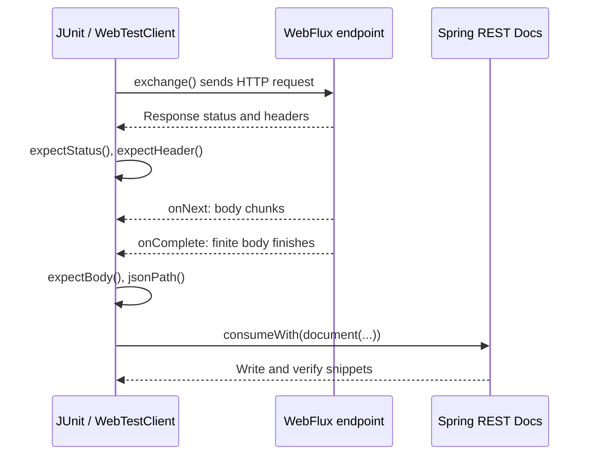

# Reactive Responses and Snippet Generation Timing

## 1. Lesson Objectives

In the **SPRING_REST_DOCS** module, we generate verifiable REST API documentation from HTTP tests using MockMvc, WebTestClient, or REST Assured. Tests verify real requests/responses, Spring REST Docs generates snippets for payloads, parameters, and headers, and then the build or CI assembles those snippets into Asciidoctor/Markdown documentation.

In the **WebTestClient** chapter, a particularly important detail is that **responses in Spring WebFlux can be produced asynchronously**. Controllers can return `Mono<T>`, `Flux<T>`, finite JSON sequences, or a continuous stream such as Server-Sent Events (SSE). Therefore, receiving a `200 OK` status does not mean the body has finished emitting and can be written completely into a snippet.

The lesson **"Reactive Responses and Snippet Generation Timing"** helps you:

- Distinguish when `exchange()` runs, when status/headers are asserted, when the body is consumed, and when snippets are written via `consumeWith(document(...))`.
- Understand the completion conditions of `Mono` and `Flux`, along with the effects of `onComplete`, `onError`, timeouts, and cancellation on documentation tests.
- Write JUnit 5 tests generating snippets for **finite** reactive responses, including JSON objects from `Mono` and JSON arrays from `Flux`.
- Test non-terminating SSE streams without waiting for `expectBody()` to buffer all data.
- Design deterministic sample data, stable operation names, and appropriate Asciidoctor/CI steps.

## 2. What Timeline Events Does a Reactive Response Have?

`WebTestClient` uses the same HTTP model at the request and response levels, but how the body is received depends on the publisher returned by the controller. Consider this example:

```java
client.get()
    .uri("/api/status")
    .exchange()
    .expectStatus().isOk()
    .expectBody()
    .jsonPath("$.state").isEqualTo("ready")
    .consumeWith(document("reactive/status"));
```

Assume the client already has the Spring REST Docs filter attached and the `/api/status` endpoint returns JSON. Milestones to distinguish:

| Milestone | Explanation | Impact on Documentation |
| --- | --- | --- |
| Build request | `get()`, `uri()`, `accept()`, etc. declare the HTTP request | No response yet to generate snippets |
| Execute `exchange()` | The client sends the request and obtains `ResponseSpec` to inspect HTTP results | Response body may still be streaming |
| Check status/headers | `expectStatus()` and `expectHeader()` verify response metadata | Success here does not guarantee a valid or completed JSON body |
| Consume body | `expectBody()` buffers the finite response; `jsonPath()` verifies content | Body data is available to document |
| Call `consumeWith(document(...))` | REST Docs processes the HTTP exchange and descriptors where the callback runs | Snippets are written when the callback executes successfully |
| Build documentation | Asciidoctor/Markdown references files generated by tests | The build must depend on fresh test results |



The diagram illustrates **the success flow of a finite response**. The exact interleaving of status/body emissions depends on how the server/codecs prepare data, but the takeaway is that **having a status** differs from **receiving the complete body**. For a non-terminating `Flux`, `onComplete` never arrives, so buffering the entire body is unsuitable.

**Avoid a common misconception:** `document(...)` does not automatically subscribe and wait for a publisher to finish in every test style. In an `expectBody().consumeWith(document(...))` chain, the finite body has already been consumed by `WebTestClient` to build an `ExchangeResult`; Spring REST Docs uses that result when the callback runs. Do not treat `document(...)` as an independent subscriber for infinite streams.

## 3. How Do Mono, Finite Flux, and Streaming Flux Differ?

| Endpoint Return Type | Publisher Characteristics | Verification & Snippet Strategy |
| --- | --- | --- |
| `Mono<BookDto>` returning one JSON object | Emits at most one item then completes, or emits an error | `expectBody()` → assert JSON → `consumeWith(document(...))` |
| `Mono<Void>` returning an empty body | Completes without emitting an item | Assert status and empty body; choose a documentation callback compatible with the test API |
| `Flux<BookDto>` with `application/json`, finite | Emits multiple items then completes, typically encoded as a JSON array | Buffer the finite response via `expectBody()`, document array elements |
| `Flux<ServerSentEvent<?>>` or non-terminating SSE | Emits events over time, may never `onComplete` | Use `returnResult(...)`/`StepVerifier` to check several events and cancel; create a dedicated finite documentation sample |
| `Flux` ending with `onError` | Some items may have been emitted before the error | Test must handle the error; do not treat a partial response as valid documentation |

In Reactive Streams, a publisher can send `onNext` (data), followed by one of two terminal signals: `onComplete` or `onError`. When a consumer cancels a subscription before completion, it does not have the entire body. This explains why **documentation generation timing must rely on a finite, deterministic, and verified response**, not merely on when the endpoint begins emitting data.

A `Flux` **is not synonymous** with SSE streaming. With `produces = application/json`, multiple finite elements can be encoded into **a single JSON array**. By contrast, `text/event-stream` or `application/x-ndjson` streams individual units of data over time and is typically tested as a stream.

## 4. Preparing Spring REST Docs with WebTestClient

In a Spring Boot project using WebFlux and JUnit 5, example Gradle (Groovy DSL) dependencies:

```groovy
dependencies {
    implementation 'org.springframework.boot:spring-boot-starter-webflux'
    testImplementation 'org.springframework.boot:spring-boot-starter-test'
    testImplementation 'org.springframework.restdocs:spring-restdocs-webtestclient'
    testImplementation 'io.projectreactor:reactor-test'
}
```

`reactor-test` provides `StepVerifier` for testing streams. Spring Boot usually manages dependency versions; if not using Spring Boot, choose compatible versions of Spring Framework, Spring REST Docs, Reactor, and JUnit.

To generate snippets, a JUnit 5 test requires:

1. `@ExtendWith(RestDocumentationExtension.class)` to provide the documentation context per test.
2. `WebTestClient` configured with the `documentationConfiguration(restDocumentation)` filter.
3. A request actually executed with `exchange()`, with appropriate assertions.
4. The `document("operation-id", snippets...)` callback invoked where the HTTP result to document is available.

Example when binding directly to a controller:

```java
@BeforeEach
void setUp(RestDocumentationContextProvider restDocumentation) {
    client = WebTestClient.bindToController(new ReactiveController())
        .configureClient()
        .filter(documentationConfiguration(restDocumentation))
        .build();
}
```

This is part of a JUnit 5 test; the controller class and full imports appear in the next section. Calling `configureClient()` is required when starting with `bindToController(...)`, `bindToRouterFunction(...)`, or `bindToApplicationContext(...)`. When binding to a real server with `bindToServer()`, configure filters directly on the client builder.

## 5. Runnable Example: Delayed Mono and Finite Flux

The example below has two endpoints:

- `GET /api/status` returns a `Mono` emitting JSON after a short delay.
- `GET /api/books` returns a `Flux` of two elements; because the response is `application/json` and the `Flux` is **finite**, the body is treated as a JSON array.

The delay simulates asynchronicity without using `Thread.sleep(...)`. The test's timeout should be long enough for the publisher to complete in CI environments.

```java
import java.time.Duration;
import java.util.Map;

import org.junit.jupiter.api.BeforeEach;
import org.junit.jupiter.api.Test;
import org.junit.jupiter.api.extension.ExtendWith;
import org.springframework.http.MediaType;
import org.springframework.restdocs.RestDocumentationContextProvider;
import org.springframework.restdocs.RestDocumentationExtension;
import org.springframework.test.web.reactive.server.WebTestClient;
import org.springframework.web.bind.annotation.GetMapping;
import org.springframework.web.bind.annotation.RestController;
import reactor.core.publisher.Flux;
import reactor.core.publisher.Mono;

import static org.springframework.restdocs.payload.PayloadDocumentation.fieldWithPath;
import static org.springframework.restdocs.payload.PayloadDocumentation.responseFields;
import static org.springframework.restdocs.webtestclient.WebTestClientRestDocumentation.document;
import static org.springframework.restdocs.webtestclient.WebTestClientRestDocumentation.documentationConfiguration;

@ExtendWith(RestDocumentationExtension.class)
class ReactiveResponseDocumentationTest {

    private WebTestClient client;

    @BeforeEach
    void setUp(RestDocumentationContextProvider restDocumentation) {
        this.client = WebTestClient.bindToController(new ReactiveController())
            .configureClient()
            .filter(documentationConfiguration(restDocumentation))
            .responseTimeout(Duration.ofSeconds(5))
            .build();
    }

    @Test
    void documentsMonoAfterBodyIsAvailable() {
        client.get()
            .uri("/api/status")
            .accept(MediaType.APPLICATION_JSON)
            .exchange()
            .expectStatus().isOk()
            .expectHeader()
                .contentTypeCompatibleWith(MediaType.APPLICATION_JSON)
            .expectBody()
            .jsonPath("$.state").isEqualTo("ready")
            .consumeWith(document("reactive/status",
                responseFields(
                    fieldWithPath("state")
                        .description("Service status")
                )
            ));
    }

    @Test
    void documentsFiniteFluxAsJsonArray() {
        client.get()
            .uri("/api/books")
            .accept(MediaType.APPLICATION_JSON)
            .exchange()
            .expectStatus().isOk()
            .expectBody()
            .jsonPath("$[0].id").isEqualTo(1)
            .jsonPath("$[1].id").isEqualTo(2)
            .jsonPath("$[0].title").isEqualTo("REST Docs")
            .jsonPath("$[1].title").isEqualTo("WebFlux")
            .consumeWith(document("reactive/books",
                responseFields(
                    fieldWithPath("[].id")
                        .description("ID of each book"),
                    fieldWithPath("[].title")
                        .description("Title of each book")
                )
            ));
    }

    @RestController
    static class ReactiveController {

        @GetMapping(
            path = "/api/status",
            produces = MediaType.APPLICATION_JSON_VALUE
        )
        public Mono<Map<String, String>> status() {
            return Mono.delay(Duration.ofMillis(30))
                .map(ignored -> Map.of("state", "ready"));
        }

        @GetMapping(
            path = "/api/books",
            produces = MediaType.APPLICATION_JSON_VALUE
        )
        public Flux<Map<String, Object>> books() {
            return Flux.just(
                Map.of("id", 1, "title", "REST Docs"),
                Map.of("id", 2, "title", "WebFlux")
            ).delayElements(Duration.ofMillis(20));
        }
    }
}
```

### 5.1. Why Does the Mono Example Generate Snippets at the Right Time?

`Mono.delay(...)` defers emitting data in the example; `exchange()` starts request processing, but status alone does not prove the JSON has arrived. `expectBody()` collects the finite response body, `jsonPath("$.state")` verifies the value, and then `consumeWith(document("reactive/status", ...))` executes. The snippet reflects the `{"state":"ready"}` JSON observed by the test.

Using `responseFields(fieldWithPath("state"))` also validates the payload structure used for documentation. If the controller returns a new field not described by a descriptor, strict documentation tests can fail.

### 5.2. Why Must the Flux Example Complete?

`Flux.just(...).delayElements(...)` emits two books sequentially and completes. When the response is encoded as a JSON array, `expectBody()` collects items until the body finishes; the JSONPaths `$[0].id` and `$[1].id` are checked against the complete array. `fieldWithPath("[].id")` and `fieldWithPath("[].title")` describe the fields of **the array elements**, instead of writing separate descriptors for every index.

If a controller accidentally replaces a finite `Flux` with a non-terminating `Flux`, waiting for the body to complete will no longer match expectations. The test may time out or stall, and a complete snippet set will not be produced as in the success path.

> **Note:** The 20–30 ms durations in the example merely illustrate an asynchronous publisher. Tests should not assert exact timings like these; correctness lies in HTTP content and the publisher's completion signals.

## 6. When Is a Snippet Written, and When Is It Not?

Suppose a test has the chain:

```java
client.get()
    .uri("/api/status")
    .exchange()
    .expectStatus().isOk()
    .expectBody()
    .jsonPath("$.state").isEqualTo("ready")
    .consumeWith(document("reactive/status",
        responseFields(
            fieldWithPath("state").description("Service status")
        )
    ));
```

Let's analyze the scenarios:

| Scenario | What Happens to the Test? | Conclusion About Snippets |
| --- | --- | --- |
| Status 200, valid JSON, body completes | Assertions pass and callback runs | REST Docs can write the complete snippets |
| Status 500, test expects 200 | Status assertion fails before callback | The callback in this chain does not run |
| Status matches but `jsonPath` lacks field | Body assertion fails before callback | Cannot be treated as a successfully documented operation |
| Finite body, but `responseFields` misses a required field | Callback runs, but snippet validation fails | Documentation test fails; contract needs updating |
| Publisher emits error while body is read | Body consumption/verification may fail | Do not publish partial snippets as valid documentation |
| Publisher never calls `onComplete` | Buffering the entire body cannot finish normally | Choose a streaming test strategy or create finite sample data |

Distinguish **when a file appears on disk** from **documentation validity**. A passing test might already have written some snippets before another test fails; therefore, the pipeline must treat a build as successful **only when all required tests pass**. Generate snippets into a clean build directory so stale files from previous runs do not leak into new documentation.

### Can Assertions Be Separated from Documentation?

`document(...)` can write default snippets even if the test verifies very little information, but such documentation does not adequately prove the API contract. A quality documentation test typically checks status, headers, and critical JSON values **before** the callback, while also using strict descriptors for fields and parameters:

```java
.expectStatus().isOk()
.expectBody()
.jsonPath("$.state").isEqualTo("ready")
.consumeWith(document("reactive/status",
    responseFields(fieldWithPath("state").description("Status"))
));
```

Descriptors catch field changes, while `jsonPath` verifies business values. Both complement each other.

## 7. Non-Terminating SSE Streams: Bounded Verification Without Buffering the Full Body

An SSE endpoint can keep an HTTP connection open and emit events continuously. Example controller:

```java
import java.time.Duration;
import org.springframework.http.MediaType;
import org.springframework.web.bind.annotation.GetMapping;
import org.springframework.web.bind.annotation.RestController;
import reactor.core.publisher.Flux;

@RestController
class TickController {

    @GetMapping(
        path = "/api/ticks",
        produces = MediaType.TEXT_EVENT_STREAM_VALUE
    )
    public Flux<String> ticks() {
        return Flux.interval(Duration.ofMillis(50))
            .map(number -> "tick-" + number);
    }
}
```

`Flux.interval(...)` emits indefinitely until the subscription is cancelled. A test wanting to check the first two events should use `returnResult(...)` instead of `expectBody()`:

```java
import java.time.Duration;
import org.springframework.http.MediaType;
import org.springframework.test.web.reactive.server.FluxExchangeResult;
import reactor.test.StepVerifier;

// client already bound to TickController or server with /api/ticks
FluxExchangeResult<String> result = client.get()
    .uri("/api/ticks")
    .accept(MediaType.TEXT_EVENT_STREAM)
    .exchange()
    .expectStatus().isOk()
    .expectHeader()
        .contentTypeCompatibleWith(MediaType.TEXT_EVENT_STREAM)
    .returnResult(String.class);

StepVerifier.create(result.getResponseBody())
    .expectNext("tick-0", "tick-1")
    .thenCancel()
    .verify(Duration.ofSeconds(3));
```

Here:

- `returnResult(String.class)` grants access to the decoded body stream without waiting for the entire SSE stream to terminate.
- `StepVerifier` asserts **the first two events**, then explicitly invokes `thenCancel()` to release the subscription.
- `verify(Duration.ofSeconds(3))` sets a timeout for the verification step, preventing the test from hanging forever if events do not arrive.

**The SSE test only verifies streaming behavior; it does not automatically generate snippets via `document(...)`.** Do not assume that `returnResult(...)` plus `StepVerifier` will generate `http-response.adoc` for an infinite SSE connection.

If an SSE endpoint needs documentation, you can document the `text/event-stream` contract and capture **a controlled finite sample** in a dedicated documentation test or fixture. That sample must accurately represent the production event format, be verified with assertions, and clearly indicate that it is a bounded event sample. Never turn an infinite stream into `expectBody()` just to force full HTTP snippet generation.

### Distinguishing Publisher Errors from HTTP Status Errors

A handler might set status 200 before the publisher emits `onError`. In that case `expectStatus().isOk()` can pass even though the body never completes cleanly. For finite publishers, checking the body and descriptors catches many errors missed by a status check alone. For streams, verify `onNext`/`onError`/`onComplete` signals against the contract using `StepVerifier`.

## 8. Documenting JSON Arrays, Headers, and Payloads at the Right Timing

For the finite JSON responses in Section 5, REST Docs generates snippets once the test has all the data to describe. Commonly used descriptors:

| HTTP Component | Spring REST Docs Descriptor | Snippet |
| --- | --- | --- |
| Path variable | `pathParameters(parameterWithName("id").description(...))` | `path-parameters.adoc` |
| Query parameter | `queryParameters(parameterWithName("page").description(...))` | `query-parameters.adoc` |
| Request header | `requestHeaders(headerWithName("X-Request-Id").description(...))` | `request-headers.adoc` |
| Response header | `responseHeaders(headerWithName("ETag").description(...))` | `response-headers.adoc` |
| JSON request field | `requestFields(fieldWithPath("title").description(...))` | `request-fields.adoc` |
| JSON response field | `responseFields(fieldWithPath("[].title").description(...))` | `response-fields.adoc` |

This is an illustrative API table: only include a descriptor in `document(...)` when the request or response actually contains that information. For example, in a POST test sending and receiving JSON, `requestFields(...)`/`responseFields(...)` must match the codec-serialized payloads. Some older versions of Spring REST Docs use `requestParameters(...)` to document request parameters; choose the API name matching your actual dependency version.

### Preprocessors Only Alter Data Used to Write Snippets

Multi-element JSON arrays or nested objects are hard to read on a single line. You can apply a preprocessor before generating documentation:

```java
import static org.springframework.restdocs.operation.preprocess.Preprocessors.prettyPrint;

client = WebTestClient.bindToController(new ReactiveController())
    .configureClient()
    .filter(documentationConfiguration(restDocumentation)
        .operationPreprocessors()
            .withRequestDefaults(prettyPrint())
            .withResponseDefaults(prettyPrint()))
    .build();
```

`prettyPrint()` formats the payload **inside snippets**, without altering reactive signals or the HTTP data produced by the controller. You can use other preprocessors to mask tokens, remove sensitive headers, or normalize hosts and ports in documentation. Ensure assertions still verify real data while published content contains no secrets.

## 9. Snippet Paths and the Asciidoctor/CI Pipeline

When the tests in Section 5 pass, Spring REST Docs can generate typical files:

```text
build/generated-snippets/
└── reactive/
    ├── status/
    │   ├── http-request.adoc
    │   ├── http-response.adoc
    │   └── response-fields.adoc
    └── books/
        ├── http-request.adoc
        ├── http-response.adoc
        └── response-fields.adoc
```

`curl-request.adoc`, `httpie-request.adoc`, `request-body.adoc`, or `response-body.adoc` may also appear depending on version and configuration; the list above is not exhaustive. With Maven, the directory is typically `target/generated-snippets`.

An Asciidoctor page can combine snippets from both `Mono` and finite `Flux`:

```asciidoc
= Reactive API
:snippets: build/generated-snippets

== Service status

include::{snippets}/reactive/status/http-request.adoc[]
include::{snippets}/reactive/status/http-response.adoc[]
include::{snippets}/reactive/status/response-fields.adoc[]

== Book list

include::{snippets}/reactive/books/http-request.adoc[]
include::{snippets}/reactive/books/http-response.adoc[]
include::{snippets}/reactive/books/response-fields.adoc[]
```

The `:snippets:` attribute must point to the correct path according to your Asciidoctor configuration and should normally be supplied by the build. To run tests before building documentation in Gradle (once the Asciidoctor plugin is applied and provides the `asciidoctor` task):

```groovy
def snippetsDir = layout.buildDirectory.dir("generated-snippets")

tasks.named("test") {
    outputs.dir(snippetsDir)
}

tasks.named("asciidoctor") {
    dependsOn(tasks.named("test"))
    inputs.dir(snippetsDir)
    attributes "snippets": snippetsDir.get().asFile
}
```

Example CI command once plugins/tasks are configured: `./gradlew clean test asciidoctor`. The `clean` step prevents old snippets from being mistaken for new results; the `test` step generates snippets and must pass before building pages. With plain Markdown, the `include::` syntax is not processed directly; a build tool is required to inline snippets or link to the generated files.

## 10. Common Errors and Diagnostics

| Symptom | Possible Cause and Resolution |
| --- | --- |
| `expectStatus().isOk()` passes but body assertion fails | Status/headers were verified, but subsequent reactive data differed from expectations; inspect the publisher, codecs, and actual JSON. |
| `expectBody()` waits indefinitely or times out | Endpoint returns a non-terminating `Flux`, publisher hangs, or emission is slow; use `returnResult(...)` for streams or adjust finite fixtures. |
| Finite `Flux` returns incomplete JSON array | Check `onComplete`, mid-stream errors, take/cancel calls, and assertions on individual elements. |
| Body test fails so no snippets appear | `consumeWith(document(...))` runs after assertions; fix the test/endpoint to match the right contract before publishing. |
| `responseFields(...)` reports extra fields | JSON contains undocumented fields; update descriptions or deliberately use `.ignored()`/`.optional()`. |
| SSE test using `expectBody()` never finishes | The stream remains open indefinitely; test with `returnResult(...)` and `StepVerifier.thenCancel()` instead of buffering the whole body. |
| `StepVerifier` does not receive enough events | Check URI, media type, delays, schedulers, and whether the subscription was cancelled too early. |
| Snippets directory is empty | Check the REST Docs filter, `document(...)` callback, identifier, and whether tests actually ran and passed. |
| Asciidoctor picks up snippets from a previous run | Use a clean build directory, run tests before building docs, and verify the `snippets` path. |
| Docs contain random data or sensitive tokens | Use deterministic fixtures and appropriate preprocessors before publishing. |

## 11. Practice Exercises

1. Run `ReactiveResponseDocumentationTest`. Open `reactive/status/http-response.adoc` and `reactive/books/response-fields.adoc` to compare against the verified JSON.
2. Increase the `Mono.delay` duration and lower the client response timeout to observe the timeout effect; restore stable values afterward.
3. Add an `author` field to a book without adding `fieldWithPath("[].author")`; watch REST Docs detect the discrepancy and fix the descriptor.
4. Replace `Flux.just(...)` with a non-terminating publisher in a practice copy of the test, observe its effect on `expectBody()`, and then restore the finite `Flux`.
5. Create the `/api/ticks` SSE endpoint and use `StepVerifier` to assert two events and cancel the subscription; explain why this SSE test does not generate snippets via `document(...)`.
6. Enable `prettyPrint()` for JSON responses, build the Asciidoctor page via `clean test asciidoctor`, and verify the output file updates after code changes.

## 12. Key Takeaways

- `exchange()` executes the request, but asserting **status** does not prove the **reactive body has completed**.
- For **finite** `Mono` or `Flux`, use `expectBody()` to buffer and assert the payload, then `consumeWith(document(...))` to write snippets from the verified exchange.
- When a publisher emits `onError` or never calls `onComplete`, verify the stream against its contract rather than treating a partial body as valid documentation.
- SSE/streaming endpoints can be verified with `returnResult(...)` and `StepVerifier` using timeouts and cancellation; they do not automatically produce REST Docs snippets.
- Descriptors validate payload structure while assertions verify behavior; use deterministic sample data, stable identifiers, and a build/CI pipeline that passes tests before publishing documentation.
