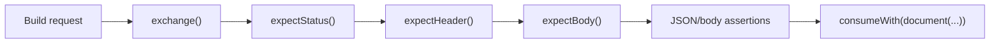

# Chaining `expectStatus`, `expectHeader`, and `expectBody`

## 1. Lesson Objectives

In the **SPRING_REST_DOCS** module, REST API documentation is generated from repeatable HTTP tests. Tests send requests, assert responses, and use Spring REST Docs to generate snippets for requests, responses, payloads, parameters, and headers. Snippets can then be compiled into Asciidoctor/Markdown and integrated into builds and CI.

In the **WebTestClient** chapter, the three assertion groups typically chained after `exchange()` are:

- **`expectStatus()`**: asserts the HTTP status code.
- **`expectHeader()`**: asserts response headers.
- **`expectBody()`**: reads and asserts response body contents.

This lesson explains how to chain these three assertion groups, choose appropriate checks, handle JSON or empty bodies, and pass the result to `consumeWith(document(...))`.

## 2. Viewing the Full Fluent API Chain

A typical GET request:

```java
client.get()
    .uri("/api/books/{id}", 42)
    .accept(MediaType.APPLICATION_JSON)
    .exchange()
    .expectStatus().isOk()
    .expectHeader().contentTypeCompatibleWith(MediaType.APPLICATION_JSON)
    .expectBody()
    .jsonPath("$.id").isEqualTo(42)
    .jsonPath("$.title").isEqualTo("Spring REST Docs");
```

`client` is a configured `WebTestClient`, and the corresponding endpoint must exist. This chain consists of the following stages:

| Stage | API | Responsibility |
| --- | --- | --- |
| Build request | `get()`, `uri()`, `accept()`, `header()`, `bodyValue()` | Declares HTTP method, URL, request headers, and body. |
| Send request | `exchange()` | Performs the HTTP exchange and returns `ResponseSpec`. |
| Assert response | `expectStatus()`, `expectHeader()`, `expectBody()` | Checks status, headers, and returned content. |
| Document | `consumeWith(document(...))` | Writes snippets from the exchange result and descriptors. |



**Order matters:** `expectStatus()` and `expectHeader()` operate on response metadata; `expectBody()` transitions to reading the body. When an assertion fails, the test stops at the unmet condition and subsequent steps generally do not execute. Therefore, place `consumeWith(document(...))` after key assertions if you only want to document responses that satisfy the contract.

## 3. Preparing WebTestClient and Spring REST Docs

In a Spring Boot project using Spring WebFlux, JUnit 5, and Spring REST Docs, the Gradle Groovy DSL can declare:

```groovy
dependencies {
    implementation 'org.springframework.boot:spring-boot-starter-webflux'
    testImplementation 'org.springframework.boot:spring-boot-starter-test'
    testImplementation 'org.springframework.restdocs:spring-restdocs-webtestclient'
}
```

Spring Boot normally manages compatible dependency versions. If your project does not use Spring Boot dependency management, select compatible versions of Spring Framework, Spring REST Docs, JUnit, and Reactor.

Example of configuring a client directly against a controller:

```java
@ExtendWith(RestDocumentationExtension.class)
class ExampleDocumentationTest {
    private WebTestClient client;

    @BeforeEach
    void setUp(RestDocumentationContextProvider restDocumentation) {
        client = WebTestClient.bindToController(new ExampleController())
            .configureClient()
            .filter(documentationConfiguration(restDocumentation))
            .build();
    }
}
```

This is the configuration portion of a test class; the controller, imports, and tests are added in Section 7. `RestDocumentationExtension` provides the documentation context for JUnit 5; `documentationConfiguration(...)` creates the REST Docs filter attached to the client. With `bindToApplicationContext(...)` or `bindToRouterFunction(...)`, the filter is configured using the same pattern. With `bindToServer()`, the filter can be attached directly on the client builder without `configureClient()`.

## 4. `expectStatus()`: Checking HTTP Status

HTTP status describes the outcome of processing a request. Assert exact status codes whenever they are part of the API contract.

```java
client.get()
    .uri("/api/books/42")
    .exchange()
    .expectStatus().isOk();
```

Common assertions:

| Assertion | Status Code or Group |
| --- | --- |
| `isOk()` | 200 OK |
| `isCreated()` | 201 Created |
| `isAccepted()` | 202 Accepted |
| `isNoContent()` | 204 No Content |
| `isBadRequest()` | 400 Bad Request |
| `isUnauthorized()` | 401 Unauthorized |
| `isForbidden()` | 403 Forbidden |
| `isNotFound()` | 404 Not Found |
| `is4xxClientError()` | Any 4xx status |
| `is5xxServerError()` | Any 5xx status |
| `valueEquals(202)` | Specific status code you designate |

Group assertions can be used when you only care that a response belongs to client or server errors. However, if the API specifies that resource creation must return 201, `isCreated()` expresses the contract much more clearly than a broad assertion.

Example testing a not-found case:

```java
client.get()
    .uri("/api/books/{id}", 9999)
    .exchange()
    .expectStatus().isNotFound();
```

This snippet assumes the endpoint returns 404 when the book does not exist. In real tests, set up fixtures or mock services so the 404 branch is triggered deterministically.

## 5. `expectHeader()`: Checking Response Headers

Headers carry critical metadata such as content type, newly created resource URI, cache policy, ETag, or trace IDs. Use `expectHeader()` to verify values returned by the server.

### 5.1. Checking `Content-Type`

```java
client.get()
    .uri("/api/books/42")
    .accept(MediaType.APPLICATION_JSON)
    .exchange()
    .expectStatus().isOk()
    .expectHeader()
        .contentTypeCompatibleWith(MediaType.APPLICATION_JSON);
```

`contentTypeCompatibleWith(...)` is suitable when a compatible media type may carry parameters such as charset. If you need an exact comparison against a specific media type value, choose the assertion suited to your version of Spring Test.

### 5.2. Checking Header Values

```java
client.post()
    .uri("/api/books")
    .contentType(MediaType.APPLICATION_JSON)
    .bodyValue(Map.of("title", "Spring REST Docs"))
    .exchange()
    .expectStatus().isCreated()
    .expectHeader().valueEquals("Location", "/api/books/42");
```

The example requires the POST endpoint to return status 201 and a `Location` header pointing to the new resource.

Several other checks:

```java
.expectHeader().exists("ETag")
.expectHeader().doesNotExist("X-Debug-Only")
.expectHeader().valueMatches("Cache-Control", ".*no-store.*")
```

These are illustrative options for separate test chains. Verify the exact API signatures against your project's Spring Test version; do not chain all of them onto one response because conditions may conflict.

### 5.3. Checking Headers with Custom Logic

For headers with multiple values or complex rules, you can use `expectHeader().value(...)` with an appropriate assertion. Clarify whether a header is required, optional, or multi-valued under the API contract.

## 6. `expectBody()`: Checking Response Content

After verifying status/headers, use `expectBody()` for finite response bodies. Depending on the data format, several assertion approaches are available.

### 6.1. JSONPath: Checking Essential Fields

```java
client.get()
    .uri("/api/books/{id}", 42)
    .exchange()
    .expectStatus().isOk()
    .expectBody()
    .jsonPath("$.id").isEqualTo(42)
    .jsonPath("$.title").isEqualTo("Spring REST Docs");
```

JSONPath is useful when you only need to assert important fields. You can inspect nested objects, array elements, and properties:

```java
.expectBody()
.jsonPath("$.author.name").isEqualTo("Lan")
.jsonPath("$.items.length()").isEqualTo(2)
.jsonPath("$.items[0].sku").isEqualTo("BOOK-01");
```

This is an illustrative example for JSON containing `author` and `items`; adjust paths and values to match your actual response.

### 6.2. JSON Comparison

```java
client.get()
    .uri("/api/books/42")
    .exchange()
    .expectStatus().isOk()
    .expectBody()
    .json("{\"id\":42,\"title\":\"Spring REST Docs\"}");
```

`json(...)` compares the body by JSON content; the comparison mechanism can tolerate different property ordering within objects. Use JSONPath if you want to focus on a subset of fields; use a sample JSON string if you want to assert the overall response content.

### 6.3. Deserializing into a Java Type

```java
client.get()
    .uri("/api/books/42")
    .exchange()
    .expectStatus().isOk()
    .expectBody(BookDto.class)
    .value(book -> {
        assertThat(book.getId()).isEqualTo(42);
        assertThat(book.getTitle()).isEqualTo("Spring REST Docs");
    });
```

This is an illustrative pattern using AssertJ and assuming `BookDto` has matching getters. This approach is helpful when the test performs assertion logic on Java objects instead of multiple individual JSONPath expressions.

### 6.4. Empty Body

For a DELETE endpoint returning 204:

```java
client.delete()
    .uri("/api/books/{id}", 42)
    .exchange()
    .expectStatus().isNoContent()
    .expectBody().isEmpty();
```

`isEmpty()` verifies the response has no payload. If the API contract requires 204, check both the status and the empty body.

### 6.5. String or Byte Bodies

When an endpoint returns plain text:

```java
client.get()
    .uri("/api/health/text")
    .exchange()
    .expectStatus().isOk()
    .expectBody(String.class)
    .isEqualTo("ready");
```

When checking a byte array, you can use `expectBody(byte[].class)` and assert length or encoded contents. Choose the body assertion type matching the media type and endpoint contract.

## 7. Integrated Example: Assertions and Snippets in the Same Test

The following example combines all three assertion groups with Spring REST Docs. Two operations use the same controller:

- `GET /api/books/{id}` returns status 200 and JSON.
- `POST /api/books` accepts JSON and returns status 201, a `Location` header, and JSON for the new resource.

```java
import java.net.URI;
import java.util.Map;

import org.junit.jupiter.api.BeforeEach;
import org.junit.jupiter.api.Test;
import org.junit.jupiter.api.extension.ExtendWith;
import org.springframework.http.HttpHeaders;
import org.springframework.http.MediaType;
import org.springframework.http.ResponseEntity;
import org.springframework.restdocs.RestDocumentationContextProvider;
import org.springframework.restdocs.RestDocumentationExtension;
import org.springframework.test.web.reactive.server.WebTestClient;
import org.springframework.web.bind.annotation.GetMapping;
import org.springframework.web.bind.annotation.PathVariable;
import org.springframework.web.bind.annotation.PostMapping;
import org.springframework.web.bind.annotation.RequestBody;
import org.springframework.web.bind.annotation.RestController;
import reactor.core.publisher.Mono;

import static org.springframework.restdocs.headers.HeaderDocumentation.headerWithName;
import static org.springframework.restdocs.headers.HeaderDocumentation.requestHeaders;
import static org.springframework.restdocs.headers.HeaderDocumentation.responseHeaders;
import static org.springframework.restdocs.payload.PayloadDocumentation.fieldWithPath;
import static org.springframework.restdocs.payload.PayloadDocumentation.requestFields;
import static org.springframework.restdocs.payload.PayloadDocumentation.responseFields;
import static org.springframework.restdocs.request.RequestDocumentation.parameterWithName;
import static org.springframework.restdocs.request.RequestDocumentation.pathParameters;
import static org.springframework.restdocs.webtestclient.WebTestClientRestDocumentation.document;
import static org.springframework.restdocs.webtestclient.WebTestClientRestDocumentation.documentationConfiguration;

@ExtendWith(RestDocumentationExtension.class)
class BookApiDocumentationTest {
    private WebTestClient client;

    @BeforeEach
    void setUp(RestDocumentationContextProvider restDocumentation) {
        client = WebTestClient.bindToController(new BookController())
            .configureClient()
            .filter(documentationConfiguration(restDocumentation))
            .build();
    }

    @Test
    void getBookChecksStatusHeaderBodyAndDocumentsIt() {
        client.get()
            .uri("/api/books/{id}", 42)
            .accept(MediaType.APPLICATION_JSON)
            .exchange()
            .expectStatus().isOk()
            .expectHeader()
                .contentTypeCompatibleWith(MediaType.APPLICATION_JSON)
            .expectBody()
            .jsonPath("$.id").isEqualTo(42)
            .jsonPath("$.title").isEqualTo("Spring REST Docs")
            .consumeWith(document("books/get",
                pathParameters(
                    parameterWithName("id").description("Book ID")
                ),
                responseFields(
                    fieldWithPath("id").description("Book ID"),
                    fieldWithPath("title").description("Book title")
                )
            ));
    }

    @Test
    void createBookChecksStatusHeaderBodyAndDocumentsIt() {
        client.post()
            .uri("/api/books")
            .header("X-Request-Id", "req-001")
            .contentType(MediaType.APPLICATION_JSON)
            .accept(MediaType.APPLICATION_JSON)
            .bodyValue(Map.of("title", "Spring REST Docs"))
            .exchange()
            .expectStatus().isCreated()
            .expectHeader().valueEquals(HttpHeaders.LOCATION, "/api/books/42")
            .expectHeader()
                .contentTypeCompatibleWith(MediaType.APPLICATION_JSON)
            .expectBody()
            .jsonPath("$.id").isEqualTo(42)
            .jsonPath("$.title").isEqualTo("Spring REST Docs")
            .consumeWith(document("books/create",
                requestHeaders(
                    headerWithName("X-Request-Id")
                        .description("Request trace ID")
                ),
                requestFields(
                    fieldWithPath("title").description("Book title")
                ),
                responseHeaders(
                    headerWithName(HttpHeaders.LOCATION)
                        .description("URI of the new book")
                ),
                responseFields(
                    fieldWithPath("id").description("Book ID"),
                    fieldWithPath("title").description("Book title")
                )
            ));
    }

    @RestController
    static class BookController {
        @GetMapping(
            path = "/api/books/{id}",
            produces = MediaType.APPLICATION_JSON_VALUE
        )
        public Mono<Map<String, Object>> getBook(@PathVariable("id") long id) {
            return Mono.just(Map.of(
                "id", id,
                "title", "Spring REST Docs"
            ));
        }

        @PostMapping(
            path = "/api/books",
            consumes = MediaType.APPLICATION_JSON_VALUE,
            produces = MediaType.APPLICATION_JSON_VALUE
        )
        public Mono<ResponseEntity<Map<String, Object>>> createBook(
                @RequestBody Mono<Map<String, String>> input) {
            return input.map(body -> {
                Map<String, Object> result = Map.of(
                    "id", 42,
                    "title", body.get("title")
                );
                return ResponseEntity
                    .created(URI.create("/api/books/42"))
                    .body(result);
            });
        }
    }
}
```

The order in both GET and POST tests follows the same principle: build the request; call `exchange()` once; assert status; assert headers; assert JSON body; finally call `consumeWith(document(...))` to write snippets.

`BookController` returns fixed data so the example is repeatable. Provide appropriate fixtures/test doubles in real projects and make sure response variations are intentional.

## 8. Combining Assertions with REST Docs Descriptors

Assertions and descriptors play complementary roles:

| Purpose | WebTestClient Assertion | REST Docs Descriptor |
| --- | --- | --- |
| Status code | `expectStatus().isCreated()` | HTTP response snippet shows actual status |
| Content type | `expectHeader().contentTypeCompatibleWith(...)` | `responseHeaders(...)` documents headers to publish |
| JSON values | `jsonPath("$.id").isEqualTo(42)` | `responseFields(fieldWithPath("id")...)` documents field |
| Path parameters | URI template and executed request | `pathParameters(parameterWithName("id")...)` |
| Request body | Body sent via `bodyValue(...)` | `requestFields(...)` documents payload |
| Request/response headers | `header(...)`, `expectHeader()` | `requestHeaders(...)`, `responseHeaders(...)` |

`jsonPath("$.id").isEqualTo(42)` checks a specific value; `fieldWithPath("id").description("Book ID")` describes the field and checks that it appears in the payload. If the API adds `author` while `responseFields(...)` has not been updated, strict documentation tests can fail. That acts as a signal for the team to review the contract change.

For fields that may legitimately be omitted, use `.optional()` when consistent with the contract. Only use `.ignored()` or relaxed descriptors when intentionally documenting a defined subset of the payload, never to hide unreviewed changes.

## 9. Notes on Finite Bodies and Streaming

`expectBody()` works for finite responses such as a JSON object, JSON array, or text. When the body is a finite `Flux` encoded as a JSON array, the test can collect the complete body and then apply JSONPath or response field descriptors.

For SSE or non-terminating streams, `expectBody()` can wait forever or time out because the publisher never emits `onComplete`. When you need to verify a number of events, use `returnResult(...)` combined with Reactor `StepVerifier`, timeouts, and cancellation:

```java
FluxExchangeResult<String> result = client.get()
    .uri("/api/events")
    .accept(MediaType.TEXT_EVENT_STREAM)
    .exchange()
    .expectStatus().isOk()
    .returnResult(String.class);

StepVerifier.create(result.getResponseBody())
    .expectNext("event-1", "event-2")
    .thenCancel()
    .verify(Duration.ofSeconds(3));
```

This is an illustrative example requiring an SSE endpoint emitting the first two events and the `reactor-test` dependency. The test verifies stream behavior; do not assume it automatically produces REST Docs snippets via `consumeWith(document(...))` like a finite response body. When documenting SSE, prepare a controlled finite sample that reflects the API's actual event format.

## 10. Common Errors and How to Resolve Them

| Symptom | Cause and Resolution |
| --- | --- |
| Unexpected status | Check HTTP method, URI, fixtures, validation, and endpoint exception handling. |
| `Location` header mismatch | Inspect the resource URI generated by the server; do not merely change the assertion to make the test pass. |
| Unexpected `Content-Type` | Compare `produces`, codecs, and request `Accept`; use a compatible assertion if media type parameters are allowed. |
| JSONPath cannot find field | Inspect the actual JSON, adjust the path for nested objects/arrays, or confirm the endpoint returns the right DTO. |
| Unexpectedly empty body | Check the handler, return type, reactive publisher, and serialization configuration. |
| Test passes but generates no snippets | Verify the client has the `documentationConfiguration(...)` filter and the test calls `consumeWith(document(...))`. |
| Snippets missing field/header tables | Add `responseFields`, `requestFields`, `requestHeaders`, or `responseHeaders` descriptors. |
| Test stops before `document` callback | An earlier status/header/body assertion failed; resolve the underlying failure before checking snippets. |
| Streaming body times out | Do not buffer the entire stream with `expectBody()`; use `returnResult(...)`/`StepVerifier` for bounded verification. |
| Asciidoctor cannot find snippet | Check the identifier, `generated-snippets` directory, and that the test task runs before the documentation build task. |

## 11. Including Snippets in Asciidoctor and CI

For the example's two operations, snippets are typically organized by identifier:

```text
build/generated-snippets/
└── books/
    ├── get/
    │   ├── http-request.adoc
    │   ├── http-response.adoc
    │   ├── path-parameters.adoc
    │   └── response-fields.adoc
    └── create/
        ├── http-request.adoc
        ├── http-response.adoc
        ├── request-headers.adoc
        ├── request-fields.adoc
        ├── response-headers.adoc
        └── response-fields.adoc
```

These are representative files; default snippets such as `curl-request.adoc`, `request-body.adoc`, or `response-body.adoc` also depend on configuration and request/response content.

An Asciidoctor page can combine the results:

```asciidoc
= Book API
:snippets: build/generated-snippets

== Get a book
include::{snippets}/books/get/http-request.adoc[]
include::{snippets}/books/get/http-response.adoc[]
include::{snippets}/books/get/response-fields.adoc[]

== Create a book
include::{snippets}/books/create/http-request.adoc[]
include::{snippets}/books/create/request-headers.adoc[]
include::{snippets}/books/create/request-fields.adoc[]
include::{snippets}/books/create/http-response.adoc[]
include::{snippets}/books/create/response-headers.adoc[]
include::{snippets}/books/create/response-fields.adoc[]
```

The `:snippets:` path must match where Asciidoctor resolves files or be passed from the build. With Gradle, once the Asciidoctor plugin and `asciidoctor` task are declared:

```groovy
def snippetsDir = layout.buildDirectory.dir("generated-snippets")

tasks.named("test") {
    outputs.dir(snippetsDir)
}

tasks.named("asciidoctor") {
    dependsOn(tasks.named("test"))
    inputs.dir(snippetsDir)
    attributes "snippets": snippetsDir.get().asFile
}
```

In CI, run `./gradlew clean test asciidoctor` once tasks are configured. If an assertion or descriptor fails, the test task must fail and prevent the documentation build/publish step from proceeding as if the API were verified. Plain Markdown requires a separate build step to inline or link snippets; the `include::` syntax belongs to Asciidoctor.

## 12. Practice Exercises

1. Run `BookApiDocumentationTest`; observe the GET test checking 200, `Content-Type`, `id`, and `title` before generating snippets.
2. Change `isCreated()` in the POST test to `isOk()`; confirm the test catches the wrong status and restore the assertion matching the 201 contract.
3. Change `Location` in the controller to `/api/books/99` while keeping the old assertion; observe `expectHeader()` catching the error.
4. Add an `author` field to the GET JSON without adding a descriptor; see REST Docs flag the undocumented field, then update `responseFields(...)`.
5. Add a DELETE test returning 204 and an empty body; assert both `expectStatus().isNoContent()` and `expectBody().isEmpty()`.
6. Combine the GET/POST snippets into an Asciidoctor page and configure CI to run tests before building documentation.

## 13. Key Takeaways

- `exchange()` sends the request; `expectStatus()` checks the HTTP code; `expectHeader()` checks metadata; `expectBody()` checks the payload.
- Choose specific assertions matching the API contract. Status 201, the `Location` header, and JSON fields can all be vital for resource creation operations.
- The `consumeWith(document(...))` callback should come after the core assertions that must pass.
- WebTestClient assertions verify behavior and values; REST Docs descriptors document requests/responses as snippets and validate declared contract elements.
- Use `expectBody()` for finite responses; for SSE/streaming, verify publishers with bounds instead of waiting for the entire body.
- Build/CI must pass tests before building and publishing documentation so snippets stay tied to verified responses.
