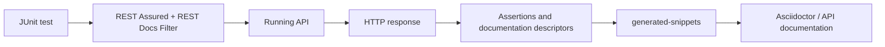

# Adding the `spring-restdocs-restassured` Dependency

## 1. Role of the Dependency in Spring REST Docs

**Spring REST Docs** generates API documentation from actual executed HTTP tests. When using **REST Assured** to send requests and verify responses, the integration module to add is:

```text
org.springframework.restdocs:spring-restdocs-restassured
```

This module provides a `Filter` to capture requests/responses and generate documentation **snippets** while tests run. It connects two distinct groups of capabilities:

| Component | Responsibility |
| --- | --- |
| `io.rest-assured:rest-assured` | Sends HTTP requests, receives responses, and writes assertions using `given` / `when` / `then` syntax. |
| `org.springframework.restdocs:spring-restdocs-restassured` | Integrates REST Assured with Spring REST Docs via `documentationConfiguration(...)` and `document(...)`. |
| `org.springframework.boot:spring-boot-starter-test` (with Spring Boot) | Provides the test execution foundation, including JUnit Jupiter and Spring testing utilities. |
| Asciidoctor/Markdown (next step) | Combines the generated snippets into API documentation for reading or publishing. |

An important distinction: adding the dependency **does not automatically generate documentation**. You must configure the REST Docs filter in your tests, call `document(...)` for the request you want to document, and run the tests successfully. Only then can the snippets be included into Asciidoctor or integrated into a build/CI pipeline.



## 2. Adding the Dependency with Gradle

In a **Spring Boot** application that already has dependency version management configured (typically via the Spring Boot BOM), add the following to `build.gradle`:

```groovy
dependencies {
    testImplementation 'org.springframework.boot:spring-boot-starter-test'
    testImplementation 'io.rest-assured:rest-assured'
    testImplementation 'org.springframework.restdocs:spring-restdocs-restassured'
}
```

With `build.gradle.kts` (Kotlin DSL), the equivalent syntax is:

```kotlin
dependencies {
    testImplementation("org.springframework.boot:spring-boot-starter-test")
    testImplementation("io.rest-assured:rest-assured")
    testImplementation("org.springframework.restdocs:spring-restdocs-restassured")
}
```

`testImplementation` places these libraries on the **test classpath**. They are used when running tests, not as functionality that the application needs to package for serving HTTP requests in production.

If the project does not use the Spring Boot BOM or an equivalent version management mechanism, you must declare compatible versions for the dependencies (or import an appropriate BOM). Do not copy a versionless example into a plain Gradle project and expect Gradle to pick a version automatically.

## 3. Adding the Dependency with Maven

In a project using `spring-boot-starter-parent` or that has imported the `spring-boot-dependencies` BOM, add the following to the `<dependencies>` section of `pom.xml`:

```xml
<dependencies>
    <dependency>
        <groupId>org.springframework.boot</groupId>
        <artifactId>spring-boot-starter-test</artifactId>
        <scope>test</scope>
    </dependency>

    <dependency>
        <groupId>io.rest-assured</groupId>
        <artifactId>rest-assured</artifactId>
        <scope>test</scope>
    </dependency>

    <dependency>
        <groupId>org.springframework.restdocs</groupId>
        <artifactId>spring-restdocs-restassured</artifactId>
        <scope>test</scope>
    </dependency>
</dependencies>
```

`<scope>test</scope>` has the same meaning as Gradle's `testImplementation`: it only participates in compiling and running test code. If the application already declares `spring-boot-starter-test` or `rest-assured`, only add the missing entries; do not declare duplicates.

In a Maven project without Spring Boot dependency management, you must provide compatible versions or import a BOM. Spring REST Docs itself can be managed with `org.springframework.restdocs:spring-restdocs-bom`; ensure the BOM version is compatible with the project's Spring Framework, Spring Boot, and testing libraries. Prefer the version set managed by the platform in use rather than arbitrarily mixing the latest versions.

## 4. Verifying Versions and Resolved Dependencies

The examples above intentionally omit version numbers, as they depend on the project's Spring Boot/Spring REST Docs release line. Follow this order:

1. Identify the project's Spring Boot (or Spring Framework) version and version management mechanism.
2. Choose a compatible Spring REST Docs line; use the version managed by the BOM if the BOM already declares this artifact.
3. Verify that REST Assured, JUnit, and related dependencies resolve consistently; avoid forcing a version just to fix a single import error.
4. Run the tests and confirm that snippets are generated, because successful dependency resolution alone does not prove the documentation configuration is correct.

Useful verification commands (run from the project directory):

```bash
# Gradle: inspect test runtime dependencies
./gradlew dependencies --configuration testRuntimeClasspath

# Maven: inspect the dependency tree for both library groups
mvn dependency:tree -Dincludes=org.springframework.restdocs,io.rest-assured
```

On Windows, you can use `gradlew.bat` instead of `./gradlew`. When using Gradle Kotlin DSL, the configuration name remains `testRuntimeClasspath`.

> **Note:** REST Docs supports multiple HTTP testing tools. `spring-restdocs-restassured` is for REST Assured; if you test directly with Spring MVC `MockMvc` or reactive `WebTestClient`, use the corresponding integration module (`spring-restdocs-mockmvc` or `spring-restdocs-webtestclient`). There is no need to add all three modules when a project only uses one tool.

## 5. Minimal Example: Generating Snippets with REST Assured

Suppose a Spring Boot application has an endpoint `GET /api/books/{id}` which, when called with `42`, returns HTTP 200 and JSON:

```json
{
  "id": 42,
  "title": "Spring REST Docs"
}
```

After adding the dependencies above, create a JUnit Jupiter test under `src/test/java`:

```java
import io.restassured.builder.RequestSpecBuilder;
import io.restassured.http.ContentType;
import io.restassured.specification.RequestSpecification;
import org.junit.jupiter.api.BeforeEach;
import org.junit.jupiter.api.Test;
import org.junit.jupiter.api.extension.ExtendWith;
import org.springframework.boot.test.context.SpringBootTest;
import org.springframework.boot.test.web.server.LocalServerPort;
import org.springframework.restdocs.RestDocumentationContextProvider;
import org.springframework.restdocs.RestDocumentationExtension;

import static io.restassured.RestAssured.given;
import static org.springframework.restdocs.payload.PayloadDocumentation.fieldWithPath;
import static org.springframework.restdocs.payload.PayloadDocumentation.responseFields;
import static org.springframework.restdocs.request.RequestDocumentation.parameterWithName;
import static org.springframework.restdocs.request.RequestDocumentation.pathParameters;
import static org.springframework.restdocs.restassured.RestAssuredRestDocumentation.document;
import static org.springframework.restdocs.restassured.RestAssuredRestDocumentation.documentationConfiguration;

@SpringBootTest(webEnvironment = SpringBootTest.WebEnvironment.RANDOM_PORT)
@ExtendWith(RestDocumentationExtension.class)
class BookApiDocumentationTest {

    @LocalServerPort
    private int port;

    private RequestSpecification specification;

    @BeforeEach
    void setUp(RestDocumentationContextProvider restDocumentation) {
        this.specification = new RequestSpecBuilder()
                .setPort(this.port)
                .addFilter(documentationConfiguration(restDocumentation))
                .build();
    }

    @Test
    void documentGetBook() {
        given(this.specification)
                .accept(ContentType.JSON)
                .filter(document("books-get",
                        pathParameters(
                                parameterWithName("id").description("ID of the book to retrieve")),
                        responseFields(
                                fieldWithPath("id").description("Book ID"),
                                fieldWithPath("title").description("Book title"))))
        .when()
                .get("/api/books/{id}", 42)
        .then()
                .statusCode(200);
    }
}
```

*This example uses the Spring Boot 3.x import for `@LocalServerPort`; for other platform versions, check the corresponding API. The `GET /api/books/{id}` endpoint is an assumed precondition for the example and must exist in the application for the test to pass.*

What happens during the test:

1. `@SpringBootTest(webEnvironment = RANDOM_PORT)` starts the embedded server on a random port; `@LocalServerPort` receives that port.
2. `RestDocumentationExtension` provides `RestDocumentationContextProvider` to `@BeforeEach`.
3. `documentationConfiguration(restDocumentation)` registers the REST Docs configuration filter on `RequestSpecification`.
4. `document("books-get", ...)` declares the snippet identifier and describes the path parameter and JSON response fields; REST Docs verifies that the documented fields are present in the response.
5. REST Assured sends the request and asserts HTTP 200; when the documentation matches, REST Docs writes the snippets for `books-get`.

Common output locations are:

```text
build/generated-snippets/books-get/       # Gradle
target/generated-snippets/books-get/      # Maven
```

Depending on the version and output directory configuration, the actual location may differ. Typical generated files include `http-request.adoc`, `http-response.adoc`, `curl-request.adoc`, and `response-fields.adoc`. For example, `response-fields.adoc` is generated because the test called `responseFields(...)`.

**Verification note:** if the API returns different fields than documented or is missing a required field, the documentation generation step can cause the test to fail. This is a key strength of Spring REST Docs: API changes are caught through tests and documentation descriptors.

## 6. Including Snippets into Asciidoctor Documentation and Build

Once snippets exist, you can include them in an `.adoc` file:

```asciidoc
= Books API

== Get Book by ID

=== HTTP request
include::{snippets}/books-get/http-request.adoc[]

=== HTTP response
include::{snippets}/books-get/http-response.adoc[]

=== Response fields
include::{snippets}/books-get/response-fields.adoc[]
```

The `{snippets}` attribute must be configured to point to the build's snippet directory (for example, `build/generated-snippets` or `target/generated-snippets`). Asciidoctor integration can be performed in the next step, but you must preserve the execution order:

```text
test  ->  generated-snippets  ->  asciidoctor  ->  HTML/PDF documentation
```

In CI, run the documentation-generating tests **before** the documentation packaging task. If tests fail, let the pipeline fail rather than publishing outdated documentation. Markdown can also reference or process snippet content with suitable build tools, though snippets generated by REST Docs are typically in AsciiDoc format.

## 7. Common Errors When Adding the Dependency

| Symptom | Root Cause to Check | Resolution |
| --- | --- | --- |
| `Could not find ... spring-restdocs-restassured` or Maven reports missing version | Repository missing or artifact version not managed. | Check Maven Central/internal repository, BOM, or declared version. |
| Cannot import `RestAssuredRestDocumentation` | Artifact not on the test classpath, or IDE has not synced dependencies. | Check `testImplementation`/`test` scope and refresh Gradle/Maven. |
| `ClassNotFoundException`/`NoClassDefFoundError` related to REST Assured | Missing `io.rest-assured:rest-assured` or dependency version conflict. | Declare REST Assured explicitly and inspect the dependency tree. |
| HTTP tests run but `generated-snippets` is missing | REST Docs filter not attached, `document(...)` not called, or output directory differs from expected. | Check `documentationConfiguration`, `document`, and the output directory. |
| Test fails due to `responseFields(...)` | JSON response does not match documentation descriptors or content type is incorrect. | Inspect the actual response and update the API/documentation to match the desired contract. |
| `Connection refused` or test calls wrong port | API not running or test does not pass the random port. | Use `RANDOM_PORT` with `@LocalServerPort`, or ensure the target server is running. |

With JUnit 5, ensure Gradle/Maven is configured to run JUnit Jupiter (Spring Boot starter test typically supports this out of the box). If tests do not run, no snippets will be generated either.

## 8. Completion Checklist

- [ ] Added `org.springframework.restdocs:spring-restdocs-restassured` to **test scope**.
- [ ] REST Assured and JUnit Jupiter are present on the test classpath.
- [ ] Versions resolve consistently with the project's Spring Boot/Spring Framework version.
- [ ] Configured `documentationConfiguration(...)` and attached `document(...)` to at least one HTTP test.
- [ ] Ran tests successfully and verified generated `.adoc` files appear.
- [ ] Configured the documentation compilation step after test completion if publishing via build/CI.

Once these conditions are met, the `spring-restdocs-restassured` dependency is properly integrated and you can proceed to document request bodies, response bodies, query parameters, path parameters, and headers for other endpoints.
