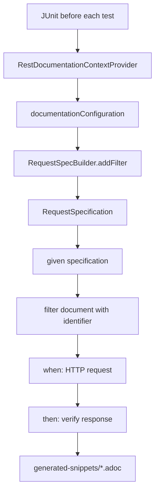

# Configuring `RequestSpecification` with `documentationConfiguration`

## 1. Why Configure `RequestSpecification`?

In **Spring REST Docs**, REST API documentation is generated from passing HTTP tests, so example requests, responses, payloads, parameters, and headers reflect the actual behavior of the application. In the **REST Assured** chapter, the bridge between the HTTP request client and Spring REST Docs is a `RequestSpecification` configured with the `documentationConfiguration(...)` filter.

`io.restassured.specification.RequestSpecification` describes shared settings when REST Assured sends requests: server host, port, base path, default headers, content types, authentication, and HTTP filters. Instead of repeating these settings for every endpoint, you build the specification during test setup and pass it to `given(...)`.

When using Spring REST Docs, there are **two filters serving two different purposes**:

| Component | Purpose |
| --- | --- |
| `documentationConfiguration(restDocumentation)` | Configures the documentation recording environment for REST Assured; typically attached to a shared `RequestSpecification`. |
| `document("identifier", ...)` | Specifies which request should generate documentation, the snippet directory name, and the descriptors to document; typically attached on each individual HTTP test. |

Adding `documentationConfiguration(...)` **does not automatically generate documentation for every request**. The test must also call `document(...)`, execute a real request, and pass.



## 2. Required Dependencies and Imports

Examples in this guide use **Spring Boot 3.x**, **JUnit Jupiter (JUnit 5)**, and REST Assured. When the project's dependency versions are managed by the Spring Boot BOM, you can declare them with Gradle:

```groovy
dependencies {
    testImplementation 'org.springframework.boot:spring-boot-starter-test'
    testImplementation 'io.rest-assured:rest-assured'
    testImplementation 'org.springframework.restdocs:spring-restdocs-restassured'
}

tasks.named('test') {
    useJUnitPlatform()
}
```

With Maven, the three artifacts above should have `<scope>test</scope>`; versions must be managed by an appropriate BOM/parent or declared explicitly. In a project that does not use Spring Boot, you can still combine REST Assured and Spring REST Docs with JUnit Jupiter, provided there is an HTTP server to send requests to and a valid `RestDocumentationContextProvider`.

The key APIs are:

```java
import io.restassured.builder.RequestSpecBuilder;
import io.restassured.specification.RequestSpecification;
import org.springframework.restdocs.RestDocumentationContextProvider;

import static org.springframework.restdocs.restassured.RestAssuredRestDocumentation.documentationConfiguration;
import static org.springframework.restdocs.restassured.RestAssuredRestDocumentation.document;
```

`RestDocumentationContextProvider` is provided by Spring REST Docs' test integration. With JUnit 5, apply `@ExtendWith(RestDocumentationExtension.class)` on the test class; the extension can inject the provider into the `@BeforeEach` method parameter.

## 3. Basic Configuration with `RequestSpecBuilder`

Here is the core configuration:

```java
private RequestSpecification specification;

@BeforeEach
void setUp(RestDocumentationContextProvider restDocumentation) {
    this.specification = new RequestSpecBuilder()
            .setBaseUri("http://localhost")
            .setPort(port)
            .setBasePath("/api")
            .addHeader("Accept", "application/json")
            .addFilter(documentationConfiguration(restDocumentation))
            .build();
}
```

Here, `port` is the HTTP port the application is actually listening on; the complete example below retrieves it via `@LocalServerPort`. What each line does:

1. `new RequestSpecBuilder()` begins configuring a new request specification.
2. `setBaseUri("http://localhost")` sets the server address; suitable for integration tests running locally.
3. `setPort(port)` targets the port used by the test server.
4. `setBasePath("/api")` adds the `/api` prefix for paths called from tests, allowing tests to use `/books/{id}` instead of repeating `/api/books/{id}`.
5. `addHeader("Accept", "application/json")` requests JSON from the server via HTTP content negotiation.
6. `addFilter(documentationConfiguration(restDocumentation))` connects REST Assured to the current test's Spring REST Docs context.
7. `build()` returns a `RequestSpecification` that can be passed directly into `given(...)`.

**Important:** `documentationConfiguration(...)` comes from a static import on `RestAssuredRestDocumentation`, not a method on `RequestSpecBuilder`. It is `addFilter(...)` that registers this configuration in REST Assured's filter chain.

The base URI and base path settings are just examples. If a test calls an API on an already-running server, use the actual hostname/port of the test environment. If the project does not have an `/api` prefix, do not call `setBasePath("/api")`.

## 4. Complete Integration Example: Documenting a GET Endpoint

Suppose a Spring Boot application has an endpoint `GET /api/books/{id}`; for `id = 42`, it returns HTTP 200 with JSON:

```json
{
  "id": 42,
  "title": "Spring REST Docs",
  "available": true
}
```

The following test both verifies the HTTP response and generates documentation from the actual request:

```java
import io.restassured.builder.RequestSpecBuilder;
import io.restassured.http.ContentType;
import io.restassured.specification.RequestSpecification;
import org.junit.jupiter.api.BeforeEach;
import org.junit.jupiter.api.Test;
import org.junit.jupiter.api.extension.ExtendWith;
import org.springframework.boot.test.context.SpringBootTest;
import org.springframework.boot.test.web.server.LocalServerPort;
import org.springframework.restdocs.RestDocumentationContextProvider;
import org.springframework.restdocs.RestDocumentationExtension;

import static io.restassured.RestAssured.given;
import static org.hamcrest.Matchers.equalTo;
import static org.springframework.restdocs.payload.PayloadDocumentation.fieldWithPath;
import static org.springframework.restdocs.payload.PayloadDocumentation.responseFields;
import static org.springframework.restdocs.request.RequestDocumentation.parameterWithName;
import static org.springframework.restdocs.request.RequestDocumentation.pathParameters;
import static org.springframework.restdocs.restassured.RestAssuredRestDocumentation.document;
import static org.springframework.restdocs.restassured.RestAssuredRestDocumentation.documentationConfiguration;

@SpringBootTest(webEnvironment = SpringBootTest.WebEnvironment.RANDOM_PORT)
@ExtendWith(RestDocumentationExtension.class)
class BookRestAssuredDocumentationTest {

    @LocalServerPort
    private int port;

    private RequestSpecification specification;

    @BeforeEach
    void setUp(RestDocumentationContextProvider restDocumentation) {
        this.specification = new RequestSpecBuilder()
                .setBaseUri("http://localhost")
                .setPort(port)
                .setBasePath("/api")
                .addHeader("Accept", "application/json")
                .addFilter(documentationConfiguration(restDocumentation))
                .build();
    }

    @Test
    void getBookGeneratesDocumentation() {
        given(this.specification)
                .accept(ContentType.JSON)
                .filter(document("books-get",
                        pathParameters(
                                parameterWithName("id")
                                        .description("ID of the book to retrieve")),
                        responseFields(
                                fieldWithPath("id").description("Book ID"),
                                fieldWithPath("title").description("Book title"),
                                fieldWithPath("available")
                                        .description("Whether the book is available"))))
        .when()
                .get("/books/{id}", 42)
        .then()
                .statusCode(200)
                .body("id", equalTo(42))
                .body("title", equalTo("Spring REST Docs"));
    }
}
```

**Key points to note:**

- `@SpringBootTest(webEnvironment = RANDOM_PORT)` starts the embedded HTTP server on a random port to avoid port conflicts; `@LocalServerPort` injects that port into the `port` field.
- `@ExtendWith(RestDocumentationExtension.class)` sets up the documentation generation context for JUnit 5; `@BeforeEach` receives the provider bound to each test run.
- `.addFilter(documentationConfiguration(restDocumentation))` is configured **once on the per-test specification**, so requests using that specification have the REST Docs environment enabled.
- `.filter(document("books-get", ...))` is attached only to the request you want to generate snippets for; `books-get` is the snippet directory name.
- `.get("/books/{id}", 42)` combines the `/api` base path and argument `42` to call `/api/books/42`. Once base path is configured, do not add `/api` again in `.get(...)`.
- `pathParameters(...)` and `responseFields(...)` document the path parameter and JSON fields. Spring REST Docs validates these descriptors against the recorded exchange; if the JSON or documentation does not match, the test can fail.

The example above is an **integration test with preconditions**: the application must actually expose the endpoint and corresponding data. If responses are randomly generated or read from a mutable database, prepare deterministic fixtures so assertions always pass. The `@LocalServerPort` import in the example belongs to Spring Boot 3.x; for other Spring Boot versions, use that release line's corresponding API.

## 5. Reusing the Specification Across Multiple Endpoints

Once `this.specification` is configured in `@BeforeEach`, you can reuse the shared configuration across multiple tests:

```java
@Test
void getBooks() {
    given(this.specification)
            .filter(document("books-list"))
    .when()
            .get("/books")
    .then()
            .statusCode(200);
}

@Test
void getBookById() {
    given(this.specification)
            .filter(document("books-get"))
    .when()
            .get("/books/{id}", 42)
    .then()
            .statusCode(200);
}
```

Both tests share the same server configuration and filter setup but have **distinct identifiers**, `books-list` and `books-get`. This keeps snippets organized by API operation. If you need to document the path parameter for `getBookById`, add `pathParameters(...)` as shown in the full example above.

Besides `given(this.specification)`, REST Assured also allows `given().spec(this.specification)`. Both serve the same purpose: applying the defined configuration to the current request. For example:

```java
given()
        .spec(this.specification)
        .filter(document("books-list"))
.when()
        .get("/books")
.then()
        .statusCode(200);
```

Create a fresh specification in `@BeforeEach` rather than storing a `static` `RequestSpecification` shared across test classes. This ensures settings such as server port, filters, and documentation context stay accurate for each test execution, especially when running tests in parallel.

## 6. Configuring Headers, Bodies, and Request-Specific Details

`RequestSpecification` should hold values that are genuinely shared. Elements specific to a single API can be placed directly on the `given(...)` call:

```java
given(this.specification)
        .contentType(ContentType.JSON)
        .header("X-Request-Id", "docs-test-001")
        .body("{\"title\":\"Spring REST Docs\"}")
        .filter(document("books-create"))
.when()
        .post("/books")
.then()
        .statusCode(201);
```

This snippet illustrates request configuration for a hypothetical `POST /api/books` endpoint; the application must support the endpoint and return HTTP 201 for the test to pass. `contentType(ContentType.JSON)` specifies the **request body** media type, whereas `accept(ContentType.JSON)` or the `Accept` header specifies the expected response media type. They are not interchangeable.

When documenting headers and payloads, add the appropriate descriptors to `document(...)`:

```java
.filter(document("books-create",
        requestHeaders(
                headerWithName("X-Request-Id")
                        .description("Request tracking ID")),
        requestFields(
                fieldWithPath("title")
                        .description("Title of the book to create"))))
```

The additional static imports needed for this example are `RequestDocumentation.requestHeaders`, `RequestDocumentation.headerWithName`, and `PayloadDocumentation.requestFields`/`fieldWithPath`. Only document headers and fields that are actually present in the corresponding request; for optional headers or payloads with varying structure, use appropriate descriptor options rather than writing inaccurate descriptions.

**Do not include sensitive data in public snippets.** For tokens, session cookies, and personal data, use dummy test data or Spring REST Docs preprocessing features to remove/mask sensitive information before generating documentation. Never hard-code real credentials in tests or documentation examples.

## 7. Locating and Using Generated Snippets

After a test containing `document("books-get", ...)` passes, depending on your build and Spring REST Docs configuration, the typical output paths are:

```text
build/generated-snippets/books-get/       # Gradle
target/generated-snippets/books-get/      # Maven
```

Common snippets include:

| File | Contents |
| --- | --- |
| `http-request.adoc` | Human-readable HTTP request. |
| `http-response.adoc` | Received HTTP response. |
| `curl-request.adoc` | Equivalent `curl` command example. |
| `path-parameters.adoc` | Path parameter description table if `pathParameters(...)` was used. |
| `response-fields.adoc` | Response JSON description table if `responseFields(...)` was used. |

Depending on version and configuration, the generated snippet set may vary. From the generated directory, you can include snippets in an Asciidoctor document:

```asciidoc
= Books API

== Get Book

=== Request
include::{snippets}/books-get/http-request.adoc[]

=== Path parameters
include::{snippets}/books-get/path-parameters.adoc[]

=== Response fields
include::{snippets}/books-get/response-fields.adoc[]
```

The build must configure `{snippets}` to point to the actual snippet directory. In CI, enforce the order **run HTTP tests -> generate snippets -> compile Asciidoctor/Markdown documentation -> publish**. Do not publish snippets from an older run when current tests fail.

## 8. Common Configuration Errors and Fixes

| Symptom | Possible Cause | How to Check and Fix |
| --- | --- | --- |
| Cannot find `documentationConfiguration` | Missing `spring-restdocs-restassured` or imported from the wrong class. | Check test dependencies and the static import `RestAssuredRestDocumentation.documentationConfiguration`. |
| `RestDocumentationContextProvider` is not provided | `RestDocumentationExtension` not registered for JUnit 5 or JUnit configuration is incorrect. | Add `@ExtendWith(RestDocumentationExtension.class)` and ensure JUnit Jupiter runs the tests. |
| HTTP test runs but no snippets are created | Only used `documentationConfiguration(...)` without `document(...)`, or checking the wrong output directory. | Add `filter(document("..."))` to the request to document and check `generated-snippets`. |
| Error when using `document(...)` | Request lacks REST Docs configuration or filters were overwritten when creating another specification. | Ensure the request uses the specification that has `documentationConfiguration(...)`. |
| HTTP 404 even though endpoint exists | `setBasePath("/api")` combined with `.get("/api/...")` duplicates the prefix, or wrong host/port. | Inspect the final URL; use `.get("/books/{id}", 42)` (without `/api`) when base path is `/api`. |
| `Connection refused` | Test server not running or `setPort(...)` does not match the actual port. | Combine `RANDOM_PORT` with `@LocalServerPort`, or verify an external server is listening. |
| Test fails when documenting response | Field/parameter names in `responseFields(...)` or `pathParameters(...)` do not match actual HTTP traffic. | Inspect the actual response/request and update descriptors or fix the endpoint to match the API contract. |
| Snippets from different tests overwrite each other | Tests use duplicate identifiers or share configuration state during parallel execution. | Use distinct identifiers per endpoint/scenario and initialize the specification per test. |

When debugging, verify **three layers separately**: whether dependencies are loaded, whether REST Assured sends the right URL and receives the expected HTTP response, and whether the REST Docs filter writes snippets under the expected name. If an earlier layer is broken, fix it before troubleshooting the documentation generation step.

## 9. Practice Checklist

- [ ] `rest-assured`, `spring-restdocs-restassured`, and JUnit platform are on the test classpath.
- [ ] Enabled REST Docs integration via `RestDocumentationExtension` and injected `RestDocumentationContextProvider`.
- [ ] Created `RequestSpecification` with appropriate base URI, port, base path, and headers.
- [ ] Attached `.addFilter(documentationConfiguration(restDocumentation))` before calling `build()`.
- [ ] Passed that specification into `given(...)` and attached `document("identifier", ...)` to requests to document.
- [ ] Verified actual responses and saw `.adoc` files in `generated-snippets`.
- [ ] Ordered snippet generation before documentation compilation in build/CI if publishing API docs.

A properly configured `RequestSpecification` provides the foundation for writing concise, consistent REST Assured tests that produce verifiable documentation with Spring REST Docs. Once the `documentationConfiguration(...)` filter is in place, you can expand `document(...)` to describe request bodies, response bodies, path/query parameters, and headers for each API contract.
