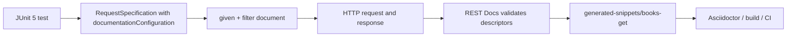

# REST Assured: Using `.filter(document(...))` to Generate API Documentation

## 1. Purpose and Placement of `document(...)`

In **Spring REST Docs**, REST API documentation is generated from HTTP exchanges that take place inside tests. This allows example requests, responses, and data descriptions to be verified alongside API behavior. Spring REST Docs integrates with **MockMvc**, **WebTestClient**, or **REST Assured**; this section focuses on REST Assured.

When using REST Assured, the key call is:

```java
given(this.specification)
        .filter(document("books-get"))
.when()
        .get("/books/42")
.then()
        .statusCode(200);
```

`document(...)` is a static method on `org.springframework.restdocs.restassured.RestAssuredRestDocumentation`. It returns a documentation filter for REST Assured; `.filter(...)` registers that filter on the request being built. When REST Assured executes the HTTP request, the filter captures the HTTP exchange and Spring REST Docs generates AsciiDoc **snippets** in the configured documentation output directory.

| Component | Role |
| --- | --- |
| `given(...)` | Starts request configuration and applies the shared `RequestSpecification`. |
| `.filter(document("books-get"))` | Marks the request for documentation and sets the snippet group identifier to `books-get`. |
| `.when().get(...)` | Executes the real HTTP exchange. |
| `.then().statusCode(200)` | Verifies API behavior with assertions. |

**Do not confuse the two filters:** `documentationConfiguration(restDocumentation)` configures the **documentation context** for REST Assured; `document("identifier", ...)` specifies **which request will be documented** and which descriptive snippets to generate. In standard practice, the configuration filter is added in `@BeforeEach`, while the `document` filter is added in each individual test.



Note: the filter may process the HTTP exchange before assertions in `.then()` finish. Therefore, **the mere presence of a snippet file does not mean the test passed**. To publish reliable documentation, the pipeline must require the corresponding tests to succeed.

## 2. Prerequisites Before Calling `document(...)`

In a Spring Boot project using a BOM for version management, you need the dependencies in **test scope**. Gradle Groovy DSL example:

```groovy
dependencies {
    testImplementation 'org.springframework.boot:spring-boot-starter-test'
    testImplementation 'io.rest-assured:rest-assured'
    testImplementation 'org.springframework.restdocs:spring-restdocs-restassured'
}

tasks.named('test') {
    useJUnitPlatform()
}
```

If using Maven, declare the corresponding artifacts with `<scope>test</scope>`. When not using the Spring Boot BOM or another dependency management mechanism, you must provide compatible versions. Avoid arbitrarily mixing incompatible release lines of Spring REST Docs, REST Assured, and Spring Boot.

Next, create a `RequestSpecification` with the REST Docs configuration filter. With JUnit Jupiter, `RestDocumentationExtension` provides `RestDocumentationContextProvider` for each test run:

```java
@SpringBootTest(webEnvironment = SpringBootTest.WebEnvironment.RANDOM_PORT)
@ExtendWith(RestDocumentationExtension.class)
class BookDocumentationTest {

    @LocalServerPort
    int port;

    RequestSpecification specification;

    @BeforeEach
    void setUp(RestDocumentationContextProvider restDocumentation) {
        this.specification = new RequestSpecBuilder()
                .setBaseUri("http://localhost")
                .setPort(port)
                .setBasePath("/api")
                .addFilter(documentationConfiguration(restDocumentation))
                .build();
    }
}
```

The skeleton above requires imports from Spring Boot Test, JUnit 5, REST Assured, and Spring REST Docs as shown in the complete example below. `@LocalServerPort` in the example uses the Spring Boot 3.x import path. The `port` value must come from the server the test actually starts; if testing an API running elsewhere, adjust the base URI and port accordingly.

In this context, `setBasePath("/api")` causes `.get("/books/{id}")` to call `/api/books/{id}`. Do not repeat `/api` in individual request paths.

## 3. `document(...)` Syntax and Snippet Descriptors

### 3.1. Minimal Syntax

```java
.filter(document("books-list"))
```

The first parameter is the **identifier**. The identifier is used as the subdirectory name for the snippets, for example:

```text
build/generated-snippets/books-list/http-request.adoc
build/generated-snippets/books-list/http-response.adoc
```

For Maven, the default location is typically `target/generated-snippets`. Build configuration can specify a different path. Default snippets typically include `curl-request.adoc`, `http-request.adoc`, `http-response.adoc`, `httpie-request.adoc`, `request-body.adoc`, and `response-body.adoc`; exact filenames and file sets depend on the Spring REST Docs version and configuration.

Identifiers should be meaningful and stable, such as `books-list`, `books-get`, `books-create`, or `books-get-not-found`. Do not reuse the same identifier across different tests running in parallel, as output may be overwritten or become hard to distinguish. Avoid putting random data into identifiers if Asciidoctor documents need to reference the directory by a fixed name.

### 3.2. Syntax with HTTP Element Descriptors

```java
.filter(document("books-get",
        pathParameters(
                parameterWithName("id").description("ID of the book to retrieve")),
        responseFields(
                fieldWithPath("id").description("Book ID"),
                fieldWithPath("title").description("Book title"))))
```

Descriptors allow Spring REST Docs to generate additional documentation tables and validate the corresponding data structures. Common descriptor groups include:

| Data Type | Descriptor API | Typical Snippet |
| --- | --- | --- |
| Path parameter | `pathParameters(parameterWithName(...))` | `path-parameters.adoc` |
| Query parameter | `queryParameters(parameterWithName(...))` (REST Docs 3.x) | `query-parameters.adoc` |
| Request header | `requestHeaders(headerWithName(...))` | `request-headers.adoc` |
| Response header | `responseHeaders(headerWithName(...))` | `response-headers.adoc` |
| JSON request body | `requestFields(fieldWithPath(...))` | `request-fields.adoc` |
| JSON response body | `responseFields(fieldWithPath(...))` | `response-fields.adoc` |

These methods reside in their respective classes: `RequestDocumentation` for parameters; `HeaderDocumentation` for headers; and `PayloadDocumentation` for fields. Do not mistakenly import `requestHeaders` from `RequestDocumentation`: header APIs belong to `HeaderDocumentation`.

In older Spring REST Docs versions, documenting query/form parameters may use `requestParameters(...)` instead of `queryParameters(...)`. Verify the API matching your project's library version.

By default, `responseFields(...)` and `requestFields(...)` validate descriptors against the payload content. When a field is undocumented or a required documented field is missing, snippet generation can fail the test. You can use `.optional()` for genuinely optional fields, `.ignored()` for fields to exclude from the table, or `relaxed...Fields(...)` variants when intentionally allowing extra fields beyond the documented list.

## 4. Full Example: GET Book by ID

Suppose a running API exposes `GET /api/books/{id}`. When receiving `id = 42`, the server returns HTTP 200, `Content-Type: application/json`, and the response:

```json
{
  "id": 42,
  "title": "Spring REST Docs",
  "available": true
}
```

Below is a JUnit 5 integration test using REST Assured, attaching the `document(...)` filter and documenting the result:

```java
import io.restassured.builder.RequestSpecBuilder;
import io.restassured.http.ContentType;
import io.restassured.specification.RequestSpecification;
import org.junit.jupiter.api.BeforeEach;
import org.junit.jupiter.api.Test;
import org.junit.jupiter.api.extension.ExtendWith;
import org.springframework.boot.test.context.SpringBootTest;
import org.springframework.boot.test.web.server.LocalServerPort;
import org.springframework.restdocs.RestDocumentationContextProvider;
import org.springframework.restdocs.RestDocumentationExtension;

import static io.restassured.RestAssured.given;
import static org.hamcrest.Matchers.equalTo;
import static org.springframework.restdocs.payload.PayloadDocumentation.fieldWithPath;
import static org.springframework.restdocs.payload.PayloadDocumentation.responseFields;
import static org.springframework.restdocs.request.RequestDocumentation.parameterWithName;
import static org.springframework.restdocs.request.RequestDocumentation.pathParameters;
import static org.springframework.restdocs.restassured.RestAssuredRestDocumentation.document;
import static org.springframework.restdocs.restassured.RestAssuredRestDocumentation.documentationConfiguration;

@SpringBootTest(webEnvironment = SpringBootTest.WebEnvironment.RANDOM_PORT)
@ExtendWith(RestDocumentationExtension.class)
class BookDocumentationTest {

    @LocalServerPort
    private int port;

    private RequestSpecification specification;

    @BeforeEach
    void setUp(RestDocumentationContextProvider restDocumentation) {
        this.specification = new RequestSpecBuilder()
                .setBaseUri("http://localhost")
                .setPort(port)
                .setBasePath("/api")
                .addFilter(documentationConfiguration(restDocumentation))
                .build();
    }

    @Test
    void documentGetBook() {
        given(this.specification)
                .accept(ContentType.JSON)
                .pathParam("id", 42)
                .filter(document("books-get",
                        pathParameters(
                                parameterWithName("id")
                                        .description("ID of the book to retrieve")),
                        responseFields(
                                fieldWithPath("id").description("Book ID"),
                                fieldWithPath("title").description("Book title"),
                                fieldWithPath("available")
                                        .description("Whether the book is currently available"))))
        .when()
                .get("/books/{id}")
        .then()
                .statusCode(200)
                .body("id", equalTo(42))
                .body("title", equalTo("Spring REST Docs"));
    }
}
```

Step-by-step execution of the test:

1. `@SpringBootTest(RANDOM_PORT)` starts the server for the test; `@LocalServerPort` supplies the connection port.
2. `RestDocumentationExtension` creates the REST Docs context; `@BeforeEach` uses it to add `documentationConfiguration(...)` to the specification.
3. `given(this.specification)` applies the host, port, base path, and configuration filter; `.pathParam("id", 42)` sets the value substituted into the URL.
4. `.filter(document("books-get", ...))` registers the documentation filter for this call, along with path parameter and JSON response descriptors.
5. `.when().get("/books/{id}")` sends a request to `http://localhost:<port>/api/books/42`; the filter captures the HTTP exchange and processes snippets.
6. `.then().statusCode(200).body(...)` verifies that the API returns the expected data; assertions are independent of descriptor declarations and both should be verified.

The example only passes when the application actually provides the matching endpoint and data. Load fixtures or create deterministic test data; do not assume `id = 42` if the test environment does not guarantee that book exists.

With a typical Gradle setup, you can inspect the output directory:

```text
build/generated-snippets/books-get/
  curl-request.adoc
  http-request.adoc
  http-response.adoc
  path-parameters.adoc
  response-fields.adoc
  ...
```

`path-parameters.adoc` and `response-fields.adoc` appear because the test declared the corresponding descriptors. Other snippets depend on defaults and configuration. The existence of snippet files alone does not prove the documentation is accurate; inspect both test results and file contents.

## 5. Documenting POST: Request Body and Headers

`document(...)` also applies to `POST`, `PUT`, `PATCH`, and `DELETE`. For example, a hypothetical `POST /api/books` endpoint accepting JSON with a `title` field and an `X-Trace-Id` header and returning HTTP 201:

```java
given(this.specification)
        .contentType(ContentType.JSON)
        .accept(ContentType.JSON)
        .header("X-Trace-Id", "docs-123")
        .body("{\"title\":\"Spring REST Docs\"}")
        .filter(document("books-create",
                requestHeaders(
                        headerWithName("X-Trace-Id")
                                .description("Request tracking ID")),
                requestFields(
                        fieldWithPath("title")
                                .description("Title of the book to create"))))
.when()
        .post("/books")
.then()
        .statusCode(201);
```

This example requires the following additional static imports:

```java
import static org.springframework.restdocs.headers.HeaderDocumentation.headerWithName;
import static org.springframework.restdocs.headers.HeaderDocumentation.requestHeaders;
import static org.springframework.restdocs.payload.PayloadDocumentation.fieldWithPath;
import static org.springframework.restdocs.payload.PayloadDocumentation.requestFields;
```

`Content-Type` describes the **request body** media type sent to the server; `Accept` indicates the response media type the client expects. In this example, only `X-Trace-Id` and the `title` field are documented. If you want to include `Content-Type` in the request headers table, add a `headerWithName("Content-Type")` descriptor and verify the actual request headers. When the API returns JSON, you can also add `responseFields(...)` to document the response payload.

For requests containing sensitive data such as `Authorization`, cookies, or passwords, use only dummy values in tests. If the documentation will be published, configure appropriate `OperationPreprocessor` instances to remove or mask sensitive data before writing snippets. Publicly exposed data in documentation must be vetted like any other published artifact.

## 6. Combining Multiple Snippets, Identifiers, and Preprocessing

A single `document(...)` call can accept multiple descriptors. For instance, with `GET /api/books/{id}?lang=vi`, you can document the path parameter, query parameter, and response simultaneously:

```java
given(this.specification)
        .pathParam("id", 42)
        .queryParam("lang", "vi")
        .filter(document("books-get-localized",
                pathParameters(
                        parameterWithName("id").description("Book ID")),
                queryParameters(
                        parameterWithName("lang").description("Language code")),
                responseFields(
                        fieldWithPath("id").description("Book ID"),
                        fieldWithPath("title").description("Book title"),
                        fieldWithPath("available").description("Availability status"))))
.when()
        .get("/books/{id}")
.then()
        .statusCode(200);
```

This example is for versions that provide `RequestDocumentation.queryParameters`; static imports for `queryParameters` and `parameterWithName` are required. Depending on the actual API, you can omit `queryParam` or adjust the payload/descriptors. Ensure descriptor names match the request actually sent and the response received.

If you need to normalize how JSON is formatted in snippets, Spring REST Docs provides preprocessors such as `preprocessRequest(prettyPrint())` and `preprocessResponse(prettyPrint())`. Depending on the `document(...)` overloads in your version, you can pass both preprocessors along with descriptors:

```java
.filter(document("books-get",
        preprocessRequest(prettyPrint()),
        preprocessResponse(prettyPrint()),
        responseFields(
                fieldWithPath("id").description("Book ID"),
                fieldWithPath("title").description("Book title"),
                fieldWithPath("available").description("Availability status"))))
```

This requires static imports `preprocessRequest`, `preprocessResponse`, and `prettyPrint` from `org.springframework.restdocs.operation.preprocess.Preprocessors`. `prettyPrint()` handles presentation; passing tests still depend on assertions and correct response data. When testing multiple endpoints, keep identifiers distinct so the documentation is easy to navigate and files do not overwrite each other.

## 7. Including Snippets into Documentation and Build/CI

Spring REST Docs generates AsciiDoc snippets rather than a complete standalone documentation page. For example, `src/docs/asciidoc/api.adoc` can include snippets from the test in Section 4:

```asciidoc
= Books API

== Get Book by ID

=== HTTP request
include::{snippets}/books-get/http-request.adoc[]

=== Path parameters
include::{snippets}/books-get/path-parameters.adoc[]

=== Response fields
include::{snippets}/books-get/response-fields.adoc[]

=== HTTP response
include::{snippets}/books-get/http-response.adoc[]
```

The Asciidoctor `{snippets}` attribute must be configured to point to `build/generated-snippets` or `target/generated-snippets` depending on the project. You can use Markdown for authoring and configure build tooling to insert snippets, but default REST Docs snippet files use AsciiDoc syntax, so inserting them verbatim into Markdown requires an appropriate processing step.

The build/CI workflow should enforce this order:

```text
JUnit/REST Assured tests
        ↓
Spring REST Docs document filters
        ↓
generated-snippets/*.adoc
        ↓
Asciidoctor (or equivalent documentation compilation step)
        ↓
Published documentation
```

Do not reuse outputs from a previous run if current tests fail. Publishing criteria should require both the documentation-generating HTTP tests and the documentation compilation step to pass.

## 8. Distinguishing Common Errors

| Symptom | Root Cause to Check | Resolution |
| --- | --- | --- |
| IDE cannot find `document(...)` | Missing dependency or missing static import. | Add `spring-restdocs-restassured` in test scope; import `RestAssuredRestDocumentation.document`. |
| Test runs but no snippets appear | Request lacks `document(...)`, configuration filter is missing, or checking the wrong output directory. | Verify both `documentationConfiguration(...)` and `.filter(document(...))` on the request; check the actual output directory. |
| `document(...)` reports documentation context error | `RequestSpecification` does not include configuration from `RestDocumentationContextProvider`. | Register `RestDocumentationExtension` and `addFilter(documentationConfiguration(restDocumentation))` in `@BeforeEach`. |
| Test fails due to undocumented field | `requestFields(...)`/`responseFields(...)` is missing a descriptor or field name does not match JSON. | Inspect the actual payload; add/fix descriptors or use `.optional()` when data is genuinely optional. |
| Missing `path-parameters.adoc` | Test did not declare `pathParameters(...)` or URL template was not recognized properly. | Check the `/books/{id}` URI template, how path parameters are passed, and the descriptors. |
| Snippet data collides across cases | Multiple tests share the same identifier, especially during parallel runs. | Name identifiers by endpoint and scenario, e.g. `books-get-200`, `books-get-404`. |
| Snippet files appear yet CI is still red | Filter writes snippets before HTTP assertions or descriptor validation completes. | Check the test results; never rely on file existence to conclude success. |
| API returns 404 instead of 200 | Base path is duplicated in the URL or fixture data does not exist. | Check base URI, port, base path, URI template, and test data. |

### Pre-Completion Checklist

- [ ] REST Assured, JUnit Jupiter, and `spring-restdocs-restassured` are on the test classpath.
- [ ] `RestDocumentationExtension` provides `RestDocumentationContextProvider` and `RequestSpecification` includes `documentationConfiguration(...)`.
- [ ] Each endpoint to be documented has `.filter(document("identifier", ...))` attached to its request.
- [ ] Descriptors such as `pathParameters`, `queryParameters`, `requestHeaders`, `requestFields`, or `responseFields` accurately reflect the actual HTTP traffic.
- [ ] Tests verify status codes and important business values, and pass.
- [ ] `generated-snippets` contains the required files and `include::{snippets}/...[]` directives reference the right identifiers.
- [ ] Build/CI runs tests before compiling and publishing documentation.

`filter(document(...))` is the entry point for attaching **documentation descriptors to individual HTTP requests** in REST Assured. Combined with `RequestSpecification`, `documentationConfiguration(...)`, and accurate assertions, it enables verifiable documentation generation for requests, responses, payloads, parameters, and headers directly within Spring REST Docs tests.
