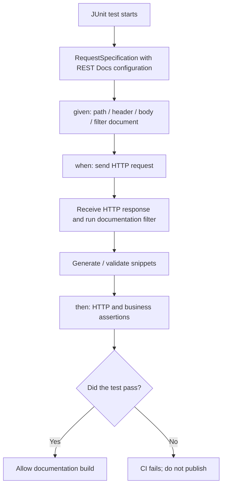
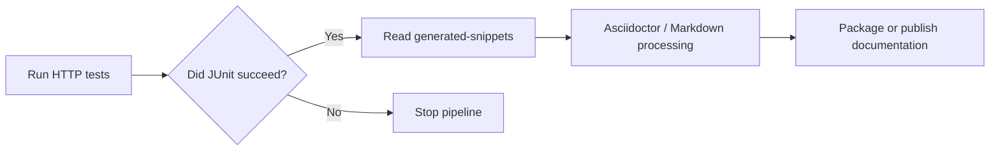

# Ordering Requests, Assertions, and `document` Properly with REST Assured

## 1. Standard Order for Testing and Generating Documentation

**Spring REST Docs** generates REST API documentation from HTTP tests, ensuring that example requests, responses, payloads, parameters, and headers are verified alongside the API. Spring REST Docs supports **MockMvc**, **WebTestClient**, and **REST Assured**; this article focuses on how to order calls in REST Assured so you send requests, generate snippets, and verify outcomes properly.

In REST Assured syntax, the standard pattern is:

```java
given(this.specification)
        .pathParam("id", 42)
        .filter(document("books-get"))
.when()
        .get("/books/{id}")
.then()
        .statusCode(200);
```

There are **two kinds of ordering to distinguish**:

1. **Writing order in the DSL:** `given(...)` to prepare the request and attach filters; `when()` to execute the HTTP call; `then()` to make assertions on the response.
2. **Execution order:** the `document(...)` filter is registered during request preparation, yet actually processes the HTTP exchange when the request is sent and the response is received. Assertions in `then()` typically run afterward. Consequently, a snippet may be written **before a later assertion fails**.



Key point: **placing `.filter(document(...))` before `when()` is right**, even though conceptually you want the response verified before publishing documentation. Release gating belongs in the test outcome and the build/CI pipeline, not by trying to move `document(...)` after `.then()`.

## 2. Where Each Call Belongs and What It Is Responsible For

| Placement | Contents | Why It Belongs Here |
| --- | --- | --- |
| `@BeforeEach` | Build `RequestSpecification` with `documentationConfiguration(restDocumentation)` | Prepares the Spring REST Docs context and shared HTTP configuration for the test. |
| `given(...)` | URI parameters, query parameters, headers, content type, request body | All of these represent data configured **before sending the request**. |
| `given(...).filter(document(...))` | Snippet name and descriptors to document | The filter must be registered before executing the request so it can observe the request/response pair. |
| `when().get/post/...` | Send HTTP request and receive response | This is where the real HTTP exchange takes place. |
| `then().statusCode/...` | Assertions on status, headers, and returned content | Verifies the API contract and business outcomes once the response arrives. |
| Post-test Build/CI | Collect snippets, run Asciidoctor/Markdown pipeline | Only consumes documentation from tests that passed. |

For example, `document("books-get", responseFields(...))` both requests snippet generation and validates JSON fields against the descriptors. It **does not replace** `.statusCode(200)` or `.body("id", equalTo(42))`: an API could have the right JSON fields while returning the wrong HTTP status or business values.

## 3. Preparing Dependencies and `RequestSpecification`

The examples below use **Spring Boot 3.x, JUnit Jupiter, and REST Assured**. If the project already uses the Spring Boot BOM/parent for dependency management, you can declare in `build.gradle`:

```groovy
dependencies {
    testImplementation 'org.springframework.boot:spring-boot-starter-test'
    testImplementation 'io.rest-assured:rest-assured'
    testImplementation 'org.springframework.restdocs:spring-restdocs-restassured'
}

tasks.named('test') {
    useJUnitPlatform()
}
```

With Maven, use the corresponding artifacts in `<scope>test</scope>`. Without a BOM/parent managing versions, declare compatible versions aligned across Spring Boot, Spring REST Docs, and REST Assured. These dependencies are for testing only; they do not need to be deployed to production runtime just to generate API documentation.

`documentationConfiguration(...)` and `document(...)` are both static methods on `RestAssuredRestDocumentation`, serving two distinct roles:

```java
import static org.springframework.restdocs.restassured.RestAssuredRestDocumentation.documentationConfiguration;
import static org.springframework.restdocs.restassured.RestAssuredRestDocumentation.document;
```

In JUnit 5, register `RestDocumentationExtension` and receive `RestDocumentationContextProvider` in `@BeforeEach`. Create a fresh `RequestSpecification` for each test to ensure the right HTTP port and documentation context:

```java
@BeforeEach
void setUp(RestDocumentationContextProvider restDocumentation) {
    this.specification = new RequestSpecBuilder()
            .setBaseUri("http://localhost")
            .setPort(this.port)
            .setBasePath("/api")
            .addFilter(documentationConfiguration(restDocumentation))
            .build();
}
```

In this setup, the configuration filter is attached once to the specification; in each test, the `document(...)` filter is attached to **the request to be documented**. Do not share a mutable specification across tests running in parallel.

## 4. Complete GET Example: Configure -> Document -> Request -> Assert

Suppose the application exposes `GET /api/books/{id}`. For ID `42`, the endpoint returns HTTP 200, `Content-Type: application/json`, and JSON:

```json
{
  "id": 42,
  "title": "Spring REST Docs",
  "available": true
}
```

Full integration test example:

```java
import io.restassured.builder.RequestSpecBuilder;
import io.restassured.http.ContentType;
import io.restassured.specification.RequestSpecification;
import org.junit.jupiter.api.BeforeEach;
import org.junit.jupiter.api.Test;
import org.junit.jupiter.api.extension.ExtendWith;
import org.springframework.boot.test.context.SpringBootTest;
import org.springframework.boot.test.web.server.LocalServerPort;
import org.springframework.restdocs.RestDocumentationContextProvider;
import org.springframework.restdocs.RestDocumentationExtension;

import static io.restassured.RestAssured.given;
import static org.hamcrest.Matchers.equalTo;
import static org.springframework.restdocs.payload.PayloadDocumentation.fieldWithPath;
import static org.springframework.restdocs.payload.PayloadDocumentation.responseFields;
import static org.springframework.restdocs.request.RequestDocumentation.parameterWithName;
import static org.springframework.restdocs.request.RequestDocumentation.pathParameters;
import static org.springframework.restdocs.restassured.RestAssuredRestDocumentation.document;
import static org.springframework.restdocs.restassured.RestAssuredRestDocumentation.documentationConfiguration;

@SpringBootTest(webEnvironment = SpringBootTest.WebEnvironment.RANDOM_PORT)
@ExtendWith(RestDocumentationExtension.class)
class BookApiDocumentationTest {

    @LocalServerPort
    private int port;

    private RequestSpecification specification;

    @BeforeEach
    void setUp(RestDocumentationContextProvider restDocumentation) {
        this.specification = new RequestSpecBuilder()
                .setBaseUri("http://localhost")
                .setPort(this.port)
                .setBasePath("/api")
                .addFilter(documentationConfiguration(restDocumentation))
                .build();
    }

    @Test
    void getBookProducesVerifiedDocumentation() {
        given(this.specification)
                // Step 1: define the request before sending
                .accept(ContentType.JSON)
                .pathParam("id", 42)
                // Step 2: register the REST Docs filter and descriptors
                .filter(document("books-get",
                        pathParameters(
                                parameterWithName("id")
                                        .description("ID of the book to view")),
                        responseFields(
                                fieldWithPath("id").description("Book ID"),
                                fieldWithPath("title").description("Book title"),
                                fieldWithPath("available")
                                        .description("Whether the book is available"))))
        .when()
                // Step 3: execute the HTTP request
                .get("/books/{id}")
        .then()
                // Step 4: assertions after receiving the response
                .statusCode(200)
                .contentType(ContentType.JSON)
                .body("id", equalTo(42))
                .body("title", equalTo("Spring REST Docs"))
                .body("available", equalTo(true));
    }
}
```

Detailed walkthrough:

1. `RANDOM_PORT` starts the embedded server; `@LocalServerPort` provides the actual port. `@BeforeEach` builds the specification with base path `/api`.
2. `given(this.specification)` applies the server and REST Docs configuration; `.pathParam("id", 42)` supplies the URL variable before sending the request.
3. `.filter(document("books-get", ...))` registers the filter and documents the path parameter as well as all known response fields.
4. `.when().get("/books/{id}")` sends `GET /api/books/42`; do not repeat the `/api` prefix since base path already includes it.
5. The Spring REST Docs filter generates the snippets and validates descriptors when processing the HTTP exchange.
6. `.then()` asserts status 200, JSON content type, and concrete values; the test passes only when all these checks succeed.

The endpoint and JSON are **hypothetical data for learning purposes**. To run this test in a real project, implement the endpoint and prepare fixtures guaranteeing that book `42` exists. The `@LocalServerPort` import above uses the Spring Boot 3.x API; use the matching import if your project targets another release line.

## 5. POST Example: Verifying Body and Documenting Request/Response

For `POST`, payloads and headers must also be declared **before `when()`**. Suppose `POST /api/books` receives:

```http
POST /api/books HTTP/1.1
Content-Type: application/json
Accept: application/json
X-Trace-Id: docs-test-1

{"title":"Spring REST Docs"}
```

The hypothetical API returns HTTP 201 and JSON `{"id":100,"title":"Spring REST Docs"}`. You can add the following test to the class in Section 4, along with static imports from `HeaderDocumentation` and `PayloadDocumentation`:

```java
import static org.springframework.restdocs.headers.HeaderDocumentation.headerWithName;
import static org.springframework.restdocs.headers.HeaderDocumentation.requestHeaders;
import static org.springframework.restdocs.payload.PayloadDocumentation.requestFields;
```

```java
@Test
void createBookProducesVerifiedDocumentation() {
    given(this.specification)
            // The request must be complete before when()
            .contentType(ContentType.JSON)
            .accept(ContentType.JSON)
            .header("X-Trace-Id", "docs-test-1")
            .body("{\"title\":\"Spring REST Docs\"}")
            .filter(document("books-create",
                    requestHeaders(
                            headerWithName("X-Trace-Id")
                                    .description("Request trace ID")),
                    requestFields(
                            fieldWithPath("title")
                                    .description("Title of the book to create")),
                    responseFields(
                            fieldWithPath("id").description("New book ID"),
                            fieldWithPath("title").description("New book title"))))
    .when()
            .post("/books")
    .then()
            // Verify HTTP outcome after executing the request
            .statusCode(201)
            .contentType(ContentType.JSON)
            .body("title", equalTo("Spring REST Docs"));
}
```

`requestHeaders(...)` documents headers; `requestFields(...)` and `responseFields(...)` document payloads. In Spring REST Docs, header descriptors belong to `org.springframework.restdocs.headers.HeaderDocumentation`, not `RequestDocumentation`. If the server returns additional fields in the response JSON, `responseFields(...)` by default requires documenting those fields as well or adjusting descriptors appropriately.

`contentType(ContentType.JSON)` sets the request body media type; `accept(ContentType.JSON)` indicates the expected response media type. They serve different purposes. If the server-generated ID is not fixed, assert the existence/type of the ID or use an appropriate matcher instead of hard-coding `100` in the test. The example above intentionally avoids asserting a specific ID to avoid depending on database sequences.

## 6. Error-Prone Arrangements

### 6.1. Trying to Place `document(...)` After `then()`

```java
// Wrong idea: at this point the request has already been sent and the response is being asserted.
given(this.specification)
.when()
        .get("/books/42")
.then()
        .statusCode(200);

// You cannot attach a filter to the request that was just sent by chaining
// .filter(document(...)) at the end of the assertion chain above.
```

`.filter(...)` configures the request; it must appear while building the request, before calling `when().get(...)` or `when().post(...)`. After `then()` is the `ValidatableResponse` assertion stage; you cannot go back and register a filter for an already-completed request.

### 6.2. Adding Only `documentationConfiguration(...)` and Forgetting `document(...)`

```java
given(this.specification)
.when()
        .get("/books/42")
.then()
        .statusCode(200);
```

This test may pass, but it does not request snippet generation under any specific identifier. Add `.filter(document("books-get"))` before `when()` on the request to document. Conversely, `document(...)` also requires the request to have a valid REST Docs context attached via `documentationConfiguration(...)`.

### 6.3. Treating Documentation as Sufficient Assertion

```java
given(this.specification)
        .filter(document("books-get"))
.when()
        .get("/books/42");
```

The request can still generate snippets even without checking status codes or business outcomes. Always add `.then().statusCode(...)` and assertions for critical data. With `requestFields(...)`/`responseFields(...)` descriptors, Spring REST Docs checks payload structure; that does not guarantee correct status codes, business formatting, or authorization.

### 6.4. Reusing an Identifier Across Different Scenarios

```java
// In a test returning HTTP 200:
given(this.specification)
        .filter(document("books-get-200"))
.when()
        .get("/books/{id}", 42)
.then()
        .statusCode(200);

// In a separate test returning HTTP 404:
given(this.specification)
        .filter(document("books-get-404"))
.when()
        .get("/books/{id}", 999)
.then()
        .statusCode(404);
```

These two chains illustrate **two independent tests**; sample data must ensure ID `42` exists and ID `999` does not. Do not attach two `document(...)` filters to the same request. If two tests share the same identifier, especially in parallel runs, snippets can be overwritten or reflect an unintended scenario. Use consistent naming by method, endpoint, and scenario (`books-get-200`, `books-get-404`, `books-create-201`).

## 7. What Happens When an Assertion or Descriptor Fails?

| Scenario | Outcome to Understand | Action |
| --- | --- | --- |
| HTTP returns 404 while test expects 200 | `statusCode(200)` fails; some snippets may already have been written by the filter. | Fix the API/fixture or assertion per the desired contract; CI must not publish docs from failing tests. |
| HTTP 200 but JSON lacks documented `title` | `responseFields(...)` can fail when the filter processes the response. | Inspect the actual response, fix the API or descriptor; only use `.optional()` when the field is truly optional. |
| HTTP 200 but `title` returns wrong value | Descriptors may pass, yet `.body("title", equalTo(...))` fails. | Keep business assertions; never rely solely on snippet generation. |
| `document(...)` is present but no snippet directory appears | REST Docs may not be configured, the request never executed, or the output directory differs. | Check `RestDocumentationExtension`, `documentationConfiguration`, output path, and test results. |
| Snippets were generated yet CI is red | The filter may run before assertions or fail during documentation processing. | Check JUnit reports before running Asciidoctor and publishing docs. |

Snippets are **intermediate artifacts of a single test run**. The reliable condition for using them is that the entire test run succeeded. If the framework or build retains snippets from an earlier run, ensure published artifacts come only from the current build output so stale docs never mask failures.

## 8. From HTTP Tests to Asciidoctor/Markdown Docs and CI

If the test in Section 4 passes, the snippet directory typically looks like:

```text
build/generated-snippets/books-get/    # Gradle, using the common default directory
  http-request.adoc
  http-response.adoc
  curl-request.adoc
  path-parameters.adoc
  response-fields.adoc

target/generated-snippets/books-get/   # Maven, common default directory
```

Actual names and locations depend on version and build configuration. Include snippets into an Asciidoctor document using the `{snippets}` attribute pointing to the output directory:

```asciidoc
= Books API

== Get Book by ID

=== Request
include::{snippets}/books-get/http-request.adoc[]

=== Path parameters
include::{snippets}/books-get/path-parameters.adoc[]

=== Response fields
include::{snippets}/books-get/response-fields.adoc[]

=== Response
include::{snippets}/books-get/http-response.adoc[]
```

The order in **documentation** can be chosen for reader convenience; the execution order in **tests** remains `given -> when -> then`. If you want to author in Markdown, you need tooling to process/transform `.adoc` contents appropriately; do not assume Markdown understands Asciidoctor `include::` directives out of the box.

In CI, configure task dependencies:



With Gradle, the Asciidoctor compilation task should depend on `test` (or a dedicated snippet-generating test task). With Maven, configure plugins so snippet generation runs before documentation compilation in the lifecycle. Do not configure the pipeline to ignore test failures and still publish documentation.

## 9. Practice Verifying Order and Checklist

Work through these steps on an API test with stable fixtures:

1. Attach `documentationConfiguration(...)` to `RequestSpecification` during test setup.
2. Write a GET test with `.pathParam(...)`, `.filter(document("books-get", ...))`, `.when().get(...)`, and `.then().statusCode(...).body(...)`.
3. Run the test, inspect the snippets in `generated-snippets`, and compare HTTP request/response against the real API.
4. Temporarily change `.statusCode(200)` to an incorrect code to see that **the test fails even though snippets may already have been written**. Restore the correct assertion before finishing.
5. Temporarily mis-describe a response field to observe that descriptors also participate in validation. Restore the descriptor to match the API.
6. Only when tests pass, run the documentation compilation step and verify `include::{snippets}/...[]` directives work.

Final checklist:

- [ ] Configured REST Docs properly on `RequestSpecification` before sending HTTP requests.
- [ ] Placed all request parameters, headers, and body inside `given(...)`.
- [ ] Attached `.filter(document("identifier", ...))` **before** `when()`.
- [ ] Sent requests with `when().get/post/put/delete(...)` using the right host, base path, and URI.
- [ ] Asserted status codes and key business values inside `then()`.
- [ ] Documented payloads, parameters, and headers matching real data; gave each scenario a distinct identifier.
- [ ] Confirmed tests pass before compiling snippets and publishing documentation.

The order to remember is **prepare request and `document` -> execute HTTP -> assert response -> publish only when tests pass**. This arrangement enables Spring REST Docs and REST Assured to jointly protect the REST API contract: documentation is generated from real HTTP traffic while tests verify both data structure and business behavior.
